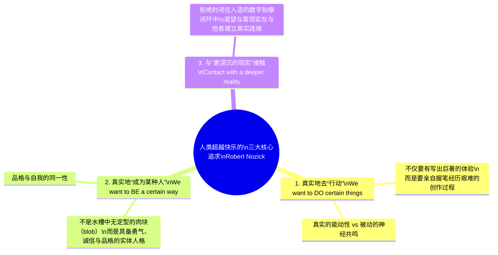

## 引言：至高幸福胶囊的终极诱惑

设想一项集成了神经科学、生物工程与超级计算的终极发明：<strong>“体验机（The Experience Machine）”</strong>。

这台机器的参数设定极其完美：
- 你静静躺在一个注满营养液的恒温水槽中，大脑皮层连接着无痛且极度精密的神经电极。
- 超级计算机直接刺激你的大脑神经突触，完美模拟出你所渴望的“任何体验”。
- 你可以体验成为写出不朽巨著的文学大师、成功登顶珠穆朗玛峰的探险家、与灵魂伴侣相伴一生的幸福恋人，或是受万人敬仰的领袖。
- <strong>至关重要的一点是：在机器内部时，你完全忘记了自己身处机器之中。</strong> 对你而言，这种体验与现实百分之百毫无二致。所有痛苦、绝望与孤独均被事先剔除，你所体验到的是纯度极高的成就感、快乐与爱意。
- 每隔两年，你可以浮出水面10分钟，挑选未来两年的全新精彩人生程序。

现在，神经科学家向你提出这个哲学拷问：

> <strong>“你愿意将自己的余生永远接入这台体验机中吗？”</strong>

如果你毫不犹豫地回答“愿意”，那么你是一名彻底的<strong>快乐主义者（Hedonist）</strong>。
然而，绝大多数人在面临这个诱人的抉择时，内心都会涌起强烈的抗拒，最终选择拒绝：“不，我不想接入。哪怕现实充满坎坷与痛苦，我也要活在真实的世界里。”

为什么我们会拒绝终生无忧的完美幸福？如果主观体验在质感上完全相同，客观“现实”究竟具有何种不可替代的价值？

1974年，美国哲学家<strong>罗伯特·诺齐克（Robert Nozick）</strong>在主著《无政府、国家与乌托邦》中提出了这个思想实验，对伦理学中根深蒂固的快乐主义教条给予了致命一击。

---

## 1. 思想史背景：快乐主义的心理状态说

### 1.1 边沁与密尔的功利主义
从古希腊的伊壁鸠鲁学派，到近代的杰里米·边沁（Jeremy Bentham）与约翰·斯图尔特·密尔（John Stuart Mill），快乐主义主张：
- <strong>唯一具有内在善（Intrinsically good）的事物是快乐；唯一具有内在恶的事物是痛苦。</strong>
- <strong>心理状态主义（Mental State Theory of Well-being）</strong>：任何事物对人的福祉（Well-being）是否有益，完全取决于其对主体主观心理体验产生的影响。

根据该学说，只要两个人在主观意识状态上拥有相同的快乐与满足感，无论一个是真正拯救苍生的英雄，还是浸泡在水槽里的躯体，<strong>两者的生命福祉在哲学评价上必须完全等价</strong>。诺齐克的思想实验正是为了揭示这一推论的荒谬性。

---

## 2. 诺齐克提炼的“三大非快乐主义真实价值”

诺齐克深刻分析指出，人们拒绝接入体验机，是因为人类所渴望的远不止主观神经电脉冲带来的快感，而是如下<strong>三种核心价值</strong>：

### 2.1 我们想要真实地去“做”某些事（To DO）
我们不只是想要“登顶珠峰的感受”，我们想要的是<strong>真正用自己的双腿踩碎冰雪、克服缺氧、战胜恐惧而登顶</strong>。在机器里，我们没有做任何事，我们只是被迫接受代码喂养的被动受体。

### 2.2 我们想要真实地“成为某种人”（To BE）
浸泡在水槽里的生物算是什么样的人？他勇敢吗？善良吗？诚实吗？诺齐克犀利地指出：<strong>他什么都不是，他只是一滩漂浮在营养液中的无定型肉块（an indeterminate blob）。</strong> 接入体验机等同于某种形式的“人格自杀”。

### 2.3 我们渴望与“更深沉的现实”建立接触（Contact with reality）
人类有着对本体论真实性（Authenticity）的原始渴望。我们希望我们的信念对应于世界的事实，我们的爱意对应于另一个真正拥有自由意志的心灵。

---

## 3. 实验哲学与“现状偏见”的反驳

2010年，哲学家费利佩·德·布里加德（Felipe De Brigard）利用实验哲学（x-phi）颠倒了诺齐克的前提：
> “如果科学家告诉你：你现在的平庸生活其实一直在体验机中。现在你可以选择拔掉插头回到艰苦贫困的‘真正现实’，还是抹去记忆回到现在的虚拟生活中？”

实验显示，<strong>过半数的受试者选择留在虚拟世界中不拔插头</strong>！这表明人们对诺齐克体验机的拒绝，很大程度上并非出于对“现实”的崇高追求，而是行为经济学中的<strong>现状偏见（Status Quo Bias）</strong>与损失规避心理。

---

## 4. 查尔默斯的“虚拟实在论”与元宇宙

当代心灵哲学泰斗大卫·查尔默斯（David J. Chalmers）在《现实+》（Reality+, 2022）中提出了彻底颠覆诺齐克的<strong>虚拟实在论（Virtual Realism）</strong>：
- 虚拟世界不是虚妄的假象，数字对象是真实存在的数据结构。
- 在一个允许多人自由互动的开放式虚拟宇宙中，人们依然在真实地行动、真实地创造社会关系、真实地塑造品格。诺齐克所批判的只是“预设的单机被动电影”，而非真正的具身交互式元宇宙。

---

## 5. 决策论下的效用函数形式化

令个人的主观心理体验为 $\mathbf{e} \in \mathcal{E}$，客观物理现实状态为 $\mathbf{w} \in \mathcal{W}$。

快乐主义效用函数仅依赖主观体验：
$$U_{\text{Hed}}(\mathbf{e}, \mathbf{w}) = h(\mathbf{e})$$

而诺齐克式的现实主义效用函数引入了<strong>真实对应度 $\Phi(\mathbf{e}, \mathbf{w})$</strong> 与 <strong>主体能动性 $\mathcal{A}(\mathbf{w})$</strong>：
$$U_{\text{Real}}(\mathbf{e}, \mathbf{w}) = h(\mathbf{e}) + \alpha \Phi(\mathbf{e}, \mathbf{w}) + \beta \mathcal{A}(\mathbf{w})$$

在体验机中，$\Phi \to 0$ 且 $\mathcal{A} = 0$。只要人类对真理与主体性的加权系数 $\alpha, \beta$ 足够大，拒绝接入体验机便是严格理性的最优解。

---

## 6. 结论：为什么我们需要不完美的现实

现实往往充满遗憾、疾病与离别。但正如苏珊·沃尔夫（Susan Wolf）所言，生命的有意义性在于“主观的投入与客观价值的交融”。

拒绝体验机的插头，是人类拒绝沦为人工饲养的幸福牲畜，是选择以脆弱、不完美但充满尊严的姿态，在这广袤冰冷的客观宇宙中，亲自书写属于自己生命的真实史诗。
---

## 7. 电影《黑客帝国》中塞弗的选择与人类脆弱性

在1999年的经典科幻电影《黑客帝国》（The Matrix）中，反叛军叛徒塞弗（Cypher）在豪华虚拟餐厅中与史密斯探员密会时，用叉子切下一块多汁的牛排并说道：
> “我知道这块牛排并不存在。我知道当我把它放进嘴里时，母体正向我的大脑发送信号，告诉我它鲜美多汁。但九年来我明白了一件事：无知即是福（Ignorance is bliss）。”

塞弗的要求是：抹去记忆，成为富有且重要的演员重新接入母体。这构成了对诺齐克英雄主义的最严峻质问。当真实世界只剩下冰冷的营养糊与死亡威胁时，对“客观真理”的坚守是否会沦为一种不人道的教条？诺齐克的崇高感正是在塞弗的疲惫与绝望中，显露出了真实人性的复杂裂痕。

---

## 8. 苏珊·沃尔夫与生命意义的双重维度

当代伦理学家苏珊·沃尔夫（Susan Wolf）在《生命的意义》（Meaning in Life）中提出：
$$\text{生命的意义} = \text{主观的热情投入 (Subjective attraction)} + \text{客观的真实价值 (Objective attractiveness)}$$

体验机中的人虽然拥有极致的主观热情，但其生命与客观世界毫无真实关联，因此其生命意义的数学积为零。人类拒绝体验机，正是因为我们追求的不仅是孤立的“幸福感”，而是与外部世界发生真实碰撞的“有意义的生命”。
---

## 9. 诺齐克的补遗：“变身机”与“结果机”

诺齐克进一步提出了另外两台机器来深化论证：
1. <strong>变身机（The Transforming Machine）</strong>：一键将你重塑为任何你渴望的人格（如极具勇气或深度仁爱）。人类依然会拒绝它，因为我们渴望的是经过斗争与反思的真实的自我成长过程，而非机械直接赋予的品行作弊码。
2. <strong>结果机（The Resulting Machine）</strong>：从水槽中直接指挥并改变外部现实世界，消除贫困与疾病。即使如此，将一切外包给机器依然剥夺了我们作为个体的独特生命能动性与存在意义。
