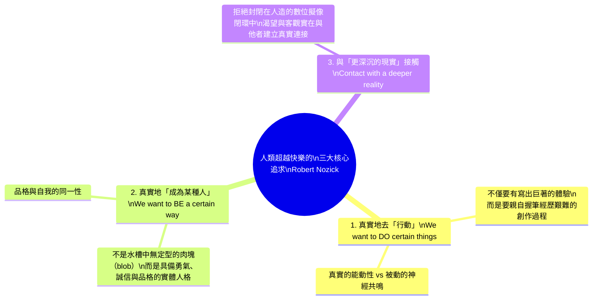

## 引言：至高幸福膠囊的終極誘惑

設想一項集成了神經科學、生物工程與超級計算的終極發明：<strong>「體驗機（The Experience Machine）」</strong>。

這台機器的參數設定極其完美：
- 你靜靜躺在一個注滿營養液的恆溫水槽中，大腦皮層連接著無痛且極度精密的微神經電極。
- 超級電腦直接刺激你的大腦神經突觸，完美模擬出你所渴望的「任何體驗」。
- 你可以體驗成為寫出不朽巨著的文學大師、成功登頂聖母峰的探險家、與靈魂伴侶相伴一生的幸福戀人，或是受萬人敬仰的英雄。
- <strong>至關重要的一點是：在機器內部時，你完全忘記了自己身處機器之中。</strong> 對你而言，這種體驗與現實百分之百毫無二致。所有痛苦、絕望與孤獨均被事先剔除，你所體驗到的是純度極高的成就感、快樂與愛意。
- 每隔兩年，你可以浮出水面10分鐘，挑選未來兩年的全新精彩人生程序。

現在，神經科學家向你提出這個哲學拷問：

> <strong>「你願意將自己的餘生永遠接入這台體驗機中嗎？」</strong>

如果你毫不猶豫地回答「願意」，那麼你是一名徹底的<strong>快樂主義者（Hedonist）</strong>。
然而，絕大多數人在面臨這個誘人的抉擇時，內心都會湧起強烈的抗拒，最終選擇拒絕：「不，我不想接入。哪怕現實充滿坎坷與痛苦，我也要活在真實的世界裡。」

為什麼我們會拒絕終生無憂的完美幸福？如果主觀體驗在質感上完全相同，客觀「現實」究竟具有何種不可替代的價值？

1974年，美國哲學家<strong>羅伯特·諾齊克（Robert Nozick）</strong>在主著《無政府、國家與烏托邦》中提出了這個思想實驗，對倫理學中根深蒂固的快樂主義教條給予了致命一擊。

---

## 1. 思想史背景：快樂主義的心理狀態說

### 1.1 邊沁與密爾的功利主義
從古希臘的伊壁鳩魯學派，到近代的邊沁（Jeremy Bentham）與約翰·斯圖爾特·密爾（John Stuart Mill），快樂主義主張：
- <strong>唯一具有內在善（Intrinsically good）的事物是快樂；唯一具有內在惡的事物是痛苦。</strong>
- <strong>心理狀態主義（Mental State Theory of Well-being）</strong>：任何事物對人的福祉（Well-being）是否有益，完全取決於其對主體主觀心理體驗產生的影響。

根據該學說，只要兩個人在主觀意識狀態上擁有相同的快樂與滿足感，無論一個是真正拯救蒼生的英雄，還是浸泡在水槽裡的軀體，<strong>兩者的生命福祉在哲學評價上必須完全等價</strong>。諾齊克的思想實驗正是為了揭示這一推論的荒謬性。

---

## 2. 諾齊克提煉的「三大非快樂主義真實價值」

諾齊克深刻分析指出，人們拒絕接入體驗機，是因為人類所渴望的遠不止主觀神經電脈衝帶來的快感，而是如下<strong>三種核心價值</strong>：

### 2.1 我們想要真實地去「做」某些事（To DO）
我們不只是想要「登頂聖母峰的感受」，我們想要的是<strong>真正用自己的雙腿踩碎冰雪、克服缺氧、戰勝恐懼而登頂</strong>。在機器裡，我們沒有做任何事，我們只是被迫接受代碼餵養的被動受體。

### 2.2 我們想要真實地「成為某種人」（To BE）
浸泡在水槽裡的生物算是一家什麼樣的人？他勇敢嗎？善良嗎？誠實嗎？諾齊克犀利地指出：<strong>他什麼都不是，他只是一灘漂浮在營養液中的無定型肉塊（an indeterminate blob）。</strong> 接入體驗機等同於某種形式的「人格自殺」。

### 2.3 我們渴望與「更深沉的現實」建立接觸（Contact with reality）
人類有著對本體論真實性（Authenticity）的原始渴望。我們希望我們的信念對應於世界的事實，我們的愛意對應於另一個真正擁有自由意志的心靈。

---

## 3. 實驗哲學與「現狀偏見」的反駁

2010年，哲學家費利佩·德·布里加德（Felipe De Brigard）利用實驗哲學（x-phi）顛倒了諾齊克的前提：
如果科學家告訴你，你現在的生活其實一直在體驗機中，問你是否拔掉插頭回到貧困痛苦的真正現實。實驗顯示，<strong>過半數的受試者選擇留在虛擬世界中不拔插頭</strong>！這表明人們對諾齊克體驗機的拒絕，很大程度上受行為經濟學中的<strong>現狀偏見（Status Quo Bias）</strong>支配。

---

## 4. 查爾默斯的「虛擬實在論」與元宇宙

當代心靈哲學泰斗大衛·查爾默斯（David J. Chalmers）在《現實+》（Reality+, 2022）中提出了<strong>虛擬實在論（Virtual Realism）</strong>：
虛擬世界不是虛妄的假象，數位對象是真實存在的資訊結構。在開放式多人虛擬宇宙中，人們依然在真實地行動、真實地創造人際關係與塑造品格。

---

## 5. 結論：為什麼我們需要不完美的現實

拒絕體驗機的插頭，是人類拒絕淪為人工飼養的幸福牲畜，是選擇以脆弱、不完美但充滿尊嚴的姿態，親自書寫屬於自己生命的真實篇章。
---

## 6. 電影《駭客任務》中塞弗的選擇與人類脆弱性

在1999年的經典科幻電影《駭客任務》（The Matrix）中，叛徒塞弗（Cypher）在豪華虛擬餐廳中與史密斯幹員密會時，用叉子切下一塊多汁的牛排並說道：
> 「我知道這塊牛排並不存在。我知道當我把它放進嘴裡時，母體正向我的大腦發送信號，告訴我它鮮美多汁。但九年來我明白了一件事：無知即是福（Ignorance is bliss）。」

塞弗的要求是：抹去記憶，成為富有且重要的演員重新接入母體。這構成了對諾齊克英雄主義的最嚴峻質問。當真實世界只剩下冰冷的營養糊與死亡威脅時，對「客觀真理」的堅守是否會淪為一種不人道的教條？諾齊克的崇高感正是在塞弗的疲憊與絕望中，顯露出了真實人性的複雜裂痕。

---

## 7. 蘇珊·沃爾夫與生命意義的雙重維度

當代倫理學家蘇珊·沃爾夫（Susan Wolf）在《生命的意義》（Meaning in Life）中提出：
$$\text{生命的意義} = \text{主觀的熱情投入 (Subjective attraction)} + \text{客觀的真實價值 (Objective attractiveness)}$$

體驗機中的人雖然擁有極致的主觀熱情，但其生命與客觀世界毫無真實關聯，因此其生命意義的數學積為零。人類拒絕體驗機，正是因為我們追求的不僅是孤立的「幸福感」，而是與外部世界發生真實碰撞的「有意義的生命」。

---

## 8. 決策論下的效用函數形式化

令個人的主觀心理體驗為 $\mathbf{e} \in \mathcal{E}$，客觀物理現實狀態為 $\mathbf{w} \in \mathcal{W}$。

諾齊克式的現實主義效用函數引入了真實對應度 $\Phi(\mathbf{e}, \mathbf{w})$ 與主體能動性 $\mathcal{A}(\mathbf{w})$：
$$U_{\text{Real}}(\mathbf{e}, \mathbf{w}) = h(\mathbf{e}) + \alpha \Phi(\mathbf{e}, \mathbf{w}) + \beta \mathcal{A}(\mathbf{w})$$

在體驗機中，$\Phi \to 0$ 且 $\mathcal{A} = 0$。只要人類對真理與主體性的加權係數 $\alpha, \beta$ 足夠大，拒絕接入體驗機便是嚴格理性的最優解。
---

## 9. 諾齊克的補遺：「變身機」與「結果機」

諾齊克進一步提出了另外兩台機器來深化論證：
1. <strong>變身機（The Transforming Machine）</strong>：一鍵將你重塑為任何你渴望的人格（如極具勇氣或深度仁愛）。人類依然會拒絕它，因為我們渴望的是經過鬥爭與反省的真實的自我成長過程，而非機械直接賦予的品行作弊碼。
2. <strong>結果機（The Resulting Machine）</strong>：從水槽中直接指揮並改變外部現實世界，消除貧困與疾病。即使如此，將一切外包給機器依然剝奪了我們作為個體的獨特生命能動性與存在意義。
---

## 10. 現代科技的前沿：腦機介面、Neuralink 與模擬宇宙假說

在21世紀，體驗機已從純粹的哲學思辨轉化為嚴肅的工程學探索。隨著伊隆·馬斯克的 Neuralink 腦機介面（BCI）技術的突破，以及哲學家尼克·博斯特羅姆（Nick Bostrom）提出的「模擬假說（Simulation Hypothesis）」，人類文明正加速朝向諾齊克預言的奇點演進。

博斯特羅姆指出，如果先進文明擁有足夠的算力運行包含意識的祖先模擬，那麼統計學上我們極大概率已經生活在由超級電腦運行的模擬宇宙之中。這進一步模糊了「現實」與「體驗機」的本體論界線。然而，正如諾齊克的深邃洞察所啟示的那樣：無論我們身處何種維度的宇宙，決定我們生命價值的永遠不是演算法發配的快感，而是我們是否勇於以真誠的意志與同伴相連、承擔痛苦並創造意義。
