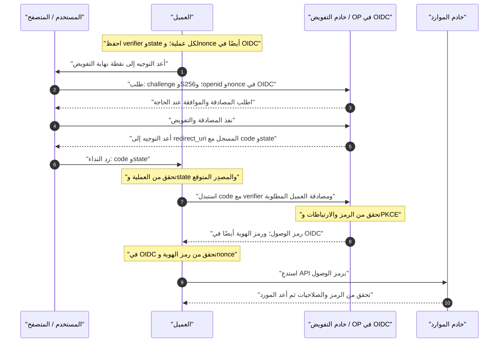

OAuth 2.0 هو إطار للتفويض يمنح التطبيقات وصولًا محدودًا. ويضيف OpenID Connect ‏(OIDC) آلية لإبلاغ العميل بنتيجة مصادقة المستخدم النهائي.

يميز هذا المقال بين المصادقة والتفويض، وأغراض الرموز، ورمز التفويض مع PKCE، والتحقق من رمز الهوية. توضح الشيفرة عمليات محددة، ولا تنفذ تسجيل دخول كاملًا. في الخدمة الفعلية، استخدم مكتبة OIDC وإعدادات مزود مناسبة لمتطلباتك.

## 1. المصادقة والتفويض

### المصادقة (Authentication / AuthN)

تتحقق المصادقة من هوية المستخدم أو النظام اعتمادًا على الأدلة المقدمة. ويمكن تشبيهها بفحص بطاقة الموظف عند استقبال الشركة.

### التفويض (Authorization / AuthZ)

يحدد التفويض العمليات التي يجوز لجهة ما تنفيذها والموارد التي يمكنها الوصول إليها. إثبات أن الشخص موظف لا يمنحه دخول جميع غرف الخوادم.

| العنصر | المصادقة | التفويض |
| --- | --- | --- |
| السؤال | من هو؟ | ما المسموح به؟ |
| الاختصار | AuthN | AuthZ |
| الآلية التي يناقشها المقال | ينقل OIDC نتيجة المصادقة | يمنح OAuth 2.0 وصولًا محدودًا |
| مثال على الرمز | رمز الهوية في OIDC | رمز الوصول في OAuth 2.0 |

لا تصدر جميع آليات المصادقة رمز هوية. ولا يحدد OAuth 2.0 كامل التحكم في الوصول داخل التطبيق. حتى بعد استلام الرمز، يجب أن تتحقق واجهة API من الصلاحيات المطلوبة للمورد والعملية المحددين.

لا يضع OAuth 2.0 وحده معيارًا لكيفية تحقق العميل من نتيجة مصادقة المستخدم النهائي. لا تعتبر تسجيل الدخول مكتملًا لمجرد استلام رمز وصول؛ استخدم بروتوكولًا مثل OIDC يتيح التحقق من تلك النتيجة.

## 2. أدوار OAuth 2.0 وأنواع المنح

### 2.1 وصول محدود

يتيح OAuth 2.0 للعميل الحصول على رمز وصول نيابة عن مالك المورد أو لحسابه الخاص. ومن خصائص تدفق رمز التفويض تفويض الوصول دون تسليم كلمة مرور المستخدم إلى العميل.

### 2.2 الأدوار الأربعة

1. **مالك المورد (Resource Owner)**: جهة يمكنها السماح بالوصول إلى مورد محمي، وليست بالضرورة شخصًا.
2. **العميل (Client)**: تطبيق يستخدم موارد محمية.
3. **خادم التفويض (Authorization Server)**: يتحقق من التفويض ومصادقة العميل وسائر شروط التدفق المستخدم، ثم يصدر الرموز.
4. **خادم الموارد (Resource Server)**: يتحقق من الرموز والصلاحيات ويوفر الموارد المحمية.

### 2.3 أنواع المنح الرئيسية

#### منحة رمز التفويض (Authorization Code Grant)

تعيد استجابة التفويض رمزًا قصير العمر، يُستبدل برمز وصول عند نقطة نهاية الرموز. يمكن لكل من **العملاء السريين (confidential clients)**، القادرين على حماية بيانات اعتمادهم على خادم، و**العملاء العامين (public clients)** مثل تطبيقات SPA والتطبيقات الأصلية استخدام هذا التدفق مع PKCE. تضمين سر العميل في شيفرة موزعة أو في المتصفح لا يحافظ على سريته.

#### المنحة الضمنية (Implicit Grant)

تعيد هذه المنحة رمز الوصول مباشرة في استجابة التفويض. تنشأ مخاطر تسرب الرموز وحقنها وإعادة استخدامها. ينص RFC 9700 على أنه ينبغي للعملاء عدم استخدامها (SHOULD NOT) إلا إذا خُففت المخاطر المحددة. اختر رمز التفويض مع PKCE للإعدادات الجديدة. ولا تفسر هذه التوصية على أنها حظر مماثل لجميع أنواع استجابات OIDC.

#### بيانات اعتماد كلمة مرور مالك المورد (ROPC)

في هذه المنحة، يتلقى العميل كلمة مرور المستخدم مباشرة. وعلى الرغم من وصفها في RFC 6749، فإن إرشادات الأمان المحدثة في RFC 9700 **تحظر استخدامها (MUST NOT)**. لا تقدم ترحيل الأنظمة القديمة بوصفه استثناءً موصى به.

#### بيانات اعتماد العميل (Client Credentials Grant)

يصادق العميل السري على هويته للحصول على رمز. ويمكنه الوصول إلى موارد تحت سيطرته أو إلى موارد مالك آخر وفق ترتيب مسبق مع خادم التفويض. يُستخدم ذلك عادة للاتصال بين الأنظمة دون تفاعل المستخدم النهائي؛ ولا يصبح العميل بالضرورة مالك المورد.

### 2.4 رمز التفويض وPKCE

يربط PKCE ‏(Proof Key for Code Exchange) العميل الذي بدأ طلب التفويض بالعميل الذي يستبدل رمز التفويض بالرموز، مما يساعد في الحماية من اعتراض رموز التفويض وحقنها. وهو إلزامي للعملاء العامين وموصى به أيضًا للعملاء السريين. ولا يحل محل مصادقة العميل المطلوبة من العميل السري.

ينشئ العميل `code_verifier` سريًا جديدًا لكل عملية تفويض. يحدد RFC 7636 طولًا من 43 إلى 128 محرفًا من الحروف اللاتينية والأرقام و`-._~`، ويوصي بإنتروبيا لا تقل عن 256 بت. ينتج عن ترميز 32 بايت من مولد عشوائي آمن تشفيريًا بصيغة Base64url دون حشو سلسلة من 43 محرفًا.

مع `S256`، تُحسب قيمة التحدي كما يلي. تُحذف محارف الحشو `=` من نهاية Base64url.

$$
\text{code\_challenge}=\operatorname{BASE64URL}\!\left(\operatorname{SHA256}\!\left(\operatorname{ASCII}(\text{code\_verifier})\right)\right)
$$

يرسل طلب التفويض `code_challenge` و`code_challenge_method=S256`، ويرسل طلب الرمز `code_verifier` المحفوظ للعملية نفسها. يتحقق الخادم منه باستخدام الطريقة وقيمة التحدي المسجلتين مع رمز التفويض. لا ترجع إلى `plain` بسبب فشل `S256`.

#### نظرة عامة على التدفق



هذه نظرة عامة على التدفق الناجح. احمِ الاتصالات باستخدام TLS. يجب أن يعالج التنفيذ أيضًا التحقق من عناوين إعادة التوجيه، واستخدام الرموز مرة واحدة، واستجابات الخطأ، وانتهاء مهلة العملية، والحماية من هجمات خلط خوادم التفويض (mix-up) عند استخدام عدة خوادم تفويض.

#### إنشاء معلمات PKCE ‏(JavaScript / Web Crypto API)

تحتاج دوال المتصفح هذه إلى سياق آمن مثل HTTPS. تعيد `generatePkce()` المعلمات فقط؛ فلا ترسل طلب التفويض ولا تحفظ العملية. لا تعرض verifier في السجلات أو عناوين URL، واربطه بالعملية التي بدأت في ذلك المتصفح ثم تخلص منه بعد التبادل أو انتهاء المهلة.

```javascript
function base64url(bytes) {
    return btoa(String.fromCharCode(...bytes))
        .replace(/\+/g, '-').replace(/\//g, '_').replace(/=+$/, '');
}

function generateCodeVerifier() {
    const bytes = new Uint8Array(32);
    crypto.getRandomValues(bytes);
    return base64url(bytes);
}

async function generateCodeChallenge(codeVerifier) {
    if (typeof codeVerifier !== 'string' ||
        codeVerifier.length < 43 || codeVerifier.length > 128 ||
        /[^A-Za-z0-9._~-]/.test(codeVerifier)) {
        throw new TypeError('Invalid PKCE verifier');
    }
    const data = new TextEncoder().encode(codeVerifier);
    const digest = await crypto.subtle.digest('SHA-256', data);
    return base64url(new Uint8Array(digest));
}

async function generatePkce() {
    const code_verifier = generateCodeVerifier();
    return {
        code_verifier,
        code_challenge: await generateCodeChallenge(code_verifier),
        code_challenge_method: 'S256'
    };
}
```

يُرمّز هذا الكود جميع بتات 32 بايت من البيانات العشوائية. كان المثال السابق يصل آخر رقمين سداسيين عشريين فقط من كل واحد من 28 عددًا صحيحًا عشوائيًا بطول 32 بت: يحصل على 896 بت، لكنه يحتفظ بـ224 بت فقط. وقد أُصلح هذا الاقتطاع.

## 3. OIDC ورموز الهوية

### 3.1 إضافة طبقة مصادقة إلى OAuth

في OIDC، يطلب العميل (Relying Party) المصادقة مع النطاق `openid`، ويعيد OpenID Provider ‏(OP) النتيجة في رمز هوية. لا يلزم أن يدخل المستخدم كلمة مرور في كل مرة؛ فقد يستخدم OP جلسة موجودة أو طريقة مصادقة أخرى.

### 3.2 فصل أغراض الرموز

- **رمز الوصول**: بيانات اعتماد للوصول إلى خادم الموارد. قد يكون JWT أو سلسلة مبهمة؛ ولا يفرض OAuth 2.0 تنسيقًا واحدًا. يجب أن يتبع العميل متطلبات API دون افتراض بنية داخلية للرمز.
- **رمز الهوية**: JWT يمثل نتيجة مصادقة موجهة إلى العميل. تحقق من التوقيع والمطالبات وارتباطه بطلب المصادقة قبل استخدامه. فك الترميز وحده غير كافٍ، ولا يجوز إرساله بدل رمز الوصول إلى API.

### 3.3 بنية JWT والتوقيعات

يشرح هذا القسم **JWS Compact Serialization** لرمز JWT موقَّع وغير مشفر، يتكون من ثلاثة أجزاء تفصلها نقاط. ويمكن أن يكون JWT مشفرًا بصيغة JWE أو متداخلًا؛ لذلك لا يتكون دائمًا من ثلاثة أجزاء.

1. **Header (الترويسة)**: حقول مثل خوارزمية التوقيع `alg` ومعرف المفتاح `kid`.
2. **Payload (الحمولة)**: مطالبات عن المصدِر والمستلمين وانتهاء الصلاحية والموضوع وغيرها.
3. **Signature (التوقيع)**: توقيع أو MAC ناتج عن الخوارزمية المحددة. يستخدم RS256 هنا توقيع RSA رقميًا.

الترويسة والحمولة مرمزتان فقط بصيغة Base64url، ولا يخفي التوقيع محتواهما. انظر أيضًا [الفروق بين التشفير والتجزئة والتوقيع]().

#### المطالبات الإلزامية الرئيسية في رمز الهوية

- `iss`: معرف مصدِر OP، ويجب أن يطابق المصدِر المتوقع تمامًا.
- `sub`: معرف مستخدم فريد ضمن ذلك المصدِر ولا يعاد تخصيصه. عند التعامل مع أكثر من OP، اجمعه مع `iss` لتحديد المستخدم.
- `aud`: المستلمون المقصودون. تحقق من احتوائه على `client_id` الخاص بالعميل، ولا تقبل مستلمين إضافيين لا يثق بهم العميل.
- `exp`: وقت انتهاء الصلاحية، ويجب أن يسبقه الوقت الحالي.
- `iat`: وقت الإصدار. تحدد سياسة العميل العمر المقبول للرمز والقيود الأخرى.

إذا أرسل طلب المصادقة قيمة `nonce`، فألزم وجود هذه المطالبة وتحقق من قيمتها. وتتطلب المطالبات الإضافية أو `max_age` فحوصًا مناسبة أيضًا.

#### مدخلات توقيع RS256

لتكن `H` الترويسة المحمية بصيغة UTF-8، و`P` الحمولة بصيغة UTF-8، و`B64u` ترميز Base64url دون حشو. مدخلات التوقيع هي تسلسل البايتات التالي؛ و`||` تعني الوصل.

$$
M=\operatorname{ASCII}\!\left(\operatorname{B64u}(H)\,||\,\texttt{.}\,||\,\operatorname{B64u}(P)\right),\qquad S=\operatorname{Sign}_{\mathrm{RS256}}(sk,M)
$$

يستخدم RS256 خوارزمية RSASSA-PKCS1-v1_5 مع SHA-256. حساب التجزئة جزء من خوارزمية التوقيع، ولا تضيف المعادلة تجزئة خارجية أخرى. الجزء الثالث من الرمز هو `B64u(S)`. تحقق من التوقيع بالمفتاح العام لمزود OP الموثوق والخوارزمية المحددة، ولا تصف التحقق من التوقيعات عمومًا بأنه فك تشفير بالمفتاح العام.

لا تسمح لرمز غير متحقق منه بتحديد الخوارزميات المسموحة أو مصدر المفاتيح. استخدم JWKS موثوقًا من إعدادات OP أو عملية Discovery تم التحقق منها، وعالج تدوير المفاتيح والتخزين المؤقت. يُستخدم `kid` للاختيار من مجموعة المفاتيح الموثوقة هذه، وليس لجلب مفاتيح من عنوان URL اعتباطي يقدمه الرمز.

#### مثال جزئي للتحقق باستخدام Python

تدعم دالة PyJWT التالية إعدادًا محدودًا: **RS256، دون تشفير، مستلم واحد ممثل بسلسلة نصية، وnonce أُرسل مسبقًا في الطلب**. يقدم الكود المستدعي `signing_key`، وهو مفتاح عام من JWKS الخاص بمزود OP الموثوق. يجب أن تكون المطالبات الإلزامية موجودة وقيمها صالحة. وإذا وُجد `azp`، فيجب في هذا الإعداد أن يطابق `client_id`.

لا تكمل هذه الدالة تسجيل الدخول. يجب أن يتحقق الكود المستدعي من ارتباط رد النداء بالعملية الأصلية وstate وتبادل الرمز والمصدِر المتوقع، وأن يدير استخدام nonce مرة واحدة. تعدد المستلمين، والتشفير، ومتطلبات المصادقة الإضافية، و`max_age` و`acr` خارج نطاق المثال.

```python
import hmac
import math
import jwt


def verify_id_token(id_token, signing_key, *, issuer, client_id, expected_nonce):
    if not isinstance(expected_nonce, str) or not expected_nonce:
        raise ValueError('A nonce from the stored transaction is required')
    claims = jwt.decode(
        id_token,
        signing_key,
        algorithms=['RS256'],
        audience=client_id,
        issuer=issuer,
        options={
            'require': ['iss', 'sub', 'aud', 'exp', 'iat', 'nonce'],
            'strict_aud': True,
        },
    )
    for name in ('exp', 'iat'):
        value = claims[name]
        if (isinstance(value, bool) or not isinstance(value, (int, float))
                or (isinstance(value, float) and not math.isfinite(value))):
            raise jwt.InvalidTokenError('Invalid NumericDate')
    subject = claims['sub']
    if (not isinstance(subject, str) or not subject or not subject.isascii()
            or len(subject) > 255):
        raise jwt.InvalidTokenError('Invalid subject')
    nonce = claims['nonce']
    if (not isinstance(nonce, str) or not hmac.compare_digest(
            nonce.encode('utf-8'), expected_nonce.encode('utf-8'))):
        raise jwt.InvalidTokenError('Nonce mismatch')
    if 'azp' in claims and claims['azp'] != client_id:
        raise jwt.InvalidTokenError('Authorized party mismatch')
    return claims
```

تعيد الدالة المطالبات المتحقق منها ضمن هذا النطاق. لا تعلن نجاح المصادقة اعتمادًا على صحة التوقيع وحدها، ولا تربط حسابات باستخدام اسم أو بريد إلكتروني لم يُتحقق منه.

## 4. اعتبارات الأمان

### 4.1 state وnonce وPKCE وCSRF

عند استخدام `state`، اربط قيمة يصعب تخمينها بأمان بالعملية التي بدأت في المتصفح. عند رد النداء، تحقق من القيمة والمهلة وأنها لم تُستخدم سابقًا، ثم علّمها كمستخدمة. تطابق السلاسل وحده لا يمنع جميع أشكال [CSRF]().

يصف RFC 9700 أيضًا الاعتماد على حماية PKCE من CSRF بعد تأكيد دعم الخادم له، واستخدام nonce في OIDC. تظل هذه الحماية بحاجة إلى ارتباط خاص بكل عملية وتحقق صحيح. تؤدي `state` و`nonce` وPKCE أدوارًا مختلفة؛ ولا توفر القيم الثابتة أو المقارنات المحذوفة الحماية المقصودة. يتطلب استخدام عدة خوادم تفويض حماية إضافية من هجمات mix-up.

### 4.2 انتهاء الصلاحية ورموز التحديث

قصر مدة صلاحية رمز الوصول وسيلة للحد من فترة استخدام رمز مسروق. قيمة مثل 15 دقيقة مثال تصميمي وليست متطلبًا عامًا. عند فحص `exp` في JWT موقَّع، يكون شرط انتهاء الصلاحية:

$$
T_{\mathrm{now}}<T_{\mathrm{exp}},\qquad T_{\mathrm{exp}}=T_{\mathrm{iat}}+D_{\mathrm{lifetime}}\ \text{فقط عند تعريفه بهذه الصورة}\ T_{\mathrm{now}}<T_{\mathrm{iat}}+D_{\mathrm{lifetime}}
$$

يفحص هذا الشرط انتهاء الصلاحية فقط، ولا يثبت صلاحية الرمز كاملة أو الإذن بالوصول. تحقق أيضًا من الخوارزمية والمفتاح والمصدِر والمستلمين، وحسب الحالة من `nbf` وحالة الإبطال والارتباط بطلب المصادقة. أدِر صراحة أي سماح بفروق التوقيت بين الساعات.

إصدار رموز التحديث اختياري. وقد يحتاج العميل دونها إلى عملية تفويض جديدة. يفرض RFC 9700 تقييد المرسل (sender constraints) أو التدوير لرموز التحديث الصادرة للعملاء العامين. يربط هذا التقييد الرمز تشفيريًا بالعميل الذي يقدمه. لا يؤدي إبطال رمز التحديث بالضرورة إلى إبطال رموز الوصول الصادرة سابقًا فورًا.

### 4.3 اختيار التدفق والتنفيذ

ابدأ برمز التفويض مع PKCE لتطبيقات الويب وSPA والتطبيقات الأصلية التي يتفاعل معها المستخدم. اختر إعدادًا يناسب نوع العميل وتخزين الرموز ودعم المزود ونموذج التهديد. ولا تفرض التدفق نفسه على أغراض أخرى، مثل بيانات اعتماد العميل لاتصالات M2M.

## الخلاصة

استخدم رموز وصول OAuth 2.0 للوصول إلى الموارد، وتحقق من رموز هوية OIDC بوصفها نتائج مصادقة موجهة إلى العميل. افحص ارتباط الرمز بـPKCE والتوقيع والمطالبات الإلزامية وnonce وعلاقة رد النداء بالعملية الأصلية.

## المراجع

- [RFC 6749: OAuth 2.0](https://www.rfc-editor.org/rfc/rfc6749.html) (الأدوار والرموز وبيانات اعتماد العميل؛ راجع RFC 9700 لإرشادات الأمان المحدثة)
- [RFC 7636: PKCE](https://www.rfc-editor.org/rfc/rfc7636.html) (القسم 4 والقسم 7.1 والملحق B)
- [RFC 9700: أمان OAuth 2.0](https://www.rfc-editor.org/rfc/rfc9700.html) (الأقسام 2.1 و2.2.2 و2.4)
- [OpenID Connect Core 1.0](https://openid.net/specs/openid-connect-core-1_0.html) (الأقسام 2 و3.1.3.7 و5.7)
- [RFC 7515: JWS](https://www.rfc-editor.org/rfc/rfc7515.html) (القسمان 3.1 و5.1)
- [PyJWT API](https://pyjwt.readthedocs.io/en/stable/api.html) (الخوارزميات المسموحة والمطالبات الإلزامية والتحقق من المستلم)
