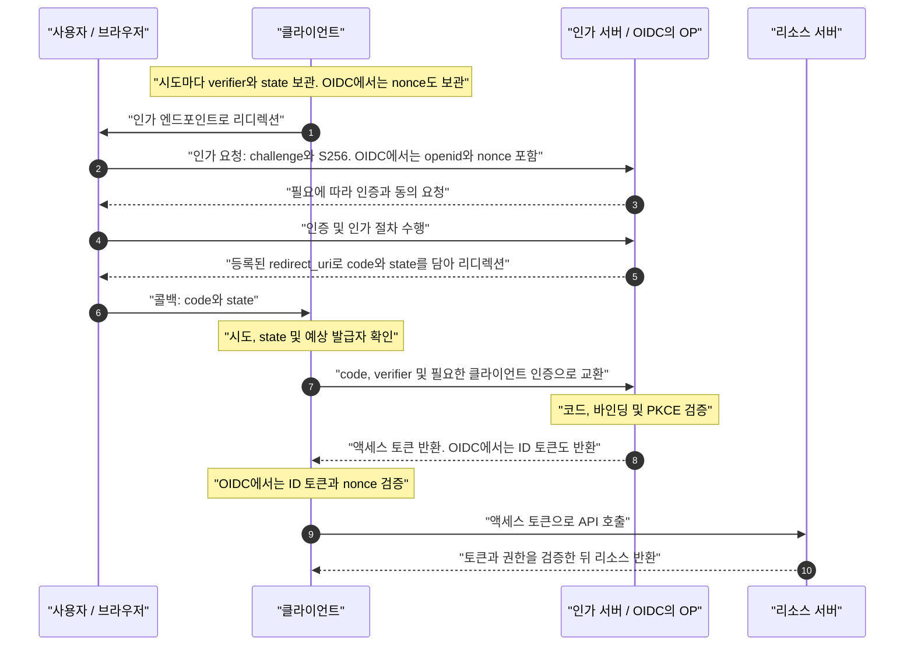

OAuth 2.0은 애플리케이션에 제한된 접근 권한을 부여하는 인가 프레임워크입니다. OpenID Connect(OIDC)는 그 위에 최종 사용자의 인증 결과를 클라이언트에 전달하는 기능을 추가합니다.

이 글에서는 인증과 인가, 토큰의 용도, 인가 코드와 PKCE, ID 토큰 검증을 구분해 설명합니다. 코드는 개별 처리 단계를 보여 주는 예시이며, 완전한 로그인 구현은 아닙니다. 실제 서비스에서는 요구 사항에 맞는 OIDC 라이브러리와 제공자 설정을 사용하세요.

## 1. 인증과 인가의 차이

### 인증(Authentication / AuthN)

인증은 제시된 증거를 바탕으로 사용자나 시스템의 신원을 확인하는 절차입니다. 회사 안내 데스크에서 사원증을 확인하는 일에 비유할 수 있습니다.

### 인가(Authorization / AuthZ)

인가는 어떤 주체에게 어떤 작업과 리소스 접근을 허용할지 결정하는 것입니다. 직원이라는 사실을 확인했더라도 모든 서버실에 들어갈 수 있는 것은 아닙니다.

| 항목 | 인증 | 인가 |
| --- | --- | --- |
| 질문 | 누구인가 | 무엇을 허용하는가 |
| 약칭 | AuthN | AuthZ |
| 이 글에서 다루는 방식 | OIDC로 인증 결과 전달 | OAuth 2.0으로 제한된 접근 권한 부여 |
| 토큰 예시 | OIDC의 ID 토큰 | OAuth 2.0의 액세스 토큰 |

모든 인증 방식이 ID 토큰을 발급하는 것은 아닙니다. OAuth 2.0이 애플리케이션 내부의 모든 접근 제어를 정의하는 것도 아닙니다. API는 토큰을 받은 뒤에도 특정 리소스와 작업에 필요한 권한을 확인해야 합니다.

OAuth 2.0 자체는 클라이언트가 최종 사용자의 인증 결과를 어떻게 확인하는지 표준화하지 않습니다. OAuth 액세스 토큰을 받았다는 사실만으로 로그인을 성립시키지 말고, OIDC처럼 인증 결과를 검증할 수 있는 프로토콜을 사용해야 합니다.

## 2. OAuth 2.0의 역할과 권한 부여 방식

### 2.1 제한된 접근 권한

OAuth 2.0에서는 클라이언트가 리소스 소유자를 대신하거나 자신을 위해 액세스 토큰을 얻습니다. 사용자 비밀번호를 클라이언트에 넘기지 않고 접근 권한을 위임할 수 있다는 점은 인가 코드 흐름의 중요한 특징입니다.

### 2.2 네 가지 역할

1. **리소스 소유자(Resource Owner)**: 보호된 리소스에 대한 접근을 허용할 수 있는 주체입니다. 반드시 사람인 것은 아닙니다.
2. **클라이언트(Client)**: 보호된 리소스를 사용하는 애플리케이션입니다.
3. **인가 서버(Authorization Server)**: 적용하는 흐름에 따라 인가, 클라이언트 인증 등의 조건을 확인하고 토큰을 발급하는 서버입니다.
4. **리소스 서버(Resource Server)**: 토큰과 접근 권한을 검증하고 보호된 리소스를 제공하는 서버입니다.

### 2.3 주요 그랜트 타입

#### 인가 코드 그랜트(Authorization Code Grant)

인가 응답에서는 유효 기간이 짧은 코드를 반환하고, 토큰 엔드포인트에서 이를 액세스 토큰과 교환합니다. 서버에서 자격 증명을 보호할 수 있는 **기밀 클라이언트(confidential client)**뿐 아니라, SPA나 네이티브 앱 같은 **공개 클라이언트(public client)**도 PKCE와 함께 사용할 수 있습니다. 배포된 앱이나 브라우저 코드에 클라이언트 시크릿을 넣어도 비밀로 유지할 수는 없습니다.

#### 암묵적 그랜트(Implicit Grant)

인가 응답에서 액세스 토큰을 직접 반환하는 방식입니다. 토큰 유출, 주입 및 재사용 위험이 있으며, RFC 9700은 명시된 위험 완화 조건을 충족하지 않으면 사용하지 않을 것을 권고합니다(SHOULD NOT). 새로운 구성에는 인가 코드와 PKCE를 선택합니다. 이 권고를 모든 OIDC 응답 타입에 대한 동일한 금지로 해석해서는 안 됩니다.

#### 리소스 소유자 비밀번호 자격 증명 그랜트(ROPC)

클라이언트가 사용자 비밀번호를 직접 받는 방식입니다. RFC 6749에는 설명되어 있지만, 갱신된 보안 지침인 RFC 9700은 **사용해서는 안 된다(MUST NOT)**고 규정합니다. 레거시 시스템 마이그레이션을 권장되는 예외로 제시하지 않습니다.

#### 클라이언트 자격 증명 그랜트(Client Credentials Grant)

기밀 클라이언트가 자신을 인증하여 토큰을 얻는 방식입니다. 자신이 관리하는 리소스나 인가 서버와 사전에 합의한 다른 리소스 소유자의 리소스에 접근할 수 있습니다. 보통 최종 사용자와의 상호작용이 없는 시스템 간 통신에 쓰이지만, 클라이언트가 반드시 리소스 소유자가 되는 것은 아닙니다.

### 2.4 인가 코드와 PKCE

PKCE(Proof Key for Code Exchange)는 인가 요청을 시작한 클라이언트와 코드를 토큰으로 교환하는 클라이언트를 연결하여, 코드 가로채기와 주입 공격을 방어하도록 돕습니다. 공개 클라이언트에는 필수이며 기밀 클라이언트에도 권장됩니다. 기밀 클라이언트에 필요한 클라이언트 인증을 대체하지는 않습니다.

클라이언트는 인가 시도마다 새로운 비밀 `code_verifier`를 생성합니다. RFC 7636은 영문자, 숫자, `-._~`로 구성된 43~128자를 지정하고, 최소 256비트의 엔트로피를 권장합니다. 암호학적으로 안전한 난수 생성기로 얻은 32바이트를 패딩 없는 Base64url로 인코딩하면 43자가 됩니다.

`S256`에서는 다음 식으로 챌린지를 계산합니다. Base64url 끝의 `=` 패딩은 붙이지 않습니다.

$$
\text{code\_challenge}=\operatorname{BASE64URL}\!\left(\operatorname{SHA256}\!\left(\operatorname{ASCII}(\text{code\_verifier})\right)\right)
$$

인가 요청에는 `code_challenge`와 `code_challenge_method=S256`을 보내고, 토큰 요청에는 같은 시도에 대해 보관한 `code_verifier`를 보냅니다. 서버는 코드와 함께 기록한 방식과 챌린지를 사용해 검증합니다. `S256`이 실패했다는 이유로 `plain`으로 전환해서는 안 됩니다.

#### 흐름 개요



성공 흐름의 개요입니다. 통신은 TLS로 보호하고, 구현에서는 리디렉션 대상 검증, 코드의 일회성 사용, 오류 응답, 시도 만료, 여러 인가 서버를 사용할 때의 mix-up 방어 등도 처리해야 합니다.

#### PKCE 매개변수 생성 예시(JavaScript / Web Crypto API)

HTTPS 같은 보안 컨텍스트에서 실행하는 브라우저용 함수입니다. `generatePkce()`는 매개변수만 반환하며, 인가 요청을 보내거나 저장 처리를 하지 않습니다. verifier를 로그나 URL에 출력하지 말고, 요청을 시작한 브라우저의 시도에 연결해 보관한 뒤 교환이 끝나거나 만료되면 폐기해야 합니다.

```javascript
function base64url(bytes) {
    return btoa(String.fromCharCode(...bytes))
        .replace(/\+/g, '-').replace(/\//g, '_').replace(/=+$/, '');
}

function generateCodeVerifier() {
    const bytes = new Uint8Array(32);
    crypto.getRandomValues(bytes);
    return base64url(bytes);
}

async function generateCodeChallenge(codeVerifier) {
    if (typeof codeVerifier !== 'string' ||
        codeVerifier.length < 43 || codeVerifier.length > 128 ||
        /[^A-Za-z0-9._~-]/.test(codeVerifier)) {
        throw new TypeError('Invalid PKCE verifier');
    }
    const data = new TextEncoder().encode(codeVerifier);
    const digest = await crypto.subtle.digest('SHA-256', data);
    return base64url(new Uint8Array(digest));
}

async function generatePkce() {
    const code_verifier = generateCodeVerifier();
    return {
        code_verifier,
        code_challenge: await generateCodeChallenge(code_verifier),
        code_challenge_method: 'S256'
    };
}
```

여기서는 난수 32바이트의 모든 비트를 인코딩합니다. 이전 예시는 32비트 난수 28개의 마지막 두 자리 16진수만 이어 붙여, 896비트를 얻고도 224비트만 남기는 방식이었으므로 수정했습니다.

## 3. OIDC와 ID 토큰

### 3.1 OAuth에 인증 계층 추가

OIDC에서 클라이언트(Relying Party)는 `openid` 범위를 포함해 인증을 요청하고, OpenID Provider(OP)는 ID 토큰으로 결과를 반환합니다. 사용자가 매번 비밀번호를 입력하는 것은 아니며, OP가 기존 세션이나 다른 인증 수단을 사용할 수도 있습니다.

### 3.2 토큰의 용도 구분

- **액세스 토큰**: 리소스 서버에 접근하기 위한 자격 증명입니다. JWT일 수도 있고 불투명한 문자열일 수도 있으며, OAuth 2.0은 하나의 형식으로 제한하지 않습니다. 클라이언트는 내부 구조를 임의로 가정하지 말고 API 명세에 따라 전송해야 합니다.
- **ID 토큰**: 클라이언트를 대상으로 인증 결과를 나타내는 JWT입니다. 서명, 클레임 및 인증 요청과의 연결을 검증한 뒤 사용합니다. 디코딩만으로는 충분하지 않으며, API용 액세스 토큰을 대신해서 보내서는 안 됩니다.

### 3.3 JWT의 구조와 서명

이 절에서는 암호화하지 않은 서명된 JWT의 **JWS Compact Serialization**을 설명합니다. 이는 점으로 구분된 세 부분으로 구성됩니다. JWT에는 암호화된 JWE나 중첩 구조도 있으므로, 항상 세 부분인 것은 아닙니다.

1. **Header(헤더)**: 서명 알고리즘 `alg`, 키 식별자 `kid` 등의 필드입니다.
2. **Payload(페이로드)**: 발급자, 대상, 만료 시각, 주체 등의 클레임입니다.
3. **Signature(서명)**: 지정된 알고리즘으로 생성한 서명이나 MAC입니다. 이 절의 RS256은 RSA 디지털 서명을 사용합니다.

헤더와 페이로드는 Base64url로 인코딩되어 있을 뿐이며, 서명은 내용을 숨기지 않습니다. [암호화·해시·서명의 차이]()도 참고하세요.

#### ID 토큰의 주요 필수 클레임

- `iss`: OP의 발급자 식별자입니다. 예상한 발급자와 정확히 일치해야 합니다.
- `sub`: 해당 발급자 내에서 고유하며 재할당되지 않는 사용자 식별자입니다. 여러 OP를 다룰 때는 `iss`와 조합해 사용자를 식별합니다.
- `aud`: ID 토큰의 수신 대상입니다. 클라이언트의 `client_id`가 포함되는지 확인하고, 신뢰하지 않는 추가 대상을 허용하지 않습니다.
- `exp`: 만료 시각입니다. 현재 시각은 이보다 이전이어야 합니다.
- `iat`: 발급 시각입니다. 허용할 토큰의 경과 시간 등은 클라이언트 정책으로 정합니다.

인증 요청에 `nonce`를 보냈다면 해당 클레임의 존재와 값의 일치도 검증해야 합니다. 추가 클레임이나 `max_age`를 요청했다면 그에 맞는 검증도 필요합니다.

#### RS256의 서명 입력

`H`를 UTF-8로 표현한 보호된 헤더, `P`를 UTF-8 페이로드, `B64u`를 패딩 없는 Base64url이라고 하면 서명 대상은 다음 바이트열입니다. `||`는 연결을 뜻합니다.

$$
M=\operatorname{ASCII}\!\left(\operatorname{B64u}(H)\,||\,\texttt{.}\,||\,\operatorname{B64u}(P)\right),\qquad S=\operatorname{Sign}_{\mathrm{RS256}}(sk,M)
$$

RS256은 RSASSA-PKCS1-v1_5와 SHA-256을 사용합니다. 해시 처리는 서명 알고리즘의 일부이며, 위 식에서 외부에 해시를 한 번 더 적용하는 것은 아닙니다. 토큰의 세 번째 부분은 `B64u(S)`입니다. 신뢰하는 OP의 공개 키와 지정된 알고리즘으로 검증해야 하며, 서명 검증을 일반적으로 “공개 키로 복호화한다”고 설명해서는 안 됩니다.

검증되지 않은 토큰에 허용 알고리즘이나 키를 가져올 위치를 맡겨서는 안 됩니다. 검증된 OP 설정이나 Discovery에서 얻은 신뢰할 수 있는 JWKS를 사용하고, 키 교체와 캐시도 처리해야 합니다. `kid`는 그 키 집합 안에서 키를 선택하는 데 쓰며, 토큰이 제공한 임의의 URL에서 키를 가져오지 않습니다.

#### Python 검증 처리의 일부

다음 PyJWT 함수는 **RS256·암호화하지 않은 토큰·문자열 하나로 표현한 audience·요청에서 nonce를 전송한 경우**라는 제한된 구성만 지원합니다. 호출자는 신뢰하는 OP의 JWKS에서 얻은 공개 키를 `signing_key`로 제공합니다. 필수 클레임은 값뿐 아니라 존재 여부도 검증합니다. `azp`가 있으면 이 구성에서는 `client_id`와 일치해야 합니다.

이 함수만으로 로그인이 완료되는 것은 아닙니다. 호출자는 콜백과 시작한 시도의 연결, state, 코드 교환, 예상 발급자, nonce의 일회성 사용을 검증하고 관리해야 합니다. 복수 audience, 암호화, 추가 인증 요구 사항, `max_age`와 `acr`를 사용하는 구성은 이 예시의 범위 밖입니다.

```python
import hmac
import math
import jwt


def verify_id_token(id_token, signing_key, *, issuer, client_id, expected_nonce):
    if not isinstance(expected_nonce, str) or not expected_nonce:
        raise ValueError('A nonce from the stored transaction is required')
    claims = jwt.decode(
        id_token,
        signing_key,
        algorithms=['RS256'],
        audience=client_id,
        issuer=issuer,
        options={
            'require': ['iss', 'sub', 'aud', 'exp', 'iat', 'nonce'],
            'strict_aud': True,
        },
    )
    for name in ('exp', 'iat'):
        value = claims[name]
        if (isinstance(value, bool) or not isinstance(value, (int, float))
                or (isinstance(value, float) and not math.isfinite(value))):
            raise jwt.InvalidTokenError('Invalid NumericDate')
    subject = claims['sub']
    if (not isinstance(subject, str) or not subject or not subject.isascii()
            or len(subject) > 255):
        raise jwt.InvalidTokenError('Invalid subject')
    nonce = claims['nonce']
    if (not isinstance(nonce, str) or not hmac.compare_digest(
            nonce.encode('utf-8'), expected_nonce.encode('utf-8'))):
        raise jwt.InvalidTokenError('Nonce mismatch')
    if 'azp' in claims and claims['azp'] != client_id:
        raise jwt.InvalidTokenError('Authorized party mismatch')
    return claims
```

반환값은 위 범위에서 검증한 클레임입니다. 서명이 올바르다는 이유만으로 “인증 성공”을 표시하거나, 검증되지 않은 이름이나 이메일 주소로 계정을 연결해서는 안 됩니다.

## 4. 보안 확인 사항

### 4.1 state·nonce·PKCE와 CSRF

`state`를 사용할 때는 예측하기 어려운 값을 요청을 시작한 브라우저의 시도에 안전하게 연결해야 합니다. 콜백에서 값의 일치, 만료 여부, 미사용 여부를 확인한 뒤 사용 처리합니다. 문자열이 일치한다는 사실만으로 모든 [CSRF]()를 막을 수 있는 것은 아닙니다.

RFC 9700은 서버의 PKCE 지원을 확인한 뒤 그 CSRF 보호에 의존할 수 있는 경우와 OIDC nonce를 사용하는 경우도 다룹니다. 이러한 보호에는 여전히 시도별 바인딩과 올바른 검증이 필요합니다. `state`, `nonce`, PKCE는 역할이 다르며, 고정값을 쓰거나 비교를 생략하면 의도한 보호를 얻을 수 없습니다. 여러 인가 서버를 다룰 때는 별도로 mix-up 방어도 필요합니다.

### 4.2 만료 조건과 리프레시 토큰

액세스 토큰의 수명을 짧게 두는 것은 탈취된 토큰을 사용할 수 있는 시간을 제한하는 한 가지 수단입니다. 15분 같은 값은 설계 예시이지 보편적인 필수 값이 아닙니다. 서명된 JWT의 `exp`를 확인할 때 만료 조건은 다음과 같습니다.

$$
T_{\mathrm{now}}<T_{\mathrm{exp}},\qquad T_{\mathrm{exp}}=T_{\mathrm{iat}}+D_{\mathrm{lifetime}}\ \text{이렇게 설정한 경우에만}\ T_{\mathrm{now}}<T_{\mathrm{iat}}+D_{\mathrm{lifetime}}
$$

이는 만료 조건만 확인하며 토큰 전체의 유효성이나 접근 권한을 증명하지 않습니다. 알고리즘, 키, 발급자, 대상과 함께, 해당하는 경우 `nbf`, 폐기 상태, 인증 요청과의 연결 등도 검증해야 합니다. 시계 오차를 허용한다면 그 범위를 명시적으로 관리해야 합니다.

리프레시 토큰 발급은 선택 사항입니다. 발급하지 않는 구성에서는 새로운 인가 시도 등이 필요할 수 있습니다. 공개 클라이언트에 발급하는 리프레시 토큰에 대해 RFC 9700은 송신자 제약(sender constraints) 또는 로테이션을 요구합니다. 송신자 제약은 토큰을 제시하는 클라이언트에 대한 암호학적 바인딩을 뜻합니다. 리프레시 토큰을 폐기해도 이미 발급된 액세스 토큰이 즉시 무효화된다고 보장할 수는 없습니다.

### 4.3 흐름과 구현 선택

사용자가 참여하는 웹·SPA·네이티브 앱에서는 인가 코드와 PKCE를 기본으로 삼고, 클라이언트 유형, 토큰 저장 위치, 제공자 지원, 위협 모델에 맞는 구성을 선택합니다. M2M용 클라이언트 자격 증명처럼 다른 용도에도 같은 흐름을 일률적으로 적용하는 것은 아닙니다.

## 요약

OAuth 2.0 액세스 토큰은 리소스 접근에 사용하고, OIDC ID 토큰은 클라이언트용 인증 결과로 검증합니다. 코드와 PKCE의 연결, 서명, 필수 클레임, nonce, 콜백과 시작한 시도의 연결을 각각 확인해야 합니다.

## 참고 명세

- [RFC 6749: OAuth 2.0](https://www.rfc-editor.org/rfc/rfc6749.html)(역할, 토큰, 클라이언트 자격 증명. 갱신된 보안 지침은 RFC 9700 참고)
- [RFC 7636: PKCE](https://www.rfc-editor.org/rfc/rfc7636.html)(4절, 7.1절, 부록 B)
- [RFC 9700: OAuth 2.0 보안 모범 사례](https://www.rfc-editor.org/rfc/rfc9700.html)(2.1절, 2.2.2절, 2.4절)
- [OpenID Connect Core 1.0](https://openid.net/specs/openid-connect-core-1_0.html)(2절, 3.1.3.7절, 5.7절)
- [RFC 7515: JWS](https://www.rfc-editor.org/rfc/rfc7515.html)(3.1절, 5.1절)
- [PyJWT API](https://pyjwt.readthedocs.io/en/stable/api.html)(허용 알고리즘, 필수 클레임, audience 검증)
