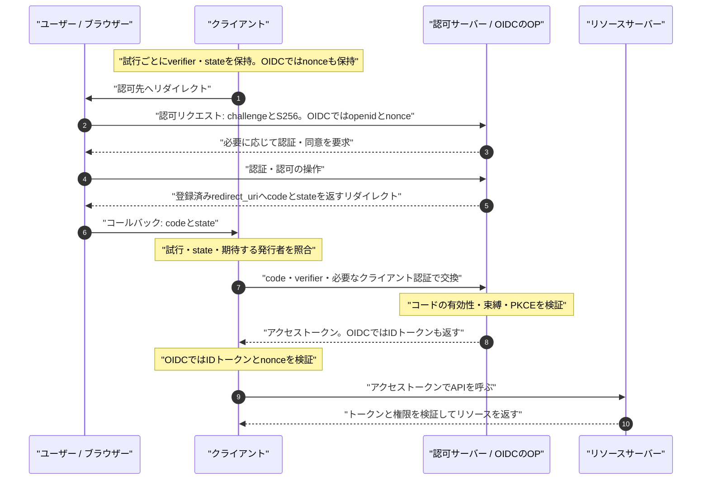

OAuth 2.0は、アプリケーションに限定的なアクセス権を与えるための認可フレームワークです。OpenID Connect（OIDC）はその上に、ユーザーの認証結果をクライアントへ伝える仕組みを加えます。

この記事では、認証と認可、トークンの用途、認可コードとPKCE、IDトークンの検証を区別して説明します。コードは個別の処理を説明する例であり、ログイン機能全体の実装ではありません。実サービスでは、要件に合ったOIDCライブラリとプロバイダーの設定を使用してください。

## 1. 認証と認可の違い

### 認証（Authentication / AuthN）

認証は、提示された証拠に基づいて、ユーザーやシステムの身元を確認する処理です。会社の受付で社員証を確認する行為に例えられます。

### 認可（Authorization / AuthZ）

認可は、ある主体にどの操作やリソースへのアクセスを許すかを決めることです。社員であることを確認できても、全員がサーバールームに入れるわけではありません。

| 項目 | 認証 | 認可 |
| --- | --- | --- |
| 問い | 誰であるか | 何を許すか |
| 略称 | AuthN | AuthZ |
| 本記事で扱う仕組み | OIDCによる認証結果の伝達 | OAuth 2.0による限定的なアクセス権の付与 |
| トークンの例 | OIDCのIDトークン | OAuth 2.0のアクセストークン |

すべての認証方式がIDトークンを発行するわけではありません。また、OAuth 2.0はアプリケーション内のアクセス制御全体を定義するものでもありません。API側は、トークンを受け取った後も対象リソースや操作に必要な権限を確認します。

OAuth 2.0単体では、クライアントがエンドユーザーの認証結果をどのように確認するかは標準化されません。OAuthのアクセストークンを受け取ったという事実だけでログインを成立させず、OIDCなど、認証結果を検証するためのプロトコルを使います。

## 2. OAuth 2.0の役割とグラント

### 2.1 限定的なアクセス権

OAuth 2.0では、クライアントがリソースオーナーの代理として、または自身のために、アクセストークンを取得します。ユーザーのパスワードをクライアントに渡さずにアクセスを委任できることが、認可コードフローの重要な特徴です。

### 2.2 4つのロール

1. **リソースオーナー（Resource Owner）**：保護されたリソースへのアクセスを許可できる主体。人間のユーザーとは限りません。
2. **クライアント（Client）**：保護されたリソースを利用するアプリケーション。
3. **認可サーバー（Authorization Server）**：適用するフローに従って認可やクライアント認証などを確認し、トークンを発行するサーバー。
4. **リソースサーバー（Resource Server）**：トークンとアクセス権を検証し、保護されたリソースを提供するサーバー。

### 2.3 主なグラントタイプ

#### 認可コードグラント（Authorization Code Grant）

認可レスポンスでは短期間有効な認可コードを返し、トークンエンドポイントでアクセストークンと交換します。サーバー側で資格情報を保持できる**機密クライアント**だけでなく、SPAやネイティブアプリなどの**公開クライアント**もPKCEと組み合わせて利用します。クライアントシークレットを配布済みアプリやブラウザー内に埋め込んでも、秘密にはできません。

#### インプリシットグラント（Implicit Grant）

認可レスポンスでアクセストークンを直接返す方式です。漏えいや注入・再利用のリスクがあり、RFC 9700は、そのリスクを緩和する条件を満たさない限り使用しないよう求めています（SHOULD NOT）。新規の構成では、認可コードとPKCEを選びます。この勧告を、OIDCのすべてのレスポンスタイプに対する同一の禁止と読み替えてはいけません。

#### リソースオーナーパスワードクレデンシャルグラント（ROPC）

クライアントがユーザーのパスワードを直接受け取る方式です。RFC 6749には記載されていますが、更新されたセキュリティ指針RFC 9700では**使用してはならない（MUST NOT）**とされています。「古いシステムの移行なら推奨できる」という扱いにはしません。

#### クライアントクレデンシャルグラント（Client Credentials Grant）

機密クライアントが自身を認証してトークンを取得する方式です。自ら管理するリソースや、認可サーバーとの事前の取り決めで許可された別のリソースオーナーのリソースに利用します。通常、エンドユーザーの対話を伴わないシステム間通信に使いますが、クライアントが必ずリソースオーナーになるわけではありません。

### 2.4 認可コードとPKCE

PKCE（Proof Key for Code Exchange）は、認可リクエストを開始したクライアントと、コードをトークンに交換するクライアントを結び付け、コードの横取りや注入への対策を提供します。公開クライアントでは必須で、機密クライアントにも推奨されます。機密クライアントに必要なクライアント認証を置き換えるものではありません。

クライアントは、認可の試行ごとに新しい秘密の `code_verifier` を生成します。RFC 7636では、英数字と `-._~` を使った43〜128文字とし、256ビット以上のエントロピーを推奨しています。32バイトの暗号学的乱数をパディングなしのBase64urlで符号化すると43文字になります。

`S256` の場合、チャレンジは次の式です。Base64urlの末尾の `=` は付けません。

$$
\text{code\_challenge}=\operatorname{BASE64URL}\!\left(\operatorname{SHA256}\!\left(\operatorname{ASCII}(\text{code\_verifier})\right)\right)
$$

認可リクエストには `code_challenge` と `code_challenge_method=S256` を送り、トークンリクエストには、同じ試行で保持していた `code_verifier` を送ります。サーバーはコードに記録した方式とチャレンジを使って照合します。`S256` が失敗したからといって `plain` へ切り替えてはいけません。

#### フローの概略



これは成功時の概略です。通信はTLSで保護し、実装ではリダイレクト先、コードの一回限りの使用、エラー応答、試行の期限、複数の認可サーバーを使う場合のmix-up対策なども扱います。

#### PKCEパラメータの生成例（JavaScript / Web Crypto API）

HTTPSなどのセキュアコンテキストで実行するブラウザー向けの関数です。`generatePkce()` はパラメータを返すだけで、認可リクエストや保存処理は行いません。verifierをログやURLに出力せず、開始したブラウザーの試行と結び付けて保持し、交換後や期限切れに破棄します。

```javascript
function base64url(bytes) {
    return btoa(String.fromCharCode(...bytes))
        .replace(/\+/g, '-').replace(/\//g, '_').replace(/=+$/, '');
}

function generateCodeVerifier() {
    const bytes = new Uint8Array(32);
    crypto.getRandomValues(bytes);
    return base64url(bytes);
}

async function generateCodeChallenge(codeVerifier) {
    if (typeof codeVerifier !== 'string' ||
        codeVerifier.length < 43 || codeVerifier.length > 128 ||
        /[^A-Za-z0-9._~-]/.test(codeVerifier)) {
        throw new TypeError('Invalid PKCE verifier');
    }
    const data = new TextEncoder().encode(codeVerifier);
    const digest = await crypto.subtle.digest('SHA-256', data);
    return base64url(new Uint8Array(digest));
}

async function generatePkce() {
    const code_verifier = generateCodeVerifier();
    return {
        code_verifier,
        code_challenge: await generateCodeChallenge(code_verifier),
        code_challenge_method: 'S256'
    };
}
```

ここでは32バイトの全ビットを符号化しています。32ビット整数の末尾2桁だけを28個連結する旧例は、896ビットを取得しても224ビット分しか残さないため修正しました。

## 3. OIDCとIDトークン

### 3.1 OAuthへの認証レイヤーの追加

OIDCでは、クライアント（Relying Party）が `openid` スコープを含めて認証を要求し、OpenID Provider（OP）が認証結果をIDトークンで返します。ユーザーが毎回パスワードを入力するとは限らず、OPの既存セッションや別の認証手段を利用する場合もあります。

### 3.2 トークンの用途を分ける

- **アクセストークン**：リソースサーバーへアクセスするための資格情報。形式はJWTの場合も不透明な文字列の場合もあり、OAuth 2.0は一つに限定しません。クライアントが勝手に内部構造を仮定せず、APIの仕様に従って送信します。
- **IDトークン**：クライアント向けの認証結果を表すJWT。署名やクレーム、認証要求との対応を検証してから利用します。デコードだけでは不十分であり、API向けアクセストークンの代わりに送信しません。

### 3.3 JWTの構造と署名

ここでは、暗号化していない署名付きJWTの **JWS Compact Serialization** を説明します。これは `.` で区切られた3部分です。JWTには暗号化されたJWEや入れ子の構成もあり、「JWTは常に3部分」とは限りません。

1. **Header**：署名アルゴリズム `alg` や鍵識別子 `kid` など。
2. **Payload**：発行者、対象、期限、ユーザーの識別子などのクレーム。
3. **Signature**：指定された方式で作成した署名やMAC。この節のRS256ではRSAのデジタル署名です。

HeaderとPayloadはBase64urlで符号化されているだけで、署名はそれらの内容を隠しません。[暗号化・ハッシュ・署名の違い]()も参照してください。

#### IDトークンの主要な必須クレーム

- `iss`：OPの発行者識別子。期待する発行者と完全一致させます。
- `sub`：その発行者内で一意かつ再割り当てされないユーザー識別子。複数OPを扱う場合は、`iss` と組み合わせて識別します。
- `aud`：IDトークンの宛先。クライアントの `client_id` が含まれることを確認し、信頼しない追加の宛先を受け入れません。
- `exp`：有効期限。現在時刻がこれより前であることを確認します。
- `iat`：発行時刻。許容する古さなどはクライアントの方針で定めます。

認証要求で `nonce` を送った場合、そのクレームの存在と値の一致も検証します。追加のクレームや `max_age` を要求した場合には、それらに対応する検証が必要です。

#### RS256の署名対象

`H` をUTF-8の保護ヘッダー、`P` をUTF-8のペイロード、`B64u` をパディングなしBase64urlとすると、署名対象は次のバイト列です。`||` は連結を表します。

$$
M=\operatorname{ASCII}\!\left(\operatorname{B64u}(H)\,||\,\texttt{.}\,||\,\operatorname{B64u}(P)\right),\qquad S=\operatorname{Sign}_{\mathrm{RS256}}(sk,M)
$$

RS256はRSASSA-PKCS1-v1_5とSHA-256を使う方式です。ハッシュ処理はその署名方式の一部であり、上の式でさらに外側からハッシュを重ねるわけではありません。トークンの3番目の部分は `B64u(S)` です。検証は信頼するOPの公開鍵と指定した方式で行い、「公開鍵で復号する」と一般化しません。

署名方式や鍵の入手先を未検証トークンに任せてはいけません。OPの検証済み設定・Discoveryから得た信頼するJWKSを使い、鍵の更新やキャッシュも扱います。`kid` はその鍵集合内での選択に使い、トークンが示す任意のURLから鍵を取得しません。

#### 検証処理の一部を示すPython例

次の関数はPyJWTを使い、**RS256・非暗号化・単一の文字列audience・nonceを送信済み**という限定した構成のトークンを検証します。`signing_key` は、呼び出し側が信頼するOPのJWKSから取得した公開鍵です。必須クレームは、値の検証だけでなく存在も要求します。`azp` がある場合は、この構成では `client_id` と一致させます。

この関数だけではログインは完了しません。呼び出し側は、コールバックと開始した試行の対応、state、コード交換、期待する発行者、nonceの一回限りの使用を検証・管理します。複数audience、暗号化、追加の認証要件、`max_age` や `acr` を使う構成はこの例の対象外です。

```python
import hmac
import math
import jwt


def verify_id_token(id_token, signing_key, *, issuer, client_id, expected_nonce):
    if not isinstance(expected_nonce, str) or not expected_nonce:
        raise ValueError('A nonce from the stored transaction is required')
    claims = jwt.decode(
        id_token,
        signing_key,
        algorithms=['RS256'],
        audience=client_id,
        issuer=issuer,
        options={
            'require': ['iss', 'sub', 'aud', 'exp', 'iat', 'nonce'],
            'strict_aud': True,
        },
    )
    for name in ('exp', 'iat'):
        value = claims[name]
        if (isinstance(value, bool) or not isinstance(value, (int, float))
                or (isinstance(value, float) and not math.isfinite(value))):
            raise jwt.InvalidTokenError('Invalid NumericDate')
    subject = claims['sub']
    if (not isinstance(subject, str) or not subject or not subject.isascii()
            or len(subject) > 255):
        raise jwt.InvalidTokenError('Invalid subject')
    nonce = claims['nonce']
    if (not isinstance(nonce, str) or not hmac.compare_digest(
            nonce.encode('utf-8'), expected_nonce.encode('utf-8'))):
        raise jwt.InvalidTokenError('Nonce mismatch')
    if 'azp' in claims and claims['azp'] != client_id:
        raise jwt.InvalidTokenError('Authorized party mismatch')
    return claims
```

この関数の返り値は、上記の範囲で検証したクレームです。署名が正しいことだけを根拠に「認証成功」と表示したり、未検証の名前・メールアドレスでアカウントを結び付けたりしないでください。

## 4. セキュリティ上の確認事項

### 4.1 state・nonce・PKCEとCSRF

`state` を使う場合は、推測困難な値を開始したブラウザーの試行へ安全に結び付け、コールバックで一致・期限・未使用を確認して消費します。文字列が一致するだけで、あらゆる[CSRF]()を防げるわけではありません。

RFC 9700では、サーバーのPKCE対応を確認したうえでそのCSRF保護に依存できる場合や、OIDCのnonceを使う場合も扱っています。ただし、これらには試行ごとの束縛と適切な検証が必要です。`state`、`nonce`、PKCEは役割が異なり、固定値や比較を省いた実装では保護になりません。複数の認可サーバーを扱う場合は、別途mix-up対策も必要です。

### 4.2 期限の判定と更新トークン

短いアクセストークンの寿命は、盗まれた場合の利用時間を制限する一つの手段です。15分などの値は設計例であり、普遍的な必須値ではありません。署名付きJWTの `exp` を確認する場合、期限の条件は次のようになります。

$$
T_{\mathrm{now}}<T_{\mathrm{exp}},\qquad T_{\mathrm{exp}}=T_{\mathrm{iat}}+D_{\mathrm{lifetime}}\ \text{と設定した場合に限り}\ T_{\mathrm{now}}<T_{\mathrm{iat}}+D_{\mathrm{lifetime}}
$$

これは期限だけの条件であり、トークン全体の有効性やアクセス許可を証明しません。方式、鍵、発行者、宛先、必要に応じて `nbf`、失効状態や認証要求との対応なども検証します。時刻ずれの許容値を設ける場合は明示的に管理します。

リフレッシュトークンの発行は任意です。発行しない構成では再度の認可などが必要になります。公開クライアントに発行する場合、RFC 9700は送信者への束縛かローテーションを要求しています。更新トークンを取り消しても、発行済みのアクセストークンが自動で直ちに無効になるとは限りません。

### 4.3 フローと実装の選択

ユーザーが関与するWeb・SPA・ネイティブアプリでは、認可コードとPKCEを基本に、クライアント種別、トークンの保管先、プロバイダーの対応、脅威モデルに合った構成を選びます。M2Mのクライアントクレデンシャルなど、別の用途へ同じフローを一律に当てはめるものではありません。

## まとめ

OAuth 2.0のアクセストークンはリソースへのアクセスに使い、OIDCのIDトークンはクライアント向けの認証結果として検証します。コードとPKCEの結び付け、署名・必須クレーム・nonceの検証、コールバックを開始した試行との対応を、一つずつ満たすことが大切です。

## 参照仕様

- [RFC 6749: OAuth 2.0](https://www.rfc-editor.org/rfc/rfc6749.html)（役割、トークン、クライアントクレデンシャル。セキュリティ指針の更新はRFC 9700を参照）
- [RFC 7636: PKCE](https://www.rfc-editor.org/rfc/rfc7636.html)（4節、7.1節、付録B）
- [RFC 9700: OAuth 2.0 Security BCP](https://www.rfc-editor.org/rfc/rfc9700.html)（2.1節、2.2.2節、2.4節）
- [OpenID Connect Core 1.0](https://openid.net/specs/openid-connect-core-1_0.html)（2節、3.1.3.7節、5.7節）
- [RFC 7515: JWS](https://www.rfc-editor.org/rfc/rfc7515.html)（3.1節、5.1節）
- [PyJWT API](https://pyjwt.readthedocs.io/en/stable/api.html)（許可するアルゴリズム、必須クレーム、audience検証）
