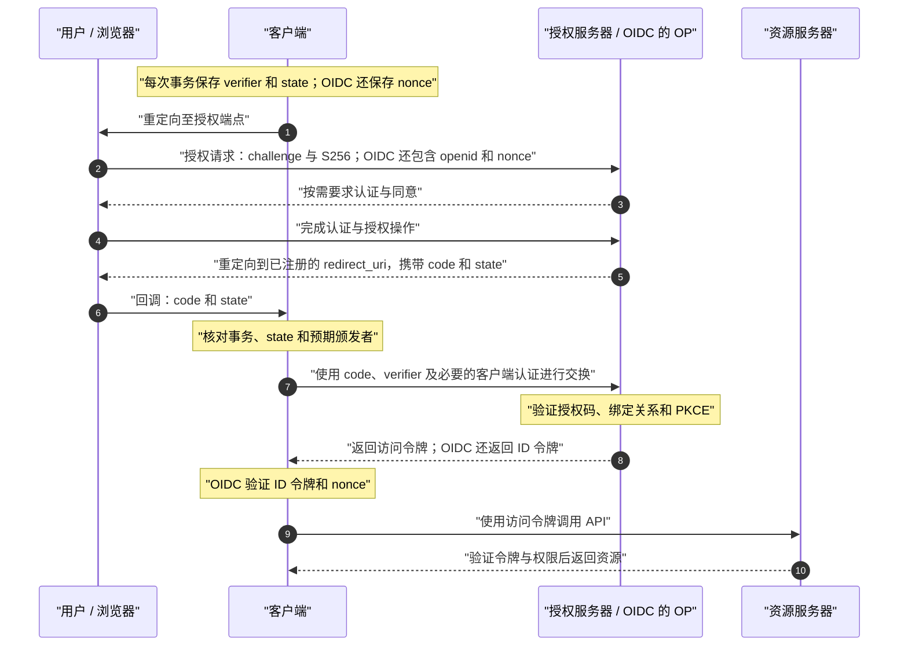

OAuth 2.0 是为应用程序授予有限访问权限的授权框架。OpenID Connect（OIDC）在其基础上增加了向客户端传达最终用户认证结果的机制。

本文区分认证与授权、令牌的用途、授权码与 PKCE，以及 ID 令牌的验证。代码用于说明个别处理步骤，并不是完整的登录实现。生产服务应使用符合自身需求的 OIDC 库和提供商配置。

## 1. 认证与授权的区别

### 认证（Authentication / AuthN）

认证是根据所提供的证据确认用户或系统身份的过程。可以把它比作公司前台检查员工卡。

### 授权（Authorization / AuthZ）

授权决定某个主体可以执行哪些操作、访问哪些资源。确认一个人是员工，并不意味着此人可以进入所有机房。

| 项目 | 认证 | 授权 |
| --- | --- | --- |
| 问题 | 是谁 | 允许做什么 |
| 简称 | AuthN | AuthZ |
| 本文讨论的机制 | OIDC 传达认证结果 | OAuth 2.0 授予有限访问权限 |
| 令牌示例 | OIDC 的 ID 令牌 | OAuth 2.0 的访问令牌 |

并非所有认证方式都会颁发 ID 令牌。OAuth 2.0 也不定义应用程序内部的全部访问控制。API 收到令牌后，仍须检查访问具体资源和执行具体操作所需的权限。

OAuth 2.0 本身没有标准化客户端如何确认最终用户的认证结果。不能仅因收到 OAuth 访问令牌就认定用户已登录；应使用 OIDC 等能够验证认证结果的协议。

## 2. OAuth 2.0 的角色与授权类型

### 2.1 有限访问权限

OAuth 2.0 允许客户端代表资源所有者，或以自身名义获取访问令牌。授权码流程的重要特点之一，是能够在不把用户密码交给客户端的情况下委托访问权限。

### 2.2 四种角色

1. **资源所有者（Resource Owner）**：能够授权访问受保护资源的主体，不一定是人类用户。
2. **客户端（Client）**：使用受保护资源的应用程序。
3. **授权服务器（Authorization Server）**：按照所用流程检查授权、客户端认证等条件，并颁发令牌的服务器。
4. **资源服务器（Resource Server）**：验证令牌和权限，并提供受保护资源的服务器。

### 2.3 主要授权类型

#### 授权码模式（Authorization Code Grant）

授权响应返回短期有效的授权码，再通过令牌端点将其交换为访问令牌。能够在服务器上安全保存凭证的**机密客户端**，以及 [SPA](/zh-cn/p/micro-frontends-architecture-spa-division/) 和原生应用等**公共客户端**，都可以结合 PKCE 使用此流程。把客户端密钥嵌入已分发的应用程序或浏览器代码，并不能使其成为可保密的凭证。

#### 隐式模式（Implicit Grant）

这种方式在授权响应中直接返回访问令牌，存在令牌泄露、注入和重放风险。RFC 9700 要求客户端在未满足指定风险缓解条件时不应使用它（SHOULD NOT）。新配置应选择授权码与 PKCE。不能把这一建议解读为对所有 OIDC 响应类型完全相同的禁止。

#### 资源所有者密码凭证模式（ROPC）

这种方式让客户端直接接收用户密码。虽然 RFC 6749 描述了它，但更新后的安全指引 RFC 9700 明确规定**不得使用（MUST NOT）**。不能把旧系统迁移作为推荐使用的例外。

#### 客户端凭证模式（Client Credentials Grant）

机密客户端通过自身认证获取令牌，以访问自己控制的资源，或按照与授权服务器的事先约定访问其他资源所有者的资源。它通常用于没有最终用户交互的系统间通信，但客户端并不必然成为资源所有者。

### 2.4 授权码与 PKCE

PKCE（Proof Key for Code Exchange）把发起授权请求的客户端与交换授权码的客户端关联起来，帮助防范授权码拦截与注入。公共客户端必须使用 PKCE，机密客户端也被建议使用。它并不取代机密客户端所需的客户端认证。

客户端须为每次授权事务生成新的秘密 `code_verifier`。RFC 7636 规定其长度为 43～128 个字符，字符来自英文字母、数字及 `-._~`，并建议至少具有 256 比特的熵。将 32 字节的密码学安全随机数编码为不带填充的 Base64url，便可得到 43 个字符。

使用 `S256` 时，挑战值按下式计算。Base64url 不保留末尾的 `=` 填充。

$$
\text{code\_challenge}=\operatorname{BASE64URL}\!\left(\operatorname{SHA256}\!\left(\operatorname{ASCII}(\text{code\_verifier})\right)\right)
$$

授权请求发送 `code_challenge` 和 `code_challenge_method=S256`，令牌请求发送为同一次事务保存的 `code_verifier`。服务器根据与授权码一起记录的方法和挑战值进行验证。不能因为 `S256` 失败就退回 `plain`。

#### 流程概览



这是成功流程的概览。通信须由 TLS 保护；实现还须处理重定向地址验证、授权码的一次性使用、错误响应、事务期限，以及使用多个授权服务器时的 mix-up 防护。

#### PKCE 参数生成示例（JavaScript / Web Crypto API）

以下浏览器函数须在 HTTPS 等安全上下文中执行。`generatePkce()` 仅返回参数，不发送授权请求，也不保存事务。不要把 verifier 写入日志或 URL；须将其与发起请求的浏览器事务绑定，交换完成或过期后将其丢弃。

```javascript
function base64url(bytes) {
    return btoa(String.fromCharCode(...bytes))
        .replace(/\+/g, '-').replace(/\//g, '_').replace(/=+$/, '');
}

function generateCodeVerifier() {
    const bytes = new Uint8Array(32);
    crypto.getRandomValues(bytes);
    return base64url(bytes);
}

async function generateCodeChallenge(codeVerifier) {
    if (typeof codeVerifier !== 'string' ||
        codeVerifier.length < 43 || codeVerifier.length > 128 ||
        /[^A-Za-z0-9._~-]/.test(codeVerifier)) {
        throw new TypeError('Invalid PKCE verifier');
    }
    const data = new TextEncoder().encode(codeVerifier);
    const digest = await crypto.subtle.digest('SHA-256', data);
    return base64url(new Uint8Array(digest));
}

async function generatePkce() {
    const code_verifier = generateCodeVerifier();
    return {
        code_verifier,
        code_challenge: await generateCodeChallenge(code_verifier),
        code_challenge_method: 'S256'
    };
}
```

这里对 32 个随机字节的所有比特进行编码。旧例把 28 个随机 32 位整数各自最后两位十六进制数字拼接起来，虽然获取了 896 比特，却只保留 224 比特，因此已予以修正。

## 3. OIDC 与 ID 令牌

### 3.1 在 OAuth 上增加认证层

OIDC 客户端（Relying Party）通过包含 `openid` 作用域的请求发起认证，OpenID Provider（OP）通过 ID 令牌返回认证结果。用户不一定每次都输入密码；OP 可以使用已有会话或其他认证方式。

### 3.2 区分令牌用途

- **访问令牌**：访问资源服务器的凭证。格式可以是 JWT，也可以是不透明字符串；OAuth 2.0 没有限定为一种格式。客户端应按照 API 规范发送令牌，而不是自行假定其内部结构。
- **ID 令牌**：面向客户端、表示认证结果的 JWT。使用前须验证签名、声明及其与认证请求的关联。仅解码并不足够，也不能把它作为 API 访问令牌的替代品发送。

### 3.3 JWT 的结构与签名

本节讨论未加密的签名 JWT 的 **JWS Compact Serialization**，它由点号分隔的三个部分组成。JWT 也可以采用加密的 JWE 或嵌套结构，并非总是三个部分。

1. **Header（头部）**：包含签名算法 `alg`、密钥标识符 `kid` 等字段。
2. **Payload（载荷）**：包含颁发者、受众、过期时间、主体等声明。
3. **Signature（签名）**：由指定算法生成的签名或 MAC。本节的 RS256 使用 RSA 数字签名。

头部和载荷只是经过 Base64url 编码，签名并不会隐藏其内容。另见[加密、哈希与签名的区别]()。

#### ID 令牌的主要必需声明

- `iss`：OP 的颁发者标识符，须与预期颁发者完全一致。
- `sub`：在该颁发者范围内唯一且不会重新分配的用户标识符。使用多个 OP 时，须与 `iss` 组合识别用户。
- `aud`：ID 令牌的预期接收者。须确认其中包含客户端的 `client_id`，并拒绝不受信任的额外受众。
- `exp`：过期时间，当前时间必须早于该时间。
- `iat`：颁发时间，可接受的令牌年龄等限制由客户端策略决定。

如果认证请求发送了 `nonce`，就须要求该声明存在并核对其值。请求额外声明或 `max_age` 时，还须进行相应验证。

#### RS256 的签名输入

设 `H` 为 UTF-8 编码的受保护头部，`P` 为 UTF-8 编码的载荷，`B64u` 为不带填充的 Base64url 编码，则签名输入为以下字节序列。`||` 表示拼接。

$$
M=\operatorname{ASCII}\!\left(\operatorname{B64u}(H)\,||\,\texttt{.}\,||\,\operatorname{B64u}(P)\right),\qquad S=\operatorname{Sign}_{\mathrm{RS256}}(sk,M)
$$

RS256 使用 RSASSA-PKCS1-v1_5 和 SHA-256。哈希处理属于该签名算法的一部分，上式没有在外部再加一层哈希。令牌的第三部分为 `B64u(S)`。应使用可信 OP 的公钥和指定算法验证，而不能把签名验证一概描述为“用公钥解密”。

不要让未经验证的令牌决定允许的算法或密钥来源。须使用从已验证的 OP 配置或 Discovery 获得的可信 JWKS，并处理密钥轮换和缓存。`kid` 用于在该可信密钥集合中选择密钥，而不是从令牌提供的任意 URL 获取密钥。

#### Python 验证步骤示例

以下 PyJWT 函数仅支持限定配置：**RS256、未加密、单个字符串形式的 audience，并且请求已发送 nonce**。调用方提供的 `signing_key` 必须是来自可信 OP 的 JWKS 的公钥。必需声明不仅须通过值验证，还必须存在。若包含 `azp`，本例要求其等于 `client_id`。

这个函数本身并不完成登录。调用方须验证和管理回调与初始事务的关联、state、授权码交换、预期颁发者以及 nonce 的一次性使用。多个 audience、加密、额外认证要求、`max_age` 和 `acr` 不在本例范围内。

```python
import hmac
import math
import jwt


def verify_id_token(id_token, signing_key, *, issuer, client_id, expected_nonce):
    if not isinstance(expected_nonce, str) or not expected_nonce:
        raise ValueError('A nonce from the stored transaction is required')
    claims = jwt.decode(
        id_token,
        signing_key,
        algorithms=['RS256'],
        audience=client_id,
        issuer=issuer,
        options={
            'require': ['iss', 'sub', 'aud', 'exp', 'iat', 'nonce'],
            'strict_aud': True,
        },
    )
    for name in ('exp', 'iat'):
        value = claims[name]
        if (isinstance(value, bool) or not isinstance(value, (int, float))
                or (isinstance(value, float) and not math.isfinite(value))):
            raise jwt.InvalidTokenError('Invalid NumericDate')
    subject = claims['sub']
    if (not isinstance(subject, str) or not subject or not subject.isascii()
            or len(subject) > 255):
        raise jwt.InvalidTokenError('Invalid subject')
    nonce = claims['nonce']
    if (not isinstance(nonce, str) or not hmac.compare_digest(
            nonce.encode('utf-8'), expected_nonce.encode('utf-8'))):
        raise jwt.InvalidTokenError('Nonce mismatch')
    if 'azp' in claims and claims['azp'] != client_id:
        raise jwt.InvalidTokenError('Authorized party mismatch')
    return claims
```

返回值是在上述范围内验证后的声明。不要仅因签名正确就显示“认证成功”，也不要使用未经验证的姓名或电子邮箱地址关联账户。

## 4. 安全注意事项

### 4.1 state、nonce、PKCE 与 CSRF

使用 `state` 时，须把不可预测的值安全地绑定到发起请求的浏览器事务；在回调时检查值是否匹配、是否过期、是否尚未使用，然后将其标记为已使用。仅字符串一致并不能防止所有类型的 [CSRF]()。

RFC 9700 还讨论了在确认服务器支持 PKCE 后依赖其 CSRF 保护，以及使用 OIDC nonce 的情况。这些保护仍须正确验证并与每次事务绑定。`state`、`nonce` 与 PKCE 的作用不同；使用固定值或省略比较均不能提供预期保护。涉及多个授权服务器时，还须另行防范 mix-up 攻击。

### 4.2 过期时间与刷新令牌

缩短访问令牌的生命周期，是限制被盗令牌可用时间的一种手段。15 分钟之类的值是设计示例，并非普遍的强制要求。检查签名 JWT 的 `exp` 时，过期条件如下：

$$
T_{\mathrm{now}}<T_{\mathrm{exp}},\qquad T_{\mathrm{exp}}=T_{\mathrm{iat}}+D_{\mathrm{lifetime}}\ \text{仅在如此设置时}\ T_{\mathrm{now}}<T_{\mathrm{iat}}+D_{\mathrm{lifetime}}
$$

这只检查过期条件，不能证明令牌整体有效或具有访问权限。还须验证算法、密钥、颁发者、受众，以及适用时的 `nbf`、撤销状态和与认证请求的关联。若允许一定的时钟偏差，应明确管理该范围。

刷新令牌的颁发是可选的。不颁发刷新令牌时，客户端可能需要重新发起授权事务。对颁发给公共客户端的刷新令牌，RFC 9700 要求进行发送者约束（sender constraints）或轮换。撤销刷新令牌，不一定会立即使此前颁发的访问令牌失效。

### 4.3 选择流程与实现

对于用户参与的 Web、SPA 和原生应用，以授权码与 PKCE 为基础，再根据客户端类型、令牌存储位置、提供商支持和威胁模型选择配置。不要把同一种流程一律套用到 M2M 客户端凭证等其他用途。

## 总结

OAuth 2.0 访问令牌用于访问资源，OIDC ID 令牌则作为面向客户端的认证结果进行验证。须逐项确认授权码与 PKCE 的绑定、签名、必需声明、nonce，以及回调与初始事务的关联。

## 参考规范

- [RFC 6749：OAuth 2.0](https://www.rfc-editor.org/rfc/rfc6749.html)（角色、令牌和客户端凭证；更新后的安全指引见 RFC 9700）
- [RFC 7636：PKCE](https://www.rfc-editor.org/rfc/rfc7636.html)（第 4 节、第 7.1 节及附录 B）
- [RFC 9700：OAuth 2.0 安全最佳实践](https://www.rfc-editor.org/rfc/rfc9700.html)（第 2.1、2.2.2、2.4 节）
- [OpenID Connect Core 1.0](https://openid.net/specs/openid-connect-core-1_0.html)（第 2、3.1.3.7、5.7 节）
- [RFC 7515：JWS](https://www.rfc-editor.org/rfc/rfc7515.html)（第 3.1、5.1 节）
- [PyJWT API](https://pyjwt.readthedocs.io/en/stable/api.html)（允许的算法、必需声明和 audience 验证）
