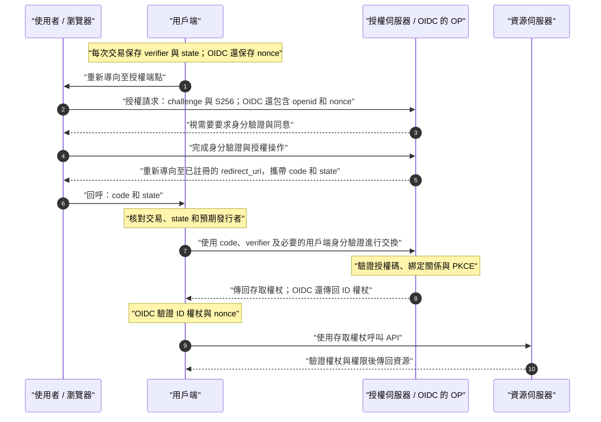

OAuth 2.0 是為應用程式授予有限存取權限的授權框架。OpenID Connect（OIDC）在其基礎上，增加了向用戶端傳達終端使用者身分驗證結果的機制。

本文區分身分驗證與授權、權杖的用途、授權碼與 PKCE，以及 ID 權杖的驗證。程式碼用來說明個別處理步驟，並非完整的登入實作。正式服務應使用符合自身需求的 OIDC 函式庫和提供者設定。

## 1. 身分驗證與授權的差異

### 身分驗證（Authentication / AuthN）

身分驗證是根據所提供的證據，確認使用者或系統身分的程序。可以將它比作公司櫃台檢查員工證。

### 授權（Authorization / AuthZ）

授權決定某個主體可以執行哪些操作、存取哪些資源。確認某人是員工，並不代表此人可以進入所有機房。

| 項目 | 身分驗證 | 授權 |
| --- | --- | --- |
| 問題 | 是誰 | 允許做什麼 |
| 縮寫 | AuthN | AuthZ |
| 本文討論的機制 | OIDC 傳達身分驗證結果 | OAuth 2.0 授予有限存取權限 |
| 權杖範例 | OIDC 的 ID 權杖 | OAuth 2.0 的存取權杖 |

並非所有身分驗證方式都會發行 ID 權杖。OAuth 2.0 也不定義應用程式內部的全部存取控制。API 收到權杖後，仍須檢查存取特定資源及執行特定操作所需的權限。

OAuth 2.0 本身沒有標準化用戶端如何確認終端使用者的身分驗證結果。不能僅因收到 OAuth 存取權杖，就認定使用者已登入；應使用 OIDC 等能夠驗證身分驗證結果的協定。

## 2. OAuth 2.0 的角色與授權類型

### 2.1 有限存取權限

OAuth 2.0 允許用戶端代表資源擁有者，或以自身名義取得存取權杖。授權碼流程的重要特點之一，是能夠在不將使用者密碼交給用戶端的情況下委派存取權限。

### 2.2 四種角色

1. **資源擁有者（Resource Owner）**：能夠允許存取受保護資源的主體，不一定是人類使用者。
2. **用戶端（Client）**：使用受保護資源的應用程式。
3. **授權伺服器（Authorization Server）**：依所用流程檢查授權、用戶端身分驗證等條件，並發行權杖的伺服器。
4. **資源伺服器（Resource Server）**：驗證權杖與權限，並提供受保護資源的伺服器。

### 2.3 主要授權類型

#### 授權碼授權（Authorization Code Grant）

授權回應會傳回短期有效的授權碼，再透過權杖端點將其交換為存取權杖。能夠在伺服器上安全保存憑證的**機密用戶端**，以及 [SPA](/zh-tw/p/micro-frontends-architecture-spa-division/) 和原生應用程式等**公開用戶端**，都可以搭配 PKCE 使用此流程。將用戶端機密（client secret）嵌入已散布的應用程式或瀏覽器程式碼，無法確保其機密性。

#### 隱含授權（Implicit Grant）

這種方式在授權回應中直接傳回存取權杖，存在權杖洩漏、注入和重放的風險。RFC 9700 要求用戶端在未滿足指定風險緩解條件時，不應使用此方式（SHOULD NOT）。新設定應選擇授權碼與 PKCE。不能將這項建議解讀為對所有 OIDC 回應類型完全相同的禁止。

#### 資源擁有者密碼憑證授權（ROPC）

這種方式讓用戶端直接接收使用者密碼。雖然 RFC 6749 描述了它，但更新後的安全指引 RFC 9700 明確規定**不得使用（MUST NOT）**。不能將舊系統移轉當成建議使用的例外。

#### 用戶端憑證授權（Client Credentials Grant）

機密用戶端透過自身的身分驗證取得權杖，用來存取自己控制的資源，或依與授權伺服器的事先約定，存取其他資源擁有者的資源。這通常用於沒有終端使用者互動的系統間通訊，但用戶端並不必然成為資源擁有者。

### 2.4 授權碼與 PKCE

PKCE（Proof Key for Code Exchange）將發起授權請求的用戶端，與交換授權碼的用戶端建立關聯，協助防範授權碼攔截與注入。公開用戶端必須使用 PKCE，機密用戶端也建議使用。它並不取代機密用戶端所需的用戶端身分驗證。

用戶端須為每次授權交易產生新的秘密 `code_verifier`。RFC 7636 規定其長度為 43～128 個字元，字元來自英文字母、數字及 `-._~`，並建議至少具有 256 位元的熵。將密碼學安全的亂數產生器輸出的 32 位元組編碼為不帶填補的 Base64url，便可得到 43 個字元。

使用 `S256` 時，挑戰值依下式計算。Base64url 不保留結尾的 `=` 填補。

$$
\text{code\_challenge}=\operatorname{BASE64URL}\!\left(\operatorname{SHA256}\!\left(\operatorname{ASCII}(\text{code\_verifier})\right)\right)
$$

授權請求傳送 `code_challenge` 和 `code_challenge_method=S256`，權杖請求則傳送為同一次交易保存的 `code_verifier`。伺服器依與授權碼一起記錄的方法和挑戰值進行驗證。不能因為 `S256` 失敗就退回 `plain`。

#### 流程概覽



這是成功流程的概覽。通訊須受 TLS 保護；實作還須處理重新導向位址驗證、授權碼的一次性使用、錯誤回應、交易期限，以及使用多個授權伺服器時的 mix-up 防護。

#### PKCE 參數產生範例（JavaScript / Web Crypto API）

以下瀏覽器函式須在 HTTPS 等安全環境（secure context）中執行。`generatePkce()` 只傳回參數，不傳送授權請求，也不儲存交易。不要將 verifier 寫入記錄或 URL；須將其綁定至發起請求的瀏覽器交易，並在交換完成或過期後捨棄。

```javascript
function base64url(bytes) {
    return btoa(String.fromCharCode(...bytes))
        .replace(/\+/g, '-').replace(/\//g, '_').replace(/=+$/, '');
}

function generateCodeVerifier() {
    const bytes = new Uint8Array(32);
    crypto.getRandomValues(bytes);
    return base64url(bytes);
}

async function generateCodeChallenge(codeVerifier) {
    if (typeof codeVerifier !== 'string' ||
        codeVerifier.length < 43 || codeVerifier.length > 128 ||
        /[^A-Za-z0-9._~-]/.test(codeVerifier)) {
        throw new TypeError('Invalid PKCE verifier');
    }
    const data = new TextEncoder().encode(codeVerifier);
    const digest = await crypto.subtle.digest('SHA-256', data);
    return base64url(new Uint8Array(digest));
}

async function generatePkce() {
    const code_verifier = generateCodeVerifier();
    return {
        code_verifier,
        code_challenge: await generateCodeChallenge(code_verifier),
        code_challenge_method: 'S256'
    };
}
```

這裡對 32 個隨機位元組的所有位元進行編碼。舊範例將 28 個隨機 32 位元整數各自最後兩位十六進位數字串接起來，雖然取得了 896 位元，卻只保留 224 位元，因此已予以修正。

## 3. OIDC 與 ID 權杖

### 3.1 在 OAuth 上增加身分驗證層

OIDC 用戶端（Relying Party）透過包含 `openid` 範圍的請求發起身分驗證，OpenID Provider（OP）透過 ID 權杖傳回驗證結果。使用者不一定每次都輸入密碼；OP 可以使用既有工作階段或其他身分驗證方式。

### 3.2 區分權杖用途

- **存取權杖**：存取資源伺服器的憑證。格式可以是 JWT，也可以是不透明字串；OAuth 2.0 並未限定為一種格式。用戶端應依 API 規格傳送權杖，而不是自行假設其內部結構。
- **ID 權杖**：提供給用戶端、表示身分驗證結果的 JWT。使用前須驗證簽章、宣告及其與身分驗證請求的關聯。僅解碼並不足夠，也不能將它當成 API 存取權杖的替代品傳送。

### 3.3 JWT 的結構與簽章

本節討論未加密的已簽署 JWT 的 **JWS Compact Serialization**，它由句點分隔的三個部分組成。JWT 也可以採用加密的 JWE 或巢狀結構，並非總是三個部分。

1. **Header（標頭）**：包含簽章演算法 `alg`、金鑰識別碼 `kid` 等欄位。
2. **Payload（承載內容）**：包含發行者、對象、到期時間、主體等宣告。
3. **Signature（簽章）**：由指定演算法產生的簽章或 MAC。本節的 RS256 使用 RSA 數位簽章。

標頭與承載內容只是經過 Base64url 編碼，簽章不會隱藏其內容。另見[加密、雜湊與簽章的差異]()。

#### ID 權杖的主要必要宣告

- `iss`：OP 的發行者識別碼，須與預期發行者完全一致。
- `sub`：在該發行者範圍內唯一且不會重新指派的使用者識別碼。使用多個 OP 時，須搭配 `iss` 識別使用者。
- `aud`：ID 權杖的預期接收對象。須確認其中包含用戶端的 `client_id`，並拒絕不受信任的額外接收對象。
- `exp`：到期時間，目前時間必須早於該時間。
- `iat`：發行時間，可接受的權杖年齡等限制由用戶端原則決定。

若身分驗證請求傳送了 `nonce`，就須要求該宣告存在並核對其值。要求額外宣告或 `max_age` 時，還須進行相應的驗證。

#### RS256 的簽章輸入

令 `H` 為 UTF-8 編碼的受保護標頭、`P` 為 UTF-8 編碼的承載內容、`B64u` 為不帶填補的 Base64url 編碼，則簽章輸入為以下位元組序列。`||` 表示串接。

$$
M=\operatorname{ASCII}\!\left(\operatorname{B64u}(H)\,||\,\texttt{.}\,||\,\operatorname{B64u}(P)\right),\qquad S=\operatorname{Sign}_{\mathrm{RS256}}(sk,M)
$$

RS256 使用 RSASSA-PKCS1-v1_5 與 SHA-256。雜湊處理屬於該簽章演算法的一部分，上式沒有在外部再加一層雜湊。權杖的第三部分是 `B64u(S)`。應使用可信任 OP 的公開金鑰與指定演算法驗證，不能將簽章驗證一概描述為「用公開金鑰解密」。

不要讓未經驗證的權杖決定允許的演算法或金鑰來源。須使用從已驗證的 OP 設定或 Discovery 取得的可信任 JWKS，並處理金鑰輪替與快取。`kid` 用來在該可信任金鑰集合中選取金鑰，而不是從權杖提供的任意 URL 取得金鑰。

#### Python 驗證步驟範例

以下 PyJWT 函式僅支援限定設定：**RS256、未加密、單一字串形式的 audience，而且請求已傳送 nonce**。呼叫端提供的 `signing_key` 必須是來自可信任 OP 的 JWKS 的公開金鑰。必要宣告不僅須通過值的驗證，也必須存在。若包含 `azp`，本例要求其等於 `client_id`。

這個函式本身並不完成登入。呼叫端須驗證與管理回呼和起始交易的關聯、state、授權碼交換、預期發行者，以及 nonce 的一次性使用。多個 audience、加密、額外身分驗證要求、`max_age` 和 `acr` 不在本例範圍內。

```python
import hmac
import math
import jwt


def verify_id_token(id_token, signing_key, *, issuer, client_id, expected_nonce):
    if not isinstance(expected_nonce, str) or not expected_nonce:
        raise ValueError('A nonce from the stored transaction is required')
    claims = jwt.decode(
        id_token,
        signing_key,
        algorithms=['RS256'],
        audience=client_id,
        issuer=issuer,
        options={
            'require': ['iss', 'sub', 'aud', 'exp', 'iat', 'nonce'],
            'strict_aud': True,
        },
    )
    for name in ('exp', 'iat'):
        value = claims[name]
        if (isinstance(value, bool) or not isinstance(value, (int, float))
                or (isinstance(value, float) and not math.isfinite(value))):
            raise jwt.InvalidTokenError('Invalid NumericDate')
    subject = claims['sub']
    if (not isinstance(subject, str) or not subject or not subject.isascii()
            or len(subject) > 255):
        raise jwt.InvalidTokenError('Invalid subject')
    nonce = claims['nonce']
    if (not isinstance(nonce, str) or not hmac.compare_digest(
            nonce.encode('utf-8'), expected_nonce.encode('utf-8'))):
        raise jwt.InvalidTokenError('Nonce mismatch')
    if 'azp' in claims and claims['azp'] != client_id:
        raise jwt.InvalidTokenError('Authorized party mismatch')
    return claims
```

傳回值是在上述範圍內驗證後的宣告。不要僅因簽章正確就顯示「身分驗證成功」，也不要使用未經驗證的姓名或電子郵件地址連結帳號。

## 4. 安全注意事項

### 4.1 state、nonce、PKCE 與 CSRF

使用 `state` 時，須將不可預測的值安全地綁定至發起請求的瀏覽器交易；在回呼時檢查值是否相符、是否過期、是否尚未使用，然後將其標記為已使用。僅字串相符並不能防止所有類型的 [CSRF]()。

RFC 9700 也討論了確認伺服器支援 PKCE 後依賴其 CSRF 保護，以及使用 OIDC nonce 的情況。這些保護仍須正確驗證，並與每次交易綁定。`state`、`nonce` 與 PKCE 的角色不同；使用固定值或省略比較，都無法提供預期保護。涉及多個授權伺服器時，還須另外防範 mix-up 攻擊。

### 4.2 到期時間與更新權杖

縮短存取權杖的有效期間，是限制遭竊權杖可用時間的一種手段。15 分鐘之類的值是設計範例，並非普遍的強制要求。檢查已簽署 JWT 的 `exp` 時，到期條件如下：

$$
T_{\mathrm{now}}<T_{\mathrm{exp}},\qquad T_{\mathrm{exp}}=T_{\mathrm{iat}}+D_{\mathrm{lifetime}}\ \text{僅在如此設定時}\ T_{\mathrm{now}}<T_{\mathrm{iat}}+D_{\mathrm{lifetime}}
$$

這僅檢查到期條件，不能證明權杖整體有效或具有存取權限。還須驗證演算法、金鑰、發行者、接收對象，以及適用時的 `nbf`、撤銷狀態和與身分驗證請求的關聯。若允許一定的時鐘偏差，應明確管理其範圍。

更新權杖的發行是選擇性的。未發行時，用戶端可能需要重新發起授權交易。對發行給公開用戶端的更新權杖，RFC 9700 要求採用傳送者約束（sender constraints）或輪替。撤銷更新權杖，不一定會立即使先前發行的存取權杖失效。

### 4.3 選擇流程與實作

對於使用者參與的 Web、SPA 和原生應用程式，以授權碼與 PKCE 為基礎，再依用戶端類型、權杖儲存位置、提供者支援情況和威脅模型選擇設定。不要將同一流程一律套用到 M2M 用戶端憑證等其他用途。

## 總結

OAuth 2.0 存取權杖用於存取資源，OIDC ID 權杖則作為提供給用戶端的身分驗證結果進行驗證。須逐項確認授權碼與 PKCE 的綁定、簽章、必要宣告、nonce，以及回呼與起始交易的關聯。

## 參考規範

- [RFC 6749：OAuth 2.0](https://www.rfc-editor.org/rfc/rfc6749.html)（角色、權杖與用戶端憑證；更新後的安全指引見 RFC 9700）
- [RFC 7636：PKCE](https://www.rfc-editor.org/rfc/rfc7636.html)（第 4 節、第 7.1 節及附錄 B）
- [RFC 9700：OAuth 2.0 安全最佳實務](https://www.rfc-editor.org/rfc/rfc9700.html)（第 2.1、2.2.2、2.4 節）
- [OpenID Connect Core 1.0](https://openid.net/specs/openid-connect-core-1_0.html)（第 2、3.1.3.7、5.7 節）
- [RFC 7515：JWS](https://www.rfc-editor.org/rfc/rfc7515.html)（第 3.1、5.1 節）
- [PyJWT API](https://pyjwt.readthedocs.io/en/stable/api.html)（允許的演算法、必要宣告與 audience 驗證）
