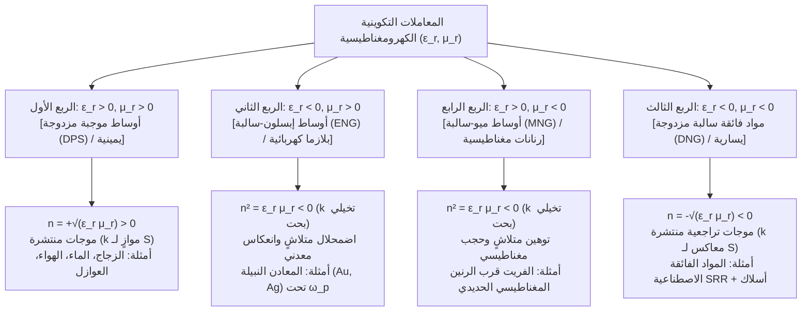
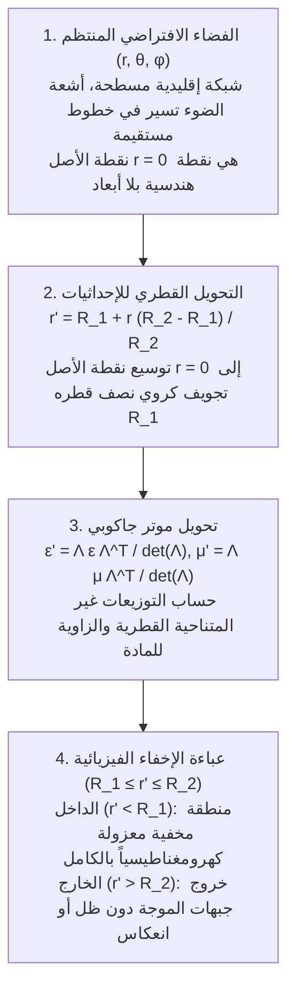

## 1. مقدمة: هندسة خصائص المواد عبر الهندسة الفراغية بدلاً من الكيمياء

لعدة قرون، نصت المسلمة الأساسية في علم المواد والبصريات الكلاسيكية على أن الخصائص الكهرومغناطيسية للمادة — لماذا ينفذ الضوء عبر الزجاج، ولماذا يلمع الذهب ببريق معدني، ولماذا تبدو القشة منكسرة في الماء — تحكمها حصرياً <strong>التركيبة الكيميائية</strong>، أي نوع الذرات في الجدول الدوري وروابطها الكيميائية. ومع مطلع القرن الحادي والعشرين، برز تحول جذري عند تقاطع الديناميكا الكهربائية الكلاسيكية وفيزياء المادة المكثفة وتقنية النانو: ظهور <strong>المواد الفائقة (Metamaterials)</strong>. تُشتق الكلمة من البادئة اليونانية <em>meta-</em> («ما وراء»)، وتشير إلى مركبات مُهندسة اصطناعياً لا تتحدد استجابتها الكهرومغناطيسية العيانية بكيمياء ذراتها، بل <strong>بالهندسة دون الطول الموجي والطوبولوجيا والترتيب المكاني لوحدات بنائية مصممة («الذرات الفائقة» Meta-atoms)</strong>.

يمتد الضوء المرئي بين أطوال موجية $\lambda \approx 400\,\text{nm}$ و$700\,\text{nm}$، بينما لا تتجاوز المسافة بين الذرات في المواد الصلبة $a_{\text{atom}} \sim 0.1\text{–}0.3\,\text{nm}$. ولأن المجال الكهرومغناطيسي يتذبذب على مقاييس أكبر بآلاف المرات من الذرات المنفردة، فإن الموجة الضوئية تستشعر وسطاً متصلاً متجانساً يتصف <strong>بالسماحية الكهربائية $\varepsilon$</strong> و<strong>النفاذية المغناطيسية $\mu$</strong>، اللتين تحددان <strong>معامل الانكسار $n = \sqrt{\varepsilon_r \mu_r}$</strong>. فإذا صنعنا رنانات اصطناعية بثابت شبكة $a \lesssim \lambda / 10$، فإن الموجة تدمج عزوم ثنائيات الأقطاب المحلية وتتعامل مع المصفوفة كـ<strong>وسط فعّال (Effective Medium)</strong> ذي معاملات مُهندسة $\varepsilon_{\text{eff}}(\omega)$ و$\mu_{\text{eff}}(\omega)$.

ومن الضروري التمييز بدقة بين المواد الفائقة و<strong>البلورات الضوئية (Photonic Crystals)</strong> والألوان البنيوية الطبيعية (مثل الأوبال أو أجنحة فراشة <em>Morpho</em>). في البلورات الضوئية يقارب ثابت الشبكة نصف الطول الموجي ($a \sim \lambda / 2$)، وتنشأ فجوات النطاق الضوئي عبر <strong>تشتت براغ (Bragg Scattering)</strong> حيث يفشل تقريب الوسط الفعّال (EMA). أما المواد الفائقة فتعمل حصراً في النظام العميق دون الطول الموجي ($a \ll \lambda$)، مما يمنح الموترات المحلية $\varepsilon_{\text{eff}}$ و$\mu_{\text{eff}}$ معنى فيزيائياً دقيقاً.

| السمة الفيزيائية | المواد المتجانسة الطبيعية (زجاج، ماء، ذهب) | البلورات الضوئية واللون البنيوي (أوبال، فراشة مورفو) | المواد الفائقة والأسطح الفائقة |
| :--- | :--- | :--- | :--- |
| <strong>وحدة البناء الأساسية</strong> | ذرات، جزيئات، أيونات | كتل عازلة دورية أو فجوات هوائية | رنانات دون الطول الموجي («ذرات فائقة»: SRR، أعمدة نانوية) |
| <strong>ثابت الشبكة $a$ مقابل $\lambda$</strong> | $a \sim 0.1\text{–}0.3\,\text{nm} \ (\ll \lambda/1000)$ | $a \sim \lambda / 2$ (نظام براغ) | $a \lesssim \lambda / 10$ (نظام دون الطول الموجي العميق) |
| <strong>الآلية الفيزيائية السائدة</strong> | استقطاب إلكتروني/أيوني | حيود براغ، تداخل متعدد | رنين متعدد الأقطاب كهربائي ومغناطيسي محلي (LC / Mie) |
| <strong>تقريب الوسط الفعّال (EMA)</strong> | دقيق عند الأطوال الموجية البصرية | غير صالح (غير متجانس على مقياس $\lambda$) | صالح (معاملات $\varepsilon_{\text{eff}}(\omega), \mu_{\text{eff}}(\omega)$ محددة بدقة) |
| <strong>معامل انكسار سالب متناحي ($n < 0$)</strong> | غائب في الطبيعة | انكسار سالب ظاهري بسبب انحناء نطاق التشتت | انتشار حقيقي لموجات تراجعية سالبة مزدوجة ($\varepsilon_{\text{eff}} < 0, \mu_{\text{eff}} < 0$) |

---

## 2. معادلات ماكسويل والأرباع الأربعة لمستوى $\varepsilon\text{–}\mu$

بالنسبة للموجات المستوية أحادية اللون $\exp(i\mathbf{k}\cdot\mathbf{r} - i\omega t)$ في وسط متناحٍ ومتجانس خالٍ من المصادر، تأخذ معادلات ماكسويل الدورانية الصورة:

$$
\mathbf{k} \times \mathbf{E} = \omega \mu \mathbf{H}, \qquad \mathbf{k} \times \mathbf{H} = -\omega \varepsilon \mathbf{E}
$$

حيث $\varepsilon = \varepsilon_0 \varepsilon_r$ و$\mu = \mu_0 \mu_r$. وبحذف $\mathbf{H}$ نحصل على علاقة التشتت ومعاوقة الموجة $Z$:

$$
k^2 = \left(\frac{\omega}{c}\right)^2 \varepsilon_r \mu_r = \left(\frac{\omega}{c}\right)^2 n^2, \qquad Z = \sqrt{\frac{\mu}{\varepsilon}} = Z_0 \sqrt{\frac{\mu_r}{\varepsilon_r}}
$$

يقسم المستوى $(\varepsilon_r, \mu_r)$ جميع الأوساط المتناحية إلى أربعة أرباع:

تترك الطبيعة الربع الثالث فارغاً لأن الرنين الكهربائي الذري يحدث عند الترددات البصرية وفوق البنفسجية ($10^{14}\text{–}10^{16}\,\text{Hz}$)، بينما يضعف الرنين المغناطيسي الذري بفعل ثابت البنية الدقيقة ($\alpha \approx 1/137$) ويتلاشى فوق ترددات الميكروويف أو التيراهيرتز.

---

## 3. تجربة فيسيلاغو الفكرية (1968) وفيزياء الانكسار السالب

في عام 1967 (نُشرت بالإنجليزية عام 1968)، أثبت الفيزيائي السوفيتي <strong>فيكتور فيسيلاغو (Viktor G. Veselago)</strong> أنه عندما يكون $\varepsilon_r < 0$ و$\mu_r < 0$ معاً، فإن الثلاثية $(\mathbf{E}, \mathbf{H}, \mathbf{k})$ تشكل <strong>منظومة يسارية</strong>، ومن هنا جاء مصطلح <strong>المواد اليسارية (Left-Handed Materials, LHM)</strong>. غير أن تدفق الطاقة الكهرومغناطيسية يحدده <strong>متجه بوينتغ $\mathbf{S}$</strong>:

$$
\mathbf{S} = \mathbf{E} \times \mathbf{H}, \qquad \langle \mathbf{S} \rangle = \frac{1}{2}\text{Re}(\mathbf{E} \times \mathbf{H}^*)
$$

وبما أن $\mathbf{S}$ لا يحتوي على $\varepsilon$ أو $\mu$، فإن $(\mathbf{E}, \mathbf{H}, \mathbf{S})$ يشكل دائماً منظومة يمينية. وبالتالي يكون متجه الموجة $\mathbf{k}$ (سرعة الطور $\mathbf{v}_p$) ومتجه بوينتغ $\mathbf{S}$ (سرعة المجموعة $\mathbf{v}_g$) <strong>متعاكسين تماماً ($\mathbf{k} \cdot \mathbf{S} < 0$، موجة تراجعية)</strong>. كما أن التحليل العقدي لأي وسط سببي غير فعّال ($\varepsilon'', \mu'' > 0$) يفرض اختيار الجذر التربيعي السالب لضمان التخميد الحراري $\text{Im}(n) > 0$:

$$
n = \sqrt{\varepsilon_r \mu_r} = \sqrt{|\varepsilon_r||\mu_r|}\,e^{i\pi - i(\delta_\varepsilon + \delta_\mu)/2} = -\sqrt{|\varepsilon'||\mu'|} + i n'' \qquad (\text{Re}(n) < 0,\ \text{Im}(n) > 0)
$$

وينتج عن ذلك ثلاث ظواهر بصرية معكوسة:
1. <strong>قانون سنيل المعكوس وعدسة فيسيلاغو المسطحة</strong>: بسبب استمرارية $k_x$ وتدفق الطاقة للأمام $S_z > 0$، ينحني الشعاع المنكسر إلى <strong>نفس جانب العمود المقام</strong> مثل الشعاع الساقط:
   $$
   n_1 \sin\theta_1 = n_2 \sin\theta_2 = -|n_2|\sin|\theta_2|
   $$
   وبذلك تعمل شريحة مسطحة متوازية ذات $n = -1$ ($\varepsilon_r = \mu_r = -1$) كعدسة مثالية تجمع الأشعة المتباعدة داخل الشريحة وخارجها دون أي انعكاس سطحي ($Z = Z_0\sqrt{(-1)/(-1)} = Z_0$).
2. <strong>تأثير دوبلر المعكوس</strong>: المصدر الضوئي المقترب من الراصد يُظهر انزياحاً نحو الأحمر $\omega' = \omega_0 (1 - |n|v/c)$.
3. <strong>إشعاع تشيرينكوف المعكوس</strong>: الجسيم المشحون فائق السرعة ($v > c/|n|$) يطلق مخروط الصدمة إلى الخلف بزاوية منفرجة.

---

## 4. اختراق السير جون بندري (1996–1999): رنانات الحلقة المشقوقة (SRR)

بين عامي 1996 و1999، أوضح <strong>السير جون بندري (Sir John B. Pendry)</strong> في إمبريال كوليدج لندن كيفية تصنيع $\varepsilon_{\text{eff}} < 0$ و$\mu_{\text{eff}} < 0$ باستخدام هياكل معدنية دون الطول الموجي:
- <strong>شبكة الأسلاك المعدنية الرقيقة (1996)</strong>: يؤدي التخفيف المكاني والمحاثة الذاتية المغناطيسية إلى منح الإلكترونات كتلة فعّالة هائلة $m_{\text{eff}} = \frac{\mu_0 e^2 n_e \pi r^2}{2\pi}\ln(a/r) \gg m_e$، مما يخفض تردد البلازما إلى نطاق الجيغاهيرتز:
  $$
  \omega_{pe}^2 = \frac{2\pi c^2}{a^2 \ln(a/r)}, \qquad \varepsilon_{\text{eff}}(\omega) = 1 - \frac{\omega_{pe}^2}{\omega(\omega + i\gamma_e)}
  $$
- <strong>رنان الحلقة المشقوقة (Split-Ring Resonator, SRR, 1999)</strong>: حلقتان نحاسيتان متحدتا المركز بهما شقان سعويان تعملان كـ<strong>دائرة رنين LC</strong> مستوية ($\omega_m = 1/\sqrt{LC}$). وفوق $\omega_m$ مباشرة، يتذبذب عزم ثنائي القطب المغناطيسي المستحث بفرق طور $180^\circ$ مع المجال الخارجي، مولداً نفاذية فعّالة سالبة:
  $$
  \mu_{\text{eff}}(\omega) = 1 - \frac{F \omega^2}{\omega^2 - \omega_m^2 + i\gamma_m \omega}
  $$

وفي عامي 2000–2001، دمج فريق <strong>ديفيد سميث (David R. Smith)</strong> في جامعة كاليفورنيا بسان دييغو (UCSD) الأسلاك ورنانات SRR في منشور من المواد الفائقة، وقاسوا تجريبياً معامل انكسار سالب $n = -2.7 \pm 0.1$ عند تردد $10.5\,\text{GHz}$.

---

## 5. تجاوز حد الحيود: العدسة الفائقة لبندري (Superlens) والعدسات الزائدية

تخضع العدسات التقليدية <strong>لحد الحيود لإرنست آبي ($\Delta x = \lambda / (2\,\text{NA})$)</strong>. فعند الترددات المكانية العالية ($k_\parallel > k_0 = 2\pi/\lambda$) يصبح العدد الموجي الطولي تخيلياً بحتاً:

$$
k_z = \sqrt{k_0^2 - k_\parallel^2} = i\sqrt{k_\parallel^2 - k_0^2} = i\kappa_z
$$

وتضمحل هذه <strong>الموجات المتلاشية (Evanescent Waves)</strong> أسياً وفق $\exp(-\kappa_z z)$. في عام 2000، أثبت بندري (*Physical Review Letters*) أن شريحة ذات $\varepsilon_r \to -1, \mu_r \to -1$ تثير <strong>بولاريتونات بلازمون السطح (SPP)</strong> التي <strong>تُضخّم الموجات المتلاشية أسياً</strong>:

$$
\lim_{\varepsilon_r \to -1,\, \mu_r \to -1} T_s(k_\parallel, d) = \exp(+\kappa_z d), \qquad \exp(-\kappa_z z_1)\cdot\exp(+\kappa_z d)\cdot\exp(-\kappa_z z_2) = 1
$$

وفي عام 2005، نجح فريق <strong>شيانغ تشانغ (Xiang Zhang)</strong> في بيركلي في عرض عدسة فائقة من الفضة بسمك $35\,\text{nm}$ عند $\lambda = 365\,\text{nm}$ بدقة $60\,\text{nm}$ ($\sim \lambda/6$)، تلتها <strong>العدسات الزائدية (Hyperlenses)</strong> ذات التشتت الزائدي ($\frac{k_r^2}{\varepsilon_\theta} - \frac{k_\theta^2}{|\varepsilon_r|} = \frac{\omega^2}{c^2}$) التي تنقل الصور دون حد الحيود إلى المجال البعيد.

---

## 6. بصريات التحويل ورياضيات عباءة الإخفاء

في مايو 2006، قدم <strong>بندري وشوريغ وسميث</strong> بالتزامن مع <strong>أولف ليونهارت</strong> في مجلة *Science* <strong>بصريات التحويل (Transformation Optics)</strong>، بالاعتماد على <strong>صمود شكل معادلات ماكسويل تحت تحويلات الإحداثيات الملساء</strong> $x^i \mapsto x^{i'}$ (مصفوفة جاكوبي $\Lambda^{i'}_i = \frac{\partial x^{i'}}{\partial x^i}$):

$$
\varepsilon^{i'j'} = \frac{\Lambda^{i'}_i \Lambda^{j'}_j}{|\det \mathbf{\Lambda}|} \varepsilon^{ij}, \qquad \mu^{i'j'} = \frac{\Lambda^{i'}_i \Lambda^{j'}_j}{|\det \mathbf{\Lambda}|} \mu^{ij}
$$

بضغط الكرة $0 \le r \le R_2$ داخل القشرة الكروية $R_1 \le r' \le R_2$ عبر التحويل $r' = R_1 + r\frac{R_2 - R_1}{R_2}$، نحصل على معاملات عباءة بندري الكروية:

$$
\varepsilon_r = \mu_r = \frac{R_2}{R_2 - R_1}\left(\frac{r' - R_1}{r'}\right)^2, \qquad \varepsilon_\theta = \varepsilon_\phi = \mu_\theta = \mu_\phi = \frac{R_2}{R_2 - R_1}
$$

عند الجدار الداخلي $r' = R_1$ تؤول المركبات القطرية إلى الصفر ($\varepsilon_r = \mu_r \to 0$)، مما يحني الموجات مماسياً حول التجويف $r' < R_1$. وفي أكتوبر 2006، بنى فريق جامعة ديوك أول عباءة إخفاء أسطوانية للميكروويف عند $8.5\,\text{GHz}$. وتشمل التصاميم الأخرى <strong>عباءة السجادة (Carpet Cloak)</strong>، وإلغاء التشتت البلازموني (ألو وإنغيتا)، و<strong>عباءة البصريات الهندسية (عباءة روتشستر)</strong>.

---

## 7. لماذا تمنع قوانين الفيزياء «عباءة إخفاء هاري بوتر»؟ ثلاثة حدود أساسية

إن صنع عباءة إخفاء غير فعّالة وعديمة الفقد وشاملة الاتجاهات لجسم ثلاثي الأبعاد عياني عبر كامل الطيف المرئي ($400\text{–}700\,\text{nm}$) مستحيل فيزيائياً بسبب ثلاثة حواجز:

1. <strong>السببية النسبية وحد عرض النطاق لكرامرز-كرونيغ</strong>: للالتفاف حول التجويف ($\pi R_1 > 2R_1$) مع حفظ الطور، يجب أن تتجاوز سرعة الطور داخل العباءة سرعة الضوء ($v_p = c/n(\omega) > c$)، لكن سرعة المجموعة الناقلة للطاقة مقيدة بـ $v_g \le c$:
   $$
   v_g(\omega) = \frac{c}{n(\omega) + \omega \frac{dn(\omega)}{d\omega}} \le c \quad \Longrightarrow \quad \omega \frac{dn(\omega)}{d\omega} \ge 1 - n(\omega) > 0
   $$
   وبالاقتران مع <strong>علاقات كرامرز-كرونيغ (Kramers-Kronig)</strong>:
   $$
   \text{Re}\,\varepsilon_r(\omega) - 1 = \frac{2}{\pi} \mathcal{P} \int_0^\infty \frac{\omega' \, \text{Im}\,\varepsilon_r(\omega')}{\omega'^2 - \omega^2} d\omega'
   $$
   ينحصر عرض النطاق النسبي بـ $\Delta\omega / \omega_0 \lesssim \lambda_0 / R_1$ ($\sim 5\times 10^{-7}$ لجسم بحجم الإنسان $R_1 = 1\,\text{m}$ في الضوء المرئي؛ قاعدة المجموع لمونتيكوني وألو).
2. <strong>الفقد الأومي البلازموني وتشبع المحاثة الحركية</strong>: عند الترددات البصرية ($400\text{–}750\,\text{THz}$)، تؤدي المحاثة الحركية للإلكترونات ($L_{\text{kin}} \propto m_e / (n_e e^2)$) إلى تشبع الرنين المغناطيسي، كما يرفع الامتصاص المعدني الجزء التخيلي $\text{Im}(\varepsilon)$ مما يخفض معامل الجودة إلى $\text{FOM} = |\text{Re}(n)|/\text{Im}(n) \sim 1\text{–}3$.
3. <strong>عنق زجاجة التصنيع النانوي ثلاثي الأبعاد</strong>: تكديس آلاف الطبقات النانوية بدقة $10\text{–}50\,\text{nm}$ على مساحات مترية يتجاوز قدرات الطباعة الحجرية الحالية.

---

## 8. من المواد الفائقة ثلاثية الأبعاد إلى الأسطح الفائقة العازلة والعدسات الفائقة المسطحة

في عقد 2010، تحول المجال نحو <strong>الأسطح الفائقة ثنائية الأبعاد (Metasurfaces)</strong> المصنوعة من رنانات مي (Mie) من <strong>عوازل عالية معامل الانكسار عديمة الفقد ($\text{Si}, \text{TiO}_2, \text{GaN}$)</strong>.

في عام 2011، صاغ <strong>فيديريكو كاباسو (Federico Capasso)</strong> ونانفانغ يو (هارفارد) <strong>قانون سنيل المعمم</strong>، حيث يتحكم تدرج الطور المكاني $\frac{d\Phi(x)}{dx}$ في الانكسار:

$$
n_t \sin\theta_t - n_i \sin\theta_i = \frac{\lambda_0}{2\pi} \frac{d\Phi(x)}{dx}, \qquad \sin\theta_r - \sin\theta_i = \frac{\lambda_0}{2\pi n_i} \frac{d\Phi(x)}{dx}
$$

وعند تحقيق <strong>شرط كيركر الأول ($\alpha_e = \alpha_m$)</strong>، تلغي <strong>أسطح هويغنز الفائقة</strong> الانعكاس الخلفي محققة نفاذية تقارب $100\%$. ومن خلال تركيب التوزيع الطوري الزائدي للعدسة المثالية:

$$
\Phi(x, y, \omega) = -\frac{\omega}{c} \left( \sqrt{x^2 + y^2 + f^2} - f \right)
$$

وهندسة تأخر المجموعة $\frac{\partial\Phi}{\partial\omega}$، تقود <strong>العدسات الفائقة اللالونية المسطحة (Metalenses)</strong> (بسمك $< 1\,\mu\text{m}$) ثورة في التعرف ثلاثي الأبعاد على الوجه، وليدار السيارات (LiDAR)، ونظارات الواقع المعزز AR/VR، والمناظير الطبية، بينما امتد المفهوم إلى <strong>المواد الفائقة الصوتية والزلزالية والحرارية والزمكانية</strong>.
