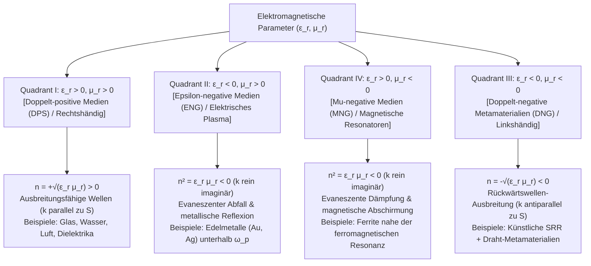
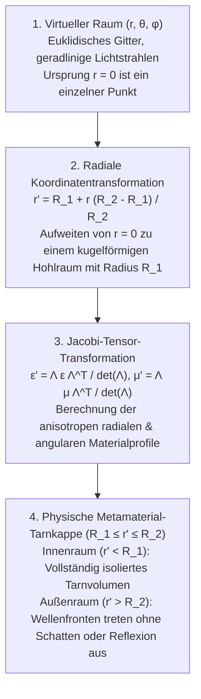

## 1. Einleitung: Materialdesign durch Geometrie statt Chemie

Jahrhundertelang galt in der Materialwissenschaft und klassischen Optik das Axiom, dass die elektromagnetischen Eigenschaften von Materie – warum Glas Licht transmittiert, Gold metallisch glänzt oder ein Trinkhalm im Wasser geknickt erscheint – ausschließlich durch die <strong>chemische Zusammensetzung</strong> bestimmt werden, also durch die Auswahl der Elemente des Periodensystems und ihre chemischen Bindungen. Zu Beginn des 21. Jahrhunderts vollzog sich jedoch an der Schnittstelle von Elektrodynamik, Festkörperphysik und Nanotechnologie ein tiefgreifender Paradigmenwechsel: die Entstehung von <strong>Metamaterialien</strong>. Abgeleitet vom griechischen Präfix <em>meta-</em> („jenseits“), bezeichnet ein Metamaterial einen künstlich strukturierten Verbundwerkstoff, dessen makroskopische elektromagnetische Antwort nicht primär durch die atomare Chemie, sondern durch die <strong>Subwellenlängen-Geometrie, Topologie und räumliche Anordnung künstlicher Struktureinheiten („Meta-Atome“)</strong> gesteuert wird.

Sichtbares Licht umfasst Wellenlängen von $\lambda \approx 400\,\text{nm}$ bis $700\,\text{nm}$, während der Atomabstand in Festkörpern nur $a_{\text{atom}} \sim 0.1\text{–}0.3\,\text{nm}$ beträgt. Da das elektromagnetische Feld über Skalen oszilliert, die tausendfach größer als einzelne Atome sind, nimmt die Lichtwelle ein räumlich gemitteltes Kontinuum wahr, das durch die <strong>elektrische Permittivität $\varepsilon$</strong> und die <strong>magnetische Permeabilität $\mu$</strong> sowie den daraus resultierenden <strong>Brechungsindex $n = \sqrt{\varepsilon_r \mu_r}$</strong> beschrieben wird. Fertigt man künstliche Resonatoren mit einer Gitterkonstante $a \lesssim \lambda / 10$, mittelt die einfallende Welle über deren Dipolmomente und erfährt das Array als homogenes <strong>effektives Medium</strong> mit maßgeschneiderten Parametern $\varepsilon_{\text{eff}}(\omega)$ und $\mu_{\text{eff}}(\omega)$.

Wesentlich ist die Abgrenzung zu <strong>photonischen Kristallen</strong> und natürlicher Strukturfarbe (wie Opalen oder <em>Morpho</em>-Schmetterlingsflügeln). In photonischen Kristallen liegt die Gitterperiode in der Größenordnung der halben Wellenlänge ($a \sim \lambda / 2$), sodass optische Bandlücken durch <strong>Bragg-Streuung</strong> entstehen und die Effektiv-Medium-Näherung (EMA) zusammenbricht. Metamaterialien operieren dagegen strikt im tiefen Subwellenlängenbereich ($a \ll \lambda$), in dem lokale Materialtensoren physikalisch wohldefiniert sind.

| Physikalisches Merkmal | Natürliche homogene Medien (Glas, Wasser, Gold) | Photonische Kristalle & Strukturfarben (Opal, Morpho) | Metamaterialien & Metasurfaces |
| :--- | :--- | :--- | :--- |
| <strong>Grundbaustein</strong> | Atome, Moleküle, Ionen | Periodische dielektrische Blöcke oder Luftlöcher | Künstliche Subwellenlängen-Resonatoren (SRRs, Nanopfeiler) |
| <strong>Gitterkonstante $a$ vs. $\lambda$</strong> | $a \sim 0.1\text{–}0.3\,\text{nm} \ (\ll \lambda/1000)$ | $a \sim \lambda / 2$ (Bragg-Regime) | $a \lesssim \lambda / 10$ (Tiefes Subwellenlängen-Regime) |
| <strong>Dominanter Mechanismus</strong> | Elektronische/ionische Polarisation | Bragg-Beugung, Vielfachstreuung | Lokale elektrische & magnetische Multipolresonanzen (LC / Mie) |
| <strong>Effektiv-Medium-Näherung</strong> | Exakt bei optischen Wellenlängen | Ungültig (stark inhomogen auf $\lambda$-Skala) | Gültig (wohldefinierte $\varepsilon_{\text{eff}}(\omega)$ und $\mu_{\text{eff}}(\omega)$) |
| <strong>Isotroper Index $n < 0$</strong> | In der Natur abwesend | Nur scheinbare Negativbrechung durch Bandkrümmung | Echte doppelt-negative Rückwärtswellen ($\varepsilon_{\text{eff}} < 0, \mu_{\text{eff}} < 0$) |

---

## 2. Maxwell-Gleichungen und die vier Quadranten der $\varepsilon\text{–}\mu$-Ebene

Für monochromatische ebene Wellen $\exp(i\mathbf{k}\cdot\mathbf{r} - i\omega t)$ in einem quellenfreien, isotropen Medium lauten die Maxwellschen Rotationsgleichungen:

$$
\mathbf{k} \times \mathbf{E} = \omega \mu \mathbf{H}, \qquad \mathbf{k} \times \mathbf{H} = -\omega \varepsilon \mathbf{E}
$$

mit $\varepsilon = \varepsilon_0 \varepsilon_r$ und $\mu = \mu_0 \mu_r$. Hieraus folgen die Dispersionsrelation und die Wellenimpedanz $Z$:

$$
k^2 = \left(\frac{\omega}{c}\right)^2 \varepsilon_r \mu_r = \left(\frac{\omega}{c}\right)^2 n^2, \qquad Z = \sqrt{\frac{\mu}{\varepsilon}} = Z_0 \sqrt{\frac{\mu_r}{\varepsilon_r}}
$$

Das Koordinatensystem aus $\varepsilon_r$ und $\mu_r$ teilt alle isotropen Materialien in vier Quadranten ein:

In der Natur bleibt Quadrant III unbesetzt, da elektrische Dipolübergänge und Plasmaschwingungen bei optischen bis UV-Frequenzen ($10^{14}\text{–}10^{16}\,\text{Hz}$) liegen, während magnetische Resonanzen (unterdrückt durch die Feinstrukturkonstante $\alpha \approx 1/137$) bereits im GHz- oder niedrigen THz-Bereich abklingen.

---

## 3. Wesselagos Gedankenexperiment (1968) und die Physik negativer Brechung

1967 (englische Übersetzung 1968) untersuchte der sowjetische Physiker <strong>Wiktor G. Wesselago (Viktor Veselago)</strong> theoretisch die Elektrodynamik eines Mediums mit $\varepsilon_r < 0$ und $\mu_r < 0$.

Aus $\mathbf{k} \times \mathbf{E} = \omega \mu \mathbf{H}$ folgt für $\varepsilon < 0, \mu < 0$, dass $(\mathbf{E}, \mathbf{H}, \mathbf{k})$ ein <strong>linkshändiges Dreibein</strong> bilden – daher der Begriff <strong>linkshändiges Material (Left-Handed Material, LHM)</strong>. Der elektromagnetische Energiefluss wird jedoch durch den <strong>Poynting-Vektor $\mathbf{S}$</strong> bestimmt:

$$
\mathbf{S} = \mathbf{E} \times \mathbf{H}, \qquad \langle \mathbf{S} \rangle = \frac{1}{2}\text{Re}(\mathbf{E} \times \mathbf{H}^*)
$$

Da $\mathbf{S}$ unabhängig von $\varepsilon$ und $\mu$ definiert ist, bildet $(\mathbf{E}, \mathbf{H}, \mathbf{S})$ immer ein rechtshändiges System. Folglich sind Wellenvektor $\mathbf{k}$ (Phasengeschwindigkeit $\mathbf{v}_p$) und Poynting-Vektor $\mathbf{S}$ (Gruppengeschwindigkeit $\mathbf{v}_g$) <strong>antiparallel ($\mathbf{k} \cdot \mathbf{S} < 0$, Rückwärtswelle)</strong>. Auch die komplexe Funktionentheorie fordert für jedes passive kausale Medium ($\varepsilon'', \mu'' > 0$) wegen der Dämpfungsbedingung $\text{Im}(n) > 0$ zwingend die negative Wurzel:

$$
n = \sqrt{\varepsilon_r \mu_r} = \sqrt{|\varepsilon_r||\mu_r|}\,e^{i\pi - i(\delta_\varepsilon + \delta_\mu)/2} = -\sqrt{|\varepsilon'||\mu'|} + i n'' \qquad (\text{Re}(n) < 0,\ \text{Im}(n) > 0)
$$

Dies führt zu drei fundamentalen Umkehreffekten:
1. <strong>Invertiertes Snelliussches Brechungsgesetz und flache Wesselago-Linse</strong>: Wegen der Stetigkeit von $k_x$ und der Vorwärtsrichtung von $S_z$ wird der gebrochene Lichtstrahl auf <strong>dieselbe Seite des Einfallslots</strong> gelenkt ($\theta_2 < 0$):
   $$
   n_1 \sin\theta_1 = n_2 \sin\theta_2 = -|n_2|\sin|\theta_2|
   $$
   Eine planparallele Platte mit $n = -1$ ($\varepsilon_r = \mu_r = -1$) fokussiert divergente Strahlen einer Punktquelle zweimal (innerhalb und außerhalb der Platte) ohne Oberflächenreflexion, da $Z = Z_0\sqrt{(-1)/(-1)} = Z_0$ exakt an das Vakuum angepasst ist.
2. <strong>Invertierter Doppler-Effekt</strong>: Eine sich nähernde Lichtquelle erfährt eine Rotverschiebung $\omega' = \omega_0 (1 - |n|v/c)$.
3. <strong>Invertierte Tscherenkow-Strahlung</strong>: Schnelle geladene Teilchen ($v > c/|n|$) emittieren den Tscherenkow-Kegel rückwärts unter einem stumpfen Winkel.

---

## 4. Sir John Pendrys Durchbruch (1996–1999): Split-Ring-Resonatoren (SRR)

Zwischen 1996 und 1999 zeigte <strong>Sir John B. Pendry</strong> am Imperial College London, wie sich $\varepsilon_{\text{eff}} < 0$ und $\mu_{\text{eff}} < 0$ durch Subwellenlängen-Metallstrukturen maßschneidern lassen:
- <strong>Dünndrahtgitter für $\varepsilon_{\text{eff}} < 0$ (1996)</strong>: Ein Gitter dünner Metalldrähte verdünnt die Elektronendichte und erhöht durch magnetische Selbstinduktion die effektive Elektronenmasse drastisch auf $m_{\text{eff}} = \frac{\mu_0 e^2 n_e \pi r^2}{2\pi}\ln(a/r) \gg m_e$. Dadurch sinkt die Plasmafrequenz in den GHz-Bereich:
  $$
  \omega_{pe}^2 = \frac{2\pi c^2}{a^2 \ln(a/r)}, \qquad \varepsilon_{\text{eff}}(\omega) = 1 - \frac{\omega_{pe}^2}{\omega(\omega + i\gamma_e)}
  $$
- <strong>Split-Ring-Resonator (SRR) für $\mu_{\text{eff}} < 0$ (1999)</strong>: Konzentrische, geschlitzte Kupferringe wirken im magnetischen Wechselfeld als subwellenlängenkleiner <strong>LC-Schwingkreis</strong> ($\omega_m = 1/\sqrt{LC}$). Knapp oberhalb von $\omega_m$ schwingt das induzierte magnetische Dipolmoment um $180^\circ$ phasenverschoben zum äußeren Feld und erzeugt eine negative effektive Permeabilität:
  $$
  \mu_{\text{eff}}(\omega) = 1 - \frac{F \omega^2}{\omega^2 - \omega_m^2 + i\gamma_m \omega}
  $$

Im Jahr 2000 kombinierten <strong>David R. Smith</strong> und Kollegen an der UC San Diego Drahtgitter und SRRs und wiesen 2001 an einem Metamaterial-Prisma bei $10.5\,\text{GHz}$ erstmals experimentell einen negativen Brechungsindex von $n = -2.7 \pm 0.1$ nach.

---

## 5. Überwindung des Beugungslimits: Pendrys Superlinse und Hyperlinsen

Klassische Linsen unterliegen dem <strong>Abbeschen Beugungslimit ($\Delta x = \lambda / (2\,\text{NA})$)</strong>. Für Raumfrequenzen $k_\parallel > k_0 = 2\pi/\lambda$ wird die longitudinale Wellenzahl rein imaginär:

$$
k_z = \sqrt{k_0^2 - k_\parallel^2} = i\sqrt{k_\parallel^2 - k_0^2} = i\kappa_z
$$

Diese <strong>evaneszenten Nahfeldwellen</strong> klingen im freien Raum exponentiell mit $\exp(-\kappa_z z)$ ab.

Im Jahr 2000 bewies Pendry (*Physical Review Letters*), dass eine Platte mit $\varepsilon_r \to -1, \mu_r \to -1$ durch resonante Anregung von <strong>Oberflächenplasmon-Polaritonen (SPPs)</strong> evaneszente Wellen exponentiell verstärkt:

$$
\lim_{\varepsilon_r \to -1,\, \mu_r \to -1} T_s(k_\parallel, d) = \exp(+\kappa_z d), \qquad \exp(-\kappa_z z_1)\cdot\exp(+\kappa_z d)\cdot\exp(-\kappa_z z_2) = 1
$$

2005 demonstrierte <strong>Xiang Zhangs</strong> Gruppe (UC Berkeley) mit einer $35\,\text{nm}$ dünnen Silber-Superlinse bei $\lambda = 365\,\text{nm}$ eine Auflösung von $60\,\text{nm}$ ($\sim \lambda/6$). Kurz darauf ermöglichten anisotrope <strong>Hyperlinsen</strong> mit hyperbolischer Dispersion ($\frac{k_r^2}{\varepsilon_\theta} - \frac{k_\theta^2}{|\varepsilon_r|} = \frac{\omega^2}{c^2}$) die Umwandlung evaneszenter Nahfelder in propagierende Fernfeldwellen.

---

## 6. Transformationsoptik und die Mathematik der Tarnkappe (Invisibility Cloak)

Im Mai 2006 begründeten <strong>John Pendry, David Schurig und David Smith</strong> sowie unabhängig <strong>Ulf Leonhardt</strong> in *Science* die <strong>Transformationsoptik (TO)</strong>. Sie nutzt die <strong>Forminvarianz der Maxwell-Gleichungen unter beliebigen glatten Koordinatentransformationen</strong> $x^i \mapsto x^{i'}$ (Jacobi-Matrix $\Lambda^{i'}_i = \frac{\partial x^{i'}}{\partial x^i}$):

$$
\varepsilon^{i'j'} = \frac{\Lambda^{i'}_i \Lambda^{j'}_j}{|\det \mathbf{\Lambda}|} \varepsilon^{ij}, \qquad \mu^{i'j'} = \frac{\Lambda^{i'}_i \Lambda^{j'}_j}{|\det \mathbf{\Lambda}|} \mu^{ij}
$$

Für Pendrys kugelförmige Tarnkappe, die eine Kugel $0 \le r \le R_2$ radial in eine Kugelschale $R_1 \le r' \le R_2$ komprimiert ($r' = R_1 + r\frac{R_2 - R_1}{R_2}$), ergeben sich die Tensorkomponenten:

$$
\varepsilon_r = \mu_r = \frac{R_2}{R_2 - R_1}\left(\frac{r' - R_1}{r'}\right)^2, \qquad \varepsilon_\theta = \varepsilon_\phi = \mu_\theta = \mu_\phi = \frac{R_2}{R_2 - R_1}
$$

An der Innenwand $r' = R_1$ verschwinden die radialen Parameter ($\varepsilon_r = \mu_r \to 0$), wodurch das Licht glatt um den Hohlraum $r' < R_1$ herumgeleitet wird. Im Oktober 2006 realisierte das Team der Duke University bei $8.5\,\text{GHz}$ die erste zylindrische Mikrowellen-Tarnkappe. Weitere Konzepte umfassen dielektrische <strong>Teppich-Tarnkappen (Carpet Cloaks)</strong>, plasmonische Streuungsunterdrückung (Alù & Engheta) und geometrisch-optische <strong>Paraxial-Tarnkappen (Rochester Cloak)</strong>.

---

## 7. Warum eine „Harry-Potter-Tarnkappe“ physikalisch unmöglich ist: Drei fundamentale Grenzen

Eine passive, verlustfreie, omnidirektionale Tarnkappe für makroskopische 3D-Objekte im gesamten sichtbaren Spektrum ($400\text{–}700\,\text{nm}$) ist durch drei fundamentale Gesetze ausgeschlossen:

1. <strong>Relativistische Kausalität und Kramers-Kronig-Bandbreitengrenze</strong>: Um den Umweg $\pi R_1 > 2R_1$ um den Hohlraum phasengleich aufzuholen, muss die Phasengeschwindigkeit in der Tarnkappe überlichtschnell sein ($v_p = c/n(\omega) > c$). Die Gruppengeschwindigkeit für Energie- und Signaltransport ist jedoch durch Einsteins Kausalitätsprinzip auf $v_g \le c$ beschränkt:
   $$
   v_g(\omega) = \frac{c}{n(\omega) + \omega \frac{dn(\omega)}{d\omega}} \le c \quad \Longrightarrow \quad \omega \frac{dn(\omega)}{d\omega} \ge 1 - n(\omega) > 0
   $$
   Gemäß den <strong>Kramers-Kronig-Relationen</strong>:
   $$
   \text{Re}\,\varepsilon_r(\omega) - 1 = \frac{2}{\pi} \mathcal{P} \int_0^\infty \frac{\omega' \, \text{Im}\,\varepsilon_r(\omega')}{\omega'^2 - \omega^2} d\omega'
   $$
   erzwingt $0 \le n(\omega) < 1$ eine starke Dispersion, die die relative Bandbreite auf $\Delta\omega / \omega_0 \lesssim \lambda_0 / R_1$ begrenzt. Für $R_1 \sim 1\,\text{m}$ bei $\lambda_0 \sim 500\,\text{nm}$ beträgt $\Delta\omega/\omega_0 \sim 5\times 10^{-7}$ (nur eine einzelne Laserlinie; Summenregel von Monticone & Alù).
2. <strong>Plasmonische Ohmsche Verluste und Sättigung der kinetischen Induktivität</strong>: Bei optischen Frequenzen ($400\text{–}750\,\text{THz}$) führt die Elektronenträgheit zur Sättigung der magnetischen Resonanz ($L_{\text{kin}} \propto m_e / (n_e e^2)$), während starke Dämpfung in Edelmetallen die Gütezahl auf $\text{FOM} = |\text{Re}(n)|/\text{Im}(n) \sim 1\text{–}3$ drückt.
3. <strong>3D-Nanofabrikation</strong>: Die Herstellung tausender präzise ausgerichteter 3D-Nanolagen mit Strukturgrößen von $10\text{–}50\,\text{nm}$ auf Quadratmeterflächen übersteigt heutige Lithografieverfahren.

---

## 8. Von 3D-Metamaterialien zu 2D-Metasurfaces und flachen Metalinsen

In den 2010er Jahren vollzog das Forschungsfeld den Übergang von <strong>3D-Volumenstrukturen zu ultradünnen 2D-Metasurfaces</strong> und ersetzte verlustbehaftete Metalle durch <strong>verlustfreie, hochbrechende Dielektrika ($\text{Si}, \text{TiO}_2, \text{GaN}$)</strong>.

2011 formulierten <strong>Federico Capasso</strong> und Nanfang Yu (Harvard) das <strong>verallgemeinerte Snelliussche Gesetz (Generalized Snell's Law)</strong>, bei dem ein räumlicher Phasengradient $\frac{d\Phi(x)}{dx}$ auf einer Subwellenlängen-Grenzfläche die Strahlablenkung steuert:

$$
n_t \sin\theta_t - n_i \sin\theta_i = \frac{\lambda_0}{2\pi} \frac{d\Phi(x)}{dx}, \qquad \sin\theta_r - \sin\theta_i = \frac{\lambda_0}{2\pi n_i} \frac{d\Phi(x)}{dx}
$$

In dielektrischen Nanopfeilern regen Verschiebungsströme ($\mathbf{J}_d = -i\omega\mathbf{D}$) verlustfreie elektrische und magnetische <strong>Mie-Resonanzen</strong> an. Bei Erfüllung der <strong>ersten Kerker-Bedingung ($\alpha_e = \alpha_m$)</strong> erreichen <strong>Huygens-Metasurfaces</strong> nahezu $100\%$ Transmission bei voller $2\pi$-Phasenkontrolle.

Durch Aufprägen des hyperbolischen Phasenprofils einer aberrationsfreien Linse:

$$
\Phi(x, y, \omega) = -\frac{\omega}{c} \left( \sqrt{x^2 + y^2 + f^2} - f \right)
$$

sowie Dispersions-Engineering der Gruppenlaufzeit $\frac{\partial\Phi}{\partial\omega}$ entstehen <strong>achromatische flache Metalinsen</strong> unter $1\,\mu\text{m}$ Dicke für Smartphones, Festkörper-LiDAR, AR/VR-Brillen und Endoskope. Darüber hinaus inspirieren Metamaterialien heute die <strong>Akustik</strong> ($\rho_{\text{eff}} < 0$), den <strong>seismischen Erdbebenschutz</strong>, <strong>thermische Tarnkappen</strong> und <strong>raumzeitliche (zeitmodulierte) Metamaterialien</strong>.
