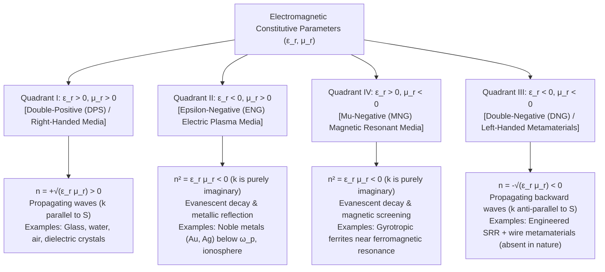
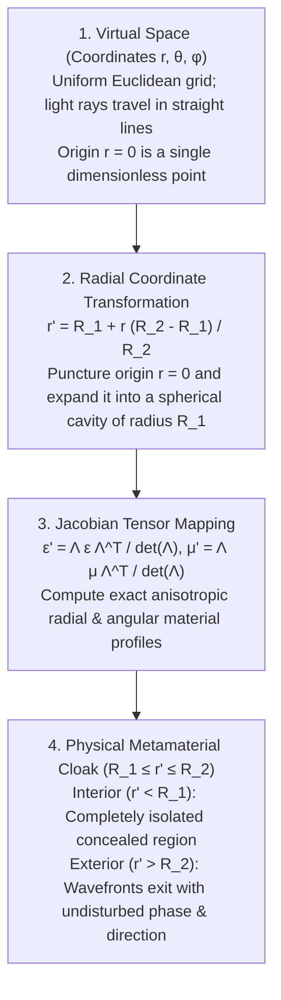

## 1. Introduction: Engineering Material Properties via Geometry Rather Than Chemistry

For centuries, a foundational axiom of materials science and classical optics held that the electromagnetic properties of matter—why glass transmits light, why gold gleams with a warm metallic luster, why a straw appears bent at the air-water interface—are dictated exclusively by <strong>chemical composition</strong>: the atomic species selected from the periodic table and the crystalline or molecular bonds uniting them. Under this paradigm, synthesizing a material with a new refractive index or absorption spectrum meant altering its stoichiometry or doping its crystal lattice.

At the turn of the twenty-first century, a profound paradigm shift emerged at the intersection of classical electrodynamics, condensed matter physics, and nanotechnology: the birth of <strong>metamaterials</strong>. Derived from the Greek prefix <em>meta-</em> ("beyond"), a metamaterial is an artificially structured composite whose macroscopic electromagnetic response is governed not primarily by the chemistry of its constituent atoms, but by the <strong>subwavelength geometry, topology, and spatial arrangement of engineered structural units ("meta-atoms")</strong>.

To appreciate why subwavelength geometry can override atomic chemistry, consider the hierarchy of length scales in light-matter interaction. Visible light spans wavelengths from $\lambda \approx 400\,\text{nm}$ (violet) to $700\,\text{nm}$ (red), whereas the interatomic spacing in solids and liquids is of order $a_{\text{atom}} \sim 0.1\text{–}0.3\,\text{nm}$—more than three orders of magnitude smaller than the optical wavelength. Because the electromagnetic field oscillates over spatial scales vastly larger than individual atoms, a propagating light wave cannot resolve discrete atomic potentials. Instead, it experiences a spatially homogenized continuum characterized by macroscopic constitutive parameters: the <strong>electric permittivity $\varepsilon$</strong> and the <strong>magnetic permeability $\mu$</strong>, which together determine the <strong>refractive index $n = \sqrt{\varepsilon_r \mu_r}$</strong>.

This observation invites a bold question: what happens if we fabricate artificial building blocks—metallic rings, dielectric nanopillars, or wire meshes—whose unit-cell pitch $a$ is much smaller than the operating wavelength ($a \lesssim \lambda / 10$), even though each unit cell still contains billions of natural atoms? To an incident electromagnetic wave of wavelength $\lambda$, these subwavelength resonators are just as unresolvable as natural atoms. The wave averages over their local electric and magnetic dipole moments, perceiving the array as a continuous, homogeneous <strong>effective medium</strong> with engineered effective permittivity $\varepsilon_{\text{eff}}(\omega)$ and effective permeability $\mu_{\text{eff}}(\omega)$.

Crucially, one must distinguish metamaterials from <strong>photonic crystals</strong> and natural structural coloration (such as the iridescent wings of <em>Morpho</em> butterflies or precious opal). In photonic crystals, the lattice constant $a$ is comparable to half the wavelength ($a \sim \lambda / 2$). Their optical properties arise from <strong>Bragg scattering and destructive interference</strong> across periodic unit cells, opening photonic bandgaps. Because the field varies rapidly on the scale of a single unit cell, a photonic crystal cannot be described as a homogeneous medium with well-defined local $\varepsilon_{\text{eff}}$ and $\mu_{\text{eff}}$. Metamaterials, by contrast, operate strictly in the deep-subwavelength regime ($a \ll \lambda$), where the <strong>Effective Medium Approximation (EMA)</strong> holds rigorously and local constitutive tensors are physically meaningful.

| Feature / Physical Regime | Natural Homogeneous Materials (Glass, Water, Metals) | Photonic Crystals & Structural Color (Opal, Morpho Wing) | Metamaterials & Metasurfaces |
| :--- | :--- | :--- | :--- |
| <strong>Fundamental Building Block</strong> | Atoms, molecules, ions | Periodic dielectric blocks, spheres, or air holes | Engineered subwavelength resonators ("meta-atoms": SRRs, nanopillars) |
| <strong>Unit-Cell Pitch $a$ vs. Wavelength $\lambda$</strong> | $a \sim 0.1\text{–}0.3\,\text{nm} \ (\ll \lambda/1000)$ | $a \sim \lambda / 2$ (Bragg regime) | $a \lesssim \lambda / 10$ (Deep-subwavelength regime) |
| <strong>Dominant Physical Mechanism</strong> | Electronic/ionic polarization, interband transitions | Bragg diffraction, multiple scattering, band folding | Local electric & magnetic multipole resonances (LC / Mie resonances) |
| <strong>Effective Medium Approximation (EMA)</strong> | Exact at optical wavelengths | Invalid (inhomogeneous on wavelength scale) | Valid (well-defined macroscopic $\varepsilon_{\text{eff}}(\omega)$ and $\mu_{\text{eff}}(\omega)$) |
| <strong>Isotropic Negative Index ($n < 0$)</strong> | Absent in nature (scales of $\varepsilon<0$ and $\mu<0$ do not overlap) | Apparent negative refraction via band-structure dispersion only | True double-negative ($\varepsilon_{\text{eff}} < 0, \mu_{\text{eff}} < 0$) backward-wave propagation |

Liberating electromagnetism from the constraints of natural atomic orbitals led to three landmark breakthroughs that rewrote textbook optics:
1. <strong>Negative Refractive Index ($n < 0$)</strong>: Realizing Viktor Veselago's 1968 theoretical prediction of "left-handed" media in which phase velocity and energy flow point in opposite directions.
2. <strong>The Superlens (Sub-diffraction Imaging)</strong>: Sir John Pendry's 2000 discovery that a negative-index slab amplifies evanescent near-field waves, overcoming Ernst Abbe's diffraction limit.
3. <strong>Transformation Optics and Invisibility Cloaking</strong>: The 2006 mathematical framework by Pendry, Schurig, Smith, and Leonhardt demonstrating that spatially tailored anisotropy ($\varepsilon^{ij}, \mu^{ij}$) mimics curved spacetime metrics, steering light smoothly around a concealed volume without reflection or shadow.

In this article, we present a rigorous, comprehensive examination of optical metamaterials—from Maxwell's equations and split-ring resonators to the mathematical physics of transformation optics, the uncompromising constraints imposed by Kramers-Kronig causality and plasmonic ohmic losses, and the modern revolution of 2D all-dielectric metasurfaces and flat metalenses.

---

## 2. Maxwell's Equations and the Four Quadrants of the $\varepsilon\text{–}\mu$ Plane

The propagation of electromagnetic waves in a source-free medium is governed by Maxwell's curl equations coupled with the macroscopic constitutive relations $\mathbf{D} = \varepsilon \mathbf{E}$ and $\mathbf{B} = \mu \mathbf{H}$. For monochromatic fields with harmonic time dependence $\exp(-i\omega t)$ in an isotropic, homogeneous medium, Maxwell's equations take the form:

$$
\nabla \times \mathbf{E} = i\omega \mu \mathbf{H}, \qquad \nabla \times \mathbf{H} = -i\omega \varepsilon \mathbf{E}
$$

where $\varepsilon = \varepsilon_0 \varepsilon_r$ is the permittivity and $\mu = \mu_0 \mu_r$ is the permeability. Substituting a plane-wave spatial dependence $\exp(i\mathbf{k}\cdot\mathbf{r})$ replaces the curl operator $\nabla \times$ with $i\mathbf{k} \times$:

$$
\mathbf{k} \times \mathbf{E} = \omega \mu \mathbf{H}, \qquad \mathbf{k} \times \mathbf{H} = -\omega \varepsilon \mathbf{E}
$$

Eliminating $\mathbf{H}$ yields the dispersion relation and the wave impedance $Z$:

$$
k^2 = \omega^2 \varepsilon \mu = \left(\frac{\omega}{c}\right)^2 \varepsilon_r \mu_r = \left(\frac{\omega}{c}\right)^2 n^2, \qquad Z = \frac{|\mathbf{E}|}{|\mathbf{H}|} = \sqrt{\frac{\mu}{\varepsilon}} = Z_0 \sqrt{\frac{\mu_r}{\varepsilon_r}}
$$

where $c = 1/\sqrt{\varepsilon_0 \mu_0}$ is the speed of light in vacuum and $Z_0 = \sqrt{\mu_0/\varepsilon_0} \approx 377\,\Omega$ is the impedance of free space.

By plotting the relative permittivity $\varepsilon_r$ on the horizontal axis and the relative permeability $\mu_r$ on the vertical axis, we partition all possible isotropic media into four distinct quadrants:

1. <strong>Quadrant I ($\varepsilon_r > 0, \mu_r > 0$: Double-Positive [DPS] Media)</strong>
   Conventional dielectrics (air, water, silica, diamond) reside here. Since $\varepsilon_r \mu_r > 0$, the wavenumber $k$ is real, waves propagate freely, and the orthogonal triad $(\mathbf{E}, \mathbf{H}, \mathbf{k})$ obeys the standard right-hand rule.
2. <strong>Quadrant II ($\varepsilon_r < 0, \mu_r > 0$: Epsilon-Negative [ENG] Media)</strong>
   Metals (silver, gold, aluminum) below their plasma frequency $\omega_p$ and gaseous plasmas inhabit Quadrant II. Free electrons oscillate $180^\circ$ out of phase with the driving electric field, screening the interior and rendering $\varepsilon_r(\omega) = 1 - \omega_p^2/\omega^2 < 0$. Because $\varepsilon_r \mu_r < 0$, the refractive index $n = i\sqrt{|\varepsilon_r|\mu_r}$ is purely imaginary. Waves cannot propagate; they decay exponentially as $\exp(-\kappa z)$ within a skin depth of tens of nanometers and undergo total reflection—explaining why polished metals act as mirrors.
3. <strong>Quadrant IV ($\varepsilon_r > 0, \mu_r < 0$: Mu-Negative [MNG] Media)</strong>
   Ferrimagnetic and ferromagnetic materials near gyromagnetic resonance at microwave frequencies exhibit $\mu_r < 0$ while $\varepsilon_r > 0$. Again, $\varepsilon_r \mu_r < 0$ yields an imaginary wavenumber $k = i\kappa$ and evanescent attenuation.
4. <strong>Quadrant III ($\varepsilon_r < 0, \mu_r < 0$: Double-Negative [DNG] Media)</strong>
   When both $\varepsilon_r < 0$ and $\mu_r < 0$ simultaneously, their product is positive: $n^2 = \varepsilon_r \mu_r > 0$! Two opacity mechanisms—electric plasma screening and magnetic resonance screening—cancel each other's evanescent character, restoring a real wavenumber $k$ and allowing electromagnetic waves to propagate transparently through the medium.

Why does nature leave Quadrant III empty? In natural atoms, electric dipole transitions and free-electron plasma oscillations occur at optical and ultraviolet frequencies ($\sim 10^{14}\text{–}10^{16}\,\text{Hz}$), whereas magnetic dipole resonances involve electron spin precession or orbital currents governed by the Bohr magneton, which couple weakly (suppressed by the fine-structure constant $\alpha \approx 1/137$) and roll off above gigahertz or low-terahertz frequencies. Thus, in naturally occurring substances, the frequency windows for $\varepsilon_r(\omega) < 0$ and $\mu_r(\omega) < 0$ are separated by several orders of magnitude.

---

## 3. Veselago's 1968 Thought Experiment and the Physics of Negative Refraction

In 1967 (published in English translation in <em>Sov. Phys. Usp.</em> in 1968), the Soviet physicist <strong>Viktor G. Veselago</strong> at the Lebedev Physical Institute asked what would happen if a Quadrant III medium ($\varepsilon_r < 0, \mu_r < 0$) could somehow be synthesized.

### Why Must We Choose the Negative Branch $n = -\sqrt{\varepsilon_r \mu_r} < 0$?

At first glance, if $\varepsilon_r = -1$ and $\mu_r = -1$, then $n^2 = \varepsilon_r \mu_r = (-1)(-1) = +1$, tempting one to write $n = +1$. Veselago proved rigorously from electrodynamics and causality that one <strong>must</strong> select the negative square root, $n = -\sqrt{\varepsilon_r \mu_r} < 0$.

To see why, examine the vector orientation in Maxwell's plane-wave equations:

$$
\mathbf{k} \times \mathbf{E} = \omega \mu \mathbf{H}, \qquad \mathbf{k} \times \mathbf{H} = -\omega \varepsilon \mathbf{E}
$$

When $\varepsilon < 0$ and $\mu < 0$, both right-hand sides reverse sign relative to a conventional medium. Consequently, the electric field $\mathbf{E}$, magnetic field $\mathbf{H}$, and wavevector $\mathbf{k}$ (which points in the direction of the <strong>phase velocity</strong> $\mathbf{v}_p = \frac{\omega}{k^2}\mathbf{k}$) form a <strong>left-handed triad</strong>—prompting Veselago to coin the term <strong>Left-Handed Material (LHM)</strong>.

However, the flow of electromagnetic energy is governed by the <strong>Poynting vector $\mathbf{S}$</strong>:

$$
\mathbf{S} = \mathbf{E} \times \mathbf{H}, \qquad \langle \mathbf{S} \rangle = \frac{1}{2}\text{Re}(\mathbf{E} \times \mathbf{H}^*)
$$

Notice that neither $\varepsilon$ nor $\mu$ appears in the definition of $\mathbf{S} = \mathbf{E} \times \mathbf{H}$. Therefore, the triad $(\mathbf{E}, \mathbf{H}, \mathbf{S})$ <strong>always forms a right-handed system</strong> in every conceivable medium!
Since $(\mathbf{E}, \mathbf{H}, \mathbf{k})$ is left-handed while $(\mathbf{E}, \mathbf{H}, \mathbf{S})$ is right-handed, the wavevector $\mathbf{k}$ and the Poynting vector $\mathbf{S}$ must be <strong>antiparallel</strong>:

$$
\mathbf{k} \cdot \mathbf{S} < 0 \quad \Longleftrightarrow \quad \mathbf{v}_p \text{ and } \mathbf{v}_g \text{ point in opposite directions!}
$$

By causality, energy emitted by a source must travel outward away from the source ($\mathbf{S}$ points away from the source). In a double-negative medium, the phase fronts ($\mathbf{k}$) therefore travel <strong>backward toward the source</strong>—a phenomenon known as a <strong>backward wave</strong>.

Complex analysis confirms this branch choice unequivocally. Any passive causal medium possesses small positive dissipation ($\varepsilon_r = -|\varepsilon'| + i\varepsilon''$ and $\mu_r = -|\mu'| + i\mu''$ with $\varepsilon'', \mu'' > 0$). Writing $\varepsilon_r = |\varepsilon_r|e^{i(\pi - \delta_\varepsilon)}$ and $\mu_r = |\mu_r|e^{i(\pi - \delta_\mu)}$ in the upper half of the complex plane, their product has argument $2\pi - (\delta_\varepsilon + \delta_\mu)$. Taking the square root halves the argument to $\pi - \frac{\delta_\varepsilon + \delta_\mu}{2}$, yielding:

$$
n = \sqrt{\varepsilon_r \mu_r} = \sqrt{|\varepsilon_r||\mu_r|} \, e^{i\pi - i(\delta_\varepsilon + \delta_\mu)/2} = -\sqrt{|\varepsilon'||\mu'|} + i n'' \qquad (\text{Re}(n) < 0,\ \text{Im}(n) > 0)
$$

Thus, thermodynamic passivity ($\text{Im}(n) > 0$, ensuring exponential decay rather than unphysical amplification along the direction of energy flow $\mathbf{S}$) mathematically forces $\text{Re}(n) < 0$.

### The Triad of Reversed Optical Phenomena

1. <strong>Reversed Snell's Law and the Flat Veselago Lens</strong>
   When a ray of light crosses an interface from a positive-index medium ($n_1 > 0$) into a negative-index medium ($n_2 < 0$), boundary continuity of the tangential field components requires conservation of the tangential wavevector component: $k_{1x} = k_{2x}$. Meanwhile, energy conservation requires the normal component of the Poynting vector $S_{2z}$ to point forward into Medium 2. Because $\mathbf{k}_2$ is antiparallel to $\mathbf{S}_2$, $k_{2z}$ must point backward toward the interface, which forces the refracted energy ray $\mathbf{S}_2$ to bend to the <strong>same side of the surface normal as the incident ray</strong> ($\theta_2 < 0$):
   $$
   n_1 \sin\theta_1 = n_2 \sin\theta_2 = -|n_2|\sin|\theta_2|
   $$
   Consequently, a simple <strong>flat parallel slab</strong> of $n = -1$ material ($\varepsilon_r = -1, \mu_r = -1$) acts as a lens: diverging rays from a point source bend inward at the front interface, cross at an internal focus inside the slab, and bend inward a second time at the rear interface to form a real, aberration-free 3D image outside the slab—with zero surface reflection because its impedance $Z = Z_0\sqrt{(-1)/(-1)} = Z_0$ matches free space perfectly.
2. <strong>Reversed Doppler Effect</strong>
   In a medium with $n < 0$, a light source moving toward an observer at velocity $v$ chases its own backward-propagating phase fronts. Instead of compressing the wavefronts (blueshift), its motion stretches them apart, causing the observer to measure a <strong>redshift (lower frequency)</strong> for an approaching source:
   $$
   \omega' = \omega_0 \left(1 - \frac{|n|v}{c}\right)
   $$
3. <strong>Reversed Cherenkov Radiation</strong>
   When a fast charged particle traverses a medium at speed $v > c/|n|$, phase matching requires $\mathbf{k}\cdot\mathbf{v} = \omega$, so $\mathbf{k}$ forms an acute forward cone ($\cos\theta_{\mathbf{k}} = \frac{c}{|n|v} > 0$). Because radiated energy flows along $\mathbf{S} \parallel -\mathbf{k}$, the Cherenkov shockwave cone is emitted <strong>backward at an obtuse angle</strong> ($\theta_{\mathbf{S}} = \pi - \theta_{\mathbf{k}} > 90^\circ$) relative to the particle's trajectory.

---

## 4. Sir John Pendry's Breakthrough (1996–1999) and the First Experimental Demonstration

For three decades, Veselago's paper remained a theoretical curiosity. The breakthrough came between 1996 and 1999, when <strong>Sir John B. Pendry</strong> at Imperial College London showed how subwavelength metallic architectures could synthesize $\varepsilon_{\text{eff}}(\omega) < 0$ and $\mu_{\text{eff}}(\omega) < 0$ at any desired frequency.

### Artificial Electric Plasma: Thin-Wire Arrays (1996)
Bulk metals have a plasma frequency $\omega_p = \sqrt{n_e e^2 / (\varepsilon_0 m_e)}$ in the ultraviolet ($\sim 2\times 10^{15}\,\text{rad/s}$), making $|\varepsilon_r|$ overwhelmingly negative and lossy at microwave frequencies. Pendry proposed a 3D periodic lattice of ultra-thin metallic wires of radius $r \sim 1\,\mu\text{m}$ spaced by $a \sim 5\,\text{mm}$. Two physical effects occur:
1. Spatial dilution reduces the average electron density to $n_{\text{eff}} = n_e (\pi r^2 / a^2)$.
2. Crucially, a current $I = \pi r^2 n_e e v$ flowing along a thin wire generates an intenseazimuthal magnetic field $H(\rho) = I / (2\pi\rho)$, storing large magnetic self-inductance energy per unit length. Equating this magnetic energy to the kinetic energy of the electrons endows each electron with an <strong>enormous effective magnetic mass</strong>:

$$
m_{\text{eff}} = \frac{\mu_0 e^2 n_e \pi r^2}{2\pi} \ln\left(\frac{a}{r}\right) \gg m_e
$$

Substituting $n_{\text{eff}}$ and $m_{\text{eff}}$ into the plasma frequency formula cancels the microscopic electron density $n_e$ entirely, leaving a purely geometric effective plasma frequency lowered by six orders of magnitude into the gigahertz regime:

$$
\omega_{pe}^2 = \frac{n_{\text{eff}} e^2}{\varepsilon_0 m_{\text{eff}}} = \frac{2\pi c^2}{a^2 \ln(a/r)}, \qquad \varepsilon_{\text{eff}}(\omega) = 1 - \frac{\omega_{pe}^2}{\omega(\omega + i\gamma_e)}
$$

### Artificial Magnetism from Non-Magnetic Conductors: The Split-Ring Resonator (1999)
To synthesize $\mu_{\text{eff}}(\omega) < 0$ without magnetic materials, Pendry invented the <strong>Split-Ring Resonator (SRR)</strong>: a pair of concentric, non-magnetic metallic rings (such as copper) with narrow capacitive splits etched on opposite sides.

When a time-varying magnetic field $\mathbf{H}(t)$ threads the ring perpendicular to its plane, Faraday's law of induction drives a circulating current $I(t)$ around the loop, creating a magnetic dipole moment $m = \pi r_0^2 I$ and an effective inductance $L$. The narrow splits interrupt the current loop and accumulate opposite charges across the gaps, acting as series capacitances $C$. The subwavelength SRR therefore operates as a miniature planar <strong>LC resonant circuit</strong> with magnetic resonance frequency $\omega_m = 1/\sqrt{LC}$.

Just above the resonance frequency ($\omega_m < \omega < \omega_{mp} = \omega_m / \sqrt{1 - F}$), the driven LC oscillator responds $180^\circ$ out of phase with the external magnetic field. The induced magnetization $\mathbf{M}$ opposes $\mathbf{H}$ so strongly that the total magnetic flux density $\mathbf{B} = \mu_0(\mathbf{H} + \mathbf{M})$ reverses sign, yielding a Lorentzian effective permeability that turns <strong>negative</strong>:

$$
\mu_{\text{eff}}(\omega) = 1 - \frac{F \omega^2}{\omega^2 - \omega_m^2 + i\gamma_m \omega}
$$

where $F = \pi r_0^2 / a^2$ is the fractional area filling factor of the unit cell and $\gamma_m$ is the ohmic damping rate.

### The Smith et al. Microwave Experiment (2000–2001)
In 2000, <strong>David R. Smith</strong>, Willie Padilla, Vier, Nemat-Nasser, and Sheldon Schultz at the University of California, San Diego (UCSD) combined Pendry's copper split-ring resonators and continuous wire strips on interlocking fiberglass printed-circuit boards. Within the overlap band around $10.5\,\text{GHz}$ ($\lambda \approx 2.85\,\text{cm}$) where both $\varepsilon_{\text{eff}}(\omega) < 0$ and $\mu_{\text{eff}}(\omega) < 0$, a passband appeared in which microwaves propagated through a composite whose individual sub-lattices were each opaque. In 2001, Shelby, Smith, and Schultz fabricated a wedge-shaped prism of this metamaterial and directly measured the deflection of a microwave beam to the negative side of the surface normal, confirming a negative refractive index of $n = -2.7 \pm 0.1$.

---

## 5. Beating the Diffraction Limit: Pendry's Superlens and Hyperlenses

In 2000, Pendry published a seminal paper in <em>Physical Review Letters</em> titled <em>"Negative Refraction Makes a Perfect Lens"</em>, proving that Veselago's flat $n = -1$ slab not only focuses propagating rays, but also restores the subwavelength near-field information lost to conventional optics.

### The Physics of the Abbe Diffraction Limit
Why can no conventional glass lens resolve details smaller than roughly half a wavelength ($\Delta x = \frac{\lambda}{2\text{NA}}$)?
Consider an object in the plane $z = 0$ emitting or scattering monochromatic light of angular frequency $\omega = c k_0$. By 2D Fourier decomposition, the spatial features of the object are encoded into transverse spatial frequencies $(k_x, k_y)$ with transverse wavenumber $k_\parallel = \sqrt{k_x^2 + k_y^2}$. Maxwell's wave equation in free space dictates the longitudinal wavenumber $k_z$:

$$
k_z = \sqrt{k_0^2 - k_\parallel^2} = \sqrt{\left(\frac{2\pi}{\lambda}\right)^2 - (k_x^2 + k_y^2)}
$$

1. <strong>Propagating Waves ($k_\parallel \le k_0$)</strong>: Coarse spatial features larger than $\lambda$ correspond to real $k_z$. These waves propagate oscillatory as $\exp(ik_z z)$ into the far field and are collected by conventional lenses. Because the maximum captured spatial frequency is bounded by $k_0 = 2\pi/\lambda$, the finest resolvable period is $\Delta x \sim \pi/k_0 = \lambda/2$.
2. <strong>Evanescent Waves ($k_\parallel > k_0$)</strong>: Fine subwavelength features smaller than $\lambda$ carry transverse wavenumbers exceeding $k_0$. Consequently, $k_z$ becomes <strong>purely imaginary</strong>:
   $$
   k_z = i\sqrt{k_\parallel^2 - k_0^2} = i\kappa_z \qquad (\kappa_z > 0)
   $$
   The propagation factor $\exp(ik_z z) = \exp(-\kappa_z z)$ decays exponentially within tens of nanometers of the object's surface. No conventional lens can recover these evanescent waves because amplifying them would require an exponential inverse transfer function $\exp(+\kappa_z d)$.

### Evanescent Wave Amplification via Surface Plasmon Resonance
Pendry analyzed the exact Fresnel transmission coefficient $T_s(k_\parallel, d)$ for an evanescent TE (or TM) mode traversing a slab of thickness $d$ with relative parameters $\varepsilon_r$ and $\mu_r$. Summing the infinite Fabry-Pérot multiple reflections between the front and back interfaces gives:

$$
T_s(k_\parallel, d) = \frac{4 \mu_r k_z k'_z \exp(-\kappa'_z d)}{(\mu_r k_z + k'_z)^2 - (\mu_r k_z - k'_z)^2 \exp(-2\kappa'_z d)}
$$

When $\varepsilon_r \to -1$ and $\mu_r \to -1$, we have $k'_z = k_z = i\kappa_z$, and the first term in the denominator $(\mu_r k_z + k'_z)^2 = (-k_z + k_z)^2$ <strong>vanishes identically</strong>! The remaining terms cancel to yield:

$$
\lim_{\varepsilon_r \to -1,\, \mu_r \to -1} T_s(k_\parallel, d) = \frac{-4 k_z^2 \exp(-\kappa_z d)}{-4 k_z^2 \exp(-2\kappa_z d)} = \exp(+\kappa_z d)
$$

Remarkably, the $n = -1$ slab <strong>amplifies evanescent waves exponentially</strong> by $\exp(+\kappa_z d)$! Physically, this does not violate energy conservation because evanescent modes carry zero time-averaged real power along $z$; instead, the condition $\mu_r k_z + k'_z = 0$ (or $\varepsilon_r k_z + k'_z = 0$ for TM polarization) is precisely the dispersion condition for resonant excitation of <strong>Surface Plasmon Polaritons (SPPs)</strong> coupled across the two interfaces of the slab. When the total free-space distance $z_1 + z_2$ equals the slab thickness $d$, the free-space decay and the slab amplification cancel exactly:

$$
\exp(-\kappa_z z_1) \cdot \exp(+\kappa_z d) \cdot \exp(-\kappa_z z_2) = \exp\bigl(-\kappa_z(z_1 + z_2 - d)\bigr) = 1
$$

Both propagating and evanescent Fourier components arrive at the image plane with unity amplitude and zero phase error, yielding a theoretical <strong>"Perfect Lens" (Superlens)</strong> free of the diffraction limit.

In 2005, <strong>Xiang Zhang's</strong> group at UC Berkeley experimentally demonstrated an optical silver ($\text{Ag}$) superlens ($35\,\text{nm}$ thick) operating at $\lambda = 365\,\text{nm}$ (where $\text{Re}(\varepsilon_{\text{Ag}}) \approx -1$), resolving $60\,\text{nm}$ half-pitch nanowires ($\sim \lambda / 6$). Shortly thereafter, researchers developed cylindrical <strong>hyperlenses</strong> made of alternating concentric nanolayers of silver and alumina ($\text{Al}_2\text{O}_3$). Exhibiting a <strong>hyperbolic dispersion relation</strong> ($\frac{k_r^2}{\varepsilon_\theta} - \frac{k_\theta^2}{|\varepsilon_r|} = \frac{\omega^2}{c^2}$ with $\varepsilon_r < 0, \varepsilon_\theta > 0$), the hyperlens converts high-$k_\theta$ evanescent waves into propagating waves and magnifies them radially outward ($k_\theta \propto 1/r$), projecting sub-diffraction images directly into the far field of a conventional optical microscope.

---

## 6. Transformation Optics and the Mathematics of Invisibility Cloaking

In May 2006, two back-to-back papers in <em>Science</em>—one by <strong>John Pendry, David Schurig, and David Smith</strong>, and the other by <strong>Ulf Leonhardt</strong>—introduced <strong>Transformation Optics (TO)</strong>, providing an exact mathematical recipe for an <strong>invisibility cloak</strong>.

### Metric Invariance of Maxwell's Equations
Transformation optics exploits a deep symmetry shared with Albert Einstein's General Theory of Relativity: <strong>Maxwell's equations are form-invariant under arbitrary smooth coordinate transformations</strong>.

Suppose light propagates in straight lines through a flat, homogeneous Euclidean "virtual space" with coordinates $x^i = (x, y, z)$ and vacuum parameters $\varepsilon^{ij} = \varepsilon_0 \delta^{ij}, \mu^{ij} = \mu_0 \delta^{ij}$. Now apply a smooth diffeomorphism $x^i \mapsto x^{i'}(x, y, z)$ that warps, stretches, or compresses the coordinate grid, characterized by the Jacobian matrix $\Lambda^{i'}_i = \frac{\partial x^{i'}}{\partial x^i}$. In the transformed coordinates $x^{i'}$, Maxwell's equations retain their exact canonical form, provided the scalar vacuum constants are replaced by spatially inhomogeneous, anisotropic permittivity and permeability tensors $\varepsilon^{i'j'}(\mathbf{r}')$ and $\mu^{i'j'}(\mathbf{r}')$:

$$
\varepsilon^{i'j'} = \frac{\Lambda^{i'}_i \Lambda^{j'}_j}{|\det \mathbf{\Lambda}|} \varepsilon^{ij}, \qquad \mu^{i'j'} = \frac{\Lambda^{i'}_i \Lambda^{j'}_j}{|\det \mathbf{\Lambda}|} \mu^{ij}
$$

Instead of warping actual spacetime with astronomical gravitational masses, we can leave flat physical space untouched and fabricate a metamaterial whose local tensors $\boldsymbol{\varepsilon}'(\mathbf{r}')$ and $\boldsymbol{\mu}'(\mathbf{r}')$ obey the Jacobian transformation above. Light rays and full electromagnetic wavefields will then follow the exact trajectories of the warped coordinate grid! Moreover, because $\boldsymbol{\varepsilon}'$ and $\boldsymbol{\mu}'$ are scaled identically everywhere, the local wave impedance remains matched to vacuum ($Z' = Z_0$), guaranteeing <strong>zero reflection</strong> at the boundary of the cloak.

### Derivation of Pendry's Spherical and Cylindrical Cloak
To create a concealed volume, Pendry et al. punctured the coordinate origin $r = 0$ inside a sphere (or cylinder) of outer radius $R_2$ and radially compressed the entire ball $0 \le r \le R_2$ into a spherical shell $R_1 \le r' \le R_2$:

$$
r' = R_1 + r \left(\frac{R_2 - R_1}{R_2}\right), \qquad \theta' = \theta, \qquad \phi' = \phi \qquad (0 \le r \le R_2 \implies R_1 \le r' \le R_2)
$$

For $r > R_2$, the transformation is the identity ($r' = r$). Substituting this radial mapping into the Jacobian tensor formula yields the required relative permittivity and permeability components inside the spherical cloak shell ($R_1 \le r' \le R_2$):

$$
\varepsilon_r = \mu_r = \frac{R_2}{R_2 - R_1}\left(\frac{r' - R_1}{r'}\right)^2, \qquad \varepsilon_\theta = \varepsilon_\phi = \mu_\theta = \mu_\phi = \frac{R_2}{R_2 - R_1}
$$

(For a 2D cylindrical cloak invariant along $z$, the parameters are $\varepsilon_r = \mu_r = \frac{r' - R_1}{r'}$, $\varepsilon_\theta = \mu_\theta = \frac{r'}{r' - R_1}$, and $\varepsilon_z = \mu_z = \left(\frac{R_2}{R_2 - R_1}\right)^2 \frac{r' - R_1}{r'}$).

Observe how these parameters guide the electromagnetic wave:
- The transverse angular indices are constant and greater than unity ($\varepsilon_\theta = \frac{R_2}{R_2 - R_1} > 1$).
- The radial components $\varepsilon_r, \mu_r$ vary continuously with radius and <strong>vanish ($\varepsilon_r = \mu_r \to 0$) at the inner boundary $r' = R_1$</strong> (an Epsilon-Near-Zero [ENZ] and Mu-Near-Zero [MNZ] singularity). This zero radial index refracts rays tangentially away from the inner wall, forcing all electromagnetic energy to glide smoothly around the central cavity $r' < R_1$ and rejoin seamlessly behind it, restoring both the propagation direction and the exact phase of the undisturbed plane wave.

In October 2006, <strong>Schurig, Mock, Justice, Cummer, Pendry, Starr, and Smith</strong> at Duke University built the first experimental 2D cylindrical microwave cloak operating at $8.5\,\text{GHz}$, using 10 concentric fiberglass rings patterned with radially graded copper SRRs to conceal a conducting copper cylinder.

Subsequent research produced several distinct cloaking architectures to mitigate the extreme anisotropy and $n_r \to 0$ singularity of the ideal transformation cloak:

| Cloaking Architecture | Key Pioneers | Physical Mechanism | Primary Advantages | Fundamental Limitations |
| :--- | :--- | :--- | :--- | :--- |
| <strong>Ideal Transformation Optics Cloak</strong> | Pendry, Schurig, Smith (2006) | Anisotropic $\boldsymbol{\varepsilon}', \boldsymbol{\mu}'$ tensors derived from radial coordinate compression | Omnidirectional, phase-preserving, exact wave-optical invisibility | Requires $n_r \to 0$ ($v_p \to \infty$) at inner boundary; restricted by causality to a single frequency |
| <strong>Carpet Cloak (Ground-Plane Cloak)</strong> | Li & Pendry (2008); Valentine et al. (2009) | Quasi-conformal mapping transforms a bump on a flat mirror into a flat virtual mirror | Eliminates anisotropy and $n < 1$; realizable with low-loss isotropic GRIN dielectrics ($\text{Si}, \text{Si}_3\text{N}_4$) at optical wavelengths | Conceals objects only against a reflective background plane, not in free space |
| <strong>Plasmonic / Mantle Scattering Cancellation</strong> | Alù & Engheta (2005, 2009) | Ultrathin negative-$\varepsilon$ shell or impedance metasurface induces anti-phase dipole moment to cancel primary scattering | Non-resonant, ultrathin coating; substantially broader bandwidth than resonant SRR cloaks | Effective only for subwavelength or wavelength-scale objects ($D \lesssim \lambda$) |
| <strong>Ray-Optics / Paraxial Cloak (Rochester Cloak)</strong> | Leonhardt (2006); Howell & Choi (2014) | Achromatic lens quadruplets or birefringent calcite crystals route geometric rays around a hidden volume | Works across the entire visible spectrum (white light) for macroscopic objects | Destroys wavefront phase; works only within a narrow viewing cone (paraxial limit) |

---

## 7. Why a "Harry Potter Invisibility Cloak" Is Forbidden by Physics: Three Fundamental Limits

Can we scale transformation optics to build a wearable cloak that renders a human invisible in broad daylight from all viewing angles? Modern electrodynamics proves that <strong>an omnidirectional, passive, lossless invisibility cloak concealing a macroscopic 3D object in free space across the broadband visible spectrum ($400\text{–}700\,\text{nm}$) is fundamentally forbidden by the laws of physics</strong>. Three formidable barriers stand in the way.

### Limit 1: Relativistic Causality and the Kramers-Kronig Bandwidth Bound
The deepest barrier is <strong>Einstein's principle of relativistic causality</strong>: no energy or information can propagate faster than the speed of light in vacuum $c$.

In an ideal spherical cloak of inner radius $R_1$, a wave packet skimming the inner boundary must traverse a curved semicircular trajectory of length $\pi R_1$, whereas an uncloaked wave in free space travels a straight diameter of length $2R_1$. To exit the cloak in phase with the surrounding undisturbed wavefront, the wave inside the cloak must travel with a <strong>phase velocity $v_p = c / n(\omega) > c$</strong> (diverging to $v_p \to \infty$ as $n_r \to 0$ at $r' = R_1$).

While a superluminal phase velocity $v_p > c$ at a single continuous-wave frequency $\omega_0$ does not violate special relativity, the <strong>group velocity</strong> $v_g = \frac{\partial \omega}{\partial k}$—which governs the speed of energy transport and broadband light pulses—is strictly bounded by $v_g \le c$:

$$
v_g(\omega) = \frac{c}{n(\omega) + \omega \frac{dn(\omega)}{d\omega}} \le c \quad \Longrightarrow \quad \omega \frac{dn(\omega)}{d\omega} \ge 1 - n(\omega) > 0
$$

Because $0 \le n(\omega) < 1$ inside the cloak, keeping $v_g \le c$ requires a <strong>steep positive frequency derivative $\frac{dn}{d\omega} \gg 0$ (strong normal dispersion)</strong>. Furthermore, causality requires the complex permittivity and permeability of any passive linear medium to obey the <strong>Kramers-Kronig relations</strong>:

$$
\text{Re}\,\varepsilon_r(\omega) - 1 = \frac{2}{\pi} \mathcal{P} \int_0^\infty \frac{\omega' \, \text{Im}\,\varepsilon_r(\omega')}{\omega'^2 - \omega^2} d\omega', \qquad \text{Re}\,\mu_r(\omega) - 1 = \frac{2}{\pi} \mathcal{P} \int_0^\infty \frac{\omega' \, \text{Im}\,\mu_r(\omega')}{\omega'^2 - \omega^2} d\omega'
$$

and positivity of stored electromagnetic energy density in low-loss regions demands $\frac{\partial(\omega\varepsilon)}{\partial\omega} > \varepsilon_0$ and $\frac{\partial(\omega\mu)}{\partial\omega} > \mu_0$. Consequently, $n(\omega) < 1$ (or $n(\omega) < 0$) can only be achieved within a <strong>narrow frequency window $\Delta\omega$</strong> around a resonance, accompanied by unavoidable absorption peaks nearby. Worse still, because the excess path delay around an object of radius $R_1$ scales with $R_1 / c$, the maximum fractional bandwidth over which phase-preserving cloaking can operate shrinks inversely with the electrical size of the object:

$$
\frac{\Delta\omega}{\omega_0} \lesssim \frac{\lambda_0}{R_1}
$$

For a human-sized object ($R_1 \sim 1\,\text{m}$) at visible wavelengths ($\lambda_0 \sim 500\,\text{nm}$), the allowable relative bandwidth is $\Delta\omega/\omega_0 \sim 5\times 10^{-7}$—a single laser line! Under broadband white sunlight, every other wavelength experiences a mismatched refractive index, producing severe chromatic distortion and strong scattering. As rigorously proven by <strong>Francesco Monticone and Andrea Alù</strong> via the <em>electromagnetic scattering cross-section sum rule</em>, integrated over all frequencies from $\omega = 0$ to $\infty$, a passive cloak cannot reduce total scattering; suppressing scattering in one narrow band inevitably enhances scattering at adjacent wavelengths.

### Limit 2: Plasmonic Ohmic Losses and Kinetic Inductance Saturation at Optical Frequencies
At microwave frequencies ($\sim 10\,\text{GHz}$), copper is an almost ideal conductor with negligible ohmic loss ($\text{FOM} = |\text{Re}(n)| / \text{Im}(n) > 100$). When scaling metallic SRRs or fishnet metamaterials up to optical frequencies ($400\text{–}750\,\text{THz}$), two physical breakdowns occur:
1. <strong>Kinetic Inductance Saturation</strong>: Above tens of terahertz, the inertial kinetic energy of drifting electrons adds a kinetic inductance $L_{\text{kin}} \propto \frac{m_e}{n_e e^2}$ that dominates the geometric Faraday inductance $L_{\text{mag}} \propto \mu_0 r_0$. Scaling the SRR radius $r_0 \to 0$ no longer increases the magnetic resonance frequency $\omega_m = 1/\sqrt{(L_{\text{mag}} + L_{\text{kin}})C}$, which saturates in the near-infrared.
2. <strong>Drude-Lorentz Ohmic Dissipation</strong>: Near the optical plasmon resonance of gold or silver, electromagnetic fields penetrate deeply into the metal, driving intense electron-phonon and surface-scattering collisions. The imaginary part $\text{Im}(\varepsilon)$ surges, collapsing the Figure of Merit to $\text{FOM} \sim 1\text{–}3$. Light propagating through a 3D metallic metamaterial is absorbed within a few micrometers, turning a putative invisibility cloak into an opaque black silhouette.

### Limit 3: 3D Nanofabrication Bottlenecks
Satisfying the effective medium condition $a \lesssim \lambda / 10$ for visible light ($\lambda = 400\text{–}700\,\text{nm}$) requires 3D unit cells with feature sizes of $10\text{–}50\,\text{nm}$. While Electron-Beam Lithography (EBL), Focused Ion Beam (FIB) milling, and Extreme Ultraviolet (EUV) lithography routinely pattern such features on 2D planar silicon wafers, stacking thousands of aligned 3D nanolayers over macroscopic square-meter areas remains prohibitively slow and expensive.

---

## 8. From 3D Metamaterials to 2D All-Dielectric Metasurfaces and Metalenses

Confronted by narrow bandwidth, metallic ohmic loss, and 3D fabrication complexity, the metamaterials community executed a brilliant strategic pivot in the 2010s based on two innovations:
1. <strong>Dimensionality Reduction (3D Bulk $\to$ 2D Metasurfaces)</strong>: Compressing bulk metamaterials into ultrathin planar arrays of subwavelength thickness ($d \ll \lambda$), eliminating propagation losses and unlocking standard planar CMOS semiconductor foundry manufacturing.
2. <strong>Material Transition (Lossy Metals $\to$ All-Dielectric Mie Resonators)</strong>: Replacing plasmonic metals with transparent, high-refractive-index dielectrics such as silicon ($\text{Si}, n \approx 3.5$), titanium dioxide ($\text{TiO}_2, n \approx 2.4$), gallium nitride ($\text{GaN}$), and silicon nitride ($\text{Si}_3\text{N}_4$).

### The Generalized Snell's Law (Yu & Capasso, 2011)
In 2011, <strong>Federico Capasso</strong> and Nanfang Yu at Harvard University demonstrated that rather than accumulating phase gradually through the bulk thickness of glass ($\Delta\phi = n k_0 d$), an array of subwavelength nano-antennas can imprint a spatially tailored, abrupt <strong>phase discontinuity $\Phi(x, y)$</strong> directly across an ultrathin interface. Applying Fermat's principle of stationary optical path length across a phase-gradient metasurface yields the <strong>Generalized Law of Reflection and Refraction (Generalized Snell's Law)</strong>:

$$
n_t \sin\theta_t - n_i \sin\theta_i = \frac{\lambda_0}{2\pi} \frac{d\Phi(x)}{dx}, \qquad \sin\theta_r - \sin\theta_i = \frac{\lambda_0}{2\pi n_i} \frac{d\Phi(x)}{dx}
$$

By engineering the spatial phase gradient $\frac{d\Phi}{dx}$ via the geometry or orientation (Pancharatnam-Berry geometric phase) of subwavelength nanopillars, a flat interface only a few hundred nanometers thick can steer light into arbitrary angles—including negative refraction—without bulk thickness.

### All-Dielectric Mie Resonances and Huygens' Metasurfaces
When light illuminates a subwavelength nanopillar of a high-index dielectric ($\text{Si}$ or $\text{TiO}_2$), Mie scattering theory shows that circular loops of <strong>displacement current $\mathbf{J}_d = -i\omega\mathbf{D}$</strong> are excited inside the dielectric cylinder, generating a strong <strong>magnetic dipole (MD) resonance</strong> alongside the <strong>electric dipole (ED) resonance</strong>—with virtually <strong>zero ohmic heating</strong> because there are no free conduction electrons!

By tuning the nanopillar aspect ratio (height-to-diameter ratio) so that the electric and magnetic dipole resonances overlap in frequency and amplitude—satisfying the <strong>first Kerker condition</strong> ($\alpha_e = \alpha_m$)—backward scattering cancels destructively to zero. Such a <strong>Huygens' metasurface</strong> achieves near-$100\%$ optical transmission while providing full $0$ to $2\pi$ phase coverage.

### Flat Metalenses Revolutionizing Modern Optics
By arranging millions of $\text{TiO}_2$ or $\text{Si}$ nanopillars on a flat glass wafer to synthesize the exact hyperbolic phase profile of an ideal aberration-free lens:

$$
\Phi(x, y, \omega) = -\frac{\omega}{c} \left( \sqrt{x^2 + y^2 + f^2} - f \right)
$$

researchers created flat <strong>metalenses</strong> less than $1\,\mu\text{m}$ thick that match or surpass the diffraction-limited focusing of multi-element compound glass objectives. Furthermore, by dispersion-engineering coupled nanopillar waveguide modes to simultaneously control both the phase $\Phi(\omega_0)$ and the group delay $\left.\frac{\partial\Phi}{\partial\omega}\right|_{\omega_0}$ (and group delay dispersion), <strong>broadband achromatic metalenses</strong> now focus the entire visible spectrum without chromatic aberration. Mass-produced on $300\,\text{mm}$ wafers via deep-UV immersion lithography and nanoimprint lithography, metasurfaces are rapidly being deployed in smartphone 3D face-recognition dot projectors, automotive solid-state LiDAR, ultracompact AR/VR waveguide combiners, endoscopic medical imaging, and spaceborne instrumentation.

---

## 9. Beyond Electromagnetism: Acoustic, Seismic, Thermal, and Spatiotemporal Metamaterials

Because wave propagation and diffusive transport across physics share isomorphic partial differential equations, the principles of metamaterials and transformation optics now extend far beyond light:
1. <strong>Acoustic Metamaterials</strong>: Replacing permittivity $\varepsilon$ and permeability $\mu$ with <strong>effective mass density $\rho_{\text{eff}}(\omega)$</strong> and <strong>effective bulk modulus $B_{\text{eff}}(\omega)$</strong> ($v_{\text{sound}} = \sqrt{B_{\text{eff}}/\rho_{\text{eff}}}$), locally resonant silicone-coated spheres and Helmholtz resonator arrays achieve negative effective mass density ($\rho_{\text{eff}} < 0$, accelerating opposite to an applied force) and negative bulk modulus ($B_{\text{eff}} < 0$, expanding under compression). Applications include ultralight subwavelength acoustic insulation, ultrasonic superlenses, and underwater sonar cloaks.
2. <strong>Seismic Metamaterials</strong>: Concentric arrays of cylindrical boreholes or resonant pilings engineered in soil around critical infrastructure (such as nuclear reactors or historic monuments) act as meter-scale metamaterials that reflect or divert destructive Rayleigh seismic surface waves ($\lambda \sim 10\text{–}100\,\text{m}$).
3. <strong>Thermal Metamaterials and Cloaking</strong>: Because Fourier's heat conduction equation $\rho c_p \frac{\partial T}{\partial t} = \nabla \cdot (\boldsymbol{\kappa}\nabla T)$ is also form-invariant under coordinate transformations, alternating concentric rings of high-conductivity copper and low-conductivity PDMS polymer synthesize anisotropic thermal conductivity tensors $\boldsymbol{\kappa}'$ that route heat flux smoothly around a thermally sensitive central region without disturbing the external temperature gradient.
4. <strong>Spatiotemporal Metamaterials (Photonic Time Crystals)</strong>: Modulating permittivity $\varepsilon(\mathbf{r}, t)$ in both space and time via ultrafast optical pumping or electro-optic modulation breaks time-translation symmetry, coupling frequencies $\omega$, breaking Lorentz reciprocity without magnetic bias, and bypassing static Kramers-Kronig bandwidth bounds.

---

## 10. Conclusion: A Copernican Revolution in Materials Science

The trajectory of optical metamaterials—from Viktor Veselago's 1968 mathematical exploration of $\varepsilon < 0, \mu < 0$ electrodynamics, through Sir John Pendry's split-ring resonators, superlenses, and transformation optics cloaks, to the rigorous bounds of Kramers-Kronig causality and the triumph of 2D all-dielectric metasurfaces—represents a Copernican revolution in how humanity conceives of matter.

We are no longer restricted to the optical constants bequeathed by natural atomic orbitals. By sculpting subwavelength geometry in space and time, we can program the constitutive tensors of space itself, bending light, sound, heat, and mechanical waves in ways nature never envisioned.
