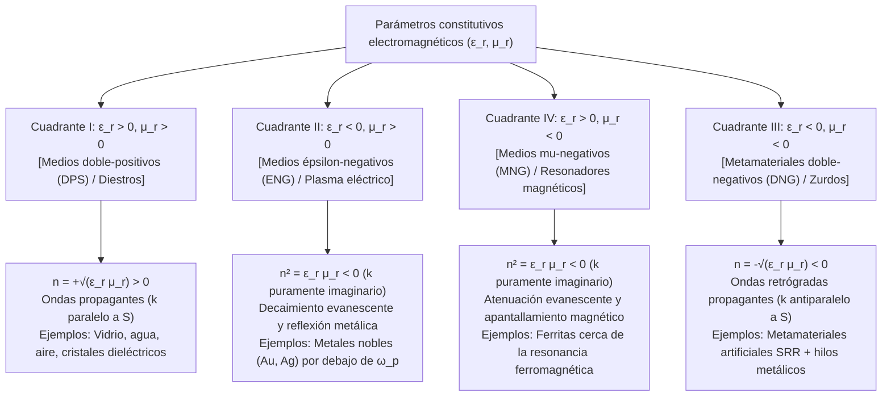
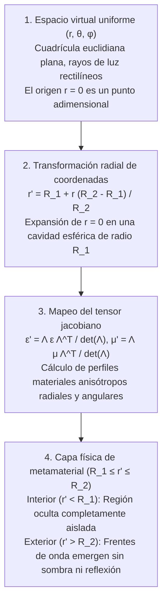

## 1. Introducción: Ingeniería de propiedades materiales mediante la geometría en lugar de la química

Durante siglos, un axioma fundamental de la ciencia de materiales y la óptica clásica sostuvo que las propiedades electromagnéticas de la materia —por qué el vidrio transmite la luz, el oro brilla con lustre metálico o una pajita parece doblarse en el agua— están dictadas exclusivamente por su <strong>composición química</strong>: las especies atómicas de la tabla periódica y sus enlaces químicos. A principios del siglo XXI surgió un cambio de paradigma radical en la intersección de la electrodinámica clásica, la física de la materia condensada y la nanotecnología: los <strong>metamateriales</strong>. Derivado del prefijo griego <em>meta-</em> («más allá»), un metamaterial es un compuesto estructurado artificialmente cuya respuesta electromagnética macroscópica no está gobernada principalmente por la química atómica, sino por la <strong>geometría sublongitud de onda, la topología y la disposición espacial de unidades estructurales diseñadas («meta-átomos»)</strong>.

La luz visible abarca longitudes de onda de $\lambda \approx 400\,\text{nm}$ a $700\,\text{nm}$, mientras que el espaciamiento interatómico en sólidos es de $a_{\text{atom}} \sim 0.1\text{–}0.3\,\text{nm}$. Como el campo electromagnético oscila en escalas miles de veces mayores que los átomos individuales, la onda luminosa percibe un continuo espacialmente promediado caracterizado por la <strong>permitividad eléctrica $\varepsilon$</strong> y la <strong>permeabilidad magnética $\mu$</strong>, que determinan el <strong>índice de refracción $n = \sqrt{\varepsilon_r \mu_r}$</strong>. Si fabricamos resonadores artificiales con un paso de celda unitaria $a \lesssim \lambda / 10$, la onda promedia sus momentos dipolares locales y percibe el conjunto como un <strong>medio efectivo</strong> continuo con parámetros diseñados $\varepsilon_{\text{eff}}(\omega)$ y $\mu_{\text{eff}}(\omega)$.

Es crucial distinguir los metamateriales de los <strong>cristales fotónicos</strong> y la coloración estructural natural (como el ópalo o las alas de la mariposa <em>Morpho</em>). En los cristales fotónicos, la constante de red es comparable a media longitud de onda ($a \sim \lambda / 2$), generando bandas prohibidas mediante <strong>dispersión de Bragg</strong> donde la aproximación de medio efectivo (EMA) no es válida. Los metamateriales operan estrictamente en el régimen sublongitud de onda profundo ($a \ll \lambda$), donde $\varepsilon_{\text{eff}}$ y $\mu_{\text{eff}}$ tienen un significado físico local riguroso.

| Característica física | Materiales homogéneos naturales (Vidrio, Agua, Oro) | Cristales fotónicos y color estructural (Ópalo, Morpho) | Metamateriales y Metasuperficies |
| :--- | :--- | :--- | :--- |
| <strong>Bloque constructivo básico</strong> | Átomos, moléculas, iones | Bloques dieléctricos periódicos o cavidades de aire | Resonadores sublongitud de onda («meta-átomos»: SRR, nanopilares) |
| <strong>Paso de red $a$ vs. $\lambda$</strong> | $a \sim 0.1\text{–}0.3\,\text{nm} \ (\ll \lambda/1000)$ | $a \sim \lambda / 2$ (Régimen de Bragg) | $a \lesssim \lambda / 10$ (Régimen sublongitud de onda profundo) |
| <strong>Mecanismo físico dominante</strong> | Polarización electrónica/iónica | Difracción de Bragg, dispersión múltiple | Resonancias multipolares eléctricas y magnéticas (LC / Mie) |
| <strong>Aproximación de Medio Efectivo</strong> | Exacta en longitudes de onda ópticas | Inválida (inhomogénea a escala de $\lambda$) | Válida (tensores $\varepsilon_{\text{eff}}(\omega), \mu_{\text{eff}}(\omega)$ bien definidos) |
| <strong>Índice negativo isótropo ($n < 0$)</strong> | Ausente en la naturaleza | Refración negativa aparente por curvatura de banda | Propagación real de ondas retrógradas doble-negativas ($\varepsilon_{\text{eff}} < 0, \mu_{\text{eff}} < 0$) |

---

## 2. Ecuaciones de Maxwell y los cuatro cuadrantes del plano $\varepsilon\text{–}\mu$

Para ondas planas monocromáticas $\exp(i\mathbf{k}\cdot\mathbf{r} - i\omega t)$ en un medio isótropo y homogéneo sin fuentes, las ecuaciones rotacionales de Maxwell son:

$$
\mathbf{k} \times \mathbf{E} = \omega \mu \mathbf{H}, \qquad \mathbf{k} \times \mathbf{H} = -\omega \varepsilon \mathbf{E}
$$

con $\varepsilon = \varepsilon_0 \varepsilon_r$ y $\mu = \mu_0 \mu_r$. Eliminando $\mathbf{H}$ se obtienen la relación de dispersión y la impedancia de onda $Z$:

$$
k^2 = \left(\frac{\omega}{c}\right)^2 \varepsilon_r \mu_r = \left(\frac{\omega}{c}\right)^2 n^2, \qquad Z = \sqrt{\frac{\mu}{\varepsilon}} = Z_0 \sqrt{\frac{\mu_r}{\varepsilon_r}}
$$

El plano $(\varepsilon_r, \mu_r)$ clasifica todos los medios isótropos en cuatro cuadrantes:

La naturaleza deja vacío el Cuadrante III porque las resonancias eléctricas atómicas ocurren en frecuencias ópticas y UV ($10^{14}\text{–}10^{16}\,\text{Hz}$), mientras que las resonancias magnéticas (suprimidas por la constante de estructura fina $\alpha \approx 1/137$) caen por encima de las frecuencias de microondas o terahercios.

---

## 3. El experimento mental de Veselago (1968) y la física de la refracción negativa

En 1967 (publicado en inglés en 1968), el físico soviético <strong>Viktor G. Veselago</strong> demostró que cuando $\varepsilon_r < 0$ y $\mu_r < 0$ simultáneamente, la tríada $(\mathbf{E}, \mathbf{H}, \mathbf{k})$ forma un <strong>sistema levógiro (mano izquierda)</strong>, acuñando el término <strong>material zurdo (Left-Handed Material, LHM)</strong>. Sin embargo, el flujo de energía electromagnética viene dado por el <strong>vector de Poynting $\mathbf{S}$</strong>:

$$
\mathbf{S} = \mathbf{E} \times \mathbf{H}, \qquad \langle \mathbf{S} \rangle = \frac{1}{2}\text{Re}(\mathbf{E} \times \mathbf{H}^*)
$$

Como $\mathbf{S}$ no contiene $\varepsilon$ ni $\mu$, $(\mathbf{E}, \mathbf{H}, \mathbf{S})$ siempre forma un sistema dextrógiro. Por consiguiente, el vector de onda $\mathbf{k}$ (velocidad de fase $\mathbf{v}_p$) y el vector de Poynting $\mathbf{S}$ (velocidad de grupo $\mathbf{v}_g$) son <strong>antiparalelos ($\mathbf{k} \cdot \mathbf{S} < 0$, onda retrógrada)</strong>. El análisis complejo en cualquier medio pasivo causal ($\varepsilon'', \mu'' > 0$) exige tomar la raíz cuadrada negativa para garantizar $\text{Im}(n) > 0$:

$$
n = \sqrt{\varepsilon_r \mu_r} = \sqrt{|\varepsilon_r||\mu_r|}\,e^{i\pi - i(\delta_\varepsilon + \delta_\mu)/2} = -\sqrt{|\varepsilon'||\mu'|} + i n'' \qquad (\text{Re}(n) < 0,\ \text{Im}(n) > 0)
$$

Esto produce tres fenómenos ópticos invertidos:
1. <strong>Ley de Snell invertida y lente plana de Veselago</strong>: Por continuidad de $k_x$ y flujo de energía hacia adelante $S_z > 0$, el rayo refractado se dobla hacia el <strong>mismo lado de la normal</strong> que el rayo incidente:
   $$
   n_1 \sin\theta_1 = n_2 \sin\theta_2 = -|n_2|\sin|\theta_2|
   $$
   Una placa plana paralela con $n = -1$ ($\varepsilon_r = \mu_r = -1$) enfoca los rayos divergentes de una fuente puntual tanto dentro como fuera de la placa sin reflexión superficial ($Z = Z_0\sqrt{(-1)/(-1)} = Z_0$).
2. <strong>Efecto Doppler invertido</strong>: Una fuente que se aproxima al observador experimenta un desplazamiento hacia el rojo $\omega' = \omega_0 (1 - |n|v/c)$.
3. <strong>Radiación de Cherenkov invertida</strong>: Una partícula cargada superlumínica ($v > c/|n|$) emite su cono de radiación hacia atrás en un ángulo obtuso.

---

## 4. El avance de Sir John Pendry (1996–1999): Resonadores de Anillo Dividido (SRR)

Entre 1996 y 1999, <strong>Sir John B. Pendry</strong> (Imperial College London) mostró cómo diseñar $\varepsilon_{\text{eff}} < 0$ y $\mu_{\text{eff}} < 0$ mediante estructuras metálicas sublongitud de onda:
- <strong>Redes de hilos metálicos finos (1996)</strong>: La dilución espacial y la autoinductancia magnética dotan a los electrones de una masa efectiva enorme $m_{\text{eff}} = \frac{\mu_0 e^2 n_e \pi r^2}{2\pi}\ln(a/r) \gg m_e$, reduciendo la frecuencia de plasma al rango de GHz:
  $$
  \omega_{pe}^2 = \frac{2\pi c^2}{a^2 \ln(a/r)}, \qquad \varepsilon_{\text{eff}}(\omega) = 1 - \frac{\omega_{pe}^2}{\omega(\omega + i\gamma_e)}
  $$
- <strong>Resonador de Anillo Dividido (Split-Ring Resonator, SRR, 1999)</strong>: Dos anillos concéntricos de cobre con ranuras capacitivas actúan como un <strong>circuito resonante LC</strong> planar ($\omega_m = 1/\sqrt{LC}$). Justo por encima de $\omega_m$, el momento magnético inducido oscila desfasado $180^\circ$ respecto al campo externo, generando una permeabilidad efectiva negativa:
  $$
  \mu_{\text{eff}}(\omega) = 1 - \frac{F \omega^2}{\omega^2 - \omega_m^2 + i\gamma_m \omega}
  $$

En 2000–2001, <strong>David R. Smith</strong> y colaboradores en UC San Diego combinaron hilos y SRRs en un prisma metamaterial, midiendo directamente un índice negativo $n = -2.7 \pm 0.1$ a $10.5\,\text{GHz}$.

---

## 5. Superando el límite de difracción: La Superlente de Pendry y las Hiperlentes

Las lentes convencionales están limitadas por el <strong>límite de difracción de Abbe ($\Delta x = \lambda / (2\,\text{NA})$)</strong>. Para frecuencias espaciales altas ($k_\parallel > k_0 = 2\pi/\lambda$), el número de onda longitudinal es puramente imaginario:

$$
k_z = \sqrt{k_0^2 - k_\parallel^2} = i\sqrt{k_\parallel^2 - k_0^2} = i\kappa_z
$$

Estas <strong>ondas evanescentes</strong> decaen exponencialmente como $\exp(-\kappa_z z)$. En 2000, Pendry (*Physical Review Letters*) demostró que una lámina con $\varepsilon_r \to -1, \mu_r \to -1$ excita <strong>polaritones de plasmón superficial (SPP)</strong> que <strong>amplifican exponencialmente las ondas evanescentes</strong>:

$$
\lim_{\varepsilon_r \to -1,\, \mu_r \to -1} T_s(k_\parallel, d) = \exp(+\kappa_z d), \qquad \exp(-\kappa_z z_1)\cdot\exp(+\kappa_z d)\cdot\exp(-\kappa_z z_2) = 1
$$

En 2005, el grupo de <strong>Xiang Zhang</strong> (UC Berkeley) demostró una superlente de plata de $35\,\text{nm}$ a $\lambda = 365\,\text{nm}$ con resolución de $60\,\text{nm}$ ($\sim \lambda/6$), seguida de las <strong>hiperlentes</strong> hiperbólicas ($\frac{k_r^2}{\varepsilon_\theta} - \frac{k_\theta^2}{|\varepsilon_r|} = \frac{\omega^2}{c^2}$) que proyectan imágenes sub-difracción al campo lejano.

---

## 6. Óptica de transformación y las matemáticas de la capa de invisibilidad

En mayo de 2006, <strong>Pendry, Schurig y Smith</strong> junto con <strong>Ulf Leonhardt</strong> introdujeron en *Science* la <strong>óptica de transformación (TO)</strong>, basada en la <strong>invariancia de forma de las ecuaciones de Maxwell bajo transformaciones de coordenadas</strong> $x^i \mapsto x^{i'}$ (matriz jacobiana $\Lambda^{i'}_i = \frac{\partial x^{i'}}{\partial x^i}$):

$$
\varepsilon^{i'j'} = \frac{\Lambda^{i'}_i \Lambda^{j'}_j}{|\det \mathbf{\Lambda}|} \varepsilon^{ij}, \qquad \mu^{i'j'} = \frac{\Lambda^{i'}_i \Lambda^{j'}_j}{|\det \mathbf{\Lambda}|} \mu^{ij}
$$

Al comprimir la esfera $0 \le r \le R_2$ en el cascarón esférico $R_1 \le r' \le R_2$ mediante $r' = R_1 + r\frac{R_2 - R_1}{R_2}$, se obtienen los parámetros de la capa esférica de Pendry:

$$
\varepsilon_r = \mu_r = \frac{R_2}{R_2 - R_1}\left(\frac{r' - R_1}{r'}\right)^2, \qquad \varepsilon_\theta = \varepsilon_\phi = \mu_\theta = \mu_\phi = \frac{R_2}{R_2 - R_1}
$$

En la frontera interna $r' = R_1$, $\varepsilon_r = \mu_r \to 0$ (singularidad de índice cero), desviando tangencialmente las ondas alrededor de la cavidad $r' < R_1$. En octubre de 2006, el equipo de la Universidad de Duke construyó la primera capa cilíndrica de microondas a $8.5\,\text{GHz}$. Otras arquitecturas incluyen la <strong>capa alfombra (Carpet Cloak)</strong> cuasi-conforme, la cancelación plasmónica de dispersión (Alù & Engheta) y la <strong>capa paraxial de óptica geométrica (Capa de Rochester)</strong>.

---

## 7. Por qué una «capa de invisibilidad de Harry Potter» está prohibida por la física

Una capa de invisibilidad pasiva, sin pérdidas y omnidireccional para un objeto 3D macroscópico en el espectro visible ($400\text{–}700\,\text{nm}$) es físicamente imposible debido a tres límites fundamentales:

1. <strong>Causalidad relativista y límite de ancho de banda de Kramers-Kronig</strong>: Para rodear la cavidad ($\pi R_1 > 2R_1$) manteniendo la fase, la velocidad de fase dentro de la capa debe superar $c$ ($v_p = c/n(\omega) > c$), pero la velocidad de grupo que transporta energía está limitada por $v_g \le c$:
   $$
   v_g(\omega) = \frac{c}{n(\omega) + \omega \frac{dn(\omega)}{d\omega}} \le c \quad \Longrightarrow \quad \omega \frac{dn(\omega)}{d\omega} \ge 1 - n(\omega) > 0
   $$
   Junto con las <strong>relaciones de Kramers-Kronig</strong>:
   $$
   \text{Re}\,\varepsilon_r(\omega) - 1 = \frac{2}{\pi} \mathcal{P} \int_0^\infty \frac{\omega' \, \text{Im}\,\varepsilon_r(\omega')}{\omega'^2 - \omega^2} d\omega'
   $$
   el ancho de banda relativo queda acotado por $\Delta\omega / \omega_0 \lesssim \lambda_0 / R_1$ ($\sim 5\times 10^{-7}$ para $R_1 = 1\,\text{m}$ en luz visible; regla de suma de Monticone & Alù).
2. <strong>Pérdidas óhmicas plasmónicas y saturación de la inductancia cinética</strong>: En frecuencias ópticas ($400\text{–}750\,\text{THz}$), la inductancia cinética electrónica ($L_{\text{kin}} \propto m_e / (n_e e^2)$) satura la resonancia magnética y la absorción metálica reduce la figura de mérito a $\text{FOM} = |\text{Re}(n)|/\text{Im}(n) \sim 1\text{–}3$.
3. <strong>Cuello de botella de la nanofabricación 3D</strong>: Apilar miles de nanocapas 3D con resolución de $10\text{–}50\,\text{nm}$ en áreas macroscópicas supera las técnicas litográficas actuales.

---

## 8. De los metamateriales 3D a las metasuperficies 2D dieléctricas y las metalentes

En la década de 2010, el campo evolucionó hacia las <strong>metasuperficies 2D</strong> fabricadas con resonadores de Mie de <strong>dieléctricos de alto índice sin pérdidas ($\text{Si}, \text{TiO}_2, \text{GaN}$)</strong>.

En 2011, <strong>Federico Capasso</strong> y Nanfang Yu (Harvard) formularon la <strong>Ley de Snell Generalizada</strong>, donde un gradiente espacial de fase $\frac{d\Phi(x)}{dx}$ controla la refracción:

$$
n_t \sin\theta_t - n_i \sin\theta_i = \frac{\lambda_0}{2\pi} \frac{d\Phi(x)}{dx}, \qquad \sin\theta_r - \sin\theta_i = \frac{\lambda_0}{2\pi n_i} \frac{d\Phi(x)}{dx}
$$

Cuando los dipolos eléctrico y magnético de Mie cumplen la <strong>primera condición de Kerker ($\alpha_e = \alpha_m$)</strong>, las <strong>metasuperficies de Huygens</strong> logran casi un $100\%$ de transmisión. Al sintetizar el perfil de fase hiperbólico de una lente ideal:

$$
\Phi(x, y, \omega) = -\frac{\omega}{c} \left( \sqrt{x^2 + y^2 + f^2} - f \right)
$$

y diseñar el retardo de grupo $\frac{\partial\Phi}{\partial\omega}$, las <strong>metalentes acromáticas planas</strong> ($< 1\,\mu\text{m}$ de espesor) impulsan hoy el reconocimiento facial 3D, el LiDAR automotriz, las gafas AR/VR y la endoscopia médica, extendiendo además el paradigma hacia los <strong>metamateriales acústicos, sísmicos, térmicos y espaciotemporales</strong>.
