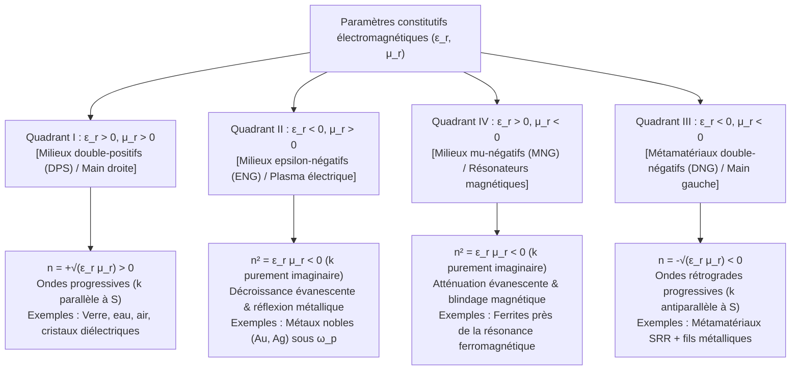
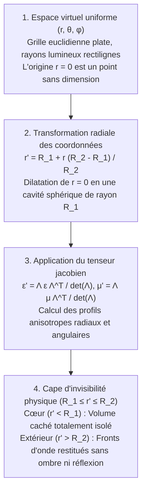

## 1. Introduction : Concevoir les propriétés de la matière par la géométrie plutôt que par la chimie

Pendant des siècles, un axiome fondamental de la science des matériaux et de l'optique classique stipulait que les propriétés électromagnétiques de la matière — la transparence du verre, l'éclat métallique de l'or ou la réfraction d'une paille dans l'eau — étaient exclusivement régies par la <strong>composition chimique</strong> : la nature des atomes du tableau périodique et leurs liaisons chimiques. À l'aube du XXIe siècle, un changement de paradigme majeur a émergé au croisement de l'électrodynamique, de la physique de la matière condensée et des nanotechnologies : la naissance des <strong>métamatériaux</strong>. Issu du préfixe grec <em>meta-</em> (« au-delà »), un métamatériau est un composite artificiellement structuré dont la réponse électromagnétique macroscopique dépend non pas de sa chimie atomique, mais de la <strong>géométrie sub-longueur d'onde, de la topologie et de l'agencement spatial d'unités structurelles (« méta-atomes »)</strong>.

La lumière visible couvre des longueurs d'onde de $\lambda \approx 400\,\text{nm}$ à $700\,\text{nm}$, tandis que la distance interatomique dans les solides est de l'ordre de $a_{\text{atom}} \sim 0.1\text{–}0.3\,\text{nm}$. Ne pouvant résoudre les atomes individuels, l'onde lumineuse perçoit un milieu continu caractérisé par la <strong>permittivité électrique $\varepsilon$</strong> et la <strong>perméabilité magnétique $\mu$</strong>, définissant l'<strong>indice de réfraction $n = \sqrt{\varepsilon_r \mu_r}$</strong>. Si l'on fabrique des résonateurs artificiels dont le pas de réseau $a$ est très inférieur à la longueur d'onde ($a \lesssim \lambda / 10$), l'onde électromagnétique moyenne leurs moments dipolaires locaux et perçoit un <strong>milieu effectif</strong> doté de paramètres sur mesure $\varepsilon_{\text{eff}}(\omega)$ et $\mu_{\text{eff}}(\omega)$.

Il est essentiel de distinguer les métamatériaux des <strong>cristaux photoniques</strong> et des couleurs structurelles naturelles (opale, ailes du papillon <em>Morpho</em>). Dans un cristal photonique, la période du réseau est comparable à la demi-longueur d'onde ($a \sim \lambda / 2$), ouvrant des bandes interdites par <strong>diffusion de Bragg</strong> où l'approximation du milieu effectif (EMA) échoue. Les métamatériaux opèrent strictement dans le régime sub-longueur d'onde profond ($a \ll \lambda$), où $\varepsilon_{\text{eff}}$ et $\mu_{\text{eff}}$ conservent un sens physique local rigoureux.

| Caractéristique physique | Matériaux homogènes naturels (Verre, Eau, Or) | Cristaux photoniques & Couleur structurelle (Opale, Morpho) | Métamatériaux & Métasurfaces |
| :--- | :--- | :--- | :--- |
| <strong>Brique élémentaire</strong> | Atomes, molécules, ions | Blocs diélectriques périodiques ou cavités d'air | Résonateurs sub-longueur d'onde (« méta-atomes » : SRR, nanopiliers) |
| <strong>Pas de réseau $a$ vs $\lambda$</strong> | $a \sim 0.1\text{–}0.3\,\text{nm} \ (\ll \lambda/1000)$ | $a \sim \lambda / 2$ (Régime de Bragg) | $a \lesssim \lambda / 10$ (Régime sub-longueur d'onde profond) |
| <strong>Mécanisme dominant</strong> | Polarisation électronique/ionique | Diffraction de Bragg, interférences multiples | Résonances multipolaires électriques et magnétiques (LC / Mie) |
| <strong>Approximation du milieu effectif</strong> | Exacte aux longueurs d'onde optiques | Invalide (champ inhomogène à l'échelle de la maille) | Valide (tenseurs $\varepsilon_{\text{eff}}(\omega), \mu_{\text{eff}}(\omega)$ bien définis) |
| <strong>Indice négatif isotrope ($n < 0$)</strong> | Absent dans la nature | Réfraction négative apparente par courbure de bande | Propagation d'ondes rétrogrades double-négatives ($\varepsilon_{\text{eff}} < 0, \mu_{\text{eff}} < 0$) |

---

## 2. Équations de Maxwell et les quatre quadrants du plan $\varepsilon\text{–}\mu$

Dans un milieu isotrope et homogène sans source, une onde plane monochromatique $\exp(i\mathbf{k}\cdot\mathbf{r} - i\omega t)$ obéit aux équations de Maxwell :

$$
\mathbf{k} \times \mathbf{E} = \omega \mu \mathbf{H}, \qquad \mathbf{k} \times \mathbf{H} = -\omega \varepsilon \mathbf{E}
$$

avec $\varepsilon = \varepsilon_0 \varepsilon_r$ et $\mu = \mu_0 \mu_r$. On en déduit la relation de dispersion et l'impédance d'onde $Z$ :

$$
k^2 = \left(\frac{\omega}{c}\right)^2 \varepsilon_r \mu_r = \left(\frac{\omega}{c}\right)^2 n^2, \qquad Z = \sqrt{\frac{\mu}{\varepsilon}} = Z_0 \sqrt{\frac{\mu_r}{\varepsilon_r}}
$$

Le plan $(\varepsilon_r, \mu_r)$ divise tous les milieux isotropes en quatre quadrants :

Dans la nature, le Quadrant III est vide car les résonances électriques atomiques se situent aux fréquences optiques/UV ($10^{14}\text{–}10^{16}\,\text{Hz}$), tandis que les résonances magnétiques (réduites par la constante de structure fine $\alpha \approx 1/137$) s'éteignent au-delà des fréquences micro-ondes ou térahertz.

---

## 3. L'expérience de pensée de Veselago (1968) et la réfraction négative

En 1967 (traduit en anglais en 1968), le physicien soviétique <strong>Viktor G. Veselago</strong> a démontré que si $\varepsilon_r < 0$ et $\mu_r < 0$ simultanément, le trièdre $(\mathbf{E}, \mathbf{H}, \mathbf{k})$ devient un <strong>trièdre rétrograde (main gauche)</strong>, d'où le nom de <strong>matériau main gauche (Left-Handed Material, LHM)</strong>. En revanche, le flux d'énergie électromagnétique est dicté par le <strong>vecteur de Poynting $\mathbf{S}$</strong> :

$$
\mathbf{S} = \mathbf{E} \times \mathbf{H}, \qquad \langle \mathbf{S} \rangle = \frac{1}{2}\text{Re}(\mathbf{E} \times \mathbf{H}^*)
$$

Comme $\mathbf{S}$ ne dépend ni de $\varepsilon$ ni de $\mu$, $(\mathbf{E}, \mathbf{H}, \mathbf{S})$ forme toujours un trièdre direct (main droite). Par conséquent, le vecteur d'onde $\mathbf{k}$ (vitesse de phase $\mathbf{v}_p$) et le vecteur de Poynting $\mathbf{S}$ (vitesse de groupe $\mathbf{v}_g$) sont <strong>antiparallèles ($\mathbf{k} \cdot \mathbf{S} < 0$, onde rétrograde)</strong>. L'analyse complexe dans un milieu passif causal ($\varepsilon'', \mu'' > 0$) impose le choix de la racine négative pour garantir l'amortissement thermodynamique $\text{Im}(n) > 0$ :

$$
n = \sqrt{\varepsilon_r \mu_r} = \sqrt{|\varepsilon_r||\mu_r|}\,e^{i\pi - i(\delta_\varepsilon + \delta_\mu)/2} = -\sqrt{|\varepsilon'||\mu'|} + i n'' \qquad (\text{Re}(n) < 0,\ \text{Im}(n) > 0)
$$

Cela entraîne trois phénomènes optiques inversés :
1. <strong>Loi de Snell-Descartes inversée et lentille plane de Veselago</strong> : La continuité de $k_x$ et la conservation du flux d'énergie $S_z > 0$ obligent le rayon réfracté à plier du <strong>même côté de la normale</strong> que le rayon incident :
   $$
   n_1 \sin\theta_1 = n_2 \sin\theta_2 = -|n_2|\sin|\theta_2|
   $$
   Une simple lame à faces parallèles d'indice $n = -1$ focalise ainsi deux fois les rayons divergents d'une source ponctuelle sans aucune réflexion de surface ($Z = Z_0\sqrt{(-1)/(-1)} = Z_0$).
2. <strong>Effet Doppler inversé</strong> : Une source s'approchant d'un observateur subit un décalage vers le rouge $\omega' = \omega_0 (1 - |n|v/c)$.
3. <strong>Rayonnement Tcherenkov inversé</strong> : Une particule chargée ultra-rapide ($v > c/|n|$) émet son cône de choc vers l'arrière selon un angle obtus.

---

## 4. La percée de Sir John Pendry (1996–1999) : Résonateurs en anneau fendu (SRR)

Entre 1996 et 1999, <strong>Sir John B. Pendry</strong> (Imperial College London) a conçu les architectures sub-longueur d'onde permettant de synthétiser $\varepsilon_{\text{eff}} < 0$ et $\mu_{\text{eff}} < 0$ :
- <strong>Réseau de fils métalliques fins (1996)</strong> : La dilution spatiale et l'auto-inductance magnétique confèrent aux électrons une masse effective géante $m_{\text{eff}} = \frac{\mu_0 e^2 n_e \pi r^2}{2\pi}\ln(a/r) \gg m_e$, abaissant la fréquence plasma dans le domaine GHz :
  $$
  \omega_{pe}^2 = \frac{2\pi c^2}{a^2 \ln(a/r)}, \qquad \varepsilon_{\text{eff}}(\omega) = 1 - \frac{\omega_{pe}^2}{\omega(\omega + i\gamma_e)}
  $$
- <strong>Résonateur en anneau fendu (Split-Ring Resonator, SRR, 1999)</strong> : Deux anneaux concentriques de cuivre dotés d'entrefers capacitifs agissent comme un <strong>circuit résonant LC</strong> plan ($\omega_m = 1/\sqrt{LC}$). Juste au-dessus de $\omega_m$, l'aimantation induite oscille en opposition de phase avec le champ magnétique externe, produisant une perméabilité effective négative :
  $$
  \mu_{\text{eff}}(\omega) = 1 - \frac{F \omega^2}{\omega^2 - \omega_m^2 + i\gamma_m \omega}
  $$

En 2000–2001, <strong>David R. Smith</strong> et ses collègues à l'UC San Diego ont combiné fils et SRR pour mesurer expérimentalement un indice négatif de $n = -2.7 \pm 0.1$ à $10.5\,\text{GHz}$.

---

## 5. Vaincre la limite de diffraction : La Superlentille de Pendry et l'Hyperlentille

L'optique conventionnelle est bornée par la <strong>limite de diffraction d'Abbe ($\Delta x = \lambda / (2\,\text{NA})$)</strong>. Pour les fréquences spatiales sub-longueur d'onde ($k_\parallel > k_0 = 2\pi/\lambda$), le vecteur d'onde longitudinal devient purement imaginaire :

$$
k_z = \sqrt{k_0^2 - k_\parallel^2} = i\sqrt{k_\parallel^2 - k_0^2} = i\kappa_z
$$

Ces <strong>ondes évanescentes</strong> décroissent exponentiellement en $\exp(-\kappa_z z)$. En 2000, Pendry (*Physical Review Letters*) a prouvé qu'une lame $n = -1$ ($\varepsilon_r \to -1, \mu_r \to -1$) excite des <strong>polaritons de plasmons de surface (SPP)</strong> couplés qui <strong>amplifient exponentiellement les ondes évanescentes</strong> :

$$
\lim_{\varepsilon_r \to -1,\, \mu_r \to -1} T_s(k_\parallel, d) = \exp(+\kappa_z d), \qquad \exp(-\kappa_z z_1)\cdot\exp(+\kappa_z d)\cdot\exp(-\kappa_z z_2) = 1
$$

En 2005, l'équipe de <strong>Xiang Zhang</strong> (UC Berkeley) a démontré une superlentille en argent de $35\,\text{nm}$ d'épaisseur résolvant des détails de $60\,\text{nm}$ ($\sim \lambda/6$) à $\lambda = 365\,\text{nm}$, suivie des <strong>hyperlentilles</strong> à dispersion hyperbolique ($\frac{k_r^2}{\varepsilon_\theta} - \frac{k_\theta^2}{|\varepsilon_r|} = \frac{\omega^2}{c^2}$) projetant les détails sub-longueur d'onde en champ lointain.

---

## 6. Optique transformationnelle et mathématiques de la cape d'invisibilité

En mai 2006, <strong>Pendry, Schurig et Smith</strong> ainsi qu'<strong>Ulf Leonhardt</strong> ont fondé l'<strong>optique transformationnelle (TO)</strong> dans *Science*, exploitant l'<strong>invariance de forme des équations de Maxwell sous difféomorphisme de coordonnées</strong> $x^i \mapsto x^{i'}$ (matrice jacobienne $\Lambda^{i'}_i = \frac{\partial x^{i'}}{\partial x^i}$) :

$$
\varepsilon^{i'j'} = \frac{\Lambda^{i'}_i \Lambda^{j'}_j}{|\det \mathbf{\Lambda}|} \varepsilon^{ij}, \qquad \mu^{i'j'} = \frac{\Lambda^{i'}_i \Lambda^{j'}_j}{|\det \mathbf{\Lambda}|} \mu^{ij}
$$

En comprimant la boule $0 \le r \le R_2$ dans la coquille sphérique $R_1 \le r' \le R_2$ via $r' = R_1 + r\frac{R_2 - R_1}{R_2}$, on obtient les paramètres de la cape sphérique de Pendry :

$$
\varepsilon_r = \mu_r = \frac{R_2}{R_2 - R_1}\left(\frac{r' - R_1}{r'}\right)^2, \qquad \varepsilon_\theta = \varepsilon_\phi = \mu_\theta = \mu_\phi = \frac{R_2}{R_2 - R_1}
$$

À la paroi interne $r' = R_1$, $\varepsilon_r = \mu_r \to 0$ (singularité d'indice nul), déviant tangentiellement la lumière autour de la cavité $r' < R_1$. En octobre 2006, l'équipe de l'Université Duke a réalisé le premier prototype micro-ondes à $8.5\,\text{GHz}$. D'autres variantes incluent la <strong>cape-tapis (Carpet Cloak)</strong> quasi-conforme, l'annulation plasmonique de diffusion (Alù & Engheta) et la <strong>cape paraxiale à rayons (Cape de Rochester)</strong>.

---

## 7. Pourquoi la « cape d'invisibilité de Harry Potter » est interdite par la physique

Une cape passive, sans perte et omnidirectionnelle dissimulant un objet macroscopique en espace libre sur tout le spectre visible ($400\text{–}700\,\text{nm}$) se heurte à trois limites fondamentales :

1. <strong>Causalité relativiste et borne de bande passante de Kramers-Kronig</strong> : Pour contourner la cavité ($\pi R_1 > 2R_1$) en phase avec l'onde libre, la vitesse de phase dans la cape doit être supraluminique ($v_p = c/n(\omega) > c$). Mais la vitesse de groupe $v_g$ transportant l'énergie est bornée par $v_g \le c$ :
   $$
   v_g(\omega) = \frac{c}{n(\omega) + \omega \frac{dn(\omega)}{d\omega}} \le c \quad \Longrightarrow \quad \omega \frac{dn(\omega)}{d\omega} \ge 1 - n(\omega) > 0
   $$
   Jointes aux <strong>relations de Kramers-Kronig</strong> :
   $$
   \text{Re}\,\varepsilon_r(\omega) - 1 = \frac{2}{\pi} \mathcal{P} \int_0^\infty \frac{\omega' \, \text{Im}\,\varepsilon_r(\omega')}{\omega'^2 - \omega^2} d\omega'
   $$
   ces contraintes limitent la bande passante relative à $\Delta\omega / \omega_0 \lesssim \lambda_0 / R_1$ ($\sim 5\times 10^{-7}$ pour $R_1 = 1\,\text{m}$ dans le visible ; règle de somme de Monticone & Alù).
2. <strong>Pertes ohmiques plasmoniques et saturation de l'inductance cinétique</strong> : Aux fréquences optiques ($400\text{–}750\,\text{THz}$), l'inductance cinétique des électrons ($L_{\text{kin}} \propto m_e / (n_e e^2)$) sature la résonance magnétique et les collisions électroniques font chuter le facteur de mérite à $\text{FOM} = |\text{Re}(n)|/\text{Im}(n) \sim 1\text{–}3$.
3. <strong>Goulot d'étranglement de la nanofabrication 3D</strong> : L'empilement de milliers de couches nanostructurées ($10\text{–}50\,\text{nm}$) sur des surfaces métriques dépasse les capacités lithographiques actuelles.

---

## 8. Des métamatériaux 3D aux métasurfaces 2D tout-diélectriques et métalentilles

Dans les années 2010, la communauté a opéré un pivot décisif vers les <strong>métasurfaces 2D</strong> composées de résonateurs de Mie en <strong>diélectriques à haut indice sans perte ($\text{Si}, \text{TiO}_2, \text{GaN}$)</strong>.

En 2011, <strong>Federico Capasso</strong> et Nanfang Yu (Harvard) ont formulé la <strong>loi de Snell généralisée</strong>, où un gradient spatial de phase $\frac{d\Phi(x)}{dx}$ gouverne la réfraction :

$$
n_t \sin\theta_t - n_i \sin\theta_i = \frac{\lambda_0}{2\pi} \frac{d\Phi(x)}{dx}, \qquad \sin\theta_r - \sin\theta_i = \frac{\lambda_0}{2\pi n_i} \frac{d\Phi(x)}{dx}
$$

Lorsque les dipôles électrique et magnétique de Mie vérifient la <strong>première condition de Kerker ($\alpha_e = \alpha_m$)</strong>, les <strong>métasurfaces de Huygens</strong> annulent toute réflexion arrière. En synthétisant le profil de phase hyperbolique d'une lentille idéale :

$$
\Phi(x, y, \omega) = -\frac{\omega}{c} \left( \sqrt{x^2 + y^2 + f^2} - f \right)
$$

et en contrôlant le délai de groupe $\frac{\partial\Phi}{\partial\omega}$, les <strong>métalentilles achromatiques planes</strong> ($< 1\,\mu\text{m}$ d'épaisseur) révolutionnent la reconnaissance faciale 3D, le LiDAR automobile, les lunettes AR/VR et l'endoscopie médicale, tandis que le concept s'étend désormais aux <strong>métamatériaux acoustiques, sismiques, thermiques et spatio-temporels</strong>.
