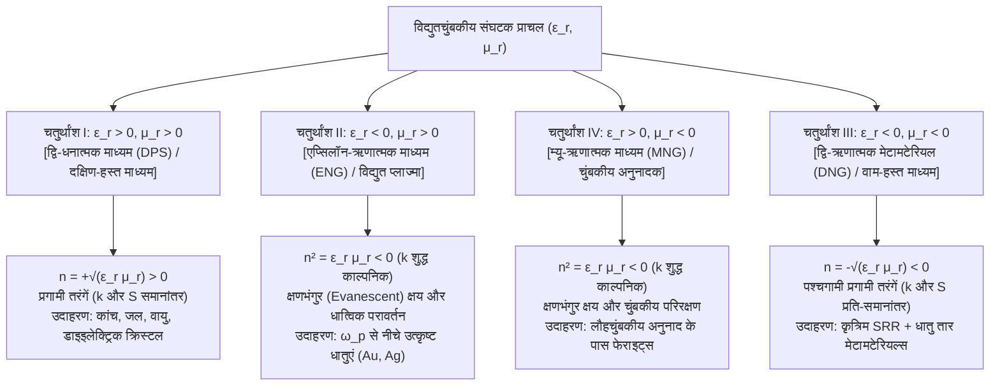
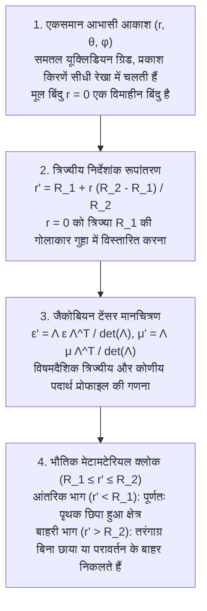

## 1. परिचय: रसायन विज्ञान के बजाय ज्यामिति द्वारा पदार्थ के गुणों की इंजीनियरिंग

सदियों से पदार्थ विज्ञान और चिरसम्मत प्रकाशिकी (Classical Optics) का मूल सिद्धांत यह रहा है कि किसी पदार्थ के विद्युतचुंबकीय गुण—कांच पारदर्शी क्यों होता है, सोना धात्विक चमक क्यों देता है, या पानी में रखा स्ट्रॉ मुड़ा हुआ क्यों दिखता है—पूरी तरह से उसके <strong>रासायनिक संघटन (Chemical Composition)</strong> यानी आवर्त सारणी के परमाणुओं और उनके रासायनिक बंधों द्वारा निर्धारित होते हैं। 21वीं सदी की शुरुआत में चिरसम्मत विद्युतगतिकी, संघनित पदार्थ भौतिकी और नैनोटेक्नोलॉजी के संगम पर एक क्रांतिकारी बदलाव आया: <strong>मेटामटेरियल्स (Metamaterials)</strong> का जन्म। ग्रीक उपसर्ग <em>meta-</em> ("परे" या "से आगे") से व्युत्पन्न, मेटामटेरियल एक ऐसा कृत्रिम रूप से संरचित मिश्रण है जिसकी स्थूल विद्युतचुंबकीय प्रतिक्रिया उसके परमाणुओं के रसायन के बजाय <strong>उप-तरंगदैर्घ्य ज्यामिति (Subwavelength Geometry), टोपोलॉजी और कृत्रिम संरचनात्मक इकाइयों ("मेटा-परमाणुओं" / Meta-atoms) की स्थानिक व्यवस्था</strong> द्वारा नियंत्रित होती है।

दृश्य प्रकाश की तरंगदैर्घ्य $\lambda \approx 400\,\text{nm}$ से $700\,\text{nm}$ तक होती है, जबकि ठोसों में अंतर-परमाण्विक दूरी केवल $a_{\text{atom}} \sim 0.1\text{–}0.3\,\text{nm}$ होती है। चूंकि विद्युतचुंबकीय क्षेत्र एकल परमाणुओं की तुलना में हजारों गुना बड़े पैमाने पर दोलन करता है, इसलिए प्रकाश तरंग एक स्थानिक रूप से औसत सतत माध्यम का अनुभव करती है जिसे <strong>विद्युतशीलता (Permittivity) $\varepsilon$</strong> और <strong>चुंबकशीलता (Permeability) $\mu$</strong> द्वारा वर्णित किया जाता है, जो मिलकर <strong>अपवर्तनांक $n = \sqrt{\varepsilon_r \mu_r}$</strong> तय करते हैं। यदि हम जालक अंतराल $a \lesssim \lambda / 10$ वाले कृत्रिम रेज़ोनेटर बनाते हैं, तो तरंग उनके स्थानीय द्विध्रुव आघूर्णों का औसत निकालती है और पूरे व्यूह को अभियांत्रिक प्राचलों $\varepsilon_{\text{eff}}(\omega)$ तथा $\mu_{\text{eff}}(\omega)$ वाले एक सतत <strong>प्रभावी माध्यम (Effective Medium)</strong> के रूप में अनुभव करती है।

मेटामटेरियल्स को <strong>फोटोनिक क्रिस्टल (Photonic Crystals)</strong> और प्राकृतिक संरचनात्मक रंगों (जैसे ओपल या <em>मॉर्फो</em> तितली के पंख) से अलग समझना अत्यंत आवश्यक है। फोटोनिक क्रिस्टल में जालक स्थिरांक आधी तरंगदैर्घ्य के बराबर ($a \sim \lambda / 2$) होता है और उनके प्रकाशीय गुण आवर्ती <strong>ब्रैग प्रकीर्णन (Bragg Scattering)</strong> से उत्पन्न होते हैं, जहाँ प्रभावी माध्यम सन्निकटन (EMA) विफल हो जाता है। इसके विपरीत, मेटामटेरियल्स गहरे उप-तरंगदैर्घ्य क्षेत्र ($a \ll \lambda$) में कार्य करते हैं जहाँ $\varepsilon_{\text{eff}}$ और $\mu_{\text{eff}}$ पूर्णतः सार्थक होते हैं।

| भौतिक विशेषता | प्राकृतिक समांगी पदार्थ (कांच, जल, सोना) | फोटोनिक क्रिस्टल और संरचनात्मक रंग (ओपल, मॉर्फो) | मेटामटेरियल्स और मेटासरफेस |
| :--- | :--- | :--- | :--- |
| <strong>मूल निर्माण इकाई</strong> | परमाणु, अणु, आयन | आवर्ती डाइइलेक्ट्रिक ब्लॉक या वायु छिद्र | उप-तरंगदैर्घ्य रेज़ोनेटर ("मेटा-परमाणु": SRR, नैनोपिलर) |
| <strong>जालक आकार $a$ बनाम $\lambda$</strong> | $a \sim 0.1\text{–}0.3\,\text{nm} \ (\ll \lambda/1000)$ | $a \sim \lambda / 2$ (ब्रैग क्षेत्र) | $a \lesssim \lambda / 10$ (गहरा उप-तरंगदैर्घ्य क्षेत्र) |
| <strong>प्रमुख भौतिक तंत्र</strong> | इलेक्ट्रॉनिक/आयनिक ध्रुवण | ब्रैग विवर्तन, बहु-प्रकीर्णन | स्थानीय विद्युत और चुंबकीय बहुध्रुव अनुनाद (LC / Mie) |
| <strong>प्रभावी माध्यम सन्निकटन (EMA)</strong> | प्रकाशीय तरंगदैर्घ्य पर सटीक | अमान्य ($\lambda$ पैमाने पर असमांगी क्षेत्र) | मान्य (सुस्पष्ट $\varepsilon_{\text{eff}}(\omega), \mu_{\text{eff}}(\omega)$ टेंसर) |
| <strong>समदैशिक ऋणात्मक अपवर्तनांक ($n < 0$)</strong> | प्रकृति में अनुपस्थित | केवल बैंड वक्रता से आभासी ऋणात्मक अपवर्तन | वास्तविक द्वि-ऋणात्मक पश्चगामी तरंग संचरण ($\varepsilon_{\text{eff}} < 0, \mu_{\text{eff}} < 0$) |

---

## 2. मैक्सवेल के समीकरण और $\varepsilon\text{–}\mu$ तल के चार चतुर्थांश

स्रोत-मुक्त, समदैशिक और समांगी माध्यम में एकवर्णी समतल तरंगों $\exp(i\mathbf{k}\cdot\mathbf{r} - i\omega t)$ के लिए मैक्सवेल के कर्ल समीकरण हैं:

$$
\mathbf{k} \times \mathbf{E} = \omega \mu \mathbf{H}, \qquad \mathbf{k} \times \mathbf{H} = -\omega \varepsilon \mathbf{E}
$$

जहाँ $\varepsilon = \varepsilon_0 \varepsilon_r$ और $\mu = \mu_0 \mu_r$ हैं। $\mathbf{H}$ को विलोपित करने पर विक्षेपण संबंध (Dispersion Relation) और तरंग प्रतिबाधा $Z$ प्राप्त होती है:

$$
k^2 = \left(\frac{\omega}{c}\right)^2 \varepsilon_r \mu_r = \left(\frac{\omega}{c}\right)^2 n^2, \qquad Z = \sqrt{\frac{\mu}{\varepsilon}} = Z_0 \sqrt{\frac{\mu_r}{\varepsilon_r}}
$$

$(\varepsilon_r, \mu_r)$ तल सभी समदैशिक माध्यमों को चार चतुर्थांशों में विभाजित करता है:

प्रकृति में चतुर्थांश III खाली रहता है क्योंकि परमाण्विक विद्युत अनुनाद प्रकाशीय/पराबैंगनी आवृत्तियों ($10^{14}\text{–}10^{16}\,\text{Hz}$) पर होते हैं, जबकि चुंबकीय द्विध्रुव अनुनाद (सूक्ष्म-संरचना स्थिरांक $\alpha \approx 1/137$ द्वारा दमित) गीगाहर्ट्ज़ या टेराहर्ट्ज़ आवृत्तियों के ऊपर समाप्त हो जाते हैं।

---

## 3. वेसेलागो का 1968 का विचार प्रयोग और ऋणात्मक अपवर्तन की भौतिकी

1967 में (1968 में अंग्रेजी में प्रकाशित), सोवियत भौतिक विज्ञानी <strong>विक्टर जी. वेसेलागो (Viktor G. Veselago)</strong> ने सिद्ध किया कि जब $\varepsilon_r < 0$ और $\mu_r < 0$ एक साथ होते हैं, तो सदिश त्रिक $(\mathbf{E}, \mathbf{H}, \mathbf{k})$ एक <strong>वाम-हस्त (Left-handed) प्रणाली</strong> बनाता है, जिससे इन्हें <strong>वाम-हस्त पदार्थ (Left-Handed Material, LHM)</strong> कहा गया। परंतु विद्युतचुंबकीय ऊर्जा का प्रवाह <strong>पॉइंटिंग सदिश (Poynting Vector) $\mathbf{S}$</strong> द्वारा निर्धारित होता है:

$$
\mathbf{S} = \mathbf{E} \times \mathbf{H}, \qquad \langle \mathbf{S} \rangle = \frac{1}{2}\text{Re}(\mathbf{E} \times \mathbf{H}^*)
$$

चूंकि $\mathbf{S}$ की परिभाषा में $\varepsilon$ या $\mu$ नहीं आते, $(\mathbf{E}, \mathbf{H}, \mathbf{S})$ सदैव एक दक्षिण-हस्त प्रणाली बनाता है। फलस्वरूप, तरंग सदिश $\mathbf{k}$ (कला वेग $\mathbf{v}_p$) और पॉइंटिंग सदिश $\mathbf{S}$ (समूह वेग $\mathbf{v}_g$) <strong>प्रति-समानांतर ($\mathbf{k} \cdot \mathbf{S} < 0$, पश्चगामी तरंग)</strong> होते हैं। किसी भी निष्क्रिय कारणता माध्यम ($\varepsilon'', \mu'' > 0$) में ऊष्मागतिकीय अवमंदन $\text{Im}(n) > 0$ सुनिश्चित करने के लिए ऋणात्मक वर्गमूल चुनना अनिवार्य है:

$$
n = \sqrt{\varepsilon_r \mu_r} = \sqrt{|\varepsilon_r||\mu_r|}\,e^{i\pi - i(\delta_\varepsilon + \delta_\mu)/2} = -\sqrt{|\varepsilon'||\mu'|} + i n'' \qquad (\text{Re}(n) < 0,\ \text{Im}(n) > 0)
$$

इससे तीन उल्टी प्रकाशीय घटनाएं उत्पन्न होती हैं:
1. <strong>उल्टा स्नेल का नियम और वेसेलागो का समतल लेंस</strong>: $k_x$ की निरंतरता और अग्रगामी ऊर्जा प्रवाह $S_z > 0$ के कारण अपवर्तित किरण अभिलंब के <strong>उसी ओर मुड़ती है</strong> जिस ओर आपतित किरण होती है:
   $$
   n_1 \sin\theta_1 = n_2 \sin\theta_2 = -|n_2|\sin|\theta_2|
   $$
   इसलिए $n = -1$ ($\varepsilon_r = \mu_r = -1$) की एक समतल पट्टिका बिंदु स्रोत की अपसारी किरणों को पट्टिका के अंदर और बाहर दो बार फोकस करती है और शून्य सतह परावर्तन ($Z = Z_0\sqrt{(-1)/(-1)} = Z_0$) देती है।
2. <strong>उल्टा डॉपलर प्रभाव</strong>: प्रेक्षक की ओर आते प्रकाश स्रोत में अभिरक्त विस्थापन (Redshift) $\omega' = \omega_0 (1 - |n|v/c)$ प्रेक्षित होता है।
3. <strong>उल्टा चेरेनकोव विकिरण</strong>: अति-प्रकाशीय आवेशित कण ($v > c/|n|$) अपने प्रघाती शंकु को गति की विपरीत दिशा में अधिक कोण पर उत्सर्जित करता है।

---

## 4. सर जॉन पेंड्री की सफलता (1996–1999): स्प्लिट-रिंग रेज़ोनेटर (SRR)

1996 और 1999 के बीच, इंपीरियल कॉलेज लंदन के <strong>सर जॉन बी. पेंड्री (Sir John B. Pendry)</strong> ने दिखाया कि उप-तरंगदैर्घ्य धात्विक संरचनाओं से $\varepsilon_{\text{eff}} < 0$ और $\mu_{\text{eff}} < 0$ कैसे प्राप्त किए जा सकते हैं:
- <strong>पतले धातु तारों का जालक (1996)</strong>: स्थानिक तनुकरण और चुंबकीय स्व-प्रेरकत्व इलेक्ट्रॉनों को विशाल प्रभावी द्रव्यमान $m_{\text{eff}} = \frac{\mu_0 e^2 n_e \pi r^2}{2\pi}\ln(a/r) \gg m_e$ प्रदान करते हैं, जिससे प्लाज्मा आवृत्ति घटकर गीगाहर्ट्ज़ क्षेत्र में आ जाती है:
  $$
  \omega_{pe}^2 = \frac{2\pi c^2}{a^2 \ln(a/r)}, \qquad \varepsilon_{\text{eff}}(\omega) = 1 - \frac{\omega_{pe}^2}{\omega(\omega + i\gamma_e)}
  $$
- <strong>स्प्लिट-रिंग रेज़ोनेटर (Split-Ring Resonator, SRR, 1999)</strong>: संधारित्र अंतराल वाले दो संकेंद्रित तांबे के छल्ले एक उप-तरंगदैर्घ्य समतल <strong>LC अनुनाद परिपथ</strong> ($\omega_m = 1/\sqrt{LC}$) की तरह काम करते हैं। $\omega_m$ से ठीक ऊपर, प्रेरित चुंबकीय आघूर्ण बाहरी चुंबकीय क्षेत्र से $180^\circ$ कला-विपरीत दोलन करता है, जिससे ऋणात्मक प्रभावी चुंबकशीलता उत्पन्न होती है:
  $$
  \mu_{\text{eff}}(\omega) = 1 - \frac{F \omega^2}{\omega^2 - \omega_m^2 + i\gamma_m \omega}
  $$

2000–2001 में, यूसी सैन डिएगो (UCSD) में <strong>डेविड आर. स्मिथ (David R. Smith)</strong> और सहयोगियों ने तारों और SRR को मिलाकर $10.5\,\text{GHz}$ पर पहली बार ऋणात्मक अपवर्तनांक $n = -2.7 \pm 0.1$ का प्रायोगिक मापन किया।

---

## 5. विवर्तन सीमा पर विजय: पेंड्री का सुपरलेंस और हाइपरलेंस

पारंपरिक लेंस <strong>अब्बे की विवर्तन सीमा ($\Delta x = \lambda / (2\,\text{NA})$)</strong> से बंधे होते हैं। उच्च स्थानिक आवृत्तियों ($k_\parallel > k_0 = 2\pi/\lambda$) के लिए अनुदैर्घ्य तरंग संख्या शुद्ध काल्पनिक हो जाती है:

$$
k_z = \sqrt{k_0^2 - k_\parallel^2} = i\sqrt{k_\parallel^2 - k_0^2} = i\kappa_z
$$

ये <strong>क्षणभंगुर तरंगें (Evanescent Waves)</strong> $\exp(-\kappa_z z)$ के रूप में चरघातांकी रूप से क्षय हो जाती हैं। 2000 में पेंड्री (*Physical Review Letters*) ने सिद्ध किया कि $\varepsilon_r \to -1, \mu_r \to -1$ वाली पट्टिका <strong>सतह प्लाज्मॉन पोलरिटॉन (SPP)</strong> को उत्तेजित कर <strong>क्षणभंगुर तरंगों को चरघातांकी रूप से प्रवर्धित करती है</strong>:

$$
\lim_{\varepsilon_r \to -1,\, \mu_r \to -1} T_s(k_\parallel, d) = \exp(+\kappa_z d), \qquad \exp(-\kappa_z z_1)\cdot\exp(+\kappa_z d)\cdot\exp(-\kappa_z z_2) = 1
$$

2005 में, यूसी बर्कले के <strong>शियांग झांग (Xiang Zhang)</strong> समूह ने $\lambda = 365\,\text{nm}$ पर $35\,\text{nm}$ पतले चांदी के सुपरलेंस से $60\,\text{nm}$ ($\sim \lambda/6$) विभेदन क्षमता प्रदर्शित की, और इसके बाद अतिपरवलयिक विक्षेपण ($\frac{k_r^2}{\varepsilon_\theta} - \frac{k_\theta^2}{|\varepsilon_r|} = \frac{\omega^2}{c^2}$) वाले <strong>हाइपरलेंस (Hyperlens)</strong> का विकास हुआ।

---

## 6. ट्रांसफॉर्मेशन ऑप्टिक्स और अदृश्यता क्लोकिंग का गणित

मई 2006 में, <strong>पेंड्री, शुरिग और स्मिथ</strong> तथा <strong>उल्फ लियोनहार्ड्ट</strong> ने *Science* में <strong>ट्रांसफॉर्मेशन ऑप्टिक्स (TO)</strong> प्रस्तुत किया, जो <strong>निर्देशांक रूपांतरणों $x^i \mapsto x^{i'}$ के अंतर्गत मैक्सवेल के समीकरणों की रूप-निश्चरता (Form-invariance)</strong> (जैकोबियन आव्यूह $\Lambda^{i'}_i = \frac{\partial x^{i'}}{\partial x^i}$) पर आधारित है:

$$
\varepsilon^{i'j'} = \frac{\Lambda^{i'}_i \Lambda^{j'}_j}{|\det \mathbf{\Lambda}|} \varepsilon^{ij}, \qquad \mu^{i'j'} = \frac{\Lambda^{i'}_i \Lambda^{j'}_j}{|\det \mathbf{\Lambda}|} \mu^{ij}
$$

गोले $0 \le r \le R_2$ को गोलीय कोश $R_1 \le r' \le R_2$ में $r' = R_1 + r\frac{R_2 - R_1}{R_2}$ द्वारा संपीड़ित करने पर पेंड्री के गोलाकार क्लोक के प्राचल मिलते हैं:

$$
\varepsilon_r = \mu_r = \frac{R_2}{R_2 - R_1}\left(\frac{r' - R_1}{r'}\right)^2, \qquad \varepsilon_\theta = \varepsilon_\phi = \mu_\theta = \mu_\phi = \frac{R_2}{R_2 - R_1}
$$

आंतरिक सीमा $r' = R_1$ पर $\varepsilon_r = \mu_r \to 0$ (शून्य-अपवर्तनांक विलक्षणता) प्रकाश को गुहा $r' < R_1$ के चारों ओर स्पर्शरेखीय रूप से मोड़ देता है। अक्टूबर 2006 में ड्यूक विश्वविद्यालय की टीम ने $8.5\,\text{GHz}$ पर पहला बेलनाकार माइक्रोवेव क्लोक बनाया। अन्य स्थापत्यों में <strong>कार्पेट क्लोक (Carpet Cloak)</strong>, प्लाज्मॉनिक प्रकीर्णन निरसन (Alù & Engheta) और <strong>रोचेस्टर पराक्षीय क्लोक</strong> शामिल हैं।

---

## 7. "हैरी पॉटर का अदृश्यता चोगा" भौतिकी द्वारा क्यों वर्जित है? तीन मौलिक सीमाएं

दृश्य प्रकाश के संपूर्ण स्पेक्ट्रम ($400\text{–}700\,\text{nm}$) में किसी स्थूल 3D वस्तु को सभी दिशाओं से छिपाने वाला निष्क्रिय, हानि-रहित अदृश्यता क्लोक तीन भौतिक सीमाओं के कारण असंभव है:

1. <strong>आपेक्षिकीय कारणता और क्रामर्स-क्रोनिग बैंडविड्थ सीमा</strong>: गुहा की परिक्रमा ($\pi R_1 > 2R_1$) करते हुए कला (Phase) बनाए रखने के लिए क्लोक के भीतर कला वेग $v_p = c/n(\omega) > c$ होना चाहिए, किंतु ऊर्जा का संचरण करने वाला समूह वेग $v_g \le c$ से बंधा है:
   $$
   v_g(\omega) = \frac{c}{n(\omega) + \omega \frac{dn(\omega)}{d\omega}} \le c \quad \Longrightarrow \quad \omega \frac{dn(\omega)}{d\omega} \ge 1 - n(\omega) > 0
   $$
   <strong>क्रामर्स-क्रोनिग संबंधों (Kramers-Kronig Relations)</strong>:
   $$
   \text{Re}\,\varepsilon_r(\omega) - 1 = \frac{2}{\pi} \mathcal{P} \int_0^\infty \frac{\omega' \, \text{Im}\,\varepsilon_r(\omega')}{\omega'^2 - \omega^2} d\omega'
   $$
   के साथ मिलकर यह सापेक्ष बैंडविड्थ को $\Delta\omega / \omega_0 \lesssim \lambda_0 / R_1$ (दृश्य प्रकाश में मानव आकार $R_1 = 1\,\text{m}$ के लिए मात्र $\sim 5\times 10^{-7}$; मोंटिकोन और अलू का योग नियम) तक सीमित कर देता है।
2. <strong>प्लाज्मॉनिक ओमीय हानि और गतिज प्रेरकत्व संतृप्ति</strong>: प्रकाशीय आवृत्तियों ($400\text{–}750\,\text{THz}$) पर इलेक्ट्रॉनों का गतिज प्रेरकत्व ($L_{\text{kin}} \propto m_e / (n_e e^2)$) चुंबकीय अनुनाद को संतृप्त कर देता है और धात्विक अवशोषण गुणवत्ता गुणांक को $\text{FOM} = |\text{Re}(n)|/\text{Im}(n) \sim 1\text{–}3$ तक गिरा देता है।
3. <strong>3D नैनोफैब्रिकेशन की बाधा</strong>: वर्ग मीटर क्षेत्रों में $10\text{–}50\,\text{nm}$ परिशुद्धता वाली हजारों 3D नैनो-परतों का संरेखण वर्तमान लिथोग्राफी की क्षमता से परे है।

---

## 8. 3D मेटामटेरियल्स से 2D डाइइलेक्ट्रिक मेटासरफेस और मेटालेंस तक

2010 के दशक में यह क्षेत्र <strong>हानि-रहित उच्च-अपवर्तनांक डाइइलेक्ट्रिक्स ($\text{Si}, \text{TiO}_2, \text{GaN}$)</strong> के मी (Mie) रेज़ोनेटरों से बने <strong>2D मेटासरफेस (Metasurfaces)</strong> की ओर मुड़ गया।

2011 में, हार्वर्ड के <strong>फेडेरिको कैपासो (Federico Capasso)</strong> और नानफांग यू ने <strong>सामान्यीकृत स्नेल का नियम (Generalized Snell's Law)</strong> प्रतिपादित किया, जहाँ स्थानिक कला प्रवणता $\frac{d\Phi(x)}{dx}$ अपवर्तन को नियंत्रित करती है:

$$
n_t \sin\theta_t - n_i \sin\theta_i = \frac{\lambda_0}{2\pi} \frac{d\Phi(x)}{dx}, \qquad \sin\theta_r - \sin\theta_i = \frac{\lambda_0}{2\pi n_i} \frac{d\Phi(x)}{dx}
$$

जब विद्युत और चुंबकीय मी द्विध्रुव <strong>प्रथम कर्कर शर्त ($\alpha_e = \alpha_m$)</strong> को पूरा करते हैं, तो <strong>हाइगेंस मेटासरफेस</strong> लगभग $100\%$ संचरण प्राप्त करते हैं। आदर्श लेंस के अतिपरवलयिक कला प्रोफाइल:

$$
\Phi(x, y, \omega) = -\frac{\omega}{c} \left( \sqrt{x^2 + y^2 + f^2} - f \right)
$$

और समूह विलंब $\frac{\partial\Phi}{\partial\omega}$ को नियंत्रित करके, $1\,\mu\text{m}$ से भी पतले <strong>समतल अवर्णक मेटालेंस (Achromatic Metalenses)</strong> आज स्मार्टफोन 3D फेस रिकग्निशन, ऑटोमोटिव LiDAR, AR/VR चश्मों और मेडिकल एंडोस्कोपी में क्रांति ला रहे हैं, तथा यह सिद्धांत अब <strong>ध्वनिक, भूकंपीय, तापीय और दिक्-काल (Spatiotemporal) मेटामटेरियल्स</strong> तक विस्तारित हो चुका है।
