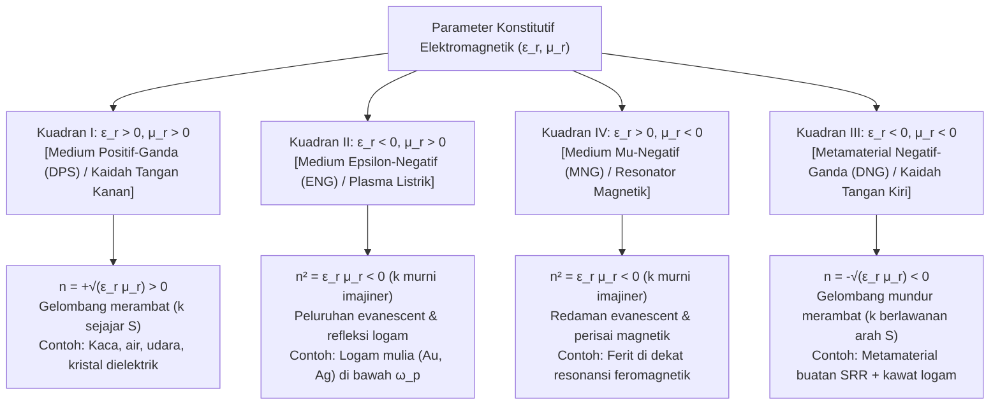
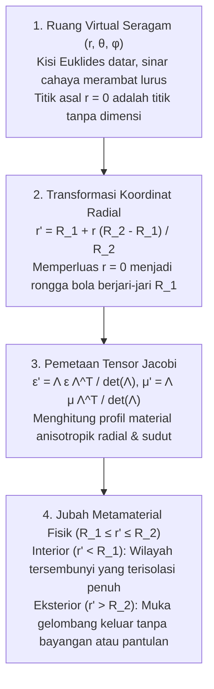

## 1. Pendahuluan: Merekayasa Sifat Material melalui Geometri, Bukan Kimia

Selama berabad-abad, aksioma dasar ilmu material dan optika klasik menyatakan bahwa sifat elektromagnetik materi—mengapa kaca meneruskan cahaya, emas berkilau logam, atau sedotan tampak bengkok di dalam air—ditentukan sepenuhnya oleh <strong>komposisi kimia</strong>: jenis atom dari tabel periodik dan ikatan kimianya. Pada awal abad ke-21, pergeseran paradigma besar muncul di persimpangan elektrodinamika klasik, fisika benda terkondensasi, dan nanoteknologi: lahirnya <strong>metamaterial</strong>. Berasal dari awalan Yunani <em>meta-</em> ("melampaui"), metamaterial adalah komposit terstruktur buatan yang respons elektromagnetik makroskopiknya tidak diatur terutama oleh kimia atomnya, melainkan oleh <strong>geometri sub-panjang gelombang, topologi, dan susunan spasial unit struktural rekayasa ("meta-atom")</strong>.

Cahaya tampak memiliki panjang gelombang $\lambda \approx 400\,\text{nm}$ hingga $700\,\text{nm}$, sedangkan jarak antaratom dalam zat padat adalah $a_{\text{atom}} \sim 0.1\text{–}0.3\,\text{nm}$. Karena medan elektromagnetik berosilasi pada skala ribuan kali lebih besar daripada atom tunggal, gelombang cahaya merasakan medium kontinu yang dirata-ratakan secara spasial melalui <strong>permitivitas listrik $\varepsilon$</strong> dan <strong>permeabilitas magnetik $\mu$</strong>, yang menentukan <strong>indeks bias $n = \sqrt{\varepsilon_r \mu_r}$</strong>. Jika kita membuat resonator buatan dengan jarak kisi $a \lesssim \lambda / 10$, gelombang elektromagnetik merata-ratakan momen dipol lokalnya dan merasakan susunan tersebut sebagai <strong>medium efektif</strong> kontinu dengan parameter rekayasa $\varepsilon_{\text{eff}}(\omega)$ dan $\mu_{\text{eff}}(\omega)$.

Penting untuk membedakan metamaterial dari <strong>kristal fotonik</strong> dan warna struktural alami (seperti opal atau sayap kupu-kupu <em>Morpho</em>). Pada kristal fotonik, konstanta kisi sebanding dengan setengah panjang gelombang ($a \sim \lambda / 2$), menghasilkan celah pita fotonik melalui <strong>hamburan Bragg</strong> di mana pendekatan medium efektif (EMA) tidak berlaku. Sebaliknya, metamaterial bekerja строго dalam rezim sub-panjang gelombang dalam ($a \ll \lambda$), sehingga $\varepsilon_{\text{eff}}$ dan $\mu_{\text{eff}}$ memiliki makna fisik lokal yang presisi.

| Karakteristik Fisik | Material Homogen Alami (Kaca, Air, Emas) | Kristal Fotonik & Warna Struktural (Opal, Morpho) | Metamaterial & Metasurface |
| :--- | :--- | :--- | :--- |
| <strong>Unit Pembangun Dasar</strong> | Atom, molekul, ion | Blok dielektrik periodik atau lubang udara | Resonator sub-panjang gelombang ("meta-atom": SRR, nanopilar) |
| <strong>Jarak Kisi $a$ vs. $\lambda$</strong> | $a \sim 0.1\text{–}0.3\,\text{nm} \ (\ll \lambda/1000)$ | $a \sim \lambda / 2$ (Rezim Bragg) | $a \lesssim \lambda / 10$ (Rezim sub-panjang gelombang dalam) |
| <strong>Mekanisme Fisik Dominan</strong> | Polarisasi elektronik/ionik | Difraksi Bragg, hamburan ganda | Resonansi multipol listrik & magnetik lokal (LC / Mie) |
| <strong>Pendekatan Medium Efektif</strong> | Eksak pada panjang gelombang optik | Tidak berlaku (inhomogen pada skala $\lambda$) | Berlaku (tensor $\varepsilon_{\text{eff}}(\omega), \mu_{\text{eff}}(\omega)$ terdefinisi) |
| <strong>Indeks Negatif Isotropik ($n < 0$)</strong> | Tidak ada di alam | Refraksi negatif semu akibat kelengkungan pita | Propagasi gelombang mundur negatif-ganda ($\varepsilon_{\text{eff}} < 0, \mu_{\text{eff}} < 0$) |

---

## 2. Persamaan Maxwell dan Empat Kuadran Bidang $\varepsilon\text{–}\mu$

Untuk gelombang datar monokromatik $\exp(i\mathbf{k}\cdot\mathbf{r} - i\omega t)$ dalam medium isotropik homogen tanpa sumber, persamaan curl Maxwell berbentuk:

$$
\mathbf{k} \times \mathbf{E} = \omega \mu \mathbf{H}, \qquad \mathbf{k} \times \mathbf{H} = -\omega \varepsilon \mathbf{E}
$$

dengan $\varepsilon = \varepsilon_0 \varepsilon_r$ dan $\mu = \mu_0 \mu_r$. Eliminasi $\mathbf{H}$ menghasilkan relasi dispersi dan impedansi gelombang $Z$:

$$
k^2 = \left(\frac{\omega}{c}\right)^2 \varepsilon_r \mu_r = \left(\frac{\omega}{c}\right)^2 n^2, \qquad Z = \sqrt{\frac{\mu}{\varepsilon}} = Z_0 \sqrt{\frac{\mu_r}{\varepsilon_r}}
$$

Bidang $(\varepsilon_r, \mu_r)$ membagi semua medium isotropik menjadi empat kuadran:

Alam membiarkan Kuadran III kosong karena resonansi listrik atomik terjadi pada frekuensi optik/UV ($10^{14}\text{–}10^{16}\,\text{Hz}$), sedangkan resonansi magnetik (ditekan oleh konstanta struktur halus $\alpha \approx 1/137$) meluruh di atas frekuensi gelombang mikro atau terahertz.

---

## 3. Eksperimen Pikiran Veselago (1968) dan Fisika Refraksi Negatif

Pada tahun 1967 (diterbitkan dalam bahasa Inggris tahun 1968), fisikawan Soviet <strong>Viktor G. Veselago</strong> membuktikan bahwa jika $\varepsilon_r < 0$ dan $\mu_r < 0$ secara bersamaan, triad $(\mathbf{E}, \mathbf{H}, \mathbf{k})$ membentuk <strong>sistem tangan kiri</strong>, sehingga dinamakan <strong>Material Tangan Kiri (Left-Handed Material, LHM)</strong>. Namun, aliran energi elektromagnetik ditentukan oleh <strong>vektor Poynting $\mathbf{S}$</strong>:

$$
\mathbf{S} = \mathbf{E} \times \mathbf{H}, \qquad \langle \mathbf{S} \rangle = \frac{1}{2}\text{Re}(\mathbf{E} \times \mathbf{H}^*)
$$

Karena $\mathbf{S}$ tidak bergantung pada $\varepsilon$ maupun $\mu$, $(\mathbf{E}, \mathbf{H}, \mathbf{S})$ selalu membentuk sistem tangan kanan. Akibatnya, vektor gelombang $\mathbf{k}$ (kecepatan fase $\mathbf{v}_p$) dan vektor Poynting $\mathbf{S}$ (kecepatan grup $\mathbf{v}_g$) bersifat <strong>antiparalel ($\mathbf{k} \cdot \mathbf{S} < 0$, gelombang mundur)</strong>. Analisis kompleks pada medium pasif kausal ($\varepsilon'', \mu'' > 0$) mengharuskan pemilihan akar kuadrat negatif demi memenuhi syarat redaman termodinamika $\text{Im}(n) > 0$:

$$
n = \sqrt{\varepsilon_r \mu_r} = \sqrt{|\varepsilon_r||\mu_r|}\,e^{i\pi - i(\delta_\varepsilon + \delta_\mu)/2} = -\sqrt{|\varepsilon'||\mu'|} + i n'' \qquad (\text{Re}(n) < 0,\ \text{Im}(n) > 0)
$$

Hal ini melahirkan tiga fenomena optik terbalik:
1. <strong>Hukum Snellius Terbalik dan Lensa Datar Veselago</strong>: Kontinuitas $k_x$ dan aliran energi maju $S_z > 0$ memaksa sinar bias berbelok ke <strong>sisi normal yang sama</strong> dengan sinar datang:
   $$
   n_1 \sin\theta_1 = n_2 \sin\theta_2 = -|n_2|\sin|\theta_2|
   $$
   Pelat sejajar datar dengan $n = -1$ ($\varepsilon_r = \mu_r = -1$) memfokuskan sinar divergen di dalam dan di luar pelat tanpa pantulan permukaan ($Z = Z_0\sqrt{(-1)/(-1)} = Z_0$).
2. <strong>Efek Doppler Terbalik</strong>: Sumber cahaya yang mendekati pengamat mengalami pergeseran merah $\omega' = \omega_0 (1 - |n|v/c)$.
3. <strong>Radiasi Cherenkov Terbalik</strong>: Partikel bermuatan superluminal ($v > c/|n|$) memancarkan kerucut kejutnya ke arah belakang pada sudut tumpul.

---

## 4. Terobosan Sir John Pendry (1996–1999): Split-Ring Resonator (SRR)

Antara tahun 1996 dan 1999, <strong>Sir John B. Pendry</strong> (Imperial College London) menunjukkan cara menyintesis $\varepsilon_{\text{eff}} < 0$ dan $\mu_{\text{eff}} < 0$ menggunakan struktur logam sub-panjang gelombang:
- <strong>Kisi Kawat Logam Tipis (1996)</strong>: Pengenceran spasial dan induktansi diri magnetik memberikan massa efektif elektron yang sangat besar $m_{\text{eff}} = \frac{\mu_0 e^2 n_e \pi r^2}{2\pi}\ln(a/r) \gg m_e$, menurunkan frekuensi plasma ke rezim GHz:
  $$
  \omega_{pe}^2 = \frac{2\pi c^2}{a^2 \ln(a/r)}, \qquad \varepsilon_{\text{eff}}(\omega) = 1 - \frac{\omega_{pe}^2}{\omega(\omega + i\gamma_e)}
  $$
- <strong>Split-Ring Resonator (SRR, 1999)</strong>: Dua cincin tembaga konsentris dengan celah kapasitif bekerja sebagai <strong>rangkaian resonansi LC</strong> planar ($\omega_m = 1/\sqrt{LC}$). Tepat di atas $\omega_m$, momen dipol magnetik terinduksi berosilasi $180^\circ$ berbeda fase dengan medan luar, menghasilkan permeabilitas efektif negatif:
  $$
  \mu_{\text{eff}}(\omega) = 1 - \frac{F \omega^2}{\omega^2 - \omega_m^2 + i\gamma_m \omega}
  $$

Pada tahun 2000–2001, <strong>David R. Smith</strong> dan rekan-rekan di UC San Diego menggabungkan kawat dan SRR dalam prisma metamaterial, mengukur secara eksperimental indeks bias negatif $n = -2.7 \pm 0.1$ pada $10.5\,\text{GHz}$.

---

## 5. Melampaui Batas Difraksi: Superlens Pendry dan Hyperlens

Lensa konvensional dibatasi oleh <strong>batas difraksi Abbe ($\Delta x = \lambda / (2\,\text{NA})$)</strong>. Untuk frekuensi spasial tinggi ($k_\parallel > k_0 = 2\pi/\lambda$), bilangan gelombang longitudinal menjadi murni imajiner:

$$
k_z = \sqrt{k_0^2 - k_\parallel^2} = i\sqrt{k_\parallel^2 - k_0^2} = i\kappa_z
$$

<strong>Gelombang evanescent</strong> ini meluruh secara eksponensial sebagai $\exp(-\kappa_z z)$. Pada tahun 2000, Pendry (*Physical Review Letters*) membuktikan bahwa lapisan dengan $\varepsilon_r \to -1, \mu_r \to -1$ mengeksitasi <strong>Surface Plasmon Polaritons (SPP)</strong> yang <strong>menguatkan gelombang evanescent secara eksponensial</strong>:

$$
\lim_{\varepsilon_r \to -1,\, \mu_r \to -1} T_s(k_\parallel, d) = \exp(+\kappa_z d), \qquad \exp(-\kappa_z z_1)\cdot\exp(+\kappa_z d)\cdot\exp(-\kappa_z z_2) = 1
$$

Pada tahun 2005, kelompok <strong>Xiang Zhang</strong> (UC Berkeley) mendemonstrasikan superlens perak setebal $35\,\text{nm}$ pada $\lambda = 365\,\text{nm}$ dengan resolusi $60\,\text{nm}$ ($\sim \lambda/6$), diikuti oleh <strong>hyperlens</strong> hiperbolik ($\frac{k_r^2}{\varepsilon_\theta} - \frac{k_\theta^2}{|\varepsilon_r|} = \frac{\omega^2}{c^2}$) yang memproyeksikan citra sub-difraksi ke medan jauh.

---

## 6. Optika Transformasi dan Matematika Jubah Tembus Pandang

Pada Mei 2006, <strong>Pendry, Schurig, dan Smith</strong> bersama <strong>Ulf Leonhardt</strong> memperkenalkan <strong>Optika Transformasi (TO)</strong> di *Science*, memanfaatkan <strong>invariansi bentuk persamaan Maxwell di bawah transformasi koordinat</strong> $x^i \mapsto x^{i'}$ (matriks Jacobi $\Lambda^{i'}_i = \frac{\partial x^{i'}}{\partial x^i}$):

$$
\varepsilon^{i'j'} = \frac{\Lambda^{i'}_i \Lambda^{j'}_j}{|\det \mathbf{\Lambda}|} \varepsilon^{ij}, \qquad \mu^{i'j'} = \frac{\Lambda^{i'}_i \Lambda^{j'}_j}{|\det \mathbf{\Lambda}|} \mu^{ij}
$$

Dengan memampatkan bola $0 \le r \le R_2$ ke dalam kulit bola $R_1 \le r' \le R_2$ melalui $r' = R_1 + r\frac{R_2 - R_1}{R_2}$, diperoleh parameter jubah bola Pendry:

$$
\varepsilon_r = \mu_r = \frac{R_2}{R_2 - R_1}\left(\frac{r' - R_1}{r'}\right)^2, \qquad \varepsilon_\theta = \varepsilon_\phi = \mu_\theta = \mu_\phi = \frac{R_2}{R_2 - R_1}
$$

Pada batas dalam $r' = R_1$, $\varepsilon_r = \mu_r \to 0$ (singularitas indeks nol), membelokkan gelombang secara tangensial mengelilingi rongga $r' < R_1$. Pada Oktober 2006, tim Duke University membangun jubah gelombang mikro silinder pertama pada $8.5\,\text{GHz}$. Arsitektur lain meliputi <strong>jubah karpet (Carpet Cloak)</strong> kuasi-konformal, pembatalan hamburan plasmonik (Alù & Engheta), dan <strong>jubah paraksial optika geometri (Jubah Rochester)</strong>.

---

## 7. Mengapa "Jubah Tembus Pandang Harry Potter" Dilarang oleh Fisika

Jubah tembus pandang pasif, tanpa rugi-rugi, dan segala arah untuk objek 3D makroskopik di seluruh spektrum cahaya tampak ($400\text{–}700\,\text{nm}$) mustahil secara fisik karena tiga batas fundamental:

1. <strong>Kausalitas Relativistik dan Batas Lebar Pita Kramers-Kronig</strong>: Untuk mengelilingi rongga ($\pi R_1 > 2R_1$) sambil mempertahankan fase, kecepatan fase di dalam jubah harus melebihi $c$ ($v_p = c/n(\omega) > c$), tetapi kecepatan grup pembawa energi dibatasi oleh $v_g \le c$:
   $$
   v_g(\omega) = \frac{c}{n(\omega) + \omega \frac{dn(\omega)}{d\omega}} \le c \quad \Longrightarrow \quad \omega \frac{dn(\omega)}{d\omega} \ge 1 - n(\omega) > 0
   $$
   Bersama dengan <strong>relasi Kramers-Kronig</strong>:
   $$
   \text{Re}\,\varepsilon_r(\omega) - 1 = \frac{2}{\pi} \mathcal{P} \int_0^\infty \frac{\omega' \, \text{Im}\,\varepsilon_r(\omega')}{\omega'^2 - \omega^2} d\omega'
   $$
   lebar pita relatif dibatasi oleh $\Delta\omega / \omega_0 \lesssim \lambda_0 / R_1$ ($\sim 5\times 10^{-7}$ untuk $R_1 = 1\,\text{m}$ pada cahaya tampak; aturan jumlah Monticone & Alù).
2. <strong>Rugi Ohmik Plasmonik dan Saturasi Induktansi Kinetik</strong>: Pada frekuensi optik ($400\text{–}750\,\text{THz}$), induktansi kinetik elektron ($L_{\text{kin}} \propto m_e / (n_e e^2)$) menjenuhkan resonansi magnetik dan serapan logam menurunkan Figure of Merit menjadi $\text{FOM} = |\text{Re}(n)|/\text{Im}(n) \sim 1\text{–}3$.
3. <strong>Hambatan Nanofabrikasi 3D</strong>: Menumpuk ribuan lapisan nano 3D dengan resolusi $10\text{–}50\,\text{nm}$ di atas area makroskopik melampaui kemampuan litografi saat ini.

---

## 8. Dari Metamaterial 3D ke Metasurface 2D Dielektrik dan Metalens

Pada dekade 2010-an, bidang ini beralih ke <strong>metasurface 2D</strong> menggunakan resonator Mie dari <strong>dielektrik indeks tinggi tanpa rugi-rugi ($\text{Si}, \text{TiO}_2, \text{GaN}$)</strong>.

Pada tahun 2011, <strong>Federico Capasso</strong> dan Nanfang Yu (Harvard) merumuskan <strong>Hukum Snellius Терgeneralisasi</strong>, di mana gradien fase spasial $\frac{d\Phi(x)}{dx}$ mengendalikan pembiasan:

$$
n_t \sin\theta_t - n_i \sin\theta_i = \frac{\lambda_0}{2\pi} \frac{d\Phi(x)}{dx}, \qquad \sin\theta_r - \sin\theta_i = \frac{\lambda_0}{2\pi n_i} \frac{d\Phi(x)}{dx}
$$

Ketika dipol listrik dan magnetik Mie memenuhi <strong>kondisi Kerker pertama ($\alpha_e = \alpha_m$)</strong>, <strong>metasurface Huygens</strong> mencapai transmisi mendekati $100\%$. Dengan menyintesis profil fase hiperbolik lensa ideal:

$$
\Phi(x, y, \omega) = -\frac{\omega}{c} \left( \sqrt{x^2 + y^2 + f^2} - f \right)
$$

serta merekayasa tunda grup $\frac{\partial\Phi}{\partial\omega}$, <strong>metalens akromatik datar</strong> (tebal $< 1\,\mu\text{m}$) kini merevolusi pengenalan wajah 3D smartphone, LiDAR otomotif, kacamata AR/VR, dan endoskopi medis, sekaligus memperluas paradigma menuju <strong>metamaterial akustik, seismik, termal, dan ruang-waktu</strong>.
