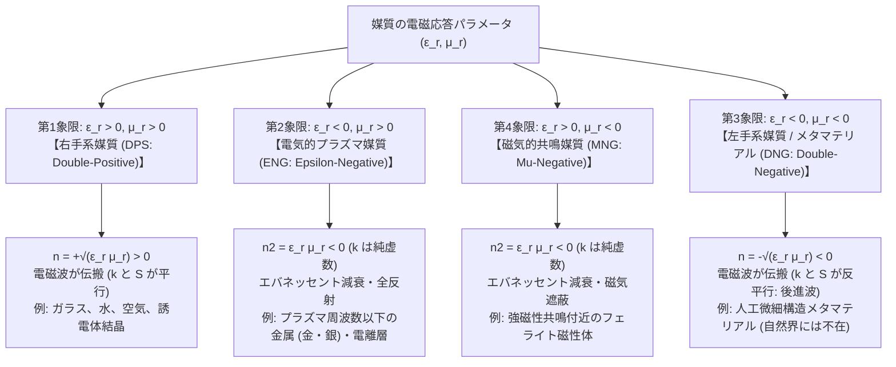
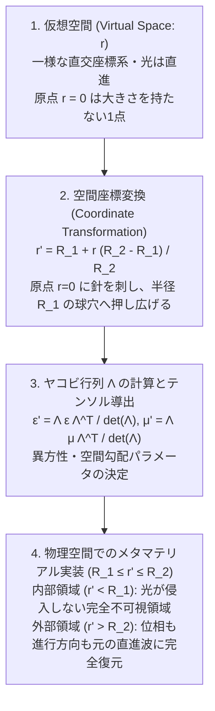

## 1. 導入：物質の性質は「化学組成」ではなく「形」で設計できるか？

私たちが日常的に目にする物質の光学的な性質――たとえばガラスが透明であること、金が山吹色の金属光沢を放つこと、水の中に差し込んだストローが水面で折れ曲がって見えること――は、長い間、その物質を構成する<strong>原子や分子の種類（化学組成）</strong>と、それらが織りなす結晶格子によって一意に決定されるものだと考えられてきた。周期表に並ぶ元素を組み合わせ、化学結合の様式を変えることでしか、新しい光学定数（屈折率や吸収率）を持つ物質は生み出せないというのが、古典的な材料科学の暗黙の前提であった。

しかし20世紀末から21世紀初頭にかけて、電磁気学とナノテクノロジーの交差点で、この大前提を根底から覆すパラダイムシフトが起きた。それが<strong>メタマテリアル（Metamaterials）</strong>の誕生である。ギリシャ語で「超越した（meta）」を意味する接頭辞が冠されたこの人工物質は、電磁波の波長 $\lambda$ よりもはるかに小さな微細構造（サブ波長構造：構造周期 $a \ll \lambda$）を人工的に設計・配列することで、構成材料そのものの性質を超越し、自然界のいかなる物質も持ち得ない電磁気的・光学的応答を発現させる。

この概念を直感的に理解するには、私たちが普段見ている「通常の物質」と光の相互作用のスケールを考えてみればよい。可視光の波長はおよそ $400\,\text{nm} \sim 700\,\text{nm}$（ナノメートル）であるのに対し、ガラスや水を構成する原子・分子のサイズや格子間隔は約 $0.1\,\text{nm} \sim 0.3\,\text{nm}$ にすぎない。光の波から見れば、自らの波長の1000分の1以下のスケールで並ぶ個々の原子の凹凸は解像できず、空間的に平均化された<strong>連続的な媒質（有効媒質：Effective Medium）</strong>としてしか認識されない。その平均化された応答を表すマクロな物理量が、<strong>誘電率（Permittivity）$\varepsilon$</strong> と<strong>透磁率（Permeability）$\mu$</strong>、そしてそれらから定まる<strong>屈折率（Refractive Index）$n$</strong> である。

であるならば、もし私たちがナノ加工技術や微細加工技術を用いて、対象とする電磁波の波長の10分の1程度（$a \lesssim \lambda / 10$）の小さな「人工的な構造単位（メタアトム：Meta-atom）」を大量に作り、周期的あるいは空間的に配列したらどうなるだろうか？ 電磁波にとって、その微細構造の集合体はもはや個別の部品の集まりではなく、あたかも新しい「人工原子」から成る均質な物質として振る舞うはずである。しかも、その人工原子の電磁気的な応答は、使われている材料の化学組成だけでなく、<strong>リングやワイヤー、ナノピラーといった「幾何学的な形（ジオメトリ）」</strong>によって自在にデザインできる。

ここで、自然界にも存在する「構造色（モルフォ蝶の翅やオパール、孔雀の羽など）」や「フォトニック結晶（Photonic Crystals）」との決定的な違いを明確にしておく必要がある。フォトニック結晶や構造色は、微細構造の周期 $a$ が光の波長と同程度（$a \sim \lambda / 2$）であり、周期構造による<strong>ブラッグ散乱（Bragg Scattering）と多重干渉</strong>によって特定の波長の光を反射・閉じ込める（フォトニックバンドギャップ）。そのため、フォトニック結晶は波長のスケールで不均質であり、均質なマクロ媒質として一様な誘電率 $\varepsilon$ や透磁率 $\mu$ を定義することはできない。これに対し、メタマテリアルは構造単位が波長より十分に小さいサブ波長領域（$a \ll \lambda$、典型的には $a \le \lambda/10 \sim \lambda/5$）で動作するため、<strong>有効媒質近似（Effective Medium Approximation: EMA）</strong>が成立し、マクロな実効誘電率 $\varepsilon_{\text{eff}}$ と実効透磁率 $\mu_{\text{eff}}$ を厳密に定義できる「真の人工均質媒質」なのである。

| 比較項目 | 通常の自然物質（ガラス・金属・結晶） | フォトニック結晶・構造色（オパール・モルフォ蝶） | メタマテリアル・メタサーフェス |
| :--- | :--- | :--- | :--- |
| <strong>基本構成単位（ユニットセル）</strong> | 原子・分子・イオン | 誘電体の周期的ブロック・空孔 | 人工微細共振器（メタアトム：SRR・ナノピラー等） |
| <strong>構造スケール $a$ と波長 $\lambda$ の比</strong> | $a \sim 0.1\text{–}0.5\,\text{nm} \ (\ll \lambda/1000)$ | $a \sim \lambda / 2$（波長と同程度の周期） | $a \lesssim \lambda / 10$（サブ波長領域） |
| <strong>物理的メカニズム</strong> | 電子分極・イオン分極・バンド間遷移 | ブラッグ散乱・空間的な多重干渉（バンドギャップ） | 局所的な電気双極子・磁気双極子共鳴（LC共振・ミー共鳴） |
| <strong>有効媒質近似（$\varepsilon_{\text{eff}}, \mu_{\text{eff}}$ の定義）</strong> | 完全に成立 | 不成立（波長スケールで不均質） | 成立（均質な実効パラメータ $\varepsilon_{\text{eff}}, \mu_{\text{eff}}$ を定義可能） |
| <strong>負の屈折率 $n < 0$ の実現機構</strong> | 不可能（$\varepsilon < 0$ と $\mu < 0$ が重ならない） | バンド構造の折り返しによる見かけの負屈折のみ（等方的 $n<0$ ではない） | $\varepsilon_{\text{eff}} < 0$ かつ $\mu_{\text{eff}} < 0$ による真の左手系媒質を実現 |

この「形で物性を設計する」という発想は、やがて物理学の教科書を書き換える3つの驚くべき成果へと結実した。第1に、自然界には存在しない<strong>「負の屈折率（Negative Refractive Index）」</strong>の実験的実現。第2に、光学顕微鏡の絶対的な壁とされてきた「アッベの回折限界」を打破する<strong>「完全レンズ（Superlens）」</strong>の提唱。そして第3に、空間の座標変換によって光を物体の周囲へ迂回させ、物体を完全に不可視化する<strong>「変換光学（Transformation Optics）」と「透明マント（Invisibility Cloaking）」</strong>の誕生である。

本稿では、光学メタマテリアルの基礎理論から透明マントの数理、さらにはクラマース・クローニッヒの関係式（因果律）や金属の損失が突きつける「なぜハリー・ポッターの透明マントはそのままでは作れないのか」という厳密な物理的限界、そして現在急速に実用化が進む平面光学素子「メタサーフェス（Metasurfaces）」に至るまで、その科学の全貌を徹底的に解き明かしていく。

---

## 2. マクスウェル方程式と媒質の4象限：$\varepsilon$ と $\mu$ が織りなす世界

電磁波（光を含む）が物質中をどのように伝搬するかは、ジェームズ・クラーク・マクスウェルが確立したマクスウェル方程式と、物質の応答を記述する構成方程式（$\mathbf{D} = \varepsilon \mathbf{E}, \mathbf{B} = \mu \mathbf{H}$）によって完全に支配されている。角周波数 $\omega$ で時間的に調和振動する単色平面波（時間因子 $\exp(-i\omega t)$）を仮定すると、自由電荷も伝導電流も存在しない等方性均質媒質中でのマクスウェルの回転方程式は次のように書ける。

$$
\nabla \times \mathbf{E} = i\omega \mu \mathbf{H}, \qquad \nabla \times \mathbf{H} = -i\omega \varepsilon \mathbf{E}
$$

ここで $\mathbf{E}$ は電場ベクトル、$\mathbf{H}$ は磁場ベクトル、$\varepsilon = \varepsilon_0 \varepsilon_r$ は誘電率（$\varepsilon_0$ は真空の誘電率、$\varepsilon_r$ は比誘電率）、$\mu = \mu_0 \mu_r$ は透磁率（$\mu_0$ は真空の透磁率、$\mu_r$ は比透磁率）である。空間変化を平面波 $\exp(i\mathbf{k}\cdot\mathbf{r})$（$\mathbf{k}$ は波数ベクトル）と置けば、空間微分演算子 $\nabla$ は $i\mathbf{k}$ に置き換わり、次の代数方程式が得られる。

$$
\mathbf{k} \times \mathbf{E} = \omega \mu \mathbf{H}, \qquad \mathbf{k} \times \mathbf{H} = -\omega \varepsilon \mathbf{E}
$$

第1式の両辺に左から $\mathbf{k} \times$ を作用させ、ベクトル三重積の公式 $\mathbf{k} \times (\mathbf{k} \times \mathbf{E}) = (\mathbf{k}\cdot\mathbf{E})\mathbf{k} - k^2\mathbf{E} = -k^2\mathbf{E}$（横波条件 $\mathbf{k}\cdot\mathbf{E}=0$ より）を用いて磁場 $\mathbf{H}$ を消去すると、波数ベクトル $\mathbf{k}$ の大きさ $k = |\mathbf{k}|$ と角周波数 $\omega$ を結ぶ<strong>分散関係（Dispersion Relation）</strong>および<strong>波動インピーダンス（Wave Impedance）$Z$</strong> が導かれる。

$$
k^2 = \omega^2 \varepsilon \mu = \left(\frac{\omega}{c}\right)^2 \varepsilon_r \mu_r = \left(\frac{\omega}{c}\right)^2 n^2, \qquad Z = \frac{|\mathbf{E}|}{|\mathbf{H}|} = \sqrt{\frac{\mu}{\varepsilon}} = Z_0 \sqrt{\frac{\mu_r}{\varepsilon_r}}
$$

ここで $c = 1/\sqrt{\varepsilon_0 \mu_0}$ は真空中の光速、$Z_0 = \sqrt{\mu_0/\varepsilon_0} \approx 377\,\Omega$ は真空の波動インピーダンスであり、$n^2 = \varepsilon_r \mu_r$ は屈折率 $n$ の2乗を与える。

この非常にシンプルな関係式 $n^2 = \varepsilon_r \mu_r$ を、横軸に比誘電率 $\varepsilon_r$、縦軸に比透磁率 $\mu_r$ をとった2次元平面（<strong>$\varepsilon-\mu$ ダイアグラム</strong>）の上で眺めてみよう。すべての物質（および人工媒質）は、$\varepsilon_r$ と $\mu_r$ の符号の組み合わせによって4つの象限に分類される。

1. <strong>第1象限（$\varepsilon_r > 0, \mu_r > 0$：Double-Positive [DPS] 媒質）</strong>
   水、ガラス、ダイヤモンド、空気など、私たちが知るすべての通常の透明媒質がここに属する。$n^2 = \varepsilon_r \mu_r > 0$ であり、屈折率 $n = +\sqrt{\varepsilon_r \mu_r} > 0$ は正の実数となる。電場 $\mathbf{E}$、磁場 $\mathbf{H}$、波数ベクトル $\mathbf{k}$ は互いに直交し、<strong>右手の法則（右手系：Right-Handed System）</strong>に従う。
2. <strong>第2象限（$\varepsilon_r < 0, \mu_r > 0$：Epsilon-Negative [ENG] 媒質）</strong>
   プラズマ周波数 $\omega_p$ よりも低い周波数の電磁波に対する金属（可視光に対する銀や金、アルミニウムなど）や、短波帯の電波に対する地球の電離層、気体放電プラズマがここに属する。自由電子が外部電場に対して逆位相で激しく遮蔽振動するため $\varepsilon_r < 0$ となる。このとき $n^2 = \varepsilon_r \mu_r < 0$ となるため、波数 $k = (\omega/c)\sqrt{\varepsilon_r \mu_r}$ は<strong>純虚数</strong>（$k = i\kappa$）になる。空間因子は $\exp(ikz) = \exp(-\kappa z)$ となり、波は媒質内部へ伝搬できず表面から侵入長（スキンデプス）程度で指数関数的に減衰する（<strong>エバネッセント減衰 / 金属全反射</strong>）。金属鏡が光を反射してキラキラ輝くのは、まさにこの第2象限の性質によるものである。
3. <strong>第4象限（$\varepsilon_r > 0, \mu_r < 0$：Mu-Negative [MNG] 媒質）</strong>
   マイクロ波領域で強磁性共鳴（Ferromagnetic Resonance）や反強磁性共鳴を起こしているフェライトなどの磁性体が特定の周波数帯で示す性質である。ここでも $\varepsilon_r$ と $\mu_r$ の符号が逆であるため $n^2 = \varepsilon_r \mu_r < 0$ となり、波数 $k$ は純虚数となって電磁波は内部を伝搬できない。
4. <strong>第3象限（$\varepsilon_r < 0, \mu_r < 0$：Double-Negative [DNG] 媒質）</strong>
   では、誘電率 $\varepsilon_r$ と透磁率 $\mu_r$ が<strong>同時に負</strong>になったらどうなるのか？ 負の数と負の数の積は正の数（$n^2 = \varepsilon_r \mu_r > 0$）である！ すなわち、それぞれ単独では電磁波を遮断してしまう $\varepsilon_r < 0$（ENG）と $\mu_r < 0$（MNG）を同じ周波数帯で重ね合わせると、波数 $k$ は再び実数となり、<strong>電磁波が媒質中を透明に伝搬できるようになる</strong>のである。

しかし、自然界には $\varepsilon_r < 0$ と $\mu_r < 0$ が同じ周波数で同時に成立する物質は事実上存在しない。なぜなら、電子のプラズマ振動やバンド間遷移によって $\varepsilon_r < 0$ が生じるのは主に赤外線〜紫外線（数10〜数1000 THz）の非常に高い周波数領域であるのに対し、磁気スピンの歳差運動（ボーア磁子）や軌道角運動量の共鳴によって $\mu_r < 0$ が生じるのはマイクロ波〜遠赤外線（数GHz〜数THz以下）の低い周波数領域に限られており、自然物質の中では電気的応答と磁気的応答のエネルギースケール（微細構造定数 $\alpha \approx 1/137$ に起因する相対論的効果の差）が何桁も乖離しているからである。

---

## 3. ヴェセラゴの思考実験（1968年）と「負の屈折率」の物理学

自然界に第3象限の物質が存在しないにもかかわらず、もし仮に $\varepsilon_r < 0$ かつ $\mu_r < 0$ を満たす等方性媒質が存在したらどのような物理現象が起きるのかを、1967年（英語翻訳版は1968年）に純粋な理論的思考実験として完璧に導き出した物理学者がいた。旧ソ連（現ロシア）・レベデフ物理学研究所の<strong>ヴィクトル・ヴェセラゴ（Viktor G. Veselago）</strong>である。

### なぜ屈折率の平方根は「負（$n = -\sqrt{\varepsilon_r \mu_r}$）」でなければならないのか？

数学的には、$(-1) \times (-1) = +1$ であるから、$\varepsilon_r = -1, \mu_r = -1$ を $n^2 = \varepsilon_r \mu_r$ に代入すると $n^2 = 1$ となり、一見すると $n = +1$ でも良さそうに見える。なぜヴェセラゴは、平方根の枝（ブランチ）として必ず<strong>負の符号 $n = -\sqrt{\varepsilon_r \mu_r} < 0$</strong> を選ばなければならないと結論づけたのだろうか？

その理由は、マクスウェル方程式における<strong>波の位相の進行方向（波数ベクトル $\mathbf{k}$）</strong>と、<strong>エネルギーの流れの方向（ポインティング・ベクトル $\mathbf{S}$）</strong>の幾何学的関係、および熱力学第2法則・因果律にある。

再度、平面波に対するマクスウェル方程式を見てみよう。

$$
\mathbf{k} \times \mathbf{E} = \omega \mu \mathbf{H}, \qquad \mathbf{k} \times \mathbf{H} = -\omega \varepsilon \mathbf{E}
$$

通常の媒質（$\varepsilon > 0, \mu > 0$）では、$\mathbf{E}$ から $\mathbf{H}$ へ右ネジを回す向きに $\mathbf{k}$ が向く（右手系）。ところが、$\varepsilon < 0$ かつ $\mu < 0$ の媒質では、右辺の係数がともに負になるため、ベクトル三重組 $(\mathbf{E}, \mathbf{H}, \mathbf{k})$ は<strong>左手系（Left-Handed System）</strong>を成す。ヴェセラゴがこの媒質を「左手系物質（Left-Handed Material: LHM）」と名付けたのはこのためである。

一方、電磁波が単位時間・単位面積あたりに運ぶエネルギー流束密度を表す<strong>ポインティング・ベクトル（Poynting Vector）$\mathbf{S}$</strong>（時間平均 $\langle\mathbf{S}\rangle = \frac{1}{2}\text{Re}(\mathbf{E} \times \mathbf{H}^*)$）は、媒質の $\varepsilon$ や $\mu$ の符号に一切依存せず、電磁気学のエネルギー保存則（ポインティングの定理）から普遍的に次の式で定義される。

$$
\mathbf{S} = \mathbf{E} \times \mathbf{H}
$$

つまり、$(\mathbf{E}, \mathbf{H}, \mathbf{S})$ はいかなる媒質中であっても<strong>常に右手系</strong>を成す！
$(\mathbf{E}, \mathbf{H}, \mathbf{k})$ が左手系であり、$(\mathbf{E}, \mathbf{H}, \mathbf{S})$ が右手系であるならば、必然的に<strong>波数ベクトル $\mathbf{k}$（位相速度 $\mathbf{v}_p$ の向き）とポインティング・ベクトル $\mathbf{S}$（エネルギー流・群速度 $\mathbf{v}_g$ の向き）は正反対（反平行：$\mathbf{k} \cdot \mathbf{S} < 0$）</strong>を向かなければならない。

光源から放出された光は、因果律により、エネルギーを光源から遠ざかる方向（$\mathbf{S}$ が外向き）へと運ぶ。すると第3象限の媒質中では、波の山と谷（等位相面）はエネルギーの進行方向とは逆に、<strong>目標地点から光源に向かって後退してくる（後進波：Backward Wave）</strong>ことになる。

さらに複素関数論の観点からもこの事実は厳密に証明される。実際の受動媒質（パッシブ媒質）には必ず微小な吸収損失が存在するため、時間因子 $\exp(-i\omega t)$ のもとでは誘電率と透磁率は虚部が正の複素数となる。

$$
\varepsilon_r = -|\varepsilon'| + i\varepsilon'' = |\varepsilon_r|\exp\bigl(i(\pi - \delta_\varepsilon)\bigr), \qquad \mu_r = -|\mu'| + i\mu'' = |\mu_r|\exp\bigl(i(\pi - \delta_\mu)\bigr) \qquad (\varepsilon'', \mu'' > 0)
$$

ここで $\delta_\varepsilon, \delta_\mu \ll 1$ は微小な損失角である。これら2つの複素数の積をとって平方根 $n = \sqrt{\varepsilon_r \mu_r}$ を計算すると、偏角（位相角）は上半平面を通って次のように一意に定まる。

$$
n = \sqrt{\varepsilon_r \mu_r} = \sqrt{|\varepsilon_r||\mu_r|} \exp\left(i\pi - i\frac{\delta_\varepsilon + \delta_\mu}{2}\right) = -\sqrt{|\varepsilon_r||\mu_r|}\left(\cos\frac{\delta_\varepsilon+\delta_\mu}{2} - i\sin\frac{\delta_\varepsilon+\delta_\mu}{2}\right) \approx -\sqrt{|\varepsilon'||\mu'|} + i n''
$$

このように、受動媒質の因果律（吸収によって波が進行方向へ減衰する条件 $\text{Im}(n) = n'' > 0$）を満たすためには、屈折率の実部は必然的に<strong>負（$\text{Re}(n) = -\sqrt{|\varepsilon'||\mu'|} < 0$）</strong>とならざるを得ないのである。

### 負の屈折率が引き起こす「逆転する3大光学現象」

屈折率 $n$ が負になり、位相速度 $\mathbf{v}_p = (\omega/k^2)\mathbf{k}$ とエネルギー速度 $\mathbf{S}$ が逆向きになると、私たちが高校や大学の物理学で学ぶ基本的な光学現象がことごとく「逆転」する。

#### ① 逆スネルの法則（Reversed Snell's Law）とヴェセラゴの平板レンズ
屈折率 $n_1 > 0$ の媒質（たとえば空気 $n_1 = 1$）から、負の屈折率 $n_2 < 0$ の媒質へ光が入射角 $\theta_1$ で斜めに入射する場面を考えよう。界面において電場・磁場の接線成分が連続であるという境界条件から、界面に平行な波数ベクトル成分 $k_\parallel$ は保存されなければならない（$k_{1\parallel} = k_{2\parallel}$）。これと同時に、エネルギー（ポインティング・ベクトル $\mathbf{S}$ の法線成分 $S_z$）は界面を通過して第1媒質から第2媒質へと奥へ進まなければならない。

第2媒質中では $\mathbf{k}_2$ と $\mathbf{S}_2$ が正反対を向いているため、エネルギー $\mathbf{S}_2$ が奥へ進むということは、波数ベクトル $\mathbf{k}_2$ の法線成分は界面に向かって戻ってくる向きになる。その上で接線成分 $k_\parallel$ を一致させるためには、屈折した光線（エネルギー流 $\mathbf{S}_2$）は、<strong>界面の法線を越えて反対側へ進むのではなく、法線に対して入射光と同じ側（負の角度 $\theta_2 < 0$）へと鋭く折れ曲がる</strong>しかない！

$$
n_1 \sin\theta_1 = n_2 \sin\theta_2 \quad \Longrightarrow \quad \theta_2 = -\arcsin\left(\frac{n_1}{|n_2|}\sin\theta_1\right) < 0
$$

この「負の屈折」を利用すると、驚くべきレンズが作れる。通常の正の屈折率（$n > 0$）のガラスで光を集めるには、表面を曲面（凸レンズ）に研磨しなければならない。しかし、$n = -1$（$\varepsilon_r = -1, \mu_r = -1$）の負屈折率媒質であれば、<strong>単なる平らな板（平板：Flat Slab）</strong>を置くだけで、点光源から広がった光が平板の表面で一度内側に折れ曲がり（平板内部で一度焦点を結び）、さらに裏面から空気に出るときにもう一度折れ曲がって、平板の向こう側に再び完全な3次元の実像を結ぶのである（<strong>ヴェセラゴ・レンズ</strong>）。曲面を持たないため光軸という概念がなく、かつ周囲の真空と波動インピーダンス $Z = Z_0\sqrt{\mu_r/\varepsilon_r} = Z_0\sqrt{(-1)/(-1)} = Z_0$ が完全に整合しているため、表面での反射ロスもゼロとなる。

#### ② 逆ドップラー効果（Reversed Doppler Effect）
救急車が近づいてくるときサイレンの音が高く（高周波に）なり、遠ざかるとき低く（低周波に）なるのは周知のドップラー効果である。光の光源が観測者に向かって速度 $v$ で近づくときも、通常の媒質中では波面が進行方向に圧縮されるため、観測される周波数は高くなる（青方偏移：Blueshift）。

ところが $n < 0$ の媒質中では、エネルギーは光源から観測者へ伝わるものの、波面（位相）は観測者から光源に向かって逆走している。そのため、光源が観測者に近づくということは、光源が自らの波面の進行方向と同じ向きに追いかける形となり、結果として観測者が受け取る単位時間あたりの波の数は<strong>減少する</strong>。

$$
\omega' = \omega_0 \left(1 - \frac{|n| v}{c}\right) \quad (\text{光源が近づくとき周波数 } \omega' \text{ が低下！})
$$

すなわち、負の屈折率媒質の中では、<strong>近づいてくる光源は赤方偏移（低周波化）し、遠ざかる光源は青方偏移（高周波化）する</strong>という「逆ドップラー効果」が生じる。

#### ③ 逆チェレンコフ放射（Reversed Cherenkov Radiation）
荷電粒子（電子など）が媒質中の光の位相速度 $v_p = c/|n|$ よりも速い速度 $v > c/|n|$ で運動するとき、衝撃波として青白い光が円錐状に放出される現象をチェレンコフ放射と呼ぶ（原子炉の冷却水が青く光る現象）。通常の媒質（$n > 0$）では、波面が前方へ広がるため、チェレンコフ光は粒子の進行方向の前方（鋭角 $\cos\theta_C = \frac{c}{n v} > 0$）に向かって放出される。

しかし $n < 0$ の媒質中では、波数ベクトル $\mathbf{k}$ とエネルギー流 $\mathbf{S}$ が逆向きであるため、位相整合条件 $\mathbf{k} \cdot \mathbf{v} = \omega$ を満たす波数ベクトル $\mathbf{k}$ が前方（鋭角）を向くと、実際に光エネルギーが放出されるポインティング・ベクトル $\mathbf{S}$ の向きは<strong>粒子の進行方向の後方（鈍角 $\theta_C > 90^\circ$、$\cos\theta_C = -\frac{c}{|n|v} < 0$）</strong>となる。まるで走る船の舳先からではなく、船尾から後方に向かって逆向きの衝撃波が噴き出すかのような現象が起きるのである。

---

## 4. ペンドリーの革命（1996–1999年）：人工構造で $\varepsilon < 0$ と $\mu < 0$ を創る

ヴェセラゴの1968年の論文は、あまりに奇抜であったうえ、$\varepsilon < 0$ と $\mu < 0$ を同時に満たす物質が自然界に存在しなかったため、その後30年間近く「興味深いが実証不可能な思考実験」として物理学史の片隅に眠っていた。

この眠りを打ち破ったのが、インペリアル・カレッジ・ロンドンの理論物理学者<strong>ジョン・ペンドリー卿（Sir John B. Pendry）</strong>である。1990年代後半、企業のレーダー吸収材料（ステルス材料）の電磁特性を解析していたペンドリーは、「自然の原子に頼るのではなく、サブ波長の金属微細構造の『形』を工夫すれば、任意の周波数で実効誘電率 $\varepsilon_{\text{eff}}(\omega) < 0$ と実効透磁率 $\mu_{\text{eff}}(\omega) < 0$ を人工的に作り出せるのではないか」と気づいた。

### ステップ1：細い金属ワイヤー配列による $\varepsilon_{\text{eff}}(\omega) < 0$ の制御（1996年）
金属がプラズマ周波数 $\omega_p$ 以下でドルーデ型（Drude Model）の負の誘電率 $\varepsilon(\omega) = 1 - \omega_p^2 / [\omega(\omega + i\gamma)]$ を示すことは古くから知られていた。しかし、金や銀、銅の自由電子密度は $n_e \sim 10^{28}\,\text{m}^{-3}$ と極めて高いため、そのプラズマ周波数 $\omega_p = \sqrt{n_e e^2 / (\varepsilon_0 m_e)}$ は紫外線領域（$\sim 2 \times 10^{15}\,\text{rad/s}$）にある。結果として、マイクロ波や遠赤外線領域では $|\varepsilon|$ がマイナス数万〜数百万という極端に大きな負の値になり、しかも衝突減衰項 $i\gamma$ が支配的になって電磁波は表面で全反射されるだけで内部へ全く侵入できない。

ペンドリーは1996年、半径 $r$（数ミクロン）の極めて細い金属ワイヤーを、波長より小さな格子間隔 $a$（数ミリメートル）で3次元周期格子状に配列する構造を提案した。この構造では、以下の2つの劇的な効果が生じる。
1. 空間の大部分が空隙となるため、空間平均された実効自由電子密度 $n_{\text{eff}} = n_e (\pi r^2 / a^2)$ が大幅に希釈される。
2. より重要なことに、細いワイヤーの中を電流 $I = \pi r^2 n_e e v$ が流れる際、ワイヤー周囲の空間に同心円状の強い磁場 $H(\rho) = \frac{I}{2\pi \rho}$ が生じる（自己インダクタンス効果）。単位長さあたりの磁場エネルギー $\frac{1}{2} L I^2$ を電子の運動エネルギー $\frac{1}{2} N m_{\text{eff}} v^2$ と等置すると、この磁気的慣性によって、ワイヤー内の電子はあたかも<strong>実効質量 $m_{\text{eff}}$ が通常の静止電子質量 $m_e$ の何千倍〜何万倍（おおよそ日本の軽自動車から大型タンカーほどの比率！）にも重くなったかのように振る舞う</strong>！

$$
m_{\text{eff}} = \frac{\mu_0 e^2 n_e \pi r^2}{2\pi} \ln\left(\frac{a}{r}\right) \gg m_e
$$

実効プラズマ周波数は $\omega_{pe}^2 = \frac{n_{\text{eff}} e^2}{\varepsilon_0 m_{\text{eff}}}$ で与えられるため、分子と分母の $n_e \pi r^2 e^2$ がきれいに約分されて消え、驚くべきことに材料の電子密度 $n_e$ に一切依存せず、<strong>純粋に幾何学的な寸法（格子間隔 $a$ とワイヤー半径 $r$）だけで決まるプラズマ周波数</strong>が導かれる。

$$
\omega_{pe}^2 = \frac{2\pi c^2}{a^2 \ln(a/r)}, \qquad \varepsilon_{\text{eff}}(\omega) = 1 - \frac{\omega_{pe}^2}{\omega(\omega + i\gamma_e)}
$$

これにより、本来は紫外線領域（PHz）にあった金属のプラズマ周波数を、マイクロ波領域（数GHz）へと一気に6桁も引き下げ、$\omega < \omega_{pe}$ において適度な大きさ（$\varepsilon_{\text{eff}} \approx -1 \sim -5$）の負の誘電率を低損失で実現できるようになったのである。

### ステップ2：分割リング共振器（SRR）による非磁性金属からの $\mu_{\text{eff}}(\omega) < 0$ の創出（1999年）
次に残された最大の難関は、自然界の物質がマイクロ波や光領域でほとんど示さない「負の透磁率 $\mu_{\text{eff}}(\omega) < 0$」をどうやって作るかであった。しかも、磁性体（鉄やフェライト）を使わずに、銅や金、銀といった<strong>非磁性金属（$\mu_r = 1$）だけ</strong>で強い磁気応答を生み出す必要があった。

1999年、ペンドリーは歴史的な論文を発表し、<strong>分割リング共振器（Split-Ring Resonator: SRR）</strong>と呼ばれる構造を提唱した。これは、非磁性金属で作られた同心円状（または四角形）の2つのリングに、互いに反対向きの小さな切れ目（スリット／ギャップ）を入れた構造である。

なぜこの「切れ目の入った金属リング」が人工の磁気原子になるのだろうか？
1. リングの面に垂直に時間変動する磁場 $H_0 \exp(-i\omega t)$ が入射すると、ファラデーの電磁誘導の法則（起電力 $V_{\text{ind}} = -\frac{d\Phi_B}{dt} = i\omega \mu_0 H_0 \pi r_0^2$）によってリングに沿って誘導電流 $I(t)$ が流れ、元の磁場を打ち消す向き（あるいは強める向き）に磁気双極子モーメント $m = \pi r_0^2 I$ が生じる。これは金属ループが持つ<strong>自己インダクタンス $L$</strong> に対応する。
2. もし単なる閉じた金属リングであれば、回路にはインダクタンス $L$ と抵抗 $R$ しか存在しないため共鳴は起きず、誘導電流は常にレンツの法則に従って弱い反磁性（$\mu_{\text{eff}} \approx 1 - F > 0$）を示すにとどまる。しかし、リングに<strong>スリット（切れ目）</strong>を入れ、さらに内側のリングと外側のリングを微小な隙間 $d_g$ で向かい合わせると、そのギャップ部分に電荷が蓄積され、<strong>静電容量（キャパシタンス）$C$</strong> として働く！
3. すなわち、分割リング共振器（SRR）は、サブ波長サイズの微小な<strong>LC直列共振回路</strong>（インピーダンス $Z_{\text{SRR}} = -i\omega L + \frac{1}{-i\omega C} + R$）そのものなのである。その磁気共振角周波数 $\omega_m = 1/\sqrt{LC}$ は、リングの半径 $r_0$ やギャップ間隔 $d_g$ という「形」だけで自在に設計できる。

外部磁場の周波数 $\omega$ がこの磁気共振周波数 $\omega_m = 1/\sqrt{LC}$ に近づくと、分母のリアクタンス $\omega L - 1/(\omega C)$ がゼロに近づくため、リング内には巨大な共振電流が流れ、極めて強い磁気双極子モーメントが誘起される（<strong>磁気プラズモン共鳴</strong>）。さらに周波数が $\omega_m$ をわずかに超えた領域（$\omega_m < \omega < \omega_{mp} = \omega_m / \sqrt{1 - F}$）では、LC共振子の応答位相が駆動磁場に対して $180^\circ$ 反転（逆位相応答）するため、誘起された磁化 $M$ が外部磁場 $H$ と正反対を向き、外部磁場よりも大きな反磁場を打ち立てる。その結果、実効透磁率 $\mu_{\text{eff}}(\omega) = 1 + M/H$ は<strong>負の値</strong>をとる！

$$
\mu_{\text{eff}}(\omega) = 1 - \frac{F \omega^2}{\omega^2 - \omega_m^2 + i\gamma_m \omega}
$$

ここで $F = \pi r_0^2 / a^2$ はリングが単位胞内で占める面積充填率（Filling Factor）、$\gamma_m$ は金属の電気抵抗による減衰係数である。

### スミスらによる歴史的実験実証（2000–2001年）
ペンドリーの理論に触発されたカリフォルニア大学サンディエゴ校（UCSD、後にデューク大学）の<strong>デビッド・スミス（David R. Smith）</strong>とシェルドン・シュルツ（Sheldon Schultz）らの実験チームは、直ちにプリント基板（ガラスエポキシ基板）の上に銅の分割リング共振器（SRR）と細い銅ワイヤー（ストリップ）を周期的に配置した人工構造を作製した。

2000年、彼らはワイヤーによる $\varepsilon_{\text{eff}} < 0$ の周波数帯と、SRRによる $\mu_{\text{eff}} < 0$ の周波数帯が重なるマイクロ波領域（約 $10.5\,\text{GHz}$、波長約 $3\,\text{cm}$）において、単独では電波を遮断する2つの構造を組み合わせた瞬間に電波が透過する「左手系伝搬バンド」を世界初めて観測した。さらに翌2001年、このメタマテリアルをくさび形（プリズム形状）に組み立ててマイクロ波を入射させ、プリズムから出射するビームが法線に対して通常のテフロン製プリズム（$n = +1.4$）とは正反対の角度へ折れ曲がることを直接測定し、<strong>屈折率 $n = -2.7$</strong> という負の屈折を実験的に決定づけたのである。33年間「思考実験」にとどまっていたヴェセラゴの予言が、人間の手で設計された「形」によって現実の物理現象となった瞬間であった。

| 物理特性・現象 | 通常の正屈折率媒質（右手系: DPS） | 負屈折率メタマテリアル（左手系: DNG） |
| :--- | :--- | :--- |
| <strong>誘電率 $\varepsilon_r$ と透磁率 $\mu_r$</strong> | $\varepsilon_r > 0,\ \mu_r > 0$ | $\varepsilon_r < 0,\ \mu_r < 0$（同一周波数帯で共鳴） |
| <strong>屈折率 $n$</strong> | $n = +\sqrt{\varepsilon_r \mu_r} > 0$ | $n = -\sqrt{\varepsilon_r \mu_r} < 0$ |
| <strong>ベクトル組 $(\mathbf{E}, \mathbf{H}, \mathbf{k})$</strong> | 右手系（Right-Handed） | 左手系（Left-Handed） |
| <strong>位相速度 $\mathbf{v}_p$ とエネルギー流 $\mathbf{S}$</strong> | 平行（$\mathbf{k} \cdot \mathbf{S} > 0$：前進波） | 反平行（$\mathbf{k} \cdot \mathbf{S} < 0$：後進波） |
| <strong>スネルの屈折の法則</strong> | 法線を挟んで反対側へ屈折（$\theta_2 > 0$） | 法線に対して入射光と同じ側へ屈折（$\theta_2 < 0$） |
| <strong>ドップラー効果（光源接近時）</strong> | 高周波化（青方偏移：$\omega' > \omega_0$） | 低周波化（赤方偏移：$\omega' < \omega_0$） |
| <strong>チェレンコフ放射の放出角</strong> | 粒子進行方向の前方（鋭角放出） | 粒子進行方向の後方（鈍角放出） |
| <strong>平板（Flat Slab）の光学作用</strong> | 焦点を持たない（像がシフトするのみ） | 集光作用を持つ（ヴェセラゴ＝ペンドリー完全レンズ） |

---

## 5. 回折限界の打破：ペンドリーの「完全レンズ（Superlens）」

2000年、スミスらの実験と時を同じくして、ジョン・ペンドリーは物理学および光学工学の世界にさらなる衝撃を与える論文『Negative Refraction Makes a Perfect Lens（負の屈折は完全なレンズを作る）』を『Physical Review Letters』誌に発表した。

### なぜ通常の光学レンズには「回折限界」があるのか？
19世紀のドイツの物理学者エルンスト・アッベ（Ernst Abbe）が定式化した通り、いかに精巧に研磨されたガラスレンズであっても、用いる光の波長 $\lambda$ の約半分よりも小さな微細構造を識別することは絶対にできない。これが<strong>アッベの回折限界（Diffraction Limit）</strong>である。

$$
\Delta x = \frac{\lambda}{2 \text{NA}} = \frac{\lambda}{2 n \sin\theta_{\max}} \gtrsim \frac{\lambda}{2}
$$

なぜこのような絶対的な解像度の壁が存在するのだろうか？ 波動光学（フーリエ光学）の観点からその本質を見てみよう。
光軸を $z$ 軸とし、$z=0$ の物体面にある2次元の物体から散乱・放射される単色電磁波（角周波数 $\omega$）は、物体の空間的な模様の細かさに対応する面内波数成分 $(k_x, k_y)$ の重ね合わせ（2次元フーリエ変換）として表現できる。自由空間（真空：$n=1$）におけるマクスウェル方程式の分散関係は次式で与えられる。

$$
k_x^2 + k_y^2 + k_z^2 = \left(\frac{\omega}{c}\right)^2 = k_0^2 \quad \Longrightarrow \quad k_z = \sqrt{k_0^2 - (k_x^2 + k_y^2)}
$$

ここで、物体の構造の細かさ $k_\parallel = \sqrt{k_x^2 + k_y^2}$ に応じて、波は2種類に分かれる。
1. <strong>伝搬波（Propagating Waves）：$k_\parallel \le k_0 = 2\pi/\lambda$ の成分</strong>
   物体のうち、波長 $\lambda$ よりも大きな（粗い）構造に対応する空間周波数成分である。このとき平方根の中身は正であるため、$k_z$ は実数となり、波は $\exp(ik_z z)$ として遠方（レンズの位置）まで減衰せずに伝搬していく。通常のレンズはこの伝搬波の位相を揃えて再集束させるが、取り込める最大波数は $k_\parallel \le k_0$ に制限されるため、像の最小分解能は $\Delta x \sim \pi / k_0 = \lambda / 2$ となる。
2. <strong>エバネッセント波（Evanescent Waves / 近接場光）：$k_\parallel > k_0 = 2\pi/\lambda$ の成分</strong>
   物体のうち、波長 $\lambda$ よりも小さな（ナノスケールの微細な）構造情報を担う高空間周波数成分である。このとき $k_0^2 - k_\parallel^2 < 0$ となるため、光軸方向の波数 $k_z$ は<strong>純虚数</strong>となる！

$$
k_z = i\sqrt{k_\parallel^2 - k_0^2} = i\kappa_z \quad (\kappa_z > 0)
$$

これを伝搬因子 $\exp(ik_z z)$ に代入すると、$\exp(-\kappa_z z)$ となる。つまり、<strong>波長より細かい微細構造の情報（$k_\parallel > k_0$）を持ったエバネッセント波は、物体表面からわずか数十〜数百ナノメートル離れただけで指数関数的に減衰して消滅してしまい、遠方にあるレンズにはそもそも1ミリも届かない</strong>のである。従来のレンズがいかに収差をゼロにしても回折限界を超えられなかった理由は、レンズの性能不足ではなく、空間そのものがエバネッセント波を減衰させてしまうことにあった。

### $n = -1$ の平板がエバネッセント波を「増幅」する奇跡
これに対しペンドリーは、ヴェセラゴが考案した「屈折率 $n = -1$（$\varepsilon_r = -1, \mu_r = -1$）の平板レンズ（厚さ $d$）」が、伝搬波だけでなくエバネッセント波に対してどのように作用するかを厳密に計算した。

S偏光（TE波）のエバネッセント波（真空中の波数 $k_z = i\kappa_z$、媒質中の波数 $k'_z = i\kappa'_z$）が真空から比誘電率 $\varepsilon_r$、比透磁率 $\mu_r$、厚さ $d$ の平板に入射するとき、単一界面でのフレネル反射係数 $r_s$ と透過係数 $t_s$（および裏面での $r'_s, t'_s$）は次のようになる。

$$
r_s = \frac{\mu_r k_z - k'_z}{\mu_r k_z + k'_z}, \qquad t_s = \frac{2\mu_r k_z}{\mu_r k_z + k'_z}, \qquad r'_s = -r_s, \qquad t'_s = \frac{2 k'_z}{\mu_r k_z + k'_z}
$$

平板の表と裏の間で無限回の多重反射（ファブリ・ペロー干渉）を足し合わせた全体の透過係数 $T_s(k_\parallel, d)$ は、幾何級数の和として厳密に次のように表される。

$$
T_s(k_\parallel, d) = \frac{t_s t'_s \exp(ik'_z d)}{1 - r_s^2 \exp(2ik'_z d)} = \frac{4 \mu_r k_z k'_z \exp(-\kappa'_z d)}{(\mu_r k_z + k'_z)^2 - (\mu_r k_z - k'_z)^2 \exp(-2\kappa'_z d)}
$$

ここで、メタマテリアルのパラメータを $\varepsilon_r \to -1, \mu_r \to -1$ の極限に近づけると、$k'_z = k_z = i\kappa_z$ となるため、分母の第1項 $(\mu_r k_z + k'_z)^2 = (-k_z + k_z)^2$ が<strong>厳密にゼロ</strong>になる！ すると分子と分母の第2項の因子が約分され、次の驚異的な結果が導かれる。

$$
\lim_{\varepsilon_r \to -1,\, \mu_r \to -1} T_s(k_\parallel, d) = \frac{4(-1)k_z^2 \exp(-\kappa_z d)}{-(-2k_z)^2 \exp(-2\kappa_z d)} = \exp(+\kappa_z d)
$$

（P偏光［TM波］についても全く同様に $\varepsilon_r \to -1$ で $\exp(+\kappa_z d)$ が導かれる）。
通常の空間を距離 $d$ だけ進むとエバネッセント波は $\exp(-\kappa_z d)$ だけ<strong>指数関数的に減衰</strong>する。ところが、$n = -1$ のメタマテリアル平板（厚さ $d$）を通過する間、エバネッセント波は逆に $\exp(+\kappa_z d)$ だけ<strong>指数関数的に「増幅（Amplification）」される</strong>のである！

エネルギー保存則に反して無からエネルギーが生まれているわけではない。エバネッセント波はそもそも実数方向のエネルギー流（ポインティング・ベクトル $S_z$）を運んでおらず、定常状態において平板の表裏の界面（$\varepsilon_r = -1$ と真空 $\varepsilon = +1$ の境界）に励起される<strong>表面プラズモン・ポラリトン（Surface Plasmon Polaritons: SPP）</strong>の共鳴モード（分母 $\mu_r k_z + k'_z = 0$ がまさに表面プラズモンの分散関係！）に電磁場エネルギーが共鳴的に蓄積されることで、近接場の振幅が指数関数的に増大するのである。
その結果、物体から平板までの距離 $z_1$ と、平板から像面までの距離 $z_2$ の合計が平板の厚さ $d$ に等しいとき（$z_1 + z_2 = d$）、自由空間での減衰と平板内部での増幅が完全に相殺される。

$$
\exp(-\kappa_z z_1) \times \exp(+\kappa_z d) \times \exp(-\kappa_z z_2) = \exp\bigl(-\kappa_z(z_1 + z_2 - d)\bigr) = \exp(0) = 1
$$

伝搬波もエバネッセント波もすべてのフーリエ成分 $(k_x, k_y)$ が振幅1・位相差0で像面に復元されるため、理論上は<strong>回折限界が完全に消滅し、無限の空間分解能を持つ「完全レンズ（Perfect Lens / Superlens）」</strong>が成立する。

2005年、カリフォルニア大学バークレー校の<strong>張翔（Xiang Zhang）</strong>らの研究グループは、紫外線（波長 $365\,\text{nm}$）において銀（$\text{Ag}$）の薄膜（厚さ $35\,\text{nm}$）がP偏光に対して $\varepsilon_r \approx -1$ の「準静電的スーパーレンズ」として機能することを利用し、回折限界の6分の1にあたる<strong>線幅 $60\,\text{nm}$ のナノ構造を光学的に結像・露光する</strong>ことに成功した。さらにその後、銀と誘電体（$\text{Al}_2\text{O}_3$ など）を円筒曲面状に交互積層した異方性メタマテリアル（動径方向の誘電率 $\varepsilon_r < 0$ と角度方向の誘電率 $\varepsilon_\theta > 0$ の符号が異なる<strong>双曲型メタマテリアル：Hyperbolic Metamaterial</strong>、分散関係 $\frac{k_r^2}{\varepsilon_\theta} - \frac{k_\theta^2}{|\varepsilon_r|} = \frac{\omega^2}{c^2}$）を用いることで、減衰するエバネッセント波の高波数成分 $k_\theta$ を、外側の半径方向へ拡大伝搬しながら角運動量保存則 $k_\theta \propto 1/r$ によって徐々に波数を圧縮し、遠方場の通常の光学顕微鏡で直接リアルタイム観察可能な伝搬波（$k_\theta < k_0$）へと断熱変換する<strong>「ハイパーレンズ（Hyperlens）」</strong>も実証され、ナノ光学の世界に革命をもたらした。

---

## 6. 変換光学（Transformation Optics）と「透明マント」の数理

負の屈折率と完全レンズに続き、メタマテリアル研究を世界的な熱狂へと押し上げた第3の頂が、2006年に『Science』誌の同じ号に並んで掲載された2本の論文――<strong>ジョン・ペンドリー、デビッド・シューリグ（David Schurig）、デビッド・スミス</strong>による論文と、セント・アンドリュース大学の<strong>ウルフ・レオンハルト（Ulf Leonhardt）</strong>による論文――が切り拓いた<strong>「変換光学（Transformation Optics）」</strong>と<strong>「透明マント（Invisibility Cloaking）」</strong>の理論である。

### アインシュタインの一般相対性理論とマクスウェル方程式の形式不変性
変換光学の根底にあるアイデアは、驚くほど美しくエレガントである。
アインシュタインの一般相対性理論によれば、重力によって曲がった時空（計量テンソル $g_{\mu\nu}$）の中では、光は曲がった測地線に沿って進む。ところで、曲がった空間の座標系（あるいは任意に歪めた曲線座標系 $x^{i'}$）で書かれた真空中のマクスウェル方程式は、数学的に書き直すと、<strong>「平坦な直交座標系（ユークリッド空間）の中に、空間的に不均一で方向によって値の異なる誘電率テンソル $\varepsilon^{i'j'}$ と透磁率テンソル $\mu^{i'j'}$ を持つ媒質が置かれている場合のマクスウェル方程式」と完全に一致する（形式不変性：Form Invariance / Metric Invariance）</strong>という性質を持っている。

具体的に数式で示そう。元の平坦な空間の座標系 $x^i = (x, y, z)$（誘電率 $\varepsilon^{ij} = \varepsilon_0 \delta^{ij}$、透磁率 $\mu^{ij} = \mu_0 \delta^{ij}$）において、光がまっすぐ直進しているとする。ここで、空間をゴム膜のように引き伸ばしたり歪めたりする滑らかな座標変換 $x^i \mapsto x^{i'}(x, y, z)$ を行う。この変換のヤコビ行列（Jacobian Matrix）を $\Lambda^{i'}_i = \frac{\partial x^{i'}}{\partial x^i}$ とすると、変換後の座標系と同じように光線を曲げるために必要な実効誘電率テンソル $\boldsymbol{\varepsilon}'$ と実効透磁率テンソル $\boldsymbol{\mu}'$ は、次の普遍的な公式によって一意に与えられる。

$$
\varepsilon^{i'j'} = \frac{\Lambda^{i'}_i \Lambda^{j'}_j}{|\det \mathbf{\Lambda}|} \varepsilon^{ij}, \qquad \mu^{i'j'} = \frac{\Lambda^{i'}_i \Lambda^{j'}_j}{|\det \mathbf{\Lambda}|} \mu^{ij}
$$

この公式の意味するところは極めて深遠である。もし私たちが「光をこのように曲げたい、迂回させたい」と思ったら、まず仮想的な座標空間の中で格子（グリッド）を好きな形に歪める変換 $x^{i'}(x)$ を書き下せばよい。あとは上式のヤコビ行列を計算するだけで、<strong>その空間の歪みを現実の3次元空間で再現するために必要なメタマテリアルの $\boldsymbol{\varepsilon}'(\mathbf{r})$ と $\boldsymbol{\mu}'(\mathbf{r})$ の空間分布が自動的に導出される</strong>のである！ しかも、$\boldsymbol{\varepsilon}'$ と $\boldsymbol{\mu}'$ が同じヤコビ行列で同時に変換されるため、媒質の波動インピーダンス $Z = \sqrt{\mu/\varepsilon} = Z_0$ は空間のあらゆる場所で真空と完全に整合したまま保たれ、<strong>境界面での反射（フレネル反射）は一切発生しない（無反射条件の完全成立）</strong>。

### ペンドリーの球面・円筒クローキング変換の導出
では、実際に物体を完全に透明化（不可視化）する「透明マント（Cloak）」はどのような座標変換で作られるのだろうか。
ペンドリーらが考案したのは、半径 $R_2$ の球（または円筒）の内部空間において、<strong>原点 $r = 0$ という大きさゼロの「1点」に針を刺し、その穴をぐっと押し広げて半径 $R_1$（$< R_2$）の球状の空洞（穴）へと引き伸ばす</strong>という線形変換である。

元の仮想空間の半径座標を $r$（$0 \le r \le R_2$）、変換後の物理空間の半径座標を $r'$（$R_1 \le r' \le R_2$）とし、角度座標は不変（$\theta' = \theta, \phi' = \phi$）とすると、この座標変換は次式で表される。

$$
r' = R_1 + r \left(\frac{R_2 - R_1}{R_2}\right) \qquad (0 \le r \le R_2 \implies R_1 \le r' \le R_2)
$$

（なお、外側の空間 $r > R_2$ では $r' = r$ の恒等変換であり、空間は一切歪んでいない）。
この変換によって、元々 $0 \le r \le R_2$ の球全体に詰まっていた空間と光線は、内半径 $R_1$ と外半径 $R_2$ に挟まれた<strong>球殻（マント領域：$R_1 \le r' \le R_2$）</strong>の内部へとぎゅっと圧縮される。そして中心の空洞領域 $0 \le r' < R_1$ は、元の仮想空間のどこにも存在しなかった領域（原点 $r=0$ の内側）であるため、外部からやってきた光線は<strong>この $r' < R_1$ の領域には絶対に侵入することができず、すべてマント層（$R_1 \le r' \le R_2$）の中を滑らかに迂回して反対側へと抜けていく</strong>！

この3次元球座標変換を先のヤコビ変換公式に代入すると、球殻マント（$R_1 \le r' \le R_2$）が持つべき動径方向（$r$）および角度方向（$\theta, \phi$）の比誘電率・比透磁率が次のように求まる。

$$
\varepsilon_r = \mu_r = \frac{R_2}{R_2 - R_1} \left(\frac{r' - R_1}{r'}\right)^2, \qquad \varepsilon_\theta = \varepsilon_\phi = \mu_\theta = \mu_\phi = \frac{R_2}{R_2 - R_1}
$$

（また、2次元円筒座標系 $(r', \theta', z')$ における円筒マントの場合は、$\varepsilon_r = \mu_r = \frac{r' - R_1}{r'}$、$\varepsilon_\theta = \mu_\theta = \frac{r'}{r' - R_1}$、$\varepsilon_z = \mu_z = \left(\frac{R_2}{R_2 - R_1}\right)^2 \frac{r' - R_1}{r'}$ となる）。

この式をじっくり眺めてみよう。
1. 球面マントにおいて角度方向のパラメータ $\varepsilon_\theta, \varepsilon_\phi, \mu_\theta, \mu_\phi$ は定数 $\frac{R_2}{R_2 - R_1} > 1$ である。
2. 一方、半径方向のパラメータ $\varepsilon_r, \mu_r$ は半径 $r'$ の関数であり、マントの最内壁 $r' \to R_1$ に近づくにつれて<strong>ゼロ（$\varepsilon_r = \mu_r \to 0$）</strong>へと連続的に減少していく！ つまり、透明マントの内壁付近では、半径方向の屈折率が $n_r \to 0$（ゼロ屈折率メタマテリアル：Epsilon-Near-Zero [ENZ] / Mu-Near-Zero [MNZ]）になる必要があり、これによって光は内壁から反発されるように角度方向へ曲げられ、中央の空洞を回り込むのである。
3. そして光がマントを通り抜けて外半径 $r' = R_2$ から外部空間へ出るとき、光線の進行方向だけでなく<strong>波面の位相（Phase）までもが、あたかもそこに何も無くて真空中をまっすぐ直進してきたかのように寸分の狂いもなく復元される</strong>。結果として、物体の後ろに影ができることもなければ、物体からの反射光が生じることもない。内部領域 $r' < R_1$ にどんな物体（金属塊であれ人間であれ）を置いても、外部との電磁的結合は完全に遮断され、完全な「透明マント」が実現する（ただし、外部の光が内部に一切届かないため、マントの中にいる人間からも外の世界は真っ暗で何も見えないという「盲目のパラドックス」も同時に生じる）。

### 2006年のマイクロ波クローキング実証と多様なクローキング方式への展開
理論発表からわずか5ヶ月後の2006年10月、デューク大学のシューリグ、スミス、ペンドリーらのチームは、同心円状に10層のガラス繊維シートを配置し、半径方向に向かって形状（スリット長や角丸半径）を少しずつ変えた銅の分割リング共振器（SRR）を配列することで、世界初の2次元円筒型マイクロ波クローキング装置を作製した。周波数 $8.5\,\text{GHz}$ のマイクロ波を照射すると、中央の銅円筒の周囲で電磁波が二手に分かれて回り込み、背後で再び合流して散乱波と影を大幅に低減させる様子が電場マッピングによって鮮やかに映し出された。

その後、変換光学の特異点（$\varepsilon_r \to 0$）や異方性の難しさを回避するため、様々なアプローチのクローキング手法が考案された。

| クローキング方式 | 提唱者・代表的手法 | 動作原理・物理メカニズム | 長所（メリット） | 短所・物理的制約 |
| :--- | :--- | :--- | :--- | :--- |
| <strong>変換光学クローキング（完全座標変換マント）</strong> | Pendry, Schurig, Smith (2006) | 空間座標変換により $\boldsymbol{\varepsilon}', \boldsymbol{\mu}'$ テンソルを設計し、光路と位相を全方位で完全迂回・復元 | 全方位に対して位相も含めた理論上完全な不可視化が可能 | 内壁で $n_r \to 0$（位相速度無限大）が必要で、因果律により極端な狭帯域（単一波長）に制限 |
| <strong>カーペット・クローキング（疑似等角写像マント）</strong> | Li & Pendry (2008), Valentine et al. (2009) | 反射鏡（床面）上の隆起を平らな鏡面に座標変換し、屈折率勾配（GRIN）誘電体で実装 | 異方性や $n < 1$ が不要で、低損失な全誘電体（$\text{Si}$ 等）により可視光・近赤外で広帯域動作 | 鏡面（背景となる床や壁）の上に置かれた物体の隆起しか隠せず、自由空間では使えない |
| <strong>プラズモニック散乱相殺（マントル・クローク）</strong> | Alù & Engheta (2005, 2009) | 散乱体と逆位相の電気双極子分極を持つ負誘電率（または超薄型メタサーフェス）被覆で散乱波を相殺 | 被覆が極めて薄く、共振器と異なり比較的広い周波数帯で散乱断面積を低減可能 | 隠せる対象が波長と同程度以下の小さな物体（サブ波長〜数波長）に限定される |
| <strong>幾何光学クローキング（光線光学クローク）</strong> | Leonhardt (2006), Howell / Rochester Cloak (2014) | 波面の位相復元を諦め、レンズ系や異方性結晶（方解石）で光線の軌跡のみを迂回させる | 通常の光学レンズや結晶だけで作製でき、可視光全域（白色光）で大きな物体を透過視可能 | 見る角度が数度ずれると背景が破綻し、位相が大幅に遅れるため干渉計やパルス計測で即座に露呈 |

---

## 7. なぜ「ハリー・ポッターの透明マント」は作れないのか？——3つの物理的・工学的限界

ここまで読むと、「ならば近い将来、映画『ハリー・ポッター』や『ドラえもん』に登場するような、羽織るだけで人間が昼間の太陽の下で完全に消える透明マントが作れるのではないか？」と期待したくなるだろう。

しかし、現代の物理学は、<strong>「外部からエネルギーを供給しない受動的（パッシブ）なメタマテリアルを用いて、自由空間に浮いた人間サイズの巨視的な物体を、可視光全域（400〜700 nmの白色光・自然光）にわたって全方位から完全に透明化（位相も含めて隠蔽）することは、物理法則によって根本的に不可能である」</strong>という冷徹な結論を下している。そこには、単なる「現在の加工技術が未熟だから」というレベルを超えた、物理学の根幹に関わる3つの巨大な壁が立ちはだかっている。

### 第1の壁：アインシュタインの因果律とクラマース・クローニッヒの関係式（帯域幅の限界）
最も本質的かつ絶対的な壁は、<strong>特殊相対性理論の因果律（Causality：「いかなる情報やエネルギーも真空中の光速 $c$ を超えて伝わることはできない」）</strong>である。

先ほどの球面透明マント（内半径 $R_1$、外半径 $R_2$）をもう一度考えてみよう。マントが外部の観測者に対して「そこに何も無いかのように」振る舞うためには、マントの周囲を大回りして曲線距離 $\pi R_1$ 近くを迂回した光が、もしマントが無かった場合に中心をまっすぐ直進する光（直線距離 $2R_1$）と<strong>まったく同じ時刻（同じ位相）</strong>で反対側に到着しなければならない。

長い道のり（$\pi R_1$）を走る光が、短い直線（$2R_1$）を光速 $c$ で走る光に追いつくためには、マント内部において光の速度が<strong>真空中の光速 $c$ を超えなければならない</strong>！
実際、先ほど導出したペンドリーのマントの式では、内壁 $r' \to R_1$ の近傍で屈折率が $n_r \to 0$ となるため、<strong>位相速度（Phase Velocity）$v_p = c / n_r$ は光速 $c$ を超えて無限大（$v_p \to \infty$）へと発散する</strong>。

「光速 $c$ を超えるなんて相対性理論に違反するのではないか？」と思われるかもしれない。実は、単一周波数の連続波における「山や谷の見かけの移動速度」である<strong>位相速度 $v_p = \omega / k = c / n(\omega)$</strong> が光速 $c$ を超えること自体は、情報やエネルギーを伝達しないため相対性理論には違反しない。
しかし、実際に光パルスや白色光（様々な波長が混ざった自然光）のエネルギーと情報を運ぶ速度である<strong>群速度（Group Velocity）$v_g = \frac{\partial \omega}{\partial k}$</strong> は、因果律により絶対に真空中の光速 $c$ を超えることができない（$v_g \le c$）。位相屈折率 $n(\omega)$ と群速度 $v_g(\omega)$ の間には次の関係がある。

$$
v_g(\omega) = \frac{c}{n(\omega) + \omega \frac{dn(\omega)}{d\omega}} \le c \quad \Longrightarrow \quad n(\omega) + \omega \frac{dn(\omega)}{d\omega} \ge 1
$$

マント内部で $0 \le n(\omega) < 1$（超光速の位相速度 $v_p > c$）を実現しつつ、上式の $v_g \le c$ を満たすためには、周波数微分 $\frac{dn(\omega)}{d\omega}$ が<strong>極めて大きな正の値（強い正常分散）</strong>を持たなければならない！
微分 $\frac{dn}{d\omega}$ が大きいということは、<strong>周波数がほんのわずか変化しただけで屈折率 $n(\omega)$ の値が劇的にずれてしまう</strong>ことを意味する。さらに、電磁気学の因果律を表す<strong>クラマース・クローニッヒの関係式（Kramers-Kronig Relations）</strong>：

$$
\text{Re}\,\varepsilon_r(\omega) - 1 = \frac{2}{\pi} \mathcal{P} \int_0^\infty \frac{\omega' \, \text{Im}\,\varepsilon_r(\omega')}{\omega'^2 - \omega^2} d\omega', \qquad \text{Re}\,\mu_r(\omega) - 1 = \frac{2}{\pi} \mathcal{P} \int_0^\infty \frac{\omega' \, \text{Im}\,\mu_r(\omega')}{\omega'^2 - \omega^2} d\omega'
$$

および受動無損失媒質の電磁エネルギー密度 $W = \frac{1}{4}\left[\frac{\partial(\omega\varepsilon)}{\partial\omega}|\mathbf{E}|^2 + \frac{\partial(\omega\mu)}{\partial\omega}|\mathbf{H}|^2\right] > 0$ の正定値条件：

$$
\frac{\partial \bigl(\omega \varepsilon(\omega)\bigr)}{\partial \omega} > \varepsilon_0, \qquad \frac{\partial \bigl(\omega \mu(\omega)\bigr)}{\partial \omega} > \mu_0
$$

により、損失のないパッシブ媒質において $n(\omega) < 1$（あるいは負の屈折率 $n(\omega) < 0$）を実現できるのは、必ず<strong>共鳴周波数近傍の極めて狭い周波数帯域（狭帯域：Narrow Bandwidth）</strong>に限られることが数学的に厳密に証明される。しかも隠したい物体の半径 $R_1$ が大きくなるほど、迂回しなければならない光路差 $(\pi - 2)R_1$ に比例して群遅延の遅れが増大するため、クローキングが成立する許容周波数帯域幅 $\Delta\omega / \omega_0$ は物体サイズ $R_1/\lambda$ に反比例して狭くなっていく（$\Delta\omega / \omega_0 \propto \lambda / R_1$）。

これを透明マントに当てはめるとどうなるか？
たとえば「波長 $532\,\text{nm}$ の緑色の単色レーザー光」というピンポイントの単一周波数に対してのみ位相整合するように設計された透明マントであれば、原理的には作ることができる。しかし、そこに太陽光や室内照明のような<strong>白色光（波長 $400\,\text{nm}$ の紫から $700\,\text{nm}$ の赤まで連続的に広がる広帯域光）</strong>を当てた瞬間、緑色以外のすべての波長では屈折率 $n(\omega)$ が設計値から大きく外れ、激しい色収差と散乱が発生して、マントは異様な虹色にギラギラと輝きながらその存在を完全に露呈してしまうのである！ さらに、フランチェスコ・モンティコーネ（Francesco Monticone）とアンドレア・アルー（Andrea Alù）らが証明した「散乱断面積の総和則（Sum Rule for Scattering Cross-Section）」によれば、パッシブなクローキング装置がある特定の波長で散乱をゼロに抑え込むと、クラマース・クローニッヒの因果律の代償として、全周波数で積分した総散乱量は減少しないため、別の波長領域での散乱がむしろ裸の物体よりも増大してしまう。

### 第2の壁：可視光領域における金属の「オーミック損失（プラズモン減衰）」
第2の壁は、材料物性における<strong>エネルギー吸収損失（Loss）</strong>の問題である。
マイクロ波領域（数GHz、波長数cm）では、銅や銀などの金属はほぼ完全導体として振る舞い、分割リング共振器（SRR）の中を流れる電流によるジュール熱損失は非常に小さい。ところが、周波数を1万倍以上高くして<strong>可視光領域（$400 \sim 750\,\text{THz}$、波長 $400 \sim 700\,\text{nm}$）</strong>に近づけると、事態は一変する。

第一に、周波数が数10 THz（赤外線）を超えると、金属内部の自由電子の運動エネルギー（慣性インダクタンス $L_{\text{kin}} \propto m_e / (n_e e^2)$）が幾何学的な磁気インダクタンス $L_{\text{mag}}$ を上回るようになり、SRRのサイズをいくら小さくしても磁気共振周波数 $\omega_m = 1/\sqrt{(L_{\text{mag}} + L_{\text{kin}})C}$ が頭打ちになる（スケーリング則の破綻・飽和現象）。
第二に、可視光領域では金属のプラズマ周波数に近づくため、ドルーデ・ローレンツモデルにおける<strong>誘電率の虚部 $\text{Im}(\varepsilon) = \varepsilon''$（吸収損失）</strong>が急激に増大する。負の屈折率や強い共鳴を得るために金属ナノ構造（フィッシュネット構造やナノロッド対など）に表面プラズモン共鳴を励起すると、電場が金属内部へ深く染み込み、電子が結晶格子（フォノン）や表面・粒界と激しく衝突して、光のエネルギーの大半が<strong>ジュール熱（オーミック損失）として吸収されて消えてしまう</strong>のである。

性能指数として用いられる<strong>フィギュア・オブ・メリット $\text{FOM} = |\text{Re}(n)| / \text{Im}(n)$</strong>（屈折率の実部と虚部の比）は、マイクロ波帯では100以上を容易に達成できるのに対し、可視光領域の金属ベース3次元負屈折率メタマテリアルでは $\text{FOM} \sim 1 \sim 3$ 程度にまで暴落する。これは、光がメタマテリアルの内部をわずか数波長（数マイクロメートル）進んだだけで大部分が吸収されて真っ暗に減衰してしまうことを意味する。透明マントを作って光を迂回させようとしても、マント自身が光を吸収してしまえば、背景の光が届かず<strong>「真っ黒なシルエット（影）」</strong>としてくっきりと浮かび上がってしまうのである。

### 第3の壁：ナノファブリケーション（3次元ナノ製造技術）のスケール限界
第3の壁は、製造工学的なスケールの問題である。
有効媒質近似が成り立つためには、メタアトム（構造単位）のサイズ $a$ は波長の10分の1程度以下でなければならない。マイクロ波（$\lambda = 3\,\text{cm}$）ならば構造サイズは $3\,\text{mm}$ でよく、通常のプリント基板加工機で簡単に作れる。しかし、可視光（$\lambda = 500\,\text{nm}$）に対するメタマテリアルを作るには、<strong>最小線幅 $10\,\text{nm} \sim 50\,\text{nm}$ の複雑な3次元金属・誘電体ナノ構造</strong>を精密に作り込まなければならない。

現在、数十ナノメートルの加工には電子線描画装置（Electron-Beam Lithography: EBL）や集束イオンビーム（FIB）、あるいは極端紫外線（EUV）リソグラフィが用いられるが、これらは基本的に半導体ウェハー表面への「2次元平面加工」に特化した技術である。2光子重合レーザー直描（Direct Laser Writing）などの3次元ナノ造形技術も進歩しているが、1立方ミリメートルの領域にナノ構造を描画するだけでも数時間〜数日を要するため、これをセンチメートルやメートルサイズの立体的な3次元バルク材料や柔軟な布（マント）として製造することは、スループット（描画時間）と製造コストの観点から天文学的な困難を伴う。

---

## 8. 3次元から2次元へ：「メタサーフェス」と全誘電体ミー共鳴の躍進

これら3つの壁――「広帯域化の限界」「金属の吸収損失」「3次元ナノ製造の困難」――に直面したメタマテリアル研究は、2010年代に入ると劇的な方向転換（ピボット）を遂げた。そしてこの転換こそが、メタマテリアルを実験室の珍奇な物理現象から、2020年代の今日、私たちのスマートフォンやカメラ、通信機器、医療機器に搭載される<strong>実用的な基幹テクノロジー</strong>へと飛躍させる原動力となった。

その解決策とは、以下の2つのブレークスルーの組み合わせである。
1. <strong>3次元の塊（バルク）を捨て、厚さわずか1層（サブ波長）の2次元平面「メタサーフェス（Metasurfaces）」へと次元を落とすこと。</strong>
2. <strong>損失の大きい金属（プラズモニクス）を捨て、光を全く吸収しない「高屈折率誘電体（シリコンや二酸化チタンなど）のミー共鳴（Mie Resonance）」へと材料を転換すること。</strong>

### 一般化されたスネルの法則（Generalized Snell's Law, 2011年）
従来のレンズやプリズム、あるいは3次元メタマテリアルは、光が媒質の「厚み」の中を何波長も伝搬する間に蓄積される位相差（伝搬位相 $\Delta\phi = n k_0 d$）を利用して波面を制御していた。しかし、そもそも光の進行方向や焦点は、境界面を通過した直後の<strong>波面の位相分布 $\Phi(x, y)$</strong> だけで完全に決定される（ホイヘンス＝フレネルの原理）。

2011年、ハーバード大学の<strong>フェデリコ・カパッソ（Federico Capasso）</strong>とユー・ナンファン（Nanfang Yu）らのグループは、界面にサブ波長サイズの微小なナノアンテナ（共振器）を並べ、場所 $x$ ごとにナノアンテナの形状や向きを少しずつ変えることで、光が界面を通過（または反射）する瞬間に不連続な<strong>位相飛び（Phase Discontinuity）$\Phi(x)$</strong> を直接書き込むという発想を提唱した。

フェルマーの原理（光路の停留条件）にこの界面位相勾配 $\frac{d\Phi}{dx}$ を組み込むと、17世紀以来390年間変わることのなかった「スネルの屈折の法則」が、より一般的な形へと拡張される。これが<strong>一般化されたスネルの法則（Generalized Snell's Law）</strong>である。

$$
n_t \sin\theta_t - n_i \sin\theta_i = \frac{\lambda_0}{2\pi} \frac{d\Phi(x)}{dx}
$$

この式が持つ威力は計り知れない。たとえ境界面の両側が同じ空気（$n_i = n_t = 1$）であり、素子の厚さが波長の10分の1（わずか数百ナノメートルの平面薄膜）であっても、表面に設計したナノ構造によって空間的な位相勾配 $\frac{d\Phi}{dx}$ を与えれば、<strong>入射した光を任意の角度 $\theta_t$（負の角度＝負の屈折を含む！）へと自在に折り曲げることができる</strong>のである！

### 全誘電体ミー共鳴と「ホイヘンス・メタサーフェス」
さらに、金属のオーミック損失を克服するために導入されたのが、<strong>全誘電体メタマテリアル（All-Dielectric Metamaterials）</strong>である。
シリコン（$\text{Si}$、近赤外・通信波長帯で $n \approx 3.5$）、二酸化チタン（$\text{TiO}_2$、可視光全域で透明かつ $n \approx 2.4$）、窒化ガリウム（$\text{GaN}$）や窒化ケイ素（$\text{Si}_3\text{N}_4$）、ハフニア（$\text{HfO}_2$）といった高屈折率の透明誘電体を、波長より小さな円柱や直方体（ナノピラー：Nanopillar）に加工する。

この高屈折率ナノピラーに光が入射すると、グスタフ・ミー（Gustav Mie）の散乱理論に従い、内部に電場が渦を巻くように閉じ込められて<strong>磁気双極子共鳴（Magnetic Dipole Resonance：変位電流 $\mathbf{J}_d = -i\omega\mathbf{D}$ の円環ループによる人工磁気応答）</strong>と<strong>電気双極子共鳴（Electric Dipole Resonance）</strong>が同時に励起される。金属の伝導電流ではなく誘電体内部の「変位電流」を使うため、<strong>ジュール熱による吸収損失がほぼゼロ</strong>でありながら、強い電気的・磁気的応答を引き出すことができる！

特に、ナノピラーの高さと直径の縦横比（アスペクト比）を精密に調整して電気双極子共鳴と磁気双極子共鳴を同じ周波数で重ね合わせる（<strong>カーカー条件：Kerker Condition</strong>）と、後方への散乱波（反射波）が干渉によって完全に打ち消し合い、<strong>透過率ほぼ $100\%$ を維持したまま透過光の位相を $0$ から $2\pi$（$360^\circ$）まで自在に制御できる「ホイヘンス・メタサーフェス（Huygens' Metasurface）」</strong>が実現する。

### 平面「メタレンズ（Metalens）」が変える光学産業
このメタサーフェス技術の最大の応用先が、従来の分厚い曲面ガラスレンズの束を、厚さわずか数マイクロメートルの1枚のフラットな平面基板に置き換える<strong>「メタレンズ（Metalens）」</strong>である。

焦点距離 $f$ の凸レンズが光に与えるべき理想的な位相分布は、双曲線関数で与えられる。

$$
\Phi(x, y) = -\frac{2\pi}{\lambda_0} \left( \sqrt{x^2 + y^2 + f^2} - f \right)
$$

ガラスの凸レンズは、この位相差をガラスの「厚みの違い」で作っているため、口径が大きくなるほど分厚く重くなり、さらに球面収差を補正するために何枚ものレンズを組み合わせる必要がある（スマートフォンの背面のカメラ突起が年々出っ張っているのはこのためである）。
これに対しメタレンズは、フラットな石英基板の上に数百万〜数億本の $\text{TiO}_2$ や $\text{Si}$ のナノピラーを並べ、中心から外側に向かってピラーの太さや形状を変えることで、上式の $\Phi(x, y)$（を $2\pi$ で割った余り）をわずか数百ナノメートルの平面層だけで完璧に再現する。

さらに近年では、ナノピラーに異方的な断面形状や結合共振モードを持たせることで、群遅延 $\frac{\partial\Phi}{\partial\omega}$ と群遅延分散までも同時に制御し、可視光全域にわたって波長による焦点位置のズレ（色収差）を補正する<strong>広帯域消色差メタレンズ（Broadband Achromatic Metalens）</strong>や、光の偏光状態・軌道角運動量（光渦）を1枚の素子で同時に分光・撮像する多機能メタレンズが開発されている。何より決定的なのは、メタサーフェスが「2次元の平面構造」であるため、現在の半導体産業が持つ<strong>CMOS露光プロセス（DUV/EUVリソグラフィとナノインプリント技術）をそのまま流用して、1枚のシリコンウェハー上に数千個のメタレンズを一括で大量生産できる</strong>点にある。すでにスマートフォンやノートPCの顔認証用3Dセンサー（ドットプロジェクター・ToFセンサー）、自動運転車用の超小型LiDAR、AR/VRグラス用の超薄型導波路・アイピース、さらには医療用の極細内視鏡カメラなどにおいて、メタレンズ・メタサーフェスの商用実装が急速に進んでいる。

---

## 9. 電磁波を超えて：音響・地震・熱・時空メタマテリアルへの拡張

メタマテリアルと変換光学が切り拓いた「サブ波長構造の幾何学的設計によって波動方程式の実効パラメータを制御する」という思想は、マクスウェル方程式（電磁波・光）だけに留まらない。なぜなら、音波、弾性波（振動・地震波）、水面波、さらには熱拡散現象に至るまで、物理学のあらゆる波動・輸送現象は同様の偏微分方程式によって記述されているからである。

1. <strong>音響メタマテリアル（Acoustic Metamaterials）</strong>
   音波（縦波の圧力波）における誘電率 $\varepsilon$ と透磁率 $\mu$ に対応する物理量は、媒質の<strong>実効質量密度 $\rho_{\text{eff}}$</strong> と<strong>体積弾性率の逆数（圧縮率）$\kappa_{\text{eff}} = 1 / B_{\text{eff}}$</strong> である（音速 $v = 1/\sqrt{\rho_{\text{eff}} \kappa_{\text{eff}}}$）。シリコンゴムで覆った鉛の球（局所共振器）や、ヘルムホルツ共鳴器（小さな穴の開いた空洞）を周期配列すると、共鳴周波数付近で「外部から右に押されたのに構造全体としては左に動く（<strong>負の実効質量密度 $\rho_{\text{eff}} < 0$</strong>）」現象や、「周囲から圧縮されたのに膨張する（<strong>負の体積弾性率 $B_{\text{eff}} < 0$</strong>）」現象が生じる。これにより、質量則の限界を破って薄いシート1枚で低周波の航空機エンジン騒音を完全に遮断する超軽量防音壁や、超音波エコー診断の解像度を飛躍的に高める<strong>音響スーパーレンズ</strong>、さらには水中でソナー音波を完全に迂回させて潜水艦を不可視化する<strong>水中音響クローキング</strong>が実証されている。
2. <strong>地震波メタマテリアル（Seismic Metamaterials）</strong>
   波長が数メートル〜数十メートルに及ぶ地震の表面波（レイリー波）に対しては、建物の周囲の地盤に直径数十センチ〜数メートルの円筒状の縦穴（ボアホール）や共振杭、あるいは森林の樹木を特定の周期・勾配で配置することで、地盤そのものを巨大なメタマテリアルに変えることができる。変換光学の手法を弾性波動方程式に適用し、地震波のエネルギーを重要施設（原子力発電所や歴史的建造物、都市インフラ）の周囲へと迂回させて被害を防ぐ「地震クローキング（Seismic Cloak）」の大規模フィールド実験がフランスなどで実際に進められている。
3. <strong>熱メタマテリアル（Thermal Metamaterials）と熱クローキング</strong>
   フーリエの熱伝導方程式 $\rho c_p \frac{\partial T}{\partial t} = \nabla \cdot (\boldsymbol{\kappa} \nabla T)$ は、波動方程式ではなく拡散方程式であるが、驚くべきことにこれも座標変換に対して形式不変性を持つ！ 高熱伝導率の金属（銅など）と低熱伝導率の断熱材（PDMS樹脂など）を同心円状の多層構造として交互に配置することで、異方的な熱伝導率テンソル $\boldsymbol{\kappa}'$ を合成できる。これにより、外部の温度勾配を乱すことなく熱流だけを中央の領域の周囲へときれいに迂回させ、内部の物体（熱に弱い電子部品や量子素子など）を熱から完全に守りつつ外部の赤外線サーモグラフィからも検知されない<strong>「熱の透明マント（Thermal Cloak）」</strong>が実現されている。
4. <strong>時空メタマテリアル（Spatiotemporal Metamaterials）と非相反光学</strong>
   さらに最先端の研究では、空間的な構造だけでなく、媒質の誘電率 $\varepsilon(\mathbf{r}, t)$ をフェムト秒レーザーや高速電気変調によって<strong>時間的にも周期変調する「時間メタマテリアル（Time-Varying Metamaterials / Photonic Time Crystals）」</strong>へと領域が拡大している。空間の並進対称性の破れが運動量（波数 $\mathbf{k}$）を変化させるのに対し、時間の並進対称性の破れはエネルギー（周波数 $\omega$）を自在に変換し、クラマース・クローニッヒの受動因果律の制約を打破して広帯域の非相反伝搬（光アイソレータ）や時間的クローキング（事象の隠蔽）をも可能にしつつある。

---

## 10. 結論：物質科学における「コペルニクス的転回」

光学メタマテリアルと透明マントの科学が私たちに教えてくれた最も深い教訓は何だろうか。

それは、<strong>「物質の性質とは、自然界から与えられた元素をただ受け入れるものではなく、空間の幾何学（形）を設計することによって人間が自在にプログラムできるものである」</strong>という、物質観そのもののコペルニクス的転回である。

1968年にヴィクトル・ヴェセラゴが純粋な数式の対称性から予言した「負の屈折率 $\varepsilon < 0, \mu < 0$」の世界は、30年後にジョン・ペンドリーの分割リング共振器（SRR）という天才的な幾何学設計によって息を吹き込まれ、回折限界を超えるスーパーレンズや、一般相対性理論の空間幾何学を卓上に具現化する「変換光学・透明マント」へと発展した。
そして、クラマース・クローニッヒの因果律や金属のプラズモン損失という厳密な物理法則の壁にぶつかることで、研究はさらなる進化を遂げ、全誘電体ミー共鳴と2次元メタサーフェス（メタレンズ）という現代光学最大のイノベーションを生み出した。

今日、私たちが手にするスマートフォンのセンサーから、宇宙の深淵を覗く次世代望遠鏡、量子コンピュータの光子制御回路、そして都市を地震から守る地盤設計に至るまで、「形で波を操る」メタマテリアルの科学は、目に見えないところで私たちの世界のあり方を根底から変革し続けているのである。
