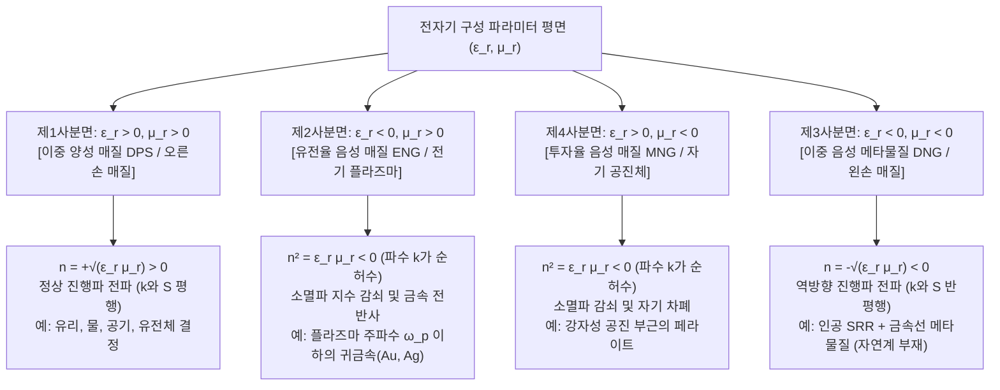
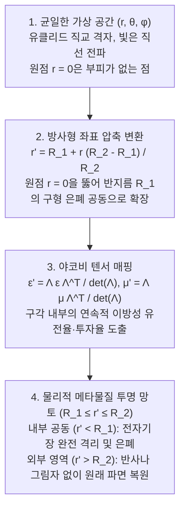

## 1. 서론: 화학 조성을 넘어선 기하학적 물질 공학

수 세기 동안 재료과학과 고전 광학의 근본 공리는 물질의 전자기적 성질—유리가 왜 투명한지, 금이 왜 금속 광택을 내는지, 물속의 빨대가 왜 꺾여 보이는지—이 주기율표의 원자 종류와 화학 결합이라는 <strong>화학적 조성(Chemical Composition)</strong>에 의해서만 결정된다는 것이었다. 그러나 21세기 초 고전 전기역학, 응집물질물리학, 나노기술의 교차점에서 <strong>메타물질(Metamaterials)</strong>이라는 패러다임 전환이 일어났다. 그리스어 접두사 <em>meta-</em>(“초월”)에서 유래한 메타물질은 구성 원자의 화학적 성질이 아니라 파장보다 훨씬 작은 <strong>아파장(Subwavelength) 구조 단위의 기하학적 형태, 위상 및 공간 배열(“메타원자”, Meta-atoms)</strong>에 의해 거시적 전자기 응답이 결정되는 인공 복합체이다.

가시광선의 파장($\lambda \approx 400\text{–}700\,\text{nm}$)은 고체 내 원자간 거리($a_{\text{atom}} \sim 0.1\text{–}0.3\,\text{nm}$)보다 1,000배 이상 크다. 따라서 빛은 개별 원자를 분해하지 못하고 공간적으로 평균화된 <strong>유전율 $\varepsilon$</strong>과 <strong>투자율 $\mu$</strong>를 통해 매질의 <strong>굴절률 $n = \sqrt{\varepsilon_r \mu_r}$</strong>을 인식한다. 만약 격자 상수 $a \lesssim \lambda / 10$인 인공 공진기 배열을 제작하면, 전자기파는 이를 유효 유전율 $\varepsilon_{\text{eff}}(\omega)$과 유효 투자율 $\mu_{\text{eff}}(\omega)$을 갖는 연속적인 <strong>유효 매질(Effective Medium)</strong>로 인식한다.

메타물질은 <strong>광결정(Photonic Crystals)</strong>이나 모르포 나비 날개·오팔 같은 자연 구조색과 엄격히 구분된다. 광결정은 격자 상수가 반파장 수준($a \sim \lambda / 2$)이며 주기적 <strong>브래그 산란(Bragg Scattering)</strong>과 간섭에 의해 광밴드갭을 형성하므로 유효 매질 근사(EMA)가 성립하지 않는다. 반면 메타물질은 깊은 아파장 영역($a \ll \lambda$)에서 작동하여 국소적인 유효 텐서 $\varepsilon_{\text{eff}}, \mu_{\text{eff}}$가 엄밀한 물리적 의미를 갖는다.

| 물리적 특성 및 작동 영역 | 자연 균질 물질 (유리, 물, 금속) | 광결정 및 자연 구조색 (오팔, 모르포 나비) | 메타물질 및 메타표면 (Metamaterials / Metasurfaces) |
| :--- | :--- | :--- | :--- |
| <strong>기본 구성 단위</strong> | 원자, 분자, 이온 | 주기적 유전체 블록 또는 공기 구멍 배열 | 인공 아파장 공진기 (SRR, 유전체 나노기둥) |
| <strong>격자 크기 $a$ 대 파장 $\lambda$</strong> | $a \sim 0.1\text{–}0.3\,\text{nm} \ (\ll \lambda/1000)$ | $a \sim \lambda / 2$ (브래그 산란 영역) | $a \lesssim \lambda / 10$ (깊은 아파장 균질화 영역) |
| <strong>지배적 물리 메커니즘</strong> | 전자/이온 분극, 밴드간 전이 | 브래그 회절, 다중 산란, 밴드 폴딩 | 국소 전기·자기 다중극 공진 (LC 공진, 미 공진) |
| <strong>유효 매질 근사 (EMA)</strong> | 광학 파장에서 정확히 성립 | 성립 불가 (단위 격자 내 장 변화 급격) | 성립 (거시적 $\varepsilon_{\text{eff}}(\omega), \mu_{\text{eff}}(\omega)$ 정의 가능) |
| <strong>등방성 음의 굴절률 ($n < 0$)</strong> | 자연계 부재 ($\varepsilon<0, \mu<0$ 대역 분리) | 밴드 분산 곡률에 의한 외견상 음굴절만 가능 | 진정한 이중 음성($\varepsilon_{\text{eff}} < 0, \mu_{\text{eff}} < 0$) 역방향파 전파 |

---

## 2. 맥스웰 방정식과 $\varepsilon\text{–}\mu$ 평면의 4사분면

등방성 균질 매질에서 단색 평면파 $\exp(i\mathbf{k}\cdot\mathbf{r} - i\omega t)$에 대한 맥스웰 회전 방정식은 다음과 같다:

$$
\mathbf{k} \times \mathbf{E} = \omega \mu \mathbf{H}, \qquad \mathbf{k} \times \mathbf{H} = -\omega \varepsilon \mathbf{E}
$$

여기서 $\varepsilon = \varepsilon_0 \varepsilon_r$, $\mu = \mu_0 \mu_r$이다. $\mathbf{H}$를 소거하면 분산 관계와 파동 임피던스 $Z$를 얻는다:

$$
k^2 = \left(\frac{\omega}{c}\right)^2 \varepsilon_r \mu_r = \left(\frac{\omega}{c}\right)^2 n^2, \qquad Z = \sqrt{\frac{\mu}{\varepsilon}} = Z_0 \sqrt{\frac{\mu_r}{\varepsilon_r}}
$$

상대 유전율 $\varepsilon_r$과 상대 투자율 $\mu_r$의 부호에 따라 모든 매질은 네 개의 사분면으로 분류된다:

왜 자연계에는 제3사분면($\varepsilon_r < 0, \mu_r < 0$) 물질이 없을까? 자연 원자의 전기 쌍극자 공진 및 플라즈마 진동은 광학·자외선 영역($10^{14}\text{–}10^{16}\,\text{Hz}$)에서 일어나지만, 자기 쌍극자 공진은 스핀 세차나 궤도 전류에 의존하여 미세구조상수($\alpha \approx 1/137$)만큼 약하고 기가헤르츠(GHz) 대역 이하에 머물기 때문이다.

---

## 3. 베셀라고의 1968년 이론 예측과 음의 굴절 물리학

1967년(1968년 영문 번역본 출판) 소련 물리학자 <strong>빅토르 베셀라고(Viktor G. Veselago)</strong>는 $\varepsilon_r < 0$과 $\mu_r < 0$이 동시에 성립하는 매질의 전기역학을 최초로 규명했다.

$\varepsilon < 0, \mu < 0$일 때 $\mathbf{k} \times \mathbf{E} = \omega \mu \mathbf{H}$에 의해 전기장 $\mathbf{E}$, 자기장 $\mathbf{H}$, 파수 벡터 $\mathbf{k}$(위상 속도 $\mathbf{v}_p$ 방향)는 <strong>왼손 직교계</strong>를 형성하므로 <strong>왼손 물질(Left-Handed Material, LHM)</strong>이라 부른다. 반면 전자기 에너지 흐름을 나타내는 <strong>포인팅 벡터(Poynting Vector) $\mathbf{S}$</strong>는 다음과 같이 정의된다:

$$
\mathbf{S} = \mathbf{E} \times \mathbf{H}, \qquad \langle \mathbf{S} \rangle = \frac{1}{2}\text{Re}(\mathbf{E} \times \mathbf{H}^*)
$$

$\mathbf{S}$의 정의에는 $\varepsilon, \mu$가 포함되지 않으므로 $(\mathbf{E}, \mathbf{H}, \mathbf{S})$는 언제나 오른손 직교계를 이룬다. 따라서 파수 벡터 $\mathbf{k}$와 에너지 흐름 $\mathbf{S}$는 반드시 <strong>반평행($\mathbf{k} \cdot \mathbf{S} < 0$)</strong>하며, 위상 속도 $\mathbf{v}_p$와 군속도 $\mathbf{v}_g$가 서로 반대 방향을 향하는 <strong>역방향파(Backward Wave)</strong>가 된다. 복소 평면 해석에서도 수동 인과 매질($\varepsilon'', \mu'' > 0$)의 열역학적 조건($\text{Im}(n) > 0$)은 필연적으로 음의 제곱근 가지 선택을 강제한다:

$$
n = \sqrt{\varepsilon_r \mu_r} = \sqrt{|\varepsilon_r||\mu_r|}\,e^{i\pi - i(\delta_\varepsilon + \delta_\mu)/2} = -\sqrt{|\varepsilon'||\mu'|} + i n'' \qquad (\text{Re}(n) < 0,\ \text{Im}(n) > 0)
$$

이로 인해 세 가지 역전된 광학 현상이 나타난다:
1. <strong>역전된 스넬의 법칙과 베셀라고 평면 렌즈</strong>: 경계면에서 접선 파수 연속성($k_{1x} = k_{2x}$)과 에너지 전진 조건($S_{2z} > 0 \implies k_{2z} < 0$)에 의해 굴절 광선은 <strong>법선의 같은 쪽</strong>으로 꺾인다:
   $$
   n_1 \sin\theta_1 = n_2 \sin\theta_2 = -|n_2|\sin|\theta_2|
   $$
   따라서 $n = -1$($\varepsilon_r = -1, \mu_r = -1$)인 평행 평판은 발산하는 광선을 내부와 외부에서 두 번 초점을 맺게 하는 무수차 평면 렌즈가 되며, 파동 임피던스 $Z = Z_0\sqrt{(-1)/(-1)} = Z_0$가 진공과 일치하여 반사가 전혀 없다.
2. <strong>역 도플러 효과</strong>: 관찰자에게 다가오는 광원은 역방향 위상면을 추격하므로 적색편이($\omega' = \omega_0(1 - |n|v/c)$)가 관측된다.
3. <strong>역 체렌코프 복사</strong>: 초광속 하전 입자($v > c/|n|$)가 방출하는 충격파 원뿔이 입자 진행 방향의 뒤쪽 둔각 방향으로 방사된다.

---

## 4. 존 펜드리의 돌파구(1996–1999): 분할 고리 공진기(SRR)와 인공 자성

1996년에서 1999년 사이 임페리얼 칼리지 런던의 <strong>존 펜드리 경(Sir John B. Pendry)</strong>은 비자성 도체의 아파장 기하학만으로 $\varepsilon_{\text{eff}}(\omega) < 0$과 $\mu_{\text{eff}}(\omega) < 0$을 구현하는 방법을 제시했다:
- <strong>인공 전기 플라즈마(세선 배열, 1996)</strong>: 주기적인 얇은 금속선 격자는 평균 전자 밀도를 희석할 뿐 아니라 강한 자기 유도장에 의해 전자의 유효 질량을 $m_{\text{eff}} = \frac{\mu_0 e^2 n_e \pi r^2}{2\pi}\ln(a/r) \gg m_e$로 극대화하여 플라즈마 주파수를 마이크로파 대역으로 낮춘다:
  $$
  \omega_{pe}^2 = \frac{2\pi c^2}{a^2 \ln(a/r)}, \qquad \varepsilon_{\text{eff}}(\omega) = 1 - \frac{\omega_{pe}^2}{\omega(\omega + i\gamma_e)}
  $$
- <strong>분할 고리 공진기(Split-Ring Resonator, SRR, 1999)</strong>: 간극이 뚫린 동심 구리 고리에 수직 교번 자기장이 가해지면 유도 전류(인덕턴스 $L$)와 간극의 전하 축적(커패시턴스 $C$)이 아파장 <strong>LC 공진 회로</strong>($\omega_m = 1/\sqrt{LC}$)를 형성한다. 공진 주파수 직상방에서 유도 자기 쌍극자가 외부 자기장과 $180^\circ$ 역위상으로 진동하여 음의 유효 투자율을 만든다:
  $$
  \mu_{\text{eff}}(\omega) = 1 - \frac{F \omega^2}{\omega^2 - \omega_m^2 + i\gamma_m \omega}
  $$

2000~2001년 UCSD의 <strong>데이비드 스미스(David R. Smith)</strong> 연구진은 구리 SRR과 금속선 격자를 결합한 프리즘을 제작하여 $10.5\,\text{GHz}$에서 세계 최초로 음의 굴절률($n = -2.7 \pm 0.1$)을 실험적으로 입증했다.

---

## 5. 아베 회절 한계 극복: 펜드리 슈퍼렌즈(Superlens)와 하이퍼렌즈

고전 광학 렌즈는 <strong>아베 회절 한계($\Delta x = \lambda / (2\,\text{NA})$)</strong>보다 작은 구조를 분해할 수 없다. 자유 공간의 종방향 파수는 다음과 같이 주어진다:

$$
k_z = \sqrt{k_0^2 - k_\parallel^2} = \sqrt{\left(\frac{2\pi}{\lambda}\right)^2 - (k_x^2 + k_y^2)}
$$

파장보다 작은 미세 구조의 공간 주파수($k_\parallel > k_0$)에 대해 $k_z = i\sqrt{k_\parallel^2 - k_0^2} = i\kappa_z$는 순허수가 되어, 근접장 <strong>소멸파(Evanescent Waves)</strong>가 $\exp(-\kappa_z z)$로 지수 감쇠하기 때문이다.

2000년 펜드리는 $\varepsilon_r \to -1, \mu_r \to -1$인 평판의 양 표면에서 <strong>표면 플라즈몬 폴라리톤(SPP)</strong>이 공진 결합하여 소멸파 투과 계수를 <strong>지수적으로 증폭</strong>함을 증명했다:

$$
\lim_{\varepsilon_r \to -1,\, \mu_r \to -1} T_s(k_\parallel, d) = \exp(+\kappa_z d), \qquad \exp(-\kappa_z z_1)\cdot\exp(+\kappa_z d)\cdot\exp(-\kappa_z z_2) = 1
$$

2005년 UC 버클리의 <strong>장샹(Xiang Zhang)</strong> 연구진은 $35\,\text{nm}$ 두께의 은(Ag) 박막 슈퍼렌즈로 $\lambda = 365\,\text{nm}$에서 $\lambda / 6$($60\,\text{nm}$) 초해상도 이미징에 성공했으며, 이후 은-알루미나 동심 다층막의 쌍곡선 분산($\frac{k_r^2}{\varepsilon_\theta} - \frac{k_\theta^2}{|\varepsilon_r|} = \frac{\omega^2}{c^2}$)을 이용해 소멸파를 원거리장 진행파로 변환·확대하는 <strong>하이퍼렌즈(Hyperlens)</strong>를 구현했다.

---

## 6. 변환 광학(Transformation Optics)과 투명 망토의 수학

2006년 5월 <strong>펜드리, 슈리그, 스미스</strong>와 <strong>울프 레온하르트(Ulf Leonhardt)</strong>는 맥스웰 방정식이 임의의 미분동형 좌표 변환 $x^i \mapsto x^{i'}$(야코비 행렬 $\Lambda^{i'}_i = \frac{\partial x^{i'}}{\partial x^i}$) 하에서 형태 불변임을 이용한 <strong>변환 광학(Transformation Optics)</strong>을 정립했다:

$$
\varepsilon^{i'j'} = \frac{\Lambda^{i'}_i \Lambda^{j'}_j}{|\det \mathbf{\Lambda}|} \varepsilon^{ij}, \qquad \mu^{i'j'} = \frac{\Lambda^{i'}_i \Lambda^{j'}_j}{|\det \mathbf{\Lambda}|} \mu^{ij}
$$

구형 영역 $0 \le r \le R_2$를 구각 $R_1 \le r' \le R_2$로 압축하는 변환 $r' = R_1 + r \frac{R_2 - R_1}{R_2}$을 적용하면 구형 투명 망토의 구성 파라미터를 얻는다:

$$
\varepsilon_r = \mu_r = \frac{R_2}{R_2 - R_1}\left(\frac{r' - R_1}{r'}\right)^2, \qquad \varepsilon_\theta = \varepsilon_\phi = \mu_\theta = \mu_\phi = \frac{R_2}{R_2 - R_1}
$$

내부 경계 $r' = R_1$에서 방사형 성분 $\varepsilon_r = \mu_r \to 0$(굴절률 0 특이점)이 되어 빛을 접선 방향으로 매끄럽게 우회시킨다. 2006년 10월 듀크 대학교 연구진은 $8.5\,\text{GHz}$에서 2차원 원통형 마이크로파 투명 망토를 최초로 시연했다. 이후 준등각 매핑을 이용한 <strong>카펫 클로크(Carpet Cloak)</strong>, 플라즈모닉 산란 상쇄 클로크, 기하광학 렌즈 배열 기반의 <strong>로체스터 클로크</strong> 등이 개발되었다.

---

## 7. 왜 '해리 포터 투명 망토'는 물리 법칙에 위배되는가? 3대 근본 한계

자유 공간에서 거시적 3차원 물체를 가시광선 전 대역($400\text{–}700\,\text{nm}$)에 걸쳐 모든 방향에서 위상까지 완벽히 숨기는 수동형 투명 망토는 세 가지 물리적 한계로 인해 불가능하다:

1. <strong>상대론적 인과율과 크라머스-크로니히(Kramers-Kronig) 대역폭 한계</strong>: 반지름 $R_1$의 내부 공동을 우회하는 경로($\pi R_1$)는 직선 거리($2R_1$)보다 길다. 외부 파면과 위상을 맞추려면 망토 내부의 위상 속도가 빛의 속도보다 빨라야 한다($v_p = c/n(\omega) > c$). 그러나 에너지와 정보를 전달하는 군속도는 상대론적 인과율에 의해 $v_g \le c$로 제한된다:
   $$
   v_g(\omega) = \frac{c}{n(\omega) + \omega \frac{dn(\omega)}{d\omega}} \le c \quad \Longrightarrow \quad \omega \frac{dn(\omega)}{d\omega} \ge 1 - n(\omega) > 0
   $$
   인과율이 강제하는 <strong>크라머스-크로니히 관계식</strong>:
   $$
   \text{Re}\,\varepsilon_r(\omega) - 1 = \frac{2}{\pi} \mathcal{P} \int_0^\infty \frac{\omega' \, \text{Im}\,\varepsilon_r(\omega')}{\omega'^2 - \omega^2} d\omega'
   $$
   에 의해 $0 \le n(\omega) < 1$은 강한 정상 분산과 공진 흡수 대역을 수반하며, 허용 가능한 상대 대역폭은 $\Delta\omega / \omega_0 \lesssim \lambda_0 / R_1$로 제한된다. 사람 크기($R_1 \sim 1\,\text{m}$)를 가시광선($\lambda_0 \sim 500\,\text{nm}$)에서 숨기려면 허용 대역폭이 $\Delta\omega/\omega_0 \sim 5\times 10^{-7}$에 불과하여 백색광 아래에서는 강한 색수차 산란이 발생한다(<strong>Monticone & Alù 산란 단면적 총합 규칙</strong>).
2. <strong>광학 주파수에서의 플라즈모닉 옴 손실과 운동 인덕턴스 포화</strong>: 수백 테라헤르츠(THz)의 가시광선 영역에서는 전자의 관성에 의한 운동 인덕턴스($L_{\text{kin}} \propto m_e / (n_e e^2)$)가 자기 공진 주파수를 포화시키고, 금속 내 강한 전자 산란으로 $\text{Im}(\varepsilon)$이 급증하여 성능 지수($\text{FOM} = |\text{Re}(n)|/\text{Im}(n) \sim 1\text{–}3$)가 붕괴한다.
3. <strong>3차원 나노공정의 한계</strong>: 가시광선 유효 매질 조건($a \lesssim \lambda/10$)을 만족하는 $10\text{–}50\,\text{nm}$ 정밀도의 3차원 구조체를 수천 층 이상 대면적으로 적층하는 것은 현대 리소그래피 공정으로도 극히 어렵다.

---

## 8. 3차원 메타물질에서 2차원 전유전체 메타표면(Metasurfaces)과 메타렌즈로의 진화

2010년대에 들어서며 메타물질 연구는 <strong>3차원 부피 구조에서 2차원 평면 메타표면(Metasurfaces)으로의 차원 축소</strong>와 <strong>손실이 큰 금속에서 고굴절률 저손실 유전체($\text{Si}, \text{TiO}_2, \text{GaN}$)로의 소재 전환</strong>을 통해 실용화의 돌파구를 열었다.

2011년 하버드 대학교의 <strong>페데리코 카파소(Federico Capasso)</strong>와 유난팡(Nanfang Yu)은 초박형 계면에 공간적 위상 기울기 $\frac{d\Phi(x)}{dx}$를 부여하여 빛의 진행 방향을 임의로 제어하는 <strong>일반화된 스넬의 법칙(Generalized Snell's Law)</strong>을 발표했다:

$$
n_t \sin\theta_t - n_i \sin\theta_i = \frac{\lambda_0}{2\pi} \frac{d\Phi(x)}{dx}, \qquad \sin\theta_r - \sin\theta_i = \frac{\lambda_0}{2\pi n_i} \frac{d\Phi(x)}{dx}
$$

고굴절률 유전체 나노기둥 내부의 변위 전류($\mathbf{J}_d = -i\omega\mathbf{D}$)는 옴 손실 없이 <strong>미(Mie) 전기 쌍극자(ED) 및 자기 쌍극자(MD) 공진</strong>을 동시에 유도하며, <strong>제1 커커 조건($\alpha_e = \alpha_m$)</strong>을 만족하는 <strong>호이겐스 메타표면(Huygens' Metasurface)</strong>은 후방 반사를 완전히 상쇄하고 $100\%$에 가까운 투과율로 $2\pi$ 위상 제어를 달성한다.

유리 웨이퍼 위에 수백만 개의 $\text{TiO}_2$ 나노기둥을 배열하여 무수차 쌍곡면 위상 분포:

$$
\Phi(x, y, \omega) = -\frac{\omega}{c} \left( \sqrt{x^2 + y^2 + f^2} - f \right)
$$

와 군지연($\frac{\partial\Phi}{\partial\omega}$)을 동시에 설계한 <strong>광대역 무색수차 메타렌즈(Achromatic Metalens)</strong>는 두께 $1\,\mu\text{m}$ 미만의 평면 칩으로 복합 유리 렌즈를 대체하며 스마트폰 3D 안면 인식, 자율주행 솔리드스테이트 라이다(LiDAR), 초박형 AR/VR 글래스, 내시경 이미징에 상용화되고 있다. 나아가 메타물질의 원리는 음의 유효 질량 밀도($\rho_{\text{eff}} < 0$)를 갖는 <strong>음향 메타물질</strong>, <strong>지진파 은폐 방호벽</strong>, <strong>열 메타물질</strong>, 그리고 시간적으로 유전율을 변조하는 <strong>시공간 메타물질(Spatiotemporal Metamaterials)</strong>로 확장되고 있다.
