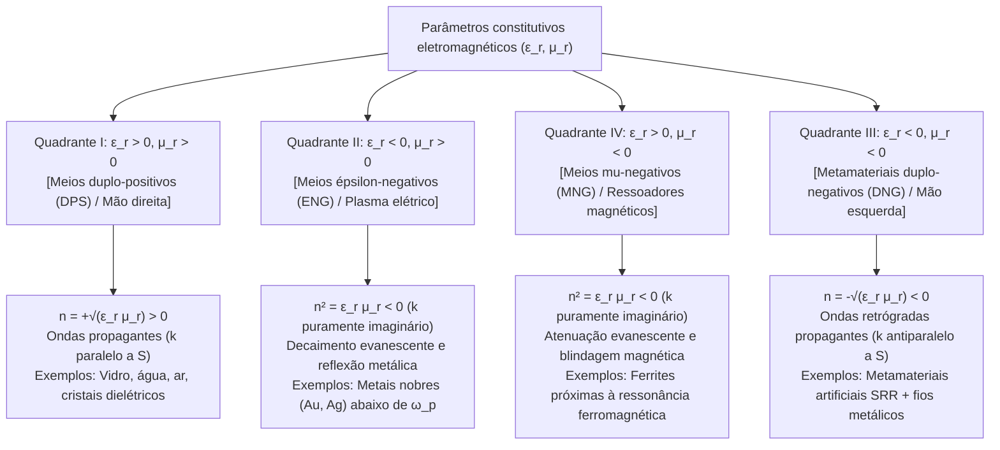
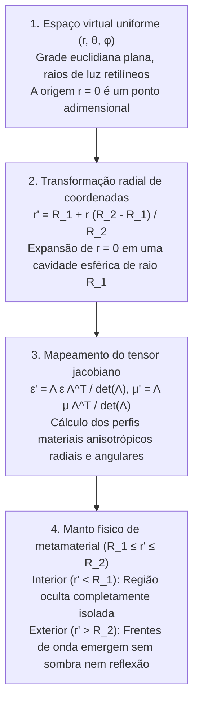

## 1. Introdução: Engenharia de propriedades materiais via geometria em vez de química

Durante séculos, um axioma fundamental da ciência dos materiais e da óptica clássica sustentou que as propriedades eletromagnéticas da matéria — por que o vidro transmite luz, o ouro reluz com brilho metálico ou um canudo parece quebrado na água — são ditadas exclusivamente pela <strong>composição química</strong>: as espécies atômicas da tabela periódica e suas ligações químicas. Na virada do século XXI, surgiu uma profunda mudança de paradigma na interseção da eletrodinâmica clássica, física da matéria condensada e nanotecnologia: os <strong>metamateriais</strong>. Derivado do prefixo grego <em>meta-</em> («além»), um metamaterial é um compósito estruturado artificialmente cuja resposta eletromagnética macroscópica é governada não pela química atômica, mas pela <strong>geometria sub-comprimento de onda, topologia e arranjo espacial de unidades estruturais projetadas («meta-átomos»)</strong>.

A luz visível abrange comprimentos de onda de $\lambda \approx 400\,\text{nm}$ a $700\,\text{nm}$, enquanto o espaçamento interatômico nos sólidos é de $a_{\text{atom}} \sim 0.1\text{–}0.3\,\text{nm}$. Como o campo eletromagnético oscila em escalas milhares de vezes maiores que os átomos individuais, a onda luminosa percebe um contínuo espacialmente homogeneizado caracterizado pela <strong>permissividade elétrica $\varepsilon$</strong> e pela <strong>permeabilidade magnética $\mu$</strong>, que determinam o <strong>índice de refração $n = \sqrt{\varepsilon_r \mu_r}$</strong>. Se fabricarmos ressoadores artificiais com passo de rede $a \lesssim \lambda / 10$, a onda tira a média de seus momentos de dipolo locais e percebe o arranjo como um <strong>meio efetivo</strong> contínuo com parâmetros projetados $\varepsilon_{\text{eff}}(\omega)$ e $\mu_{\text{eff}}(\omega)$.

É essencial distinguir metamateriais de <strong>cristais fotônicos</strong> e cores estruturais naturais (como opalas ou asas da borboleta <em>Morpho</em>). Nos cristais fotônicos, a constante de rede é comparável a meio comprimento de onda ($a \sim \lambda / 2$), abrindo bandgaps fotônicos por <strong>espalhamento de Bragg</strong>, onde a aproximação de meio efetivo (EMA) falha. Os metamateriais operam estritamente no regime sub-comprimento de onda profundo ($a \ll \lambda$), onde $\varepsilon_{\text{eff}}$ e $\mu_{\text{eff}}$ possuem significado físico local rigoroso.

| Característica física | Materiais homogêneos naturais (Vidro, Água, Ouro) | Cristais fotônicos e cor estrutural (Opala, Morpho) | Metamateriais e Metasuperfícies |
| :--- | :--- | :--- | :--- |
| <strong>Bloco fundamental</strong> | Átomos, moléculas, íons | Blocos dielétricos periódicos ou furos de ar | Ressoadores sub-comprimento de onda («meta-átomos»: SRR, nanopilares) |
| <strong>Passo de rede $a$ vs. $\lambda$</strong> | $a \sim 0.1\text{–}0.3\,\text{nm} \ (\ll \lambda/1000)$ | $a \sim \lambda / 2$ (Regime de Bragg) | $a \lesssim \lambda / 10$ (Regime sub-comprimento de onda profundo) |
| <strong>Mecanismo dominante</strong> | Polarização eletrônica/iônica | Difração de Bragg, espalhamento múltiplo | Ressonâncias multipolares elétricas e magnéticas (LC / Mie) |
| <strong>Aproximação de Meio Efetivo</strong> | Exata em comprimentos de onda ópticos | Inválida (campo in-homogêneo na escala de $\lambda$) | Válida (tensores $\varepsilon_{\text{eff}}(\omega), \mu_{\text{eff}}(\omega)$ bem definidos) |
| <strong>Índice negativo isotrópico ($n < 0$)</strong> | Ausente na natureza | Refração negativa aparente por curvatura de banda | Propagação real de ondas retrógradas duplo-negativas ($\varepsilon_{\text{eff}} < 0, \mu_{\text{eff}} < 0$) |

---

## 2. Equações de Maxwell e os quatro quadrantes do plano $\varepsilon\text{–}\mu$

Para ondas planas monocromáticas $\exp(i\mathbf{k}\cdot\mathbf{r} - i\omega t)$ em um meio isotrópico e homogêneo sem fontes, as equações rotacionais de Maxwell assumem a forma:

$$
\mathbf{k} \times \mathbf{E} = \omega \mu \mathbf{H}, \qquad \mathbf{k} \times \mathbf{H} = -\omega \varepsilon \mathbf{E}
$$

com $\varepsilon = \varepsilon_0 \varepsilon_r$ e $\mu = \mu_0 \mu_r$. Eliminando $\mathbf{H}$, obtemos a relação de dispersão e a impedância de onda $Z$:

$$
k^2 = \left(\frac{\omega}{c}\right)^2 \varepsilon_r \mu_r = \left(\frac{\omega}{c}\right)^2 n^2, \qquad Z = \sqrt{\frac{\mu}{\varepsilon}} = Z_0 \sqrt{\frac{\mu_r}{\varepsilon_r}}
$$

O plano $(\varepsilon_r, \mu_r)$ divide todos os meios isotrópicos em quatro quadrantes:

A natureza deixa o Quadrante III vazio porque as ressonâncias elétricas atômicas ocorrem em frequências ópticas/UV ($10^{14}\text{–}10^{16}\,\text{Hz}$), enquanto as ressonâncias magnéticas (suprimidas pela constante de estrutura fina $\alpha \approx 1/137$) decaem acima de GHz ou THz.

---

## 3. O experimento mental de Veselago (1968) e a física da refração negativa

Em 1967 (traduzido para o inglês em 1968), o físico soviético <strong>Viktor G. Veselago</strong> provou que quando $\varepsilon_r < 0$ e $\mu_r < 0$ simultaneamente, a tríade $(\mathbf{E}, \mathbf{H}, \mathbf{k})$ forma um <strong>sistema de mão esquerda</strong>, originando o termo <strong>material canhoto (Left-Handed Material, LHM)</strong>. Contudo, o fluxo de energia eletromagnética é governado pelo <strong>vetor de Poynting $\mathbf{S}$</strong>:

$$
\mathbf{S} = \mathbf{E} \times \mathbf{H}, \qquad \langle \mathbf{S} \rangle = \frac{1}{2}\text{Re}(\mathbf{E} \times \mathbf{H}^*)
$$

Como $\mathbf{S}$ independe de $\varepsilon$ e $\mu$, $(\mathbf{E}, \mathbf{H}, \mathbf{S})$ forma sempre um sistema de mão direita. Portanto, o vetor de onda $\mathbf{k}$ (velocidade de fase $\mathbf{v}_p$) e o vetor de Poynting $\mathbf{S}$ (velocidade de grupo $\mathbf{v}_g$) são <strong>antiparalelos ($\mathbf{k} \cdot \mathbf{S} < 0$, onda retrógrada)</strong>. A análise complexa em qualquer meio passivo causal ($\varepsilon'', \mu'' > 0$) exige a escolha da raiz negativa para satisfazer $\text{Im}(n) > 0$:

$$
n = \sqrt{\varepsilon_r \mu_r} = \sqrt{|\varepsilon_r||\mu_r|}\,e^{i\pi - i(\delta_\varepsilon + \delta_\mu)/2} = -\sqrt{|\varepsilon'||\mu'|} + i n'' \qquad (\text{Re}(n) < 0,\ \text{Im}(n) > 0)
$$

Isso resulta em três fenômenos ópticos invertidos:
1. <strong>Lei de Snell invertida e lente plana de Veselago</strong>: Pela continuidade de $k_x$ e fluxo de energia $S_z > 0$, o raio refratado dobra para o <strong>mesmo lado da normal</strong> que o raio incidente:
   $$
   n_1 \sin\theta_1 = n_2 \sin\theta_2 = -|n_2|\sin|\theta_2|
   $$
   Uma lâmina plana paralela com $n = -1$ ($\varepsilon_r = \mu_r = -1$) focaliza raios divergentes dentro e fora da lâmina sem reflexão superficial ($Z = Z_0\sqrt{(-1)/(-1)} = Z_0$).
2. <strong>Efeito Doppler invertido</strong>: Uma fonte aproximando-se de um observador sofre desvio para o vermelho $\omega' = \omega_0 (1 - |n|v/c)$.
3. <strong>Radiação Cherenkov invertida</strong>: Uma partícula carregada superluminal ($v > c/|n|$) emite seu cone de choque para trás em ângulo obtuso.

---

## 4. O avanço de Sir John Pendry (1996–1999): Ressoadores de Anel Dividido (SRR)

Entre 1996 e 1999, <strong>Sir John B. Pendry</strong> (Imperial College London) demonstrou como sintetizar $\varepsilon_{\text{eff}} < 0$ e $\mu_{\text{eff}} < 0$ com estruturas metálicas sub-comprimento de onda:
- <strong>Rede de fios metálicos finos (1996)</strong>: A diluição espacial e a autoindutância magnética conferem aos elétrons uma massa efetiva gigante $m_{\text{eff}} = \frac{\mu_0 e^2 n_e \pi r^2}{2\pi}\ln(a/r) \gg m_e$, reduzindo a frequência de plasma para GHz:
  $$
  \omega_{pe}^2 = \frac{2\pi c^2}{a^2 \ln(a/r)}, \qquad \varepsilon_{\text{eff}}(\omega) = 1 - \frac{\omega_{pe}^2}{\omega(\omega + i\gamma_e)}
  $$
- <strong>Ressoador de Anel Dividido (Split-Ring Resonator, SRR, 1999)</strong>: Dois anéis concêntricos de cobre com fendas capacitivas operam como um <strong>circuito ressonante LC</strong> planar ($\omega_m = 1/\sqrt{LC}$). Logo acima de $\omega_m$, o dipolo magnético induzido oscila $180^\circ$ fora de fase com o campo magnético externo, gerando permeabilidade efetiva negativa:
  $$
  \mu_{\text{eff}}(\omega) = 1 - \frac{F \omega^2}{\omega^2 - \omega_m^2 + i\gamma_m \omega}
  $$

Em 2000–2001, <strong>David R. Smith</strong> e colaboradores na UC San Diego combinaram fios e SRRs em um prisma metamaterial, medindo experimentalmente $n = -2.7 \pm 0.1$ em $10.5\,\text{GHz}$.

---

## 5. Superando o limite de difração: A Superlente de Pendry e as Hiperlentes

Lentes convencionais são limitadas pelo <strong>limite de difração de Abbe ($\Delta x = \lambda / (2\,\text{NA})$)</strong>. Para frequências espaciais altas ($k_\parallel > k_0 = 2\pi/\lambda$), o número de onda longitudinal torna-se puramente imaginário:

$$
k_z = \sqrt{k_0^2 - k_\parallel^2} = i\sqrt{k_\parallel^2 - k_0^2} = i\kappa_z
$$

Essas <strong>ondas evanescentes</strong> decaem exponencialmente como $\exp(-\kappa_z z)$. Em 2000, Pendry (*Physical Review Letters*) provou que uma lâmina com $\varepsilon_r \to -1, \mu_r \to -1$ excita <strong>polaritons de plásmons de superfície (SPP)</strong> que <strong>amplificam exponencialmente as ondas evanescentes</strong>:

$$
\lim_{\varepsilon_r \to -1,\, \mu_r \to -1} T_s(k_\parallel, d) = \exp(+\kappa_z d), \qquad \exp(-\kappa_z z_1)\cdot\exp(+\kappa_z d)\cdot\exp(-\kappa_z z_2) = 1
$$

Em 2005, o grupo de <strong>Xiang Zhang</strong> (UC Berkeley) demonstrou uma superlente de prata de $35\,\text{nm}$ em $\lambda = 365\,\text{nm}$ com resolução de $60\,\text{nm}$ ($\sim \lambda/6$), seguida pelas <strong>hiperlentes</strong> hiperbólicas ($\frac{k_r^2}{\varepsilon_\theta} - \frac{k_\theta^2}{|\varepsilon_r|} = \frac{\omega^2}{c^2}$) que projetam imagens sub-difração no campo distante.

---

## 6. Óptica de transformação e a matemática do manto de invisibilidade

Em maio de 2006, <strong>Pendry, Schurig e Smith</strong> juntamente com <strong>Ulf Leonhardt</strong> introduziram na *Science* a <strong>óptica de transformação (TO)</strong>, baseada na <strong>invariância de forma das equações de Maxwell sob transformações de coordenadas</strong> $x^i \mapsto x^{i'}$ (matriz jacobiana $\Lambda^{i'}_i = \frac{\partial x^{i'}}{\partial x^i}$):

$$
\varepsilon^{i'j'} = \frac{\Lambda^{i'}_i \Lambda^{j'}_j}{|\det \mathbf{\Lambda}|} \varepsilon^{ij}, \qquad \mu^{i'j'} = \frac{\Lambda^{i'}_i \Lambda^{j'}_j}{|\det \mathbf{\Lambda}|} \mu^{ij}
$$

Comprimindo a esfera $0 \le r \le R_2$ na casca esférica $R_1 \le r' \le R_2$ via $r' = R_1 + r\frac{R_2 - R_1}{R_2}$, obtêm-se os parâmetros do manto esférico de Pendry:

$$
\varepsilon_r = \mu_r = \frac{R_2}{R_2 - R_1}\left(\frac{r' - R_1}{r'}\right)^2, \qquad \varepsilon_\theta = \varepsilon_\phi = \mu_\theta = \mu_\phi = \frac{R_2}{R_2 - R_1}
$$

Na fronteira interna $r' = R_1$, $\varepsilon_r = \mu_r \to 0$ (singularidade de índice zero), desviando tangencialmente as ondas ao redor da cavidade $r' < R_1$. Em outubro de 2006, a equipe da Universidade Duke construiu o primeiro manto cilíndrico de micro-ondas em $8.5\,\text{GHz}$. Outras arquiteturas incluem o <strong>manto-tapete (Carpet Cloak)</strong> quase-conforme, o cancelamento plasmônico de espalhamento (Alù & Engheta) e o <strong>manto paraxial de óptica geométrica (Manto de Rochester)</strong>.

---

## 7. Por que um «manto de invisibilidade de Harry Potter» é proibido pela física

Um manto de invisibilidade passivo, sem perdas e omnidirecional para um objeto 3D macroscópico no espectro visível ($400\text{–}700\,\text{nm}$) é fisicamente impossível devido a três limites fundamentais:

1. <strong>Causalidade relativística e limite de largura de banda de Kramers-Kronig</strong>: Para contornar a cavidade ($\pi R_1 > 2R_1$) mantendo a fase, a velocidade de fase dentro do manto deve superar $c$ ($v_p = c/n(\omega) > c$), mas a velocidade de grupo que transporta energia é limitada por $v_g \le c$:
   $$
   v_g(\omega) = \frac{c}{n(\omega) + \omega \frac{dn(\omega)}{d\omega}} \le c \quad \Longrightarrow \quad \omega \frac{dn(\omega)}{d\omega} \ge 1 - n(\omega) > 0
   $$
   Junto com as <strong>relações de Kramers-Kronig</strong>:
   $$
   \text{Re}\,\varepsilon_r(\omega) - 1 = \frac{2}{\pi} \mathcal{P} \int_0^\infty \frac{\omega' \, \text{Im}\,\varepsilon_r(\omega')}{\omega'^2 - \omega^2} d\omega'
   $$
   a largura de banda relativa fica limitada a $\Delta\omega / \omega_0 \lesssim \lambda_0 / R_1$ ($\sim 5\times 10^{-7}$ para $R_1 = 1\,\text{m}$ na luz visível; regra de soma de Monticone & Alù).
2. <strong>Perdas ôhmicas plasmônicas e saturação da indutância cinética</strong>: Em frequências ópticas ($400\text{–}750\,\text{THz}$), a indutância cinética eletrônica ($L_{\text{kin}} \propto m_e / (n_e e^2)$) satura a ressonância magnética e a absorção metálica reduz a figura de mérito para $\text{FOM} = |\text{Re}(n)|/\text{Im}(n) \sim 1\text{–}3$.
3. <strong>Gargalo da nanofabricação 3D</strong>: Empilhar milhares de nanocamadas 3D com resolução de $10\text{–}50\,\text{nm}$ em áreas macroscópicas supera as técnicas litográficas atuais.

---

## 8. Dos metamateriais 3D às metasuperfícies 2D dielétricas e metalentes

Na década de 2010, a área evoluiu para as <strong>metasuperfícies 2D</strong> fabricadas com ressoadores de Mie de <strong>dielétricos de alto índice sem perdas ($\text{Si}, \text{TiO}_2, \text{GaN}$)</strong>.

Em 2011, <strong>Federico Capasso</strong> e Nanfang Yu (Harvard) formularam a <strong>Lei de Snell Generalizada</strong>, onde um gradiente espacial de fase $\frac{d\Phi(x)}{dx}$ controla a refração:

$$
n_t \sin\theta_t - n_i \sin\theta_i = \frac{\lambda_0}{2\pi} \frac{d\Phi(x)}{dx}, \qquad \sin\theta_r - \sin\theta_i = \frac{\lambda_0}{2\pi n_i} \frac{d\Phi(x)}{dx}
$$

Quando os dipolos elétrico e magnético de Mie cumprem a <strong>primeira condição de Kerker ($\alpha_e = \alpha_m$)</strong>, as <strong>metasuperfícies de Huygens</strong> alcançam quase $100\%$ de transmissão. Ao sintetizar o perfil de fase hiperbólico de uma lente ideal:

$$
\Phi(x, y, \omega) = -\frac{\omega}{c} \left( \sqrt{x^2 + y^2 + f^2} - f \right)
$$

e projetar o atraso de grupo $\frac{\partial\Phi}{\partial\omega}$, as <strong>metalentes acromáticas planas</strong> ($< 1\,\mu\text{m}$ de espessura) impulsionam hoje o reconhecimento facial 3D, o LiDAR automotivo, os óculos AR/VR e a endoscopia médica, estendendo o paradigma para os <strong>metamateriais acústicos, sísmicos, térmicos e espaçotemporais</strong>.
