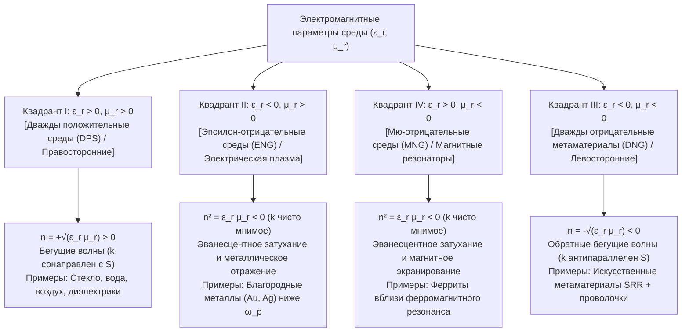
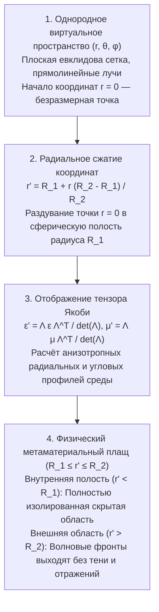

## 1. Введение: Инженерия свойств материалов с помощью геометрии вместо химии

На протяжении столетий базовой аксиомой материаловедения и классической оптики считалось утверждение, что электромагнитные свойства вещества — почему стекло пропускает свет, золото обладает металлическим блеском, а соломинка в воде кажется надломленной — определяются исключительно его <strong>химическим составом</strong>: типом атомов из периодической таблицы и характером химических связей. На рубеже XXI века на стыке электродинамики, физики конденсированного состояния и нанотехнологий произошла смена парадигмы — возникли <strong>метаматериалы</strong>. От греческой приставки <em>meta-</em> («сверх», «за пределами»), метаматериал представляет собой искусственно структурированный композит, чей макроскопический электромагнитный отклик определяется не атомной химией, а <strong>субволновой геометрией, топологией и пространственным расположением искусственных структурных ячеек («мета-атомов»)</strong>.

Видимый свет охватывает длины волн от $\lambda \approx 400\,\text{нм}$ до $700\,\text{нм}$, тогда как межатомное расстояние в кристаллах составляет всего $a_{\text{atom}} \sim 0.1\text{–}0.3\,\text{нм}$. Поскольку электромагнитное поле осциллирует на масштабах, в тысячи раз превышающих размеры отдельных атомов, световая волна воспринимает сплошную среду с усреднёнными макроскопическими параметрами: <strong>диэлектрической проницаемостью $\varepsilon$</strong> и <strong>магнитной проницаемостью $\mu$</strong>, определяющими <strong>показатель преломления $n = \sqrt{\varepsilon_r \mu_r}$</strong>. Если создать массив искусственных резонаторов с периодом решётки $a \lesssim \lambda / 10$, падающая волна усредняет их локальные дипольные моменты и воспринимает структуру как однородную <strong>эффективную среду</strong> с заданными параметрами $\varepsilon_{\text{eff}}(\omega)$ и $\mu_{\text{eff}}(\omega)$.

Принципиально важно отличать метаматериалы от <strong>фотонных кристаллов</strong> и природной структурной окраски (опал, крылья бабочек <em>Morpho</em>). В фотонных кристаллах период решётки соизмерим с полуволной ($a \sim \lambda / 2$), а запрещённые зоны формируются за счёт <strong>брэгговской дифракции</strong>, где приближение эффективной среды (EMA) неприменимо. Метаматериалы же работают строго в глубоко субволновом режиме ($a \ll \lambda$), где локальные тензоры $\varepsilon_{\text{eff}}$ и $\mu_{\text{eff}}$ имеют строгий физический смысл.

| Физическая характеристика | Природные однородные среды (Стекло, Вода, Золото) | Фотонные кристаллы и структурный цвет (Опал, Morpho) | Метаматериалы и Метаповерхности |
| :--- | :--- | :--- | :--- |
| <strong>Базовый элемент</strong> | Атомы, молекулы, ионы | Периодические диэлектрические блоки или полости | Субволновые резонаторы («мета-атомы»: SRR, наностолбики) |
| <strong>Период $a$ к длине волны $\lambda$</strong> | $a \sim 0.1\text{–}0.3\,\text{нм} \ (\ll \lambda/1000)$ | $a \sim \lambda / 2$ (брэгговский режим) | $a \lesssim \lambda / 10$ (глубоко субволновой режим) |
| <strong>Доминирующий механизм</strong> | Электронная/ионная поляризация | Брэгговская дифракция, многократное рассеяние | Локальные электрические и магнитные резонансы (LC / Ми) |
| <strong>Приближение эффективной среды</strong> | Точное на оптических частотах | Неприменимо (неоднородность на масштабе $\lambda$) | Справедливо (определены $\varepsilon_{\text{eff}}(\omega)$ и $\mu_{\text{eff}}(\omega)$) |
| <strong>Изотропный индекс $n < 0$</strong> | Отсутствует в природе | Кажущееся отрицательное преломление из-за зонной дисперсии | Истинные дважды отрицательные обратные волны ($\varepsilon_{\text{eff}} < 0, \mu_{\text{eff}} < 0$) |

---

## 2. Уравнения Максвелла и четыре квадранта плоскости $\varepsilon\text{–}\mu$

Для монохроматических плоских волн $\exp(i\mathbf{k}\cdot\mathbf{r} - i\omega t)$ в однородной изотропной среде без источников роторные уравнения Максвелла имеют вид:

$$
\mathbf{k} \times \mathbf{E} = \omega \mu \mathbf{H}, \qquad \mathbf{k} \times \mathbf{H} = -\omega \varepsilon \mathbf{E}
$$

где $\varepsilon = \varepsilon_0 \varepsilon_r$ и $\mu = \mu_0 \mu_r$. Исключая $\mathbf{H}$, получаем дисперсионное соотношение и волновой импеданс $Z$:

$$
k^2 = \left(\frac{\omega}{c}\right)^2 \varepsilon_r \mu_r = \left(\frac{\omega}{c}\right)^2 n^2, \qquad Z = \sqrt{\frac{\mu}{\varepsilon}} = Z_0 \sqrt{\frac{\mu_r}{\varepsilon_r}}
$$

Плоскость $(\varepsilon_r, \mu_r)$ делит все изотропные среды на четыре квадранта:

В природе Квадрант III пустует, поскольку электрические дипольные и плазменные резонансы лежат в оптическом и УФ-диапазонах ($10^{14}\text{–}10^{16}\,\text{Гц}$), а магнитные резонансы подавлены постоянной тонкой структуры $\alpha \approx 1/137$ и затухают выше СВЧ- и ТГц-частот.

---

## 3. Мысленный эксперимент В. Г. Веселаго (1967–1968) и физика отрицательного преломления

В 1967 году (английский перевод в 1968 г.) советский физик <strong>Виктор Георгиевич Веселаго</strong> (ФИАН) впервые строго исследовал электродинамику среды с одновременными $\varepsilon_r < 0$ и $\mu_r < 0$.

Из $\mathbf{k} \times \mathbf{E} = \omega \mu \mathbf{H}$ при $\varepsilon < 0, \mu < 0$ следует, что тройка векторов $(\mathbf{E}, \mathbf{H}, \mathbf{k})$ образует <strong>левую тройку</strong>, почему Веселаго назвал такие среды <strong>«левыми» веществами (Left-Handed Materials, LHM)</strong>. Однако поток электромагнитной энергии определяется <strong>вектором Пойнтинга $\mathbf{S}$</strong>:

$$
\mathbf{S} = \mathbf{E} \times \mathbf{H}, \qquad \langle \mathbf{S} \rangle = \frac{1}{2}\text{Re}(\mathbf{E} \times \mathbf{H}^*)
$$

Так как в определение $\mathbf{S}$ не входят $\varepsilon$ и $\mu$, векторы $(\mathbf{E}, \mathbf{H}, \mathbf{S})$ всегда образуют правую тройку! Следовательно, волновой вектор $\mathbf{k}$ (фазовая скорость $\mathbf{v}_p$) и вектор Пойнтинга $\mathbf{S}$ (групповая скорость $\mathbf{v}_g$) <strong>антипараллельны ($\mathbf{k} \cdot \mathbf{S} < 0$, обратная волна)</strong>. Комплексный анализ для пассивной причинной среды ($\varepsilon'', \mu'' > 0$) также однозначно требует выбора отрицательной ветви квадратного корня для выполнения условия затухания $\text{Im}(n) > 0$:

$$
n = \sqrt{\varepsilon_r \mu_r} = \sqrt{|\varepsilon_r||\mu_r|}\,e^{i\pi - i(\delta_\varepsilon + \delta_\mu)/2} = -\sqrt{|\varepsilon'||\mu'|} + i n'' \qquad (\text{Re}(n) < 0,\ \text{Im}(n) > 0)
$$

Это приводит к трём обращённым оптическим эффектам:
1. <strong>Обращённый закон Снеллиуса и плоская линза Веселаго</strong>: Из непрерывности $k_x$ и условия $S_z > 0$ преломлённый луч отклоняется <strong>по ту же сторону от нормали</strong>, что и падающий:
   $$
   n_1 \sin\theta_1 = n_2 \sin\theta_2 = -|n_2|\sin|\theta_2|
   $$
   Плоскопараллельная пластина с $n = -1$ ($\varepsilon_r = \mu_r = -1$) дважды фокусирует расходящиеся лучи точечного источника (внутри и снаружи пластины) без отражения от границ ($Z = Z_0\sqrt{(-1)/(-1)} = Z_0$).
2. <strong>Обратный эффект Доплера</strong>: Приближающийся к наблюдателю источник света испытывает красное смещение $\omega' = \omega_0 (1 - |n|v/c)$.
3. <strong>Обратное излучение Вавилова — Черенкова</strong>: Быстрая заряженная частица ($v > c/|n|$) излучает конус ударной волны назад под тупым углом к траектории.

---

## 4. Прорыв сэра Джона Пендри (1996–1999): Разомкнутые кольцевые резонаторы (SRR)

В 1996–1999 годах <strong>сэр Джон Пендри (Sir John B. Pendry)</strong> из Имперского колледжа Лондона показал, как конструировать $\varepsilon_{\text{eff}} < 0$ и $\mu_{\text{eff}} < 0$ из немагнитных проводников:
- <strong>Решётка тонких металлических проволочек (1996)</strong>: Пространственное разбавление и огромная магнитная самоиндукция придают электронам гигантскую эффективную массу $m_{\text{eff}} = \frac{\mu_0 e^2 n_e \pi r^2}{2\pi}\ln(a/r) \gg m_e$, снижая плазменную частоту до ГГц-диапазона:
  $$
  \omega_{pe}^2 = \frac{2\pi c^2}{a^2 \ln(a/r)}, \qquad \varepsilon_{\text{eff}}(\omega) = 1 - \frac{\omega_{pe}^2}{\omega(\omega + i\gamma_e)}
  $$
- <strong>Разомкнутый кольцевой резонатор (Split-Ring Resonator, SRR, 1999)</strong>: Два концентрических медных кольца с ёмкостными зазорами работают как субволновой планарный <strong>LC-контур</strong> ($\omega_m = 1/\sqrt{LC}$). Чуть выше $\omega_m$ наведённый магнитный момент осциллирует в противофазе с внешним полем, создавая отрицательную магнитную проницаемость:
  $$
  \mu_{\text{eff}}(\omega) = 1 - \frac{F \omega^2}{\omega^2 - \omega_m^2 + i\gamma_m \omega}
  $$

В 2000–2001 годах группа <strong>Дэвида Смита (David R. Smith)</strong> в Калифорнийском университете в Сан-Диего (UCSD) объединила проволочки и SRR, впервые экспериментально измерив на частоте $10.5\,\text{ГГц}$ отрицательный показатель преломления $n = -2.7 \pm 0.1$.

---

## 5. Преодоление дифракционного предела: Суперлинза Пендри и гиперлинзы

Обычная оптика ограничена <strong>дифракционным пределом Аббе ($\Delta x = \lambda / (2\,\text{NA})$)</strong>. Для субволновых пространственных частот ($k_\parallel > k_0 = 2\pi/\lambda$) продольное волновое число становится чисто мнимым:

$$
k_z = \sqrt{k_0^2 - k_\parallel^2} = i\sqrt{k_\parallel^2 - k_0^2} = i\kappa_z
$$

Эти <strong>эванесцентные (затухающие) волны</strong> экспоненциально спадают как $\exp(-\kappa_z z)$. В 2000 году Пендри (*Physical Review Letters*) доказал, что слой с $\varepsilon_r \to -1, \mu_r \to -1$ за счёт резонансного возбуждения <strong>поверхностных плазмон-поляритонов (SPP)</strong> <strong>экспоненциально усиливает эванесцентные волны</strong>:

$$
\lim_{\varepsilon_r \to -1,\, \mu_r \to -1} T_s(k_\parallel, d) = \exp(+\kappa_z d), \qquad \exp(-\kappa_z z_1)\cdot\exp(+\kappa_z d)\cdot\exp(-\kappa_z z_2) = 1
$$

В 2005 году группа <strong>Сяна Чжана (Xiang Zhang)</strong> в UC Berkeley продемонстрировала серебряную суперлинзу толщиной $35\,\text{нм}$ на длине волны $\lambda = 365\,\text{нм}$ с разрешением $60\,\text{нм}$ ($\sim \lambda/6$), а затем цилиндрические <strong>гиперлинзы</strong> с гиперболической дисперсией ($\frac{k_r^2}{\varepsilon_\theta} - \frac{k_\theta^2}{|\varepsilon_r|} = \frac{\omega^2}{c^2}$), проецирующие субволновые изображения в дальнюю зону.

---

## 6. Трансформационная оптика и математика плаща-невидимки

В мае 2006 года <strong>Пендри, Шуриг и Смит</strong>, а также <strong>Ульф Леонхардт</strong> опубликовали в *Science* основы <strong>трансформационной оптики (TO)</strong>, опирающейся на <strong>форм-инвариантность уравнений Максвелла относительно гладких преобразований координат</strong> $x^i \mapsto x^{i'}$ (матрица Якоби $\Lambda^{i'}_i = \frac{\partial x^{i'}}{\partial x^i}$):

$$
\varepsilon^{i'j'} = \frac{\Lambda^{i'}_i \Lambda^{j'}_j}{|\det \mathbf{\Lambda}|} \varepsilon^{ij}, \qquad \mu^{i'j'} = \frac{\Lambda^{i'}_i \Lambda^{j'}_j}{|\det \mathbf{\Lambda}|} \mu^{ij}
$$

Сжимая шар $0 \le r \le R_2$ в сферический слой $R_1 \le r' \le R_2$ преобразованием $r' = R_1 + r\frac{R_2 - R_1}{R_2}$, получаем параметры сферического плаща Пендри:

$$
\varepsilon_r = \mu_r = \frac{R_2}{R_2 - R_1}\left(\frac{r' - R_1}{r'}\right)^2, \qquad \varepsilon_\theta = \varepsilon_\phi = \mu_\theta = \mu_\phi = \frac{R_2}{R_2 - R_1}
$$

На внутренней границе $r' = R_1$ радиальные компоненты обращаются в нуль ($\varepsilon_r = \mu_r \to 0$), плавно огибая светом скрытую полость $r' < R_1$. В октябре 2006 года в Университете Дьюка был создан первый микроволновый плащ-невидимка на частоте $8.5\,\text{ГГц}$. В дальнейшем были разработаны <strong>ковровые плащи (Carpet Cloaks)</strong>, плазмонная компенсация рассеяния (Алу и Энгета) и геометрические <strong>параксиальные плащи (Рочестерский плащ)</strong>.

---

## 7. Почему «плащ-невидимка Гарри Поттера» запрещён законами физики

Всенаправленный пассивный плащ-невидимка без потерь для макроскопического 3D-объекта в широком видимом спектре ($400\text{–}700\,\text{нм}$) невозможен из-за трёх фундаментальных запретов:

1. <strong>Релятивистская причинность и предел полосы пропускания Крамерса — Кронига</strong>: Чтобы обогнуть полость по дуге $\pi R_1 > 2R_1$ в фазе с внешней волной, фазовая скорость внутри плаща должна быть сверхсветовой ($v_p = c/n(\omega) > c$). Однако групповая скорость переноса энергии ограничена условием $v_g \le c$:
   $$
   v_g(\omega) = \frac{c}{n(\omega) + \omega \frac{dn(\omega)}{d\omega}} \le c \quad \Longrightarrow \quad \omega \frac{dn(\omega)}{d\omega} \ge 1 - n(\omega) > 0
   $$
   В сочетании с <strong>соотношениями Крамерса — Кронига</strong>:
   $$
   \text{Re}\,\varepsilon_r(\omega) - 1 = \frac{2}{\pi} \mathcal{P} \int_0^\infty \frac{\omega' \, \text{Im}\,\varepsilon_r(\omega')}{\omega'^2 - \omega^2} d\omega'
   $$
   относительная полоса частот маскировки ограничена величиной $\Delta\omega / \omega_0 \lesssim \lambda_0 / R_1$ ($\sim 5\times 10^{-7}$ для $R_1 = 1\,\text{м}$ в видимом свете; правило сумм Монтиконе и Алу).
2. <strong>Плазмонные омические потери и насыщение кинетической индуктивности</strong>: На оптических частотах ($400\text{–}750\,\text{ТГц}$) кинетическая индуктивность электронов ($L_{\text{kin}} \propto m_e / (n_e e^2)$) насыщает магнитный резонанс, а поглощение в металлах снижает добротность до $\text{FOM} = |\text{Re}(n)|/\text{Im}(n) \sim 1\text{–}3$.
3. <strong>Технологический барьер 3D-нанофабрикации</strong>: Послойное создание тысяч выровненных 3D-нанослоёв с разрешением $10\text{–}50\,\text{нм}$ на метровых площадях недоступно современной литографии.

---

## 8. От 3D-метаматериалов к 2D-диэлектрическим метаповерхностям и металинзам

В 2010-х годах произошёл переход к <strong>двумерным метаповерхностям (Metasurfaces)</strong> на основе резонаторов Ми из <strong>высокопреломляющих диэлектриков без потерь ($\text{Si}, \text{TiO}_2, \text{GaN}$)</strong>.

В 2011 году <strong>Федерико Капассо (Federico Capasso)</strong> и Наньфан Юй (Гарвард) сформулировали <strong>обобщённый закон Снеллиуса</strong>, где пространственный градиент фазы $\frac{d\Phi(x)}{dx}$ управляет преломлением:

$$
n_t \sin\theta_t - n_i \sin\theta_i = \frac{\lambda_0}{2\pi} \frac{d\Phi(x)}{dx}, \qquad \sin\theta_r - \sin\theta_i = \frac{\lambda_0}{2\pi n_i} \frac{d\Phi(x)}{dx}
$$

При выполнении <strong>первого условия Керкера ($\alpha_e = \alpha_m$)</strong> <strong>метаповерхности Гюйгенса</strong> подавляют обратное отражение, обеспечивая почти $100\%$-ное пропускание. Формируя гиперболический фазовый профиль идеальной линзы:

$$
\Phi(x, y, \omega) = -\frac{\omega}{c} \left( \sqrt{x^2 + y^2 + f^2} - f \right)
$$

и управляя групповой задержкой $\frac{\partial\Phi}{\partial\omega}$, плоские <strong>ахроматические металинзы</strong> толщиной менее $1\,\text{мкм}$ внедряются в 3D-распознавание лиц смартфонов, твердотельные лидары (LiDAR), очки AR/VR и медицинские эндоскопы, а концепция метаматериалов успешно расширяется на <strong>акустические, сейсмические, тепловые и пространственно-временные метаматериалы</strong>.
