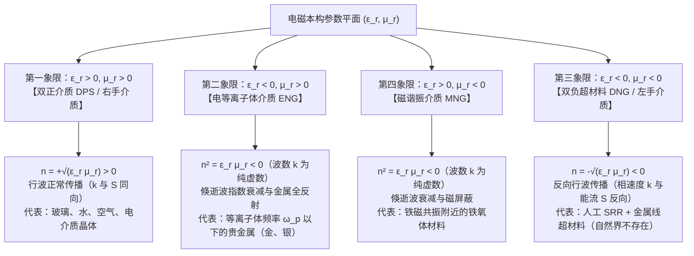
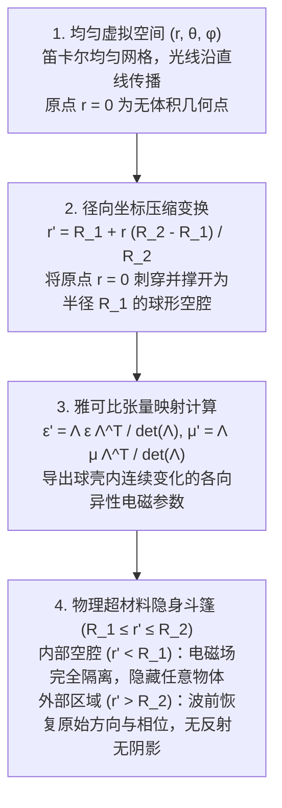

## 1. 引言：超越化学组成的几何材料工程

几个世纪以来，材料科学与经典光学的基本公理认为，物质的电磁性质——为什么玻璃透明、黄金闪烁金属光泽、吸管在水中看似折断——完全由<strong>化学组成</strong>决定，即元素周期表中的原子种类及其化学键结构。然而在21世纪初，经典电动力学、凝聚态物理与纳米技术的交叉领域诞生了<strong>超材料（Metamaterials）</strong>。前缀 <em>meta-</em> 源自希腊语“超越”，超材料是一类人工微结构复合材料，其宏观电磁响应主要不取决于构成原子的化学成分，而是由远小于工作波长的<strong>亚波长几何结构、拓扑形状与空间排列（“超原子”，Meta-atoms）</strong>决定。

可见光波长范围为 $\lambda \approx 400\,\text{nm}$ 至 $700\,\text{nm}$，而晶体中的原子间距仅为 $a_{\text{atom}} \sim 0.1\text{–}0.3\,\text{nm}$，比光波长小三个数量级以上。电磁波无法分辨单个原子，只能感知空间平均后的宏观本构参数：<strong>介电常数 $\varepsilon$</strong> 与<strong>磁导率 $\mu$</strong>，二者共同决定<strong>折射率 $n = \sqrt{\varepsilon_r \mu_r}$</strong>。如果我们制造晶格常数 $a \lesssim \lambda / 10$ 的亚波长金属环或电介质纳米柱阵列，入射电磁波同样无法分辨单个谐振单元，而是将其视为具有工程化等效介电常数 $\varepsilon_{\text{eff}}(\omega)$ 和等效磁导率 $\mu_{\text{eff}}(\omega)$ 的连续<strong>等效介质（Effective Medium）</strong>。

必须将超材料与<strong>光子晶体（Photonic Crystals）</strong>及自然结构色（如闪蝶翅膀、蛋白石）严格区分。光子晶体的晶格常数与半波长相当（$a \sim \lambda / 2$），依靠周期性<strong>布拉格散射（Bragg Scattering）</strong>产生光子带隙，等效介质近似失效；而超材料严格工作在深亚波长区（$a \ll \lambda$），局部等效参数 $\varepsilon_{\text{eff}}$ 和 $\mu_{\text{eff}}$ 具有严格的物理意义。

| 物理特征与工作机制 | 天然均匀材料（玻璃、水、金属） | 光子晶体与结构色（蛋白石、闪蝶翅） | 超材料与超表面（Metamaterials / Metasurfaces） |
| :--- | :--- | :--- | :--- |
| <strong>基本结构单元</strong> | 原子、分子、离子 | 周期性电介质块或气孔阵列 | 人工亚波长谐振器（开口谐振环 SRR、纳米柱） |
| <strong>晶格尺度 $a$ 与波长 $\lambda$</strong> | $a \sim 0.1\text{–}0.3\,\text{nm} \ (\ll \lambda/1000)$ | $a \sim \lambda / 2$（布拉格衍射区） | $a \lesssim \lambda / 10$（深亚波长均匀化区） |
| <strong>主导物理机制</strong> | 电子极化、离子极化、带间跃迁 | 布拉格散射、多重干涉、能带折叠 | 局域电偶极与磁偶极谐振（LC谐振、米氏谐振） |
| <strong>等效介质近似（EMA）</strong> | 在光学波段精确成立 | 不成立（波长尺度内场强剧烈变化） | 成立（可定义宏观张量 $\varepsilon_{\text{eff}}(\omega), \mu_{\text{eff}}(\omega)$） |
| <strong>各向同性负折射（$n < 0$）</strong> | 自然界不存在（$\varepsilon<0$ 与 $\mu<0$ 频段分离） | 仅由能带色散曲率产生表观负折射 | 真正双负介质（$\varepsilon_{\text{eff}} < 0, \mu_{\text{eff}} < 0$）反向波传播 |

---

## 2. 麦克斯韦方程组与 $\varepsilon\text{–}\mu$ 平面四象限

在无源各向同性均匀介质中，单色平面电磁波 $\exp(i\mathbf{k}\cdot\mathbf{r} - i\omega t)$ 满足麦克斯韦旋度方程：

$$
\mathbf{k} \times \mathbf{E} = \omega \mu \mathbf{H}, \qquad \mathbf{k} \times \mathbf{H} = -\omega \varepsilon \mathbf{E}
$$

其中 $\varepsilon = \varepsilon_0 \varepsilon_r$，$\mu = \mu_0 \mu_r$。消去磁场 $\mathbf{H}$ 可得色散关系与波阻抗 $Z$：

$$
k^2 = \left(\frac{\omega}{c}\right)^2 \varepsilon_r \mu_r = \left(\frac{\omega}{c}\right)^2 n^2, \qquad Z = \sqrt{\frac{\mu}{\varepsilon}} = Z_0 \sqrt{\frac{\mu_r}{\varepsilon_r}}
$$

以相对介电常数 $\varepsilon_r$ 为横轴、相对磁导率 $\mu_r$ 为纵轴，所有各向同性介质可分为四个象限：

为何自然界不存在第三象限（$\varepsilon_r < 0, \mu_r < 0$）材料？在天然原子中，电偶极跃迁与自由电子等离子体振荡发生在光学和紫外频段（$\sim 10^{14}\text{–}10^{16}\,\text{Hz}$），而磁偶极响应源于电子自旋进动或轨道电流，受精细结构常数 $\alpha \approx 1/137$ 压制，仅出现在微波或吉赫兹频段。两者的负值频段在自然物质中相隔数个数量级。

---

## 3. 韦谢拉戈1968年的理论预言与负折射物理

1967年（英译本发表于1968年），苏联物理学家<strong>维克托·韦谢拉戈（Viktor G. Veselago）</strong>首次系统探讨了当 $\varepsilon_r < 0$ 且 $\mu_r < 0$ 时的电动力学行为。

当 $\varepsilon < 0, \mu < 0$ 时，由 $\mathbf{k} \times \mathbf{E} = \omega \mu \mathbf{H}$ 可知，电场 $\mathbf{E}$、磁场 $\mathbf{H}$ 与波矢 $\mathbf{k}$（指向相速度 $\mathbf{v}_p$ 方向）构成<strong>左手螺旋三元组</strong>，故称为<strong>左手材料（Left-Handed Material, LHM）</strong>。然而，决定电磁能量流动方向的<strong>坡印廷矢量（Poynting Vector）$\mathbf{S}$</strong> 定义为：

$$
\mathbf{S} = \mathbf{E} \times \mathbf{H}, \qquad \langle \mathbf{S} \rangle = \frac{1}{2}\text{Re}(\mathbf{E} \times \mathbf{H}^*)
$$

由于 $\mathbf{S}$ 的定义不含 $\varepsilon$ 和 $\mu$，$(\mathbf{E}, \mathbf{H}, \mathbf{S})$ 始终构成右手系！这意味着波矢 $\mathbf{k}$ 与能流矢量 $\mathbf{S}$ 必然<strong>严格反向平行（$\mathbf{k} \cdot \mathbf{S} < 0$）</strong>，即相速度 $\mathbf{v}_p$ 与群速度（能量传播方向）$\mathbf{v}_g$ 相反。在复平面分析中，任何满足热力学无源损耗条件（$\varepsilon_r = -|\varepsilon'| + i\varepsilon'', \mu_r = -|\mu'| + i\mu''$，其中 $\varepsilon'', \mu'' > 0$）的因果介质，其折射率平方根必须取负支：

$$
n = \sqrt{\varepsilon_r \mu_r} = \sqrt{|\varepsilon_r||\mu_r|}\,e^{i\pi - i(\delta_\varepsilon + \delta_\mu)/2} = -\sqrt{|\varepsilon'||\mu'|} + i n'' \qquad (\text{Re}(n) < 0,\ \text{Im}(n) > 0)
$$

负折射率导致三大反转物理效应：
1. <strong>反转斯涅尔折射定律与韦谢拉戈平板透镜</strong>：光从正介质（$n_1 > 0$）斜射入负介质（$n_2 < 0$）时，切向波矢连续（$k_{1x} = k_{2x}$），而法向能流 $S_{2z} > 0$ 要求 $k_{2z} < 0$。折射光线折向<strong>法线的同一侧</strong>：
   $$
   n_1 \sin\theta_1 = n_2 \sin\theta_2 = -|n_2|\sin|\theta_2|
   $$
   因此，一块简单的 $n = -1$ 平行平板即可将点光源发出的发散光线先在板内聚焦，再在板外二次聚焦成实像，且波阻抗 $Z = Z_0\sqrt{(-1)/(-1)} = Z_0$ 与真空完全匹配，无表面反射。
2. <strong>反转多普勒效应</strong>：朝向观察者运动的光源追赶反向传播的等相面，使接收频率降低（红移）：$\omega' = \omega_0 (1 - |n|v/c)$。
3. <strong>反转切伦科夫辐射</strong>：超光速带电粒子（$v > c/|n|$）激发的切伦科夫辐射锥沿能流 $\mathbf{S} \parallel -\mathbf{k}$ 方向，即向粒子运动后方的钝角方向发射。

---

## 4. 约翰·彭德里的突破（1996–1999）：开口谐振环与人工磁性

1996年至1999年，伦敦帝国理工学院的<strong>约翰·彭德里爵士（Sir John B. Pendry）</strong>提出了用非磁性金属结构分别定制 $\varepsilon_{\text{eff}}(\omega) < 0$ 和 $\mu_{\text{eff}}(\omega) < 0$ 的工程方案：
- <strong>人工电等离子体（细金属线阵列，1996）</strong>：周期排列的微米级细金属线既稀释了平均电子浓度 $n_{\text{eff}} = n_e (\pi r^2 / a^2)$，又因细线周围强烈的磁场自感赋予电子巨大的等效磁质量 $m_{\text{eff}} = \frac{\mu_0 e^2 n_e \pi r^2}{2\pi} \ln(a/r) \gg m_e$，从而将等离子体频率从紫外频段拉低六个数量级至微波频段：
  $$
  \omega_{pe}^2 = \frac{2\pi c^2}{a^2 \ln(a/r)}, \qquad \varepsilon_{\text{eff}}(\omega) = 1 - \frac{\omega_{pe}^2}{\omega(\omega + i\gamma_e)}
  $$
- <strong>人工磁性与开口谐振环（Split-Ring Resonator, SRR, 1999）</strong>：由带有狭窄开口的同心铜环构成。交变磁场垂直穿过环面时感应出环形电流（等效电感 $L$），而开口间隙积累电荷形成串联电容 $C$，构成亚波长平面 <strong>LC 谐振回路</strong>（谐振频率 $\omega_m = 1/\sqrt{LC}$）。在略高于 $\omega_m$ 的窄频带内，感应磁矩与外磁场反相，产生负等效磁导率：
  $$
  \mu_{\text{eff}}(\omega) = 1 - \frac{F \omega^2}{\omega^2 - \omega_m^2 + i\gamma_m \omega}
  $$

2000年至2001年，加州大学圣迭戈分校（UCSD）的<strong>大卫·史密斯（David R. Smith）</strong>团队将铜质 SRR 与金属线阵列组合，在 $10.5\,\text{GHz}$ 微波频段首次实验测得负折射率（$n = -2.7 \pm 0.1$）。

---

## 5. 突破阿贝衍射极限：彭德里超透镜（Superlens）与双曲超透镜

传统光学显微镜受制于<strong>阿贝衍射极限（Abbe Diffraction Limit，$\Delta x = \lambda / (2\,\text{NA})$）</strong>。自由空间色散关系决定纵向波矢为：

$$
k_z = \sqrt{k_0^2 - k_\parallel^2} = \sqrt{\left(\frac{2\pi}{\lambda}\right)^2 - (k_x^2 + k_y^2)}
$$

物体小于波长 $\lambda$ 的精细亚波长结构对应高空间频率 $k_\parallel > k_0$，此时 $k_z = i\sqrt{k_\parallel^2 - k_0^2} = i\kappa_z$ 为纯虚数。这些携带亚波长信息的<strong>倏逝波（Evanescent Waves）</strong>按 $\exp(-\kappa_z z)$ 在几十纳米内指数衰减，无法到达远场透镜。

2000年，彭德里在《物理评论快报》发表 <em>“Negative Refraction Makes a Perfect Lens”</em>，证明当平板满足 $\varepsilon_r \to -1, \mu_r \to -1$ 时，其前后界面激发耦合的<strong>表面等离激元极化激元（Surface Plasmon Polaritons, SPP）</strong>共振，使菲涅耳透射系数分母中的首项严格归零，从而<strong>指数放大倏逝波</strong>：

$$
\lim_{\varepsilon_r \to -1,\, \mu_r \to -1} T_s(k_\parallel, d) = \exp(+\kappa_z d), \qquad \exp(-\kappa_z z_1)\cdot\exp(+\kappa_z d)\cdot\exp(-\kappa_z z_2) = 1
$$

2005年，加州大学伯克利分校<strong>张翔（Xiang Zhang）</strong>团队利用 $35\,\text{nm}$ 厚的银膜超透镜在 $\lambda = 365\,\text{nm}$ 下实现了 $\lambda / 6$（$60\,\text{nm}$）的超分辨光刻成像。随后发展的<strong>双曲超透镜（Hyperlens）</strong>利用银与氧化铝同心纳米多层膜的各向异性双曲色散（$\frac{k_r^2}{\varepsilon_\theta} - \frac{k_\theta^2}{|\varepsilon_r|} = \frac{\omega^2}{c^2}$），将近场高波矢倏逝波转化为向远场放大的传播波。

---

## 6. 变换光学（Transformation Optics）与隐身斗篷的数学原理

2006年5月，<strong>彭德里、舒里格（D. Schurig）、史密斯</strong>与<strong>乌尔夫·莱昂哈特（Ulf Leonhardt）</strong>在《科学》（<em>Science</em>）杂志同期发表论文，创立了<strong>变换光学（Transformation Optics）</strong>。

麦克斯韦方程组在任意光滑坐标变换 $x^i \mapsto x^{i'}(x, y, z)$（雅可比矩阵 $\Lambda^{i'}_i = \frac{\partial x^{i'}}{\partial x^i}$）下保持形式不变，坐标网格的弯曲等价于平直物理空间中非均匀各向异性的介电常数与磁导率张量：

$$
\varepsilon^{i'j'} = \frac{\Lambda^{i'}_i \Lambda^{j'}_j}{|\det \mathbf{\Lambda}|} \varepsilon^{ij}, \qquad \mu^{i'j'} = \frac{\Lambda^{i'}_i \Lambda^{j'}_j}{|\det \mathbf{\Lambda}|} \mu^{ij}
$$

对于将半径 $0 \le r \le R_2$ 的球体径向压缩至球壳 $R_1 \le r' \le R_2$ 的<strong>彭德里球形隐身斗篷</strong>，坐标变换为 $r' = R_1 + r \frac{R_2 - R_1}{R_2}$，导出球壳内的本构参数：

$$
\varepsilon_r = \mu_r = \frac{R_2}{R_2 - R_1}\left(\frac{r' - R_1}{r'}\right)^2, \qquad \varepsilon_\theta = \varepsilon_\phi = \mu_\theta = \mu_\phi = \frac{R_2}{R_2 - R_1}
$$

在内边界 $r' = R_1$ 处，径向参数趋于零（$\varepsilon_r = \mu_r \to 0$，即近零折射率奇点），将光线沿切向平滑导引绕过内部空腔 $r' < R_1$，并在后方完美汇合。2006年10月，杜克大学利用10层渐变铜质 SRR 同心圆环在 $8.5\,\text{GHz}$ 下首次验证了二维圆柱微波隐身斗篷。此外，学界还发展了基于准保角映射的<strong>地毯式隐身斗篷（Carpet Cloak）</strong>、基于反相偶极抵消的<strong>等离激元散射抵消斗篷</strong>以及基于几何光学透镜组的<strong>傍轴光线斗篷（罗切斯特斗篷）</strong>。

---

## 7. 为什么“哈利·波特隐身衣”违反物理定律？三大基本极限

为什么我们无法制造出在自然日光下全向隐身宏观人体的“哈利·波特隐身衣”？现代物理学证明，<strong>在自由空间中对宏观三维物体实现宽带可见光（$400\text{–}700\,\text{nm}$）、全向、无源无损的相位保持隐身斗篷，从根本上违反物理学定律</strong>：

1. <strong>相对论因果律与克拉默斯-克勒尼希（Kramers-Kronig）带宽极限</strong>：绕过半径 $R_1$ 空腔的弧长 $\pi R_1$ 大于直线距离 $2R_1$。要保持出射波前相位一致，斗篷内部的<strong>相速度必须超光速（$v_p = c/n(\omega) > c$，在内壁 $n_r \to 0$ 处 $v_p \to \infty$）</strong>。虽然单频相速度超光速不违反狭义相对论，但传递能量的<strong>群速度必须满足 $v_g \le c$</strong>：
   $$
   v_g(\omega) = \frac{c}{n(\omega) + \omega \frac{dn(\omega)}{d\omega}} \le c \quad \Longrightarrow \quad \omega \frac{dn(\omega)}{d\omega} \ge 1 - n(\omega) > 0
   $$
   结合因果律要求的<strong>克拉默斯-克勒尼希关系</strong>：
   $$
   \text{Re}\,\varepsilon_r(\omega) - 1 = \frac{2}{\pi} \mathcal{P} \int_0^\infty \frac{\omega' \, \text{Im}\,\varepsilon_r(\omega')}{\omega'^2 - \omega^2} d\omega'
   $$
   任何 $0 \le n(\omega) < 1$ 的区域都伴随剧烈的正常色散，使得相位隐身的最大相对带宽受限于物体尺寸：$\Delta\omega / \omega_0 \lesssim \lambda_0 / R_1$。对于人体尺度（$R_1 \sim 1\,\text{m}$）和可见光（$\lambda_0 \sim 500\,\text{nm}$），允许带宽仅为 $\Delta\omega/\omega_0 \sim 5\times 10^{-7}$（单一激光线）！根据<strong>散射截面求和规则（Monticone & Alù）</strong>，全谱积分的总散射无法通过无源外壳消除。
2. <strong>光学频段的等离激元欧姆损耗与动能电感饱和</strong>：在光频（$400\text{–}750\,\text{THz}$）下，金属自由电子的惯性产生<strong>动能电感（$L_{\text{kin}} \propto m_e / (n_e e^2)$）</strong>，导致磁谐振频率饱和；同时强烈的电子散射使金属虚部 $\text{Im}(\varepsilon)$ 暴增，品质因数跌至 $\text{FOM} = |\text{Re}(n)|/\text{Im}(n) \sim 1\text{–}3$，三维金属超材料在几微米内即吸光变黑。
3. <strong>三维纳米制造瓶颈</strong>：可见光等效介质要求 $10\text{–}50\,\text{nm}$ 精度的三维晶格，在宏观面积上堆叠数千层纳米结构远超当前半导体光刻工艺的产能极限。

---

## 8. 从三维超材料到二维全介质超表面（Metasurfaces）与超构透镜

为克服三维金属超材料的损耗与制造难题，2010年代超材料领域实现了两大战略转型：<strong>从三维体材料降维至二维平面超表面（Metasurfaces）</strong>，以及<strong>用高折射率无损电介质（硅 $\text{Si}$、二氧化钛 $\text{TiO}_2$、氮化镓 $\text{GaN}$）取代有损金属</strong>。

2011年，哈佛大学<strong>费德里科·卡帕索（Federico Capasso）</strong>与虞南方提出了<strong>广义斯涅尔定律（Generalized Snell's Law）</strong>。亚波长纳米天线阵列可在超薄界面上直接赋予光波空间突变的<strong>相位梯度 $\frac{d\Phi(x)}{dx}$</strong>：

$$
n_t \sin\theta_t - n_i \sin\theta_i = \frac{\lambda_0}{2\pi} \frac{d\Phi(x)}{dx}, \qquad \sin\theta_r - \sin\theta_i = \frac{\lambda_0}{2\pi n_i} \frac{d\Phi(x)}{dx}
$$

在全介质纳米柱中，交变位移电流 $\mathbf{J}_d = -i\omega\mathbf{D}$ 同时激发无欧姆损耗的<strong>米氏电偶极（ED）与磁偶极（MD）谐振</strong>。当二者满足<strong>第一克尔克条件（First Kerker Condition，$\alpha_e = \alpha_m$）</strong>时，后向反射完全相消，形成透射率近 $100\%$ 的<strong>惠更斯超表面（Huygens' Metasurface）</strong>。

通过在平面石英晶圆上排列数百万根 $\text{TiO}_2$ 纳米柱以合成理想无像差双曲相位分布：

$$
\Phi(x, y, \omega) = -\frac{\omega}{c} \left( \sqrt{x^2 + y^2 + f^2} - f \right)
$$

并同时调控群延迟 $\frac{\partial\Phi}{\partial\omega}$ 实现<strong>宽带消色差超构透镜（Achromatic Metalens）</strong>，厚度不足 $1\,\mu\text{m}$ 的平面超构透镜正依托 CMOS 晶圆厂大规模量产，广泛赋能智能手机 3D 人脸识别、车载固态激光雷达（LiDAR）、AR/VR 超薄波导眼镜与医疗内窥成像。此外，超材料思想已成功拓展至<strong>声学超材料</strong>（负有效质量密度 $\rho_{\text{eff}} < 0$）、<strong>地震超材料防护屏障</strong>、<strong>热超材料斗篷</strong>以及同时调制时间与空间的<strong>时空超材料（Time-Varying / Spatiotemporal Metamaterials）</strong>。
