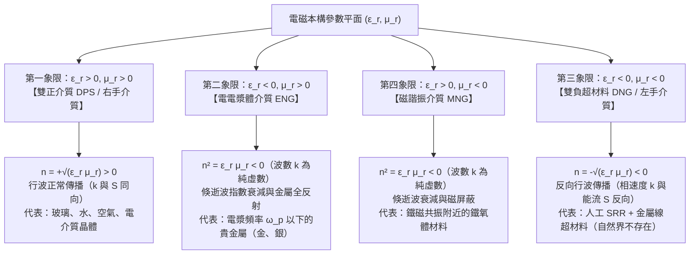
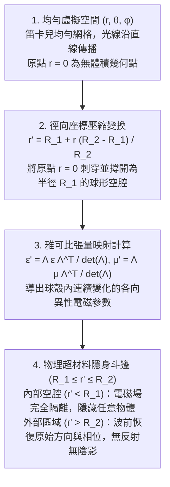

## 1. 引言：超越化學組成的幾何材料工程

幾個世紀以來，材料科學與古典光學的基本公理認為，物質的電磁性質——為什麼玻璃透明、黃金閃爍金屬光澤、吸管在水中看似折斷——完全由<strong>化學組成</strong>決定，即元素週期表中的原子種類及其化學鍵結構。然而在21世紀初，古典電動力學、凝聚態物理與奈米技術的交叉領域誕生了<strong>超材料（Metamaterials）</strong>。字首 <em>meta-</em> 源自希臘語「超越」，超材料是一類人工微結構複合材料，其巨觀電磁響應主要不取決於構成原子的化學成分，而是由遠小於工作波長的<strong>次波長幾何結構、拓撲形狀與空間排列（「超原子」，Meta-atoms）</strong>決定。

可見光波長範圍為 $\lambda \approx 400\,\text{nm}$ 至 $700\,\text{nm}$，而晶體中的原子間距僅為 $a_{\text{atom}} \sim 0.1\text{–}0.3\,\text{nm}$，比光波長小三個數量級以上。電磁波無法分辨單個原子，只能感知空間平均後的巨觀本構參數：<strong>介電常數 $\varepsilon$</strong> 與<strong>磁導率 $\mu$</strong>，二者共同決定<strong>折射率 $n = \sqrt{\varepsilon_r \mu_r}$</strong>。如果我們製造晶格常數 $a \lesssim \lambda / 10$ 的次波長金屬環或電介質奈米柱陣列，入射電磁波同樣無法分辨單個諧振單元，而是將其視為具有工程化等效介電常數 $\varepsilon_{\text{eff}}(\omega)$ 和等效磁導率 $\mu_{\text{eff}}(\omega)$ 的連續<strong>等效介質（Effective Medium）</strong>。

必須將超材料與<strong>光子晶體（Photonic Crystals）</strong>及自然結構色（如摩爾福蝶翅膀、蛋白石）嚴格區分。光子晶體的晶格常數與半波長相當（$a \sim \lambda / 2$），依靠週期性<strong>布拉格散射（Bragg Scattering）</strong>產生光子能隙，等效介質近似失效；而超材料嚴格工作在深次波長區（$a \ll \lambda$），局部等效參數 $\varepsilon_{\text{eff}}$ 和 $\mu_{\text{eff}}$ 具有嚴格的物理意義。

| 物理特徵與工作機制 | 天然均勻材料（玻璃、水、金屬） | 光子晶體與結構色（蛋白石、摩爾福蝶翅） | 超材料與超表面（Metamaterials / Metasurfaces） |
| :--- | :--- | :--- | :--- |
| <strong>基本結構單元</strong> | 原子、分子、離子 | 週期性電介質塊或氣孔陣列 | 人工次波長諧振器（開口諧振環 SRR、奈米柱） |
| <strong>晶格尺度 $a$ 與波長 $\lambda$</strong> | $a \sim 0.1\text{–}0.3\,\text{nm} \ (\ll \lambda/1000)$ | $a \sim \lambda / 2$（布拉格繞射區） | $a \lesssim \lambda / 10$（深次波長均勻化區） |
| <strong>主導物理機制</strong> | 電子極化、離子極化、帶間躍遷 | 布拉格繞射、多重干涉、能帶折疊 | 局域電偶極與磁偶極諧振（LC諧振、米氏諧振） |
| <strong>等效介質近似（EMA）</strong> | 在光學波段精確成立 | 不成立（波長尺度內場強劇烈變化） | 成立（可定義巨觀張量 $\varepsilon_{\text{eff}}(\omega), \mu_{\text{eff}}(\omega)$） |
| <strong>各向同性負折射（$n < 0$）</strong> | 自然界不存在（$\varepsilon<0$ 與 $\mu<0$ 頻段分離） | 僅由能帶色散曲率產生表觀負折射 | 真正雙負介質（$\varepsilon_{\text{eff}} < 0, \mu_{\text{eff}} < 0$）反向波傳播 |

---

## 2. 馬克士威方程組與 $\varepsilon\text{–}\mu$ 平面四象限

在無源各向同性均勻介質中，單色平面電磁波 $\exp(i\mathbf{k}\cdot\mathbf{r} - i\omega t)$ 滿足馬克士威旋度方程：

$$
\mathbf{k} \times \mathbf{E} = \omega \mu \mathbf{H}, \qquad \mathbf{k} \times \mathbf{H} = -\omega \varepsilon \mathbf{E}
$$

其中 $\varepsilon = \varepsilon_0 \varepsilon_r$，$\mu = \mu_0 \mu_r$。消去磁場 $\mathbf{H}$ 可得色散關係與波阻抗 $Z$：

$$
k^2 = \left(\frac{\omega}{c}\right)^2 \varepsilon_r \mu_r = \left(\frac{\omega}{c}\right)^2 n^2, \qquad Z = \sqrt{\frac{\mu}{\varepsilon}} = Z_0 \sqrt{\frac{\mu_r}{\varepsilon_r}}
$$

以相對介電常數 $\varepsilon_r$ 為橫軸、相對磁導率 $\mu_r$ 為縱軸，所有各向同性介質可分為四個象限：

為何自然界不存在第三象限（$\varepsilon_r < 0, \mu_r < 0$）材料？在天然原子中，電偶極躍遷與自由電子電漿振盪發生在光學和紫外頻段（$\sim 10^{14}\text{–}10^{16}\,\text{Hz}$），而磁偶極響應源於電子自旋進動或軌道電流，受精細結構常數 $\alpha \approx 1/137$ 壓制，僅出現在微波或吉赫茲頻段。兩者的負值頻段在自然物質中相隔數個數量級。

---

## 3. 韋謝拉戈1968年的理論預言與負折射物理

1967年（英譯本發表於1968年），蘇聯物理學家<strong>維克托·韋謝拉戈（Viktor G. Veselago）</strong>首次系統探討了當 $\varepsilon_r < 0$ 且 $\mu_r < 0$ 時的電動力學行為。

當 $\varepsilon < 0, \mu < 0$ 時，由 $\mathbf{k} \times \mathbf{E} = \omega \mu \mathbf{H}$ 可知，電場 $\mathbf{E}$、磁場 $\mathbf{H}$ 與波矢 $\mathbf{k}$（指向相速度 $\mathbf{v}_p$ 方向）構成<strong>左手螺旋三元組</strong>，故稱為<strong>左手材料（Left-Handed Material, LHM）</strong>。然而，決定電磁能量流動方向的<strong>坡印廷向量（Poynting Vector）$\mathbf{S}$</strong> 定義為：

$$
\mathbf{S} = \mathbf{E} \times \mathbf{H}, \qquad \langle \mathbf{S} \rangle = \frac{1}{2}\text{Re}(\mathbf{E} \times \mathbf{H}^*)
$$

由於 $\mathbf{S}$ 的定義不含 $\varepsilon$ 和 $\mu$，$(\mathbf{E}, \mathbf{H}, \mathbf{S})$ 始終構成右手系！這意味著波矢 $\mathbf{k}$ 與能流向量 $\mathbf{S}$ 必然<strong>嚴格反向平行（$\mathbf{k} \cdot \mathbf{S} < 0$）</strong>，即相速度 $\mathbf{v}_p$ 與群速度（能量傳播方向）$\mathbf{v}_g$ 相反。在複數平面分析中，任何滿足熱力學無源損耗條件（$\varepsilon_r = -|\varepsilon'| + i\varepsilon'', \mu_r = -|\mu'| + i\mu''$，其中 $\varepsilon'', \mu'' > 0$）的因果介質，其折射率平方根必須取負支：

$$
n = \sqrt{\varepsilon_r \mu_r} = \sqrt{|\varepsilon_r||\mu_r|}\,e^{i\pi - i(\delta_\varepsilon + \delta_\mu)/2} = -\sqrt{|\varepsilon'||\mu'|} + i n'' \qquad (\text{Re}(n) < 0,\ \text{Im}(n) > 0)
$$

負折射率導致三大反轉物理效應：
1. <strong>反轉司乃耳折射定律與韋謝拉戈平板透鏡</strong>：光從正介質（$n_1 > 0$）斜射入負介質（$n_2 < 0$）時，切向波矢連續（$k_{1x} = k_{2x}$），而法向能流 $S_{2z} > 0$ 要求 $k_{2z} < 0$。折射光線折向<strong>法線的同一側</strong>：
   $$
   n_1 \sin\theta_1 = n_2 \sin\theta_2 = -|n_2|\sin|\theta_2|
   $$
   因此，一塊簡單的 $n = -1$ 平行平板即可將點光源發出的發散光線先在板內聚焦，再在板外二次聚焦成實像，且波阻抗 $Z = Z_0\sqrt{(-1)/(-1)} = Z_0$ 與真空完全匹配，無表面反射。
2. <strong>反轉都卜勒效應</strong>：朝向觀察者運動的光源追趕反向傳播的等相面，使接收頻率降低（紅移）：$\omega' = \omega_0 (1 - |n|v/c)$。
3. <strong>反轉切連科夫輻射</strong>：超光速帶電粒子（$v > c/|n|$）激發的切連科夫輻射錐沿能流 $\mathbf{S} \parallel -\mathbf{k}$ 方向，即向粒子運動後方的鈍角方向發射。

---

## 4. 約翰·彭德里的突破（1996–1999）：開口諧振環與人工磁性

1996年至1999年，倫敦帝國理工學院的<strong>約翰·彭德里爵士（Sir John B. Pendry）</strong>提出了用非磁性金屬結構分別定製 $\varepsilon_{\text{eff}}(\omega) < 0$ 和 $\mu_{\text{eff}}(\omega) < 0$ 的工程方案：
- <strong>人工電電漿體（細金屬線陣列，1996）</strong>：週期排列的微米級細金屬線既稀釋了平均電子濃度 $n_{\text{eff}} = n_e (\pi r^2 / a^2)$，又因細線周圍強烈的磁場自感賦予電子巨大的等效磁質量 $m_{\text{eff}} = \frac{\mu_0 e^2 n_e \pi r^2}{2\pi} \ln(a/r) \gg m_e$，從而將電漿頻率從紫外頻段拉低六個數量級至微波頻段：
  $$
  \omega_{pe}^2 = \frac{2\pi c^2}{a^2 \ln(a/r)}, \qquad \varepsilon_{\text{eff}}(\omega) = 1 - \frac{\omega_{pe}^2}{\omega(\omega + i\gamma_e)}
  $$
- <strong>人工磁性與開口諧振環（Split-Ring Resonator, SRR, 1999）</strong>：由帶有狹窄開口的同心銅環構成。交變磁場垂直穿過環面時感應出環形電流（等效電感 $L$），而開口間隙積累電荷形成串聯電容 $C$，構成次波長平面 <strong>LC 諧振迴路</strong>（諧振頻率 $\omega_m = 1/\sqrt{LC}$）。在略高於 $\omega_m$ 的窄頻帶內，感應磁矩與外磁場反相，產生負等效磁導率：
  $$
  \mu_{\text{eff}}(\omega) = 1 - \frac{F \omega^2}{\omega^2 - \omega_m^2 + i\gamma_m \omega}
  $$

2000年至2001年，加州大學聖地牙哥分校（UCSD）的<strong>大衛·史密斯（David R. Smith）</strong>團隊將銅質 SRR 與金屬線陣列組合，在 $10.5\,\text{GHz}$ 微波頻段首次實驗測得負折射率（$n = -2.7 \pm 0.1$）。

---

## 5. 突破阿貝繞射極限：彭德里超透鏡（Superlens）與雙曲超透鏡

傳統光學顯微鏡受制於<strong>阿貝繞射極限（Abbe Diffraction Limit，$\Delta x = \lambda / (2\,\text{NA})$）</strong>。自由空間色散關係決定縱向波矢為：

$$
k_z = \sqrt{k_0^2 - k_\parallel^2} = \sqrt{\left(\frac{2\pi}{\lambda}\right)^2 - (k_x^2 + k_y^2)}
$$

物體小於波長 $\lambda$ 的精細次波長結構對應高空間頻率 $k_\parallel > k_0$，此時 $k_z = i\sqrt{k_\parallel^2 - k_0^2} = i\kappa_z$ 為純虛數。這些攜帶次波長資訊的<strong>倏逝波（Evanescent Waves）</strong>按 $\exp(-\kappa_z z)$ 在幾十奈米內指數衰減，無法到達遠場透鏡。

2000年，彭德里在《物理評論快報》發表 <em>“Negative Refraction Makes a Perfect Lens”</em>，證明當平板滿足 $\varepsilon_r \to -1, \mu_r \to -1$ 時，其前後界面激發耦合的<strong>表面電漿極化激元（Surface Plasmon Polaritons, SPP）</strong>共振，使菲涅耳透射係數分母中的首項嚴格歸零，從而<strong>指數放大倏逝波</strong>：

$$
\lim_{\varepsilon_r \to -1,\, \mu_r \to -1} T_s(k_\parallel, d) = \exp(+\kappa_z d), \qquad \exp(-\kappa_z z_1)\cdot\exp(+\kappa_z d)\cdot\exp(-\kappa_z z_2) = 1
$$

2005年，加州大學柏克萊分校<strong>張翔（Xiang Zhang）</strong>團隊利用 $35\,\text{nm}$ 厚的銀膜超透鏡在 $\lambda = 365\,\text{nm}$ 下實現了 $\lambda / 6$（$60\,\text{nm}$）的超解析度微影成像。隨後發展的<strong>雙曲超透鏡（Hyperlens）</strong>利用銀與氧化鋁同心奈米多層膜的各向異性雙曲色散（$\frac{k_r^2}{\varepsilon_\theta} - \frac{k_\theta^2}{|\varepsilon_r|} = \frac{\omega^2}{c^2}$），將近場高波矢倏逝波轉化為向遠場放大的傳播波。

---

## 6. 變換光學（Transformation Optics）與隱身斗篷的數學原理

2006年5月，<strong>彭德里、舒里格（D. Schurig）、史密斯</strong>與<strong>烏爾夫·萊昂哈特（Ulf Leonhardt）</strong>在《科學》（<em>Science</em>）雜誌同期發表論文，創立了<strong>變換光學（Transformation Optics）</strong>。

馬克士威方程組在任意光滑座標變換 $x^i \mapsto x^{i'}(x, y, z)$（雅可比矩陣 $\Lambda^{i'}_i = \frac{\partial x^{i'}}{\partial x^i}$）下保持形式不變，座標網格的彎曲等價於平直物理空間中非均勻各向異性的介電常數與磁導率張量：

$$
\varepsilon^{i'j'} = \frac{\Lambda^{i'}_i \Lambda^{j'}_j}{|\det \mathbf{\Lambda}|} \varepsilon^{ij}, \qquad \mu^{i'j'} = \frac{\Lambda^{i'}_i \Lambda^{j'}_j}{|\det \mathbf{\Lambda}|} \mu^{ij}
$$

對於將半徑 $0 \le r \le R_2$ 的球體徑向壓縮至球殼 $R_1 \le r' \le R_2$ 的<strong>彭德里球形隱身斗篷</strong>，座標變換為 $r' = R_1 + r \frac{R_2 - R_1}{R_2}$，導出球殼內的本構參數：

$$
\varepsilon_r = \mu_r = \frac{R_2}{R_2 - R_1}\left(\frac{r' - R_1}{r'}\right)^2, \qquad \varepsilon_\theta = \varepsilon_\phi = \mu_\theta = \mu_\phi = \frac{R_2}{R_2 - R_1}
$$

在內邊界 $r' = R_1$ 處，徑向參數趨於零（$\varepsilon_r = \mu_r \to 0$，即近零折射率奇點），將光線沿切向平滑導引繞過內部空腔 $r' < R_1$，並在後方完美匯合。2006年10月，杜克大學利用10層漸變銅質 SRR 同心圓環在 $8.5\,\text{GHz}$ 下首次驗證了二維圓柱微波隱身斗篷。此外，學界還發展了基於準保角映射的<strong>地毯式隱身斗篷（Carpet Cloak）</strong>、基於反相偶極抵消的<strong>電漿散射抵消斗篷</strong>以及基於幾何光學透鏡組的<strong>傍軸光線斗篷（羅徹斯特斗篷）</strong>。

---

## 7. 為什麼「哈利·波特隱形斗篷」違反物理定律？三大基本極限

為什麼我們無法製造出在自然日光下全向隱身巨觀人體的「哈利·波特隱形斗篷」？現代物理學證明，<strong>在自由空間中對巨觀三維物體實現寬頻可見光（$400\text{–}700\,\text{nm}$）、全向、無源無損的相位保持隱身斗篷，從根本上違反物理學定律</strong>：

1. <strong>相對論因果律與克拉莫-克若尼（Kramers-Kronig）頻寬極限</strong>：繞過半徑 $R_1$ 空腔的弧長 $\pi R_1$ 大於直線距離 $2R_1$。要保持出射波前相位一致，斗篷內部的<strong>相速度必須超光速（$v_p = c/n(\omega) > c$，在內壁 $n_r \to 0$ 處 $v_p \to \infty$）</strong>。雖然單頻相速度超光速不違反狹義相對論，但傳遞能量的<strong>群速度必須滿足 $v_g \le c$</strong>：
   $$
   v_g(\omega) = \frac{c}{n(\omega) + \omega \frac{dn(\omega)}{d\omega}} \le c \quad \Longrightarrow \quad \omega \frac{dn(\omega)}{d\omega} \ge 1 - n(\omega) > 0
   $$
   結合因果律要求的<strong>克拉莫-克若尼關係</strong>：
   $$
   \text{Re}\,\varepsilon_r(\omega) - 1 = \frac{2}{\pi} \mathcal{P} \int_0^\infty \frac{\omega' \, \text{Im}\,\varepsilon_r(\omega')}{\omega'^2 - \omega^2} d\omega'
   $$
   任何 $0 \le n(\omega) < 1$ 的區域都伴隨劇烈的正常色散，使得相位隱身的最大相對頻寬受限於物體尺寸：$\Delta\omega / \omega_0 \lesssim \lambda_0 / R_1$。對於人體尺度（$R_1 \sim 1\,\text{m}$）和可見光（$\lambda_0 \sim 500\,\text{nm}$），允許頻寬僅為 $\Delta\omega/\omega_0 \sim 5\times 10^{-7}$（單一雷射線）！根據<strong>散射截面求和規則（Monticone & Alù）</strong>，全譜積分的总散射無法透過無源外殼消除。
2. <strong>光學頻段的電漿歐姆損耗與動能電感飽和</strong>：在光頻（$400\text{–}750\,\text{THz}$）下，金屬自由電子的慣性產生<strong>動能電感（$L_{\text{kin}} \propto m_e / (n_e e^2)$）</strong>，導致磁諧振頻率飽和；同時強烈的電子散射使金屬虛部 $\text{Im}(\varepsilon)$ 暴增，品質因數跌至 $\text{FOM} = |\text{Re}(n)|/\text{Im}(n) \sim 1\text{–}3$，三維金屬超材料在幾微米內即吸光變黑。
3. <strong>三維奈米製造瓶頸</strong>：可見光等效介質要求 $10\text{–}50\,\text{nm}$ 精度的三維晶格，在巨觀面積上堆疊數千層奈米結構遠超當前半導體微影製程的產能極限。

---

## 8. 從三維超材料到二維全介質超表面（Metasurfaces）與超構透鏡

為克服三維金屬超材料的損耗與製造難題，2010年代超材料領域實現了兩大戰略轉型：<strong>從三維體材料降維至二維平面超表面（Metasurfaces）</strong>，以及<strong>用高折射率無損電介質（矽 $\text{Si}$、二氧化鈦 $\text{TiO}_2$、氮化鎵 $\text{GaN}$）取代有損金屬</strong>。

2011年，哈佛大學<strong>費德里科·卡帕索（Federico Capasso）</strong>與虞南方提出了<strong>廣義司乃耳定律（Generalized Snell's Law）</strong>。次波長奈米天線陣列可在超薄界面上直接賦予光波空間突變的<strong>相位梯度 $\frac{d\Phi(x)}{dx}$</strong>：

$$
n_t \sin\theta_t - n_i \sin\theta_i = \frac{\lambda_0}{2\pi} \frac{d\Phi(x)}{dx}, \qquad \sin\theta_r - \sin\theta_i = \frac{\lambda_0}{2\pi n_i} \frac{d\Phi(x)}{dx}
$$

在全介質奈米柱中，交變位移電流 $\mathbf{J}_d = -i\omega\mathbf{D}$ 同時激發無歐姆損耗的<strong>米氏電偶極（ED）與磁偶極（MD）諧振</strong>。當二者滿足<strong>第一克爾克條件（First Kerker Condition，$\alpha_e = \alpha_m$）</strong>時，後向反射完全相消，形成透射率近 $100\%$ 的<strong>惠更斯超表面（Huygens' Metasurface）</strong>。

透過在平面石英晶圓上排列數百萬根 $\text{TiO}_2$ 奈米柱以合成理想無像差雙曲相位分佈：

$$
\Phi(x, y, \omega) = -\frac{\omega}{c} \left( \sqrt{x^2 + y^2 + f^2} - f \right)
$$

並同時調控群延遲 $\frac{\partial\Phi}{\partial\omega}$ 實現<strong>寬頻消色差超構透鏡（Achromatic Metalens）</strong>，厚度不足 $1\,\mu\text{m}$ 的平面超構透鏡正依託 CMOS 晶圓廠大規模量產，廣泛賦能智慧型手機 3D 人臉辨識、車載固態光達（LiDAR）、AR/VR 超薄波導眼鏡與醫療內視鏡成像。此外，超材料思想已成功拓展至<strong>聲學超材料</strong>（負有效質量密度 $\rho_{\text{eff}} < 0$）、<strong>地震超材料防護屏障</strong>、<strong>熱超材料斗篷</strong>以及同時調變時間與空間的<strong>時空超材料（Time-Varying / Spatiotemporal Metamaterials）</strong>。
