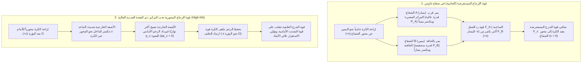
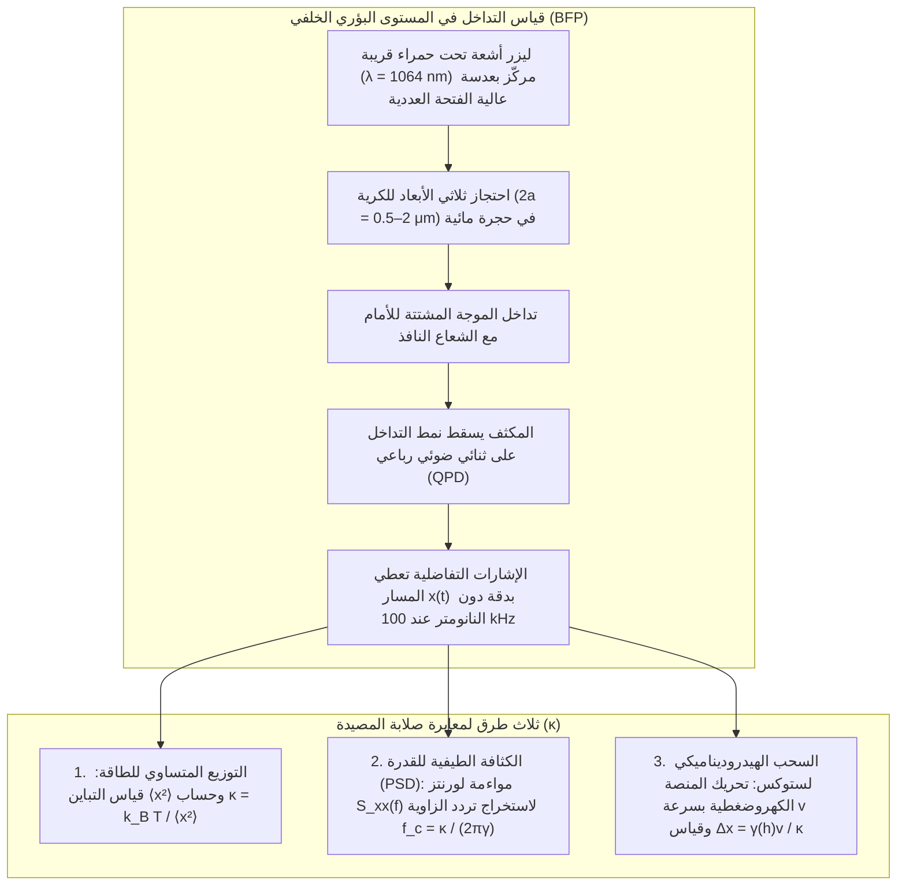

## 1. مقدمة: لماذا يستطيع الضوء عديم الكتلة دفع وسحب المادة؟

في خبرتنا اليومية العيانية، يبدو الضوء غير ملموس تماماً. غير أنه من منظور الفيزياء الأساسية، يحمل الإشعاع الكهرومغناطيسي كلاً من <strong>الطاقة</strong> و<strong>الزخم الخطي (كمية الحركة)</strong>. منذ عام 1619، لاحظ يوهانس كبلر أن ذيول الغبار للمذنبات تتجه دائماً بعيداً عن الشمس، مفترضاً وجود <strong>ضغط إشعاعي (Radiation Pressure)</strong>. وفي عام 1873، أثبت جيمس كليرك ماكسويل نظرياً أن الموجات الكهرومغناطيسية تنقل الزخم عبر متجه بوينتغ $\mathbf{S} = \frac{1}{\mu_0}(\mathbf{E} \times \mathbf{B})$، وفي عام 1905 وحّدت النسبية الخاصة لألبرت أينشتاين ($E^2 = (pc)^2 + (mc^2)^2$) الطاقة والزخم، ليصبح زخم الفوتون عديم كتلة السكون ($m = 0$) ذي الطاقة $E = h\nu = hc/\lambda$:

$$
p = \frac{E}{c} = \frac{h\nu}{c} = \frac{h}{\lambda}
$$

عندما يسقط شعاع ليزر متوازٍ بقدرة $P$ عمودياً على سطح ماص تماماً أو مرآة عاكسة مثالية، فإن القوة الإشعاعية تكون:

$$
F_{\text{abs}} = \frac{P}{c}, \qquad F_{\text{ref}} = \frac{2P}{c}
$$

بسبب السرعة الهائلة للضوء $c \approx 3.0 \times 10^8\,\text{m/s}$، لا يولد ليزر بقدرة $1\,\text{W}$ سوى قوة $3.3\,\text{nN}$. ولكن بمجرد الانتقال إلى <strong>مقياس الميكرومتر ($10^{-6}\,\text{m}$) للكريات الغروية والخلايا الحية، أو مقياس النانومتر ($10^{-9}\,\text{m}$) للجزيئات الحيوية الضخمة</strong>، ينقلب التسلسل الهرمي للقوى رأساً على عقب: فكرية بوليسترين نصف قطرها $a = 1\,\mu\text{m}$ لا تتجاوز كتلتها $m \approx 4.4 \times 10^{-15}\,\text{kg}$ ووزنها الثقالي $mg \approx 0.043\,\text{pN}$ ($1\,\text{pN} = 10^{-12}\,\text{N}$). إن عشرات الملي واط من ضوء الليزر المركّز تولد قوى تبلغ عدة بيكونيوتن ($\text{pN}$)، متفوقةً على الجاذبية بعدة مراتب أسية! والأكثر إثارة أنه بالقرب من بؤرة شعاع ليزر شديد التركيز، يتعرض الجسيم العازل الشفاف إلى <strong>قوة تدرج بصري (Optical Gradient Force)</strong> محافظة تجذبه نحو نقطة أقصى شدة ضوئية — وهذه هي تقنية <strong>الملاقط البصرية (Optical Tweezers)</strong>.

---

## 2. اختراقات آرثر أشكين الرائدة وولادة الملاقط البصرية

في عام 1970 في مختبرات بل (Bell Labs)، وجّه <strong>آرثر أشكين (Arthur Ashkin، 1922–2020)</strong> شعاع ليزر أيون الأرغون ($\lambda = 514.5\,\text{nm}$) نحو كريات لاتكس شفافة معلقة في الماء (*Physical Review Letters*, 24, 156). وبدلاً من مجرد اندفاعها للأمام، لاحظ أن الكريات القريبة من حافة الشعاع <strong>تُجذب في الوقت نفسه عرضياً نحو المحور المركزي المضيء لشعاع غاوس</strong>! وفي العام ذاته بنى أول مصيدة بصرية ثلاثية الأبعاد باستخدام شعاعين متعاكسين.

وفي عام 1986، نشر أشكين مع زملائه دزيدزيك وبيوركهولم و<strong>ستيفن تشو (Steven Chu)</strong> ورقتهم التاريخية (*Optics Letters*, 11, 288, 1986)، مثبتين أن <strong>شعاع ليزر منفرداً شديد التركيز</strong> عبر عدسة شيئية ذات فتحة عددية عالية ($\text{NA} = 1.25$) يولّد قوة تدرج محورية خلفية تتغلب على قوة التشتت الأمامية، محتجزاً جسيمات عازلة من $10\,\mu\text{m}$ حتى $25\,\text{nm}$ في ثلاثة أبعاد: وهكذا وُلدت <strong>الملاقط البصرية</strong>. وفي عام 1987، انتقل أشكين إلى <strong>ليزر Nd:YAG في الأشعة تحت الحمراء القريبة ($\lambda = 1064\,\text{nm}$)</strong> لتجنب التلف الضوئي، فنجح في احتجاز بكتيريا *E. coli* الحية وخلايا الخميرة المنقسمة والفيروسات، لينال <strong>جائزة نوبل في الفيزياء لعام 2018</strong>.

---

## 3. ميكانيكا الاحتجاز في نظام البصريات الهندسية (تشتت مي، $a \gg \lambda$)

عندما يكون نصف قطر الكرة أكبر بكثير من الطول الموجي ($a \gg \lambda$)، فإن انكسار شعاع ضوئي بقدرة $P_{\text{ray}}$ عبر كرة ذات معامل انكسار $n_p > n_m$ ($m = n_p/n_m > 1$) يمنح الكرة، بموجب حفظ الزخم، قوة ارتداد ميكانيكية $\mathbf{F}_{\text{ray}}$:

$$
\mathbf{F}_{\text{ray}} = -\frac{d\mathbf{p}_{\text{light}}}{dt} = -\frac{n_m P_{\text{ray}}}{c} \left( \hat{\mathbf{u}}_{\text{out}} - \hat{\mathbf{u}}_{\text{in}} \right)
$$

- <strong>الاستقرار الجانبي</strong>: في توزيع غاوس $I(r) = I_0 \exp(-2r^2/w_0^2)$، تحمل الأشعة القريبة من المركز قدرة أعلى، فيعيد ارتداد انكسارها الكرة دائماً إلى المركز المضيء ($x=y=0$).
- <strong>الاستقرار المحوري وضرورة العدسة الشيئية عالية الفتحة العددية (High-NA)</strong>: عند إزاحة الكرة خلف البؤرة ($+z$)، تجمع الكرة الأشعة الطرفية شديدة التباعد نحو المحور، مما يزيد الزخم الأمامي $p_z$ للضوء ($\Delta p_z > 0$) ويولّد قوة رد فعل خلفية ($-z$) نحو البؤرة $O$. وللتغلب على دفع الانعكاسات السطحية، يجب ملء الفتحة الخلفية <strong>لعدسة شيئية غاطسة عالية الفتحة العددية ($\text{NA} = n_m \sin\theta_{\max} \ge 1.2$)</strong> بالكامل.

---

## 4. نظام ثنائي القطب الكهرومغناطيسي (تشتت رايلي، $a \ll \lambda$)

بالنسبة للجسيمات النانوية ($a \ll \lambda$)، تعمل الكرة كثنائي قطب كهربائي نقطي مستحث $\mathbf{p} = \alpha \mathbf{E}$ تتناسب <strong>قابليته للاستقطاب لكلوزيوس-موسوتي</strong> $\alpha$ مع الحجم ($\propto a^3$):

$$
\alpha = 4\pi n_m^2 \varepsilon_0 a^3 \left( \frac{m^2 - 1}{m^2 + 2} \right) \qquad \left(m \equiv \frac{n_p}{n_m}\right)
$$

يعطي المتوسط الزمني لقوة لورنتز والمقطع العرضي لتشتت رايلي ($\sigma_{\text{scat}} \propto k^4 a^6$) كلاً من <strong>قوة التدرج $\mathbf{F}_{\text{grad}}$</strong> و<strong>قوة التشتت $\mathbf{F}_{\text{scat}}$</strong>:

$$
\mathbf{F}_{\text{grad}}(\mathbf{r}) = \frac{2\pi n_m a^3}{c} \left( \frac{m^2 - 1}{m^2 + 2} \right) \nabla I(\mathbf{r}) = -\nabla U(\mathbf{r})
$$

$$
\mathbf{F}_{\text{scat}}(\mathbf{r}) = \frac{n_m \sigma_{\text{scat}}}{c} I(\mathbf{r})\hat{\mathbf{z}} = \frac{128 \pi^5 n_m^5 a^6}{3 c \lambda_0^4} \left( \frac{m^2 - 1}{m^2 + 2} \right)^2 I(\mathbf{r}) \hat{\mathbf{z}}
$$

| الخاصية الفيزيائية | قوة التدرج ($\mathbf{F}_{\text{grad}}$) | قوة التشتت ($\mathbf{F}_{\text{scat}}$) |
| :--- | :--- | :--- |
| <strong>المنشأ الفيزيائي</strong> | مجال غير متجانس يؤثر في ثنائي قطب مستحث (تقليل طاقة الوضع $U$) | نقل الزخم بالامتصاص وإعادة إشعاع رايلي |
| <strong>اتجاه التأثير</strong> | باتجاه تدرج الشدة $\nabla I(\mathbf{r})$ (نحو البؤرة ثلاثية الأبعاد عند $n_p > n_m$) | باتجاه متجه الموجة $\hat{\mathbf{z}}$ (يدفع الجسيم للأمام) |
| <strong>التناسب مع نصف القطر $a$ ($a \ll \lambda$)</strong> | <strong>يتناسب مع الحجم ($\propto a^3$)</strong> | <strong>يتناسب مع مربع الحجم ($\propto a^6$)</strong> |
| <strong>التناسب مع الطول الموجي $\lambda_0$</strong> | عبر هندسة البقعة البؤرية | <strong>عكسياً مع القوة الرابعة ($\propto \lambda_0^{-4}$)</strong> |
| <strong>تباين معامل الانكسار $m = n_p/n_m$</strong> | خطي في $\left(\frac{m^2-1}{m^2+2}\right)$ (ينعكس عند $m=1$) | تربيعي $\left(\frac{m^2-1}{m^2+2}\right)^2$ (يدفع للأمام دائماً) |

لمنع الهروب الحراري البراوني ($k_B T \approx 4.14\,\text{pN}\cdot\text{nm}$ عند $T = 300\,\text{K}$)، يجب أن يحقق عمق بئر الجهد $|U_{\min}| \propto a^3 I_{\max} \gtrsim 10\,k_B T$. وبسبب التناسب $a^3$، يربط علماء الفيزياء الحيوية الحمض النووي أو البروتينات كيميائياً بـ<strong>كريات عازلة ميكرونية ($2a \sim 0.5\text{–}2\,\mu\text{m}$)</strong> تعمل كمقابض ميكانيكية.

---

## 5. الحركة البراونية ومعادلة لانجفين والمعايرة بالبيكونيوتن

بالقرب من مركز التوازن ($|\Delta x| \lesssim 150\,\text{nm}$)، يكون بئر الجهد توافقياً ($U(x) \approx \frac{1}{2}\kappa_x x^2$) ويخضع <strong>لقانون هوك</strong>:

$$
F_{\text{trap}}(x) = -\kappa_x \Delta x
$$

حيث $\kappa_x$ ($0.005\text{–}1.0\,\text{pN/nm}$) هي <strong>صلابة المصيدة (Trap Stiffness)</strong>. وعند عدد رينولدز منخفض جداً ($\text{Re} \sim 10^{-5} \ll 1$)، يختفي الحد القصوري ويخضع المسار $x(t)$ إلى <strong>معادلة لانجفين مفرطة التخميد</strong> مع مقاومة ستوكس اللزجة $\gamma = 6\pi\eta_{\text{vis}}a$:

$$
\gamma \frac{dx(t)}{dt} + \kappa x(t) = \sqrt{2\gamma k_B T}\,\eta(t)
$$

1. <strong>مبرهنة التوزيع المتساوي للطاقة</strong>: $\frac{1}{2}\kappa \langle x^2 \rangle = \frac{1}{2}k_B T \implies \kappa = k_B T / \langle x^2 \rangle$.
2. <strong>الكثافة الطيفية للقدرة (PSD)</strong>: يتبع طيف القدرة منحنى لورنتز بـ<strong>تردد زاوية $f_c$</strong>:
   $$
   S_{xx}(f) = \frac{k_B T}{\pi^2 \gamma \left( f_c^2 + f^2 \right)}, \qquad f_c = \frac{\kappa}{2\pi \gamma}
   $$
3. <strong>طريقة السحب الهيدروديناميكي لستوكس (مع تصحيح فاكسين للجدار)</strong>: $F = \gamma_\parallel(h)v = \kappa \Delta x$.

---

## 6. ثورة الفيزياء الحيوية للجزيئات المنفردة: مرونة DNA والمحركات الجزيئية

يتيح استخدام <strong>النافذة البصرية الحيوية في الأشعة تحت الحمراء القريبة ($\lambda = 1064\,\text{nm}$)</strong> مع <strong>الأنظمة الإنزيمية الكاسحة للأكسجين</strong> منع التلف الضوئي.

### كارلوس بوستامانتي والمرونة الإنتروبية لجزيئات DNA المنفردة
بين عامي 1992 و1996، قاس <strong>كارلوس بوستامانتي</strong> وزملاؤه منحنى القوة والامتداد $F(z)$ لجزيء منفرد من الحمض النووي مزدوج السلسلة للعاثية $\lambda$ ($L_0 \approx 16.5\,\mu\text{m}$)، مثبتين خضوعه لنموذج <strong>السلسلة شبيهة الدودة (Worm-Like Chain, WLC)</strong> (Marko & Siggia, 1995) بطول ثبات $L_p \approx 50\,\text{nm}$:

$$
F(z) = \frac{k_B T}{L_p} \left[ \frac{1}{4\left(1 - z/L_0\right)^2} - \frac{1}{4} + \frac{z}{L_0} \right]
$$

ومكتشفين عند $F \approx 65\,\text{pN}$ <strong>انتقال التمدد المفرط (Overstretching Transition)</strong> إلى $1.7$ ضعف طوله الأصلي.

### ستيفن بلوك: خطوات الكينيسين (8 نانومتر) ودقة الزوج القاعدي لبوليميراز الحمض النووي الريبي
- <strong>الكينيسين-1 (Kinesin-1)</strong>: في عام 1993، أثبت فريق <strong>ستيفن بلوك</strong> (*Nature*, 365, 721) أن جزيء كينيسين منفرداً يمشي على الأنيبيب الدقيق <strong>بخطوات متقطعة قدرها $\Delta d = 8.2\,\text{nm}$</strong>، مستهلكاً <strong>جزيء ATP واحداً لكل خطوة</strong> ضد <strong>قوة توقف (Stall Force) تبلغ $F_{\text{stall}} \approx 6\text{–}7\,\text{pN}$</strong> (بكفاءة ديناميكية حرارية $\sim 50\text{–}60\%$).
- <strong>الملاقط البصرية مزدوجة المصيدة وبوليميراز الحمض النووي الريبي (RNAP)</strong>: في عام 2005، وباستخدام مصيدة بصرية مزدوجة معزولة بغاز الهيليوم، نجح مختبر بلوك في تمييز <strong>الخطوات الفردية البالغة $3.4\,\text{\AA}$ ($0.34\,\text{nm}$، أي زوج قاعدي واحد)</strong> لبوليميراز الحمض النووي الريبي أثناء نسخ DNA!

---

## 7. الآفاق الحديثة: الملاقط الهولوغرافية، البلازمونيات، والميكانيكا البصرية الكمومية

1. <strong>الملاقط البصرية الهولوغرافية (HOT) والمفاتيح البصرية</strong>: تتحكم معدّلات الضوء المكانية (SLM) في مئات المصائد آنياً، بينما يدير الزخم الزاوي المغزلي ($\pm\hbar$) أو المداري ($\ell\hbar$ في حزم لاغير-غاوس الدوامية) الدوارات المجهرية.
2. <strong>الملاقط النانوية البلازمونية</strong>: يتيح رنين بلازمون السطح الموضعي (LSPR) في الهوائيات النانوية المعدنية احتجاز البروتينات المنفردة ($< 10\,\text{nm}$) مباشرة.
3. <strong>مصفوفات الذرات المتعادلة والميكانيكا البصرية الكمومية في الفراغ</strong>: تقود مصفوفات الملاقط البصرية الحواسيب الكمومية للذرات المتعادلة، وتسمح بتبريد كريات السيليكا النانوية المعلقة في الفراغ الفائق إلى <strong>الحالة الأرضية الكمومية للحركة ($\bar{n} < 1$ فونون)</strong> (Delić et al., *Science*, 2020).
