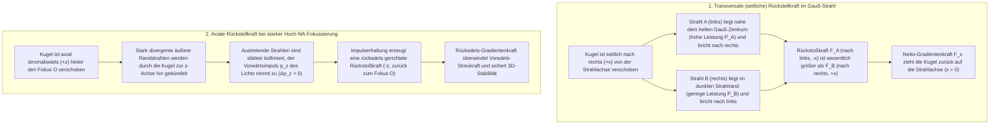
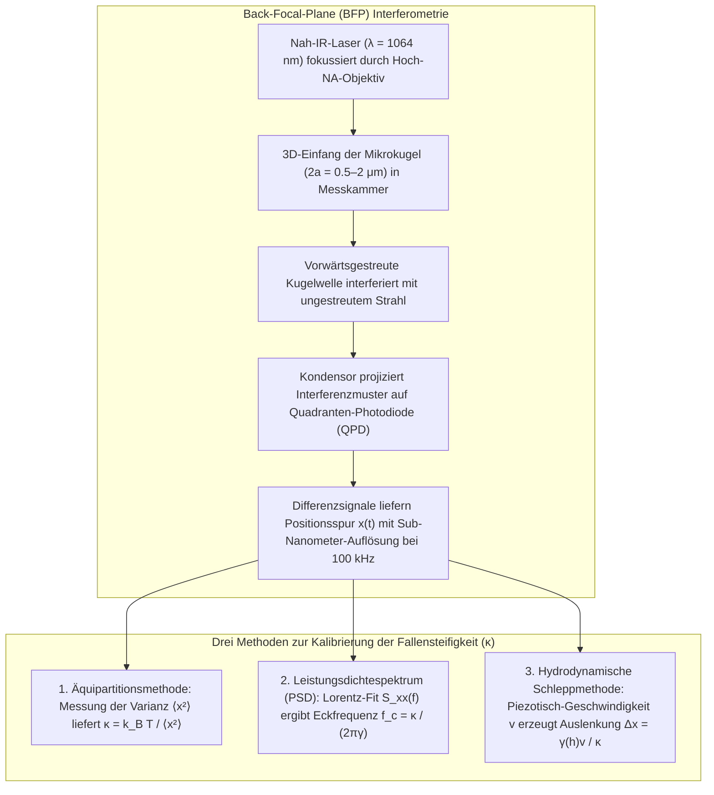

## 1. Einleitung: Warum kann masseloses Licht Materie schieben und ziehen?

In unserer makroskopischen Alltagserfahrung erscheint Licht völlig körperlos. Doch aus Sicht der fundamentalen Physik transportiert elektromagnetische Strahlung sowohl <strong>Energie</strong> als auch <strong>linearen Impuls</strong>. Bereits 1619 vermutete Johannes Kepler anhand der stets von der Sonne abgewandten Staubschweife von Kometen einen mechanischen <strong>Strahlungsdruck (Radiation Pressure)</strong> des Sonnenlichts. 1873 bewies James Clerk Maxwell theoretisch, dass elektromagnetische Wellen über den Poynting-Vektor $\mathbf{S} = \frac{1}{\mu_0}(\mathbf{E} \times \mathbf{B})$ Impuls übertragen. Mit Albert Einsteins spezieller Relativitätstheorie ($E^2 = (pc)^2 + (mc^2)^2$) ergibt sich für masselose Photonen ($m = 0$) mit der Energie $E = h\nu = hc/\lambda$ der Impuls:

$$
p = \frac{E}{c} = \frac{h\nu}{c} = \frac{h}{\lambda}
$$

Trifft ein kollimierter Laserstrahl der Leistung $P$ senkrecht auf eine perfekt absorbierende Fläche oder einen idealen Spiegel, beträgt die Strahlungskraft:

$$
F_{\text{abs}} = \frac{P}{c}, \qquad F_{\text{ref}} = \frac{2P}{c}
$$

Wegen der enormen Lichtgeschwindigkeit $c \approx 3.0 \times 10^8\,\text{m/s}$ erzeugt ein $1\,\text{W}$-Laser nur eine Kraft von $3.3\,\text{nN}$. Wechselt man jedoch in die <strong>Mikrometer-Welt ($10^{-6}\,\text{m}$) lebender Zellen und kolloidaler Mikrokugeln oder in die Nanometer-Welt ($10^{-9}\,\text{m}$) biologischer Makromoleküle</strong>, kehrt sich die Kräftehierarchie um: Eine Polystyrolkugel mit Radius $a = 1\,\mu\text{m}$ besitzt nur eine Masse von $m \approx 4.4 \times 10^{-15}\,\text{kg}$ und eine Gewichtskraft von $mg \approx 0.043\,\text{pN}$ ($1\,\text{pN} = 10^{-12}\,\text{N}$). Einige zehn Milliwatt fokussiertes Laserlicht erzeugen Kräfte im Pikonewton-Bereich ($\text{pN}$), die die Schwerkraft um Größenordnungen übertreffen! Mehr noch: Nahe dem Fokus eines stark gebündelten Laserstrahls zieht eine konservative <strong>optische Gradientenkraft (Gradient Force)</strong> transparente Partikel zum Punkt höchster Lichtintensität – das Prinzip der <strong>optischen Pinzette (Optical Tweezers)</strong>.

---

## 2. Arthur Ashkins bahnbrechende Entdeckungen und die Geburt der optischen Pinzette

1970 richtete <strong>Arthur Ashkin (1922–2020)</strong> an den Bell Laboratories einen Argon-Ionen-Laserstrahl ($\lambda = 514.5\,\text{nm}$) auf transparente Latexkugeln in Wasser (*Physical Review Letters*, 24, 156). Statt nur vorwärts geschoben zu werden, wurden Kugeln am Strahlrand <strong>gleichzeitig quer zur hellen Strahlachse hineingezogen</strong>. Durch zwei gegenläufige Laserstrahlen schuf Ashkin noch 1970 die erste dreidimensionale optische Falle.

1986 gelang Ashkin gemeinsam mit J. M. Dziedzic, J. E. Bjorkholm und <strong>Steven Chu</strong> der entscheidende Durchbruch (*Optics Letters*, 11, 288, 1986): Mit einem <strong>einzigen, durch ein Hoch-NA-Objektiv ($\text{NA} = 1.25$) extrem scharf fokussierten Laserstrahl</strong> überwand die rückwärts gerichtete axiale Gradientenkraft die vorwärts gerichtete Streukraft und fing dielektrische Partikel von $10\,\mu\text{m}$ bis hinab zu $25\,\text{nm}$ stabil in drei Dimensionen – die <strong>optische Pinzette</strong> war geboren. 1987 wechselten Ashkin und Dziedzic zu einem nahinfraroten <strong>Nd:YAG-Laser ($\lambda = 1064\,\text{nm}$)</strong>, um Phototoxizität zu vermeiden, und fingen erstmals lebende *E.-coli*-Bakterien, Hefezellen und Viren zerstörungsfrei ein. Dafür erhielt Ashkin 2018 den <strong>Nobelpreis für Physik</strong>.

---

## 3. Fangmechanik im Regime der Strahlenoptik (Mie-Regime, $a \gg \lambda$)

Ist der Kugelradius groß gegenüber der Wellenlänge ($a \gg \lambda$), beschreibt die geometrische Optik den Impulsübertrag exakt. Wird ein Lichtstrahl der Leistung $P_{\text{ray}}$ durch eine höherbrechende Kugel ($n_p > n_m$, $m = n_p/n_m > 1$) gebrochen, erfährt die Kugel nach dem Impulserhaltungssatz die Rückstoßkraft $\mathbf{F}_{\text{ray}}$:

$$
\mathbf{F}_{\text{ray}} = -\frac{d\mathbf{p}_{\text{light}}}{dt} = -\frac{n_m P_{\text{ray}}}{c} \left( \hat{\mathbf{u}}_{\text{out}} - \hat{\mathbf{u}}_{\text{in}} \right)
$$

- <strong>Laterale Stabilität</strong>: Im Gauß-Profil $I(r) = I_0 \exp(-2r^2/w_0^2)$ erzeugt der intensivere innenliegende Strahl A bei Brechung durch die Kugel einen stärkeren Rückstoß zur Strahlmitte als der schwache Randstrahl B.
- <strong>Axiale Stabilität und Hoch-NA-Objektiv</strong>: Liegt die Kugel stromabwärts ($+z$) hinter dem Fokus $O$, bündelt sie die stark divergenten äußeren Strahlen nach innen. Dadurch wächst der Vorwärtsimpuls $p_z$ des Lichts ($\Delta p_z > 0$), und die Kugel erfährt einen Rückstoß stromaufwärts ($-z$) zurück zum Fokus $O$. Um die vorwärts gerichtete Oberflächenreflexion zu überwinden, sind steile Einfallswinkel unerlässlich, weshalb das Überleuchten eines <strong>Hoch-NA-Immersionsobjektivs ($\text{NA} = n_m \sin\theta_{\max} \ge 1.2$)</strong> zwingend erforderlich ist.

---

## 4. Elektromagnetisches Dipol-Regime (Rayleigh-Streuung, $a \ll \lambda$)

Für Nanopartikel ($a \ll \lambda$) wirkt das Teilchen als induzierter elektrischer Punktdipol $\mathbf{p} = \alpha \mathbf{E}$ mit der <strong>Clausius-Mossotti-Polarisierbarkeit</strong> $\alpha \propto a^3$:

$$
\alpha = 4\pi n_m^2 \varepsilon_0 a^3 \left( \frac{m^2 - 1}{m^2 + 2} \right) \qquad \left(m \equiv \frac{n_p}{n_m}\right)
$$

Die Zeitmittelung der Lorentzkraft und der Rayleigh-Streuquerschnitt ($\sigma_{\text{scat}} \propto k^4 a^6$) liefern die konservative <strong>Gradientenkraft $\mathbf{F}_{\text{grad}}$</strong> und die nicht-konservative <strong>Streukraft $\mathbf{F}_{\text{scat}}$</strong>:

$$
\mathbf{F}_{\text{grad}}(\mathbf{r}) = \frac{2\pi n_m a^3}{c} \left( \frac{m^2 - 1}{m^2 + 2} \right) \nabla I(\mathbf{r}) = -\nabla U(\mathbf{r})
$$

$$
\mathbf{F}_{\text{scat}}(\mathbf{r}) = \frac{n_m \sigma_{\text{scat}}}{c} I(\mathbf{r})\hat{\mathbf{z}} = \frac{128 \pi^5 n_m^5 a^6}{3 c \lambda_0^4} \left( \frac{m^2 - 1}{m^2 + 2} \right)^2 I(\mathbf{r}) \hat{\mathbf{z}}
$$

| Physikalische Eigenschaft | Gradientenkraft ($\mathbf{F}_{\text{grad}}$) | Streukraft ($\mathbf{F}_{\text{scat}}$) |
| :--- | :--- | :--- |
| <strong>Physikalischer Ursprung</strong> | Inhomogenes Feld auf induzierten Dipol (Potentialminimierung / Brechungsrückstoß) | Impulsübertrag durch Photonenabsorption & isotrope Rayleigh-Abstrahlung |
| <strong>Wirkungsrichtung</strong> | Entlang des Intensitätsgradienten $\nabla I(\mathbf{r})$ (zum 3D-Fokus für $n_p > n_m$) | Entlang der Strahlrichtung $\hat{\mathbf{z}}$ (schiebt Teilchen stromabwärts) |
| <strong>Skalierung mit Radius $a$ ($a \ll \lambda$)</strong> | <strong>Proportional zum Volumen ($\propto a^3$)</strong> | <strong>Proportional zum Volumenquadrat ($\propto a^6$)</strong> |
| <strong>Skalierung mit Wellenlänge $\lambda_0$</strong> | Über Fokusgeometrie | <strong>Umgekehrt zur vierten Potenz ($\propto \lambda_0^{-4}$)</strong> |
| <strong>Brechungsindexkontrast $m = n_p/n_m$</strong> | Linear in $\left(\frac{m^2-1}{m^2+2}\right)$ (Vorzeichenwechsel bei $m=1$) | Quadratisch $\left(\frac{m^2-1}{m^2+2}\right)^2$ (immer vorwärts schiebend) |

Damit ein Nanopartikel bei Raumtemperatur ($T = 300\,\text{K}$, $k_B T \approx 4.14\,\text{pN}\cdot\text{nm}$) nicht durch Brownsche Stöße entkommt, muss die Potentialtiefe $|U_{\min}| \propto a^3 I_{\max} \gtrsim 10\,k_B T$ betragen. Wegen der $a^3$-Skalierung koppelt man in der Einzelmolekül-Biophysik Proteine oder DNA chemisch an <strong>mikrometergroße Kügelchen ($2a \sim 0.5\text{–}2\,\mu\text{m}$)</strong> als mechanische Griffe.

---

## 5. Brownsche Bewegung, Langevin-Gleichung und Pikonewton-Kalibrierung

Nahe dem Fokuszentrum ($|\Delta x| \lesssim 150\,\text{nm}$) ist das Potential harmonisch ($U(x) \approx \frac{1}{2}\kappa_x x^2$), und die optische Falle wirkt als <strong>Hookesche Feder</strong>:

$$
F_{\text{trap}}(x) = -\kappa_x \Delta x
$$

mit der <strong>Fallensteifigkeit (Trap Stiffness) $\kappa_x$</strong> ($0.005\text{–}1.0\,\text{pN/nm}$). Bei extrem kleiner Reynolds-Zahl ($\text{Re} \sim 10^{-5} \ll 1$) ist die Bewegung überdämpft und folgt mit der Stokesschen Reibung $\gamma = 6\pi\eta_{\text{vis}}a$ der <strong>überdämpften Langevin-Gleichung</strong>:

$$
\gamma \frac{dx(t)}{dt} + \kappa x(t) = \sqrt{2\gamma k_B T}\,\eta(t)
$$

1. <strong>Äquipartitionstheorem</strong>: $\frac{1}{2}\kappa \langle x^2 \rangle = \frac{1}{2}k_B T \implies \kappa = k_B T / \langle x^2 \rangle$ (unabhängig von Viskosität $\eta_{\text{vis}}$ und Radius $a$).
2. <strong>Leistungsdichtespektrum (Power Spectral Density, PSD)</strong>: Die Fourier-Transformation liefert ein <strong>Lorentz-Spektrum</strong> mit der <strong>Eckfrequenz $f_c$</strong>:
   $$
   S_{xx}(f) = \frac{k_B T}{\pi^2 \gamma \left( f_c^2 + f^2 \right)}, \qquad f_c = \frac{\kappa}{2\pi \gamma}
   $$
3. <strong>Stokessche Schleppkraft (mit Faxén-Wandkorrektur)</strong>: Auslenkung $\Delta x = \gamma_\parallel(h)v/\kappa$ bei bekannter Strömungsgeschwindigkeit $v$.

---

## 6. Die Einzelmolekül-Revolution: DNA-Elastizität und molekulare Motoren

Durch Einsatz des <strong>biologischen optischen Fensters ($\lambda = 1064\,\text{nm}$)</strong> und enzymatischer <strong>Sauerstofffänger-Systeme</strong> vermeiden moderne optische Pinzetten jede Lichtschädigung.

### Carlos Bustamante und die entropische Elastizität einzelner DNA-Moleküle
Zwischen 1992 und 1996 maßen <strong>Carlos Bustamante</strong> und Mitarbeiter die Kraft-Ausdehnungs-Kurve $F(z)$ einzelner $\lambda$-Phagen-dsDNA-Moleküle ($L_0 \approx 16.5\,\mu\text{m}$), die präzise dem <strong>Worm-Like-Chain-(WLC)-Modell</strong> (Marko & Siggia, 1995) mit Persistenzlänge $L_p \approx 50\,\text{nm}$ folgt:

$$
F(z) = \frac{k_B T}{L_p} \left[ \frac{1}{4\left(1 - z/L_0\right)^2} - \frac{1}{4} + \frac{z}{L_0} \right]
$$

Bei $F \approx 65\,\text{pN}$ durchläuft die DNA einen kooperativen <strong>Überstreckungs-Phasenübergang (Overstretching Transition)</strong> auf das $1.7$-Fache ihrer Konturlänge.

### Steven Block: Die 8-nm-Schritte von Kinesin und Basenpaar-Auflösung der RNA-Polymerase
- <strong>Kinesin-1</strong>: 1993 wies <strong>Steven Blocks</strong> Gruppe (*Nature*, 365, 721) nach, dass sich ein einzelnes Kinesin-Motorprotein in <strong>diskreten Schritten von $\Delta d = 8.2\,\text{nm}$</strong> entlang eines Mikrotubulus bewegt, pro Schritt exakt <strong>ein ATP-Molekül</strong> hydrolysiert und gegen eine <strong>Stall-Kraft von $F_{\text{stall}} \approx 6\text{–}7\,\text{pN}$</strong> arbeitet ($\sim 50\text{–}60\%$ Wirkungsgrad).
- <strong>Doppelfallen-Pinzette und RNA-Polymerase (RNAP)</strong>: 2005 löste Blocks Labor in einer Helium-isolierten passiven Doppelfalle die <strong>einzelnen Basenpaar-Schritte der RNAP von nur $3.4\,\text{\AA}$ ($0.34\,\text{nm}$)</strong> direkt auf!

---

## 7. Moderne Grenzen: Holografische Pinzetten, Plasmonik und Quanten-Optomechanik

1. <strong>Holografische optische Pinzetten (HOT) & optische Schraubenschlüssel</strong>: Räumliche Lichtmodulatoren (SLM) steuern hunderte Fallen simultan; Spin- ($\pm\hbar$) und Bahndrehimpuls ($\ell\hbar$ in Laguerre-Gauß-Wirbelstrahlen) versetzen Mikrorotoren in Drehung.
2. <strong>Plasmonische Nanopinzetten</strong>: Lokalisierte Oberflächenplasmonen (LSPR) an Gold-Nanoantennen überwinden das Beugungslimit und fangen einzelne Proteine ($< 10\,\text{nm}$) direkt.
3. <strong>Atomare Tweezers-Arrays & Quanten-Optomechanik im Vakuum</strong>: Neutralatom-Arrays bilden die Basis moderner Quantensimulatoren, während im Ultrahochvakuum schwebende Silika-Nanokugeln in den <strong>quantenmechanischen Bewegungsgrundzustand ($\bar{n} < 1$ Phonon)</strong> gekühlt werden (Delić et al., *Science*, 2020).
