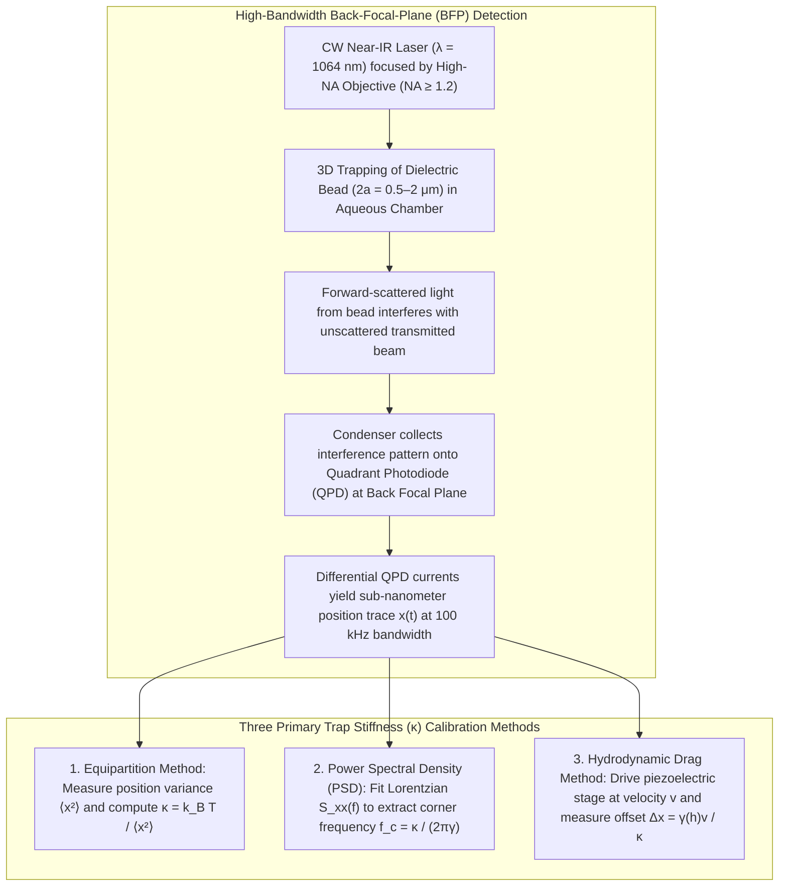

## 1. Introduction: Why Can Massless Light Push and Pull Matter?

In our macroscopic everyday experience, light feels entirely intangible. Sunlight warms our skin and indoor lamps illuminate a room, yet a beam of light never knocks over a coffee cup or pushes a person backward. It is therefore natural to assume that light possesses neither weight nor the capacity to exert mechanical forces on physical objects. From the standpoint of fundamental physics, however, electromagnetic radiation carries both <strong>energy</strong> and <strong>linear momentum</strong>. Whenever light is absorbed, reflected, or refracted by matter, conservation of momentum dictates that a mechanical force must be imparted to that matter.

The earliest scientific intimation that light exerts a physical push—what we now call <strong>radiation pressure</strong>—originated in astronomy. In 1619, the German astronomer Johannes Kepler observed in his treatise *De Cometis Libelli Tres* that the dust tails of comets always point away from the Sun, regardless of whether the comet is approaching perihelion or receding into the outer solar system. Kepler boldly hypothesized that solar rays physically sweep cometary matter backward.

More than two and a half centuries elapsed before Kepler's intuition was placed on a rigorous mathematical foundation. In 1873, James Clerk Maxwell unified classical electrodynamics in *A Treatise on Electricity and Magnetism* and demonstrated theoretically that an electromagnetic wave propagating in free space or a dielectric medium transports momentum via the Poynting vector $\mathbf{S} = \frac{1}{\mu_0}(\mathbf{E} \times \mathbf{B})$, exerting a surface pressure proportional to the energy density of the field. In 1905, Albert Einstein's light-quantum hypothesis and special theory of relativity unified energy, mass, and momentum into a single relativistic dispersion relation for any particle of rest mass $m$:

$$E^2 = (pc)^2 + (m c^2)^2$$

Because a photon is a strictly massless gauge boson ($m = 0$), the rest-mass term vanishes identically, yielding the fundamental relation between a photon's energy $E$ and the magnitude of its linear momentum $p$:

$$p = \frac{E}{c}$$

Expressing the photon energy via Planck's constant $h$, optical frequency $\nu$, and vacuum wavelength $\lambda = c/\nu$ ($E = h\nu = hc/\lambda$), the momentum of a single photon is given by:

$$p = \frac{h\nu}{c} = \frac{h}{\lambda}$$

Even without rest mass, every photon carries a well-defined momentum inversely proportional to its wavelength. Suppose a collimated monochromatic laser beam of optical power $P$ (energy per unit time, measured in Watts, $1\,\text{W} = 1\,\text{J/s}$) impinges perpendicularly upon a completely absorbing black surface. Since $P/E$ photons strike the surface per second, the rate of momentum transfer—which by Newton's second law $F = dp/dt$ equals the mechanical radiation force $F_{\text{abs}}$—is simply:

$$F_{\text{abs}} = \frac{P}{c}$$

If the target is instead an ideal mirror with $100\%$ normal reflectivity, the momentum vector of every photon reverses direction ($\Delta p = 2p$), doubling the radiation force to:

$$F_{\text{ref}} = \frac{2P}{c}$$

Why, then, is this force imperceptible in daily life? The answer lies in the colossal magnitude of the speed of light in the denominator, $c \approx 3.0 \times 10^8\,\text{m/s}$. Even if a relatively powerful $P = 1\,\text{W}$ laser beam is completely absorbed by a human hand, the resulting force is merely $F = 1 / (3.0 \times 10^8) \approx 3.3 \times 10^{-9}\,\text{N}$ ($3.3$ nanonewtons)—roughly the weight of a single sub-microgram grain of dust.

Yet the moment we transition from the macroscopic human scale down to the <strong>micrometer ($10^{-6}\,\text{m}$) realm of colloidal microspheres and living cells, or the nanometer ($10^{-9}\,\text{m}$) realm of biological macromolecules</strong>, the hierarchy of forces flips completely. Consider a polystyrene microsphere of radius $a = 1\,\mu\text{m}$ and density $\rho \approx 1.05\,\text{g/cm}^3$. Its mass is only $m = \frac{4}{3}\pi a^3 \rho \approx 4.4 \times 10^{-15}\,\text{kg}$ ($4.4$ femtograms), and the gravitational force acting upon it is a minuscule $mg \approx 4.3 \times 10^{-14}\,\text{N}$ ($0.043$ piconewtons, where $1\,\text{pN} = 10^{-12}\,\text{N}$). When tens of milliwatts of laser light are focused to a diffraction-limited spot of roughly $1\,\mu\text{m}$ diameter, the resulting optical forces reach several to tens of piconewtons—exceeding gravity by orders of magnitude and capable of accelerating Microscopic spheres atUpwards of $10^5\,g$.

More remarkably still, light does not merely push small objects forward along the direction of beam propagation. Near the focal point of a tightly focused laser beam, a transparent dielectric particle experiences an inward, conservative <strong>pulling force—the optical gradient force—directed toward the point of highest light intensity</strong>. Harnessing this phenomenon to hold, move, and measure forces on microscopic particles, living cells, and individual biological molecules in three dimensions using a single focused laser beam is the technology known as <strong>Optical Tweezers</strong>.

---

## 2. Arthur Ashkin's Pioneering Breakthroughs and the Birth of Optical Tweezers

The first experimental verifications of Maxwell's radiation pressure were achieved in 1901 by Pyotr Lebedev in Moscow and independently by Ernest Fox Nichols and Gordon Ferrie Hull in the United States, using delicate torsion balances housed inside vacuum chambers. Because thermal radiometric effects (crookes radiometer forces caused by residual gas molecules rebounding from heated vanes) easily masked true photon momentum transfer, radiation pressure remained a subtle laboratory curiosity for six decades.

The invention of the laser in 1960 provided a coherent light source capable of concentrating extraordinary optical power into a diffraction-limited spot. At Bell Laboratories in Holmdel, New Jersey, physicist <strong>Arthur Ashkin (1922–2020)</strong> began calculating and testing what happens when a continuous-wave (CW) laser beam illuminates micron-sized particles suspended in water.

### The 1970 Surprise: Why Are Particles Drawn Into the Center of a Laser Beam?

In his landmark 1970 experiment (*Physical Review Letters*, 24, 156), Ashkin directed a mildly focused argon-ion laser beam ($\lambda = 514.5\,\text{nm}$, power in the tens of milliwatts) into a glass cuvette filled with water containing transparent latex (polystyrene) spheres with diameters between $0.59\,\mu\text{m}$ and $2.68\,\mu\text{m}$. By using transparent spheres in a transparent liquid, Ashkin eliminated thermal absorption and radiometric heating. He expected to see particles near the beam axis get pushed steadily forward by radiation pressure against viscous fluid drag.

Instead, peering through his microscope, Ashkin observed something profound: whenever a wandering Brownian sphere drifted near the faint outer edge of the Gaussian laser beam, it was <strong>simultaneously pulled laterally inward toward the bright central axis of the beam</strong> and then propelled axially forward until it pressed against the front glass wall of the cell.

Ashkin immediately deduced the physical mechanism via ray optics: because the sphere had a higher refractive index ($n_p \approx 1.59$) than the surrounding water ($n_m \approx 1.33$), rays passing through the sphere were refracted. Due to the radial intensity gradient of the Gaussian beam, the stronger rays nearer the beam axis imparted a larger transverse recoil momentum than the weaker rays near the periphery, creating a net restoring force toward the regions of highest intensity—the <strong>gradient force</strong>. In that same 1970 paper, Ashkin aligned two counter-propagating laser beams facing each other along a common axis. Where the beams met, the forward axial pushing forces (scattering forces) canceled out, while the radial gradient forces added constructively, creating the first stable three-dimensional optical trap. In 1971, Ashkin also demonstrated <strong>optical levitation</strong> in air and vacuum, balancing the upward scattering force of a single vertical laser beam against downward gravity.

### The 1986 Culmination: Single-Beam Gradient Force Optical Trap

While dual counter-propagating traps and optical levitation were major milestones, maintaining sub-micron alignment between two opposing beams was technically arduous, and gravity-balanced levitation was unusable for sub-micron biological samples in water. Working alongside Bell Labs colleagues J. M. Dziedzic, J. E. Bjorkholm, and <strong>Steven Chu</strong> (who was simultaneously investigating laser cooling of neutral atoms), Ashkin asked a bold question: *Could a single laser beam, if focused tightly enough, create an axial intensity gradient so steep that the backward gradient force pulling a particle toward the focus overcomes the forward scattering force pushing it downstream?*

In 1986, Ashkin, Dziedzic, Bjorkholm, and Chu published their seminal paper, *"Observation of a single-beam gradient force optical trap for dielectric particles"* (*Optics Letters*, 11, 288–290, 1986). By sending a laser beam through a high-numerical-aperture ($\text{NA} = 1.25$) water-immersion microscope objective, they demonstrated stable three-dimensional trapping of dielectric spheres ranging from $10\,\mu\text{m}$ all the way down to $\sim 25\,\text{nm}$ in diameter using a single focused beam. <strong>Optical Tweezers</strong> had been born.

Just one year later, in 1987, Ashkin and Dziedzic made the pivotal transition to Biophysics. Recognizing that visible argon-ion laser light caused severe photodamage ("opticution") to biological specimens, they switched to a near-infrared <strong>Nd:YAG laser ($\lambda = 1064\,\text{nm}$)</strong>, where water and intracellular chromophores are nearly transparent. With this infrared trap, Ashkin non-invasively captured tobacco mosaic viruses, motile *Escherichia coli* bacteria, and yeast cells, observing living cells divide normally right inside the optical trap (*Nature*, 330, 769, 1987). For the invention of optical tweezers and their application to biological systems, Arthur Ashkin was awarded the <strong>2018 Nobel Prize in Physics</strong> at the age of 96.

---

## 3. Mechanics of Trapping in the Ray-Optics Regime (Mie Scattering, $a \gg \lambda$)

To understand quantitatively how a single focused beam traps a dielectric sphere in all three dimensions, physicists classify optical trapping into three regimes based on the dimensionless size parameter $k a = 2\pi n_m a / \lambda_0$, where $a$ is the particle radius, $\lambda_0$ is the vacuum wavelength of light, and $n_m$ is the refractive index of the surrounding medium:

1. <strong>Ray-Optics (Mie) Regime ($a \gg \lambda$)</strong>: When the particle diameter is much larger than the wavelength of light (e.g., $a \ge 5\,\mu\text{m}$ for $\lambda \approx 1\,\mu\text{m}$), diffraction effects are secondary and the incident laser beam can be decomposed into individual geometric rays that reflect and refract at the particle interface according to Fresnel's equations and Snell's law.
2. <strong>Rayleigh Dipole Regime ($a \ll \lambda$)</strong>: When the particle is much smaller than the wavelength (e.g., $2a \lesssim 50\,\text{nm}$), the spatial variation of the electric field across the particle volume is negligible at any instant, and the particle behaves as an induced point electric dipole in an inhomogeneous electromagnetic field.
3. <strong>Generalized Lorenz-Mie Regime ($a \approx \lambda$)</strong>: The intermediate regime ($2a \sim 0.5\text{–}2\,\mu\text{m}$) where most single-molecule biophysics beads reside. Exact calculation requires expanding the tightly focused incident beam and scattered fields in vector spherical harmonics and integrating Maxwell's stress tensor, yet the qualitative physics is seamlessly bridged by the limiting Ray-Optics and Rayleigh theories.

Let us first examine the <strong>Ray-Optics Regime ($a \gg \lambda$)</strong>, which provides an extraordinarily clear geometric picture of momentum transfer.

### Refraction of Rays and Recoil Force via Conservation of Momentum

Consider a transparent, non-absorbing dielectric sphere of radius $a$ and refractive index $n_p$ immersed in a homogeneous medium of refractive index $n_m$, such that the relative refractive index exceeds unity ($m \equiv n_p / n_m > 1$, e.g., polystyrene $n_p = 1.59$ or silica $n_p = 1.46$ in water $n_m = 1.33$). To isolate the dominant physical mechanism, suppose the sphere is anti-reflection coated or that Fresnel surface reflections (typically $\sim 0.2\%\text{–}0.8\%$ per water-glass or water-polystyrene interface at small angles) are small compared to the transmitted ray power.

When a single ray of optical power $P_{\text{ray}}$ and initial momentum flux $\dot{\mathbf{p}}_{\text{in}} = \frac{n_m P_{\text{ray}}}{c} \hat{\mathbf{u}}_{\text{in}}$ enters the sphere, refracts according to Snell's law ($n_m \sin\theta_i = n_p \sin\theta_r$), traverses the interior, and refracts a second time upon exiting into the medium along unit vector $\hat{\mathbf{u}}_{\text{out}}$, the magnitude of its momentum per unit time remains $\frac{n_m P_{\text{ray}}}{c}$, but its direction has been deflected. Consequently, the light ray undergoes a rate of momentum change:

$$\frac{d\mathbf{p}_{\text{light}}}{dt} = \dot{\mathbf{p}}_{\text{out}} - \dot{\mathbf{p}}_{\text{in}} = \frac{n_m P_{\text{ray}}}{c} \left( \hat{\mathbf{u}}_{\text{out}} - \hat{\mathbf{u}}_{\text{in}} \right)$$

By conservation of total linear momentum (Newton's third law of action and reaction), the dielectric sphere must experience an equal and opposite mechanical recoil force $\mathbf{F}_{\text{ray}}$:

$$\mathbf{F}_{\text{ray}} = -\frac{d\mathbf{p}_{\text{light}}}{dt} = -\frac{n_m P_{\text{ray}}}{c} \left( \hat{\mathbf{u}}_{\text{out}} - \hat{\mathbf{u}}_{\text{in}} \right)$$

```mermaid
flowchart TD
    subgraph Lateral["1. Transverse (Lateral) Restoring Force in a Gaussian Beam"]
        L1["Sphere is displaced laterally to the right (+x) of the beam axis"] --> L2["Ray A passing through the left side lies near the bright Gaussian center (high power P_A) and refracts rightward"]
        L1 --> L3["Ray B passing through the right side lies in the dim Gaussian wing (low power P_B) and refracts leftward"]
        L2 --> L4["Reaction force F_A (pulling left toward -x) is much larger than F_B (pulling right toward +x)"]
        L3 --> L4
        L4 --> L5["Net transverse gradient force F_x pulls the sphere back to the beam axis (x = 0)"]
    end

    subgraph Axial["2. Axial (Longitudinal) Restoring Force under Tight High-NA Focusing"]
        A1["Sphere is displaced axially downstream (+z) past the focal point O"] --> A2["Highly divergent outer cone rays enter the sphere at steep angles and refract inward toward the z-axis"]
        A2 --> A3["Exiting rays are more collimated along +z, so forward optical momentum p_z increases (Δp_z > 0)"]
        A3 --> A4["By momentum conservation, the sphere receives a backward recoil force (-z, upstream toward focus O)"]
        A4 --> A5["Backward gradient force overcomes forward surface-reflection scattering force, locking 3D stability"]
    end
```

This yields the fundamental rule of geometric optical trapping: <strong>whenever a dielectric object deflects a ray of light, the object is pulled toward the side into which it bent the light</strong>.

### Lateral (Transverse) Trapping Mechanism

Suppose a Gaussian laser beam ($\text{TEM}_{00}$ mode) propagates vertically upward along the $+z$ axis with radial intensity profile:

$$I(r) = I_0 \exp\left(-\frac{2r^2}{w_0^2}\right)$$

Assume the center of our high-index sphere ($n_p > n_m$) is displaced laterally to the right ($+x$ direction) relative to the beam center ($x = 0$). Consider two symmetric rays parallel to the $+z$ axis entering the sphere at equal distances from the sphere's own center:
- <strong>Ray A</strong> enters the left hemisphere of the sphere. Because the sphere was shifted right, Ray A originates near the core of the Gaussian beam and carries a <strong>high optical power $P_A$</strong>. Acting as a positive convex lens, the sphere refracts Ray A toward the right ($+x$). Because Ray A gains $+x$ momentum, its reaction force $\mathbf{F}_A$ pulls the sphere strongly to the <strong>left ($-x$, back toward the beam axis)</strong> while also imparting an upward $+z$ component.
- <strong>Ray B</strong> enters the right hemisphere of the sphere, located in the dim outer wing of the Gaussian profile, carrying a <strong>much lower power $P_B \ll P_A$</strong>. Ray B refracts to the left ($-x$), producing a small rightward reaction force $\mathbf{F}_B$.

Summing the two contributions, since $P_A \gg P_B$, the net lateral force $F_x = F_{A,x} + F_{B,x}$ points decisively in the $-x$ direction—restoring the sphere to the bright central axis of the beam ($x = y = 0$).

### Axial ($z$-Axis) Trapping Mechanism and Why a High-NA Objective is Mandatory

Now consider stability along the optical axis ($z$). In an unfocused or weakly focused beam, both Ray A and Ray B enter parallel to $+z$ and exit at an angle $\theta$ relative to $+z$. Because $\cos\theta < 1$, the forward $z$-momentum of the light decreases upon refraction ($\Delta p_z < 0$), so the recoil force on the sphere points strictly downstream ($+z$). An unfocused beam can guide a particle along its axis, but it pushes the particle forward indefinitely.

Everything changes when the beam is focused through a <strong>high-numerical-aperture ($\text{NA} = n_m \sin\theta_{\max} \ge 1.2$) microscope objective</strong> to a tight diffraction-limited focus $O$:
- <strong>Downstream Displacement ($z > 0$)</strong>: Suppose the sphere is displaced slightly downstream ($+z$) beyond the focal point $O$. The steep outer rays of the focused cone have already crossed the focus and are diverging rapidly at a large angle $\theta_{\text{in}}$ relative to the $+z$ axis when they strike the sphere. Because $n_p > n_m$, the convex sphere refracts these diverging rays inward, bending them so they exit at a much smaller angle $\theta_{\text{out}} < \theta_{\text{in}}$ (closer to parallel with the $+z$ axis). Consequently, the forward $z$-component of the light's momentum <strong>increases</strong> ($\Delta p_z = p(\cos\theta_{\text{out}} - \cos\theta_{\text{in}}) > 0$). By conservation of momentum, the sphere experiences a strong <strong>backward recoil force along $-z$, pulling it upstream back toward the focus $O$!</strong>
- <strong>Upstream Displacement ($z < 0$)</strong>: Conversely, if the sphere is displaced upstream ($-z$) before the focus $O$, the converging cone of rays is focused even more steeply by the sphere ($\theta_{\text{out}} > \theta_{\text{in}}$). The light's forward $z$-momentum decreases ($\Delta p_z < 0$), and the reaction force pushes the sphere downstream ($+z$) back toward the focus $O$.

In practice, Fresnel reflections at the front and back surfaces of the sphere always contribute a net forward pushing force (the ray-optics scattering force). Only rays entering at very large convergence angles $\theta$ (the outer annulus of a high-NA objective aperture) generate enough backward refraction recoil to defeat the forward scattering force. This is why <strong>overfilling the back aperture of a high-NA objective ($\text{NA} \ge 1.2$)</strong> is an indispensable experimental requirement for three-dimensional single-beam optical trapping.

---

## 4. Electromagnetic Dipole Regime (Rayleigh Scattering, $a \ll \lambda$): Gradient vs. Scattering Forces

When the radius $a$ of a trapped nanoparticle is much smaller than the optical wavelength ($a \ll \lambda$, typically $a < 25\,\text{nm}$), geometric ray tracing ceases to be valid. Instead, we solve Maxwell's equations in the <strong>Rayleigh dipole approximation</strong>.

### Induced Dipole Moment and the Clausius-Mossotti Relation

A spherical dielectric nanoparticle of radius $a$ and dielectric permittivity $\varepsilon_p = n_p^2 \varepsilon_0$ immersed in a medium of permittivity $\varepsilon_m = n_m^2 \varepsilon_0$ experiences the oscillating electric field $\mathbf{E}(\mathbf{r}, t)$ of the incident laser as quasi-uniform across its tiny volume. The field polarizes the nanoparticle, inducing an oscillating electric dipole moment $\mathbf{p}(\mathbf{r}, t)$:

$$\mathbf{p}(\mathbf{r}, t) = \alpha \mathbf{E}(\mathbf{r}, t)$$

Solving Laplace's equation for a dielectric sphere in a uniform external field yields the quasi-static <strong>Clausius-Mossotti polarizability</strong> $\alpha$:

$$\alpha = 4\pi \varepsilon_m a^3 \left( \frac{m^2 - 1}{m^2 + 2} \right) = 4\pi n_m^2 \varepsilon_0 a^3 \left( \frac{m^2 - 1}{m^2 + 2} \right)$$

where $m \equiv n_p / n_m$ is the relative refractive index. Crucially, the polarizability $\alpha$ scales directly with the <strong>particle volume $V = \frac{4}{3}\pi a^3$ ($\propto a^3$)</strong> and is positive whenever the particle has a higher refractive index than the surrounding fluid ($n_p > n_m \implies m > 1$).

### Derivation of the Gradient Force and Scattering Force from the Lorentz Force

The instantaneous electromagnetic Lorentz force acting on a point dipole $\mathbf{p}$ situated in an inhomogeneous electromagnetic field $(\mathbf{E}(\mathbf{r}, t), \mathbf{B}(\mathbf{r}, t))$ is obtained by expanding the Coulomb force on the displaced charges $\pm q$ ($\mathbf{p} = q\mathbf{d}$) to first order in $\mathbf{d}$ and adding the magnetic Lorentz force on the polarization current $\dot{\mathbf{p}}$:

$$\mathbf{F}(\mathbf{r}, t) = (\mathbf{p} \cdot \nabla)\mathbf{E}(\mathbf{r}, t) + \frac{d\mathbf{p}}{dt} \times \mathbf{B}(\mathbf{r}, t)$$

Substituting $\mathbf{p} = \alpha \mathbf{E}$ and invoking the vector calculus identity:

$$(\mathbf{E} \cdot \nabla)\mathbf{E} = \frac{1}{2}\nabla(\mathbf{E}\cdot\mathbf{E}) - \mathbf{E} \times (\nabla \times \mathbf{E})$$

together with Faraday's law of induction ($\nabla \times \mathbf{E} = -\frac{\partial \mathbf{B}}{\partial t}$), we combine the magnetic terms via the product rule $\mathbf{E} \times \frac{\partial \mathbf{B}}{\partial t} + \frac{\partial \mathbf{E}}{\partial t} \times \mathbf{B} = \frac{\partial}{\partial t}(\mathbf{E} \times \mathbf{B})$ to obtain:

$$\mathbf{F}(\mathbf{r}, t) = \alpha \left[ \frac{1}{2}\nabla |\mathbf{E}(\mathbf{r}, t)|^2 + \frac{\partial}{\partial t}\left(\mathbf{E}(\mathbf{r}, t) \times \mathbf{B}(\mathbf{r}, t)\right) \right]$$

Because optical frequencies ($\nu \sim 3 \times 10^{14}\,\text{Hz}$) oscillate far too rapidly for a massive particle in fluid to follow instantaneously, only the <strong>time-averaged force $\langle \mathbf{F}(\mathbf{r}, t) \rangle$</strong> over an optical cycle $T_{\text{opt}} = 1/\nu$ governs particle motion. For a continuous-wave monochromatic wave $\mathbf{E}(\mathbf{r}, t) = \text{Re}\{\mathbf{E}_0(\mathbf{r}) e^{-i\omega t}\}$, the time derivative of the Poynting-like cross product $\frac{\partial}{\partial t}(\mathbf{E} \times \mathbf{B})$ averages to zero over a steady cycle, while the time average of the squared electric field is $\langle |\mathbf{E}(\mathbf{r}, t)|^2 \rangle = \frac{1}{2}|\mathbf{E}_0(\mathbf{r})|^2$.

Since the local optical intensity (irradiance) is related to the field amplitude by $I(\mathbf{r}) = \frac{1}{2} c n_m \varepsilon_0 |\mathbf{E}_0(\mathbf{r})|^2$, the first term yields the conservative <strong>Optical Gradient Force $\mathbf{F}_{\text{grad}}(\mathbf{r})$</strong>:

$$\mathbf{F}_{\text{grad}}(\mathbf{r}) = \frac{1}{4}\alpha \nabla |\mathbf{E}_0(\mathbf{r})|^2 = \frac{\alpha}{2 c n_m \varepsilon_0} \nabla I(\mathbf{r})$$

Substituting the Clausius-Mossotti expression for $\alpha$ gives the explicit Rayleigh gradient force formula:

$$\mathbf{F}_{\text{grad}}(\mathbf{r}) = \frac{2\pi n_m a^3}{c} \left( \frac{m^2 - 1}{m^2 + 2} \right) \nabla I(\mathbf{r}) = -\nabla U(\mathbf{r})$$

where $U(\mathbf{r}) = -\frac{2\pi n_m a^3}{c}\left(\frac{m^2-1}{m^2+2}\right) I(\mathbf{r})$ is the three-dimensional <strong>optical dipole potential well</strong>. Whenever $m = n_p / n_m > 1$, $\mathbf{F}_{\text{grad}}$ points strictly along the intensity gradient $\nabla I(\mathbf{r})$, pulling the nanoparticle toward the brightest focal point from all three spatial directions.

Where, then, does the non-conservative <strong>Scattering Force $\mathbf{F}_{\text{scat}}(\mathbf{r})$</strong> arise in the dipole picture? In the derivation above, we treated $\alpha$ as purely real. In reality, an oscillating electric dipole radiates electromagnetic waves outward (Rayleigh scattering). Including the Abraham-Lorentz radiative reaction field endows the effective polarizability with an imaginary part:

$$\alpha_{\text{eff}} = \frac{\alpha}{1 - i \frac{k^3 \alpha}{6\pi \varepsilon_m}}$$

where $k = 2\pi n_m / \lambda_0$ is the wavenumber in the medium. Equivalently, from energy and momentum conservation, the dipole extracts optical power $P_{\text{scat}} = \sigma_{\text{scat}} I(\mathbf{r})$ from the incident beam (propagating along $\hat{\mathbf{z}}$) and re-radiates it with a dipole radiation pattern ($\propto \sin^2\Theta$) that is symmetric between the forward and backward hemispheres. Because the scattered radiation carries zero net momentum on average, all the momentum removed from the incident beam per unit time is transferred to the particle along the propagation direction $\hat{\mathbf{z}}$:

$$\mathbf{F}_{\text{scat}}(\mathbf{r}) = \frac{n_m \sigma_{\text{scat}}}{c} I(\mathbf{r}) \hat{\mathbf{z}}$$

Inserting the Rayleigh scattering cross-section for a dielectric sphere:

$$\sigma_{\text{scat}} = \frac{8\pi}{3} k^4 a^6 \left( \frac{m^2 - 1}{m^2 + 2} \right)^2 = \frac{128 \pi^5 n_m^4 a^6}{3 \lambda_0^4} \left( \frac{m^2 - 1}{m^2 + 2} \right)^2$$

we arrive at the explicit formula for the <strong>Optical Scattering Force $\mathbf{F}_{\text{scat}}(\mathbf{r})$</strong>:

$$\mathbf{F}_{\text{scat}}(\mathbf{r}) = \frac{128 \pi^5 n_m^5 a^6}{3 c \lambda_0^4} \left( \frac{m^2 - 1}{m^2 + 2} \right)^2 I(\mathbf{r}) \hat{\mathbf{z}}$$

### Scaling Laws ($a^3$ vs. $a^6$) and the Criterion for 3D Trapping Stability

Comparing $\mathbf{F}_{\text{grad}}(\mathbf{r})$ and $\mathbf{F}_{\text{scat}}(\mathbf{r})$ reveals the fundamental design principles and physical limits of optical tweezers:

| Physical Property | Gradient Force ($\mathbf{F}_{\text{grad}}$) | Scattering Force ($\mathbf{F}_{\text{scat}}$) |
| :--- | :--- | :--- |
| <strong>Physical Origin</strong> | Inhomogeneous field acting on induced dipole (potential energy minimization / refraction recoil) | Momentum transfer from photon absorption & isotropic Rayleigh re-radiation (or Fresnel reflection) |
| <strong>Direction of Action</strong> | Along the intensity gradient $\nabla I(\mathbf{r})$ (toward the 3D focal maximum for $n_p > n_m$) | Along the local wavevector / Poynting vector $\hat{\mathbf{z}}$ (pushes particle downstream) |
| <strong>Dependence on Intensity</strong> | Proportional to spatial gradient $\nabla I(\mathbf{r})$ | Proportional to local intensity $I(\mathbf{r})$ |
| <strong>Particle Radius $a$ Scaling ($a \ll \lambda$)</strong> | <strong>Scales with Volume ($\propto a^3$)</strong> | <strong>Scales with Volume Squared ($\propto a^6$)</strong> |
| <strong>Wavelength $\lambda_0$ Scaling ($a \ll \lambda$)</strong> | Weak direct dependence (scales via focal spot geometry) | <strong>Inverse fourth-power Rayleigh scaling ($\propto \lambda_0^{-4}$)</strong> |
| <strong>Refractive Index Contrast $m = n_p/n_m$</strong> | Linear in Clausius-Mossotti factor $\left(\frac{m^2-1}{m^2+2}\right)$ (changes sign at $m=1$) | Quadratic $\left(\frac{m^2-1}{m^2+2}\right)^2$ (always positive, pushes both high- and low-index particles) |

For a single-beam trap to achieve stable three-dimensional confinement, the maximum backward axial gradient force just downstream of the focus ($z \approx z_R / \sqrt{3}$, where $z_R = \pi n_m w_0^2 / \lambda_0$ is the Rayleigh range) must exceed the forward scattering force at that position:

$$\frac{|\mathbf{F}_{\text{grad}, z}|}{|\mathbf{F}_{\text{scat}, z}|} = \frac{3 \lambda_0^4}{64 \pi^4 n_m^4 a^3} \left( \frac{m^2 + 2}{m^2 - 1} \right) \left| \frac{1}{I} \frac{\partial I}{\partial z} \right| > 1$$

Because the axial relative gradient scales as $\left|\frac{1}{I}\frac{\partial I}{\partial z}\right|_{\max} \sim \frac{1}{z_R} \propto \frac{\lambda_0}{n_m w_0^2}$ and the diffraction-limited beam waist scales inversely with numerical aperture ($w_0 \sim \frac{\lambda_0}{\pi\,\text{NA}}$), achieving $|\mathbf{F}_{\text{grad}, z}| > |\mathbf{F}_{\text{scat}, z}|$ requires minimizing $w_0$—which again demands a <strong>high-NA water- or oil-immersion objective ($\text{NA} \ge 1.2$)</strong>.

At the same time, even if axial stability $|\mathbf{F}_{\text{grad}, z}| > |\mathbf{F}_{\text{scat}, z}|$ is easily satisfied for tiny nanoparticles (because $a^6$ shrinks much faster than $a^3$ as $a \to 0$), a second fundamental barrier emerges at the nanoscale: <strong>thermal escape via Brownian motion</strong>. To keep a nanoparticle from escaping the trap due to thermal kicks of average energy $\sim k_B T$ (where $k_B T \approx 4.14 \times 10^{-21}\,\text{J} = 4.14\,\text{pN}\cdot\text{nm}$ at room temperature $T = 300\,\text{K}$), Kramers' escape rate theory requires that the depth of the optical potential well $|U_{\min}|$ exceed thermal energy by a factor of at least $10$:

$$|U_{\min}| = \frac{2\pi n_m a^3}{c} \left( \frac{m^2 - 1}{m^2 + 2} \right) I_{\max} \gtrsim 10\,k_B T$$

Because $|U_{\min}| \propto a^3$, reducing a particle's radius by a factor of $10$ (from $500\,\text{nm}$ to $50\,\text{nm}$) reduces the trapping potential depth by a factor of $1,000$! Compensating with $1,000$-fold higher laser intensity $I_{\max}$ would vaporize biological samples. This $a^3$ volume scaling explains why single-molecule biophysicists do not trap a $5\,\text{nm}$ protein molecule directly in the laser focus; instead, they chemically tether the protein or DNA to a <strong>dielectric microsphere ($2a \sim 0.5\text{–}2\,\mu\text{m}$)</strong> that serves as a high-polarizability mechanical handle and position reporter.

---

## 5. Taming Thermal Fluctuations: Brownian Motion, the Langevin Equation, and Piconewton Calibration

What elevates optical tweezers from a qualitative micromanipulator to a quantitative biophysical instrument is their ability to act as a <strong>calibrated linear Hookean spring capable of measuring sub-piconewton forces ($0.1\,\text{pN} = 10^{-13}\,\text{N}$) and sub-nanometer displacements ($0.1\,\text{nm} = 1\,\text{\AA}$) simultaneously on microsecond timescales</strong>.

### Harmonic Potential Approximation and Hooke's Law

Near the equilibrium trapping center ($x = y = z = 0$), the Gaussian optical potential well $U(x)$ can be expanded in a Taylor series. Because $x = 0$ is a potential minimum ($dU/dx|_{0} = 0$), the leading behavior for small displacements ($|\Delta x| \lesssim 150\,\text{nm}$) is purely quadratic—a <strong>three-dimensional harmonic oscillator potential</strong>:

$$U(x, y, z) \approx U_0 + \frac{1}{2}\kappa_x x^2 + \frac{1}{2}\kappa_y y^2 + \frac{1}{2}\kappa_z z^2$$

Taking the negative gradient along the measurement axis $x$, the restoring force $F_{\text{trap}}$ exerted by the optical trap on the bead obeys <strong>Hooke's Law</strong>:

$$F_{\text{trap}}(x) = -\frac{\partial U}{\partial x} = -\kappa_x \Delta x$$

where $\kappa_x$ (typically expressed in $\text{pN/nm}$ or $\text{mN/m}$) is the <strong>trap stiffness</strong> (spring constant). Note that because a focused beam is elongated along the optical axis ($z_R > w_0$), the axial stiffness $\kappa_z$ is typically $3$ to $5$ times weaker than the lateral stiffness $\kappa_x, \kappa_y$. By adjusting the incident laser power from a few milliwatts to several hundred milliwatts, an experimenter can continuously tune $\kappa_x$ across $\kappa_x \approx 0.005\text{–}1.0\,\text{pN/nm}$—several orders of magnitude softer than an atomic force microscope (AFM) cantilever ($\kappa_{\text{AFM}} \sim 10\text{–}10^4\,\text{pN/nm}$), making optical tweezers ideally matched to the tender forces of biological macromolecules.

### The Overdamped Langevin Equation at Low Reynolds Number

To measure an unknown biological force $F_{\text{bio}} = \kappa_x \Delta x$, we must first calibrate the trap stiffness $\kappa_x$ to high precision. Remarkably, the most accurate calibration methods exploit the ceaseless bombardment of the trapped bead by surrounding water molecules—<strong>Brownian motion</strong>.

Let us write Newton's second law for the 1D trajectory $x(t)$ of a spherical bead of mass $m$ and radius $a$ held in an optical trap of stiffness $\kappa$ inside a Newtonian fluid of dynamic viscosity $\eta_{\text{vis}}$ at absolute temperature $T$. This stochastic differential equation is the <strong>Langevin Equation</strong>:

$$m \frac{d^2 x(t)}{dt^2} + \gamma \frac{dx(t)}{dt} + \kappa x(t) = F_{\text{thermal}}(t) = \sqrt{2\gamma k_B T}\,\eta(t)$$

Here:
- $-\gamma \dot{x}(t)$ is the viscous hydrodynamic drag force given by <strong>Stokes' Law</strong> for a sphere far from walls:
  $$\gamma = 6\pi \eta_{\text{vis}} a$$
  (For water at $T = 298\,\text{K}$, $\eta_{\text{vis}} \approx 0.89 \times 10^{-3}\,\text{Pa}\cdot\text{s}$, so a $a = 0.5\,\mu\text{m}$ bead has $\gamma \approx 8.4 \times 10^{-9}\,\text{N}\cdot\text{s/m} = 8.4 \times 10^{-6}\,\text{pN}\cdot\text{s/nm}$.)
- $F_{\text{thermal}}(t) = \sqrt{2\gamma k_B T}\,\eta(t)$ is the stochastic thermal Langevin force whose amplitude is fixed by Einstein's <strong>Fluctuation-Dissipation Theorem</strong>. The function $\eta(t)$ represents zero-mean Gaussian white noise satisfying $\langle \eta(t) \rangle = 0$ and $\langle \eta(t)\eta(t') \rangle = \delta(t - t')$.

In micron-scale fluid mechanics, the ratio of inertial forces to viscous forces—the <strong>Reynolds number $\text{Re} = \rho_{\text{fluid}} v a / \eta_{\text{vis}}$</strong>—is vanishingly small ($\text{Re} \sim 10^{-5} \ll 1$). The characteristic momentum relaxation time of the bead's inertia is $\tau_m = m / \gamma \approx 50\,\text{ns}$. On all experimental timescales longer than a microsecond ($t \gg \tau_m$), the inertial term $m\ddot{x}(t)$ drops out completely, leaving the <strong>Overdamped Langevin Equation</strong>:

$$\gamma \frac{dx(t)}{dt} + \kappa x(t) = \sqrt{2\gamma k_B T}\,\eta(t)$$

### The Three Pillars of Trap Stiffness Calibration

From the overdamped Langevin equation, experimentalists derive three complementary methods to calibrate $\kappa$:

#### 1. The Equipartition Theorem Method
By the classical <strong>Equipartition Theorem</strong> of statistical mechanics, every quadratic degree of freedom in thermal equilibrium at temperature $T$ possesses an average potential energy of $\frac{1}{2}k_B T$:

$$\left\langle U(x) \right\rangle = \frac{1}{2}\kappa \left\langle x^2 \right\rangle = \frac{1}{2}k_B T \quad \Longrightarrow \quad \kappa = \frac{k_B T}{\left\langle x^2 \right\rangle}$$

By recording the thermal position fluctuations $x(t)$ of a trapped bead and computing its mean-square variance $\langle x^2 \rangle$, one obtains $\kappa$ directly. A major virtue of the Equipartition method is that it requires <strong>no knowledge of the fluid viscosity $\eta_{\text{vis}}$, bead radius $a$, or proximity to chamber walls</strong>. However, it requires prior calibration of the detector sensitivity factor $\beta$ (converting QPD voltage $V(t)$ into nanometers $x(t) = \beta V(t)$), and any low-frequency mechanical drift or acoustic vibration inflates $\langle x^2 \rangle$, causing an underestimate of $\kappa$.

#### 2. Power Spectral Density (PSD) Lorentzian Analysis
The gold standard for precision calibration transforms the time-series $x(t)$ into the frequency domain via Fourier transformation $\tilde{x}(f) = \int_{-\infty}^{\infty} x(t) e^{-i 2\pi f t}\,dt$. Taking the Fourier transform of the overdamped Langevin equation gives:

$$\left( \kappa + i 2\pi \gamma f \right) \tilde{x}(f) = \sqrt{2\gamma k_B T}\,\tilde{\eta}(f)$$

Computing the one-sided <strong>Power Spectral Density (PSD)</strong> $S_{xx}(f) \equiv 2 \lim_{T_{\text{meas}}\to\infty} \frac{1}{T_{\text{meas}}} \langle |\tilde{x}(f)|^2 \rangle$ (for $f \ge 0$), where the one-sided white noise spectrum is $S_{\eta\eta}(f) = 2$, yields an exact <strong>Lorentzian profile</strong>:

$$S_{xx}(f) = \frac{k_B T}{\pi^2 \gamma \left( f_c^2 + f^2 \right)}$$

characterized by the <strong>corner frequency (roll-off frequency) $f_c$</strong>:

$$f_c = \frac{\kappa}{2\pi \gamma}$$

When $S_{xx}(f)$ is plotted on log-log axes:
- <strong>Low-Frequency Plateau ($f \ll f_c$)</strong>: For timescales longer than the trap relaxation time $\tau_{\text{trap}} = \gamma/\kappa = (2\pi f_c)^{-1}$, the harmonic trap confines the bead, producing a flat white-noise plateau $S_{xx}(0) = \frac{4\gamma k_B T}{\kappa^2}$.
- <strong>High-Frequency Diffusive Roll-off ($f \gg f_c$)</strong>: For timescales much shorter than $\tau_{\text{trap}}$, the bead has not yet felt the restoring wall of the potential well and undergoes free Einsteinian Brownian diffusion ($S_{xx}(f) \approx \frac{k_B T}{\pi^2 \gamma f^2} \propto f^{-2}$), appearing as a straight line of slope $-2$ on a log-log plot.

Fitting the experimental voltage power spectrum $S_{VV}(f)$ to a Lorentzian extracts $f_c$ directly (immune to low-frequency drift below a few Hertz), giving $\kappa = 2\pi \gamma f_c$, while the high-frequency asymptote simultaneously calibrates the voltage-to-nanometer conversion factor $\beta$!

#### 3. Stokes Hydrodynamic Drag Method (with Faxén's Wall Correction)
In the third method, the microscope sample chamber is translated at a known velocity $v$ using a closed-loop piezoelectric stage. The moving fluid exerts a Stokes drag force $F_{\text{drag}} = \gamma(h) v$ that displaces the bead to a new equilibrium position $\Delta x = \gamma(h) v / \kappa$. When trapping near a glass coverslip at height $h$ comparable to the bead radius $a$, hydrodynamic no-slip boundary conditions increase the viscous drag according to <strong>Faxén's Law</strong> (for motion parallel to the wall):

$$\gamma_{\parallel}(h) = \frac{6\pi \eta_{\text{vis}} a}{1 - \frac{9}{16}\left(\frac{a}{h}\right) + \frac{1}{8}\left(\frac{a}{h}\right)^3 - \frac{45}{256}\left(\frac{a}{h}\right)^4 - \frac{1}{16}\left(\frac{a}{h}\right)^5}$$

| Calibration Method | Governing Equation | Required Known Parameters | Primary Advantages & Limitations |
| :--- | :--- | :--- | :--- |
| <strong>Equipartition Theorem</strong> | $\kappa = \frac{k_B T}{\langle x^2 \rangle}$ | Temperature $T$, detector sensitivity $\beta$ ($\text{nm/V}$) | Independent of fluid viscosity $\eta_{\text{vis}}$, bead radius $a$, and wall height $h$. Sensitive to low-frequency drift and finite detector bandwidth. |
| <strong>Power Spectral Density (PSD)</strong> | $S_{xx}(f) = \frac{k_B T}{\pi^2 \gamma (f_c^2 + f^2)}, \; f_c = \frac{\kappa}{2\pi\gamma}$ | Temperature $T$, drag coefficient $\gamma$ (or combined active-passive PSD) | Rejects low-frequency drift; simultaneously determines both $\kappa$ and detector sensitivity $\beta$ from a single Lorentzian fit. |
| <strong>Stokes Hydrodynamic Drag</strong> | $F = \kappa \Delta x = \gamma_{\parallel}(h) v$ | Stage velocity $v$, viscosity $\eta_{\text{vis}}$, bead radius $a$, wall height $h$ | Directly maps the full force-displacement curve $F(\Delta x)$ even into the non-linear regime; requires precise piezo stage control. |

To record $x(t)$ with sub-nanometer resolution at $10\text{–}100\,\text{kHz}$ rates, modern optical tweezers rely on <strong>Back-Focal-Plane (BFP) Interferometry</strong> (Gittes & Schmidt, 1998). A condenser lens collects the Gouy-phase-shifted interference pattern between the unscattered transmitted laser beam and the spherical wave scattered forward by the trapped bead, projecting it onto a <strong>Quadrant Photodiode (QPD)</strong> placed at the condenser's conjugate back focal plane. Normalized differential signals along $x$ and $y$, together with total sum intensity along $z$, track 3D bead displacements with angstrom sensitivity.

---

## 6. The Single-Molecule Biophysics Revolution: DNA Elasticity and Molecular Motors

Prior to the 1990s, biochemistry and molecular biology operated almost exclusively through <strong>bulk ensemble assays</strong>. Measuring the activity of an enzyme in a test tube containing $10^{12}$ asynchronously acting molecules averages out all transient intermediates, discrete stepping events, pauses, and stochastic fluctuations. Optical tweezers shattered this limitation, enabling scientists to grab a <strong>single biological macromolecule</strong> and measure its mechanochemical cycle one step and one ATP molecule at a time.

### The Biological Optical Window ($\lambda = 1064\,\text{nm}$) and Oxygen Scavenging

To manipulate delicate biomolecules without destroying them, modern biological optical tweezers operate within the <strong>near-infrared "biological optical window" ($\lambda \approx 800\text{–}1100\,\text{nm}$)</strong>, most commonly using ultra-stable single-frequency Nd:YAG or Nd:YVO$_4$ lasers at $\lambda = 1064\,\text{nm}$ (or Ti:Sapphire lasers at $830\text{–}850\,\text{nm}$). At $1064\,\text{nm}$, electronic absorption by cellular proteins, nucleic acids, and porphyrin chromophores is virtually zero, while vibrational overtone absorption by water ($\text{H}_2\text{O}$) remains low enough that local heating at the focus is limited to $\sim 1\,\text{K}$ per $100\,\text{mW}$ of trapping power. Furthermore, because trace absorption by molecular oxygen ($\text{O}_2$) can generate cytotoxic singlet oxygen ($^1\text{O}_2$) that nicks DNA and photo-oxidizes proteins, high-resolution assays routinely supplement the buffer with enzymatic <strong>oxygen-scavenging systems</strong> (such as glucose oxidase, catalase, and $\beta$-D-glucose, or protocatechuate 3,4-dioxygenase [PCD]).

### Carlos Bustamante and the Entropic Elasticity of Single DNA Molecules

Between 1992 and 1996, <strong>Carlos Bustamante</strong>, <strong>Steven B. Smith</strong>, and coworkers performed a series of foundational experiments that established single-molecule polymer physics. By functionalizing one end of a single bacteriophage $\lambda$ double-stranded DNA molecule ($\text{dsDNA}$, $48,502$ base pairs, crystallographic contour length $L_0 \approx 16.5\,\mu\text{m}$) with biotin (bound to a streptavidin-coated polystyrene bead in an optical trap) and the other end with digoxigenin (bound to an anti-digoxigenin-coated micropipette or second trapped bead), they measured the <strong>force-extension curve $F(z)$ of a single DNA molecule</strong>.

In solution, a long DNA molecule adopts a thermally writhed random-coil conformation to maximize its configurational entropy $S = k_B \ln \Omega$. Pulling the ends apart reduces the number of accessible conformations, generating an <strong>entropic restoring force</strong> ($F \approx -T (\partial S / \partial z)_T$) even at forces below $5\,\text{pN}$ where covalent chemical bonds are unstretched. Bustamante and colleagues demonstrated that $\text{dsDNA}$ elasticity is quantitatively governed by the <strong>Worm-Like Chain (WLC) model</strong> (Marko & Siggia, *Macromolecules*, 1995), which treats the polymer as a continuous, inextensible flexible rod of bending stiffness $\kappa_{\text{bend}} = k_B T L_p$:

$$F(z) = \frac{k_B T}{L_p} \left[ \frac{1}{4\left(1 - \frac{z}{L_0}\right)^2} - \frac{1}{4} + \frac{z}{L_0} \right]$$

where $z$ is the end-to-end extension, $L_0$ is the total contour length, and $L_p$ is the <strong>persistence length</strong>—the characteristic length scale over which tangent vectors along the polymer backbone lose directional correlation ($\langle \hat{\mathbf{t}}(s)\cdot\hat{\mathbf{t}}(s+\Delta s) \rangle = e^{-\Delta s / L_p}$). Fitting single-molecule extension curves revealed that under physiological salt conditions, B-form $\text{dsDNA}$ has a persistence length of $L_p \approx 50\,\text{nm}$ ($\sim 150$ base pairs).

When Smith, Cui, and Bustamante (*Science*, 271, 795, 1996) pulled $\text{dsDNA}$ beyond its contour length ($z \to L_0$) using higher-stiffness optical tweezers, they discovered an extraordinary cooperative phase transition: at a critical tension of <strong>$F_{\text{overstretch}} \approx 65\,\text{pN}$</strong>, the DNA molecule abruptly lengthens to <strong>$1.7$ times its B-form contour length</strong> over a narrow force plateau less than $2\,\text{pN}$ wide! This <strong>DNA overstretching transition</strong>—converting right-handed B-DNA into an unwound ladder-like state (S-DNA) or force-induced strand peeling—revealed how mechanical tension directly regulates the thermodynamics of the double helix during replication, recombination, and transcription. At slightly higher forces when torsionally constrained, or when unzipping a DNA hairpin (~$15\,\text{pN}$), optical tweezers can directly read out sequence-dependent base-pairing free energies ($\Delta G_{\text{AT}}$ vs. $\Delta G_{\text{GC}}$).

### Steven Block and the $8.2\,\text{nm}$ Steps of Kinesin Molecular Motors

Simultaneously, <strong>Steven M. Block</strong>, <strong>Karel Svoboda</strong>, and collaborators applied optical tweezers to solve one of cell biology's greatest mysteries: how cytoskeletal <strong>molecular motors</strong> convert the chemical free energy of adenosine triphosphate ($\text{ATP}$) hydrolysis into directed mechanical motion along cellular tracks.

Conventional <strong>kinesin-1</strong> is a two-headed dimeric motor protein that hauls membrane-bound organelles along cytoplasmic microtubules (hollow cylindrical polymers composed of $13$ protofilaments of $\alpha/\beta$-tubulin heterodimers) toward the cell periphery (the microtubule plus end). In their landmark 1993 paper (*Nature*, 365, 721–727), Svoboda, Schmidt, Schnapp, and Block adsorbed single kinesin molecules onto $0.5\,\mu\text{m}$ silica beads at low stoichiometry, captured a bead in an optical trap equipped with a high-resolution dual-beam interferometer, and brought it into contact with an immobilized microtubule on a coverslip.

Rather than sliding smoothly, the trapped bead advanced along the microtubule in <strong>discrete, quantized steps of exactly $\Delta d = 8.2\,\text{nm}$</strong>! Each $8.2\,\text{nm}$ step corresponds precisely to the spatial repeat distance of consecutive $\alpha/\beta$-tubulin dimers along a single microtubule protofilament. By implementing an active feedback <strong>force clamp</strong> (which continuously shifts the laser trap position to maintain a constant backward load force $F$ on the walking motor), Block and colleagues established the fundamental mechanochemistry of kinesin:

1. <strong>Stall Force ($F_{\text{stall}} \approx 5\text{–}7\,\text{pN}$)</strong>: Under zero load and saturating $\text{ATP}$, kinesin takes roughly $100$ steps per second ($v \approx 800\,\text{nm/s}$). As the opposing optical trap force increases, the stepping velocity decreases until the motor stalls completely at a maximum load force of <strong>$F_{\text{stall}} \approx 5\text{–}7\,\text{pN}$</strong>.
2. <strong>Tight $1:1$ Mechanochemical Coupling and Thermodynamic Efficiency</strong>: By analyzing the statistical variance of stepping dwell times (the randomness parameter $r = \lim_{t\to\infty} \frac{\langle d^2(t)\rangle - \langle d(t)\rangle^2}{\Delta d \langle d(t)\rangle}$), Block's group proved that <strong>each $8.2\,\text{nm}$ step is coupled to the hydrolysis of exactly one $\text{ATP}$ molecule</strong> ($\text{ATP} + \text{H}_2\text{O} \to \text{ADP} + \text{P}_i$). Under cellular conditions, the free energy released by hydrolyzing a single $\text{ATP}$ molecule is $|\Delta G_{\text{ATP}}| \approx 80\text{–}100\,\text{pN}\cdot\text{nm}$ ($\sim 20\text{–}25\,k_B T$). Since the maximum mechanical work performed by kinesin in a single step against stall force is:
   $$W_{\max} = F_{\text{stall}} \times \Delta d \approx 6\,\text{pN} \times 8.2\,\text{nm} \approx 49.2\,\text{pN}\cdot\text{nm} \approx 12\,k_B T$$
   kinesin achieves an astonishing <strong>thermodynamic efficiency $\eta = W_{\max} / |\Delta G_{\text{ATP}}| \approx 50\%\text{–}60\%$</strong> while operating in an isothermal bath dominated by violent thermal noise!
3. <strong>Asymmetric Hand-over-Hand Walking Mechanism</strong>: Subsequent high-precision optical trapping and single-molecule fluorescence studies (Yildiz et al., 2004; Asbury, Fehr & Block, *Science*, 2003) proved that kinesin walks in an alternating <strong>"hand-over-hand"</strong> fashion, where the trailing catalytic head swings forward $16.4\,\text{nm}$ past the bound leading head on each step, shifting the molecule's center of mass by $8.2\,\text{nm}$.

### Myosin, RNA Polymerase ($0.34\,\text{nm}$ Base-Pair Steps), and the Ribosome

The single-molecule revolution rapidly expanded across the entire cellular machinery:
- <strong>Myosin II and Myosin V (The Three-Bead Dumbbell Assay)</strong>: Because muscle myosin II is a non-processive motor that detaches from actin immediately after a single power stroke, <strong>Jeffrey T. Finer, Robert M. Simmons, and James A. Spudich</strong> (*Nature*, 368, 113, 1994) invented the <strong>dual-trap "three-bead dumbbell" geometry</strong>. Two independent optical traps hold two polystyrene beads attached to the ends of a single actin filament, pulling the filament taut in mid-water like a tightrope above a third, surface-immobilized bead coated with a single myosin molecule. Whenever myosin binds and executes a conformational power stroke, the dumbbell is displaced by $\sim 5\text{–}11\,\text{nm}$, generating $\sim 3\text{–}5\,\text{pN}$ of force. For processive <strong>myosin V</strong>, optical tweezers revealed giant <strong>$36\,\text{nm}$ hand-over-hand steps</strong> matching the half-helical pitch of the actin filament.
- <strong>RNA Polymerase Stepping at $3.4\,\text{\AA}$ ($0.34\,\text{nm}$) Resolution</strong>: In 2005, Steven Block's laboratory achieved the ultimate spatial resolution milestone in optical trapping (Abbondanzieri, Bokinsky, Rausch, Zhang & Block, *Nature*, 438, 460–465, 2005). By suspending a passive dual-beam dumbbell assay inside a sealed chamber purged with <strong>helium gas ($\text{He}$)</strong>—whose refractive index ($n_{\text{He}} - 1 \approx 3.5 \times 10^{-5}$) is nearly ten times lower than air, eliminating beam-pointing noise from atmospheric density fluctuations—they resolved the stepping of a single <strong>*E. coli* RNA Polymerase (RNAP)</strong> enzyme transcribing along a DNA template in discrete increments of <strong>$0.34\,\text{nm}$ ($3.4\,\text{\AA}$)—the exact rise of a single base pair of DNA!</strong>
- <strong>Co-Translational Protein Folding and the Ribosome</strong>: Using dual optical traps, Bustamante, Tinoco, and Marqusee tracked single <strong>ribosomes</strong> translating messenger RNA (mRNA) into polypeptide chains in discrete <strong>$3$-nucleotide ($1\text{-codon} \approx 1.0\,\text{nm}$) translocation steps</strong>, while directly measuring the free-energy landscape of single proteins folding and unfolding on the nascent ribosomal chain.

| Biomolecular System | Characteristic Step Size / Structural Length | Stall Force / Critical Transition Force | Key Biophysical Discovery via Optical Tweezers |
| :--- | :--- | :--- | :--- |
| <strong>Double-Stranded DNA ($\text{dsDNA}$)</strong> | Persistence length $L_p \approx 50\,\text{nm}$ ($0.34\,\text{nm/bp}$) | $\approx 65\,\text{pN}$ (overstretching plateau) | Entropic elasticity obeys Worm-Like Chain (WLC) model; cooperative $1.7\times$ extension to S-DNA at $65\,\text{pN}$. |
| <strong>Kinesin-1 Motor</strong> | <strong>$8.2\,\text{nm}$</strong> (1 $\alpha/\beta$-tubulin dimer repeat) | <strong>$\approx 5\text{–}7\,\text{pN}$</strong> | Processive hand-over-hand walking; tight $1:1$ coupling ($1\,\text{ATP}$ per $8.2\,\text{nm}$ step); $\sim 50\%\text{–}60\%$ thermodynamic efficiency. |
| <strong>Myosin V / Myosin II</strong> | <strong>$36\,\text{nm}$</strong> (Myosin V) / $\sim 5\text{–}11\,\text{nm}$ (Myosin II) | <strong>$\approx 2\text{–}5\,\text{pN}$</strong> | Three-bead dumbbell assay directly resolves single actin-myosin cross-bridge power strokes and lever-arm swing. |
| <strong>RNA Polymerase (RNAP)</strong> | <strong>$0.34\,\text{nm}$ ($3.4\,\text{\AA}$)</strong> (single DNA base pair) | <strong>$\approx 25\text{–}30\,\text{pN}$</strong> | Direct visualization of single-base-pair transcriptional stepping, transcriptional pausing, and proofreading backtracking. |
| <strong>$\phi 29$ DNA Packaging Motor</strong> | $2.5\,\text{bp}$ ($0.85\,\text{nm}$) substeps in $10\,\text{bp}$ bursts | <strong>$\approx 57\text{–}110\,\text{pN}$</strong> | One of the strongest known biological motors; packs viral genome into capsid against immense internal electrostatic pressure. |

---

## 7. From Laser Cooling of Atoms to Holographic Tweezers and Quantum Levitated Optomechanics

The physics of optical radiation pressure and dipole gradient forces extends far beyond aqueous cell biology, forming the backbone of atomic physics, quantum computing, and macroscopic quantum mechanics.

### Steven Chu, Doppler Cooling ("Optical Molasses"), and the Magneto-Optical Trap (MOT)

While collaborating with Ashkin at Bell Labs in the mid-1980s, <strong>Steven Chu</strong> realized that optical scattering forces could decelerate neutral atoms in a gas from thermal supersonic speeds ($v_{\text{rms}} \sim 500\text{–}1000\,\text{m/s}$ at $300\,\text{K}$) down to fractions of a millimeter per second.

The mechanism—<strong>Doppler cooling</strong> (originally proposed for gases by Hänsch and Schawlow in 1975)—uses three orthogonal pairs of counter-propagating laser beams ($\pm x, \pm y, \pm z$) whose optical frequency $\omega_L$ is tuned slightly <strong>below</strong> (red-detuned from, $\Delta = \omega_L - \omega_0 < 0$) an atomic electronic transition frequency $\omega_0$.
- When an atom moves with velocity $\mathbf{v}$ toward one of the counter-propagating beams (wavevector $\mathbf{k}$ opposing $\mathbf{v}$), the relativistic <strong>Doppler shift</strong> increases the apparent frequency of that oncoming beam in the atom's rest frame to $\omega_{\text{eff}} = \omega_L - \mathbf{k}\cdot\mathbf{v} = \omega_L + kv$, shifting it <strong>closer to atomic resonance $\omega_0$</strong>.
- Simultaneously, the co-propagating beam behind the atom is Doppler-shifted further away from resonance ($\omega_L - kv$).
- Consequently, the atom absorbs far more photons per second from the beam opposing its motion than from the beam trailing it. Because spontaneous emission of fluorescence photons occurs isotropically in random directions (averaging to zero recoil over many cycles), the atom experiences a net viscous damping force opposing its velocity in all three dimensions:

$$\mathbf{F}_{\text{molasses}} \approx -\alpha_{\text{Doppler}} \mathbf{v}$$

Because the intersection of the six laser beams acts like a viscous fluid that slows atoms in every direction without confining them spatially, Chu coined the term <strong>"Optical Molasses"</strong> in 1985, cooling sodium atoms to the Doppler limit of $T_D = \frac{\hbar \Gamma}{2 k_B} \approx 240\,\mu\text{K}$ (*Physical Review Letters*, 55, 48, 1985). Combining optical molasses with a spherical quadrupole magnetic field ($\mathbf{B} = B'(x\hat{\mathbf{x}} + y\hat{\mathbf{y}} - 2z\hat{\mathbf{z}})$) and circularly polarized beams ($\sigma^+, \sigma^-$) that Zeeman-shift the atomic sublevels as a function of position yielded the <strong>Magneto-Optical Trap (MOT)</strong> (Raab, Prentiss, Cable, Chu & Pritchard, 1987). For developing methods to cool and trap atoms with laser light, <strong>Steven Chu, Claude Cohen-Tannoudji, and William D. Phillips</strong> shared the <strong>1997 Nobel Prize in Physics</strong>.

Today, far-off-resonance optical dipole traps (atomic optical tweezers) combined with spatial light modulators and acousto-optic deflectors are used to assemble defect-free 2D and 3D arrays of hundreds to thousands of individual neutral atoms (such as $^{87}\text{Rb}$, $^{133}\text{Cs}$, $^{88}\text{Sr}$, and $^{171}\text{Yb}$), forming the programmable architecture of <strong>Neutral-Atom Quantum Computers</strong>.

### Holographic Optical Tweezers (HOT) and Optical Vortices (Orbital Angular Momentum)

In the late 1990s and 2000s, David Grier, Miles Padgett, and colleagues transformed single-beam traps into <strong>Holographic Optical Tweezers (HOT)</strong> by inserting a computer-addressed liquid-crystal <strong>Spatial Light Modulator (SLM)</strong> in a plane conjugate to the objective's back aperture. By imprinting a calculated phase hologram $\Phi(x, y)$ onto the incident laser wavefront, a single input beam can be diffracted into hundreds of independently steerable 3D optical traps simultaneously.

Furthermore, by imprinting an azimuthal helical phase profile $\Phi(\phi) = \ell \phi$ (where $\ell$ is an integer topological charge), the SLM converts a standard Gaussian beam into a doughnut-shaped <strong>Laguerre-Gaussian ($\text{LG}_{0}^{\ell}$) "optical vortex" beam</strong>. While circular polarization endows each photon with <strong>spin angular momentum (SAM)</strong> of $\sigma \hbar = \pm \hbar$, a helical Laguerre-Gaussian wavefront endows each photon with an additional <strong>orbital angular momentum (OAM)</strong> of $\ell \hbar$ along the beam axis. When absorbed or scattered by a trapped microparticle (or when a birefringent vaterite or quartz particle rotates the polarization state of circularly polarized light), this angular momentum transfers a mechanical <strong>optical torque $\tau \sim \Delta J \frac{P}{\omega}$</strong>, creating an <strong>"optical spanner" (optical wrench)</strong> capable of spinning microscopic rotors, driving microfluidic pumps, and measuring the torsional stiffness of single DNA molecules and the rotary motor $\text{F}_0\text{F}_1\text{-ATP}$ synthase.

### Vacuum Levitated Optomechanics: Cooling a Solid Nanoparticle to the Quantum Ground State

Perhaps the most breathtaking modern frontier of optical trapping is <strong>Levitated Optomechanics</strong> in ultra-high vacuum (UHV, pressures below $10^{-8}\,\text{mbar}$). When a silica nanosphere ($2a \approx 100\text{–}150\,\text{nm}$, containing $\sim 10^8\text{–}10^9$ atoms) is optically levitated in vacuum without any physical tether or substrate contact, thermal clamping and mechanical dissipation from the environment nearly vanish, yielding mechanical quality factors exceeding $Q > 10^{10}$.

In 2020 and 2021, research groups led by <strong>Markus Aspelmeyer</strong> (University of Vienna) and <strong>Lukas Novotny</strong> (ETH Zurich) used coherent scattering into an optical cavity and real-time quantum-limited homodyne detection with cold-damping feedback to cool the center-of-mass harmonic motion ($\Omega / 2\pi \sim 100\,\text{kHz}$) of an optically trapped silica nanoparticle down to its <strong>quantum mechanical ground state</strong>—achieving an average phonon occupation number $\bar{n} < 1$ ($T_{\text{eff}} \sim \mu\text{K}$) where the particle's position spread is governed by Heisenberg zero-point quantum fluctuations $x_{\text{zpf}} = \sqrt{\frac{\hbar}{2 m \Omega}} \sim \text{picometers}$ (Delić et al., *Science*, 367, 892, 2020; Magrini et al., *Nature*, 595, 373, 2021; Tebbenjohanns et al., *Nature*, 595, 378, 2021). Optical tweezers have thus become a premier platform for testing macroscopic quantum superpositions, searching for dark matter and fifth-force deviations from Newtonian gravity at micron scales, and probing non-equilibrium stochastic thermodynamics.

---

## 8. Conclusion: The Intangible Scalpel and Spring of Modern Science

What began with Kepler gazing at the sunlit tails of comets and Maxwell writing down the stress tensor of the electromagnetic field has evolved, through Arthur Ashkin's ingenuity, into one of the most versatile precision instruments in the history of science.

Whether understood through the geometric recoil of refracted rays in the Mie regime ($a \gg \lambda$) or the potential-energy minimization of an induced dipole $\mathbf{F}_{\text{grad}} = \frac{1}{4}\alpha \nabla |\mathbf{E}_0|^2$ in the Rayleigh regime ($a \ll \lambda$), optical tweezers demonstrate that tightly focused light creates a conservative three-dimensional potential well capable of grasping matter without physical contact. By uniting high-NA diffraction-limited optics with the statistical mechanics of Brownian motion—turning thermal noise from an adversary into a calibration standard via the Langevin equation, Equipartition theorem, and Lorentzian power spectra—physicists forged a transducer sensitive to tenths of a piconewton and single angstroms.

With these "tweezers made of light," humanity has stretched single molecules of DNA to witness their entropic elasticity and $65\,\text{pN}$ overstretching phase transition, watched individual kinesin motors march in $8.2\,\text{nm}$ steps powered by single molecules of ATP, resolved RNA polymerase transcribing the genetic code one $0.34\,\text{nm}$ base pair at a time, cooled atomic gases to microkelvin temperatures, assembled neutral-atom quantum processors, and brought levitated solid nanoparticles into the quantum ground state. Pure, massless photons have given us the gentlest and most precise hands with which to touch the machinery of life and the quantum fabric of the universe.
