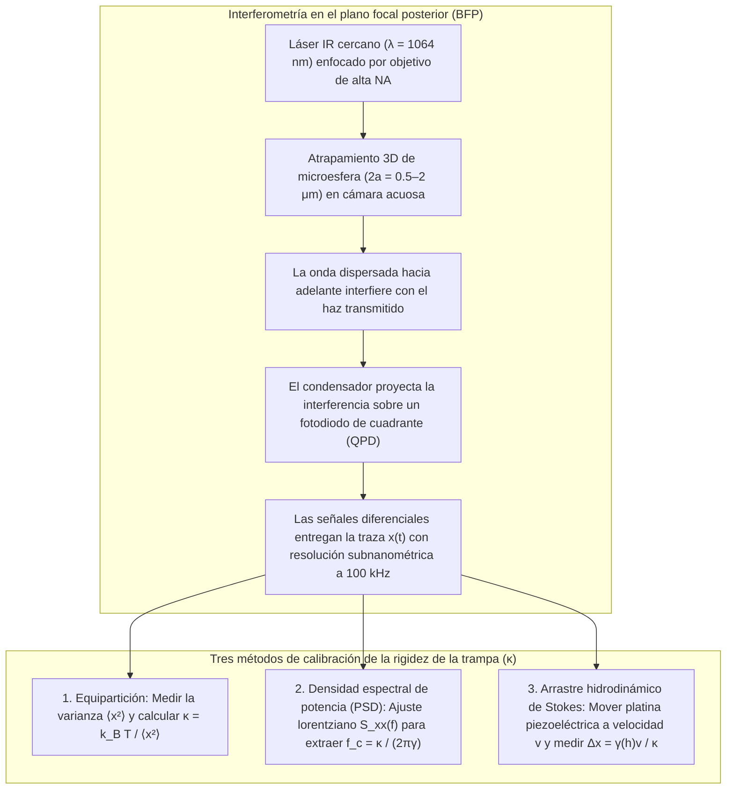

```mermaid
flowchart TD
    subgraph Lateral["1. Fuerza restauradora transversal (lateral) en un haz gaussiano"]
        L1["La esfera se desplaza lateralmente a la derecha (+x) del eje del haz"] --> L2["El rayo A (izquierda) pasa cerca del centro brillante (alta potencia P_A) y se refracta a la derecha"]
        L1 --> L3["El rayo B (derecha) pasa por el borde tenue (baja potencia P_B) y se refracta a la izquierda"]
        L2 --> L4["La fuerza de reacción F_A (hacia la izquierda, -x) es mucho mayor que F_B (+x)"]
        L3 --> L4
        L4 --> L5["La fuerza de gradiente transversal neta F_x devuelve la esfera al eje del haz (x = 0)"]
    end

    subgraph Axial["2. Fuerza restauradora axial bajo enfoque de alta apertura numérica (High-NA)"]
        A1["La esfera se desplaza aguas abajo (+z) más allá del foco O"] --> A2["Los rayos exteriores muy divergentes se refractan hacia el eje z al atravesar la esfera"]
        A2 --> A3["Los rayos salientes están más colimados, aumentando el momento axial p_z de la luz (Δp_z > 0)"]
        A3 --> A4["Por conservación del momento, la esfera recibe un retroceso hacia atrás (-z, hacia el foco O)"]
        A4 --> A5["La fuerza de gradiente hacia atrás supera la fuerza de dispersión y asegura la estabilidad 3D"]
    end
```

## 1. Introducción: ¿Por qué la luz sin masa puede empujar y atraer la materia?

En nuestra experiencia macroscópica cotidiana, la luz parece completamente intangible. Sin embargo, desde el punto de vista de la física fundamental, la radiación electromagnética transporta tanto <strong>energía</strong> como <strong>momento lineal (cantidad de movimiento)</strong>. Ya en 1619, Johannes Kepler observó que las colas de polvo de los cometas apuntan siempre en dirección opuesta al Sol, postulando la existencia de una <strong>presión de radiación</strong>. En 1873, James Clerk Maxwell demostró que las ondas electromagnéticas transportan momento mediante el vector de Poynting $\mathbf{S} = \frac{1}{\mu_0}(\mathbf{E} \times \mathbf{B})$. En 1905, la relatividad especial de Albert Einstein ($E^2 = (pc)^2 + (mc^2)^2$) estableció para un fotón sin masa en reposo ($m = 0$) y energía $E = h\nu = hc/\lambda$ el momento lineal:

$$
p = \frac{E}{c} = \frac{h\nu}{c} = \frac{h}{\lambda}
$$

Cuando un haz láser colimado de potencia $P$ incide perpendicularmente sobre una superficie totalmente absorbente o un espejo perfecto, la fuerza de radiación es:

$$
F_{\text{abs}} = \frac{P}{c}, \qquad F_{\text{ref}} = \frac{2P}{c}
$$

Debido a la enorme velocidad de la luz $c \approx 3.0 \times 10^8\,\text{m/s}$, un láser de $1\,\text{W}$ ejerce apenas $3.3\,\text{nN}$. Pero al descender a la <strong>escala micrométrica ($10^{-6}\,\text{m}$) de las microesferas coloidales y células vivas, o a la escala nanométrica ($10^{-9}\,\text{m}$) de las macromoléculas biológicas</strong>, la jerarquía de fuerzas se invierte por completo: una microesfera de poliestireno de radio $a = 1\,\mu\text{m}$ tiene una masa de solo $m \approx 4.4 \times 10^{-15}\,\text{kg}$ y un peso gravitatorio de $mg \approx 0.043\,\text{pN}$ ($1\,\text{pN} = 10^{-12}\,\text{N}$). Decenas de milivatios de luz láser enfocada generan fuerzas de varios piconewtons ($\text{pN}$), superando la gravedad por órdenes de magnitud. Más aún, cerca del foco de un haz láser fuertemente enfocado, una partícula dieléctrica transparente experimenta una <strong>fuerza de gradiente óptico</strong> conservativa que la atrae hacia el punto de máxima intensidad luminosa: esta es la tecnología de las <strong>pinzas ópticas (Optical Tweezers)</strong>.

---

## 2. Los avances pioneros de Arthur Ashkin y el nacimiento de las pinzas ópticas

En 1970, en los Bell Laboratories, <strong>Arthur Ashkin (1922–2020)</strong> enfocó un láser de iones de argón ($\lambda = 514.5\,\text{nm}$) sobre microesferas de látex transparentes suspendidas en agua (*Physical Review Letters*, 24, 156). En lugar de ser simplemente empujadas hacia adelante, las esferas cercanas al borde del haz eran <strong>simultáneamente atraídas transversalmente hacia el brillante eje central del haz gaussiano</strong>. Ese mismo año construyó la primera trampa óptica 3D mediante dos haces contrapropagantes.

En 1986, Ashkin, J. M. Dziedzic, J. E. Bjorkholm y <strong>Steven Chu</strong> publicaron su artículo seminal (*Optics Letters*, 11, 288, 1986), demostrando que un <strong>único haz láser fuertemente enfocado</strong> a través de un objetivo de alta apertura numérica ($\text{NA} = 1.25$) genera una fuerza de gradiente axial hacia atrás capaz de superar la fuerza de dispersión hacia adelante, atrapando establemente en 3D partículas dieléctricas desde $10\,\mu\text{m}$ hasta $25\,\text{nm}$: habían nacido las <strong>pinzas ópticas</strong>. En 1987, utilizando un <strong>láser Nd:YAG en el infrarrojo cercano ($\lambda = 1064\,\text{nm}$)</strong> para evitar el fotodaño, Ashkin atrapó bacterias *E. coli* vivas, levaduras en división y virus, recibiendo por ello el <strong>Premio Nobel de Física 2018</strong>.

---

## 3. Mecánica del atrapamiento en el régimen de óptica geométrica (Dispersión de Mie, $a \gg \lambda$)

Cuando el radio de la esfera es mucho mayor que la longitud de onda ($a \gg \lambda$), la refracción de un rayo de potencia $P_{\text{ray}}$ a través de una esfera de índice $n_p > n_m$ ($m = n_p/n_m > 1$) imparte, por conservación del momento lineal, una fuerza de retroceso mecánico $\mathbf{F}_{\text{ray}}$:

$$
\mathbf{F}_{\text{ray}} = -\frac{d\mathbf{p}_{\text{light}}}{dt} = -\frac{n_m P_{\text{ray}}}{c} \left( \hat{\mathbf{u}}_{\text{out}} - \hat{\mathbf{u}}_{\text{in}} \right)
$$

- <strong>Estabilidad transversal</strong>: En un perfil gaussiano $I(r) = I_0 \exp(-2r^2/w_0^2)$, los rayos más cercanos al eje central portan mayor potencia y su retroceso de refracción devuelve siempre la esfera al centro brillante ($x=y=0$).
- <strong>Estabilidad axial y necesidad de un objetivo de alta apertura numérica (High-NA)</strong>: Cuando la esfera se desplaza aguas abajo ($+z$) del foco $O$, refracta hacia adentro los rayos exteriores fuertemente divergentes, incrementando el momento hacia adelante $p_z$ de la luz ($\Delta p_z > 0$) y generando una fuerza de reacción hacia atrás ($-z$) hacia el foco $O$. Para vencer el empuje de las reflexiones superficiales, es indispensable sobrellenar la apertura posterior de un <strong>objetivo de inmersión de alta apertura numérica ($\text{NA} = n_m \sin\theta_{\max} \ge 1.2$)</strong>.

---

## 4. Régimen dipolar electromagnético (Dispersión de Rayleigh, $a \ll \lambda$)

Para nanopartículas ($a \ll \lambda$), la esfera actúa como un dipolo eléctrico puntual inducido $\mathbf{p} = \alpha \mathbf{E}$ cuya <strong>polarizabilidad de Clausius-Mossotti</strong> $\alpha$ escala con el volumen ($\propto a^3$):

$$
\alpha = 4\pi n_m^2 \varepsilon_0 a^3 \left( \frac{m^2 - 1}{m^2 + 2} \right) \qquad \left(m \equiv \frac{n_p}{n_m}\right)
$$

El promedio temporal de la fuerza de Lorentz y la sección eficaz de dispersión de Rayleigh ($\sigma_{\text{scat}} \propto k^4 a^6$) conducen a la <strong>fuerza de gradiente $\mathbf{F}_{\text{grad}}$</strong> y a la <strong>fuerza de dispersión $\mathbf{F}_{\text{scat}}$</strong>:

$$
\mathbf{F}_{\text{grad}}(\mathbf{r}) = \frac{2\pi n_m a^3}{c} \left( \frac{m^2 - 1}{m^2 + 2} \right) \nabla I(\mathbf{r}) = -\nabla U(\mathbf{r})
$$

$$
\mathbf{F}_{\text{scat}}(\mathbf{r}) = \frac{n_m \sigma_{\text{scat}}}{c} I(\mathbf{r})\hat{\mathbf{z}} = \frac{128 \pi^5 n_m^5 a^6}{3 c \lambda_0^4} \left( \frac{m^2 - 1}{m^2 + 2} \right)^2 I(\mathbf{r}) \hat{\mathbf{z}}
$$

| Propiedad física | Fuerza de gradiente ($\mathbf{F}_{\text{grad}}$) | Fuerza de dispersión ($\mathbf{F}_{\text{scat}}$) |
| :--- | :--- | :--- |
| <strong>Origen físico</strong> | Campo inhomogéneo sobre dipolo inducido (minimización del potencial $U$) | Transferencia de momento por absorción y reemisión de Rayleigh |
| <strong>Dirección de acción</strong> | A lo largo del gradiente de intensidad $\nabla I(\mathbf{r})$ (hacia el foco 3D si $n_p > n_m$) | A lo largo del vector de onda $\hat{\mathbf{z}}$ (empuja la partícula aguas abajo) |
| <strong>Escalamiento con el radio $a$ ($a \ll \lambda$)</strong> | <strong>Proporcional al volumen ($\propto a^3$)</strong> | <strong>Proporcional al cuadrado del volumen ($\propto a^6$)</strong> |
| <strong>Escalamiento con la longitud de onda $\lambda_0$</strong> | A través de la geometría del punto focal | <strong>Inversa de la cuarta potencia ($\propto \lambda_0^{-4}$)</strong> |
| <strong>Contraste de índice $m = n_p/n_m$</strong> | Lineal en $\left(\frac{m^2-1}{m^2+2}\right)$ (cambia de signo en $m=1$) | Cuadrático $\left(\frac{m^2-1}{m^2+2}\right)^2$ (siempre empuja hacia adelante) |

Para evitar el escape térmico browniano ($k_B T \approx 4.14\,\text{pN}\cdot\text{nm}$ a $T = 300\,\text{K}$), la profundidad del pozo de potencial debe cumplir $|U_{\min}| \propto a^3 I_{\max} \gtrsim 10\,k_B T$. Debido al escalamiento $a^3$, los biofísicos unen químicamente el ADN o las proteínas a <strong>microesferas dieléctricas ($2a \sim 0.5\text{–}2\,\mu\text{m}$)</strong> que actúan como asas mecánicas.

---

## 5. Movimiento browniano, ecuación de Langevin y calibración al piconewton

Cerca del centro de equilibrio ($|\Delta x| \lesssim 150\,\text{nm}$), el pozo de potencial es armónico ($U(x) \approx \frac{1}{2}\kappa_x x^2$) y cumple la <strong>ley de Hooke</strong>:

$$
F_{\text{trap}}(x) = -\kappa_x \Delta x
$$

donde $\kappa_x$ ($0.005\text{–}1.0\,\text{pN/nm}$) es la <strong>rigidez de la trampa (Trap Stiffness)</strong>. A bajo número de Reynolds ($\text{Re} \sim 10^{-5} \ll 1$), el término inercial desaparece y la trayectoria $x(t)$ obedece la <strong>ecuación de Langevin sobreamortiguada</strong> con arrastre viscoso de Stokes $\gamma = 6\pi\eta_{\text{vis}}a$:

$$
\gamma \frac{dx(t)}{dt} + \kappa x(t) = \sqrt{2\gamma k_B T}\,\eta(t)
$$

1. <strong>Teorema de equipartición</strong>: $\frac{1}{2}\kappa \langle x^2 \rangle = \frac{1}{2}k_B T \implies \kappa = k_B T / \langle x^2 \rangle$.
2. <strong>Densidad espectral de potencia (PSD)</strong>: El espectro de frecuencias sigue un perfil lorentziano con <strong>frecuencia de esquina $f_c$</strong>:
   $$
   S_{xx}(f) = \frac{k_B T}{\pi^2 \gamma \left( f_c^2 + f^2 \right)}, \qquad f_c = \frac{\kappa}{2\pi \gamma}
   $$
3. <strong>Arrastre hidrodinámico de Stokes (con corrección de pared de Faxén)</strong>: $F = \gamma_\parallel(h)v = \kappa \Delta x$.

---

## 6. La revolución de la biofísica de moléculas individuales: Elasticidad del ADN y motores moleculares

El uso de la <strong>ventana óptica biológica en el infrarrojo cercano ($\lambda = 1064\,\text{nm}$)</strong> junto con <strong>sistemas enzimáticos captadores de oxígeno</strong> previene el fotodaño celular.

### Carlos Bustamante y la elasticidad entrópica de moléculas individuales de ADN
Entre 1992 y 1996, <strong>Carlos Bustamante</strong> y colaboradores midieron la curva fuerza-extensión $F(z)$ de una molécula individual de ADN de doble cadena del fago $\lambda$ ($L_0 \approx 16.5\,\mu\text{m}$), demostrando que sigue el <strong>modelo de cadena tipo gusano (Worm-Like Chain, WLC)</strong> (Marko & Siggia, 1995) con longitud de persistencia $L_p \approx 50\,\text{nm}$:

$$
F(z) = \frac{k_B T}{L_p} \left[ \frac{1}{4\left(1 - z/L_0\right)^2} - \frac{1}{4} + \frac{z}{L_0} \right]
$$

y descubriendo a $F \approx 65\,\text{pN}$ la <strong>transición de sobreestiramiento (Overstretching Transition)</strong> hasta $1.7$ veces su longitud original.

### Steven Block: Los pasos de 8 nm de la kinesina y la resolución de pares de bases de la ARN polimerasa
- <strong>Kinesina-1</strong>: En 1993, el grupo de <strong>Steven Block</strong> (*Nature*, 365, 721) demostró que una sola molécula de kinesina camina sobre un microtúbulo dando <strong>pasos discretos de $\Delta d = 8.2\,\text{nm}$</strong>, hidrolizando exactamente <strong>1 molécula de ATP por paso</strong> contra una <strong>fuerza de detención (Stall Force) de $F_{\text{stall}} \approx 6\text{–}7\,\text{pN}$</strong> ($\sim 50\text{–}60\%$ de eficiencia termodinámica).
- <strong>Pinzas ópticas de doble trampa y ARN polimerasa (RNAP)</strong>: En 2005, mediante una doble trampa óptica pasiva aislada en helio, el equipo de Block resolvió los <strong>pasos individuales de $3.4\,\text{\AA}$ ($0.34\,\text{nm}$, un solo par de bases)</strong> de la ARN polimerasa transcribiendo ADN.

---

## 7. Fronteras modernas: Pinzas holográficas, plasmónica y optomecánica cuántica

1. <strong>Pinzas ópticas holográficas (HOT) y llaves ópticas</strong>: Moduladores espaciales de luz (SLM) controlan cientos de trampas simultáneamente, mientras el momento angular de espín ($\pm\hbar$) u orbital ($\ell\hbar$ en haces vórtice de Laguerre-Gauss) hace girar microrrotores.
2. <strong>Nanopinzas plasmónicas</strong>: Las resonancias de plasmón superficial localizado (LSPR) en nanoantenas metálicas atrapan directamente proteínas individuales ($< 10\,\text{nm}$).
3. <strong>Matrices de átomos neutros y optomecánica cuántica en vacío</strong>: Las matrices de pinzas ópticas impulsan los simuladores cuánticos de átomos neutros y el enfriamiento en ultra-alto vacío de nanoesferas de sílice hasta su <strong>estado fundamental cuántico de movimiento ($\bar{n} < 1$ fonón)</strong> (Delić et al., *Science*, 2020).
