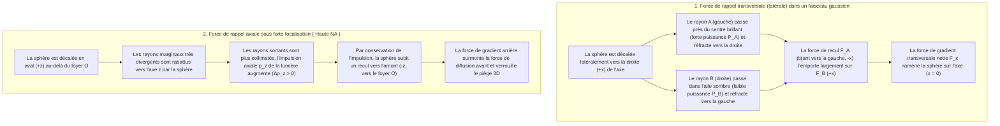
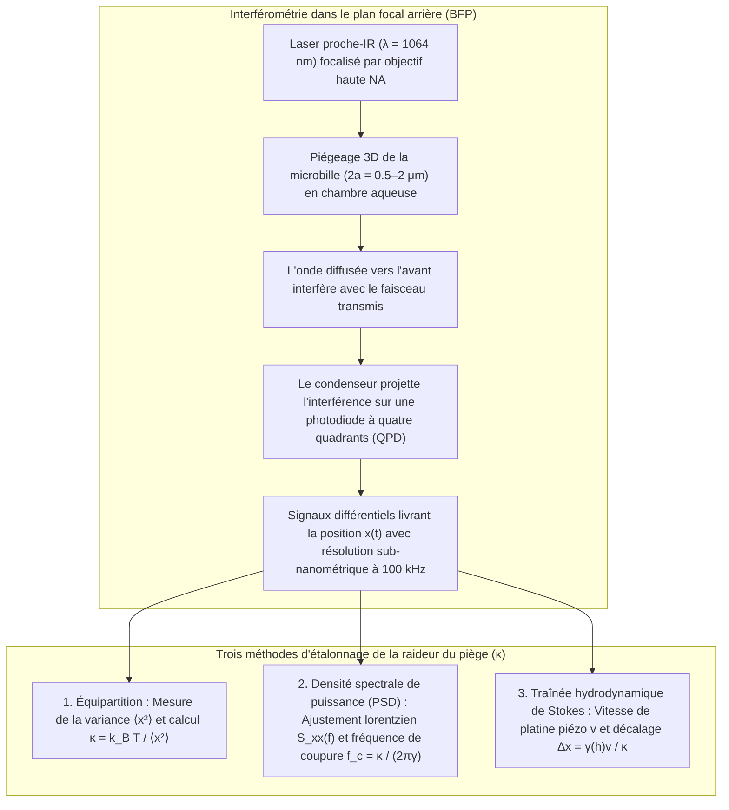

## 1. Introduction : Pourquoi la lumière sans masse peut-elle pousser et tirer la matière ?

Dans notre expérience macroscopique quotidienne, la lumière semble totalement immatérielle. Pourtant, selon la physique fondamentale, le rayonnement électromagnétique transporte à la fois de l'<strong>énergie</strong> et une <strong>impulsion (quantité de mouvement) linéaire</strong>. Dès 1619, Johannes Kepler observa que les queues de poussière des comètes pointent toujours à l'opposé du Soleil, suggérant une <strong>pression de radiation</strong>. En 1873, James Clerk Maxwell démontra que les ondes électromagnétiques transportent une impulsion via le vecteur de Poynting $\mathbf{S} = \frac{1}{\mu_0}(\mathbf{E} \times \mathbf{B})$. En 1905, la relativité restreinte d'Albert Einstein ($E^2 = (pc)^2 + (mc^2)^2$) établit pour un photon de masse au repos nulle ($m = 0$) et d'énergie $E = h\nu = hc/\lambda$ l'impulsion :

$$
p = \frac{E}{c} = \frac{h\nu}{c} = \frac{h}{\lambda}
$$

Lorsqu'un faisceau laser de puissance $P$ frappe normalement une surface totalement absorbante ou un miroir parfait, la force exercée vaut :

$$
F_{\text{abs}} = \frac{P}{c}, \qquad F_{\text{ref}} = \frac{2P}{c}
$$

En raison de l'immense vitesse de la lumière $c \approx 3.0 \times 10^8\,\text{m/s}$, un laser de $1\,\text{W}$ ne produit qu'une force de $3.3\,\text{nN}$. Mais dès que l'on descend à l'<strong>échelle micrométrique ($10^{-6}\,\text{m}$) des cellules vivantes et des microbilles colloïdales, ou à l'échelle nanométrique ($10^{-9}\,\text{m}$) des macromolécules biologiques</strong>, la hiérarchie des forces s'inverse : une microbille de polystyrène de rayon $a = 1\,\mu\text{m}$ ne pèse que $m \approx 4.4 \times 10^{-15}\,\text{kg}$, soit un poids gravitationnel minuscule de $mg \approx 0.043\,\text{pN}$ ($1\,\text{pN} = 10^{-12}\,\text{N}$). Quelques dizaines de milliwatts de lumière laser focalisée génèrent des forces de plusieurs piconewtons ($\text{pN}$), dépassant la gravité de plusieurs ordres de grandeur ! Mieux encore, au voisinage du foyer d'un faisceau fortement focalisé, une particule diélectrique transparente subit une <strong>force de gradient optique</strong> conservative qui l'attire vers le point de plus haute intensité lumineuse : c'est le principe des <strong>pinces optiques (Optical Tweezers)</strong>.

---

## 2. Les percées pionnières d'Arthur Ashkin et la naissance des pinces optiques

En 1970, aux Bell Laboratories, <strong>Arthur Ashkin (1922–2020)</strong> dirigea un faisceau laser argon-ion ($\lambda = 514.5\,\text{nm}$) sur des microbilles de latex transparentes en suspension dans l'eau (*Physical Review Letters*, 24, 156). Au lieu d'être simplement poussées vers l'avant, les billes situées sur le bord du faisceau étaient <strong>simultanément aspirées transversalement vers l'axe central brillant du faisceau gaussien</strong> ! La même année, il réalisa le premier piège optique 3D à deux faisceaux contre-propageants.

En 1986, Ashkin, J. M. Dziedzic, J. E. Bjorkholm et <strong>Steven Chu</strong> publièrent leur article fondateur (*Optics Letters*, 11, 288, 1986) démontrant qu'un <strong>unique faisceau laser fortement focalisé</strong> par un objectif de grande ouverture numérique ($\text{NA} = 1.25$) produit un gradient axial suffisant pour vaincre la force de diffusion vers l'avant et piéger en 3D des particules de $10\,\mu\text{m}$ jusqu'à $25\,\text{nm}$ : les <strong>pinces optiques</strong> étaient nées. Dès 1987, passant à un <strong>laser Nd:YAG proche infrarouge ($\lambda = 1064\,\text{nm}$)</strong> pour éviter tout dommage photochimique, Ashkin piégea des bactéries *E. coli* vivantes et des levures en division, recevant le <strong>prix Nobel de physique 2018</strong>.

---

## 3. Mécanique du piégeage en régime d'optique géométrique (Diffusion de Mie, $a \gg \lambda$)

Lorsque le rayon de la sphère est grand devant la longueur d'onde ($a \gg \lambda$), la réfraction d'un rayon de puissance $P_{\text{ray}}$ par une sphère d'indice $n_p > n_m$ ($m = n_p/n_m > 1$) impose, par conservation de l'impulsion, une force de recul mécanique $\mathbf{F}_{\text{ray}}$ :

$$
\mathbf{F}_{\text{ray}} = -\frac{d\mathbf{p}_{\text{light}}}{dt} = -\frac{n_m P_{\text{ray}}}{c} \left( \hat{\mathbf{u}}_{\text{out}} - \hat{\mathbf{u}}_{\text{in}} \right)
$$

- <strong>Stabilité latérale</strong> : Dans un profil gaussien $I(r) = I_0 \exp(-2r^2/w_0^2)$, les rayons proches du cœur du faisceau sont plus intenses et exercent un recul de réfraction qui ramène systématiquement la bille sur l'axe optique.
- <strong>Stabilité axiale et nécessité d'un objectif de haute ouverture numérique (High-NA)</strong> : En aval du foyer ($+z$), la bille redresse les rayons marginaux fortement divergents, augmentant l'impulsion avant $p_z$ de la lumière ($\Delta p_z > 0$) et créant par réaction une force de rappel vers le foyer ($-z$). Seuls les rayons à grand angle issus d'un <strong>objectif à immersion de haute ouverture numérique ($\text{NA} = n_m \sin\theta_{\max} \ge 1.2$)</strong> permettent à ce recul de vaincre la poussée des réflexions de Fresnel.

---

## 4. Régime dipolaire électromagnétique (Diffusion de Rayleigh, $a \ll \lambda$)

Pour une nanoparticule ($a \ll \lambda$), la bille agit comme un dipôle électrique induit $\mathbf{p} = \alpha \mathbf{E}$ dont la <strong>polarisabilité de Clausius-Mossotti</strong> $\alpha$ est proportionnelle au volume ($\propto a^3$) :

$$
\alpha = 4\pi n_m^2 \varepsilon_0 a^3 \left( \frac{m^2 - 1}{m^2 + 2} \right) \qquad \left(m \equiv \frac{n_p}{n_m}\right)
$$

La moyenne temporelle de la force de Lorentz et la section efficace de diffusion de Rayleigh ($\sigma_{\text{scat}} \propto k^4 a^6$) donnent la <strong>force de gradient $\mathbf{F}_{\text{grad}}$</strong> et la <strong>force de diffusion $\mathbf{F}_{\text{scat}}$</strong> :

$$
\mathbf{F}_{\text{grad}}(\mathbf{r}) = \frac{2\pi n_m a^3}{c} \left( \frac{m^2 - 1}{m^2 + 2} \right) \nabla I(\mathbf{r}) = -\nabla U(\mathbf{r})
$$

$$
\mathbf{F}_{\text{scat}}(\mathbf{r}) = \frac{n_m \sigma_{\text{scat}}}{c} I(\mathbf{r})\hat{\mathbf{z}} = \frac{128 \pi^5 n_m^5 a^6}{3 c \lambda_0^4} \left( \frac{m^2 - 1}{m^2 + 2} \right)^2 I(\mathbf{r}) \hat{\mathbf{z}}
$$

| Propriété physique | Force de gradient ($\mathbf{F}_{\text{grad}}$) | Force de diffusion ($\mathbf{F}_{\text{scat}}$) |
| :--- | :--- | :--- |
| <strong>Origine physique</strong> | Champ inhomogène sur dipôle induit (minimisation d'énergie potentielle $U$) | Transfert d'impulsion par absorption et réémission de Rayleigh |
| <strong>Direction d'action</strong> | Le long du gradient d'intensité $\nabla I(\mathbf{r})$ (vers le foyer 3D si $n_p > n_m$) | Le long du vecteur d'onde $\hat{\mathbf{z}}$ (pousse la particule vers l'aval) |
| <strong>Loi d'échelle en rayon $a$ ($a \ll \lambda$)</strong> | <strong>Proportionnelle au volume ($\propto a^3$)</strong> | <strong>Proportionnelle au carré du volume ($\propto a^6$)</strong> |
| <strong>Loi d'échelle en longueur d'onde $\lambda_0$</strong> | Via la géométrie de la tache focale | <strong>Puissance quatrième inverse ($\propto \lambda_0^{-4}$)</strong> |
| <strong>Contraste d'indice $m = n_p/n_m$</strong> | Linéaire en $\left(\frac{m^2-1}{m^2+2}\right)$ (change de signe à $m=1$) | Quadratique $\left(\frac{m^2-1}{m^2+2}\right)^2$ (toujours répulsive vers l'avant) |

Pour confiner une particule face à l'agitation thermique $k_B T \approx 4.14\,\text{pN}\cdot\text{nm}$ ($T = 300\,\text{K}$), la profondeur du puits de potentiel doit vérifier $|U_{\min}| \propto a^3 I_{\max} \gtrsim 10\,k_B T$. En raison de la loi en $a^3$, les biophysiciens greffent les protéines ou l'ADN sur une <strong>microbille diélectrique ($2a \sim 0.5\text{–}2\,\mu\text{m}$)</strong> servant de poignée mécanique.

---

## 5. Mouvement brownien, équation de Langevin et étalonnage au piconewton

Près du centre du piège ($|\Delta x| \lesssim 150\,\text{nm}$), le potentiel est harmonique ($U(x) \approx \frac{1}{2}\kappa_x x^2$) et obéit à la <strong>loi de Hooke</strong> :

$$
F_{\text{trap}}(x) = -\kappa_x \Delta x
$$

où $\kappa_x$ ($0.005\text{–}1.0\,\text{pN/nm}$) est la <strong>raideur du piège (Trap Stiffness)</strong>. À très bas nombre de Reynolds ($\text{Re} \sim 10^{-5} \ll 1$), l'inertie est négligeable et la trajectoire $x(t)$ suit l'<strong>équation de Langevin sur-amortie</strong> avec la traînée de Stokes $\gamma = 6\pi\eta_{\text{vis}}a$ :

$$
\gamma \frac{dx(t)}{dt} + \kappa x(t) = \sqrt{2\gamma k_B T}\,\eta(t)
$$

1. <strong>Théorème d'équipartition</strong> : $\frac{1}{2}\kappa \langle x^2 \rangle = \frac{1}{2}k_B T \implies \kappa = k_B T / \langle x^2 \rangle$.
2. <strong>Densité spectrale de puissance (PSD)</strong> : Le spectre de puissance suit un profil lorentzien caractérisé par la <strong>fréquence de coin $f_c$</strong> :
   $$
   S_{xx}(f) = \frac{k_B T}{\pi^2 \gamma \left( f_c^2 + f^2 \right)}, \qquad f_c = \frac{\kappa}{2\pi \gamma}
   $$
3. <strong>Traînée hydrodynamique de Stokes (avec correction de paroi de Faxén)</strong> : $F = \gamma_\parallel(h)v = \kappa \Delta x$.

---

## 6. Révolution de la biophysique à molécule unique : Élasticité de l'ADN et moteurs moléculaires

L'utilisation de la <strong>fenêtre optique biologique proche-IR ($\lambda = 1064\,\text{nm}$)</strong> associée à des <strong>systèmes enzymatiques piégeurs d'oxygène</strong> élimine la phototoxicité.

### Carlos Bustamante et l'élasticité entropique d'une molécule d'ADN unique
Entre 1992 et 1996, <strong>Carlos Bustamante</strong> et ses collègues ont mesuré la courbe force-extension $F(z)$ d'une molécule unique d'ADN double brin du phage $\lambda$ ($L_0 \approx 16.5\,\mu\text{m}$), validant le modèle de la <strong>chaîne semi-flexible (Worm-Like Chain, WLC)</strong> (Marko & Siggia, 1995) avec une longueur de persistance $L_p \approx 50\,\text{nm}$ :

$$
F(z) = \frac{k_B T}{L_p} \left[ \frac{1}{4\left(1 - z/L_0\right)^2} - \frac{1}{4} + \frac{z}{L_0} \right]
$$

et révélant à $F \approx 65\,\text{pN}$ la <strong>transition de sur-étirement (Overstretching Transition)</strong> où l'ADN s'allonge d'un facteur $1.7$.

### Steven Block : Les pas de 8 nm de la kinésine et la résolution d'une paire de bases de l'ARN polymérase
- <strong>Kinésine-1</strong> : En 1993, l'équipe de <strong>Steven Block</strong> (*Nature*, 365, 721) a démontré qu'une molécule unique de kinésine avance le long d'un microtubule par <strong>pas discrets de $\Delta d = 8.2\,\text{nm}$</strong>, consommant exactement <strong>1 molécule d'ATP par pas</strong> jusqu'à une <strong>force de décrochage (Stall Force) de $F_{\text{stall}} \approx 6\text{–}7\,\text{pN}$</strong> (rendement thermodynamique de $\sim 50\text{–}60\%$).
- <strong>Double piège optique et ARN polymérase (RNAP)</strong> : En 2005, grâce à un double piège optique passif isolé dans l'hélium, le groupe de Block a résolu les <strong>pas élémentaires de $3.4\,\text{\AA}$ ($0.34\,\text{nm}$, une seule paire de bases)</strong> de l'ARN polymérase transcrivant l'ADN !

---

## 7. Frontières modernes : Pinces holographiques, plasmonique et optomécanique quantique

1. <strong>Pinces optiques holographiques (HOT) & clés optiques</strong> : Des modulateurs spatiaux de lumière (SLM) contrôlent des centaines de pièges en 3D, tandis que le moment cinétique de spin ($\pm\hbar$) ou orbital ($\ell\hbar$ des faisceaux vortex de Laguerre-Gauss) fait tourner des micro-engrenages.
2. <strong>Nanopinces plasmoniques</strong> : Les résonances plasmoniques de surface localisées (LSPR) de nano-antennes métalliques piègent directement des protéines uniques ($< 10\,\text{nm}$).
3. <strong>Réseaux d'atomes neutres & optomécanique quantique sous vide</strong> : Les réseaux de pinces optiques permettent l'informatique quantique à atomes neutres et le refroidissement de nanosphères de silice lévitées sous ultravide jusqu'à leur <strong>état fondamental quantique de mouvement ($\bar{n} < 1$ phonon)</strong> (Delić et al., *Science*, 2020).
