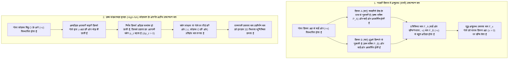
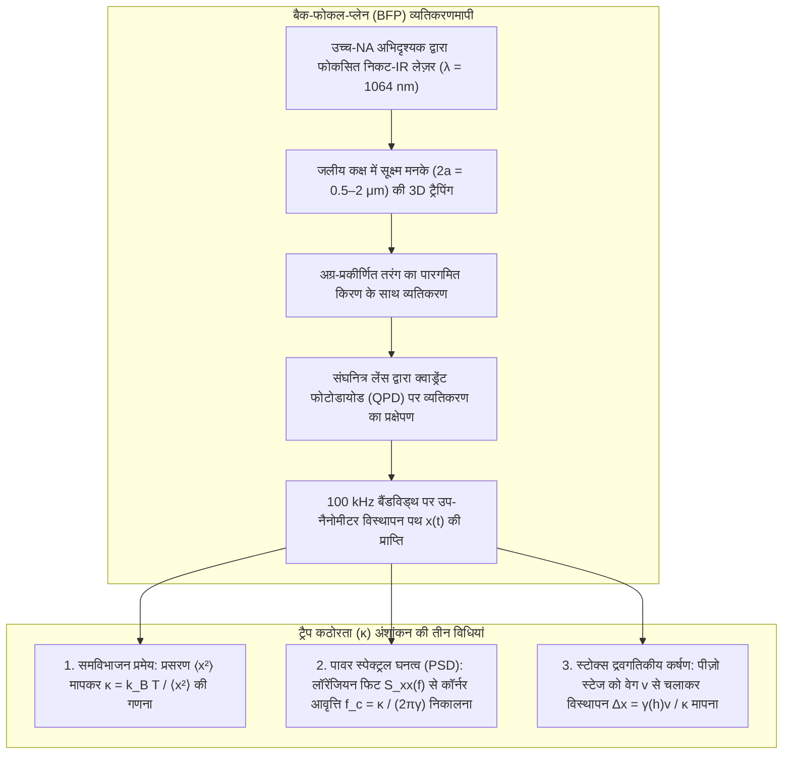

## 1. परिचय: द्रव्यमान-रहित प्रकाश पदार्थ को धक्का और खिंचाव कैसे दे सकता है?

हमारे दैनिक स्थूल अनुभव में प्रकाश पूर्णतः भारहीन और अमूर्त प्रतीत होता है। किंतु मूलभूत भौतिकी के दृष्टिकोण से, विद्युतचुंबकीय विकिरण <strong>ऊर्जा</strong> और <strong>रेखीय संवेग (Linear Momentum)</strong> दोनों का वहन करता है। 1619 में जोहान्स केपलर ने देखा कि धूमकेतुओं की धूल भरी पूंछ हमेशा सूर्य से दूर रहती है और उन्होंने <strong>विकिरण दाब (Radiation Pressure)</strong> की परिकल्पना प्रस्तुत की। 1873 में जेम्स क्लर्क मैक्सवेल ने सिद्ध किया कि विद्युतचुंबकीय तरंगें पॉइंटिंग सदिश $\mathbf{S} = \frac{1}{\mu_0}(\mathbf{E} \times \mathbf{B})$ के माध्यम से संवेग स्थानांतरित करती हैं। 1905 में अल्बर्ट आइंस्टीन के विशिष्ट सापेक्षता सिद्धांत ($E^2 = (pc)^2 + (mc^2)^2$) ने शून्य विराम द्रव्यमान ($m = 0$) और ऊर्जा $E = h\nu = hc/\lambda$ वाले फोटॉन का रेखीय संवेग स्थापित किया:

$$
p = \frac{E}{c} = \frac{h\nu}{c} = \frac{h}{\lambda}
$$

जब $P$ शक्ति की एक समांतरित लेज़र किरण किसी पूर्ण अवशोषक सतह या आदर्श दर्पण पर लंबवत आपतित होती है, तो विकिरण बल होता है:

$$
F_{\text{abs}} = \frac{P}{c}, \qquad F_{\text{ref}} = \frac{2P}{c}
$$

प्रकाश के अत्यधिक वेग $c \approx 3.0 \times 10^8\,\text{m/s}$ के कारण $1\,\text{W}$ का लेज़र केवल $3.3\,\text{nN}$ का बल उत्पन्न करता है। परंतु जैसे ही हम <strong>कोलॉइडी माइक्रोस्फीयर और जीवित कोशिकाओं के माइक्रोमीटर ($10^{-6}\,\text{m}$) संसार या जैविक वृहदणुओं के नैनोमीटर ($10^{-9}\,\text{m}$) संसार</strong> में प्रवेश करते हैं, बलों का पदानुक्रम पूरी तरह पलट जाता है: $a = 1\,\mu\text{m}$ त्रिज्या के पॉलीस्टाइरीन सूक्ष्म गोले का द्रव्यमान केवल $m \approx 4.4 \times 10^{-15}\,\text{kg}$ और गुरुत्वीय भार मात्र $mg \approx 0.043\,\text{pN}$ ($1\,\text{pN} = 10^{-12}\,\text{N}$) होता है। कुछ दहाई मिलीवाट का फोकसित लेज़र प्रकाश कई पिको-न्यूटन ($\text{pN}$) का बल उत्पन्न करता है जो गुरुत्वाकर्षण से हजारों गुना अधिक है! इससे भी अद्भुत बात यह है कि तीव्र रूप से फोकसित लेज़र किरण के फोकस बिंदु के पास एक पारदर्शी डाइइलेक्ट्रिक कण एक संरक्षी <strong>प्रकाशीय प्रवणता बल (Optical Gradient Force)</strong> का अनुभव करता है जो उसे अधिकतम प्रकाश तीव्रता वाले बिंदु की ओर खींचता है—यही <strong>ऑप्टिकल ट्वीज़र्स (Optical Tweezers / प्रकाशीय चिमटी)</strong> की तकनीक है।

---

## 2. आर्थर एश्किन की अग्रणी खोजें और ऑप्टिकल ट्वीज़र्स का जन्म

1970 में बेल लेबोरेटरीज (Bell Labs) में <strong>आर्थर एश्किन (Arthur Ashkin, 1922–2020)</strong> ने जल में निलंबित पारदर्शी लेटेक्स गोलों पर आर्गन-आयन लेज़र किरण ($\lambda = 514.5\,\text{nm}$) डाली (*Physical Review Letters*, 24, 156)। केवल आगे धकेले जाने के बजाय, किरण के किनारे स्थित गोले <strong>एक साथ अनुप्रस्थ रूप से गाउसी किरण के चमकीले केंद्रीय अक्ष की ओर खिंचे चले आए</strong>! उसी वर्ष उन्होंने दो विपरीतगामी किरणों से पहला त्रि-आयामी (3D) प्रकाशीय ट्रैप बनाया।

1986 में एश्किन, जे. एम. ज़िएदज़िक, जे. ई. ब्योर्कहोम और <strong>स्टीवन चू (Steven Chu)</strong> ने अपना ऐतिहासिक शोध-पत्र प्रकाशित किया (*Optics Letters*, 11, 288, 1986), जिसमें सिद्ध किया गया कि उच्च संख्यात्मक द्वारक ($\text{NA} = 1.25$) के अभिदृश्यक लेंस से तीव्र रूप से फोकसित <strong>एकल लेज़र किरण</strong> अग्रगामी प्रकीर्णन बल को परास्त कर $10\,\mu\text{m}$ से $25\,\text{nm}$ तक के कणों को 3D में स्थिर रूप से पकड़ सकती है—इसी के साथ <strong>ऑप्टिकल ट्वीज़र्स</strong> का जन्म हुआ। 1987 में जैविक नमूनों को प्रकाशीय क्षति से बचाने के लिए <strong>निकट-अवरक्त Nd:YAG लेज़र ($\lambda = 1064\,\text{nm}$)</strong> का उपयोग कर एश्किन ने जीवित *E. coli* जीवाणुओं, यीस्ट कोशिकाओं और विषाणुओं को बिना नुकसान पहुँचाए पकड़ा, जिसके लिए उन्हें <strong>2018 का भौतिकी का नोबेल पुरस्कार</strong> प्रदान किया गया।

---

## 3. किरण-प्रकाशिकी क्षेत्र (मी प्रकीर्णन, $a \gg \lambda$) में ट्रैपिंग यांत्रिकी

जब गोले की त्रिज्या तरंगदैर्घ्य से बहुत बड़ी ($a \gg \lambda$) होती है, तो $n_p > n_m$ ($m = n_p/n_m > 1$) अपवर्तनांक वाले गोले से गुजरने वाली $P_{\text{ray}}$ शक्ति की किरण संवेग संरक्षण के अनुसार गोले पर यांत्रिक प्रतिक्षेप बल (Recoil Force) $\mathbf{F}_{\text{ray}}$ लगाती है:

$$
\mathbf{F}_{\text{ray}} = -\frac{d\mathbf{p}_{\text{light}}}{dt} = -\frac{n_m P_{\text{ray}}}{c} \left( \hat{\mathbf{u}}_{\text{out}} - \hat{\mathbf{u}}_{\text{in}} \right)
$$

- <strong>अनुप्रस्थ स्थिरता</strong>: गाउसी प्रोफाइल $I(r) = I_0 \exp(-2r^2/w_0^2)$ में केंद्र के पास की किरणें अधिक शक्तिशाली होती हैं, इसलिए उनका अपवर्तन प्रतिक्षेप सदैव गोले को चमकीले केंद्र ($x=y=0$) पर वापस लाता है।
- <strong>अक्षीय स्थिरता और उच्च-NA अभिदृश्यक की अनिवार्यता</strong>: जब गोला फोकस $O$ से आगे ($+z$) खिसकता है, तो यह तीव्र रूप से फैलती बाहरी किरणों को अंदर की ओर मोड़ता है, जिससे प्रकाश का अग्रगामी संवेग $p_z$ बढ़ता है ($\Delta p_z > 0$) और गोले पर फोकस $O$ की ओर पश्चगामी प्रतिक्रिया बल ($-z$) लगता है। सतह परावर्तन के अग्रगामी धक्के को हराने के लिए <strong>उच्च-NA निमज्जन अभिदृश्यक ($\text{NA} = n_m \sin\theta_{\max} \ge 1.2$)</strong> के पिछले द्वारक को पूरा भरना अनिवार्य है।

---

## 4. विद्युतचुंबकीय द्विध्रुव क्षेत्र (रेले प्रकीर्णन, $a \ll \lambda$)

नैनोकणों ($a \ll \lambda$) के लिए कण एक प्रेरित बिंदु विद्युत द्विध्रुव $\mathbf{p} = \alpha \mathbf{E}$ की भांति व्यवहार करता है जिसकी <strong>क्लॉसियस-मोसोटी ध्रुवणीयता</strong> $\alpha$ आयतन ($\propto a^3$) के समानुपाती होती है:

$$
\alpha = 4\pi n_m^2 \varepsilon_0 a^3 \left( \frac{m^2 - 1}{m^2 + 2} \right) \qquad \left(m \equiv \frac{n_p}{n_m}\right)
$$

लॉरेंज बल का समय-औसत और रेले प्रकीर्णन अनुप्रस्थ काट ($\sigma_{\text{scat}} \propto k^4 a^6$) संरक्षी <strong>प्रवणता बल $\mathbf{F}_{\text{grad}}$</strong> और असंरक्षी <strong>प्रकीर्णन बल $\mathbf{F}_{\text{scat}}$</strong> प्रदान करते हैं:

$$
\mathbf{F}_{\text{grad}}(\mathbf{r}) = \frac{2\pi n_m a^3}{c} \left( \frac{m^2 - 1}{m^2 + 2} \right) \nabla I(\mathbf{r}) = -\nabla U(\mathbf{r})
$$

$$
\mathbf{F}_{\text{scat}}(\mathbf{r}) = \frac{n_m \sigma_{\text{scat}}}{c} I(\mathbf{r})\hat{\mathbf{z}} = \frac{128 \pi^5 n_m^5 a^6}{3 c \lambda_0^4} \left( \frac{m^2 - 1}{m^2 + 2} \right)^2 I(\mathbf{r}) \hat{\mathbf{z}}
$$

| भौतिक गुण | प्रवणता बल ($\mathbf{F}_{\text{grad}}$) | प्रकीर्णन बल ($\mathbf{F}_{\text{scat}}$) |
| :--- | :--- | :--- |
| <strong>भौतिक उत्पत्ति</strong> | प्रेरित द्विध्रुव पर असमांगी क्षेत्र (स्थितिज ऊर्जा $U$ का न्यूनतमीकरण) | फोटॉन अवशोषण और रेले पुनर्विकिरण से संवेग स्थानांतरण |
| <strong>क्रिया की दिशा</strong> | तीव्रता प्रवणता $\nabla I(\mathbf{r})$ के अनुदिश ($n_p > n_m$ के लिए 3D फोकस की ओर) | तरंग सदिश $\hat{\mathbf{z}}$ के अनुदिश (कण को आगे धकेलता है) |
| <strong>त्रिज्या $a$ के साथ संबंध ($a \ll \lambda$)</strong> | <strong>आयतन के समानुपाती ($\propto a^3$)</strong> | <strong>आयतन के वर्ग के समानुपाती ($\propto a^6$)</strong> |
| <strong>तरंगदैर्घ्य $\lambda_0$ के साथ संबंध</strong> | फोकस बिंदु ज्यामिति के माध्यम से | <strong>चतुर्थ घात के व्युत्क्रमानुपाती ($\propto \lambda_0^{-4}$)</strong> |
| <strong>अपवर्तनांक अनुपात $m = n_p/n_m$</strong> | $\left(\frac{m^2-1}{m^2+2}\right)$ में रैखिक ($m=1$ पर चिह्न बदलता है) | द्विघाती $\left(\frac{m^2-1}{m^2+2}\right)^2$ (सदैव आगे की ओर) |

कमरे के तापमान ($T = 300\,\text{K}$, $k_B T \approx 4.14\,\text{pN}\cdot\text{nm}$) पर ब्राउनियन तापीय पलायन को रोकने के लिए विभव कूप की गहराई $|U_{\min}| \propto a^3 I_{\max} \gtrsim 10\,k_B T$ होनी चाहिए। $a^3$ नियम के कारण जैव-भौतिक विज्ञानी प्रोटीन या DNA को <strong>माइक्रोमीटर आकार के डाइइलेक्ट्रिक मनकों ($2a \sim 0.5\text{–}2\,\mu\text{m}$)</strong> से जोड़कर पकड़ते हैं।

---

## 5. ब्राउनियन गति, लैंग्विन समीकरण और पिको-न्यूटन अंशांकन

संतुलन केंद्र ($|\Delta x| \lesssim 150\,\text{nm}$) के पास विभव कूप सरल आवर्ती ($U(x) \approx \frac{1}{2}\kappa_x x^2$) होता है और <strong>हुक के नियम (Hooke's Law)</strong> का पालन करता है:

$$
F_{\text{trap}}(x) = -\kappa_x \Delta x
$$

जहाँ $\kappa_x$ ($0.005\text{–}1.0\,\text{pN/nm}$) <strong>ट्रैप कठोरता (Trap Stiffness)</strong> है। निम्न रेनॉल्ड्स संख्या ($\text{Re} \sim 10^{-5} \ll 1$) पर जड़त्वीय पद नगण्य हो जाता है और प्रक्षेपवक्र $x(t)$ स्टोक्स श्यान कर्षण $\gamma = 6\pi\eta_{\text{vis}}a$ के साथ <strong>अति-अवमंदित लैंग्विन समीकरण (Overdamped Langevin Equation)</strong> का पालन करता है:

$$
\gamma \frac{dx(t)}{dt} + \kappa x(t) = \sqrt{2\gamma k_B T}\,\eta(t)
$$

1. <strong>ऊर्जा समविभाजन प्रमेय</strong>: $\frac{1}{2}\kappa \langle x^2 \rangle = \frac{1}{2}k_B T \implies \kappa = k_B T / \langle x^2 \rangle$।
2. <strong>पावर स्पेक्ट्रल घनत्व (PSD)</strong>: आवृत्ति स्पेक्ट्रम <strong>कॉर्नर आवृत्ति $f_c$</strong> के साथ लॉरेंजियन प्रोफाइल का अनुसरण करता है:
   $$
   S_{xx}(f) = \frac{k_B T}{\pi^2 \gamma \left( f_c^2 + f^2 \right)}, \qquad f_c = \frac{\kappa}{2\pi \gamma}
   $$
3. <strong>स्टोक्स द्रवगतिकीय कर्षण विधि (फैक्सेन दीवार संशोधन सहित)</strong>: $F = \gamma_\parallel(h)v = \kappa \Delta x$।

---

## 6. एकल-अणु जैव-भौतिकी क्रांति: DNA प्रत्यास्थता और आणविक मोटर्स

<strong>निकट-अवरक्त जैविक प्रकाशीय विंडो ($\lambda = 1064\,\text{nm}$)</strong> और एंजाइमी <strong>ऑक्सीजन-अपमार्जक प्रणालियों</strong> का उपयोग कोशिकीय प्रकाशीय क्षति को रोकता है।

### कार्लोस बुस्तामांते और एकल DNA अणुओं की एन्ट्रॉपिक प्रत्यास्थता
1992 और 1996 के बीच, <strong>कार्लोस बुस्तामांते</strong> और सहयोगियों ने एकल $\lambda$-फेज dsDNA अणु ($L_0 \approx 16.5\,\mu\text{m}$) का बल-विस्तार वक्र $F(z)$ मापा, जो $L_p \approx 50\,\text{nm}$ सातत्य लंबाई वाले <strong>वर्म-लाइक चेन (WLC) मॉडल</strong> (Marko & Siggia, 1995) का सटीक पालन करता है:

$$
F(z) = \frac{k_B T}{L_p} \left[ \frac{1}{4\left(1 - z/L_0\right)^2} - \frac{1}{4} + \frac{z}{L_0} \right]
$$

और $F \approx 65\,\text{pN}$ पर इसकी लंबाई में $1.7$ गुना वृद्धि के <strong>अति-खिंचाव प्रावस्था संक्रमण (Overstretching Transition)</strong> की खोज की।

### स्टीवन ब्लॉक: काइनेसिन के 8 nm कदम और RNA पॉलीमरेज़ का एकल क्षार-युग्म विभेदन
- <strong>काइनेसिन-1 (Kinesin-1)</strong>: 1993 में <strong>स्टीवन ब्लॉक</strong> के समूह (*Nature*, 365, 721) ने सिद्ध किया कि एकल काइनेसिन अणु सूक्ष्मनलिका (Microtubule) पर <strong>$\Delta d = 8.2\,\text{nm}$ के असतत कदमों</strong> से चलता है, प्रति कदम ठीक <strong>1 ATP अणु</strong> का जल-अपघटन करता है और <strong>$F_{\text{stall}} \approx 6\text{–}7\,\text{pN}$ के अवरोधक बल (Stall Force)</strong> तक कार्य करता है ($\sim 50\text{–}60\%$ दक्षता)।
- <strong>द्वि-ट्रैप ऑप्टिकल ट्वीज़र्स और RNA पॉलीमरेज़ (RNAP)</strong>: 2005 में हीलियम-पृथक निष्क्रिय द्वि-ट्रैप प्रणाली द्वारा ब्लॉक की प्रयोगशाला ने DNA का अनुलेखन करते समय RNA पॉलीमरेज़ के <strong>$3.4\,\text{\AA}$ ($0.34\,\text{nm}$, एकल क्षार-युग्म) के सूक्ष्मतम कदमों</strong> को सीधे मापने में सफलता पाई!

---

## 7. आधुनिक सीमाएं: होलोग्राफिक ट्वीज़र्स, प्लाज्मॉनिक्स और क्वांटम ऑप्टोमैकेनिक्स

1. <strong>होलोग्राफिक ऑप्टिकल ट्वीज़र्स (HOT) और प्रकाशीय स्पैनर</strong>: स्थानिक प्रकाश मॉड्यूलेटर (SLM) सैकड़ों ट्रैप्स को एक साथ नियंत्रित करते हैं, जबकि प्रचक्रण ($\pm\hbar$) या कक्षीय कोणीय संवेग ($\ell\hbar$, लैगेर-गाउस भंवर किरणें) सूक्ष्म रोटर्स को घुमाते हैं।
2. <strong>प्लाज्मॉनिक नैनोट्वीज़र्स</strong>: धात्विक नैनोएंटेना में स्थानीयकृत सतह प्लाज्मॉन अनुनाद (LSPR) सीधे एकल प्रोटीन ($< 10\,\text{nm}$) को पकड़ते हैं।
3. <strong>उदासीन परमाणु व्यूह और निर्वात क्वांटम ऑप्टोमैकेनिक्स</strong>: ऑप्टिकल ट्वीज़र व्यूह उदासीन-परमाणु क्वांटम सिमुलेटरों का आधार हैं और अति-उच्च निर्वात में निलंबित सिलिका नैनोगोलों को उनकी <strong>क्वांटम गतिज मूल अवस्था ($\bar{n} < 1$ फोनॉन)</strong> तक ठंडा करने में सक्षम बनाते हैं (Delić et al., *Science*, 2020)।
