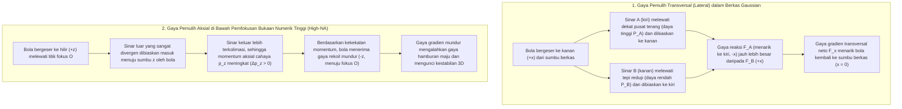
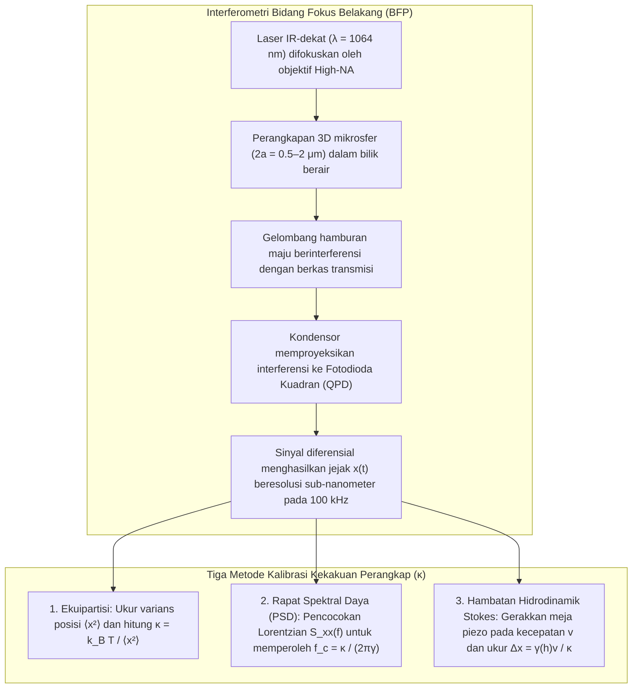

## 1. Pendahuluan: Mengapa Cahaya Tanpa Massa Dapat Mendorong dan Menarik Materi?

Dalam pengalaman makroskopis sehari-hari, cahaya terasa sama sekali tidak berwujud. Namun dari sudut pandang fisika fundamental, radiasi elektromagnetik membawa <strong>energi</strong> sekaligus <strong>momentum linier</strong>. Sejak tahun 1619, Johannes Kepler mengamati bahwa ekor debu komet selalu menjauhi Matahari dan mengajukan hipotesis adanya <strong>tekanan radiasi (Radiation Pressure)</strong>. Pada tahun 1873, James Clerk Maxwell membuktikan bahwa gelombang elektromagnetik membawa momentum melalui vektor Poynting $\mathbf{S} = \frac{1}{\mu_0}(\mathbf{E} \times \mathbf{B})$. Pada tahun 1905, relativitas khusus Albert Einstein ($E^2 = (pc)^2 + (mc^2)^2$) menetapkan bahwa foton tanpa massa diam ($m = 0$) dengan energi $E = h\nu = hc/\lambda$ memiliki momentum linier:

$$
p = \frac{E}{c} = \frac{h\nu}{c} = \frac{h}{\lambda}
$$

Ketika berkas laser terkolimasi berdaya $P$ mengenai permukaan penyerap sempurna atau cermin pantul sempurna secara tegak lurus, gaya radiasinya adalah:

$$
F_{\text{abs}} = \frac{P}{c}, \qquad F_{\text{ref}} = \frac{2P}{c}
$$

Karena kecepatan cahaya $c \approx 3.0 \times 10^8\,\text{m/s}$ sangat besar, laser $1\,\text{W}$ hanya menghasilkan gaya $3.3\,\text{nN}$. Namun begitu kita memasuki <strong>skala mikrometer ($10^{-6}\,\text{m}$) mikrosfer koloid dan sel hidup, atau skala nanometer ($10^{-9}\,\text{m}$) makromolekul biologis</strong>, hierarki gaya berbalik total: mikrosfer polistirena berjari-jari $a = 1\,\mu\text{m}$ hanya bermassa $m \approx 4.4 \times 10^{-15}\,\text{kg}$ dengan berat gravitasi $mg \approx 0.043\,\text{pN}$ ($1\,\text{pN} = 10^{-12}\,\text{N}$). Puluhan miliwatt cahaya laser terfokus menghasilkan gaya beberapa pikonewton ($\text{pN}$), melampaui gravitasi ribuan kali lipat! Lebih menakjubkan lagi, di dekat titik fokus berkas laser yang difokuskan secara tajam, partikel dielektrik transparan mengalami <strong>gaya gradien optik</strong> konservatif yang menariknya menuju titik intensitas cahaya tertinggi—inilah teknologi <strong>Pinset Optik (Optical Tweezers)</strong>.

---

## 2. Terobosan Arthur Ashkin dan Lahirnya Pinset Optik

Pada tahun 1970 di Bell Laboratories, <strong>Arthur Ashkin (1922–2020)</strong> mengarahkan berkas laser ion argon ($\lambda = 514.5\,\text{nm}$) pada mikrosfer lateks transparan di dalam air (*Physical Review Letters*, 24, 156). Alih-alih sekadar terdorong ke depan, bola-bola di tepi berkas <strong>secara bersamaan tertarik ke arah samping menuju sumbu tengah berkas Gaussian yang terang</strong>! Pada tahun yang sama, ia menciptakan perangkap optik 3D pertama menggunakan dua berkas berlawanan arah.

Pada tahun 1986, Ashkin, J. M. Dziedzic, J. E. Bjorkholm, dan <strong>Steven Chu</strong> menerbitkan makalah tonggak sejarah (*Optics Letters*, 11, 288, 1986), membuktikan bahwa <strong>satu berkas laser tunggal yang difokuskan secara tajam</strong> melalui lensa objektif bukaan numerik tinggi ($\text{NA} = 1.25$) menghasilkan gaya gradien aksial mundur yang mampu mengalahkan gaya hamburan maju, memerangkap partikel dielektrik dari $10\,\mu\text{m}$ hingga $25\,\text{nm}$ secara stabil dalam 3D: <strong>pinset optik</strong> telah lahir. Pada tahun 1987, beralih ke <strong>laser Nd:YAG inframerah-dekat ($\lambda = 1064\,\text{nm}$)</strong> untuk menghindari kerusakan fototoksik, Ashkin memerangkap bakteri *E. coli* hidup, sel ragi yang membelah, dan virus, yang mengantarkannya meraih <strong>Hadiah Nobel Fisika 2018</strong>.

---

## 3. Mekanika Perangkapan dalam Rezim Optika Geometri (Hamburan Mie, $a \gg \lambda$)

Ketika jari-jari bola jauh lebih besar daripada panjang gelombang ($a \gg \lambda$), pembiasan sinar berdaya $P_{\text{ray}}$ oleh bola berindeks bias $n_p > n_m$ ($m = n_p/n_m > 1$) memberikan gaya rekoil mekanis $\mathbf{F}_{\text{ray}}$ berdasarkan kekekalan momentum:

$$
\mathbf{F}_{\text{ray}} = -\frac{d\mathbf{p}_{\text{light}}}{dt} = -\frac{n_m P_{\text{ray}}}{c} \left( \hat{\mathbf{u}}_{\text{out}} - \hat{\mathbf{u}}_{\text{in}} \right)
$$

- <strong>Kestabilan Transversal</strong>: Dalam profil Gaussian $I(r) = I_0 \exp(-2r^2/w_0^2)$, sinar di dekat pusat berkas membawa daya lebih besar sehingga rekoil pembiasannya selalu mengembalikan bola ke pusat terang ($x=y=0$).
- <strong>Kestabilan Aksial dan Keharusan Objektif High-NA</strong>: Ketika bola bergeser ke hilir ($+z$) dari fokus $O$, bola membiaskan sinar tepi yang sangat divergen ke arah dalam, meningkatkan momentum maju $p_z$ cahaya ($\Delta p_z > 0$) dan menghasilkan gaya reaksi mundur ($-z$) menuju fokus $O$. Untuk mengalahkan dorongan pantulan permukaan Fresnel, bukaan belakang <strong>lensa objektif imersi ber-NA tinggi ($\text{NA} = n_m \sin\theta_{\max} \ge 1.2$)</strong> wajib diisi penuh.

---

## 4. Rezim Dipol Elektromagnetik (Hamburan Rayleigh, $a \ll \lambda$)

Untuk nanopartikel ($a \ll \lambda$), bola bertindak sebagai dipol listrik titik terinduksi $\mathbf{p} = \alpha \mathbf{E}$ dengan <strong>polarisabilitas Clausius-Mossotti</strong> $\alpha$ yang sebanding dengan volume ($\propto a^3$):

$$
\alpha = 4\pi n_m^2 \varepsilon_0 a^3 \left( \frac{m^2 - 1}{m^2 + 2} \right) \qquad \left(m \equiv \frac{n_p}{n_m}\right)
$$

Rata-rata waktu gaya Lorentz dan tampang lintang hamburan Rayleigh ($\sigma_{\text{scat}} \propto k^4 a^6$) menghasilkan <strong>gaya gradien $\mathbf{F}_{\text{grad}}$</strong> dan <strong>gaya hamburan $\mathbf{F}_{\text{scat}}$</strong>:

$$
\mathbf{F}_{\text{grad}}(\mathbf{r}) = \frac{2\pi n_m a^3}{c} \left( \frac{m^2 - 1}{m^2 + 2} \right) \nabla I(\mathbf{r}) = -\nabla U(\mathbf{r})
$$

$$
\mathbf{F}_{\text{scat}}(\mathbf{r}) = \frac{n_m \sigma_{\text{scat}}}{c} I(\mathbf{r})\hat{\mathbf{z}} = \frac{128 \pi^5 n_m^5 a^6}{3 c \lambda_0^4} \left( \frac{m^2 - 1}{m^2 + 2} \right)^2 I(\mathbf{r}) \hat{\mathbf{z}}
$$

| Sifat Fisik | Gaya Gradien ($\mathbf{F}_{\text{grad}}$) | Gaya Hamburan ($\mathbf{F}_{\text{scat}}$) |
| :--- | :--- | :--- |
| <strong>Asal Fisik</strong> | Medan tak-homogen pada dipol terinduksi (minimisasi potensial $U$) | Transfer momentum dari serapan & pancaran ulang Rayleigh |
| <strong>Arah Kerja</strong> | Searah gradien intensitas $\nabla I(\mathbf{r})$ (menuju fokus 3D jika $n_p > n_m$) | Searah vektor gelombang $\hat{\mathbf{z}}$ (mendorong partikel ke hilir) |
| <strong>Penskalaan Jari-jari $a$ ($a \ll \lambda$)</strong> | <strong>Sebanding dengan volume ($\propto a^3$)</strong> | <strong>Sebanding dengan kuadrat volume ($\propto a^6$)</strong> |
| <strong>Penskalaan Panjang Gelombang $\lambda_0$</strong> | Melalui geometri titik fokus | <strong>Berbanding terbalik dengan pangkat empat ($\propto \lambda_0^{-4}$)</strong> |
| <strong>Kontras Indeks $m = n_p/n_m$</strong> | Linier terhadap $\left(\frac{m^2-1}{m^2+2}\right)$ (berubah tanda pada $m=1$) | Kuadratik $\left(\frac{m^2-1}{m^2+2}\right)^2$ (selalu mendorong maju) |

Untuk mencegah lepasnya partikel akibat fluktuasi termal Brown ($k_B T \approx 4.14\,\text{pN}\cdot\text{nm}$ pada $T = 300\,\text{K}$), kedalaman sumur potensial harus memenuhi $|U_{\min}| \propto a^3 I_{\max} \gtrsim 10\,k_B T$. Karena penskalaan $a^3$, fisikawan biofisika menambatkan DNA atau protein pada <strong>mikrosfer dielektrik ($2a \sim 0.5\text{–}2\,\mu\text{m}$)</strong> sebagai pegangan mekanis.

---

## 5. Gerak Brown, Persamaan Langevin, dan Kalibrasi Pikonewton

Di dekat pusat kesetimbangan ($|\Delta x| \lesssim 150\,\text{nm}$), sumur potensial bersifat harmonik ($U(x) \approx \frac{1}{2}\kappa_x x^2$) dan mematuhi <strong>hukum Hooke</strong>:

$$
F_{\text{trap}}(x) = -\kappa_x \Delta x
$$

di mana $\kappa_x$ ($0.005\text{–}1.0\,\text{pN/nm}$) adalah <strong>kekakuan perangkap (Trap Stiffness)</strong>. Pada bilangan Reynolds rendah ($\text{Re} \sim 10^{-5} \ll 1$), suku inersia lenyap dan lintasan $x(t)$ mematuhi <strong>persamaan Langevin teredam-lebih (Overdamped Langevin Equation)</strong> dengan hambatan viskos Stokes $\gamma = 6\pi\eta_{\text{vis}}a$:

$$
\gamma \frac{dx(t)}{dt} + \kappa x(t) = \sqrt{2\gamma k_B T}\,\eta(t)
$$

1. <strong>Teorema Ekuipartisi</strong>: $\frac{1}{2}\kappa \langle x^2 \rangle = \frac{1}{2}k_B T \implies \kappa = k_B T / \langle x^2 \rangle$.
2. <strong>Rapat Spektral Daya (PSD)</strong>: Spektrum daya mengikuti profil Lorentzian dengan <strong>frekuensi sudut (corner frequency) $f_c$</strong>:
   $$
   S_{xx}(f) = \frac{k_B T}{\pi^2 \gamma \left( f_c^2 + f^2 \right)}, \qquad f_c = \frac{\kappa}{2\pi \gamma}
   $$
3. <strong>Hambatan Hidrodinamik Stokes (dengan koreksi dinding Faxén)</strong>: $F = \gamma_\parallel(h)v = \kappa \Delta x$.

---

## 6. Revolusi Biofisika Molekul Tunggal: Elastisitas DNA dan Motor Molekuler

Penggunaan <strong>jendela optik biologis inframerah-dekat ($\lambda = 1064\,\text{nm}$)</strong> bersama <strong>sistem enzimatik pemulung oksigen</strong> mencegah kerusakan fototoksik.

### Carlos Bustamante dan Elastisitas Entropik Molekul DNA Tunggal
Antara tahun 1992 dan 1996, <strong>Carlos Bustamante</strong> dan rekan-rekan mengukur kurva gaya-ekstensi $F(z)$ molekul tunggal dsDNA fag $\lambda$ ($L_0 \approx 16.5\,\mu\text{m}$), membuktikan kesesuaiannya dengan <strong>model Worm-Like Chain (WLC)</strong> (Marko & Siggia, 1995) dengan panjang persistensi $L_p \approx 50\,\text{nm}$:

$$
F(z) = \frac{k_B T}{L_p} \left[ \frac{1}{4\left(1 - z/L_0\right)^2} - \frac{1}{4} + \frac{z}{L_0} \right]
$$

serta menemukan pada $F \approx 65\,\text{pN}$ <strong>transisi peregangan-lebih (Overstretching Transition)</strong> hingga $1.7$ kali panjang aslinya.

### Steven Block: Langkah 8 nm Kinesin dan Resolusi Pasangan Basa RNA Polimerase
- <strong>Kinesin-1</strong>: Pada tahun 1993, kelompok <strong>Steven Block</strong> (*Nature*, 365, 721) membuktikan bahwa satu molekul kinesin berjalan di atas mikrotubulus dengan <strong>langkah diskrit $\Delta d = 8.2\,\text{nm}$</strong>, menghidrolisis tepat <strong>1 molekul ATP per langkah</strong> melawan <strong>gaya henti (Stall Force) $F_{\text{stall}} \approx 6\text{–}7\,\text{pN}$</strong> (efisiensi termodinamika $\sim 50\text{–}60\%$).
- <strong>Pinset Optik Perangkap-Ganda dan RNA Polimerase (RNAP)</strong>: Pada tahun 2005, menggunakan perangkap optik ganda pasif dalam ruang helium, tim Block berhasil memisahkan <strong>langkah tunggal $3.4\,\text{\AA}$ ($0.34\,\text{nm}$, satu pasangan basa)</strong> dari RNA polimerase saat mentranskripsi DNA!

---

## 7. Garis Depan Modern: Pinset Holografik, Plasmonik, dan Optomekanika Kuantum

1. <strong>Pinset Optik Holografik (HOT) & Kunci Pas Optik</strong>: Modulator cahaya spasial (SLM) mengendalikan ratusan perangkap secara bersamaan, sedangkan momentum sudut spin ($\pm\hbar$) atau orbital ($\ell\hbar$ pada berkas vorteks Laguerre-Gauss) memutar mikrorotor.
2. <strong>Nanopinset Plasmonik</strong>: Resonansi plasmon permukaan terlokalisasi (LSPR) pada nanoantena logam memerangkap protein tunggal ($< 10\,\text{nm}$) secara langsung.
3. <strong>Kisi Atom Netral & Optomekanika Kuantum Vakum</strong>: Kisi pinset optik menjadi tulang punggung simulator kuantum atom netral dan mendinginkan nanosfer silika yang melayang di vakum ultra-tinggi hingga <strong>keadaan dasar kuantum gerak ($\bar{n} < 1$ fonon)</strong> (Delić et al., *Science*, 2020).
