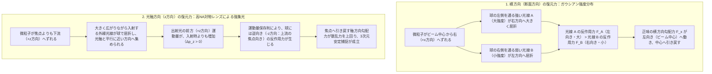
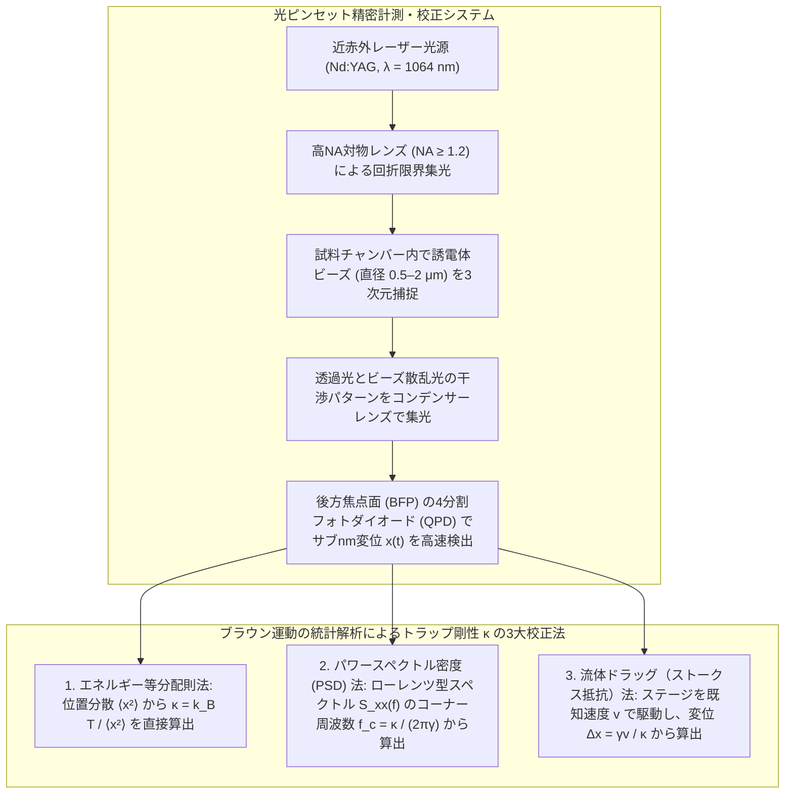

## 1. 序論：光は質量を持たないのになぜ物体を押せるのか？

私たちが日常生活で浴びている太陽光や室内の照明は、肌に温もりを感じさせることはあっても、私たちの身体を物理的に突き動かしたり、机の上のコップを持ち上げたりすることはない。そのため、直感的には「光には重さもなければ、物体を押したり引いたりする機械的な力も存在しない」と思われがちである。しかし、現代物理学の視点に立てば、光（電磁波）は明確に<strong>運動量（momentum）</strong>を運んでおり、物質と相互作用する際には必ず力積を及ぼしている。

光が物体を押す力、すなわち<strong>放射圧（radiation pressure：光圧）</strong>の存在に人類が初めて気づいたきっかけは、夜空に輝く彗星の観測であった。1619年、惑星の運動法則で知られるドイツの天文学者ヨハネス・ケプラー（Johannes Kepler）は、彗星の尾が進行方向とは無関係に、常に太陽から遠ざかる方向へと伸びている事実に着目し、「太陽から放たれる光線が彗星の物質を吹き飛ばしているのではないか」という驚くべき仮説を提唱した。

この直観が厳密な物理学の言葉で定式化されたのは、それから2世紀半後の1873年のことである。ジェームズ・クラーク・マクスウェル（James Clerk Maxwell）は、古典電磁気学を統合した『電気磁気論（A Treatise on Electricity and Magnetism）』の中で、電磁波はエネルギーだけでなく運動量をも輸送し、電磁波を吸収または反射する表面には圧力が働くことを理論的に導き出した。さらに1905年、アルベルト・アインシュタイン（Albert Einstein）が提唱した光量子仮説と特殊相対性理論によって、光の運動量は量子力学的な粒子（光子：フォトン）の性質として極めてシンプルに記述されることとなった。

質量 $m$ を持つ粒子の相対論的なエネルギー $E$ と運動量 $p$ の間には、次の普遍的な関係式が成り立つ。

$$E^2 = (pc)^2 + (m c^2)^2$$

光子（photon）は静止質量が厳密にゼロ（$m = 0$）の素粒子であるため、上式の第2項は消滅し、エネルギー $E$ と運動量 $p$ の関係は光速 $c$ を用いて次のように表される。

$$p = \frac{E}{c}$$

さらに、プランク定数 $h$ と光の振動数 $\nu$（または波長 $\lambda = c/\nu$）を用いれば、光子1個が持つエネルギーは $E = h\nu = hc/\lambda$ であるため、光子1個の運動量の大きさは次式となる。

$$p = \frac{h\nu}{c} = \frac{h}{\lambda}$$

この式が示す通り、光は質量を持たないにもかかわらず、波長 $\lambda$ に反比例する確固たる運動量を持っている。もし出力 $P$（単位時間あたりのエネルギー、単位：ワット $\text{W} = \text{J/s}$）の平行な光ビームが物体に入射し、そのすべてが吸収されたとすれば、単位時間あたりに物体へ移送される運動量、すなわち光が物体を押す力 $F_{\text{abs}}$ はニュートンの運動の第2法則（$F = dp/dt$）から直ちに求まる。

$$F_{\text{abs}} = \frac{P}{c}$$

もし物体が完全な鏡であり、光を $100\%$ 正反射する場合には、運動量の向きが逆転するため運動量変化は2倍となり、働く力 $F_{\text{ref}}$ は次のようになる。

$$F_{\text{ref}} = \frac{2P}{c}$$

では、なぜ私たちは日常で光の力を感じないのだろうか。ここに光速 $c \approx 3.0 \times 10^8\,\text{m/s}$ という巨大な分母の壁がある。たとえば、出力 $P = 1\,\text{W}$ のかなり強力なレーザーポインターの光を手のひらに当てて全吸収させたとしても、生じる力はわずか $F = 1 / (3.0 \times 10^8) \approx 3.3 \times 10^{-9}\,\text{N}$（$3.3$ ナノニュートン）に過ぎない。これは地上で質量 $0.3$ マイクログラムの砂粒1個に働く重力に相当し、人間の触覚では到底知覚できない。

しかし、対象をマクロな人間から<strong>マイクロメートル（$10^{-6}\,\text{m}$）スケールの微粒子や細胞、さらにはナノメートル（$10^{-9}\,\text{m}$）スケールの生体分子</strong>へと縮小した瞬間、世界の支配法則は劇的に逆転する。半径 $a = 1\,\mu\text{m}$ のポリスチレン球（密度 $\rho \approx 1.05\,\text{g/cm}^3$）の質量は $m = \frac{4}{3}\pi a^3 \rho \approx 4.4 \times 10^{-15}\,\text{kg}$ であり、これに働く重力は $mg \approx 4.3 \times 10^{-14}\,\text{N}$（$0.043$ ピコニュートン）しかない。このようなミクロの世界において、数ミリワットから数十ミリワットのレーザー光をレンズで回折限界（約 $1\,\mu\text{m}$）まで極限集光すれば、生じる光の力（数ピコニュートン〜数十ピコニュートン、$1\,\text{pN} = 10^{-12}\,\text{N}$）は重力を優に数桁も上回り、微粒子を自在に加速・浮揚・捕捉できる圧倒的な支配力となるのである。

しかも、光が微粒子に及ぼす力は、単に進行方向へ吹き飛ばす「押す力」だけではない。光を強く絞り込んだ焦点付近では、光の強度が最も強い中心に向かって透明な微粒子を<strong>引き寄せる力（勾配力）</strong>が立ち現れる。この原理を応用し、ただ1本のレーザービームの焦点に微粒子や生きた細胞、さらにはDNAやタンパク質1分子を非接触で3次元的に捕捉・操作する技術こそが<strong>光ピンセット（Optical Tweezers）</strong>である。

---

## 2. アーサー・アシュキンの先駆的実験と「光ピンセット」の誕生

マクスウェルの予言から約30年後の1901年、ロシアのピョートル・レベデフ（Pyotr Lebedev）や米国のニコルズとハル（Ernest Fox Nichols & Gordon Ferrie Hull）が、真空中に吊るしたねじり秤に強いアーク灯の光を当てることで、微弱な放射圧の実験的測定に初めて成功した。しかし、熱対流や残留気体分子の反跳（ラジオメーター効果）に邪魔されるため、光の力は長らく「物理学の精妙な珍奇現象」にとどまっていた。

この状況を一変させたのが、1960年のレーザー（LASER: Light Amplification by Stimulated Emission of Radiation）の発明と、ベル研究所の物理学者<strong>アーサー・アシュキン（Arthur Ashkin, 1922–2020）</strong>による一連の独創的な実験であった。

### 1970年の衝撃：なぜ微粒子はレーザーの中心へ吸い寄せられるのか

1960年代後半、アシュキンは連続発振（CW）アルゴンイオンレーザー（波長 $\lambda = 514.5\,\text{nm}$、出力数十ミリワット）を用い、水中に懸濁させた直径 $0.59 \sim 2.68\,\mu\text{m}$ の透明なラテックス（ポリスチレン）微小球に緩やかに絞ったレーザービームを照射する実験を行った。当初の目的は、光の放射圧によって微粒子がビームの進行方向へ毎秒数十マイクロメートルの速度で押し流される様子を確認することだった。

ところが、顕微鏡を覗き込んだアシュキンは、予想もしなかった奇妙な現象を目撃する。ビームの端（周辺部）を漂っていた微粒子が、光に弾き飛ばされるどころか、<strong>まるで目に見えない掃除機に吸い込まれるかのようにレーザービームの中心軸（光強度が最も強い場所）へと自ら引き寄せられ、そのままビーム軸に沿って前方へと加速されていった</strong>のである。

アシュキンは直ちに、透明な誘電体微粒子が光の強度勾配（断面方向の明るさの変化）から受ける横方向の引き込み力——今日<strong>勾配力（gradient force）</strong>と呼ばれる力——のメカニズムを幾何光学的な屈折から解き明かした。さらに彼はこの1970年の歴史的論文（*Physical Review Letters*, 24, 156）の中で、左右から対向する2本のレーザービームを同じ軸上で向かい合わせに照射すれば、進行方向へ押す力（散乱力）が互いに打ち消し合い、微粒子を3次元空間の1点に安定して閉じ込められることを実証した（対向2ビームトラップ）。翌1971年には、下から上へ向けて照射した1本のレーザービームの放射圧と下向きの重力を釣り合わせることで、空気中および真空中でガラス微小球を宙に浮遊させる「光浮揚（optical levitation）」にも成功している。

### 1986年の決定打：単一ビーム勾配力トラップ（光ピンセット）の実現

対向2ビームトラップや光浮揚は画期的であったが、2本のビームをサブミクロンの精度で完全に一致させ続ける調整は極めて難しく、また重力との釣り合いを利用する光浮揚は水中では使えなかった。アシュキンと、当時ベル研究所の同僚であったスティーヴン・チュー（Steven Chu）らが目指したのは、原子や微粒子を<strong>たった1本のレーザービームの焦点だけで3次元的に捕捉する技術</strong>であった。

1986年、アシュキン、ジエジック（J. M. Dziedzic）、ビョークホルム（J. E. Bjorkholm）、そしてチューの4名は、顕微鏡用の高開口数（High Numerical Aperture: 高NA）対物レンズを用いて1本のレーザービームを極限まで強く絞り込むことで、光の進行方向（光軸方向）においても「焦点へ引き戻す勾配力」が「前方へ押し流す散乱力」を上回り、10マイクロメートルから約25ナノメートル（レイリー領域）に至る幅広いサイズの誘電体粒子を水中で完全に3次元トラップできることを実証した（*Optics Letters*, 11, 288, 1986）。これこそが<strong>単一ビーム勾配力光トラップ（Single-beam gradient force optical trap）</strong>、すなわち<strong>光ピンセット（Optical Tweezers）</strong>の誕生である。

翌1987年、アシュキンは可視光のアルゴンレーザーの代わりに、水や生体組織による吸収が極めて少ない近赤外領域のNd:YAGレーザー（波長 $\lambda = 1064\,\text{nm}$）を光源に採用した。これにより、タバコモザイクウイルスや大腸菌（*Escherichia coli*）、さらには酵母菌を<strong>熱損傷で殺すことなく生きたまま捕捉し、光ピンセットの中で細胞分裂させる</strong>ことに成功した。機械的な針やピペットを一切触れさせずに、細胞内部の小器官や生体分子を直接つまみ上げて操作する道が開かれた瞬間であった。この功績により、アシュキンは96歳を迎えた2018年、ノーベル物理学賞を受賞した。

---

## 3. 幾何光学レジーム（ミー散乱領域 $a \gg \lambda$）における捕捉の力学

なぜ1本の強く絞られたレーザービームの焦点に、透明な微粒子が吸い寄せられて捕捉されるのだろうか。光の波長 $\lambda$ と微粒子の半径 $a$ の大小関係によって、物理的な記述は大きく2つのレジーム（領域）に分かれる。

1. <strong>幾何光学レジーム（ミー散乱領域 / Mie regime, $a \gg \lambda$）</strong>：粒子の直径が光の波長よりも十分に大きい場合（例：波長 $\lambda \approx 1\,\mu\text{m}$ のレーザーに対して直径 $5 \sim 20\,\mu\text{m}$ の球や細胞）。光は直進・屈折・反射する「光線（ray）」の束として扱うことができる。
2. <strong>レイリー散乱レジーム（双極子近似領域 / Rayleigh regime, $a \ll \lambda$）</strong>：粒子の直径が光の波長よりも十分に小さい場合（例：直径数十ナノメートルの金ナノ粒子、ウイルス、タンパク質複合体）。粒子は振動電場の中に置かれた「微小な電気双極子（point dipole）」として振る舞う。

なお、生物物理学の実験で最も頻繁に用いられる直径 $0.5 \sim 2\,\mu\text{m}$ のビーズは、ちょうど $a \approx \lambda$ の中間領域（ローレンツ・ミー散乱領域 / Lorenz-Mie regime）に位置するが、そこに働く本質的な物理メカニズムは、幾何光学と双極子近似の双方から極めて明快に理解することができる。まずは直観的に理解しやすい幾何光学レジームから見ていこう。

### 光線の屈折と運動量保存則による反作用力

周囲の媒質（たとえば水、屈折率 $n_m \approx 1.33$）の中に、それよりも屈折率が高い透明な誘電体球（たとえばポリスチレン $n_p \approx 1.59$ やシリカガラス $n_p \approx 1.46$、すなわち相対屈折率 $n = n_p / n_m > 1$）が置かれているとする。球の吸収は無視でき、表面でのフレネル反射は透過光に比べて小さいと仮定しよう。

光子1個（あるいは光線1本）が球に入射し、球の入口と出口の界面でスネルの法則（$n_m \sin\theta_i = n_p \sin\theta_r$）に従って2回屈折して球から出ていく過程を考える。光の進行方向が角度 $\theta$ だけ曲げられたとすると、光線の運動量ベクトルは入射前の $\mathbf{p}_{\text{in}}$ から出射後の $\mathbf{p}_{\text{out}}$ へと変化する。光の波長や媒質の屈折率が変わらないため、入射光と出射光の運動量の大きさ $|\mathbf{p}_{\text{in}}| = |\mathbf{p}_{\text{out}}|$ は等しいが、<strong>向きが変わるため、光は運動量変化 $\Delta \mathbf{p} = \mathbf{p}_{\text{out}} - \mathbf{p}_{\text{in}}$ を受け取る</strong>。

孤立系における運動量保存則（あるいはニュートンの作用・反作用の第3法則）により、光線の運動量を $\Delta \mathbf{p}$ だけ変化させた原因は誘電体球にあるため、誘電体球は光から逆向きで同じ大きさの反作用力 $\mathbf{F}_{\text{ray}}$ を受ける。

$$\mathbf{F}_{\text{ray}} = -\frac{d\mathbf{p}_{\text{light}}}{dt} = -\frac{\Delta \mathbf{p}}{\Delta t}$$

すなわち、<strong>「光線を曲げた物体は、光線を曲げた方向とは逆向きに引き戻される」</strong>というのが幾何光学における光ピンセットの第一原理である。

### 横方向（断面方向）の捕捉メカニズム

まず、レーザービームが紙面の下から上（$+z$ 方向）に向かって進んでおり、その断面強度分布が中心で最も明るく周辺に向かって減衰するガウシアン分布（$\text{TEM}_{00}$ モード）を持っているとしよう。

$$I(r) = I_0 \exp\left(-\frac{2r^2}{w_0^2}\right)$$

ここで、誘電体球の中心がビームの中心軸（$x = 0$）から少しだけ右側（$+x$ 方向）にずれた位置にある場合を考える。
球の左半分を通過する光線 $\text{A}$ はビームの中心近くを通るため<strong>光強度が非常に強い</strong>（単位時間あたりの光子数が多い）。この光線 $\text{A}$ は屈折率の高い球によって球の中心側、すなわち右斜め上方向へと屈折して出射する。光線 $\text{A}$ が右向きの運動量を得た結果、その反作用として球は<strong>左向き（$-x$ 方向、すなわちビーム中心向き）かつ上向き（$+z$ 方向）の大きな力 $\mathbf{F}_A$</strong> を受ける。

一方、球の右半分を通過する光線 $\text{B}$ はビームの裾野を通るため<strong>光強度が弱い</strong>。光線 $\text{B}$ は左斜め上方向へ屈折し、その反作用として球に右向き（$+x$ 方向）の力 $\mathbf{F}_B$ を与える。しかし、光線 $\text{A}$ の方が光線 $\text{B}$ よりも圧倒的に強いため（$|\mathbf{F}_A| \gg |\mathbf{F}_B|$）、左右の力を合成した正味の横方向の力は必ず左向き（$-x$ 方向）、すなわち<strong>最も光が強いビーム中心軸へと球を引き戻す復元力</strong>となる。球が左にずれた場合も全く同様に対称な議論が成り立ち、球は常にビームの中心軸上（$x = y = 0$）に安定して閉じ込められる。

### 光軸方向（$z$ 方向）の捕捉メカニズムと高開口数レンズの役割

では、光の進行方向である $z$ 軸方向についてはどうだろうか。もしレーザービームが平行光（または緩やかにしか絞られていない光）であれば、光線 $\text{A}$ も光線 $\text{B}$ も屈折によって進行方向が横へ曲げられるため、出射光の $+z$ 方向の運動量成分は入射時よりも必ず減少する（$\Delta p_z < 0$）。その結果、球が受ける反作用力の $z$ 成分は常に上向き（$+z$ 方向）となり、球はビームの下流へと際限なく押し流されてしまう。

ところが、高開口数（高NA）の対物レンズを使ってレーザービームを大きな収束角 $\theta_{\max}$ で焦点 $O$ に向かって急激に絞り込むと、劇的な逆転が起こる。
いま、誘電体球の中心が焦点 $O$ よりも少しだけ下流側（$+z$ 方向）にずれた位置にあるとしよう。焦点を通過して大きく広がりながら（大きな角度 $\theta$ を持って）球に入射した外縁部の光線は、凸レンズとして働く誘電体球によって内側へと強く屈折され、光軸（$z$ 軸）に対してより平行に近い小さな角度で出射していく。

このとき、入射光線と出射光線の運動量の大きさ $p$ は同じであるが、出射光線の方が $z$ 軸に対する傾き角が小さくなるため、<strong>光線の $z$ 方向運動量成分 $p_z = p \cos\theta$ は入射前よりも出射後の方が大きくなる（$\Delta p_z > 0$）</strong>。光が前方（$+z$ 方向）へ余分な運動量を受け取ったということは、その反作用として、誘電体球には<strong>逆向き、すなわち上流の焦点 $O$ に向かって引き戻す力（$-z$ 方向の力）</strong>が働くことを意味する！

逆に、球が焦点 $O$ よりも上流側（$-z$ 方向）にずれた場合には、集束しつつある光線が球によってさらに強く曲げられてより急な角度で出射するため、光の $+z$ 方向運動量が減少し（$\Delta p_z < 0$）、球は下流の焦点 $O$ に向かって（$+z$ 方向へ）押し戻される。

実際の軸方向のつり合い位置（トラップ中心）は、界面でのわずかな反射光が及ぼす下流向きの散乱力と、屈折光が引き起こす上流向きの勾配力が完全に釣り合う点となるため、幾何学的な焦点 $O$ よりもわずかに下流側（$+z$ 側）に形成される。ここで重要なのは、もし球の屈折率が周囲の媒質よりも低い場合（$n_p < n_m$、たとえば水中の気泡）には、スネルの法則による屈折の向きがすべて逆転するため、気泡はビームの最も明るい中心から外へと<strong>弾き出される</strong>という点である。通常のガウシアンビームによる光ピンセットが捕捉できるのは、周囲の媒質よりも屈折率が高い（$n_p > n_m$）粒子に限られる理由がここにある。

---

## 4. 電磁気学・双極子近似レジーム（レイリー散乱領域 $a \ll \lambda$）における散乱力と勾配力

次に、捕捉対象の粒子サイズ $a$ が光の波長 $\lambda$ よりも十分に小さい<strong>レイリー散乱レジーム（$a \ll \lambda$）</strong>を電磁気学的に厳密に導出しよう。この領域では、粒子全体がほぼ一様な空間電場を感じるとみなせるため、粒子を電場 $\mathbf{E}(\mathbf{r}, t)$ によって分極した<strong>点双極子（point dipole）</strong>として扱うことができる。

### クラウジウス・モソッティ関係式と誘導双極子モーメント

屈折率 $n_m$（誘電率 $\varepsilon_m = n_m^2 \varepsilon_0$）の媒質中に、半径 $a$、屈折率 $n_p$（誘電率 $\varepsilon_p = n_p^2 \varepsilon_0$）の球状誘電体ナノ粒子が置かれているとする。ここに外部からレーザー光の電場 $\mathbf{E}(\mathbf{r}, t)$ が印加されると、粒子内部の電子雲が変位し、電場に比例する誘導双極子モーメント $\mathbf{p}(\mathbf{r}, t)$ が誘起される。

$$\mathbf{p}(\mathbf{r}, t) = \alpha \mathbf{E}(\mathbf{r}, t)$$

ここで比例係数 $\alpha$ は粒子の<strong>分極率（polarizability）</strong>であり、静電場近似における球の境界値問題を解くことで得られる<strong>クラウジウス・モソッティ（Clausius-Mossotti）の関係式</strong>から次のように与えられる。

$$\alpha = 4\pi \varepsilon_m a^3 \left( \frac{m^2 - 1}{m^2 + 2} \right) = 4\pi n_m^2 \varepsilon_0 a^3 \left( \frac{m^2 - 1}{m^2 + 2} \right)$$

ただし、$m \equiv n_p / n_m$ は媒質に対する粒子の相対屈折率である。この式から明らかなように、分極率 $\alpha$ は粒子の体積 $V = \frac{4}{3}\pi a^3$（すなわち半径の3乗 $a^3$）に比例し、粒子の方が媒質より屈折率が高いとき（$m > 1$）に正の値（$\alpha > 0$）をとる。

### ローレンツ力からの勾配力と散乱力の導出

不均一な電磁場 $(\mathbf{E}, \mathbf{B})$ の中に置かれた微小双極子 $\mathbf{p}$ が受ける瞬時的なローレンツ力 $\mathbf{F}$ は、正電荷 $+q$ と負電荷 $-q$（変位ベクトル $\mathbf{d}$、$\mathbf{p} = q\mathbf{d}$）に働くクーロン力と磁場からの力をテイラー展開の1次まで取ることで、次式で表される。

$$\mathbf{F}(\mathbf{r}, t) = (\mathbf{p} \cdot \nabla)\mathbf{E} + \frac{d\mathbf{p}}{dt} \times \mathbf{B}$$

ここに $\mathbf{p} = \alpha \mathbf{E}$ を代入し、ベクトル解析の恒等式

$$(\mathbf{E} \cdot \nabla)\mathbf{E} = \frac{1}{2}\nabla(\mathbf{E}\cdot\mathbf{E}) - \mathbf{E} \times (\nabla \times \mathbf{E})$$

およびマクスウェル方程式（ファラデーの電磁誘導の法則 $\nabla \times \mathbf{E} = -\frac{\partial \mathbf{B}}{\partial t}$）を適用して整理すると、双極子に働く力は次のように変形される。

$$\mathbf{F}(\mathbf{r}, t) = \alpha \left[ \frac{1}{2}\nabla |\mathbf{E}(\mathbf{r}, t)|^2 + \frac{\partial}{\partial t}\left(\mathbf{E}(\mathbf{r}, t) \times \mathbf{B}(\mathbf{r}, t)\right) \right]$$

光の振動数 $\nu$ は数百テラヘルツ（$\sim 10^{14}\,\text{Hz}$）と極めて高速であるため、質量を持つ粒子が実際に応答するのは、光の1周期にわたって時間平均（$\langle \cdots \rangle$）をとった力である。定常的な単色レーザービームにおいて、第1項の電場2乗の時間平均は $\langle |\mathbf{E}(\mathbf{r}, t)|^2 \rangle = \frac{1}{2}|\mathbf{E}_0(\mathbf{r})|^2$ となり、光の局所強度（放射照度）$I(\mathbf{r}) = \frac{1}{2} c n_m \varepsilon_0 |\mathbf{E}_0(\mathbf{r})|^2$ に直結する。この第1項から生じる保存力こそが<strong>勾配力（Gradient Force）$\mathbf{F}_{\text{grad}}$</strong>である。

$$\mathbf{F}_{\text{grad}}(\mathbf{r}) = \frac{1}{4}\alpha \nabla |\mathbf{E}_0(\mathbf{r})|^2 = \frac{\alpha}{2 c n_m \varepsilon_0} \nabla I(\mathbf{r})$$

クラウジウス・モソッティの式を代入して具体的に書き下せば、勾配力は次のようになる。

$$\mathbf{F}_{\text{grad}}(\mathbf{r}) = \frac{2\pi n_m a^3}{c} \left( \frac{m^2 - 1}{m^2 + 2} \right) \nabla I(\mathbf{r})$$

この方程式は、光ピンセットの本質を余すところなく語っている。
第一に、$\mathbf{F}_{\text{grad}}$ は光強度の空間勾配 $\nabla I(\mathbf{r})$ に比例する。$m > 1$（すなわち $n_p > n_m$）であれば係数は正となり、粒子には<strong>光強度 $I(\mathbf{r})$ が最も高い場所（レーザーの焦点中心）へ向かう引力</strong>が働く。
第二に、勾配力はポテンシャルエネルギー $U(\mathbf{r}) = -\frac{1}{4}\alpha |\mathbf{E}_0(\mathbf{r})|^2 \propto -I(\mathbf{r})$ の負の勾配（$\mathbf{F}_{\text{grad}} = -\nabla U(\mathbf{r})$）として書ける<strong>保存力</strong>である。すなわち、レーザーの焦点は誘電体粒子にとって3次元的な「光のポテンシャルの井戸（Optical Potential Well）」を形成している。

では、もう一方の<strong>散乱力（Scattering Force）$\mathbf{F}_{\text{scat}}$</strong>はどこから現れるのか。実は、振動する双極子 $\mathbf{p}(t)$ はそれ自身がアンテナとなって周囲へ電磁波を再放射（レイリー散乱）するため、放射減衰（radiation reaction）に伴って実効的な複素分極率 $\alpha_{\text{eff}} = \alpha / \left(1 - i \frac{k^3 \alpha}{6\pi\varepsilon_m}\right)$ の虚部が生じる（またはポインティング・ベクトル $\mathbf{S} = \frac{1}{\mu_0}\mathbf{E}\times\mathbf{B}$ によるエネルギー・運動量の散乱流束を考える）。粒子が入射光から単位時間あたりに散乱するパワーは、レイリー散乱断面積 $\sigma_{\text{scat}}$ と光強度 $I(\mathbf{r})$ の積 $\sigma_{\text{scat}} I(\mathbf{r})$ であり、レイリー散乱の角度分布は前後対称であるため、散乱光が持ち去る正味の運動量はゼロとなる。したがって、入射光から奪われた運動量がそのまま光の進行方向（単位ベクトル $\hat{\mathbf{z}}$）へ粒子を押す散乱力 $\mathbf{F}_{\text{scat}}$ となる。

$$\mathbf{F}_{\text{scat}}(\mathbf{r}) = \frac{n_m \sigma_{\text{scat}}}{c} I(\mathbf{r}) \hat{\mathbf{z}}$$

ここで、球状レイリー粒子の散乱断面積 $\sigma_{\text{scat}}$ は波数 $k = 2\pi n_m / \lambda_0$（$\lambda_0$ は真空中の波長）を用いて次式で与えられる。

$$\sigma_{\text{scat}} = \frac{8\pi}{3} k^4 a^6 \left( \frac{m^2 - 1}{m^2 + 2} \right)^2 = \frac{128 \pi^5 n_m^4 a^6}{3 \lambda_0^4} \left( \frac{m^2 - 1}{m^2 + 2} \right)^2$$

したがって、散乱力の具体的な表式は次のようになる。

$$\mathbf{F}_{\text{scat}}(\mathbf{r}) = \frac{128 \pi^5 n_m^5 a^6}{3 c \lambda_0^4} \left( \frac{m^2 - 1}{m^2 + 2} \right)^2 I(\mathbf{r}) \hat{\mathbf{z}}$$

### 3次元安定捕捉の絶対条件とサイズスケーリング則（$a^3$ 対 $a^6$）

導出した2つの力、勾配力 $\mathbf{F}_{\text{grad}}$ と散乱力 $\mathbf{F}_{\text{scat}}$ を並べて比較すると、光ピンセットを設計する上で極めて重要な物理的トレードオフが浮かび上がる。

| 物理特性 | 勾配力（Gradient Force, $\mathbf{F}_{\text{grad}}$） | 散乱力（Scattering Force, $\mathbf{F}_{\text{scat}}$） |
| :--- | :--- | :--- |
| <strong>物理的起源</strong> | 不均一電場中での誘導双極子のポテンシャルエネルギー低下（屈折による運動量変化） | 入射光子の吸収・等方的再放射（レイリー散乱）および界面反射に伴う運動量移送 |
| <strong>力の向き</strong> | 光強度勾配 $\nabla I(\mathbf{r})$ の方向（$n_p > n_m$ なら焦点中心へ向かう3次元引力） | 光の伝播方向 $\hat{\mathbf{z}}$（ポインティング・ベクトルに沿った下流への押し流し力） |
| <strong>光強度への依存性</strong> | 強度の<strong>空間微分（勾配）</strong> $\nabla I(\mathbf{r})$ に比例 | 局所的な<strong>光強度そのもの</strong> $I(\mathbf{r})$ に比例 |
| <strong>粒子半径 $a$ への依存性（$a \ll \lambda$）</strong> | <strong>体積に比例（$\propto a^3$）</strong> | <strong>体積の2乗に比例（$\propto a^6$）</strong> |
| <strong>波長 $\lambda_0$ への依存性（$a \ll \lambda$）</strong> | 分散を除けば波長にほぼ非依存（焦点サイズ経由で依存） | <strong>波長のマイナス4乗に比例（$\propto \lambda_0^{-4}$）</strong> |
| <strong>相対屈折率 $m = n_p/n_m$ への依存性</strong> | $\left(\frac{m^2-1}{m^2+2}\right)$ の1乗に比例（符号反転あり） | $\left(\frac{m^2-1}{m^2+2}\right)^2$ の2乗に比例（常に正） |

粒子がレーザーの焦点付近から下流へ吹き飛ばされずに3次元的に安定捕捉されるための必要十分条件は、焦点のすぐ下流側における<strong>光軸方向の後ろ向き勾配力 $|\mathbf{F}_{\text{grad}, z}|$ が、前向きの散乱力 $|\mathbf{F}_{\text{scat}, z}|$ を上回ること</strong>である。

$$\frac{|\mathbf{F}_{\text{grad}, z}|}{|\mathbf{F}_{\text{scat}, z}|} > 1$$

ビームウエスト半径を $w_0$ としたガウシアンビームでは、軸方向の強度勾配が最大となる位置（レイリー長 $z_R = \pi n_m w_0^2 / \lambda_0$ の付近）において $|\nabla_z I| / I \sim 1 / z_R \propto \lambda_0 / w_0^2$ となる。ビームウエスト $w_0$ は対物レンズの<strong>開口数（Numerical Aperture: $\text{NA} = n_m \sin\theta_{\max}$）</strong>に反比例する（$w_0 \sim \lambda_0 / (\pi \text{NA})$）ため、軸方向の勾配 $|\nabla_z I|$ は $\text{NA}^2$（集光スポット面積と合わせれば全体として $\text{NA}^3 \sim \text{NA}^4$）で急激に増大する。

このため、通常の低NAレンズで緩く絞った光では $|\mathbf{F}_{\text{grad}, z}| < |\mathbf{F}_{\text{scat}, z}|$ となって粒子は前方に吹き飛ばされてしまうが、<strong>水浸または油浸の高開口数対物レンズ（$\text{NA} = 1.2 \sim 1.49$）</strong>を用いて光を回折限界まで極限集光すると、焦点前後の光軸方向強度勾配 $\partial I / \partial z$ が劇的に急峻になり、ついに $|\mathbf{F}_{\text{grad}, z}| > |\mathbf{F}_{\text{scat}, z}|$ が達成されるのである。

また、粒子半径 $a$ に対するスケーリングにも注目してほしい。粒子が大きくなると、散乱力（$\propto a^6$）は勾配力（$\propto a^3$）よりもはるかに速く増大するため、屈折率が非常に高い大きな粒子（たとえば高屈折率の酸化チタン $\text{TiO}_2$ 粒子など）は散乱力が強すぎて捕捉が難しくなることがある。逆に、粒子が極端に小さくなると（たとえば直径 $10\,\text{nm}$ 以下の生体分子）、散乱力は事実上ゼロ（$a^6 \to 0$）になって吹き飛ばされる心配はなくなるものの、勾配力自体も体積 $a^3$ に比例して急減してしまう。

室温（$T \approx 300\,\text{K}$）の水中では、あらゆる粒子が周囲の水分子の熱運動によって激しく衝突され、エネルギー $k_B T \approx 4.14 \times 10^{-21}\,\text{J}$（$= 4.14\,\text{pN}\cdot\text{nm}$）のブラウン運動を行っている。ナノ粒子をポテンシャル井戸から逃がさずに長時間安定捕捉するためには、ポテンシャル井戸の深さ $|U_{\min}|$ が熱エネルギー $k_B T$ の少なくとも10倍以上（ボルツマン因子 $\exp(-|U_{\min}|/k_B T) \ll 1$）でなければならない。

$$|U_{\min}| = \frac{2\pi n_m a^3}{c} \left( \frac{m^2 - 1}{m^2 + 2} \right) I_{\max} \gtrsim 10 k_B T$$

半径 $a$ が $1/10$ になると、体積 $a^3$ は $1/1000$ に減るため、同じポテンシャル深さを維持するにはレーザー強度 $I_{\max}$ を1000倍に高めなければならず、試料の沸騰や光破壊を招いてしまう。これが、直径数ナノメートルのタンパク質1分子を直接レーザーでつまむ代わりに、直径 $0.5 \sim 2\,\mu\text{m}$ のポリスチレンやシリカの微小球（ビーズ）を「取っ手（ハンドル）」としてタンパク質やDNAに結合させて操作する理由である。

---

## 5. 熱揺らぎとの闘い：ブラウン運動・ランジュバン方程式とピコニュートン力の精密計測

光ピンセットの真の威力は、単に微粒子をつかんで動かすことにあるのではない。光ピンセットは、<strong>サブピコニュートン（$0.1\,\text{pN} = 10^{-13}\,\text{N}$）の微小な力と、サブナノメートル（$0.1\,\text{nm} = 10^{-10}\,\text{m}$）の微小な変位を同時にリアルタイムで測定できる超高感度な「光のばねばかり（フォース・トランスデューサー）」</strong>として機能するのである。

### 調和ポテンシャル近似とフックの法則

レーザー焦点の中心（平衡位置 $x = 0$）の近傍では、ガウシアン強度分布が作る光のポテンシャル井戸 $U(x)$ を $x = 0$ の周りでテイラー展開すると、1次の項が消えて2次の<strong>調和ポテンシャル（harmonic potential）</strong>で極めて精度よく近似できる。

$$U(x) \approx U_0 + \frac{1}{2} \kappa_x x^2$$

したがって、捕捉されたビーズがトラップ中心から微小変位 $\Delta x$ だけ引き離されたときに光ピンセットがビーズを引き戻す復元力 $F_{\text{trap}}$ は、線形な<strong>フックの法則（Hooke's law）</strong>に従う。

$$F_{\text{trap}} = -\frac{dU(x)}{dx} = -\kappa_x \Delta x$$

ここで比例定数 $\kappa_x$（単位：$\text{pN/nm}$ または $\text{N/m} = \text{mN/m}$）は<strong>トラップ剛性（trap stiffness：光ピンセットのばね定数）</strong>と呼ばれる。一般的な生物物理実験では、レーザー出力（数十〜数百 $\text{mW}$）を調節することで、トラップ剛性 $\kappa_x$ を $\kappa_x \approx 0.01 \sim 1.0\,\text{pN/nm}$ の範囲で自在に設定できる。もし $\kappa_x = 0.1\,\text{pN/nm}$ に校正された光ピンセットの中で、分子モーターがビーズを $\Delta x = 50\,\text{nm}$ 引っ張ったとすれば、その瞬間に分子モーターが発生している力は $F = \kappa_x \Delta x = 0.1 \times 50 = 5.0\,\text{pN}$ であると直ちに算出できるのである。

### 過減衰ランジュバン方程式（Overdamped Langevin Equation）

では、目に見えない「光のばね」のばね定数 $\kappa_x$ を、どうやって正確に測定（キャリブレーション）するのだろうか。ここで主役となるのが、かつては単なるノイズと思われていた<strong>水分子の熱運動（ブラウン運動）</strong>そのものである。

水中に捕捉された質量 $m$、半径 $a$ の微小球の1次元運動方程式（<strong>ランジュバン方程式</strong>）を書き下してみよう。微小球には、(1) 流体からの粘性抵抗力 $-\gamma \dot{x}(t)$、(2) 光ピンセットによる調和復元力 $-\kappa x(t)$、そして (3) 周囲の水分子の不規則な衝突による熱揺動カ（ホワイトノイズ）$F_{\text{thermal}}(t) = \sqrt{2\gamma k_B T}\eta(t)$ の3つの力が働く。

$$m \ddot{x}(t) + \gamma \dot{x}(t) + \kappa x(t) = \sqrt{2\gamma k_B T}\,\eta(t)$$

ここで、$\gamma$ は<strong>ストークスの粘性抵抗係数（Stokes drag coefficient）</strong>であり、水の粘性率を $\eta_{\text{vis}}$（室温の純水で $\eta_{\text{vis}} \approx 0.89 \times 10^{-3}\,\text{Pa}\cdot\text{s}$）とすると次式で与えられる。

$$\gamma = 6\pi \eta_{\text{vis}} a$$

また、$k_B \approx 1.38 \times 10^{-23}\,\text{J/K}$ はボルツマン定数、$T$ は絶対温度であり、$\eta(t)$ は平均 $\langle \eta(t) \rangle = 0$、自己相関関数がディラックのデルタ関数 $\langle \eta(t)\eta(t') \rangle = \delta(t - t')$ を満たす無次元のガウス型白色雑音（揺動散逸定理に基づく表記）である。

ここでミクロな流体力学の重要な特徴である<strong>低レイノルズ数（Low Reynolds Number, $\text{Re} \ll 1$）の世界</strong>を考えよう。半径 $a = 0.5\,\mu\text{m}$ のビーズにおいて、慣性項 $m\ddot{x}$ が粘性減衰項 $\gamma\dot{x}$ に対して緩和する特徴的緩和時間 $\tau_{\text{inertia}} = m / \gamma$ を計算すると、$\tau_{\text{inertia}} \approx 5 \times 10^{-8}\,\text{s}$（$50$ ナノ秒）程度にしかならない。通常の計測時間スケール（マイクロ秒〜ミリ秒以上）においては慣性項 $m\ddot{x}(t)$ は完全に無視でき、運動方程式は以下の<strong>過減衰ランジュバン方程式（Overdamped Langevin Equation）</strong>へと帰着する。

$$\gamma \frac{dx(t)}{dt} + \kappa x(t) = \sqrt{2\gamma k_B T}\,\eta(t)$$

### トラップ剛性 $\kappa$ の3大キャリブレーション手法

この過減衰ランジュバン方程式と統計力学の原理から、光ピンセットのばね定数 $\kappa$ を実験的に決定する3つの独立した校正法が導かれる。

#### 1. エネルギー等分配則（Equipartition Theorem）による方法
熱平衡状態にある古典統計力学系において、2次の調和ポテンシャル自由度1つあたりが持つ平均ポテンシャルエネルギーは、粒子の質量や流体の粘性率 $\gamma$ に一切よらず、常に $\frac{1}{2}k_B T$ に等しい。

$$\frac{1}{2} \kappa \langle x^2 \rangle = \frac{1}{2} k_B T \quad \Longrightarrow \quad \kappa = \frac{k_B T}{\langle x^2 \rangle}$$

ここで $\langle x^2 \rangle$ は、外力を加えていない状態でトラップ内で熱揺らぎしているビーズの位置時系列データ $x(t)$ の<strong>分散（平均二乗変位）</strong>である。たとえば室温（$k_B T \approx 4.14\,\text{pN}\cdot\text{nm}$）において、ビーズの揺らぎの標準偏差が $\sqrt{\langle x^2 \rangle} = 6.4\,\text{nm}$（分散 $\langle x^2 \rangle \approx 41.4\,\text{nm}^2$）であったとすれば、そのトラップ剛性は $\kappa = 4.14 / 41.4 = 0.10\,\text{pN/nm}$ と即座に決定できる。この手法は流体の粘性率 $\eta_{\text{vis}}$ やビーズ半径 $a$ の値を知る必要がないという大きな利点がある一方、検出器の電圧信号 $V(t)$ を実空間の距離 $x(t)$ に変換する感度係数 $\beta$（単位：$\text{nm/V}$）が事前に正確に求まっている必要があり、また低周波の機械的ドリフトノイズが分散 $\langle x^2 \rangle$ を過大評価させやすいという注意点がある。

#### 2. パワースペクトル密度（Power Spectral Density: PSD）解析による方法
ドリフトの影響を排除し、最も信頼性が高い標準手法として世界中の研究室で用いられているのが、位置時系列 $x(t)$ をフーリエ変換して周波数領域で解析する<strong>パワースペクトル密度（PSD）法</strong>である。
過減衰ランジュバン方程式の両辺をフーリエ変換（$\tilde{x}(f) = \int x(t) e^{-i 2\pi f t} dt$）すると、次式を得る。

$$\gamma (i 2\pi f) \tilde{x}(f) + \kappa \tilde{x}(f) = \sqrt{2\gamma k_B T}\,\tilde{\eta}(f)$$

ホワイトノイズの片側パワースペクトル密度は $|\tilde{\eta}(f)|^2 = 2$（周波数 $f \ge 0$ の片側定義）であるため、ビーズの位置揺らぎの片側パワースペクトル密度 $S_{xx}(f)$ は厳密に次の<strong>ローレンツ関数（Lorentzian function）</strong>となる。

$$S_{xx}(f) = \frac{k_B T}{\pi^2 \gamma \left( f_c^2 + f^2 \right)}$$

ここで $f_c$ は<strong>コーナー周波数（corner frequency：ロールオフ周波数）</strong>と呼ばれ、トラップ剛性 $\kappa$ と粘性抵抗係数 $\gamma$ の比で決まる特徴周波数である。

$$f_c = \frac{\kappa}{2\pi \gamma}$$

両対数グラフ（$\log f$ 対 $\log S_{xx}(f)$）にパワースペクトルをプロットすると、コーナー周波数よりも低い周波数領域（$f \ll f_c$）では、光ピンセットの復元力が支配的となって粒子がポテンシャル井戸の中に閉じ込められるため、スペクトルは一定の平坦なプラトー値 $S_{xx}(0) = \frac{4\gamma k_B T}{\kappa^2}$ を示す。一方、コーナー周波数よりも高い周波数領域（$f \gg f_c$）では、極短時間のスケールとなり粒子がまだトラップの壁を感じる前に自由なブラウン運動（自由拡散）を行うため、スペクトルは $S_{xx}(f) \propto f^{-2}$（傾き $-2$ の直線）に従って減衰する。

このローレンツ曲線で実験データをフィッティングすれば、折れ曲がり点であるコーナー周波数 $f_c$ から直ちにトラップ剛性 $\kappa = 2\pi \gamma f_c$ を決定でき、さらに高周波漸近線の高さから検出器の変位感度係数 $\beta$（$\text{nm/V}$）までも同時に独立して校正することができる。

#### 3. 流体ドラッグ（ストークス粘性抵抗）法
ピエゾステージを速度 $v$ で周期的（三角波または正弦波）に駆動し、静止したトラップ内のビーズに対して周囲の流体を既知の速度 $v$ で流す方法である。このときビーズが受ける流体力学的なストークス抵抗力 $F_{\text{drag}} = \gamma v = 6\pi \eta_{\text{vis}} a v$ と光ピンセットの復元力 $\kappa \Delta x$ が釣り合うため、ビーズの平均変位 $\Delta x$ を測ることで $\kappa = \gamma v / \Delta x$ が求まる。特にガラス基板表面の近く（高さ $h$）で実験を行う場合は、壁面による流体力学的境界効果を取り入れた<strong>ファクセンの法則（Faxén's law）</strong>によって粘性抵抗係数 $\gamma(h)$ を補正する。

$$\gamma(h) = \frac{6\pi \eta_{\text{vis}} a}{1 - \frac{9}{16}\left(\frac{a}{h}\right) + \frac{1}{8}\left(\frac{a}{h}\right)^3 - \frac{45}{256}\left(\frac{a}{h}\right)^4 - \frac{1}{16}\left(\frac{a}{h}\right)^5}$$

| 校正手法 | 基本原理・数式 | 必要な既知パラメータ | 長所と短所 |
| :--- | :--- | :--- | :--- |
| <strong>エネルギー等分配則法</strong> | $\frac{1}{2}\kappa \langle x^2 \rangle = \frac{1}{2}k_B T$ | 絶対温度 $T$、検出器感度 $\beta$ | 粘性率 $\eta_{\text{vis}}$ や粒子半径 $a$・壁面距離 $h$ に依存しない。低周波ドリフトや検出器帯域制限の影響を受けやすい。 |
| <strong>パワースペクトル密度（PSD）法</strong> | $S_{xx}(f) = \frac{k_B T}{\pi^2 \gamma (f_c^2 + f^2)}$, $f_c = \frac{\kappa}{2\pi\gamma}$ | 温度 $T$、粘性抵抗係数 $\gamma$（または併用校正） | 低周波ノイズを分離でき精度が極めて高い。フィッティングからトラップ剛性 $\kappa$ と検出感度 $\beta$ を同時決定可能。 |
| <strong>流体ドラッグ（ストークス抵抗）法</strong> | $\kappa \Delta x = \gamma(h) v$ | 流体速度 $v$、粘性抵抗係数 $\gamma(h)$、感度 $\beta$ | 大変位領域での線形性（フックの法則が成り立つ範囲）を直接検証できる。ピエゾステージの精密駆動が必要。 |

なお、ビーズのサブナノメートル変位 $\Delta x(t)$ を毎秒数万〜数十万回（数十 $\text{kHz}$〜$\text{MHz}$）という超高速で検出するためには、通常のカメラ撮像ではなく<strong>後方焦点面干渉法（Back-Focal-Plane Interferometry）</strong>が用いられる。トラップを通過した直接透過光とビーズによって前方散乱された光がコンデンサーレンズの後方焦点面（BFP）で作る干渉パターンを、<strong>4分割フォトダイオード（Quadrant Photodiode: QPD）</strong>で受光する。左右・上下のフォトダイオードの差動出力電流を計算することで、オングストローム（$0.1\,\text{nm}$）レベルの空間分解能とマイクロ秒の時間分解能が同時に実現されるのである。

---

## 6. 単一分子生物物理学の革命：DNAの弾性と分子モーターのステップ計測

1990年代に入ると、光ピンセットは生物学・生物物理学のあり方を根底から変革した。それまでの生化学実験（バルク測定）は、試験管の中に数兆個（$10^{12}$ 個以上）のタンパク質やDNA分子を混ぜ合わせ、その集団全体の「アンサンブル平均」を観察するしかなかった。それはいわば、スタジアム全体の歓声の音量だけから、観客一人ひとりが何を喋っているかを推測するようなものだった。

これに対し、光ピンセットは<strong>「たった1個の生体分子（Single Molecule）」</strong>の両端や片端をつまみ上げ、その分子が力を発生し、構造を変え、化学反応を進める瞬間を1ステップずつリアルタイムで追跡することを可能にしたのである。

### 近赤外レーザーによる「光学の窓」と生体分子ハンドル技術

生体分子の計測において決定的に重要なのがレーザー波長の選択である。可視光（$400 \sim 700\,\text{nm}$）は細胞内のヘモグロビンやフラビン、シトクロムなどの色素に強く吸収されて光化学的損傷（光毒性）を引き起こし、他方、波長 $1200\,\text{nm}$ 以上の赤外光は水（$\text{H}_2\text{O}$）の振動吸収バンドにかかって試料の局所加熱（沸騰）を引き起こす。
その中間に位置する<strong>波長 $800 \sim 1100\,\text{nm}$ の近赤外領域（特に波長 $\lambda = 1064\,\text{nm}$ のNd:YAGレーザーやNd:YVO$_4$レーザー）</strong>は、生体色素の吸収も水の吸収も極小となる<strong>「生体の光学的窓（Biological Optical Window）」</strong>にあたり、生体分子や生細胞にダメージを与えずに高出力で捕捉できる理想的な波長である。また、溶存酸素が光励起されて生じる活性酸素（一重項酸素）による光酸化ダメージ（opticution）を防ぐため、実験溶液にはグルコースオキシダーゼとカタラーゼなどの酸素除去酵素系が添加される。

### カルロス・ブスタマンテらによる単一DNA分子の延伸とWLCモデル

1992年から1996年にかけて、スティーヴン・スミス（Steven B. Smith）やカルロス・ブスタマンテ（Carlos Bustamante）らの研究グループは、光ピンセットを用いてラムダファージ（$\lambda$-phage）由来の<strong>たった1本の二本鎖DNA（dsDNA、全長約 $48,502$ 塩基対、自然長 $L_0 \approx 16.5\,\mu\text{m}$）</strong>の端をビオチン・ストレプトアビジン結合やジゴキシゲニン・抗ジゴキシゲニン抗体結合によってポリスチレンビーズに固定し、DNAを直接引っ張ってその「力 - 伸び曲線（Force-Extension Curve）」を測定することに成功した。

溶液中のDNAは、熱揺らぎによってランダムに丸まったコイル状態をとっており、これが最もエントロピーが高い状態である。光ピンセットでDNAの両端を引き離すと、丸まろうとするエントロピー的な復元力（<strong>エントロピー弾性</strong>）に逆らうことになる。ブスタマンテらは、二本鎖DNAの弾性が、高分子を連続的な弾性棒として扱う<strong>ワームライクチェーン（Worm-Like Chain: WLC、ミミズ鎖）モデル</strong>によって極めて精密に記述されることを示した。マルコとシッジャー（Marko & Siggia, 1995）によって導かれたWLCモデルの内挿式は以下の通りである。

$$F(z) = \frac{k_B T}{L_p} \left[ \frac{1}{4\left(1 - \frac{z}{L_0}\right)^2} - \frac{1}{4} + \frac{z}{L_0} \right]$$

ここで、$z$ はDNAの両端間の伸び（extension）、$L_0$ はDNAの輪郭長（contour length：1塩基対あたり約 $0.34\,\text{nm}$）、そして $L_p$ は高分子の曲がりにくさを表す<strong>持続長（persistence length）</strong>である。実験データのフィッティングから、生理的塩濃度における二本鎖DNAの持続長は $L_p \approx 50\,\text{nm}$（約150塩基対分）であることが決定された。つまり、DNAは $50\,\text{nm}$ より短いスケールでは硬いガラス棒のように振る舞い、それより長いスケールでは柔軟なひものように曲がるのである。

さらに驚くべき発見は、伸び $z$ が輪郭長 $L_0$ に達した後、さらに強い力で引っ張り続けたときに現れた。張力が<strong>約 $65\,\text{pN}$</strong> に達した瞬間、力はほとんど増えないままDNAの長さが自然長の<strong>約 $1.7$ 倍へと一挙に伸びる劇的な平坦領域（プラトー）</strong>が観測されたのである（Smith, Cui & Bustamante, *Science*, 1996）。これは<strong>DNAの過剰延伸相転移（overstretching transition）</strong>と呼ばれ、通常のB型らせん構造がほどけて「S-DNA（stretched DNA）」や塩基対の融解（ピーリング）を起こす協同的な構造相転移を、単一分子レベルで直接捉えた歴史的成果であった。

### スティーヴン・ブロックらによるキネシン分子モーターの $8.2\,\text{nm}$ ステップ解明

DNAと並んで光ピンセットが最も輝かしい成果を挙げたのが、細胞内の物質輸送や筋肉収縮を担う<strong>分子モーター（molecular motors）</strong>の動作原理の解明である。
私たちの細胞（特に神経細胞の長い軸索など）の内部では、微小管（microtubule）という直径 $25\,\text{nm}$ のレールの上を、<strong>キネシン（kinesin）</strong>や<strong>ダイニン（dynein）</strong>といったモータータンパク質が、小胞などの「荷物」を背負って二足歩行のように歩いて運んでいる。

1993年、スティーヴン・ブロック（Steven M. Block）、カレル・スヴォボダ（Karel Svoboda）らのグループは、直径約 $0.5\,\mu\text{m}$ のシリカビーズの表面に<strong>たった1分子のキネシン1（kinesin-1）</strong>を結合させ、ガラス基板に固定した微小管レールの上に光ピンセットでそっと接触させた（*Nature*, 365, 721, 1993）。そして超高感度の干渉計でビーズの変位を追跡したところ、キネシンは滑らかに滑るのではなく、<strong>正確に $8.2\,\text{nm}$ ごとの離散的なステップ（階段状の変位）</strong>を刻みながら前進していることを世界で初めて直接観測した！

この $8.2\,\text{nm}$ という数字は、微小管を構成する $\alpha/\beta$-チューブリン二量体（tubulin dimer）の周期的間隔と完全に一致していた。さらにブロックらは、光ピンセットの位置をリアルタイムで制御してキネシンに一定の負荷（張力）をかけ続ける<strong>フォース・クランプ（Force Clamp：力固定フィードバック）</strong>技術を開発し、以下の決定的な事実を突き止めた。

1. <strong>ストール力（Stall Force）の決定</strong>：キネシンが前進するにつれて光ピンセットの引き戻し力 $F = \kappa \Delta x$ が増大していくと、キネシンの歩行速度は次第に遅くなり、負荷が<strong>約 $5 \sim 7\,\text{pN}$</strong> に達したところで前進が完全に停止する（ストールする）。たった1個のタンパク質分子が数ピコニュートンもの力を発生するというのは、体重70キログラムの人間が数トンのトラックを引っ張るのに匹敵する驚異的な出力重量比である。
2. <strong>化学力学共役（Mechanochemical Coupling）と熱力学効率</strong>：ATP濃度と負荷を変化させた揺らぎ解析（ランダムウォークの分散パラメータ解析）により、キネシンは<strong>1回の $8.2\,\text{nm}$ ステップにつき、ちょうど1分子のATP（アデノシン三リン酸）を加水分解している（1:1のタイトカップリング）</strong>ことが証明された。生体内でATP 1分子の加水分解（$\text{ATP} \to \text{ADP} + \text{P}_i$）から得られる自由エネルギー変化 $|\Delta G_{\text{ATP}}|$ は約 $80 \sim 100\,\text{pN}\cdot\text{nm}$（約 $20 \sim 25\,k_B T$）である。これに対し、キネシンがストール力 $F_{\text{stall}} \approx 6\,\text{pN}$ に逆らって $\Delta d = 8.2\,\text{nm}$ のステップを踏む際に行う最大機械的仕事 $W_{\max}$ は次式となる。

$$W_{\max} = F_{\text{stall}} \times \Delta d \approx 6\,\text{pN} \times 8.2\,\text{nm} \approx 49.2\,\text{pN}\cdot\text{nm} \approx 12\,k_B T$$

したがって、キネシン分子モーターの熱力学的エネルギー変換効率 $\eta_{\text{motor}} = W_{\max} / |\Delta G_{\text{ATP}}|$ は<strong>約 $50 \sim 60\%$</strong> にも達する。これは人間が作ったいかなる内燃機関よりも高い、熱揺らぎの海の中で動作する究極のナノマシンである。
3. <strong>Hand-over-Hand（交互二足歩行）機構</strong>：その後の研究（Yildiz et al., 2004; Block et al.）により、2つのモータードメイン（頭部）を持つキネシンは、後ろの足が前の足を追い越して交互に $16.4\,\text{nm}$ ずつ踏み出すことで、重心として $8.2\,\text{nm}$ のステップを実現する「Hand-over-Hand（あやつり人形の二足歩行）」機構で歩いていることが確定した。

### ミオシン、RNAポリメラーゼ、リボソームへの展開

光ピンセットによる単一分子計測は、細胞内のあらゆる分子機械へと拡大した。
たとえば筋肉収縮を担う<strong>ミオシンII（myosin II）</strong>や細胞内輸送を担う<strong>ミオシンV（myosin V）</strong>の研究では、アクチンフィラメントの1本を<strong>2つの光ピンセット（デュアルトラップ / ダンベルアッセイ）</strong>で両端のビーズを介して空中にピンと張り渡し、第3の固定ビーズ上のミオシン1分子と相互作用させるジェフリー・スポディック（Jeffrey T. Finer, Robert M. Simmons & James A. Spudich, *Nature*, 1994）らの「3ビーズ・アッセイ」が考案された。これにより、ミオシンIIの1回のパワーストローク変位（約 $5 \sim 11\,\text{nm}$、発生力約 $3 \sim 5\,\text{pN}$）や、ミオシンVがアクチンらせんの半周期に対応する<strong>約 $36\,\text{nm}$ の巨大な歩幅</strong>で歩行する様子が鮮やかに捉えられた。

さらに2005年、ブロックらのグループは、光学系全体を空気浮上除振台の上に構築し、光路をレーザー光の揺らぎ（屈折率ゆらぎ）が極めて小さい<strong>ヘリウムガス（$\text{He}$）で満たした密閉チャンバー</strong>で覆うことで、空間分解能を極限まで高めた超安定デュアル光ピンセットを開発した（Abbondanzieri et al., *Nature*, 438, 460, 2005）。この装置により、DNAの遺伝情報をメッセンジャーRNA（mRNA）に書き写す酵素<strong>RNAポリメラーゼ（RNA Polymerase: RNAP）</strong>が、DNAテンプレート上を<strong>わずか $3.4\,\text{\AA} = 0.34\,\text{nm}$（DNAのちょうど1塩基対の間隔！）</strong>ずつ階段状に前進し、最大約 $25\,\text{pN}$ もの強力なストール力を発揮する様子を直接分解して見せたのである。1個の光子群の力で、生命のセントラルドグマが1文字（1塩基）ずつ読み取られる瞬間が可視化された瞬間であった。

| 生体分子システム | 特徴的ステップサイズ / 構造変化量 | 最大発生力（ストール力 / 転移力） | 主な生物学的役割と光ピンセットによる知見 |
| :--- | :--- | :--- | :--- |
| <strong>二本鎖DNA（dsDNA）</strong> | 持続長 $L_p \approx 50\,\text{nm}$（1塩基対 $= 0.34\,\text{nm}$） | 約 $65\,\text{pN}$（過剰延伸相転移） | 遺伝情報の保持。エントロピー弾性（WLCモデル）と $65\,\text{pN}$ での自然長 $1.7$ 倍への協同的構造転移（S-DNA）。 |
| <strong>キネシン1（Kinesin-1）</strong> | <strong>$8.2\,\text{nm}$</strong>（チューブリン二量体1周期） | <strong>約 $5 \sim 7\,\text{pN}$</strong> | 微小管上の順行性小胞輸送。ATP 1分子の加水分解と $8.2\,\text{nm}$ ステップの1:1共役、効率 $\sim 50\text{–}60\%$。 |
| <strong>ミオシンV（Myosin V）</strong> | <strong>約 $36\,\text{nm}$</strong>（アクチンらせん半周期） | <strong>約 $2 \sim 3\,\text{pN}$</strong> | アクチンフィラメント上の小胞輸送。長いレバーアームを用いた大歩幅のHand-over-Hand歩行。 |
| <strong>RNAポリメラーゼ（RNAP）</strong> | <strong>$0.34\,\text{nm}$</strong>（$= 3.4\,\text{\AA}$、DNA 1塩基対） | <strong>約 $25 \sim 30\,\text{pN}$</strong> | DNAからmRNAへの転写。1塩基ごとの離散ステップ、バックトラッキング（後退）と校正機構の解明。 |
| <strong>リボソーム（Ribosome）</strong> | <strong>約 $1.0\,\text{nm}$</strong>（mRNAの1コドン $= 3$ 塩基） | <strong>約 $13 \sim 20\,\text{pN}$</strong> | mRNAからタンパク質への翻訳。mRNAの二次構造（ヘアピン）を力でほどきながら1コドンずつ進む翻訳動態。 |

---

## 7. 原子のレーザー冷却からホログラフィック光ピンセット・真空浮揚オプトメカニクスへ

光の運動量と勾配力を操る技術は、水中の生体分子にとどまらず、気体中の<strong>中性原子の極低温冷却</strong>や、<strong>量子オプトメカニクス（Quantum Optomechanics）</strong>という現代物理学の最先端領域をも切り拓いてきた。

### スティーヴン・チューによるドップラー冷却と「光糖蜜（Optical Molasses）」

アシュキンと共に1986年の光ピンセット論文を執筆したスティーヴン・チューは、光の放射圧（散乱力）を巧みに応用して、室温で毎秒数百メートルの猛スピードで飛び回る気体原子を減速・冷却する研究を推進した。
その基本原理が<strong>ドップラー冷却（Doppler cooling）</strong>である。原子の共鳴吸収振動数 $\nu_0$ よりもわずかに低い振動数（赤方離調：red-detuned, $\nu_{\text{laser}} < \nu_0$）に調整したレーザー光を、上下・左右・前後の6方向（3軸対向）から照射する。

このとき、あるレーザーに向かって速度 $v$ で近づいてくる原子は、<strong>ドップラー効果</strong>によってその正面からのレーザー光の振動数を $\nu' = \nu_{\text{laser}}(1 + v/c) \approx \nu_0$ と高く（共鳴周波数に近く）感じるため、正面からの光子を猛烈な勢いで吸収し、進行方向とは逆向きの運動量キック（減速力）を連続的に受ける（吸収後の自然放出は全方向へランダムに起こるため、放出に伴う反跳運動量は平均するとゼロになる）。一方、背後から追いかけてくるレーザー光はドップラー効果でさらに共鳴から遠ざかるため、ほとんど吸収されない。

結果として、原子がどの方向へ動こうとしても、必ず運動速度に比例する強い粘性抵抗力 $\mathbf{F}_{\text{molasses}} = -\alpha_{\text{damp}} \mathbf{v}$ を受けて急減速する。チューは1985年、この6本のレーザーが交差する領域を、原子があたかも粘り気の強い蜜の中を動いているかのように減速されることから<strong>「光糖蜜（Optical Molasses）」</strong>と名付け、ナトリウム原子気体を絶対零度に近い<strong>約 $240\,\mu\text{K}$（マイクロケルビン）</strong>まで冷却することに成功した。さらに不均一磁場（四重極磁場）と円偏光レーザーを組み合わせた<strong>磁気光学トラップ（Magneto-Optical Trap: MOT）</strong>の開発へと発展し、チューはクロード・コーエン＝タヌージ（Claude Cohen-Tannoudji）、ウィリアム・フィリップス（William D. Phillips）と共に<strong>1997年のノーベル物理学賞</strong>を受賞した。このレーザー冷却・光双極子トラップ技術は、その後のボース・アインシュタイン凝縮（BEC、2001年ノーベル賞）や光格子時計、さらには現在の<strong>中性原子方式量子コンピュータ（リュードベリ原子アレイ）</strong>において数百〜数千個の原子量子ビットを1個ずつ光ピンセットアレイで並べる基盤技術として直結している。

### ホログラフィック光ピンセット（HOT）と光渦の角運動量

2000年代以降、光ピンセットは「1本のビームで1個の粒子をつかむ」時代から、<strong>空間光変調器（Spatial Light Modulator: SLM）</strong>や音響光学偏向器（AOD）を用いた<strong>ホログラフィック光ピンセット（Holographic Optical Tweezers: HOT）</strong>へと進化した。SLMの液晶ピクセル上でレーザーの波面（位相分布）をコンピュータ制御のホログラムとしてリアルタイムに書き換えることで、1本のレーザービームを数百個の独立した3次元トラップへと分割し、多数の微粒子や細胞、中性原子を任意の3次元結晶構造に配置・同時操作することが可能になった。

さらに、波面が光軸の周りにらせん状にねじれた<strong>ラゲール・ガウシアン（Laguerre-Gaussian: LG）ビーム（いわゆる光渦：Optical Vortex）</strong>を用いれば、光子のスピン角運動量（円偏光による $\pm \hbar$）だけでなく、らせん波面が持つ<strong>軌道角運動量（Orbital Angular Momentum: OAM、光子1個あたり $l\hbar$）</strong>を微粒子に移送することができる。これにより、捕捉した微粒子を光の力だけで高速回転させる「光スパナ（Optical Spanner）」や、マイクロ流体チップ内の微小ポンプ・バルブの駆動も実現している。

### 高真空浮揚オプトメカニクスとマクロ量子基底状態への到達

近年、物理学の新たなフロンティアとして急速に発展しているのが、水の中ではなく<strong>超高真空（Ultra-High Vacuum）の中でシリカナノ粒子（直径約 $100 \sim 200\,\text{nm}$）を光ピンセットで浮揚させる「浮揚オプトメカニクス（Levitated Optomechanics）」</strong>である。

高真空中では周囲の気体分子による熱ノイズや粘性減衰がほぼ完全に遮断されるため、光ピンセットの調和ポテンシャル内で振動するナノ粒子は、機械的な接触を一切持たない究極の超高Q値（$Q > 10^{10}$）機械共振器となる。2020年から2021年にかけて、スイス連邦工科大学チューリッヒ校（ETH Zurich）のルーカス・ノヴォトニー（Lukas Novotny）らやウィーン大学のマルクス・アスペルマイヤー（Markus Aspelmeyer）らの研究グループは、光共振器冷却や散乱光計測に基づく能動フィードバック冷却（コールドダンピング）を駆使することで、光ピンセットに捕捉された約 $10^8$ 個の原子からなるシリカナノ粒子の重心運動を、ついに<strong>量子力学的な基底状態（フォノン占有数 $\bar{n} < 1$、ハイゼンベルクの不確定性原理が許すゼロ点振動エネルギー $\frac{1}{2}\hbar\Omega$ の状態）</strong>まで冷却することに成功した（Delić et al., *Science*, 2020; Magrini et al., *Nature*, 2021）。これは、マクロな固体粒子の運動を量子力学の法則が支配する領域へと引き込んだ金字塔であり、カシミール力や短距離重力の精密検証、ダークマター探索、さらにはマクロなシュレーディンガーの猫状態の生成に向けた実験プラットフォームとして熱い注目を集めている。

---

## 8. 結論：光という無形のメスが切り拓くナノ・量子・生命科学の未来

「光で小さな物体をつかめるのか」という問いに対する現代科学の答えは、単なる「イエス」をはるかに超えている。マクスウェルが方程式の中に見た電磁場の運動量は、アシュキンの洞察と高NAレンズの極限集光技術によって、ミクロの世界で物質を3次元的に捕捉する「光ピンセット」へと結実した。

幾何光学における屈折光線の反作用と、電磁気学における誘導双極子の勾配力 $\mathbf{F}_{\text{grad}} \propto \nabla I(\mathbf{r})$ は、異なるサイズ領域で同じ物理的本質——「光が作り出すポテンシャルの井戸への閉じ込め」——を表現している。そして、かつては微視的計測の妨げとみなされていた水分子のブラウン運動は、ランジュバン方程式とエネルギー等分配則・パワースペクトル解析を通じて、光のばねをサブピコニュートンの精度で校正する最高の物差しへと転換された。

この「無形のピンセット」を手にしたことで、人類はDNA 1分子を引っ張ってそのエントロピー弾性と相転移を測り、キネシンが $8.2\,\text{nm}$ の歩幅で微小管の上を歩き、RNAポリメラーゼが $0.34\,\text{nm}$ の塩基対を1文字ずつ読み進める生命の躍動を直接触れながら計測できるようになった。さらに同じ光の力は、極低温の原子を並べて量子コンピュータの回路を組み、真空中に浮かせたナノ粒子を量子基底状態へと導いている。質量を持たない純粋な光子が紡ぎ出すピコニュートンの力学は、これからも生命科学・ナノテクノロジー・量子物理学の境界を突き破り、私たちがまだ見ぬミクロの秩序を解き明かし続けるだろう。
