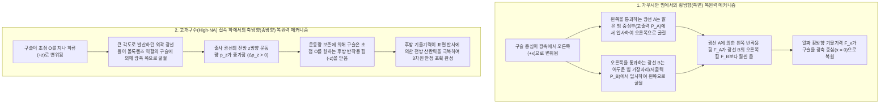
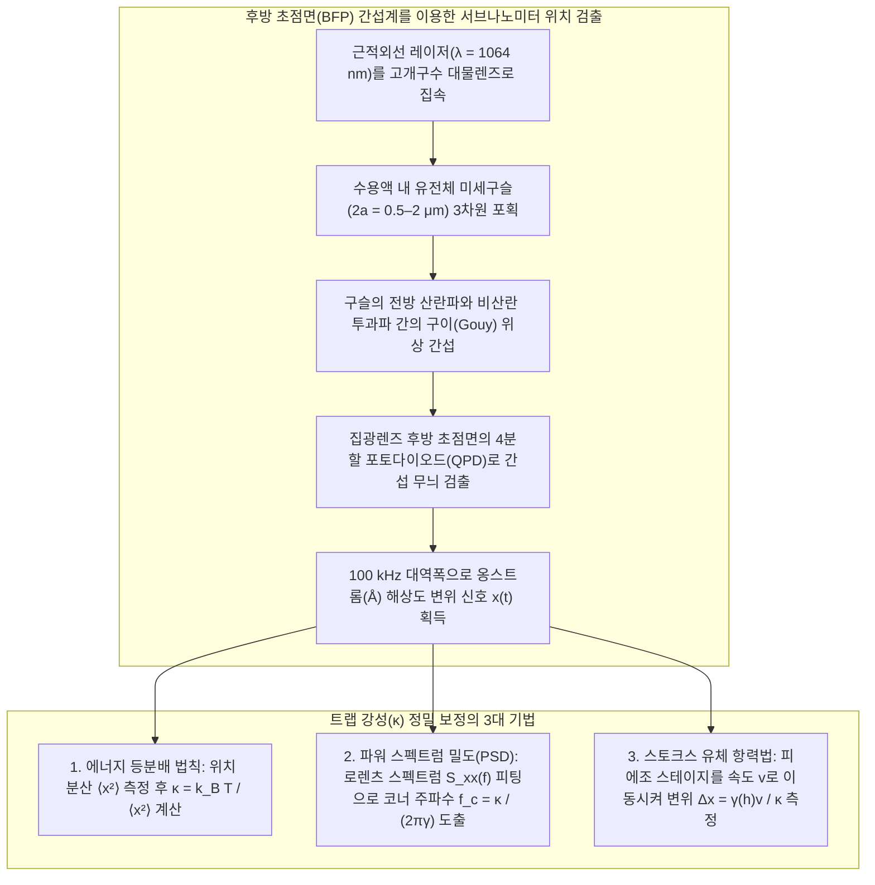

## 1. 서론: 질량이 없는 빛이 어떻게 물질을 밀고 당길 수 있는가?

일상적인 거시 세계에서 빛은 질량도 무게도 없는 것처럼 느껴진다. 그러나 기초 물리학의 관점에서 전자기파는 <strong>에너지</strong>와 함께 <strong>선운동량(Linear Momentum)</strong>을 운반한다. 1619년 요하네스 케플러(Johannes Kepler)는 혜성의 먼지 꼬리가 항상 태양 반대쪽을 향하는 것을 보고 태양빛이 물질을 밀어내는 <strong>복사압(Radiation Pressure)</strong>을 가설로 제시했다. 1873년 맥스웰(James Clerk Maxwell)은 포인팅 벡터 $\mathbf{S} = \frac{1}{\mu_0}(\mathbf{E} \times \mathbf{B})$를 통해 전자기파의 운동량 전달을 증명했고, 1905년 아인슈타인의 특수상대성이론 에너지-운동량 관계식 $E^2 = (pc)^2 + (mc^2)^2$에서 정지 질량 $m = 0$인 광자(Photon)의 운동량은 다음과 같이 주어진다:

$$
p = \frac{E}{c} = \frac{h\nu}{c} = \frac{h}{\lambda}
$$

출력 $P$인 레이저 빔이 완전 흡수체나 완전 반사 거울에 수직 입사할 때 가해지는 복사압 힘은 각각 다음과 같다:

$$
F_{\text{abs}} = \frac{P}{c}, \qquad F_{\text{ref}} = \frac{2P}{c}
$$

광속 $c \approx 3.0 \times 10^8\,\text{m/s}$가 매우 크므로 $1\,\text{W}$ 레이저의 힘은 $3.3\,\text{nN}$에 불과하다. 하지만 <strong>마이크로미터($10^{-6}\,\text{m}$) 크기의 세포·미세구슬이나 나노미터($10^{-9}\,\text{m}$) 크기의 생체 고분자 영역</strong>으로 내려가면 상황은 완전히 역전된다. 반지름 $a = 1\,\mu\text{m}$인 폴리스티렌 구슬의 질량은 $m \approx 4.4 \times 10^{-15}\,\text{kg}$이며 중력은 $mg \approx 0.043\,\text{pN}$($1\,\text{pN} = 10^{-12}\,\text{N}$)에 불과하다. 수십 밀리와트의 집속 레이저가 만드는 수 피코뉴턴($\text{pN}$)의 힘은 중력보다 수만 배 크며, 특히 빛의 세기가 가장 강한 초점 중심으로 투명 입자를 끌어당기는 <strong>광학 기울기력(Optical Gradient Force)</strong>을 이용해 단일 레이저 빔으로 미시 물질을 3차원으로 포획·조작하는 기술이 바로 2018년 노벨 물리학상 수상 업적인 <strong>광학 집게(Optical Tweezers)</strong>이다.

---

## 2. 아서 애슈킨(Arthur Ashkin)의 돌파구와 광학 집게의 탄생

1970년 벨 연구소의 <strong>아서 애슈킨(Arthur Ashkin, 1922–2020)</strong>은 물속의 투명 라텍스 미세구슬에 아르곤 이온 레이저($\lambda = 514.5\,\text{nm}$)를 조사했다. 그는 입자들이 단순히 앞으로 밀려날 것이라 예상했으나, 놀랍게도 빔 가장자리의 구슬들이 <strong>가우시안 빔의 가장 밝은 중심축으로 강하게 끌려 들어오는 현상</strong>을 발견했다! 같은 해 그는 마주 보는 두 레이저 빔으로 최초의 3차원 광학 포획을 구현했다.

1986년 애슈킨은 동료 J. M. Dziedzic, J. E. Bjorkholm 및 <strong>스티븐 추(Steven Chu)</strong>와 함께 높은 개구수($\text{NA} = 1.25$)의 대물렌즈로 강하게 집속된 <strong>단일 레이저 빔</strong>만으로 축방향 기울기력이 전방 산란력을 이겨내고 $10\,\mu\text{m}$에서 $25\,\text{nm}$에 이르는 유전체 입자를 3차원으로 포획함을 증명했다(*Optics Letters*, 11, 288, 1986). 이듬해인 1987년, 애슈킨은 물과 생체 시료의 광손상을 최소화하는 근적외선 <strong>Nd:YAG 레이저($\lambda = 1064\,\text{nm}$)</strong>를 도입하여 살아있는 대장균(*E. coli*)과 효모 세포를 손상 없이 포획하고 세포 분열까지 관찰하는 데 성공했다.

---

## 3. 기하광학 영역(미 산란, $a \gg \lambda$)에서의 포획 메커니즘

입자 반지름이 파장보다 훨씬 클 때($a \gg \lambda$), 굴절률 $n_p > n_m$($m = n_p/n_m > 1$)인 투명 구슬을 통과하며 굴절되는 출력 $P_{\text{ray}}$인 광선은 운동량 보존 법칙에 의해 구슬에 반작용 힘 $\mathbf{F}_{\text{ray}}$를 가한다:

$$
\mathbf{F}_{\text{ray}} = -\frac{d\mathbf{p}_{\text{light}}}{dt} = -\frac{n_m P_{\text{ray}}}{c} \left( \hat{\mathbf{u}}_{\text{out}} - \hat{\mathbf{u}}_{\text{in}} \right)
$$

- <strong>횡방향 포획</strong>: 구슬이 중심축에서 벗어나면 빔 중심 쪽을 지나는 강한 광선의 굴절 반작용이 가장자리 약한 광선의 반작용을 압도하여 구슬을 항상 최대 세기 중심($x=y=0$)으로 끌어당긴다.
- <strong>축방향 포획과 고개구수(High-NA) 대물렌즈의 필수성</strong>: 구슬이 초점 하류($+z$)로 밀려나면, 크게 발산하던 외곽 광선들이 구슬을 통과하며 평행하게 모아져 빛의 전방 운동량 $p_z$가 증가($\Delta p_z > 0$)한다. 그 반작용으로 구슬은 초점 쪽($-z$)으로 당겨진다. 전방 표면 반사(산란력)를 이기기 위해서는 큰 입사각의 외곽 광선이 필수적이므로 <strong>고개구수 대물렌즈($\text{NA} = n_m \sin\theta_{\max} \ge 1.2$)</strong>의 후방 조리개를 가득 채워야 한다.

---

## 4. 전자기 쌍극자 영역(레일리 산란, $a \ll \lambda$): 기울기력과 산란력

입자 반지름이 파장보다 훨씬 작을 때($a \ll \lambda$), 나노입자는 유도 전기 쌍극자 $\mathbf{p} = \alpha \mathbf{E}$로 작용하며, 준정적 <strong>클라우지우스-모소티(Clausius-Mossotti) 편극률</strong> $\alpha$는 부피($\propto a^3$)에 비례한다:

$$
\alpha = 4\pi n_m^2 \varepsilon_0 a^3 \left( \frac{m^2 - 1}{m^2 + 2} \right) \qquad \left(m \equiv \frac{n_p}{n_m}\right)
$$

불균일 전자기장 내 로렌츠 힘의 시간 평균과 레일리 산란 단면적($\sigma_{\text{scat}} \propto k^4 a^6$)으로부터 보존력인 <strong>기울기력 $\mathbf{F}_{\text{grad}}$</strong>와 비보존력인 <strong>산란력 $\mathbf{F}_{\text{scat}}$</strong>를 얻는다:

$$
\mathbf{F}_{\text{grad}}(\mathbf{r}) = \frac{2\pi n_m a^3}{c} \left( \frac{m^2 - 1}{m^2 + 2} \right) \nabla I(\mathbf{r}) = -\nabla U(\mathbf{r})
$$

$$
\mathbf{F}_{\text{scat}}(\mathbf{r}) = \frac{n_m \sigma_{\text{scat}}}{c} I(\mathbf{r})\hat{\mathbf{z}} = \frac{128 \pi^5 n_m^5 a^6}{3 c \lambda_0^4} \left( \frac{m^2 - 1}{m^2 + 2} \right)^2 I(\mathbf{r}) \hat{\mathbf{z}}
$$

| 물리적 특성 | 광학 기울기력 ($\mathbf{F}_{\text{grad}}$) | 광학 산란력 ($\mathbf{F}_{\text{scat}}$) |
| :--- | :--- | :--- |
| <strong>물리적 기원</strong> | 불균일 전기장 내 유도 쌍극자의 퍼텐셜 에너지 최소화 (굴절 반작용) | 광자 흡수 및 등방성 레일리 재복사(또는 프레넬 반사)에 의한 운동량 전달 |
| <strong>작용 방향</strong> | 빛의 세기 기울기 $\nabla I(\mathbf{r})$ 방향 ($n_p > n_m$일 때 3차원 초점 중심) | 빔 진행 방향 $\hat{\mathbf{z}}$ (입자를 하류로 밀어냄) |
| <strong>입자 반지름 $a$ 스케일링 ($a \ll \lambda$)</strong> | <strong>입자 부피에 비례 ($\propto a^3$)</strong> | <strong>입자 부피의 제곱에 비례 ($\propto a^6$)</strong> |
| <strong>파장 $\lambda_0$ 스케일링</strong> | 초점 기하학에 의존 | <strong>파장의 4제곱에 반비례 ($\propto \lambda_0^{-4}$)</strong> |
| <strong>상대 굴절률 $m = n_p/n_m$ 의존성</strong> | $\left(\frac{m^2-1}{m^2+2}\right)$에 비례 ($m<1$이면 척력) | $\left(\frac{m^2-1}{m^2+2}\right)^2$에 비례 (항상 양의 전방 추력) |

실온($T = 300\,\text{K}$)에서 브라운 열운동 에너지 $k_B T \approx 4.14\,\text{pN}\cdot\text{nm}$에 의한 탈출을 막으려면 퍼텐셜 우물 깊이가 $|U_{\min}| \propto a^3 I_{\max} \gtrsim 10\,k_B T$여야 한다. $|U_{\min}| \propto a^3$이므로 $5\,\text{nm}$ 단백질을 직접 포획하는 대신 <strong>마이크로미터 크기의 유전체 구슬($2a \sim 0.5\text{–}2\,\mu\text{m}$)을 '손잡이(Handle)'로 결합</strong>하여 조작한다.

---

## 5. 브라운 운동 제어: 과감쇠 랑주뱅 방정식과 피코뉴턴 강성 보정

평형점 근처($|\Delta x| \lesssim 150\,\text{nm}$)에서 광학 퍼텐셜은 조화 퍼텐셜 $U(x) \approx \frac{1}{2}\kappa_x x^2$를 형성하여 <strong>후크의 법칙(Hooke's Law)</strong>을 따르는 선형 용수철로 작동한다:

$$
F_{\text{trap}}(x) = -\kappa_x \Delta x
$$

여기서 $\kappa_x$($0.005\text{–}1.0\,\text{pN/nm}$)는 <strong>트랩 강성(Trap Stiffness)</strong>이다. 낮은 레이놀즈 수($\text{Re} \sim 10^{-5} \ll 1$) 유체에서 관성 항 $m\ddot{x}$는 수십 나노초 내에 소멸하며, 구슬의 궤적 $x(t)$는 스토크스 점성 저항 $\gamma = 6\pi\eta_{\text{vis}}a$와 열적 백색 잡음에 지배되는 <strong>과감쇠 랑주뱅 방정식(Overdamped Langevin Equation)</strong>을 따른다:

$$
\gamma \frac{dx(t)}{dt} + \kappa x(t) = \sqrt{2\gamma k_B T}\,\eta(t)
$$

1. <strong>에너지 등분배 법칙(Equipartition Method)</strong>: $\frac{1}{2}\kappa \langle x^2 \rangle = \frac{1}{2}k_B T \implies \kappa = k_B T / \langle x^2 \rangle$ (점성 계수 $\eta_{\text{vis}}$나 입자 반지름 $a$ 정보 불필요).
2. <strong>파워 스펙트럼 밀도(PSD) 로렌츠 분석</strong>: 푸리에 변환을 통해 유도되는 단측 파워 스펙트럼은 <strong>코너 주파수 $f_c$</strong>를 갖는 로렌츠 함수이다:
   $$
   S_{xx}(f) = \frac{k_B T}{\pi^2 \gamma \left( f_c^2 + f^2 \right)}, \qquad f_c = \frac{\kappa}{2\pi \gamma}
   $$
   $f \ll f_c$에서는 트랩 구속에 의한 평탄 영역을, $f \gg f_c$에서는 자유 브라운 확산($\propto f^{-2}$)을 보이며, 저주파 드리프트 잡음을 배제하고 $\kappa$와 검출기 감도 $\beta$를 동시에 보정한다.
3. <strong>스토크스 유체 항력법(팩센 벽면 보정 포함)</strong>: 유속 $v$에 의한 항력 $F = \gamma_\parallel(h)v = \kappa \Delta x$를 측정한다.

---

## 6. 단일 분자 생물물리학 혁명: DNA 탄성과 분자 모터의 스텝 측정

생체 시료의 광손상을 막기 위해 <strong>근적외선 생물학적 창($\lambda = 1064\,\text{nm}$)</strong>과 <strong>산소 제거 효소 시스템(Oxygen Scavenging System)</strong>을 사용한다.

### 카를로스 부스타만테(Carlos Bustamante)와 단일 DNA 분자의 엔트로피 탄성
1992–1996년 <strong>부스타만테</strong> 연구진은 바이오틴-스트렙타비딘 결합으로 단일 $\lambda$-파지 이중가닥 DNA($L_0 \approx 16.5\,\mu\text{m}$)를 당기며 힘-신장 곡선 $F(z)$를 측정했고, 이것이 <strong>기생충 사슬(Worm-Like Chain, WLC) 모델</strong>(Marko & Siggia, 1995)을 정확히 따름을 입증했다:

$$
F(z) = \frac{k_B T}{L_p} \left[ \frac{1}{4\left(1 - z/L_0\right)^2} - \frac{1}{4} + \frac{z}{L_0} \right]
$$

여기서 지속 길이 $L_p \approx 50\,\text{nm}$이며, $F \approx 65\,\text{pN}$에서는 DNA 길이가 $1.7$배로 급증하는 <strong>과신장 상전이(Overstretching Transition)</strong>가 일어난다.

### 스티븐 블록(Steven Block): 키네신의 8 nm 스텝과 RNA 중합효소의 단일 염기쌍 해상도
- <strong>키네신(Kinesin-1) 분자 모터</strong>: 1993년 <strong>스티븐 블록</strong> 연구진(*Nature*, 365, 721)은 미세소관 위를 걷는 단일 키네신이 연속 이동이 아니라 <strong>$\Delta d = 8.2\,\text{nm}$의 불연속 스텝</strong>으로 이동함을 최초로 관측했다. 한 걸음당 정확히 <strong>ATP 1분자</strong>를 가수분해하며, <strong>정지 힘(Stall Force) $F_{\text{stall}} \approx 6\text{–}7\,\text{pN}$</strong>에서 멈추고 약 $50\text{–}60\%$의 높은 열역학적 효율로 작동한다.
- <strong>이중 트랩 아령형(Dumbbell) 광학 집게와 RNA 중합효소(RNAP)</strong>: 2005년 블록 연구진은 헬륨 가스 챔버 내 이중 광학 트랩으로 기판 드리프트를 제거하여, 대장균 RNA 중합효소가 DNA를 따라 염기쌍 하나씩 전사할 때 이동하는 <strong>$3.4\,\text{\AA}$($0.34\,\text{nm}$) 단일 염기쌍 스텝</strong>을 직접 분해하는 쾌거를 이루었다.

---

## 7. 최첨단 진화: 홀로그래픽 광학 집게, 플라즈모닉 나노집게, 진공 양자 광역학

1. <strong>홀로그래픽 광학 집게(HOT) 및 광학 스패너(Optical Spanner)</strong>: 공간 광변조기(SLM)로 수백 개의 트랩을 동시에 제어하며, 원편광 스핀 각운동량($\pm\hbar$)이나 라게르-가우스 소용돌이 빔($e^{i\ell\phi}$)의 궤도 각운동량($\ell\hbar$)을 전달해 미시 입자를 회전시킨다.
2. <strong>플라즈모닉 나노집게(Plasmonic Nanotweezers)</strong>: 금속 나노 안테나의 국소 표면 플라즈몬 공명(LSPR)으로 회절 한계 이하의 극단적 전기장 기울기를 생성하여 $10\,\text{nm}$ 이하의 단일 단백질을 구슬 없이 직접 포획한다.
3. <strong>중성 원자 배열 양자 시뮬레이터와 진공 부양 양자 광역학</strong>: 초고진공에서 레이저 냉각된 중성 원자들을 광학 집게 배열에 가두어 수백 큐비트 양자 컴퓨터를 구현하며, 부양된 실리카 나노구슬을 <strong>양자역학적 운동 바닥 상태($\bar{n} < 1$ 포논)</strong>로 냉각하여 거시적 양자 중첩과 중력·암흑물질 탐색의 새 지평을 열고 있다.
