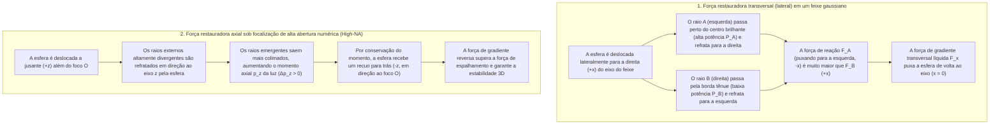
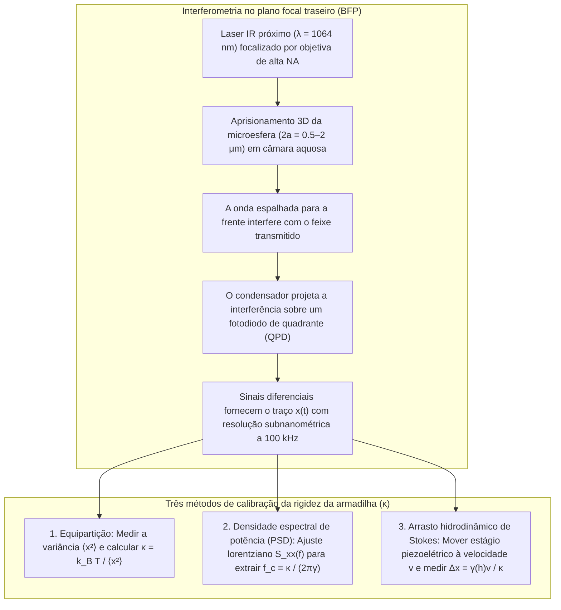

## 1. Introdução: Por que a luz sem massa pode empurrar e puxar a matéria?

Em nossa experiência macroscópica cotidiana, a luz parece completamente intangível. Contudo, do ponto de vista da física fundamental, a radiação eletromagnética transporta tanto <strong>energia</strong> quanto <strong>momento linear (quantidade de movimento)</strong>. Já em 1619, Johannes Kepler observou que as caudas de poeira dos cometas apontam sempre na direção oposta ao Sol, postulando a existência de uma <strong>pressão de radiação</strong>. Em 1873, James Clerk Maxwell demonstrou que ondas eletromagnéticas transportam momento através do vetor de Poynting $\mathbf{S} = \frac{1}{\mu_0}(\mathbf{E} \times \mathbf{B})$. Em 1905, a relatividade restrita de Albert Einstein ($E^2 = (pc)^2 + (mc^2)^2$) estabeleceu para um fóton sem massa de repouso ($m = 0$) e energia $E = h\nu = hc/\lambda$ o momento linear:

$$
p = \frac{E}{c} = \frac{h\nu}{c} = \frac{h}{\lambda}
$$

Quando um feixe de laser colimado de potência $P$ incide perpendicularmente sobre uma superfície totalmente absorvente ou um espelho perfeito, a força de radiação é:

$$
F_{\text{abs}} = \frac{P}{c}, \qquad F_{\text{ref}} = \frac{2P}{c}
$$

Devido à imensa velocidade da luz $c \approx 3.0 \times 10^8\,\text{m/s}$, um laser de $1\,\text{W}$ exerce apenas $3.3\,\text{nN}$. Mas ao descermos para a <strong>escala micrométrica ($10^{-6}\,\text{m}$) de microesferas coloidais e células vivas, ou para a escala nanométrica ($10^{-9}\,\text{m}$) de macromoléculas biológicas</strong>, a hierarquia de forças inverte-se completamente: uma microesfera de poliestireno de raio $a = 1\,\mu\text{m}$ tem massa de apenas $m \approx 4.4 \times 10^{-15}\,\text{kg}$ e peso gravitacional de $mg \approx 0.043\,\text{pN}$ ($1\,\text{pN} = 10^{-12}\,\text{N}$). Dezenas de miliwatts de luz laser focalizada geram forças de vários piconewtons ($\text{pN}$), superando a gravidade em ordens de grandeza. Mais ainda, perto do foco de um feixe fortemente focalizado, uma partícula dielétrica transparente experimenta uma <strong>força de gradiente óptico</strong> conservativa que a puxa para o ponto de máxima intensidade luminosa: esta é a tecnologia das <strong>pinças ópticas (Optical Tweezers)</strong>.

---

## 2. Os avanços pioneiros de Arthur Ashkin e o nascimento das pinças ópticas

Em 1970, nos Bell Laboratories, <strong>Arthur Ashkin (1922–2020)</strong> focalizou um laser de íons de argônio ($\lambda = 514.5\,\text{nm}$) sobre microesferas de látex transparentes suspensas em água (*Physical Review Letters*, 24, 156). Em vez de serem apenas empurradas para a frente, as esferas próximas à borda do feixe eram <strong>simultaneamente puxadas transversalmente para o brilhante eixo central do feixe gaussiano</strong>. No mesmo ano, ele construiu a primeira armadilha óptica 3D usando dois feixes contrapropagantes.

Em 1986, Ashkin, J. M. Dziedzic, J. E. Bjorkholm e <strong>Steven Chu</strong> publicaram seu artigo seminal (*Optics Letters*, 11, 288, 1986), demonstrando que um <strong>único feixe de laser fortemente focalizado</strong> por uma objetiva de alta abertura numérica ($\text{NA} = 1.25$) gera uma força de gradiente axial reversa capaz de vencer a força de espalhamento frontal, aprisionando em 3D partículas dielétricas de $10\,\mu\text{m}$ até $25\,\text{nm}$: nasciam as <strong>pinças ópticas</strong>. Em 1987, mudando para um <strong>laser Nd:YAG no infravermelho próximo ($\lambda = 1064\,\text{nm}$)</strong> para evitar fotodanos, Ashkin aprisionou bactérias *E. coli* vivas, leveduras em divisão e vírus, recebendo o <strong>Prêmio Nobel de Física de 2018</strong>.

---

## 3. Mecânica do aprisionamento no regime da óptica geométrica (Espalhamento de Mie, $a \gg \lambda$)

Quando o raio da esfera é muito maior que o comprimento de onda ($a \gg \lambda$), a refração de um raio de potência $P_{\text{ray}}$ através de uma esfera de índice $n_p > n_m$ ($m = n_p/n_m > 1$) transfere, por conservação do momento linear, uma força de recuo mecânico $\mathbf{F}_{\text{ray}}$:

$$
\mathbf{F}_{\text{ray}} = -\frac{d\mathbf{p}_{\text{light}}}{dt} = -\frac{n_m P_{\text{ray}}}{c} \left( \hat{\mathbf{u}}_{\text{out}} - \hat{\mathbf{u}}_{\text{in}} \right)
$$

- <strong>Estabilidade transversal</strong>: Em um perfil gaussiano $I(r) = I_0 \exp(-2r^2/w_0^2)$, os raios mais próximos ao núcleo do feixe possuem maior potência e seu recuo de refração devolve sempre a esfera ao centro brilhante ($x=y=0$).
- <strong>Estabilidade axial e necessidade de uma objetiva de alta abertura numérica (High-NA)</strong>: Quando a esfera se desloca a jusante ($+z$) do foco $O$, ela refrata para dentro os raios externos fortemente divergentes, aumentando o momento frontal $p_z$ da luz ($\Delta p_z > 0$) e gerando uma reação para trás ($-z$) rumo ao foco $O$. Para vencer o empurrão das reflexões superficiais, é indispensável preencher totalmente a abertura traseira de uma <strong>objetiva de imersão de alta abertura numérica ($\text{NA} = n_m \sin\theta_{\max} \ge 1.2$)</strong>.

---

## 4. Regime dipolar eletromagnético (Espalhamento de Rayleigh, $a \ll \lambda$)

Para nanopartículas ($a \ll \lambda$), a esfera atua como um dipolo elétrico pontual induzido $\mathbf{p} = \alpha \mathbf{E}$ cuja <strong>polarizabilidade de Clausius-Mossotti</strong> $\alpha$ escala com o volume ($\propto a^3$):

$$
\alpha = 4\pi n_m^2 \varepsilon_0 a^3 \left( \frac{m^2 - 1}{m^2 + 2} \right) \qquad \left(m \equiv \frac{n_p}{n_m}\right)
$$

A média temporal da força de Lorentz e a seção de choque de espalhamento de Rayleigh ($\sigma_{\text{scat}} \propto k^4 a^6$) fornecem a <strong>força de gradiente $\mathbf{F}_{\text{grad}}$</strong> e a <strong>força de espalhamento $\mathbf{F}_{\text{scat}}$</strong>:

$$
\mathbf{F}_{\text{grad}}(\mathbf{r}) = \frac{2\pi n_m a^3}{c} \left( \frac{m^2 - 1}{m^2 + 2} \right) \nabla I(\mathbf{r}) = -\nabla U(\mathbf{r})
$$

$$
\mathbf{F}_{\text{scat}}(\mathbf{r}) = \frac{n_m \sigma_{\text{scat}}}{c} I(\mathbf{r})\hat{\mathbf{z}} = \frac{128 \pi^5 n_m^5 a^6}{3 c \lambda_0^4} \left( \frac{m^2 - 1}{m^2 + 2} \right)^2 I(\mathbf{r}) \hat{\mathbf{z}}
$$

| Propriedade física | Força de gradiente ($\mathbf{F}_{\text{grad}}$) | Força de espalhamento ($\mathbf{F}_{\text{scat}}$) |
| :--- | :--- | :--- |
| <strong>Origem física</strong> | Campo in-homogêneo sobre dipolo induzido (minimização do potencial $U$) | Transferência de momento por absorção e reemissão de Rayleigh |
| <strong>Direção de atuação</strong> | Ao longo do gradiente de intensidade $\nabla I(\mathbf{r})$ (para o foco 3D se $n_p > n_m$) | Ao longo do vetor de onda $\hat{\mathbf{z}}$ (empurra a partícula a jusante) |
| <strong>Escalonamento com o raio $a$ ($a \ll \lambda$)</strong> | <strong>Proporcional ao volume ($\propto a^3$)</strong> | <strong>Proporcional ao quadrado do volume ($\propto a^6$)</strong> |
| <strong>Escalonamento com o comprimento de onda $\lambda_0$</strong> | Através da geometria do ponto focal | <strong>Inverso da quarta potência ($\propto \lambda_0^{-4}$)</strong> |
| <strong>Contraste de índice $m = n_p/n_m$</strong> | Linear em $\left(\frac{m^2-1}{m^2+2}\right)$ (muda de sinal em $m=1$) | Quadrático $\left(\frac{m^2-1}{m^2+2}\right)^2$ (sempre empurra para a frente) |

Para evitar o escape térmico browniano ($k_B T \approx 4.14\,\text{pN}\cdot\text{nm}$ a $T = 300\,\text{K}$), a profundidade do poço de potencial deve satisfazer $|U_{\min}| \propto a^3 I_{\max} \gtrsim 10\,k_B T$. Devido ao escalonamento $a^3$, os biofísicos acoplam quimicamente o DNA ou proteínas a <strong>microesferas dielétricas ($2a \sim 0.5\text{–}2\,\mu\text{m}$)</strong> que funcionam como alças mecânicas.

---

## 5. Movimento browniano, equação de Langevin e calibração ao piconewton

Perto do centro de equilíbrio ($|\Delta x| \lesssim 150\,\text{nm}$), o poço de potencial é harmônico ($U(x) \approx \frac{1}{2}\kappa_x x^2$) e obedece à <strong>lei de Hooke</strong>:

$$
F_{\text{trap}}(x) = -\kappa_x \Delta x
$$

onde $\kappa_x$ ($0.005\text{–}1.0\,\text{pN/nm}$) é a <strong>rigidez da armadilha (Trap Stiffness)</strong>. Em baixo número de Reynolds ($\text{Re} \sim 10^{-5} \ll 1$), o termo inercial desaparece e a trajetória $x(t)$ obedece à <strong>equação de Langevin superamortecida</strong> com arrasto viscoso de Stokes $\gamma = 6\pi\eta_{\text{vis}}a$:

$$
\gamma \frac{dx(t)}{dt} + \kappa x(t) = \sqrt{2\gamma k_B T}\,\eta(t)
$$

1. <strong>Teorema da equipartição</strong>: $\frac{1}{2}\kappa \langle x^2 \rangle = \frac{1}{2}k_B T \implies \kappa = k_B T / \langle x^2 \rangle$.
2. <strong>Densidade espectral de potência (PSD)</strong>: O espectro de frequência segue um perfil lorentziano com <strong>frequência de canto $f_c$</strong>:
   $$
   S_{xx}(f) = \frac{k_B T}{\pi^2 \gamma \left( f_c^2 + f^2 \right)}, \qquad f_c = \frac{\kappa}{2\pi \gamma}
   $$
3. <strong>Arrasto hidrodinâmico de Stokes (com correção de parede de Faxén)</strong>: $F = \gamma_\parallel(h)v = \kappa \Delta x$.

---

## 6. A revolução da biofísica de moléculas individuais: Elasticidade do DNA e motores moleculares

O uso da <strong>janela óptica biológica no infravermelho próximo ($\lambda = 1064\,\text{nm}$)</strong> combinado com <strong>sistemas enzimáticos removedores de oxigênio</strong> previne o fotodano celular.

### Carlos Bustamante e a elasticidade entrópica de moléculas individuais de DNA
Entre 1992 e 1996, <strong>Carlos Bustamante</strong> e colaboradores mediram a curva força-extensão $F(z)$ de uma única molécula de DNA de fita dupla do fago $\lambda$ ($L_0 \approx 16.5\,\mu\text{m}$), demonstrando que ela segue o <strong>modelo de cadeia vermiforme (Worm-Like Chain, WLC)</strong> (Marko & Siggia, 1995) com comprimento de persistência $L_p \approx 50\,\text{nm}$:

$$
F(z) = \frac{k_B T}{L_p} \left[ \frac{1}{4\left(1 - z/L_0\right)^2} - \frac{1}{4} + \frac{z}{L_0} \right]
$$

e descobrindo em $F \approx 65\,\text{pN}$ a <strong>transição de superestiramento (Overstretching Transition)</strong> até $1.7$ vezes o seu comprimento original.

### Steven Block: Os passos de 8 nm da cinesina e a resolução de pares de bases da RNA polimerase
- <strong>Cinesina-1</strong>: Em 1993, o grupo de <strong>Steven Block</strong> (*Nature*, 365, 721) demonstrou que uma única molécula de cinesina caminha sobre um microtúbulo dando <strong>passos discretos de $\Delta d = 8.2\,\text{nm}$</strong>, hidrolisando exatamente <strong>1 molécula de ATP por passo</strong> contra uma <strong>força de parada (Stall Force) de $F_{\text{stall}} \approx 6\text{–}7\,\text{pN}$</strong> ($\sim 50\text{–}60\%$ de eficiência termodinâmica).
- <strong>Pinças ópticas de armadilha dupla e RNA polimerase (RNAP)</strong>: Em 2005, usando uma armadilha óptica dupla passiva isolada em hélio, a equipe de Block resolveu os <strong>passos individuais de $3.4\,\text{\AA}$ ($0.34\,\text{nm}$, um único par de bases)</strong> da RNA polimerase transcrevendo DNA!

---

## 7. Fronteiras modernas: Pinças holográficas, plasmônica e optomecânica quântica

1. <strong>Pinças ópticas holográficas (HOT) e chaves ópticas</strong>: Moduladores espaciais de luz (SLM) controlam centenas de armadilhas simultaneamente, enquanto o momento angular de spin ($\pm\hbar$) ou orbital ($\ell\hbar$ em feixes vórtice de Laguerre-Gauss) gira microrrotores.
2. <strong>Nanopinças plasmônicas</strong>: Ressonâncias de plásmon de superfície localizado (LSPR) em nanoantenas metálicas aprisionam diretamente proteínas individuais ($< 10\,\text{nm}$).
3. <strong>Redes de átomos neutros e optomecânica quântica em vácuo</strong>: Redes de pinças ópticas impulsionam simuladores quânticos de átomos neutros e o resfriamento em ultra-alto vácuo de nanoesferas de sílica até seu <strong>estado fundamental quântico de movimento ($\bar{n} < 1$ fônon)</strong> (Delić et al., *Science*, 2020).
