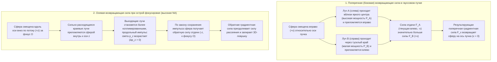
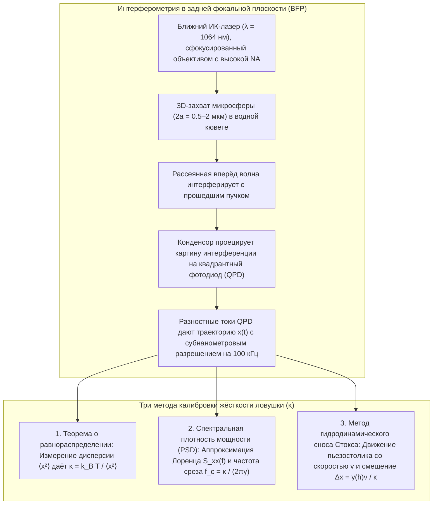

## 1. Введение: Почему безмассовый свет способен толкать и притягивать вещество?

В нашем повседневном макроскопическом опыте свет кажется совершенно невесомым и неосязаемым. Однако с точки зрения фундаментальной физики электромагнитное излучение переносит не только <strong>энергию</strong>, но и <strong>линейный импульс</strong>. Ещё в 1619 году Иоганн Кеплер заметил, что пылевые хвосты комет всегда направлены от Солнца, и высказал гипотезу о существовании <strong>светового (радиационного) давления</strong>. В 1873 году Джеймс Клерк Максвелл теоретически доказал, что электромагнитные волны переносят импульс через вектор Пойнтинга $\mathbf{S} = \frac{1}{\mu_0}(\mathbf{E} \times \mathbf{B})$, а в 1905 году специальная теория относительности Альберта Эйнштейна ($E^2 = (pc)^2 + (mc^2)^2$) установила для фотона с нулевой массой покоя ($m = 0$) и энергией $E = h\nu = hc/\lambda$ импульс:

$$
p = \frac{E}{c} = \frac{h\nu}{c} = \frac{h}{\lambda}
$$

Когда коллимированный лазерный луч мощности $P$ падает перпендикулярно на идеально поглощающую поверхность или идеальное зеркало, радиационная сила составляет:

$$
F_{\text{abs}} = \frac{P}{c}, \qquad F_{\text{ref}} = \frac{2P}{c}
$$

Из-за колоссальной скорости света $c \approx 3.0 \times 10^8\,\text{м/с}$ лазер мощностью $1\,\text{Вт}$ создаёт силу всего $3.3\,\text{нН}$. Но как только мы переходим в <strong>микронный мир ($10^{-6}\,\text{м}$) коллоидных микросфер и живых клеток или нанометровый мир ($10^{-9}\,\text{м}$) биологических макромолекул</strong>, соотношение сил полностью переворачивается: полистироловая микросфера радиуса $a = 1\,\text{мкм}$ имеет массу лишь $m \approx 4.4 \times 10^{-15}\,\text{кг}$ и силу тяжести $mg \approx 0.043\,\text{пН}$ ($1\,\text{пН} = 10^{-12}\,\text{Н}$). Десятки милливатт сфокусированного лазерного излучения развивают силы в десятки пиконьютонов ($\text{пН}$), на порядки превосходя гравитацию! Более того, вблизи фокуса жёстко сфокусированного луча прозрачная диэлектрическая частица испытывает консервативную <strong>оптическую градиентную силу</strong>, втягивающую её в область максимальной интенсивности света — на этом принципе работает технология <strong>оптического пинцета (Optical Tweezers)</strong>.

---

## 2. Пионерские открытия Артура Эшкина и рождение оптического пинцета

В 1970 году в Bell Laboratories <strong>Артур Эшкин (Arthur Ashkin, 1922–2020)</strong> направил луч аргонового лазера ($\lambda = 514.5\,\text{нм}$) на прозрачные латексные микросферы в воде (*Physical Review Letters*, 24, 156). Вместо того чтобы просто толкаться вперёд, частицы на краю луча <strong>одновременно втягивались в поперечном направлении к яркой центральной оси гауссова пучка</strong>! В том же году с помощью двух встречных пучков он создал первую трёхмерную оптическую ловушку.

В 1986 году Эшкин, Дж. М. Дзедзич, Дж. Э. Бьоркхольм и <strong>Стивен Чу (Steven Chu)</strong> опубликовали основополагающую работу (*Optics Letters*, 11, 288, 1986), доказав, что <strong>один-единственный лазерный луч</strong>, жёстко сфокусированный объективом с высокой числовой апертурой ($\text{NA} = 1.25$), создаёт обратную осевую градиентную силу, преодолевающую прямую силу рассеяния и удерживающую в 3D частицы размером от $10\,\text{мкм}$ до $25\,\text{нм}$ — так родился <strong>оптический пинцет</strong>. В 1987 году, перейдя на <strong>Nd:YAG-лазер ближнего ИК-диапазона ($\lambda = 1064\,\text{нм}$)</strong> во избежание фотоповреждений, Эшкин захватил живые бактерии *E. coli*, делящиеся дрожжевые клетки и вирусы, за что в 2018 году был удостоен <strong>Нобелевской премии по физике</strong>.

---

## 3. Механика захвата в режиме геометрической оптики (рассеяние Ми, $a \gg \lambda$)

Когда радиус сферы много больше длины волны ($a \gg \lambda$), преломление луча мощности $P_{\text{ray}}$ прозрачной сферой с показателем преломления $n_p > n_m$ ($m = n_p/n_m > 1$) по закону сохранения импульса сообщает сфере механическую силу отдачи $\mathbf{F}_{\text{ray}}$:

$$
\mathbf{F}_{\text{ray}} = -\frac{d\mathbf{p}_{\text{light}}}{dt} = -\frac{n_m P_{\text{ray}}}{c} \left( \hat{\mathbf{u}}_{\text{out}} - \hat{\mathbf{u}}_{\text{in}} \right)
$$

- <strong>Поперечная устойчивость</strong>: В гауссовом профиле $I(r) = I_0 \exp(-2r^2/w_0^2)$ лучи вблизи оси интенсивнее краевых, поэтому их реактивная отдача при преломлении всегда возвращает частицу на ось ($x=y=0$).
- <strong>Осевая устойчивость и необходимость высокой числовой апертуры (High-NA)</strong>: При смещении сферы за фокус ($+z$) она собирает сильно расходящиеся периферийные лучи ближе к оси $z$, увеличивая прямой импульс света $p_z$ ($\Delta p_z > 0$) и создавая обратную силу отдачи ($-z$) к фокусу $O$. Чтобы преодолеть прямое давление френелевских отражений, необходимо полностью заполнить входной зрачок <strong>иммерсионного объектива с высокой числовой апертурой ($\text{NA} = n_m \sin\theta_{\max} \ge 1.2$)</strong>.

---

## 4. Электромагнитный дипольный режим (рэлеевское рассеяние, $a \ll \lambda$)

Для наночастиц ($a \ll \lambda$) сфера ведёт себя как индуцированный точечный электрический диполь $\mathbf{p} = \alpha \mathbf{E}$, чья <strong>поляризуемость Клаузиуса — Моссотти</strong> $\alpha$ пропорциональна объёму ($\propto a^3$):

$$
\alpha = 4\pi n_m^2 \varepsilon_0 a^3 \left( \frac{m^2 - 1}{m^2 + 2} \right) \qquad \left(m \equiv \frac{n_p}{n_m}\right)
$$

Усреднение силы Лоренца по оптическому периоду и сечение рэлеевского рассеяния ($\sigma_{\text{scat}} \propto k^4 a^6$) дают консервативную <strong>градиентную силу $\mathbf{F}_{\text{grad}}$</strong> и неконсервативную <strong>силу рассеяния $\mathbf{F}_{\text{scat}}$</strong>:

$$
\mathbf{F}_{\text{grad}}(\mathbf{r}) = \frac{2\pi n_m a^3}{c} \left( \frac{m^2 - 1}{m^2 + 2} \right) \nabla I(\mathbf{r}) = -\nabla U(\mathbf{r})
$$

$$
\mathbf{F}_{\text{scat}}(\mathbf{r}) = \frac{n_m \sigma_{\text{scat}}}{c} I(\mathbf{r})\hat{\mathbf{z}} = \frac{128 \pi^5 n_m^5 a^6}{3 c \lambda_0^4} \left( \frac{m^2 - 1}{m^2 + 2} \right)^2 I(\mathbf{r}) \hat{\mathbf{z}}
$$

| Физическое свойство | Градиентная сила ($\mathbf{F}_{\text{grad}}$) | Сила рассеяния ($\mathbf{F}_{\text{scat}}$) |
| :--- | :--- | :--- |
| <strong>Физическая природа</strong> | Неоднородное поле на индуцированный диполь (минимизация потенциала $U$) | Передача импульса при поглощении и рэлеевском переизлучении |
| <strong>Направление действия</strong> | Вдоль градиента интенсивности $\nabla I(\mathbf{r})$ (к 3D-фокусу при $n_p > n_m$) | Вдоль волнового вектора $\hat{\mathbf{z}}$ (толкает частицу по ходу луча) |
| <strong>Зависимость от радиуса $a$ ($a \ll \lambda$)</strong> | <strong>Пропорциональна объёму ($\propto a^3$)</strong> | <strong>Пропорциональна квадрату объёма ($\propto a^6$)</strong> |
| <strong>Зависимость от длины волны $\lambda_0$</strong> | Через геометрию фокального пятна | <strong>Обратно пропорциональна четвёртой степени ($\propto \lambda_0^{-4}$)</strong> |
| <strong>Контраст показателя $m = n_p/n_m$</strong> | Линейна по $\left(\frac{m^2-1}{m^2+2}\right)$ (меняет знак при $m=1$) | Квадратична $\left(\frac{m^2-1}{m^2+2}\right)^2$ (всегда направлена вперёд) |

Для подавления теплового выброса из ловушки ($k_B T \approx 4.14\,\text{пН}\cdot\text{нм}$ при $T = 300\,\text{К}$) глубина потенциальной ямы должна удовлетворять условию $|U_{\min}| \propto a^3 I_{\max} \gtrsim 10\,k_B T$. Из-за зависимости $a^3$ биофизики прикрепляют белки или ДНК к <strong>диэлектрическим микросферам ($2a \sim 0.5\text{–}2\,\text{мкм}$)</strong>, служащим механическими «ручками».

---

## 5. Броуновское движение, уравнение Ланжевена и пиконьютонная калибровка

Вблизи центра ловушки ($|\Delta x| \lesssim 150\,\text{нм}$) потенциал гармоничен ($U(x) \approx \frac{1}{2}\kappa_x x^2$) и подчиняется <strong>закону Гука</strong>:

$$
F_{\text{trap}}(x) = -\kappa_x \Delta x
$$

где $\kappa_x$ ($0.005\text{–}1.0\,\text{пН/нм}$) — <strong>жёсткость ловушки (Trap Stiffness)</strong>. При малых числах Рейнольдса ($\text{Re} \sim 10^{-5} \ll 1$) инерцией можно пренебречь, и траектория $x(t)$ описывается <strong>передемпфированным уравнением Ланжевена</strong> с вязким трением Стокса $\gamma = 6\pi\eta_{\text{vis}}a$:

$$
\gamma \frac{dx(t)}{dt} + \kappa x(t) = \sqrt{2\gamma k_B T}\,\eta(t)
$$

1. <strong>Метод равнораспределения энергии</strong>: $\frac{1}{2}\kappa \langle x^2 \rangle = \frac{1}{2}k_B T \implies \kappa = k_B T / \langle x^2 \rangle$.
2. <strong>Метод спектральной плотности мощности (PSD)</strong>: Спектр мощности имеет лоренцевский профиль с <strong>угловой частотой (частотой среза) $f_c$</strong>:
   $$
   S_{xx}(f) = \frac{k_B T}{\pi^2 \gamma \left( f_c^2 + f^2 \right)}, \qquad f_c = \frac{\kappa}{2\pi \gamma}
   $$
3. <strong>Метод гидродинамического сопротивления Стокса (с поправкой Факсена у стенки)</strong>: $F = \gamma_\parallel(h)v = \kappa \Delta x$.

---

## 6. Революция одномолекулярной биофизики: Упругость ДНК и молекулярные моторы

Использование <strong>биологического окна прозрачности в ближнем ИК-диапазоне ($\lambda = 1064\,\text{нм}$)</strong> и ферментативных <strong>систем удаления кислорода</strong> предотвращает фотоповреждение биомолекул.

### Карлос Бустаманте и энтропийная упругость одиночных молекул ДНК
В 1992–1996 годах <strong>Карлос Бустаманте</strong> и коллеги измерили кривую «сила — растяжение» $F(z)$ одиночной двухцепочечной молекулы ДНК фага $\lambda$ ($L_0 \approx 16.5\,\text{мкм}$), подтвердив <strong>модель червеобразной цепи (Worm-Like Chain, WLC)</strong> (Marko & Siggia, 1995) с персистентной длиной $L_p \approx 50\,\text{нм}$:

$$
F(z) = \frac{k_B T}{L_p} \left[ \frac{1}{4\left(1 - z/L_0\right)^2} - \frac{1}{4} + \frac{z}{L_0} \right]
$$

и открыв при $F \approx 65\,\text{пН}$ кооперативный <strong>фазовый переход сверхупругого растяжения (Overstretching Transition)</strong> в $1.7$ раза.

### Стивен Блок: 8-нанометровые шаги кинезина и разрешение в одну пару оснований РНК-полимеразы
- <strong>Кинезин-1</strong>: В 1993 году группа <strong>Стивена Блока</strong> (*Nature*, 365, 721) показала, что одиночная молекула кинезина шагает вдоль микротрубочки <strong>дискретными шагами $\Delta d = 8.2\,\text{нм}$</strong>, гидролизуя ровно <strong>1 молекулу АТФ на шаг</strong> и развивая <strong>силу остановки (Stall Force) $F_{\text{stall}} \approx 6\text{–}7\,\text{пН}$</strong> (КПД $\sim 50\text{–}60\%$).
- <strong>Двухловушечный оптический пинцет и РНК-полимераза (RNAP)</strong>: В 2005 году с помощью пассивного двухловушечного пинцета в атмосфере гелия лаборатория Блока разрешила <strong>элементарные шаги РНК-полимеразы в $3.4\,\text{\AA}$ ($0.34\,\text{нм}$ — одна пара оснований ДНК)</strong>!

---

## 7. Современные горизонты: Голографические пинцеты, плазмоника и квантовая оптомеханика

1. <strong>Голографические оптические пинцеты (HOT) и оптические гаечные ключи</strong>: Пространственные модуляторы света (SLM) управляют сотнями ловушек одновременно, а спиновый ($\pm\hbar$) и орбитальный ($\ell\hbar$ в вихревых пучках Лагерра — Гаусса) угловой момент вращает микророторы.
2. <strong>Плазмонные нанопинцеты</strong>: Локализованный поверхностный плазмонный резонанс (LSPR) металлических наноантенн напрямую захватывает отдельные белки ($< 10\,\text{нм}$).
3. <strong>Массивы нейтральных атомов и вакуумная квантовая оптомеханика</strong>: Массивы оптических пинцетов лежат в основе квантовых симуляторов на нейтральных атомах и позволяют охлаждать левитирующие в сверхвысоком вакууме кремнезёмные наносферы до <strong>квантового основного состояния движения ($\bar{n} < 1$ фонона)</strong> (Delić et al., *Science*, 2020).
