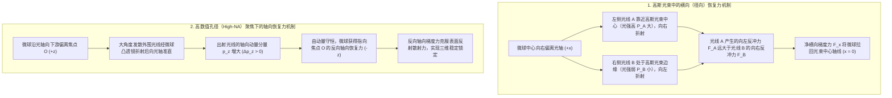
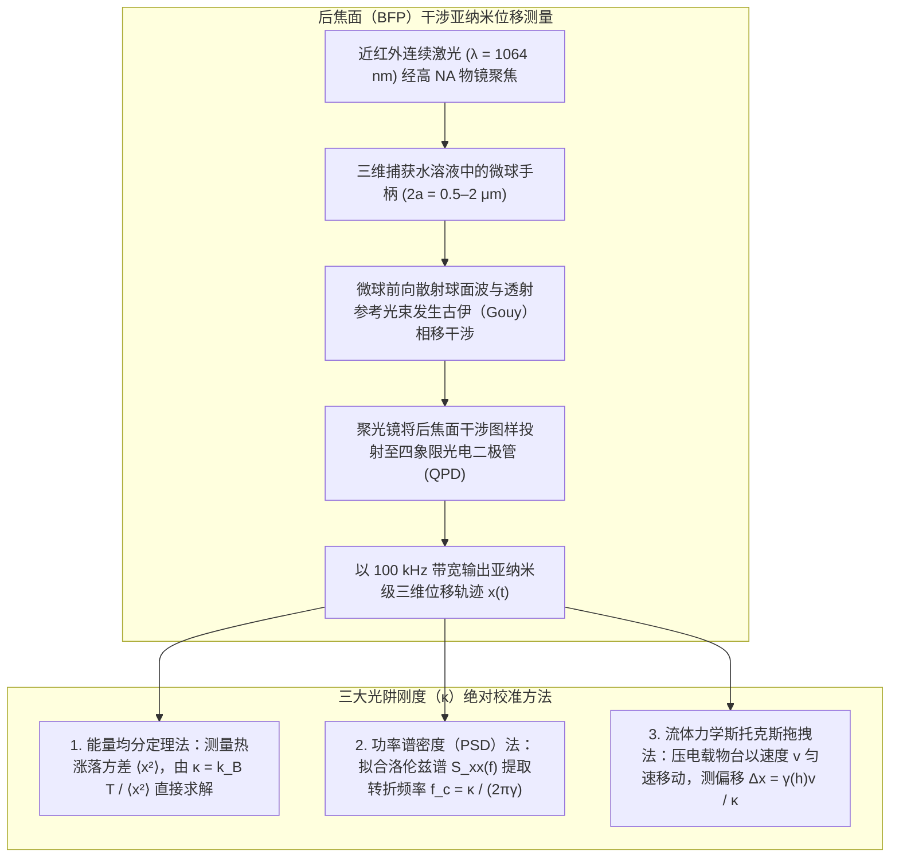

## 1. 引言：为什么没有静质量的光能够推拉物质？

在宏观日常经验中，光似乎完全没有重量与机械力：阳光温暖皮肤，却不会推倒咖啡杯。然而从基础物理学来看，电磁辐射同时携带<strong>能量</strong>与<strong>线性动量</strong>。早在1619年，开普勒（Johannes Kepler）就通过观测彗星尘埃尾始终背离太阳，提出太阳光会对物质施加推力——即<strong>辐射压（Radiation Pressure）</strong>。1873年，麦克斯韦（James Clerk Maxwell）证明电磁波通过坡印廷矢量 $\mathbf{S} = \frac{1}{\mu_0}(\mathbf{E} \times \mathbf{B})$ 传输动量；1905年，爱因斯坦狭义相对论给出质能动量关系 $E^2 = (pc)^2 + (mc^2)^2$。对于静止质量 $m = 0$ 的光子，其动量 $p$ 与能量 $E = h\nu = hc/\lambda$ 的关系为：

$$
p = \frac{E}{c} = \frac{h\nu}{c} = \frac{h}{\lambda}
$$

当功率为 $P$ 的激光束垂直照射在完全吸收表面或全反射镜面上时，每秒传递的动量即辐射压力分别为：

$$
F_{\text{abs}} = \frac{P}{c}, \qquad F_{\text{ref}} = \frac{2P}{c}
$$

由于光速 $c \approx 3.0 \times 10^8\,\text{m/s}$ 极其巨大，$1\,\text{W}$ 激光产生的推力仅为 $3.3\,\text{nN}$（纳米牛顿），在宏观世界微不足道。但当我们进入<strong>微米（$10^{-6}\,\text{m}$）级的胶体微球、活细胞，以及纳米（$10^{-9}\,\text{m}$）级的生物大分子世界</strong>时，半径 $a = 1\,\mu\text{m}$ 的聚苯乙烯微球质量仅为 $m \approx 4.4 \times 10^{-15}\,\text{kg}$，重力仅为 $mg \approx 0.043\,\text{pN}$（$1\,\text{pN} = 10^{-12}\,\text{N}$）。此时，几十毫瓦聚焦激光产生的数皮牛顿（$\text{pN}$）光学力比重力大数个数量级！更奇妙的是，高度聚焦的激光不仅能向前推物体，还能通过<strong>光学梯度力（Optical Gradient Force）</strong>将透明微粒拉向光强最强的焦点中心——这就是荣获2018年诺贝尔物理学奖的<strong>光镊（Optical Tweezers）</strong>技术。

---

## 2. 阿瑟·阿什金（Arthur Ashkin）的开创性突破与光镊的诞生

1970年，贝尔实验室的<strong>阿瑟·阿什金（Arthur Ashkin，1922–2020）</strong>将毫瓦级氩离子激光（$\lambda = 514.5\,\text{nm}$）射入悬浮着透明乳胶微球的水槽中。他原本预期微球会被辐射压单纯向前推，却惊讶地发现：偏离光束中心的微球会<strong>同时被横向拉向高斯光束最亮的中心轴线</strong>！同年，他利用两束相向传播的激光抵消轴向散射力，构建了首个三维光学势阱。

1986年，阿什金与同事 J. M. Dziedzic、J. E. Bjorkholm 以及<strong>朱棣文（Steven Chu）</strong>发表了里程碑论文（*Optics Letters*, 11, 288, 1986），证明仅用<strong>单束高度聚焦的激光</strong>（通过高数值孔径物镜 $\text{NA} = 1.25$），轴向梯度力即可克服向前的散射力，在水中稳定三维捕获直径从 $10\,\mu\text{m}$ 到 $25\,\text{nm}$ 的电介质微粒——<strong>单光束梯度力光阱（光镊）</strong>正式诞生。1987年，阿什金改用近红外 <strong>Nd:YAG 激光（$\lambda = 1064\,\text{nm}$）</strong>，避免了对生物样品的光损伤，首次在无损状态下捕获并操纵活体大肠杆菌、酵母菌和烟草花叶病毒，开创了单分子与单细胞生物物理学。

---

## 3. 几何光学区（米氏散射区，$a \gg \lambda$）的捕获力学

当微球半径远大于光波长（$a \gg \lambda$）时，可用几何光线追踪严格解释动量传递。设透明微球折射率 $n_p$ 大于周围介质（水）折射率 $n_m$（即相对折射率 $m = n_p / n_m > 1$）。功率为 $P_{\text{ray}}$ 的单根光线折射穿出微球时，单位时间动量变化率等于微球受到的反冲力 $\mathbf{F}_{\text{ray}}$：

$$
\mathbf{F}_{\text{ray}} = -\frac{d\mathbf{p}_{\text{light}}}{dt} = -\frac{n_m P_{\text{ray}}}{c} \left( \hat{\mathbf{u}}_{\text{out}} - \hat{\mathbf{u}}_{\text{in}} \right)
$$

- <strong>横向稳定机制</strong>：在高斯光束 $I(r) = I_0 \exp(-2r^2/w_0^2)$ 中，若微球向右偏离光轴，穿过微球左半侧的近轴强光线 A（功率 $P_A$）向右折射，给微球施加巨大的向左反冲力；而穿过右半侧的边缘弱光线 B（$P_B \ll P_A$）产生的向右反冲力很小，净合力将微球拉回光轴中心。
- <strong>轴向稳定与高数值孔径（High-NA）的必要性</strong>：当微球位于焦点下游（$+z$）时，经过焦点后原本大角度发散的边缘光线被高折射率微球向内折射准直，使光线的轴向动量 $p_z$ 显著增加（$\Delta p_z > 0$）。根据动量守恒，微球受到指向焦点上游（$-z$）的反向拉回力！只有当物镜数值孔径足够大（$\text{NA} = n_m \sin\theta_{\max} \ge 1.2$），大角度外围光线的反向折射反冲才能战胜表面反射带来的向前散射推力。

---

## 4. 电磁偶极区（瑞利散射区，$a \ll \lambda$）：梯度力与散射力的严格推导

当纳米颗粒半径远小于波长（$a \ll \lambda$）时，微粒在外加电场 $\mathbf{E}(\mathbf{r}, t)$ 中被极化为点电偶极子 $\mathbf{p} = \alpha \mathbf{E}$，其准静态<strong>克劳修斯-莫索蒂（Clausius-Mossotti）极化率</strong> $\alpha$ 正比于颗粒体积（$\propto a^3$）：

$$
\alpha = 4\pi n_m^2 \varepsilon_0 a^3 \left( \frac{m^2 - 1}{m^2 + 2} \right) \qquad \left(m \equiv \frac{n_p}{n_m}\right)
$$

对不均匀电磁场中的洛伦兹力 $\mathbf{F} = (\mathbf{p}\cdot\nabla)\mathbf{E} + \dot{\mathbf{p}}\times\mathbf{B}$ 取光学周期时间平均，并计入偶极辐射反作用（瑞利散射截面 $\sigma_{\text{scat}} \propto k^4 a^6$），可得光阱总力由保守的<strong>光学梯度力 $\mathbf{F}_{\text{grad}}$</strong> 与非保守的<strong>光学散射力 $\mathbf{F}_{\text{scat}}$</strong> 组成：

$$
\mathbf{F}_{\text{grad}}(\mathbf{r}) = \frac{2\pi n_m a^3}{c} \left( \frac{m^2 - 1}{m^2 + 2} \right) \nabla I(\mathbf{r}) = -\nabla U(\mathbf{r})
$$

$$
\mathbf{F}_{\text{scat}}(\mathbf{r}) = \frac{n_m \sigma_{\text{scat}}}{c} I(\mathbf{r})\hat{\mathbf{z}} = \frac{128 \pi^5 n_m^5 a^6}{3 c \lambda_0^4} \left( \frac{m^2 - 1}{m^2 + 2} \right)^2 I(\mathbf{r}) \hat{\mathbf{z}}
$$

| 物理特性 | 光学梯度力（$\mathbf{F}_{\text{grad}}$） | 光学散射力（$\mathbf{F}_{\text{scat}}$） |
| :--- | :--- | :--- |
| <strong>物理起源</strong> | 不均匀电场对感应偶极子的势能最小化作用（或折射动量反冲） | 光子吸收与各向同性瑞利再辐射（或菲涅耳反射）传递的动量 |
| <strong>作用方向</strong> | 沿光强梯度 $\nabla I(\mathbf{r})$ 方向（当 $n_p > n_m$ 时指向三维焦点中心） | 沿波矢传播方向 $\hat{\mathbf{z}}$（将微粒推向下游） |
| <strong>微粒半径 $a$ 标度律（$a \ll \lambda$）</strong> | <strong>正比于体积（$\propto a^3$）</strong> | <strong>正比于体积平方（$\propto a^6$）</strong> |
| <strong>波长 $\lambda_0$ 标度律</strong> | 取决于焦斑空间梯度几何 | <strong>反比于波长四次方（$\propto \lambda_0^{-4}$）</strong> |
| <strong>折射率比 $m = n_p/n_m$ 依赖</strong> | 线性依赖于 $\left(\frac{m^2-1}{m^2+2}\right)$（$m<1$ 时变为排斥力） | 二次方依赖于 $\left(\frac{m^2-1}{m^2+2}\right)^2$（恒为正向推力） |

要在室温 $T = 300\,\text{K}$ 下克服热运动能量 $k_B T \approx 4.14\,\text{pN}\cdot\text{nm}$ 实现稳定捕获，克拉默斯逃逸理论要求光学势阱深度满足 $|U_{\min}| \propto a^3 I_{\max} \gtrsim 10\,k_B T$。由于势阱深度随半径按 $a^3$ 急剧缩小，直接捕获几纳米的单个蛋白质需要毁灭性的高激光功率。因此，单分子生物物理学家总是将蛋白质或 DNA 化学偶联在<strong>微米级介电微球（$2a \sim 0.5\text{–}2\,\mu\text{m}$，“手柄”）</strong>上进行精密操控。

---

## 5. 驾驭布朗运动：过阻尼朗之万方程与皮牛顿级刚度校准

在焦点平衡位置附近（$|\Delta x| \lesssim 150\,\text{nm}$），光学势阱呈简谐抛物线型 $U(x) \approx \frac{1}{2}\kappa_x x^2$，光镊表现为遵循<strong>胡克定律（Hooke's Law）</strong>的精密线性弹簧：

$$
F_{\text{trap}}(x) = -\kappa_x \Delta x
$$

其中 $\kappa_x$（通常为 $0.005\text{–}1.0\,\text{pN/nm}$）为<strong>光阱刚度（Trap Stiffness）</strong>。在微米尺度流体中，雷诺数极低（$\text{Re} \sim 10^{-5} \ll 1$），惯性弛豫时间仅 $\tau_m = m/\gamma \approx 50\,\text{ns}$，小球在粘滞阻力 $\gamma = 6\pi\eta_{\text{vis}}a$（斯托克斯定律）与热涨落白噪声力驱动下遵循<strong>过阻尼朗之万方程（Overdamped Langevin Equation）</strong>：

$$
\gamma \frac{dx(t)}{dt} + \kappa x(t) = \sqrt{2\gamma k_B T}\,\eta(t)
$$

利用背焦面（BFP）四象限光电二极管（QPD）记录的布朗运动轨迹 $x(t)$，可通过三种经典方法精确校准刚度 $\kappa$：
1. <strong>能量均分定理法（Equipartition Theorem）</strong>：由热平衡统计力学 $\frac{1}{2}\kappa \langle x^2 \rangle = \frac{1}{2}k_B T$，直接得 $\kappa = k_B T / \langle x^2 \rangle$（无需知道液体粘度 $\eta_{\text{vis}}$ 和微球半径 $a$）。
2. <strong>功率谱密度（PSD）洛伦兹拟合法</strong>：对过阻尼朗之万方程做傅里叶变换，单边位置功率谱 $S_{xx}(f)$ 呈严格的洛伦兹线型：
   $$
   S_{xx}(f) = \frac{k_B T}{\pi^2 \gamma \left( f_c^2 + f^2 \right)}, \qquad f_c = \frac{\kappa}{2\pi \gamma}
   $$
   测定转折频率（Corner Frequency）$f_c$ 即可高精度求出 $\kappa = 2\pi\gamma f_c$，且完全免疫低频机械漂移。
3. <strong>斯托克斯流体拖拽法</strong>：结合近壁面法克森修正（Faxén's Law）$\gamma_\parallel(h)$，通过已知流速 $v$ 下的平衡位移 $\Delta x = \gamma_\parallel(h)v/\kappa$ 标定力与位移关系。

---

## 6. 单分子生物物理学革命：DNA 熵弹性与分子马达的离散步进

为了在不损伤生物大分子的前提下长时间观测，现代生物光镊工作在 $\lambda = 1064\,\text{nm}$ 的<strong>近红外生物光学窗口</strong>，并配合葡萄糖氧化酶/过氧化氢酶<strong>除氧系统（Oxygen Scavenging System）</strong>消除单线态氧光毒性。

### 卡洛斯·布斯塔曼特（Carlos Bustamante）与单根 DNA 分子的蠕虫状链（WLC）弹性
1992–1996年，<strong>布斯塔曼特</strong>团队利用生物素-链霉亲和素（Biotin-Streptavidin）或地高辛（Digoxigenin）化学键将单根 $\lambda$ 噬菌体双链 DNA（$L_0 \approx 16.5\,\mu\text{m}$）两端分别连接在光阱微球与微吸管上，测出单分子力-伸长曲线 $F(z)$，证实 DNA 的<strong>熵弹性（Entropic Elasticity）</strong>严格遵循马尔科-西吉亚（Marko-Siggia）<strong>蠕虫状链（Worm-Like Chain, WLC）模型</strong>：

$$
F(z) = \frac{k_B T}{L_p} \left[ \frac{1}{4\left(1 - z/L_0\right)^2} - \frac{1}{4} + \frac{z}{L_0} \right]
$$

其中持久长度 $L_p \approx 50\,\text{nm}$。当拉力达到 $F \approx 65\,\text{pN}$ 时，双链 DNA 发生高度协同的<strong>过度拉伸相变（Overstretching Transition）</strong>，长度突增至原长的 $1.7$ 倍。

### 史蒂文·布洛克（Steven Block）：驱动蛋白 8 纳米步进与 RNA 聚合酶单碱基分辨
- <strong>驱动蛋白（Kinesin-1）与肌球蛋白（Myosin）</strong>：1993年，<strong>史蒂文·布洛克</strong>团队（*Nature*, 365, 721）将单个驱动蛋白分子偶联于光镊微球并置于微管（Microtubule）轨道上，首次直接观测到驱动蛋白并非连续滑动，而是以 <strong>$\Delta d = 8.2\,\text{nm}$（恰等于一个微管蛋白二聚体周期）的离散步长</strong>以“手递手（Hand-over-hand）”方式前进！每走一步消耗<strong>整整 1 个 ATP 分子</strong>（紧密力化学偶联），在高达 $F_{\text{stall}} \approx 6\text{–}7\,\text{pN}$ 的<strong>失速力（Stall Force）</strong>下停止，单步输出机械功 $W \approx 50\,\text{pN}\cdot\text{nm}$，热力学能量转换效率高达 $\sim 50\text{–}60\%$。
- <strong>双光阱超稳定光镊与 RNA 聚合酶（RNAP）</strong>：2005年，布洛克团队构建了悬浮于氦气声学隔离腔中的<strong>被动力钳双光阱系统（Dual-Trap Dumbbell Optical Tweezers）</strong>，将基底漂移噪声彻底消除，成功分辨出大肠杆菌 RNA 聚合酶沿 DNA 模板每次转录一个碱基对的 <strong>$3.4\,\text{\AA}$（$0.34\,\text{nm}$）离散步进</strong>！

---

## 7. 前沿演进：从全息光镊、等离激元纳米光镊到真空悬浮量子光力学

进入21世纪，光学捕获技术已远超单一高斯光束：
1. <strong>全息光镊（Holographic Optical Tweezers, HOT）与角动量传递</strong>：利用空间光调制器（SLM）实时合成计算机生成全息图，可同时独立操控数百个微粒组装三维微结构；若使用携带自旋角动量（圆偏振，$\pm\hbar$）或轨道角动量（拉盖尔-高斯涡旋光束 $e^{i\ell\phi}$，$\ell\hbar$）的光束，则可构成驱动微米齿轮旋转的<strong>光学扳手（Optical Spanner）</strong>。
2. <strong>等离激元纳米光镊（Plasmonic Nanotweezers）</strong>：利用金属纳米蝶形天线（Bowtie Nanoantennas）的局域表面等离激元共振（LSPR）产生极端亚波长场梯度 $\nabla|\mathbf{E}|^2$，突破衍射极限与 $a^3$ 热逃逸限制，无需微球手柄即可直接捕获单个蛋白质分子（$< 10\,\text{nm}$）。
3. <strong>原子光镊阵列与真空悬浮量子光力学</strong>：在超高真空（$10^{-10}\,\text{Torr}$）中，光镊一方面用于构建无缺陷<strong>中性原子阵列（Neutral-Atom Quantum Simulators）</strong>实现数百量子比特纠缠计算；另一方面将 $100\,\text{nm}$ 二氧化硅纳米球冷却至<strong>量子力学运动基态（$\bar{n} < 1$ 声子）</strong>（Delić et al., *Science*, 2020），为探索宏观量子叠加态与暗物质微弱力传感开辟了全新纪元。
