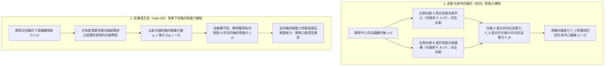
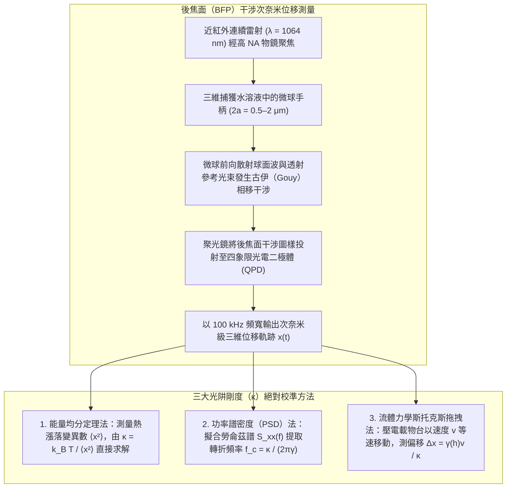

## 1. 引言：為什麼沒有靜質量的光能夠推拉物質？

在巨觀日常經驗中，光似乎完全沒有重量與機械力：陽光溫暖皮膚，卻不會推倒咖啡杯。然而從基礎物理學來看，電磁輻射同時攜帶<strong>能量</strong>與<strong>線性動量</strong>。早在1619年，克卜勒（Johannes Kepler）就透過觀測彗星塵埃尾始終背離太陽，提出太陽光會對物質施加推力——即<strong>輻射壓（Radiation Pressure）</strong>。1873年，馬克士威（James Clerk Maxwell）證明電磁波透過坡印廷向量 $\mathbf{S} = \frac{1}{\mu_0}(\mathbf{E} \times \mathbf{B})$ 傳輸動量；1905年，愛因斯坦狹義相對論給出質能動量關係 $E^2 = (pc)^2 + (mc^2)^2$。對於靜止質量 $m = 0$ 的光子，其動量 $p$ 與能量 $E = h\nu = hc/\lambda$ 的關係為：

$$
p = \frac{E}{c} = \frac{h\nu}{c} = \frac{h}{\lambda}
$$

當功率為 $P$ 的雷射光束垂直照射在完全吸收表面或全反射鏡面上時，每秒傳遞的動量即輻射壓力分別為：

$$
F_{\text{abs}} = \frac{P}{c}, \qquad F_{\text{ref}} = \frac{2P}{c}
$$

由於光速 $c \approx 3.0 \times 10^8\,\text{m/s}$ 極其巨大，$1\,\text{W}$ 雷射產生的推力僅為 $3.3\,\text{nN}$（奈米牛頓），在巨觀世界微不足道。但當我們進入<strong>微米（$10^{-6}\,\text{m}$）級的膠體微球、活細胞，以及奈米（$10^{-9}\,\text{m}$）級的生物大分子世界</strong>時，半徑 $a = 1\,\mu\text{m}$ 的聚苯乙烯微球質量僅為 $m \approx 4.4 \times 10^{-15}\,\text{kg}$，重力僅為 $mg \approx 0.043\,\text{pN}$（$1\,\text{pN} = 10^{-12}\,\text{N}$）。此時，幾十毫瓦聚焦雷射產生的數皮牛頓（$\text{pN}$）光學力比重力大數個數量級！更奇妙的是，高度聚焦的雷射不僅能向前推物體，還能透過<strong>光學梯度力（Optical Gradient Force）</strong>將透明微粒拉向光強最強的焦點中心——這就是榮獲2018年諾貝爾物理學獎的<strong>光鑷（Optical Tweezers）</strong>技術。

---

## 2. 亞瑟·阿什金（Arthur Ashkin）的開創性突破與光鑷的誕生

1970年，貝爾實驗室的<strong>亞瑟·阿什金（Arthur Ashkin，1922–2020）</strong>將毫瓦級氬離子雷射（$\lambda = 514.5\,\text{nm}$）射入懸浮著透明乳膠微球的水槽中。他原本預期微球會被輻射壓單純向前推，卻驚訝地發現：偏離光束中心的微球會<strong>同時被橫向拉向高斯光束最亮的中心軸線</strong>！同年，他利用兩束相向傳播的雷射抵消軸向散射力，構建了首個三維光學勢阱。

1986年，阿什金與同事 J. M. Dziedzic、J. E. Bjorkholm 以及<strong>朱棣文（Steven Chu）</strong>發表了里程碑論文（*Optics Letters*, 11, 288, 1986），證明僅用<strong>單束高度聚焦的雷射</strong>（透過高數值孔徑物鏡 $\text{NA} = 1.25$），軸向梯度力即可克服向前的散射力，在水中穩定三維捕獲直徑從 $10\,\mu\text{m}$ 到 $25\,\text{nm}$ 的電介質微粒——<strong>單光束梯度力光阱（光鑷）</strong>正式誕生。1987年，阿什金改用近紅外 <strong>Nd:YAG 雷射（$\lambda = 1064\,\text{nm}$）</strong>，避免了對生物樣品的光損傷，首次在無損狀態下捕獲並操縱活體大腸桿菌、酵母菌和菸草鑲嵌病毒，開創了單分子與單細胞生物物理學。

---

## 3. 幾何光學區（米氏散射區，$a \gg \lambda$）的捕獲力學

當微球半徑遠大於光波長（$a \gg \lambda$）時，可用幾何光線追蹤嚴格解釋動量傳遞。設透明微球折射率 $n_p$ 大於周圍介質（水）折射率 $n_m$（即相對折射率 $m = n_p / n_m > 1$）。功率為 $P_{\text{ray}}$ 的單根光線折射穿出微球時，單位時間動量變化率等於微球受到的反衝力 $\mathbf{F}_{\text{ray}}$：

$$
\mathbf{F}_{\text{ray}} = -\frac{d\mathbf{p}_{\text{light}}}{dt} = -\frac{n_m P_{\text{ray}}}{c} \left( \hat{\mathbf{u}}_{\text{out}} - \hat{\mathbf{u}}_{\text{in}} \right)
$$

- <strong>橫向穩定機制</strong>：在高斯光束 $I(r) = I_0 \exp(-2r^2/w_0^2)$ 中，若微球向右偏離光軸，穿過微球左半側的近軸強光線 A（功率 $P_A$）向右折射，給微球施加巨大的向左反衝力；而穿過右半側的邊緣弱光線 B（$P_B \ll P_A$）產生的向右反衝力很小，淨合力將微球拉回光軸中心。
- <strong>軸向穩定與高數值孔徑（High-NA）的必要性</strong>：當微球位於焦點下游（$+z$）時，經過焦點後原本大角度發散的邊緣光線被高折射率微球向內折射準直，使光線的軸向動量 $p_z$ 顯著增加（$\Delta p_z > 0$）。根據動量守恆，微球受到指向焦點上游（$-z$）的反向拉回力！只有當物鏡數值孔徑足夠大（$\text{NA} = n_m \sin\theta_{\max} \ge 1.2$），大角度外圍光線的反向折射反衝才能戰勝表面反射帶來的向前散射推力。

---

## 4. 電磁偶極區（瑞利散射區，$a \ll \lambda$）：梯度力與散射力的嚴格推導

當奈米顆粒半徑遠小於波長（$a \ll \lambda$）時，微粒在外加電場 $\mathbf{E}(\mathbf{r}, t)$ 中被極化為點電偶極子 $\mathbf{p} = \alpha \mathbf{E}$，其準靜態<strong>克勞修斯-莫索蒂（Clausius-Mossotti）極化率</strong> $\alpha$ 正比於顆粒體積（$\propto a^3$）：

$$
\alpha = 4\pi n_m^2 \varepsilon_0 a^3 \left( \frac{m^2 - 1}{m^2 + 2} \right) \qquad \left(m \equiv \frac{n_p}{n_m}\right)
$$

對不均勻電磁場中的勞侖茲力 $\mathbf{F} = (\mathbf{p}\cdot\nabla)\mathbf{E} + \dot{\mathbf{p}}\times\mathbf{B}$ 取光學週期時間平均，並計入偶極輻射反作用（瑞利散射截面 $\sigma_{\text{scat}} \propto k^4 a^6$），可得光阱總力由保守的<strong>光學梯度力 $\mathbf{F}_{\text{grad}}$</strong> 與非保守的<strong>光學散射力 $\mathbf{F}_{\text{scat}}$</strong> 組成：

$$
\mathbf{F}_{\text{grad}}(\mathbf{r}) = \frac{2\pi n_m a^3}{c} \left( \frac{m^2 - 1}{m^2 + 2} \right) \nabla I(\mathbf{r}) = -\nabla U(\mathbf{r})
$$

$$
\mathbf{F}_{\text{scat}}(\mathbf{r}) = \frac{n_m \sigma_{\text{scat}}}{c} I(\mathbf{r})\hat{\mathbf{z}} = \frac{128 \pi^5 n_m^5 a^6}{3 c \lambda_0^4} \left( \frac{m^2 - 1}{m^2 + 2} \right)^2 I(\mathbf{r}) \hat{\mathbf{z}}
$$

| 物理特性 | 光學梯度力（$\mathbf{F}_{\text{grad}}$） | 光學散射力（$\mathbf{F}_{\text{scat}}$） |
| :--- | :--- | :--- |
| <strong>物理起源</strong> | 不均勻電場對感應偶極子的位能最小化作用（或折射動量反衝） | 光子吸收與各向同性瑞利再輻射（或菲涅耳反射）傳遞的動量 |
| <strong>作用方向</strong> | 沿光強梯度 $\nabla I(\mathbf{r})$ 方向（當 $n_p > n_m$ 時指向三維焦點中心） | 沿波矢傳播方向 $\hat{\mathbf{z}}$（將微粒推向下游） |
| <strong>微粒半徑 $a$ 標度律（$a \ll \lambda$）</strong> | <strong>正比於體積（$\propto a^3$）</strong> | <strong>正比於體積平方（$\propto a^6$）</strong> |
| <strong>波長 $\lambda_0$ 標度律</strong> | 取決於焦斑空間梯度幾何 | <strong>反比於波長四次方（$\propto \lambda_0^{-4}$）</strong> |
| <strong>折射率比 $m = n_p/n_m$ 依賴</strong> | 線性依賴於 $\left(\frac{m^2-1}{m^2+2}\right)$（$m<1$ 時變為排斥力） | 二次方依賴於 $\left(\frac{m^2-1}{m^2+2}\right)^2$（恆為正向推力） |

要在室溫 $T = 300\,\text{K}$ 下克服熱運動能量 $k_B T \approx 4.14\,\text{pN}\cdot\text{nm}$ 實現穩定捕獲，克拉莫逃逸理論要求光學勢阱深度滿足 $|U_{\min}| \propto a^3 I_{\max} \gtrsim 10\,k_B T$。由於勢阱深度隨半徑按 $a^3$ 急劇縮小，直接捕獲幾奈米的單個蛋白質需要毀滅性的高雷射功率。因此，單分子生物物理學家總是將蛋白質或 DNA 化學偶聯在<strong>微米級介電微球（$2a \sim 0.5\text{–}2\,\mu\text{m}$，「手柄」）</strong>上進行精密操控。

---

## 5. 駕馭布朗運動：過阻尼朗之萬方程與皮牛頓級剛度校準

在焦點平衡位置附近（$|\Delta x| \lesssim 150\,\text{nm}$），光學勢阱呈簡諧拋物線型 $U(x) \approx \frac{1}{2}\kappa_x x^2$，光鑷表現為遵循<strong>虎克定律（Hooke's Law）</strong>的精密線性彈簧：

$$
F_{\text{trap}}(x) = -\kappa_x \Delta x
$$

其中 $\kappa_x$（通常為 $0.005\text{–}1.0\,\text{pN/nm}$）為<strong>光阱剛度（Trap Stiffness）</strong>。在微米尺度流體中，雷諾數極低（$\text{Re} \sim 10^{-5} \ll 1$），慣性弛豫時間僅 $\tau_m = m/\gamma \approx 50\,\text{ns}$，小球在黏滯阻力 $\gamma = 6\pi\eta_{\text{vis}}a$（斯托克斯定律）與熱漲落白雜訊力驅動下遵循<strong>過阻尼朗之萬方程（Overdamped Langevin Equation）</strong>：

$$
\gamma \frac{dx(t)}{dt} + \kappa x(t) = \sqrt{2\gamma k_B T}\,\eta(t)
$$

利用背焦面（BFP）四象限光電二極體（QPD）記錄的布朗運動軌跡 $x(t)$，可透過三種經典方法精確校準剛度 $\kappa$：
1. <strong>能量均分定理法（Equipartition Theorem）</strong>：由熱平衡統計力學 $\frac{1}{2}\kappa \langle x^2 \rangle = \frac{1}{2}k_B T$，直接得 $\kappa = k_B T / \langle x^2 \rangle$（無需知道液體黏度 $\eta_{\text{vis}}$ 和微球半徑 $a$）。
2. <strong>功率譜密度（PSD）勞侖茲擬合法</strong>：對過阻尼朗之萬方程做傅立葉變換，單邊位置功率譜 $S_{xx}(f)$ 呈嚴格的勞侖茲線型：
   $$
   S_{xx}(f) = \frac{k_B T}{\pi^2 \gamma \left( f_c^2 + f^2 \right)}, \qquad f_c = \frac{\kappa}{2\pi \gamma}
   $$
   測定轉折頻率（Corner Frequency）$f_c$ 即可高精度求出 $\kappa = 2\pi\gamma f_c$，且完全免疫低頻機械漂移。
3. <strong>斯托克斯流體拖拽法</strong>：結合近壁面法克森修正（Faxén's Law）$\gamma_\parallel(h)$，透過已知流速 $v$ 下的平衡位移 $\Delta x = \gamma_\parallel(h)v/\kappa$ 標定力與位移關係。

---

## 6. 單分子生物物理學革命：DNA 熵彈性與分子馬達的離散步進

為了在不損傷生物大分子的前提下長時間觀測，現代生物光鑷工作在 $\lambda = 1064\,\text{nm}$ 的<strong>近紅外生物光學窗口</strong>，並配合葡萄糖氧化酶/過氧化氫酶<strong>除氧系統（Oxygen Scavenging System）</strong>消除單線態氧光毒性。

### 卡洛斯·布斯塔曼特（Carlos Bustamante）與單根 DNA 分子的蠕蟲狀鏈（WLC）彈性
1992–1996年，<strong>布斯塔曼特</strong>團隊利用生物素-鏈黴親和素（Biotin-Streptavidin）或地高辛（Digoxigenin）化學鍵將單根 $\lambda$ 噬菌體雙鏈 DNA（$L_0 \approx 16.5\,\mu\text{m}$）兩端分別連接在光阱微球與微吸管上，測出單分子力-伸長曲線 $F(z)$，證實 DNA 的<strong>熵彈性（Entropic Elasticity）</strong>嚴格遵循馬爾科-西吉亞（Marko-Siggia）<strong>蠕蟲狀鏈（Worm-Like Chain, WLC）模型</strong>：

$$
F(z) = \frac{k_B T}{L_p} \left[ \frac{1}{4\left(1 - z/L_0\right)^2} - \frac{1}{4} + \frac{z}{L_0} \right]
$$

其中持久長度 $L_p \approx 50\,\text{nm}$。當拉力達到 $F \approx 65\,\text{pN}$ 時，雙鏈 DNA 發生高度協同的<strong>過度拉伸相變（Overstretching Transition）</strong>，長度突增至原長的 $1.7$ 倍。

### 史蒂文·布洛克（Steven Block）：驅動蛋白 8 奈米步進與 RNA 聚合酶單鹼基分辨
- <strong>驅動蛋白（Kinesin-1）與肌球蛋白（Myosin）</strong>：1993年，<strong>史蒂文·布洛克</strong>團隊（*Nature*, 365, 721）將單個驅動蛋白分子偶聯於光鑷微球並置於微管（Microtubule）軌道上，首次直接觀測到驅動蛋白並非連續滑動，而是以 <strong>$\Delta d = 8.2\,\text{nm}$（恰等於一個微管蛋白二聚體週期）的離散步長</strong>以「手遞手（Hand-over-hand）」方式前進！每走一步消耗<strong>整整 1 個 ATP 分子</strong>（緊密力化學偶聯），在高達 $F_{\text{stall}} \approx 6\text{–}7\,\text{pN}$ 的<strong>失速力（Stall Force）</strong>下停止，單步輸出機械功 $W \approx 50\,\text{pN}\cdot\text{nm}$，熱力學能量轉換效率高達 $\sim 50\text{–}60\%$。
- <strong>雙光阱超穩定光鑷與 RNA 聚合酶（RNAP）</strong>：2005年，布洛克團隊構建了懸浮於氦氣聲學隔離腔中的<strong>被動力鉗雙光阱系統（Dual-Trap Dumbbell Optical Tweezers）</strong>，將基底漂移雜訊徹底消除，成功分辨出大腸桿菌 RNA 聚合酶沿 DNA 模板每次轉錄一個鹼基對的 <strong>$3.4\,\text{\AA}$（$0.34\,\text{nm}$）離散步進</strong>！

---

## 7. 前沿演進：從全像光鑷、電漿奈米光鑷到真空懸浮量子光力學

進入21世紀，光學捕獲技術已遠超單一高斯光束：
1. <strong>全像光鑷（Holographic Optical Tweezers, HOT）與角動量傳遞</strong>：利用空間光調變器（SLM）即時合成電腦生成全像圖，可同時獨立操控數百個微粒組裝三維微結構；若使用攜帶自旋角動量（圓偏振，$\pm\hbar$）或軌道角動量（拉蓋爾-高斯渦旋光束 $e^{i\ell\phi}$，$\ell\hbar$）的光束，則可構成驅動微米齒輪旋轉的<strong>光學扳手（Optical Spanner）</strong>。
2. <strong>電漿奈米光鑷（Plasmonic Nanotweezers）</strong>：利用金屬奈米蝶形天線（Bowtie Nanoantennas）的局域表面電漿共振（LSPR）產生極端次波長場梯度 $\nabla|\mathbf{E}|^2$，突破繞射極限與 $a^3$ 熱逃逸限制，無需微球手柄即可直接捕獲單個蛋白質分子（$< 10\,\text{nm}$）。
3. <strong>原子光鑷陣列與真空懸浮量子光力學</strong>：在超高真空（$10^{-10}\,\text{Torr}$）中，光鑷一方面用於構建無缺陷<strong>中性原子陣列（Neutral-Atom Quantum Simulators）</strong>實現數百量子位元糾纏計算；另一方面將 $100\,\text{nm}$ 二氧化矽奈米球冷卻至<strong>量子力學運動基態（$\bar{n} < 1$ 聲子）</strong>（Delić et al., *Science*, 2020），為探索巨觀量子疊加態與暗物質微弱力感測開闢了全新紀元。
