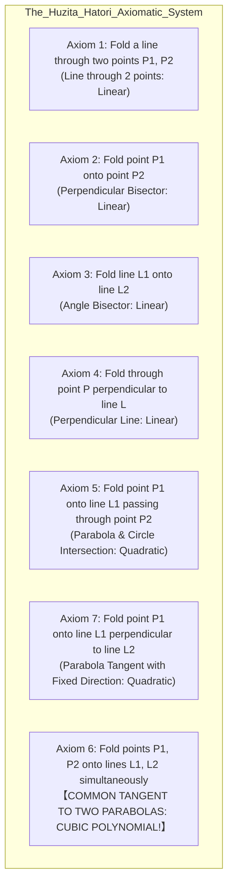
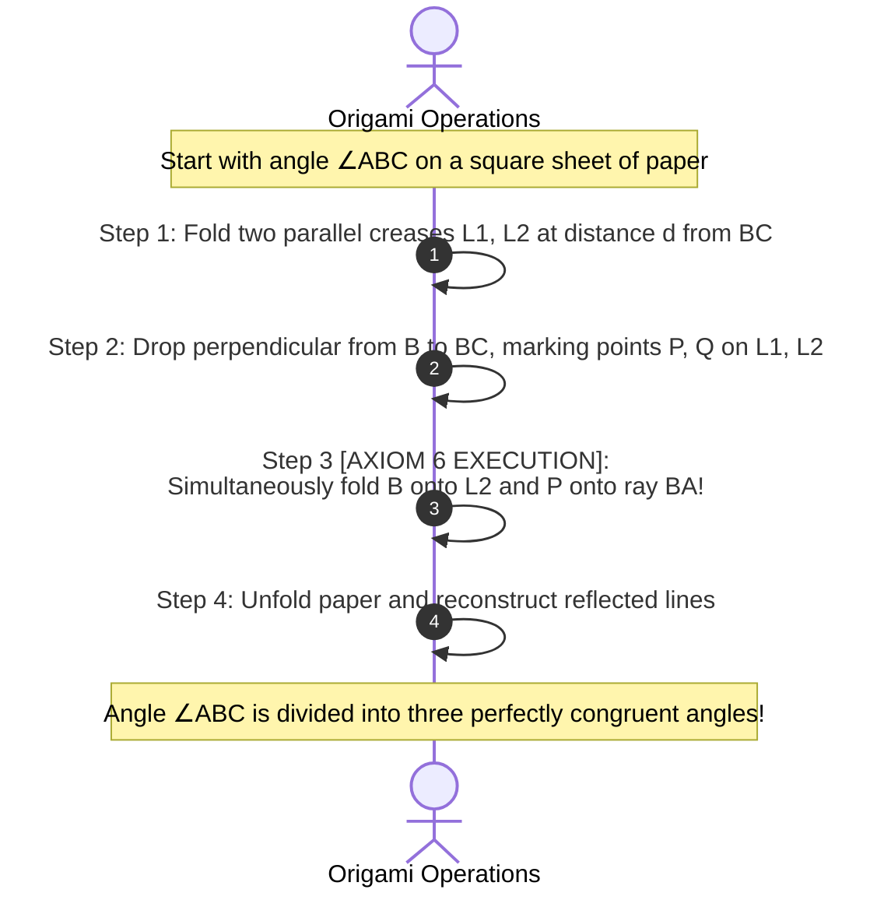
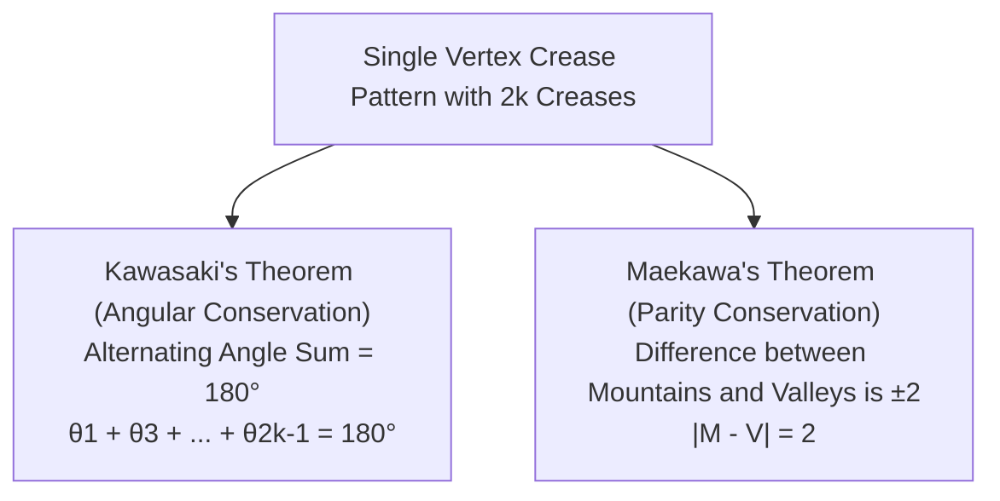

For over two millennia, the greatest minds of classical antiquity and the Enlightenment were haunted by the legendary <strong>Three Classical Problems of Antiquity</strong>. Formulated in ancient Greece, these geometrical challenges demanded constructions using only an unmarked straightedge and a compass:

1. <strong>The Trisection of the Angle</strong>: Construct an angle exactly one-third the measure of an arbitrary given angle.
2. <strong>The Duplication of the Cube (The Delian Problem)</strong>: Construct the side of a cube whose volume is precisely twice that of a given cube (requiring the geometric construction of $\sqrt[3]{2}$).
3. <strong>The Squaring of the Circle</strong>: Construct a square having exactly the same area as a given circle (requiring the construction of $\sqrt{\pi}$).

In 1837, French mathematician Pierre Wantzel applied the nascent machinery of abstract algebra and field theory to prove conclusively that the first two problems are <strong>impossible</strong> with straightedge and compass. In 1882, Ferdinand von Lindemann proved the transcendence of $\pi$, permanently sealing the impossibility of the third. Straightedge and compass constructions, it turned out, are strictly constrained to the realm of iterated quadratic field extensions—meaning they can only compute square roots ($\sqrt{\cdot}$), never cube roots ($\sqrt[3]{\cdot}$).

For centuries, this was regarded as the final, immutable boundary of planar geometric construction.

Then came a revelation from an astonishingly humble source: <strong>a flat sheet of square paper</strong>.

In the twentieth century, mathematicians discovered that the simple, tactile physical act of <strong>folding paper (Origami)</strong> effortlessly shatters the Euclidean barrier. Using a sequence of precise folds governed by rigorous geometric axioms, one can <strong>trisect an arbitrary angle</strong> and <strong>construct $\sqrt[3]{2}$ (doubling the cube)</strong> in mere seconds with surgical precision.

What was long dismissed as a child's pastime in Japanese traditional culture is, in truth, <strong>a powerful analog computer capable of solving cubic and quartic polynomial equations</strong>.

Today, formal origami mathematics has evolved far beyond recreational puzzles. Systematized by the <strong>Huzita-Hatori Axioms</strong>, governed by the topological theorems of Kawasaki and Maekawa, and empowered by computational circle-packing algorithms (Robert Lang's TreeMaker), origami has transformed into a cutting-edge technological discipline: <strong>Origami Engineering</strong>. From the Miura fold deploying solar arrays in deep space to self-expanding cardiovascular stents and auxetic mechanical metamaterials, folding paper has redefined modern science.

This exhaustive treatise examines the algebraic impossibility theorems of classical geometry, uncovers the forgotten historical breakthrough of Margherita Beloch, deconstructs how simultaneous folds solve cubic equations via common tangents of parabolas, provides step-by-step mathematical proofs of angle trisection and cube duplication, surveys flat foldability, and explores the revolutionary industrial applications of computational origami.

---

## 1. The Classical Impasse: Ruler, Compass, and Field Theory

To comprehend how paper folding transcends Euclidean geometry, we must first examine why the ruler and compass were doomed to fail.

### 1.1 The Geometric Operations of Euclidean Construction

In classical geometry, valid constructions permit only two idealized instruments:
1. <strong>Unmarked Straightedge</strong>: Draws an infinitely extendable straight line through two distinct, previously identified points.
2. <strong>Compass</strong>: Draws a circle centered at a given point with a radius equal to the distance between two given points.

Every point constructed via these tools arises strictly as:
- The intersection of two lines: algebraically, a system of two linear equations ($1^{\text{st}}$ degree).
- The intersection of a line and a circle: a system of a linear equation and a quadratic equation ($2^{\text{nd}}$ degree).
- The intersection of two circles: subtracting the two quadratic equations yields the equation of their radical axis (a linear equation), reducing the problem back to the intersection of a line and a circle ($2^{\text{nd}}$ degree).

### 1.2 Constructible Numbers and Tower of Quadratic Extensions

Let two initial base points be defined in the Cartesian plane as $(0, 0)$ and $(1, 0)$, establishing the unit length $1$ and the field of rational numbers $\mathbb{Q}$.

A real number $\alpha$ is defined as <strong>compass-and-straightedge constructible</strong> if and only if there exists a finite sequence of field extensions:

$$
\mathbb{Q} = K_0 \subset K_1 \subset K_2 \subset \dots \subset K_m
$$

such that $\alpha \in K_m$, and for each intermediate step $j \in \{1, \dots, m\}$:

$$
[K_j : K_{j-1}] = 2
$$

By the tower law of field degrees, the total extension degree over $\mathbb{Q}$ must satisfy:

$$
[K_m : \mathbb{Q}] = \prod_{j=1}^m [K_j : K_{j-1}] = 2^m
$$

Consequently, if the minimal polynomial of a geometric magnitude $\alpha$ over $\mathbb{Q}$ has a degree that is <strong>not a power of two</strong>, $\alpha$ <strong>cannot be constructed with ruler and compass</strong> (Wantzel's Theorem, 1837).

### 1.3 Algebraic Impossibility of the Delian Problem and Angle Trisection

#### 1. Doubling the Cube (Delian Problem)
Let the original cube have unit volume $V = 1$. A cube of volume $2$ must have side length $x$ satisfying:
$$
x^3 = 2 \implies x = \sqrt[3]{2}
$$
The polynomial $P(x) = x^3 - 2$ is irreducible over $\mathbb{Q}$ by Eisenstein's Criterion (with prime $p = 2$). The field extension degree is:
$$
[\mathbb{Q}(\sqrt[3]{2}) : \mathbb{Q}] = 3
$$
Since $3$ is not a power of $2$ ($3 \neq 2^k$), <strong>doubling the cube with ruler and compass is mathematically impossible</strong>.

#### 2. Trisecting an Arbitrary Angle
Consider an angle $\theta = 60^\circ$ ($\pi/3$ radians), which is easily constructed with ruler and compass (via an equilateral triangle). If an arbitrary angle could be trisected, one could construct an angle of $20^\circ$ ($\pi/9$).
Applying the trigonometric triple-angle identity for cosine:
$$
\cos(3\phi) = 4\cos^3\phi - 3\cos\phi
$$
Setting $\phi = 20^\circ$, so that $3\phi = 60^\circ$ and $\cos(60^\circ) = 1/2$:
$$
\frac{1}{2} = 4\cos^3(20^\circ) - 3\cos(20^\circ)
$$
Multiplying by $2$ and substituting $x = 2\cos(20^\circ)$:
$$
x^3 - 3x - 1 = 0
$$
By the Rational Root Theorem, any rational root must divide $\pm 1$. Testing $x = \pm 1$:
$$
(1)^3 - 3(1) - 1 = -3 \neq 0, \quad (-1)^3 - 3(-1) - 1 = 1 \neq 0
$$
Since it has no rational roots, the cubic polynomial $x^3 - 3x - 1$ is irreducible over $\mathbb{Q}$. Its extension degree is:
$$
[\mathbb{Q}(2\cos(20^\circ)) : \mathbb{Q}] = 3
$$
Because $3 \neq 2^k$, <strong>trisecting a $60^\circ$ angle with straightedge and compass is mathematically impossible</strong>.

---

## 2. Margherita Beloch: The Forgotten Pioneer (1936)

For nearly a century after Wantzel's proof, mathematicians assumed that geometric planar construction ended at quadratic equations. 

However, in 1936, the Italian geometer <strong>Margherita Piazzola Beloch</strong> (professor of geometry at the University of Ferrara) made a historic discovery: <strong>folding a sheet of paper allows the direct physical construction of the real roots of general cubic equations</strong>.

Beloch recognized that folding paper does not merely mirror Euclidean straightedge drawing. When paper is folded so that two distinct points simultaneously land onto two distinct lines, the crease line acts as a <strong>common tangent to two distinct parabolas</strong>. In projective algebraic geometry, finding the common tangents of two conics is a problem of degree $3$ or $4$.

Beloch used this construction—now celebrated as the <strong>Beloch Fold</strong>—to solve the cubic equation and construct $\sqrt[3]{2}$. Unfortunately, because her research was published in Italian mathematics journals during the turbulent interwar period, her work remained largely unknown to the wider world until its rediscovery in the 1980s by Japanese and American geometers.

---

## 3. The Huzita-Hatori Axioms: The Formal Foundations of Origami

Just as Euclid established five postulates for classical plane geometry, modern origami was rigorously axiomatized through the work of <strong>Humiaki Huzita</strong> (1989), <strong>Jacques Justin</strong> (1986/1989), and <strong>Koshiro Hatori</strong> (2001). Together, they defined the <strong>Seven Huzita-Hatori Axioms</strong>, proving that these seven operations encapsulate every possible single-crease fold of a planar sheet.

### Detailed Formalization of the Seven Axioms

1. <strong>Axiom 1</strong>: Given two points $P_1$ and $P_2$, fold a crease along the unique straight line passing through both. (Corresponds to Euclidean straightedge; linear, degree 1).
2. <strong>Axiom 2</strong>: Given two points $P_1$ and $P_2$, fold point $P_1$ directly onto point $P_2$. (Constructs the perpendicular bisector of segment $P_1P_2$; linear, degree 1).
3. <strong>Axiom 3</strong>: Given two lines $L_1$ and $L_2$, fold line $L_1$ onto line $L_2$. (Constructs the angle bisector of the two lines; linear, degree 1).
4. <strong>Axiom 4</strong>: Given a point $P$ and a line $L$, fold a crease passing through $P$ perpendicular to $L$. (Constructs the unique perpendicular dropped from a point to a line; linear, degree 1).
5. <strong>Axiom 5</strong>: Given two points $P_1, P_2$ and a line $L_1$, fold a crease passing through $P_2$ that maps $P_1$ onto $L_1$. (Geometrically, the crease is a tangent to the parabola with focus $P_1$ and directrix $L_1$ passing through $P_2$; quadratic, degree 2).
6. <strong>Axiom 6 (The Master Axiom)</strong>: <strong>Given two points $P_1, P_2$ and two lines $L_1, L_2$, fold a single crease that simultaneously maps $P_1$ onto $L_1$ and $P_2$ onto $L_2$.</strong> (Constructs a common tangent to two parabolas; <strong>cubic, degree 3</strong>).
7. <strong>Axiom 7</strong>: Given a point $P_1$ and two lines $L_1, L_2$, fold a crease perpendicular to $L_2$ that maps $P_1$ onto $L_1$. (Added by Koshiro Hatori in 2001; quadratic, degree 2).

Axioms 1 through 5, and Axiom 7, generate only linear and quadratic field extensions. They allow us to construct exactly the same numbers as straightedge and compass.

<strong>Axiom 6 alone shatters the quadratic ceiling, lifting origami into the realm of cubic equations.</strong>

---

## 4. The Geometry of Axiom 6: Parabolas and Common Tangents

Why does Axiom 6 solve cubic equations? The secret lies in the definition of a parabola as an envelope of tangent lines.

### 4.1 Folding a Point to a Line Generates a Parabola
Recall the classical locus definition of a <strong>parabola</strong>:
> The set of all points in the plane equidistant from a fixed point (the <strong>focus</strong> $F$) and a fixed line (the <strong>directrix</strong> $D$).

Suppose we have a point $P$ and a line $L$. When we fold the paper so that point $P$ lands on some point $P' \in L$, the crease line $K$ is, by definition of reflection, the <strong>perpendicular bisector of the segment $PP'$</strong>.

For any point $Q$ on the crease $K$, the distance to $P$ equals the distance to $P'$:
$$
\|Q - P\| = \|Q - P'\|
$$
If we construct a line perpendicular to $L$ through $P'$, it intersects the crease $K$ at a point $Q_0$. At this point:
$$
\text{dist}(Q_0, P) = \text{dist}(Q_0, L)
$$
Therefore, $Q_0$ lies on the parabola $\mathcal{P}$ whose focus is $P$ and whose directrix is $L$. Furthermore, because every other point $Q \in K$ satisfies $\|Q - P\| = \|Q - P'\| > \text{dist}(Q, L)$, the crease line $K$ touches the parabola $\mathcal{P}$ at exactly one point $Q_0$ and never crosses it!

<strong>Every valid fold mapping point $P$ onto line $L$ is tangent to the parabola with focus $P$ and directrix $L$.</strong> The family of all such folds forms the envelope of tangents to the parabola.

### 4.2 Axiom 6 as the Common Tangent of Two Parabolas
Now consider Axiom 6: we are given two focus-directrix pairs:
- Parabola $\mathcal{P}_1$ with focus $P_1$ and directrix $L_1$.
- Parabola $\mathcal{P}_2$ with focus $P_2$ and directrix $L_2$.

A single fold $K$ that simultaneously places $P_1$ onto $L_1$ and $P_2$ onto $L_2$ must be:
- Tangent to $\mathcal{P}_1$, AND
- Tangent to $\mathcal{P}_2$.

In Cartesian coordinates, let the line have slope $m$ and intercept $k$: $y = mx + k$.
The condition of tangency to a parabola $y = ax^2 + bx + c$ requires that the discriminant of their intersection equation vanishes:
$$
\Delta_1(m, k) = 0 \implies k = f_1(m)
$$
where $f_1(m)$ is a rational function of $m$.
Similarly, tangency to the second parabola $\mathcal{P}_2$ requires:
$$
\Delta_2(m, k) = 0 \implies k = f_2(m)
$$
Equating the two expressions for the intercept $k$:
$$
f_1(m) = f_2(m)
$$
Clearing denominators yields a polynomial equation in the slope $m$ of degree <strong>three</strong>:

$$
A m^3 + B m^2 + C m + D = 0
$$

Depending on the relative orientation and distance between the two parabolas, they share <strong>between one and three real common tangents</strong>. When a human being slides the paper until two points align with two lines simultaneously, the physical sheet is executing an analog gradient search that converges instantly upon the real root of an arbitrary cubic polynomial!

---

## 5. Abe's Angle Trisection: The Definitive Origami Proof

The most celebrated demonstration of Axiom 6 in action is <strong>Abe's Angle Trisection</strong>, discovered in 1980 by the Japanese origami master and mathematician <strong>Hisashi Abe</strong> (阿部恒).

### 5.1 Step-by-Step Construction Protocol
Let an arbitrary acute angle $\angle ABC$ be drawn on a sheet of paper, with vertex $B$, base ray $BC$, and top ray $BA$.

1. <strong>Crease Parallel Baselines</strong>:
   Fold a line $L_1$ parallel to ray $BC$ at arbitrary distance $d$.
   Fold a second line $L_2$ parallel to $L_1$ at the same distance $d$ (so the distance from $BC$ to $L_2$ is $2d$).
2. <strong>Mark Reference Points</strong>:
   Fold a line through vertex $B$ perpendicular to $BC$.
   Let this perpendicular intersect line $L_1$ at point $P$, and line $L_2$ at point $Q$.
   By construction, the segment lengths are equal: $\|B - P\| = d$ and $\|P - Q\| = d$.
3. <strong>Execute the Master Fold (Axiom 6)</strong>:
   Fold the paper such that:
   - Vertex $B$ is mapped onto a point $B'$ on line $L_2$, AND
   - Point $P$ is simultaneously mapped onto a point $P'$ on ray $BA$.
   Crease the paper firmly along this line $K$, then unfold.
4. <strong>Draw the Trisection Rays</strong>:
   Fold through vertex $B$ along the crease that maps to $B'$.
   The ray $BP'$ cuts off exactly $\frac{1}{3} \angle ABC$, and the subsequent crease cuts off the second third!

### 5.2 Geometric Rigor of the Proof
The crease line $K$ is the axis of reflection mapping $B \mapsto B'$ and $P \mapsto P'$.
- By isometry of reflection, the segment $BP$ is congruent to $B'P'$, with length $\|B'P'\| = d$.
- Because $B'$ lies on $L_2$ (which is at distance $2d$ from $BC$) and $L_1$ lies halfway between at distance $d$, the perpendicular dropped from $B'$ to $L_1$ has length $d$.
- Using the properties of congruent right triangles formed by the reflected points, three identical adjacent right triangles are formed around vertex $B$.
- Consequently:
  $$
  \angle_1 = \angle_2 = \angle_3 = \frac{1}{3} \angle ABC
  $$
The ancient Euclidean impossibility is dissolved by a single simultaneous alignment fold.

---

## 6. Duplicating the Cube: Peter Messer's Construction of $\sqrt[3]{2}$

In 1986, American mathematician <strong>Peter Messer</strong> published a remarkably simple construction using a square piece of paper to construct $\sqrt[3]{2}$.

### Messer's Protocol:
1. Divide a square sheet of unit edge length ($[0, 1] \times [0, 1]$) into three horizontal strips of equal width by folding creases at $y = 1/3$ and $y = 2/3$.
2. Label the bottom-left corner $(0, 0)$ as point $P_1$, and the point $(0, 1/3)$ on the left edge as $P_2$.
3. Define line $L_1$ as the right edge $x = 1$, and line $L_2$ as the upper crease $y = 2/3$.
4. <strong>Apply Axiom 6</strong>:
   Simultaneously fold point $P_1(0, 0)$ onto line $L_1 (x = 1)$ and point $P_2(0, 1/3)$ onto line $L_2 (y = 2/3)$.
5. Let the point $P_1$ land at $(1, y^*)$ on the right edge.

Solving the system of parabolas shows that the coordinate $y^*$ satisfies:
$$
y^* = \sqrt[3]{2} - 1
$$
Adding the unit length $1$ produces <strong>$\sqrt[3]{2}$</strong>, duplicating the cube with breathtaking simplicity!

---

## 7. The Field of Origami Numbers: $\mathcal{O}$

What is the full algebraic power of origami? 

A real number is called an <strong>Origami Number</strong> (belonging to field $\mathcal{O}$) if it can be constructed from a given unit length using the seven Huzita-Hatori axioms.

In algebraic field theory, because origami can solve arbitrary linear, quadratic, and cubic equations, the field $\mathcal{O}$ is the closure of $\mathbb{Q}$ under:
- Addition, subtraction, multiplication, and division ($+ , -, \times, \div$)
- Square roots ($\sqrt{\cdot}$)
- Cube roots ($\sqrt[3]{\cdot}$)

### The Origami Degree Theorem
A number $\alpha$ is an origami number if and only if its minimal polynomial over $\mathbb{Q}$ has a splitting field whose degree over $\mathbb{Q}$ has the form:

$$
[\mathbb{Q}(\alpha) : \mathbb{Q}] = 2^a \cdot 3^b \quad (a, b \in \mathbb{Z}_{\ge 0})
$$

### Constructibility of Regular Polygons
Under Gauss's famous theorem, a regular $p$-gon can be constructed with straightedge and compass if and only if $p$ is a product of a power of 2 and distinct Fermat primes ($p = 2^k F_0 F_1 \dots$). Thus, regular 7-gons (heptagons) and 9-gons (nonagons) are impossible with ruler and compass.

With origami:
- <strong>Regular Heptagon (7-gon)</strong>: The minimal polynomial for $\cos(2\pi/7)$ is $8x^3 + 4x^2 - 4x - 1 = 0$, which has degree $3$. <strong>Constructible with origami!</strong>
- <strong>Regular Nonagon (9-gon)</strong>: Requires trisecting $60^\circ$, degree $3$. <strong>Constructible with origami!</strong>
- <strong>Regular 13-gon, 19-gon, etc.</strong>: Any polygon whose symmetry group factors into powers of 2 and 3 can be constructed folded in paper.

---

## 8. Flat Foldability: Kawasaki's and Maekawa's Theorems

Beyond geometric construction lies the topological and combinatorial question of <strong>Flat Foldability</strong>: *Given a crease pattern (a planar graph of folds), can it be folded into a completely flat configuration without tearing, stretching, or penetrating itself?*

### 8.1 Kawasaki's Theorem (1989)
Let $2k$ creases meet at a single flat vertex, dividing the surrounding paper into angles $\theta_1, \theta_2, \dots, \theta_{2k}$ in circular order.

> <strong>Kawasaki's Theorem</strong>: A single-vertex crease pattern is flat-foldable if and only if the sum of every other angle equals $180^\circ$:
> $$
> \theta_1 + \theta_3 + \dots + \theta_{2k-1} = 180^\circ = \pi
> $$
> and
> $$
> \theta_2 + \theta_4 + \dots + \theta_{2k} = 180^\circ = \pi
> $$

This theorem is proven by modeling the folded vertex as a closed spherical polygon on the unit sphere; alternating folds reverse the orientation of motion, requiring equal forward and backward angular displacements to close the loop.

### 8.2 Maekawa's Theorem (1980s)
At any flat-foldable vertex, folds must be designated as either <strong>Mountain ($M$)</strong> or <strong>Valley ($V$)</strong>.

> <strong>Maekawa's Theorem</strong>: The difference between the number of mountain folds and valley folds at any interior vertex of a flat-folded origami pattern is always $\pm 2$:
> $$
> M - V = \pm 2
> $$

Because $M + V = 2k$ is always even, $M - V$ must also be even. Topologically, tracing a small circle around the folded vertex corresponds to a rotation of $\pm 360^\circ$, directly mandating $180^\circ(M - V) = \pm 360^\circ$.

### 8.3 The Computational Complexity: NP-Completeness
While a single vertex is easy to verify, testing whether an arbitrary multi-vertex crease pattern can be flat-folded was proven to be <strong>NP-Complete</strong> by Marshall Bern and Erik Demaine in 1996. The paper sheet can simulate Boolean logic circuits (AND, OR, NOT gates), showing that paper folding possesses universal computational expressiveness.

---

## 9. Computational Origami: Robert Lang and TreeMaker

In the 1990s, physicist and origami master <strong>Robert J. Lang</strong> revolutionized the field by formalizing <strong>Computational Origami</strong>.

To fold an arbitrary complex shape (e.g., an insect with six legs, two antennae, and wings) from an uncut square, Lang modeled the target subject as a topological <strong>stick figure (Tree Graph)</strong>.
Each appendage of length $l_i$ requires a flap of paper containing a circular disk of radius $l_i$. The design problem is mathematically equivalent to the <strong>Circle Packing Problem</strong>: pack non-overlapping disks into the square such that their pairwise distances satisfy:

$$
\forall i \neq j, \quad \|p_i - p_j\| \ge l_i + l_j
$$

Lang developed the software <strong>TreeMaker</strong>, which solves nonlinear Kuhn-Tucker optimization problems to automatically generate complete, foldable crease patterns obeying Kawasaki's and Maekawa's theorems.

---

## 10. Modern Engineering: From Deep Space to Nanomedicine

Origami mathematics has expanded into an indispensable branch of modern aerospace, mechanical, and biomedical engineering.

### 10.1 The Miura-ori and Space Exploration
Invented in 1970 by Japanese astrophysicist <strong>Koryo Miura</strong>, the <strong>Miura fold (ミウラ折り)</strong> is a rigid tessellation of parallelograms that packs a large planar surface into a compact footprint with <strong>1 degree of freedom</strong>. Pulling on two opposite corners deploys the entire two-dimensional array simultaneously without flexing the rigid facets.
- Flown on Japan's Space Flyer Unit (SFU) satellite in 1995.
- Inspired the deployment mechanisms for NASA's James Webb Space Telescope (JWST) solar shields and deep-space solar sails.

### 10.2 Biomedical Stents and Micro-Robotics
Using origami folding patterns, researchers at Oxford University designed self-expanding heart stents. Folded into a slender cylinder to navigate narrow blood vessels, the origami tube expands radially upon reaching an arterial blockage, locking into place without surgery.

### 10.3 Mechanical Metamaterials and Auxetics
Unlike standard materials that become thinner when stretched (positive Poisson's ratio), origami tessellations can exhibit <strong>negative Poisson's ratio (Auxetics)</strong>: stretching them horizontally causes them to expand vertically as well. This enables ultra-impact-resistant armor, adaptive acoustic dampeners, and morphing aircraft wings.

---

## 11. Conclusion: The Liberation of Geometry

The mathematical journey of origami delivers an enduring epistemological lesson:

<strong>The limits of what can be solved depend entirely on the physical operations permitted by our tools.</strong>

Ancient Greek geometers confined themselves to the virtual, idealized abstractions of the ruler and compass, inadvertently trapping their mathematics within quadratic boundaries. Yet, by embracing the physical reality of a flexible, foldable sheet of paper, modern mathematics discovered that physical constraints—the ability to touch point to line and fold simultaneously—open the gates to higher-order algebraic worlds.

In every humble crease of paper lies the vindication of ancient dreams and the structural foundation of the technologies that carry humanity into the stars.
