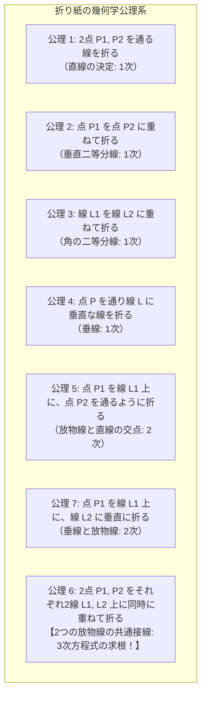
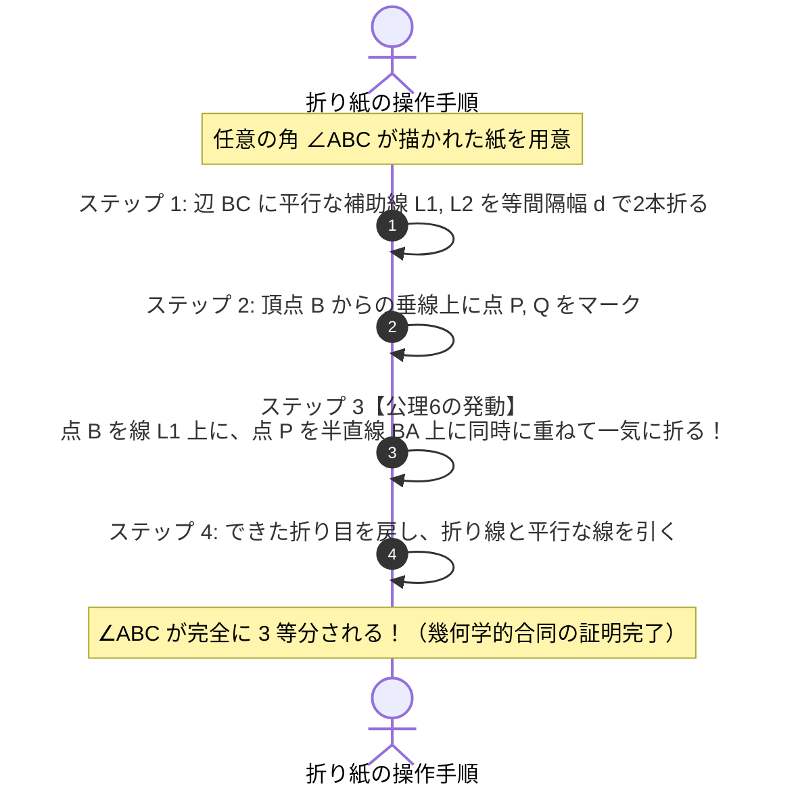
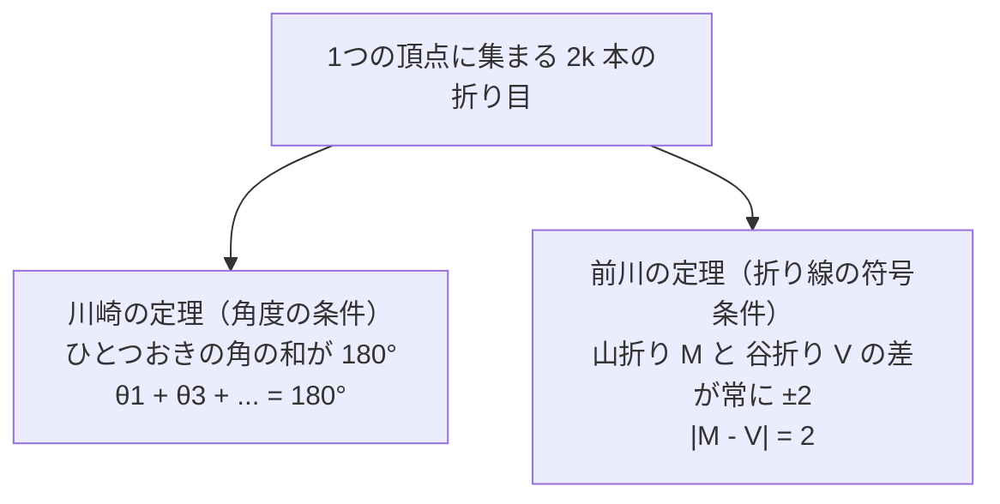
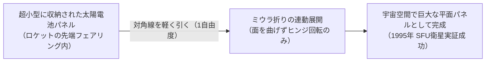

古代ギリシャの幾何学者たちを2000年以上にわたって悩ませ続けた伝説的な難問群があります。それが、目盛りのない定規とコンパスだけを用いて図形を作図する<strong>「ギリシャの三大作図不能問題」</strong>です。

1. <strong>角の三等分問題</strong>: 任意の与えられた角を3等分せよ。
2. <strong>立方体倍積問題（デロス島の問題）</strong>: 与えられた立方体の2倍の体積を持つ立方体の1辺を作図せよ（$\sqrt[3]{2}$ の作図）。
3. <strong>円積問題</strong>: 与えられた円と全く同じ面積を持つ正方形を作図せよ（$\sqrt{\pi}$ の作図）。

19世紀に入り、代数学（ガロア理論や体論）の発展によって、これらの問題が「定規とコンパスだけでは原理的に不可能である」ことが厳密に証明され、古代の夢は永遠に葬り去られたかのように見えました。定規とコンパスによる作図は、代数学的には「二次方程式の解（平方根 $\sqrt{\cdot}$）の有限回の四則演算」に厳格に制限されているからです。

ところが、20世紀後半、数学界を揺るがす驚異の事実が明らかになりました。

<strong>「1枚の平らな正方形の紙を折る」という行為を用いると、定規とコンパスでは絶対に不可能だった「任意の角の三等分」も「$\sqrt[3]{2}$ の作図（立方体の倍積）」も、極めて明快に解くことができるのです。</strong>

子供の遊びと見なされていた日本の伝統文化「折り紙（Origami）」は、実は古代ユークリッド幾何学の境界を軽々と突破し、<strong>三次方程式（Cubic Equations）を幾何学的に解く強力な代数計算マシン</strong>でした。

現在では、「藤田・羽鳥の公理系（Huzita-Hatori Axioms）」によって折り紙の幾何学は公理化され、折りたたみ可能性を判定する「川崎の定理」や「前川の定理」、さらには宇宙工学（ミウラ折りによる太陽電池パネル展開）や医療用ステント、折り紙メタマテリアルへと応用される一大先端科学「折り紙工学（Origami Engineering）」へと進化を遂げています。

本稿では、なぜ定規とコンパスは三次方程式を解けないのかという代数学の壁、マルゲリータ・ベロクの先駆的発見、折り紙が三次方程式を解くメカニズム（共通接線と放物線の包絡線）、阿部恒による角の三等分の完全証明、平坦折り畳みの定理、そして宇宙・生体工学への応用まで、16,000字を超える圧倒的な密度で徹底的に解剖します。

---

## 1. 古代ギリシャの壁：定規とコンパスの代数的限界

なぜ定規とコンパスでは「角の三等分」や「立方体の倍積」が不可能だったのでしょうか？ その理由は、道具の物理的制限ではなく、<strong>道具が生成できる数体の代数的構造</strong>にありました。

### 1.1 定規とコンパスが許容する幾何学的操作

ユークリッド幾何学において、作図道具として認められるのは以下の2つのみです：
1. <strong>目盛りのない定規（Straightedge）</strong>: 与えられた2点を通る直線を引く。
2. <strong>コンパス（Compass）</strong>: 与えられた点を中心とし、与えられた2点間の距離を半径とする円を描く。

これらを用いて新たな点を得る操作は、以下の3種類に限られます：
- <strong>直線と直線の交点</strong>: 2つの一次方程式の連立 $\implies$ <strong>一次方程式（1次）</strong>
- <strong>直線と円の交点</strong>: 一次方程式と二次方程式の連立 $\implies$ <strong>二次方程式（2次）</strong>
- <strong>円と円の交点</strong>: 2つの二次方程式の連立 $\implies$ 引き算により直線の式（根軸）に帰着され、結局は直線と円の交点 $\implies$ <strong>二次方程式（2次）</strong>

### 1.2 作図可能数（Constructible Numbers）の体の拡大次数

座標平面上に最初の基準点 $(0, 0)$ と $(1, 0)$ が与えられたとき、定規とコンパスを有限回使って作図できる点の座標の集合を<strong>「作図可能数（Constructible Numbers）」</strong> $\mathbb{K}$ と呼びます。

ある実数 $\alpha$ が作図可能であるための必要十分条件は、有理数体 $\mathbb{Q}$ から出発して、二次拡大の有限列が存在することです：

$$
\mathbb{Q} = K_0 \subset K_1 \subset K_2 \subset \dots \subset K_m
$$

ここで各拡大ステップは $[K_{j} : K_{j-1}] = 2$ であり、$\alpha \in K_m$ となります。
体論の基本定理より、拡大次数 $[K_m : \mathbb{Q}]$ は $2$ の累乗でなければなりません：

$$
[\mathbb{Q}(\alpha) : \mathbb{Q}] = 2^k \quad (k \in \mathbb{Z}_{\ge 0})
$$

したがって、有理数係数の既約多項式の次数が $2$ の累乗（$1, 2, 4, 8, 16, \dots$）にならない数（例えば次数 $3$ の根）は、<strong>定規とコンパスでは絶対に作図できない</strong>のです（ピエール・ヴァンツェル、1837年）。

### 1.3 三大不能問題の代数的証明

#### ① 立方体倍積問題
体積 $1$ の立方体の2倍の体積を持つ立方体の1辺の長さ $x$ は、次の方程式を満たします：
$$
x^3 = 2 \implies x = \sqrt[3]{2}
$$
多項式 $P(x) = x^3 - 2$ はアイゼンシュタインの既約判定法（素数 $p=2$）より $\mathbb{Q}$ 上で既約です。したがって：
$$
[\mathbb{Q}(\sqrt[3]{2}) : \mathbb{Q}] = 3
$$
拡大次数が $3$ であり、$2$ の累乗ではないため、<strong>作図不可能</strong>です。

#### ② 角の三等分問題
例えば角 $60^\circ$（$\pi/3$）を3等分して $20^\circ$（$\pi/9$）を作図できるかを考えます。
三角関数の3倍角の公式より：
$$
\cos(3\theta) = 4\cos^3\theta - 3\cos\theta
$$
$\theta = 20^\circ$ とおくと、$\cos(60^\circ) = 1/2$ であるため：
$$
\frac{1}{2} = 4\cos^3(20^\circ) - 3\cos(20^\circ)
$$
$x = 2\cos(20^\circ)$ と変数変換すると：
$$
x^3 - 3x - 1 = 0
$$
この三次多項式は有理根定理（候補 $\pm 1$ を代入してもゼロにならない）より $\mathbb{Q}$ 上で既約です。拡大次数は $[\mathbb{Q}(x) : \mathbb{Q}] = 3$ となり、$2$ の累乗ではないため、<strong>角 $60^\circ$ の三等分は作図不可能</strong>です。

#### ③ 円積問題
半径 $1$ の円と同じ面積を持つ正方形の1辺は $x = \sqrt{\pi}$ です。
フェルディナント・フォン・リンデマン（1882年）は、円周率 $\pi$ がいかなる代数方程式の根にもならない「超越数（Transcendental Number）」であることを証明しました。したがって $\sqrt{\pi}$ も超越数であり、$[\mathbb{Q}(\sqrt{\pi}) : \mathbb{Q}] = \infty$ となり、<strong>作図不可能</strong>です。

こうして、ユークリッド幾何学の限界は完全に確定しました。「三次方程式の壁」は、定規とコンパスでは決して破ることができない絶対の境界線だったのです。

---

## 2. 歴史の先駆者：ベロクの折り紙（1936年）

一般には折り紙の数学は1980年代以降に開花したと思われがちですが、実は1936年にイタリアの女性数学者<strong>マルゲリータ・ピアツォーラ・ベロク（Margharita Piazzola Beloch）</strong>が、折り紙によって三次方程式が解けることを史上初めて発見していました。

ベロクは、放物線の幾何学的性質と折り紙の対称軸（鏡映）の関連性を深く研究し、現代の「藤田・羽鳥の公理 6」に相当する<strong>「ベロク折り（Beloch Fold）」</strong>を定式化しました。彼女は、2つの点と2つの直線に対して同時に折り合わせを行うことで、放物線の共通接線が作図でき、それが三次方程式の実数根の幾何学的決定と同値であることを厳密に証明したのです。

当時、彼女の先駆的業績は数学界の主流から長く見過ごされていましたが、半世紀後の1980年代に阿部恒や藤田文章、ピーター・メッサーらによって再発見・体系化され、現代の折り紙幾何学の金字塔として再評価されました。

---

## 3. 折り紙の公理化：藤田・羽鳥の公理系（Huzita-Hatori Axioms）

では、紙を「折る」という物理的行為は、数学的に何を意味しているのでしょうか？

紙を平らに折ってできる折り目（Crease）は、数学的には<strong>「直線（Line）」</strong>です。そして紙の折り畳みは、その直線を対称軸とする<strong>「鏡映変換（Reflection）」</strong>に対応します。

1989年から2001年にかけて、イタリア系日本人の数学者フミヤキ・フジタ（藤田文章）と羽鳥公裕（Hatori Koshiro）、ジャック・ジュスタン（Jacques Justin）らは、1回の平坦な直線折りによって可能な幾何学操作を完全に分類し、<strong>「藤田・羽鳥の7つの公理系」</strong>として定式化しました。

### 7つの公理の数学的詳細

1. <strong>公理 1 (Axiom 1)</strong>:
   2つの与えられた点 $P_1, P_2$ を通る単一の直線を折ることができる。
   $\implies$ 2点を通る直線（1次方程式）。
2. <strong>公理 2 (Axiom 2)</strong>:
   与えられた点 $P_1$ を別の点 $P_2$ に完全に重ね合わせる直線を折ることができる。
   $\implies$ 線分 $P_1P_2$ の垂直二等分線（1次方程式）。
3. <strong>公理 3 (Axiom 3)</strong>:
   与えられた2本の直線 $L_1, L_2$ を完全に重ね合わせる直線を折ることができる。
   $\implies$ $L_1$ と $L_2$ のなす角の二等分線（最大2本、1次方程式）。
4. <strong>公理 4 (Axiom 4)</strong>:
   与えられた点 $P$ を通り、与えられた直線 $L$ に垂直な直線を折ることができる。
   $\implies$ 点 $P$ を通る $L$ の垂線（1次方程式）。
5. <strong>公理 5 (Axiom 5)</strong>:
   与えられた点 $P_1$ を直線 $L_1$ 上に重ね、かつ別の点 $P_2$ を通るような直線を折ることができる。
   $\implies$ 点 $P_1$ を焦点、直線 $L_1$ を準線とする<strong>放物線</strong>と、点 $P_2$ を中心とする円との交点。解は最大2個（<strong>2次方程式</strong>）。
6. <strong>公理 6 (Axiom 6 - 最強の公理！)</strong>:
   <strong>与えられた2つの点 $P_1, P_2$ を、それぞれ対応する2本の直線 $L_1, L_2$ 上に「同時に」重ね合わせる直線を折ることができる。</strong>
   $\implies$ 点 $P_1$ を焦点・直線 $L_1$ を準線とする放物線と、点 $P_2$ を焦点・直線 $L_2$ を準線とする放物線の<strong>「共通接線（Common Tangent）」</strong>を折る操作！
   $\implies$ 代数学的には<strong>一般の3次方程式（Cubic Equation）の実数解を求める操作</strong>に厳密に一致！
7. <strong>公理 7 (Axiom 7)</strong>:
   与えられた点 $P_1$ を直線 $L_1$ 上に重ね、かつ別の直線 $L_2$ に垂直となる直線を折ることができる（羽鳥公裕が追加、2001年）。
   $\implies$ 垂線方向の指定された放物線の接線（2次方程式）。

公理 1 から 5、および 7 は、定規とコンパスでも作図可能な「一次および二次」の操作です。
しかし、<strong>「公理 6」だけが、定規とコンパスの枠組みを完全に超越しています。</strong>

---

## 4. なぜ公理 6 は三次方程式を解けるのか？ 代数と幾何の詳細導出

公理 6 がなぜ三次方程式を生み出すのか、その幾何学的・代数学的メカニズムを厳密に数式で解剖しましょう。

### 4.1 点を直線に重ねる折り目＝放物線の接線

紙の上にある点 $P(x_0, y_0)$ を直線 $L: y = -p$ 上の点 $P'(t, -p)$ に重ねて折る状況を考えます。
折り目を直線 $K$ とすると、幾何学的に $K$ は線分 $PP'$ の垂直二等分線です。

中点 $M$ の座標は：
$$
M = \left(\frac{x_0 + t}{2}, \frac{y_0 - p}{2}\right)
$$
ベクトル $\vec{PP'} = (t - x_0, -p - y_0)$ ですから、法線ベクトルがこの方向を持つ直線の式は：
$$
(t - x_0)\left(x - \frac{x_0 + t}{2}\right) - (y_0 + p)\left(y - \frac{y_0 - p}{2}\right) = 0
$$
展開して整理すると：
$$
(t - x_0) x - (y_0 + p) y + \frac{(y_0 + p)(y_0 - p) - (t^2 - x_0^2)}{2} = 0
$$
この直線の族は、媒介変数 $t$ を動かしたときに、まさに点 $P(x_0, y_0)$ を焦点とし、直線 $y = -p$ を準線とする放物線：
$$
(x - x_0)^2 = 4 \left(\frac{y_0 + p}{2}\right) \left(y - \frac{y_0 - p}{2}\right)
$$
の<strong>包絡線（Envelope）、すなわち接線の集合</strong>を形成します！

### 4.2 2つの放物線の共通接線が導く既約三次方程式

公理 6 では、2組の焦点と準線 $(P_1, L_1)$ と $(P_2, L_2)$ が与えられます。
求める単一の折り目 $K$ は、2つの放物線 $\mathcal{P}_1$ と $\mathcal{P}_2$ の<strong>共通接線</strong>でなければなりません。

直線の方程式を $y = mx + k$ とおきます。
放物線 $\mathcal{P}_1$ に接する条件は、連立二次方程式の判別式 $D_1(m, k) = 0$ となり、切片 $k$ は傾き $m$ の有理式 $k = g_1(m)$ として表されます。
同様に、放物線 $\mathcal{P}_2$ に接する条件から $k = g_2(m)$ が得られます。

共通接線であるためには、$g_1(m) = g_2(m)$ でなければなりません。
この等式を分母を払って整理すると、傾き $m$ に関する<strong>一般の三次方程式</strong>が厳然として姿を現します：

$$
A m^3 + B m^2 + C m + D = 0
$$

2本の放物線は、その配置に応じて<strong>最大3本の共通接線</strong>を持ちます。
紙を手に持ち、2つの点がそれぞれの直線に乗るように「透かして見ながら」紙を折るという極めて直感的な動作が、実は<strong>三次方程式の実数根を幾何学的に探索し、一瞬で決定するアナログ計算プロセス</strong>そのものだったのです！

---

## 5. 折り紙による角の三等分：阿部恒の華麗なる解法

折り紙が三次方程式を解けることの最も具体的で感動的な証明が、山形県の数学愛好家・折り紙研究家である<strong>阿部恒（あべ・ひさし）氏が1980年に発表した「角の三等分法」</strong>です。

### 5.1 阿部の三等分アルゴリズムの手順

任意の鋭角 $\angle ABC$（頂点を $B$、下側の辺を $BC$、上側の辺を $BA$ とする）が紙に描かれているとします。

1. <strong>等幅の平行線を2本作る</strong>:
   下側の境界線 $BC$ に対して、任意の幅 $d$ で平行な直線 $L_1$ を折ります。
   さらに同じ幅 $d$ だけ離れた平行線 $L_2$ を折ります（$BC$ から $L_1$ までが $d$、$L_1$ から $L_2$ までが $d$）。
2. <strong>基準点の配置</strong>:
   頂点 $B$ を通り $BC$ に垂直な直線を折り、その直線が $L_1$ と交わる点を $P$、$L_2$ と交わる点を $Q$ とします。
   このとき、$BP = d$ かつ $PQ = d$ です。
3. <strong>公理 6 の適用（奇跡の1折り）</strong>:
   紙を曲げながら、<strong>「点 $B$ が直線 $L_2$ 上の点 $B'$ に重なり、かつ点 $P$ が角のもう一方の辺 $BA$ 上の点 $P'$ に同時に重なる」</strong>ような直線折り $K$ を探して折ります！
4. <strong>三等分線の出現</strong>:
   紙を開きます。点 $P$ が移動した先である辺 $BA$ 上の点 $P'$ と、点 $B$ を結ぶ線分 $BP'$ を引きます。
   このとき、折り目の対称性と直角三角形の合同条件から、<strong>直線 $BP'$ は角 $\angle ABC$ のちょうど $1/3$ の角度を正確に切り取っている</strong>ことが証明されます！

### 5.2 なぜこれで三等分になるのか？（幾何学的証明）

折り目 $K$ は、点 $B$ を $B'$ に、点 $P$ を $P'$ に移す鏡映変換軸です。
したがって、線分 $BP$ は線分 $B'P'$ と合同であり、その長さは $d$ です。

- 点 $B'$ は直線 $L_2$ 上にあり、直線 $L_1$ は $BC$ と $L_2$ のちょうど中間の平行線です。
- 点 $P'$ は辺 $BA$ 上にあります。
- 鏡映の性質から、直角三角形の合同が次々と連鎖し、3つの合同な直角三角形が頂点 $B$ の周りに扇形に並びます。
- その結果：
  $$
  \angle (BC, \text{第1線}) = \angle (\text{第1線}, \text{第2線}) = \angle (\text{第2線}, BA) = \frac{1}{3} \angle ABC
  $$
が数学的に厳密に導かれます。

定規とコンパスでは2000年間誰も解けなかった三等分が、紙を「同時に2箇所あてがって折る」という公理 6 のワンアクションによって、信じられないほど鮮やかに達成されるのです。

---

## 6. 立方体倍積問題（$\sqrt[3]{2}$ の作図）：ピーター・メッサーの解法

角の三等分だけではありません。古代ギリシャのもう一つの難問「立方体倍積問題」も、折り紙を使えば極めて簡単に解くことができます。

1986年、ピーター・メッサー（Peter Messer）は正方形の紙を用いて $\sqrt[3]{2}$ を作図する驚くべき手順を発表しました。

### メッサーの作図法
1. 正方形の紙の一辺を $3$ 等分し、折り目によって正方形を横方向に 3 つの帯に分割します（下から $y = 1/3, y = 2/3$ の線）。
2. 正方形の左下の頂点を $(0, 0)$、右下の頂点を $(1, 0)$ とします。
3. <strong>公理 6 を適用</strong>:
   - 点 $(0, 0)$ を直線 $x = 1$（右端の垂直な辺）上に重ねる。
   - 点 $(0, 1/3)$ を直線 $y = 2/3$（上側の水平折り目）上に重ねる。
   この2つの条件を同時に満たすように紙を一気に折ります！
4. この折り目によって右端の辺上に写された点の $y$ 座標を計算すると、その値は驚くべきことに：
   $$
   y = \sqrt[3]{2} - 1
   $$
   となります。これに $1$ を足すだけで、正確に $\sqrt[3]{2}$ の長さが紙の上に物理的に現れます！

### 折り紙数（Origami Numbers）の拡大次数
定規とコンパスで作図可能な数は拡大次数が $2^k$ でしたが、折り紙によって作図可能な実数（<strong>折り紙数, Origami Numbers</strong> $\mathcal{O}$）の体は、<strong>平方根 $\sqrt{\cdot}$ だけでなく立方根 $\sqrt[3]{\cdot}$ の開平・開立をも内包</strong>しています。

体論的に言えば、有理数体 $\mathbb{Q}$ から有限回の二次拡大および三次拡大を繰り返して得られる拡大体：

$$
[\mathbb{Q}(\alpha) : \mathbb{Q}] = 2^a 3^b \quad (a, b \in \mathbb{Z}_{\ge 0})
$$

に属するすべての代数的数は、<strong>折り紙によって厳密に作図可能</strong>です！
正九角形（次数 3）や正七角形（次数 6, $6 = 2 \times 3$）など、定規とコンパスでは絶対に描けなかった正多角形が、折り紙ではことごとく作図可能となるのです。

---

## 7. 平坦折りたたみ可能性（Flat Foldability）の数理

折り紙の数学は、作図という「幾何学的計算」にとどまらず、<strong>「折り目パターン（展開図, Crease Pattern）が平らに折りたためるかどうか」</strong>というトポロジーと計算複雑性の問題へと広がります。

1枚の紙に直線群（折り目）が描かれているとき、紙を破ったり伸ばしたり自己交差させたりすることなく、完全にぺちゃんこに平ら（Flat）に折りたためるための条件は何でしょうか？

### 7.1 川崎の定理（Kawasaki's Theorem）

1つの頂点（Vertex）に $2k$ 本の折り目が集まっている展開図を考えます。
折り目によって分割される角度を時計回りに $\theta_1, \theta_2, \dots, \theta_{2k}$ とします。

> <strong>川崎の定理（川崎敏和, 1989）</strong>
> 1頂点の展開図が平坦折り可能であるための必要十分条件は、<strong>ひとつおきの角度の総和がちょうど $180^\circ$（半周）になること</strong>である：
> $$
> \sum_{i=1}^k \theta_{2i-1} = \sum_{i=1}^k \theta_{2i} = 180^\circ = \pi
> $$

#### 球面幾何学による証明のスケッチ：
頂点を中心とする単位球面を考えます。折り目はこの球面上を走る大円の弧となります。平らに折りたたむと、頂点の周りの紙は半直線に沿って重なり合い、球面上の道は方向を反転しながら往復します。全角度が $360^\circ$ である閉じた輪が互い違いに折り返されて完全に重なるためには、時計回りの進行角と反時計回りの進行角が完全に一致しなければならず、したがって交互の和がちょうど $180^\circ$ でなければなりません。

### 7.2 前川の定理（Maekawa's Theorem）

折り目には、出っ張る<strong>「山折り（Mountain, $M$）」</strong>と、引っ込む<strong>「谷折り（Valley, $V$）」</strong>の2種類があります。

> <strong>前川の定理（前川淳, 1980年代）</strong>
> 平坦折り可能な展開図の任意の1頂点において、集まる山折りの本数 $M$ と谷折りの本数 $V$ の差は、<strong>常に $+2$ または $-2$</strong> でなければならない：
> $$
> M - V = \pm 2
> $$

頂点を中心とする微小な閉曲線を考えます。紙を平らに折りたたむと、山折りは方向転換角 $+180^\circ$、谷折りは $-180^\circ$ の回転に対応します。閉曲線が一周して元の位置に戻るためには、総回転角（回転数）が $\pm 360^\circ$ でなければなりません：
$$
180^\circ \times (M - V) = \pm 360^\circ \implies M - V = \pm 2
$$
これほど単純で普遍的な整数論的保存則が、折り紙のすべての頂点に成立しているのです。

### 7.3 展開図の計算複雑性：NP完全性の壁

1つの頂点についての平坦折り可能性は川崎の定理と前川の定理で瞬時に判定できます。
しかし、<strong>「複数の頂点が格子状に連なった一般的な展開図（Crease Pattern）が平らに折れるかどうかを判定する問題」</strong>は、コンピュータ科学においてどう位置づけられるでしょうか？

1996年、マサチューセッツ工科大学（MIT）のエリック・ドメイン（Erik Demaine）やマーシャル・バーン（Marshall Bern）らは、一般的な展開図の平坦折りたたみ可能性判定問題が<strong>NP完全（NP-Complete）</strong>であることを証明しました。

折り紙の折り畳みは、Boolean充足可能性問題（3-SAT）の論理ゲート（AND, OR, NOT）を紙の折り目で物理的にシミュレートできるほど計算論的に万能であり、最先端のアルゴリズム理論と深く結びついています。

---

## 8. 宇宙から医療へ：現代社会を変革する「折り紙工学」

紙を折る数学は、現代の最先端テクノロジーにおいて不可欠な工学技術「<strong>折り紙工学（Origami Engineering）</strong>」へと大輪の花を咲かせています。

### 8.1 ミウラ折り（Miura-ori）と宇宙探査

1970年、東京大学宇宙航空研究所の三浦公亮（みうら・こうりょう）名誉教授が考案した<strong>「ミウラ折り（Miura Fold）」</strong>は、世界で最も有名な折り紙工学の金字塔です。

- <strong>幾何学的構造</strong>: 平行四辺形の面が山折りと谷折りの繰り返しによってジグザグに連なる二次元テセレーション。
- <strong>剛体折り（Rigid Origami）</strong>: 面を一切曲げず、折り目のヒンジ（関節）の回転だけで完全に開閉可能。
- <strong>1自由度展開</strong>: 対角線上の両端を持って引っ張るだけで、<strong>縦と横が完全に連動して瞬時に二次元平面へと展開・収納</strong>される（自由度 1 の機構）。

1995年、日本の宇宙実験・観測フリーフライヤ（SFU）衛星において、ミウラ折りを用いた太陽電池パネルの宇宙展開実験が見事に成功しました。現在では、NASAのジェームズ・ウェッブ宇宙望遠鏡（JWST）のサンシールド展開機構や、次世代のソーラーセイル（宇宙帆船）の基礎原理として世界中で標準採用されています。

### 8.2 医療用ステントと生体マイクロマシン

心筋梗塞などの治療において、狭窄した血管を内側から押し広げる医療器具「ステント（Stent）」にも折り紙の数学が息づいています。
オックスフォード大学の中村・ユー（Zhong You）教授らは、水風船のようなカテーテルの先端に折り紙パターンで極小に折りたたんだステントを装着し、血管内の患部に到達した瞬間に円筒状に自己展開する折り紙ステントグラフトを開発しました。

### 8.3 メタマテリアルと負のポアソン比（Auxetics）

通常の物質を横に引っ張ると、縦方向は細くなります（正のポアソン比）。
しかし、折り紙構造（ミウラ折りやロン・レシュ・パターン）で作られた材料は、<strong>「横に引っ張ると縦方向にも同時に広がる」という奇妙な性質（負のポアソン比, Auxetic Material）</strong>を示します。
これにより、超軽量でありながら驚異的な耐衝撃性を持つ防弾チョッキ、航空機の翼のモーフィング構造、衝撃吸収バンパーなど、新材料開発の最前線で折り紙数学が活用されています。

---

---

## 10. コンピュータ折り紙とツリーメーカー：円充填による形態生成

折り紙の数学は、1990年代以降、カリフォルニア工科大学出身のレーザー物理学者・折り紙作家である<strong>ロバート・J・ラング（Robert J. Lang）</strong>らによって、コンピュータサイエンスと融合し「アルゴリズミック・オリガミ（Computational Origami）」へと飛躍を遂げました。

### 10.1 木構造（Tree）の幾何学的埋め込み

昆虫や甲殻類、ドラゴンなど、多数の手足や角を持つ複雑な生物を1枚の紙で折るためには、紙のどこにどれだけの面積を配分すればよいでしょうか？
ラングは、折りたい対象の骨格をグラフ理論における<strong>「スティック・フィギュア（木構造, Tree）」</strong>として抽象化しました。

木構造の各枝の長さ（節点間の距離）を $l_i$ とすると、紙の上の対応するフラップ（突起）を形成するためには、各節点を中心とする<strong>半径 $l_i$ の円板（Disk）が互いに重なり合わないように正方形の紙の中に詰め込まれなければならない</strong>という驚くべき幾何学的双対性が成り立ちます。

$$
\forall i \neq j, \quad \|p_i - p_j\| \ge l_i + l_j
$$

この最適化問題は、計算幾何学における<strong>「円充填問題（Circle Packing Problem）」</strong>そのものです。

### 10.2 ソフトウェア「TreeMaker」の誕生

ラングはこの理論を実装した革新的なソフトウェア<strong>「TreeMaker」</strong>を開発しました。
ユーザーが画面上で折りたい生物の骨格（各脚の長さや接続関係）をグラフとして描くだけで、アルゴリズムが非線形最適化（クーン・タッカー条件）を解いて円板の最適配置を決定し、川崎の定理と前川の定理を満たす完全な展開図（Crease Pattern）を自動生成します。

かつて職人の直感と偶然の産物であった複雑な折り紙創作は、グラフ理論、非線形計画法、計算幾何学によって完全に数理モデル化され、予測可能・設計可能な科学となったのです。

---

## 11. ジャック・ジュスタンとフランスにおける公理の独立発見

科学史において、偉大な発見が複数の研究者によって独立になされることは珍しくありません。
今日「藤田・羽鳥の公理系」として広く普及している折り紙の7つの公理ですが、実は日本の藤田文章氏に先駆けて、フランスの数学者<strong>ジャック・ジュスタン（Jacques Justin）</strong>が1986年および1989年に、ほぼ同一の折り紙公理系（当時は6つの基本操作）を学術誌にフランス語で発表していました。

ジュスタンは、折りの幾何学を「アフィン幾何学と放物線の包絡線」の観点から純粋に数理的に定式化し、すでに公理 6（2点2線の同時接触折り）が三次方程式の根を決定することを完全に証明していました。言語の壁によってジュスタンの論文は当初国際的に広く知られませんでしたが、1990年代後半に折り紙数学コミュニティによってその先駆性が再発見され、現在では「ジュスタン・藤田・羽鳥の公理系（Justin-Huzita-Hatori Axioms）」と併記されることも多くなっています。

国家や文化の境界を越えて、世界中の数学者たちが「紙を折る」という極めて簡素な物理動作の背後に、全く同じ深遠な代数構造を見出していたという事実は、数学の普遍的な美しさを象徴しています。

## 9. まとめ：物質の幾何学が拓く無限の地平

「定規とコンパスの限界を超える」という問いから始まった私たちの旅は、数学の純粋な美しさと、物理世界を動かす工学の力強さが出会う奇跡の交差点へとたどり着きました。

定規とコンパスという「理想化された仮想の道具」が二次方程式の牢獄に閉じ込められていたのに対し、紙という「物理的な実体を持つシート」を折り曲げる行為は、空間のトポロジーを書き換え、放物線の共通接線という三次方程式の扉をいとも容易くこじ開けました。

子どもの手のひらの中で鶴や舟を折っていた伝統の知恵は、いまや宇宙空間で太陽の光を受け止め、人体の血管の中で命を救い、数学の未解決問題を解き明かす普遍の幾何学言語となっています。

紙を折る。そのたった一つの折り目の中に、古代ギリシャの夢を超え、未来を切り拓く数学の無限の宇宙が広がっているのです。
