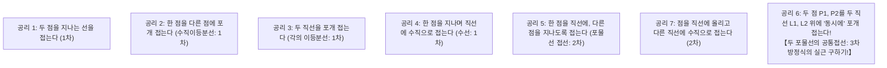

고대 그리스 수학자들을 2천 년 넘게 괴롭혀 온 전설적인 '3대 작도 불가능 문제'가 있습니다:
1. <strong>임의의 각의 3등분 문제</strong>: 눈금 없는 자와 컴퍼스만으로 주어진 임의의 각을 정확히 3등분하라.
2. <strong>배입방 문제(델로스의 문제)</strong>: 주어진 정육면체 부피의 2배가 되는 정육면체의 한 변($\sqrt[3]{2}$)을 작도하라.
3. <strong>원적 문제</strong>: 주어진 원과 면적이 정확히 같은 정사각형($\sqrt{\pi}$)을 작도하라.

1837년 프랑스의 수학자 피에르 방첼(Pierre Wantzel)은 추상대수학과 체론(Field Theory)을 통해 자와 컴퍼스로 작도 가능한 수의 체 확대 차수가 반드시 2의 거듭제곱($2^k$)이어야 함을 증명했습니다. 배입방과 각의 3등분은 3차 다항식($x^3 - 2 = 0$, $x^3 - 3x - 1 = 0$)의 해를 요구하므로, 자와 컴퍼스로는 절대 불가능하다는 것이 확정되었습니다.

그러나 20세기 후반, 현대 수학계는 경이로운 사실을 발견했습니다:
<strong>평평한 정사각형 종이를 '접는' 행위를 도입하면, 자와 컴퍼스로는 불가능했던 각의 3등분과 $\sqrt[3]{2}$의 작도가 단 몇 초 만에 정확히 해결된다는 사실입니다.</strong>

전통적인 놀이로 여겨졌던 <strong>종이접기(오리가미, Origami)</strong>는 사실 3차 방정식을 기하학적으로 풀어내는 강력한 아날로그 연산기였습니다.

오늘날 종이접기는 '후지타-하토리 공리계(Huzita-Hatori Axioms)'로 체계화되었으며, 평탄 접힘 가능성을 판정하는 가와사키의 정리, 마에카와의 정리, 그리고 우주 인공위성의 태양전지판(미우라 접기) 및 생체 스텐트로 확장된 첨단 학문인 <strong>'종이접기 공학(Origami Engineering)'</strong>으로 눈부시게 진화했습니다.

---

## 1. 자와 컴퍼스의 대수적 감옥: 왜 3차 방정식을 못 푸는가?

유클리드 기하학의 작도 도구인 자와 컴퍼스는:
- 직선과 직선의 교점 (1차 연립방정식)
- 직선과 원의 교점, 원과 원의 교점 (2차 연립방정식)
만을 생성할 수 있습니다. 유리수체 $\mathbb{Q}$에서 시작해 2차 확대의 유한 열만을 거치므로 작도 가능 수 $\alpha$의 확대 차수는 반드시 다음과 같아야 합니다:
$$
[\mathbb{Q}(\alpha) : \mathbb{Q}] = 2^k \quad (k \in \mathbb{Z}_{\ge 0})
$$

반면 $\sqrt[3]{2}$의 기약다항식 $x^3 - 2$와 $60^\circ$를 3등분할 때 등장하는 $x^3 - 3x - 1$의 확대 차수는 모두 <strong>3</strong>입니다. 3은 2의 거듭제곱이 아니므로 작도가 원천적으로 불가능합니다.

---

## 2. 종이접기의 7대 공리: 후지타-하토리 공리계

종이를 평평하게 접을 때 생기는 접는 선(Crease)은 직선이며, 접는 행위는 <strong>반사 변환(Reflection)</strong>에 해당합니다. 1989~2001년 정립된 7대 공리는 다음과 같습니다:

공리 1~5 및 7은 1차 및 2차 연산에 불과합니다.
하지만 <strong>공리 6(Axiom 6)</strong>은 자와 컴퍼스의 한계를 단숨에 돌파합니다.

---

## 3. 공리 6이 3차 방정식을 푸는 원리: 두 포물선의 공통접선

한 점 $P$를 직선 $L$ 위의 점 $P'$에 포개 접을 때, 접는 선은 선분 $PP'$의 수직이등분선입니다.
이는 기하학적으로 <strong>점 $P$를 초점, 직선 $L$을 준선으로 하는 포물선의 접선(Tangent)</strong>이 됩니다!

따라서 공리 6—점 $P_1$을 직선 $L_1$에, 점 $P_2$를 직선 $L_2$에 동시에 포개 접는 선—은 <strong>두 포물선 $\mathcal{P}_1, \mathcal{P}_2$의 '공통접선(Common Tangent)'</strong>을 작도하는 물리적 행위입니다.
해석기하학에서 두 포물선의 공통접선 기울기 $m$을 연립하면 <strong>일반 3차 방정식</strong>이 유도됩니다:

$$
A m^3 + B m^2 + C m + D = 0
$$

사람이 종이를 들고 두 점을 두 직선에 비추어 보며 맞추는 행위는, 3차 방정식의 실근을 아날로그적으로 탐색해 찾아내는 물리적 미적분 계산인 것입니다!

---

## 4. 아베 히사시의 각의 3등분법과 피터 메서의 배입방 작도

### 4.1 아베 히사시의 3등분 알고리즘 (1980년)
일본의 수학 연구가 아베 히사시(阿部恒)가 고안한 각의 3등분법은 공리 6의 정점입니다:
1. 임의의 각 $\angle ABC$의 밑변 $BC$에 평행한 보조선 $L_1, L_2$를 같은 간격 $d$로 접습니다.
2. 꼭짓점 $B$에서 수선을 올려 점 $P, Q$를 잡습니다 ($BP = PQ = d$).
3. <strong>공리 6 적용</strong>: 꼭짓점 $B$를 직선 $L_2$ 위에 올리고, <strong>동시에</strong> 점 $P$를 각의 위쪽 변 $BA$ 위에 올리도록 종이를 접습니다!
4. 종이를 펴면 점 $P$가 닿았던 자리와 $B$를 잇는 직선이 각 $\angle ABC$를 정확하게 $1/3$로 나눕니다.

### 4.2 피터 메서의 $\sqrt[3]{2}$ 작도 (1986년)
정사각형 종이를 가로 3등분한 뒤, 공리 6을 적용해 한 모서리를 변에, 다른 기준점을 3등분선에 동시에 맞추어 접으면, 오른쪽 모서리에 나타나는 교점의 높이가 정확히 $\sqrt[3]{2} - 1$이 됩니다. 1을 더하면 배입방 문제의 해인 $\sqrt[3]{2}$가 물리적으로 완벽히 얻어집니다.

종이접기로 작도 가능한 수의 체 $\mathcal{O}$는 제곱근뿐만 아니라 세제곱근을 포함하므로 확대 차수가 다음과 같습니다:
$$
[\mathbb{Q}(\alpha) : \mathbb{Q}] = 2^a \cdot 3^b
$$
따라서 자와 컴퍼스로는 그릴 수 없었던 정칠각형(7각)과 정구각형(9각)도 종이접기로는 완벽히 작도할 수 있습니다!

---

## 5. 평탄 접힘 가능성: 가와사키 정리와 마에카와 정리

- <strong>가와사키 정리(Kawasaki's Theorem)</strong>: 단일 꼭짓점을 평평하게 접기 위한 필요충분조건은 하나 건너 각도들의 합이 각각 $180^\circ$가 되는 것입니다 ($\theta_1 + \theta_3 + \dots = 180^\circ$).
- <strong>마에카와 정리(Maekawa's Theorem)</strong>: 한 꼭짓점에 모이는 산접기($M$)와 골접기($V$)의 개수 차이는 항상 $\pm 2$입니다 ($M - V = \pm 2$).
- <strong>NP-완전성</strong>: 여러 꼭짓점이 이어진 일반적인 전개도의 평탄 접힘 가능성 판정 문제는 컴퓨터과학에서 <strong>NP-완전(NP-Complete)</strong>임이 증명되었습니다 (Bern & Demaine, 1996).

---

## 6. 우주와 생체로 확장된 종이접기 공학

- <strong>미우라 접기(Miura-ori)</strong>: 1970년 미우라 고료 교수가 고안한 1자유도 강체 접기로, 우주 인공위성의 거대 태양전지판을 한 번의 동작으로 펼칠 수 있습니다. 1995년 SFU 위성 실증에 성공했으며 제임스 웹 우주망원경 차광막에도 응용되었습니다.
- <strong>의료용 스텐트</strong>: 혈관을 통과할 때는 초소형으로 접히고, 환부에 도달하면 원통형으로 스스로 펼쳐지는 혈관 스텐트.
- <strong>음의 푸아송비 메타물질(Auxetics)</strong>: 가로로 당기면 세로로도 함께 늘어나는 충격 흡수 신소재.
- <strong>로버트 랭과 트리메이커(TreeMaker)</strong>: 원형 채우기(Circle Packing) 알고리즘을 이용해 복잡한 곤충이나 생물을 한 장의 종이로 접는 컴퓨터 원천 설계 기술.

---

## 7. 결론

종이접기는 가상적인 이상화에 갇혀 있던 고대 수학의 한계를 물리적 재료의 구속 조건과 연속성을 통해 멋지게 극복했습니다. 종이 한 장을 접는 소박한 손길 안에, 3차 방정식을 풀고 우주로 뻗어나가는 수학의 무한한 지평이 담겨 있습니다.
