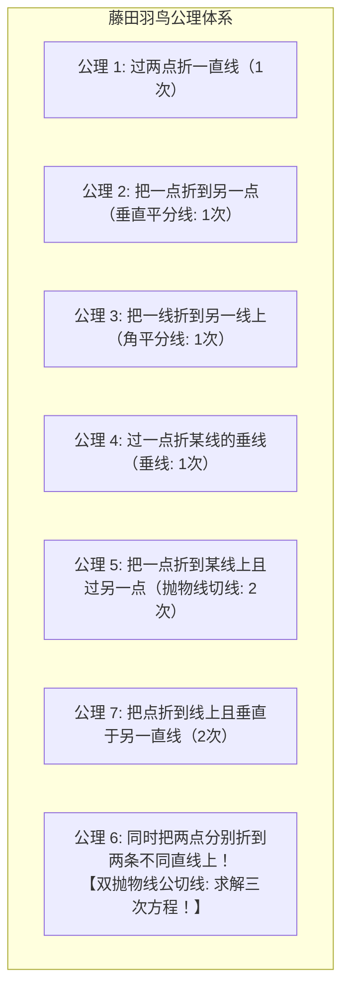

在人类数学史上，古希腊几何学曾留下三大悬置了两千余年的传奇难题：
1. <strong>三等分任意角</strong>：仅用无刻度直尺与圆规，将任意给定角三等分。
2. <strong>倍立方问题（德罗斯问题）</strong>：作出一立方体，其体积等于已知立方体的两倍（即构造 $\sqrt[3]{2}$）。
3. <strong>化圆为方</strong>：作出一正方形，其面积等于已知圆的面积（即构造 $\sqrt{\pi}$）。

1837年，法国数学家皮埃尔·旺策尔（Pierre Wantzel）运用抽象代数与域论，彻底宣告了前两个难题在尺規作圖框架下的“死刑”：直尺与圆规本质上只能求解一次与二次方程，无法突破二次扩域的限制。1882年林德曼证明 $\pi$ 是超越数，化圆为方亦被判定不可能。

然而，20世纪下半叶，数学界却迎来了极具颠覆性的发现：
<strong>只需借助一张平整正方形纸张的“折叠”动作，古希腊人梦寐以求的“三等分角”与“倍立方”，便可在数秒之内被极其精确而优雅地解出！</strong>

曾被视为孩童游戏的“折紙（Origami）”，竟是一台超越欧几里得尺规极限、能直接求取<strong>三次代数方程实根的强大模拟几何计算机</strong>！

如今，折紙不仅被形式化为“藤田-羽鸟公理体系（Huzita-Hatori Axioms）”，还催生了关于平坦折叠性的“川崎定理”与“前川定理”，并在航空航天（三浦折疊太阳能翼）、生物医疗支架及超材料设计中大放异彩，成为当代显学——<strong>“折紙工程学（Origami Engineering）”</strong>。

本文深度剖析尺規作圖的代数枷锁、贝洛克的开创性发现、折紙公理6求解三次方程的几何本质（双抛物线公切线）、阿部恒三等分角定理的完全证明，以及折紙在现代航天和微创医疗中的前沿应用。

---

## 1. 尺規作圖的代数枷锁：为什么古希腊人无法三等分角？

在经典几何学中，尺规操作被严格限制为：
- 直线与直线的交点（一次方程）
- 直线与圆的交点、圆与圆的交点（二次方程）

设基准点坐标为 $(0, 0)$ 与 $(1, 0)$，通过有限次尺规操作所能构造出的数域 $K$，必须是有理数域 $\mathbb{Q}$ 的二次扩域塔：
$$
\mathbb{Q} = K_0 \subset K_1 \subset \dots \subset K_m, \quad [K_j : K_{j-1}] = 2
$$
由域扩张的乘法公式，总扩域次数必然为 2 的幂次：$[K_m : \mathbb{Q}] = 2^m$。

### 为什么倍立方与三等分角不可行？
- <strong>倍立方</strong>：解方程 $x^3 = 2$。多项式 $x^3 - 2$ 在 $\mathbb{Q}$ 上不可约，扩域次数为 $[\mathbb{Q}(\sqrt[3]{2}) : \mathbb{Q}] = 3 \neq 2^k$。
- <strong>三等分角（以 $60^\circ$ 为例）</strong>：由三倍角公式 $\cos(60^\circ) = 4\cos^3(20^\circ) - 3\cos(20^\circ)$，设 $x = 2\cos(20^\circ)$，得 $x^3 - 3x - 1 = 0$。该三次多项式在 $\mathbb{Q}$ 上不可约，扩域次数亦为 $3$。

由于 $3$ 无法表示为 $2$ 的幂次，欧几里得的尺规永远被锁死在三次方程的大门之外！

---

## 2. 折紙几何的公理化：藤田-羽鸟公理体系

纸张在平整折叠时，折痕（Crease）在数学上是一条<strong>直线</strong>，而折叠动作对应于以该折痕为对称轴的<strong>平面镜像反射（Reflection）</strong>。

1989至2001年间，藤田文章、羽鸟公裕及法国数学家雅克·朱斯坦（Jacques Justin）等人总结出完整的<strong>藤田-羽鸟七大公理</strong>：

公理 1 至 5 以及公理 7，只涉及一次或二次代数方程。
唯独<strong>公理 6（Axiom 6）</strong>，赋予了折紙超越传统几何的磅礴神力！

---

## 3. 为什么公理 6 能求解三次方程？双抛物线公切线的魔力

公理 6 规定：<strong>给定两点 $P_1, P_2$ 和两条直线 $L_1, L_2$，可以折出一条单一折痕，同时将 $P_1$ 落在 $L_1$ 上，并将 $P_2$ 落在 $L_2$ 上。</strong>

### 3.1 折痕与抛物线的包络线
回忆抛物线的几何定义：平面上到定点（焦点 $F$）与到定直线（准线 $D$）距离相等的点的轨迹。
将点 $P$ 折到直线 $L$ 上的某点 $P'$ 时，折痕正是线段 $PP'$ 的垂直平分线。随着 $P'$ 在 $L$ 上滑动，所有的折痕构成了<strong>以 $P$ 为焦点、以 $L$ 为准线的抛物线的切线族（Envelope）</strong>！

### 3.2 两抛物线的公切线方程
公理 6 要求同时完成两组折叠：
- 折痕必须是抛物线 $\mathcal{P}_1$（焦点 $P_1$，准线 $L_1$）的切线。
- 折痕必须是抛物线 $\mathcal{P}_2$（焦点 $P_2$，准线 $L_2$）的切线。

因此，公理 6 的物理折痕，正是<strong>两条独立抛物线的公切线（Common Tangent）</strong>！
在解析几何中，联立两条抛物线的切线判别式，消去截距后，关于切线斜率 $m$ 的方程必然化为一个<strong>一般的三次代数方程</strong>：

$$
A m^3 + B m^2 + C m + D = 0
$$

当人们手持纸张、透光对准两点两线轻轻一折，纸张在物理变形的微积分连续性下，瞬间找到了三次方程的实数根！

---

## 4. 阿部恒的角三等分法（1980年）

日本数学爱好者阿部恒（Hisashi Abe）在1980年提出的三等分角算法，是公理 6 经典应用的巅峰之作：

1. <strong>构造基准线</strong>：在角 $\angle ABC$ 的底边 $BC$ 侧折出两条等距平行线 $L_1, L_2$（距 $BC$ 距离分别为 $d$ 与 $2d$）。过顶点 $B$ 折 $BC$ 垂线，与 $L_1, L_2$ 分别交于点 $P, Q$（$BP = PQ = d$）。
2. <strong>公理 6 奇迹一折</strong>：将纸张弯折，使点 $B$ 落在直线 $L_2$ 上，<strong>同时</strong>使点 $P$ 落在射线 $BA$ 上！
3. <strong>三等分线呈现</strong>：展开纸张，连接顶点 $B$ 与点 $P$ 映射后的位置，依据全等直角三角形链，该射线恰好将 $\angle ABC$ 精确等分为三份！

---

## 5. 贝洛克与倍立方问题

1936年意大利数学家玛格丽塔·贝洛克（Margherita Beloch）首次指出折紙能解三次方程；1986年彼得·梅瑟（Peter Messer）利用正方形纸折出 $\sqrt[3]{2}$。
在抽象代数中，<strong>折紙数域 $\mathcal{O}$</strong> 是有理数域在开平方和开立方下的闭包：
$$
[\mathbb{Q}(\alpha) : \mathbb{Q}] = 2^a \cdot 3^b
$$
正七边形（7次）、正九边形（9次）等所有尺规无法画出的正多边形，在折紙几何下均可完美作图！

---

## 6. 平坦折叠性定理：川崎定理与前川定理

1. <strong>川崎定理（Kawasaki's Theorem）</strong>：单顶点平坦折叠的充要条件是交替夹角之和各为 $180^\circ$：
   $$
   \theta_1 + \theta_3 + \dots = \theta_2 + \theta_4 + \dots = 180^\circ
   $$
2. <strong>前川定理（Maekawa's Theorem）</strong>：任意单顶点处山折线数 $M$ 与谷折线数 $V$ 之差恒为 $\pm 2$：
   $$
   M - V = \pm 2
   $$

---

## 7. 从深空到微创医疗：折紙工程学

- <strong>三浦折疊（Miura-ori）</strong>：1970年日本三浦公亮发明，面不弯曲、仅靠铰链单自由度伸展，广泛应用于深空卫星太阳翼（1995年SFU卫星、韦伯望远镜防热罩）。
- <strong>医用血管支架</strong>：折叠至极细穿过狭窄血管，到达病灶后受温控或水压自膨胀支撑。
- <strong>负泊松比超材料（Auxetics）</strong>：拉伸时横纵双向同时膨胀，用于轻质装甲与防撞结构。

---

## 8. 结语

古希腊人被理想化的尺规禁锢在二次方的象牙塔内，而一张触手可及的薄纸，却借由物理实体的折叠拓扑，轻巧跨越了千年的数学天堑。这不仅是几何学的胜利，更是人类探索工具与思想极限的伟大启示。
