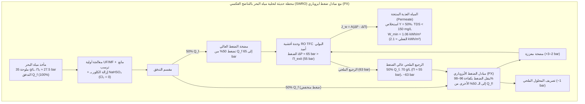

## مقدمة: من الخيار المملح إلى الأمن المائي العالمي — العملاق الخفي للتناضح (الأسموزية)

عندما نرش ملح الطعام على شرائح الخيار الرقيقة، تتساقط قطرات الماء من الأنسجة النباتية خلال دقائق. وفي الطب السريري، لو حُقن مريض بالخطأ بماء مقطر نقي وريدياً بدلاً من <strong>المحلول الملحي الفيزيولوجي ($0.9\,\text{wt}\%$ $\text{NaCl}$)</strong>، لاندفع الماء بقوة هائلة إلى داخل كريات الدم الحمراء حتى تنفجر أغشيتها الخلوية في حالة قاتلة تُعرف باسم <strong>انحلال الدم (Hemolysis)</strong>. وعلى العكس، فإن البحار الغريق الذي يشرب ماء البحر يصاب بجفاف تناقضي قاتل لأن كليتيه تضطران لسحب ماء من خلايا جسمه لطرد فائض ملح البحر أكثر من حجم الماء الذي شربه.

تخضع جميع هذه الظواهر لعملية <strong>التناضح (الأسموزية - Osmosis)</strong>، وتُقاس قوتها الدافعة الديناميكية الحرارية بواسطة <strong>الضغط الاسموزي ($\Pi$)</strong>. وتبلغ قيمة الضغط الاسموزي لمياه البحر القياسية ($35\,\text{g/L}$) نحو <strong>$27\text{ إلى }28\,\text{atm}$ ($\approx 2.75\,\text{MPa}$ أو $27.5\,\text{bar}$)</strong>، وهو ما يعادل ميكانيكياً الضغط الهيدروستاتيكي على <strong>عمق $280\,\text{متراً}$ تحت سطح المحيط</strong>! وبتطبيق ضغوط هيدروليكية تتراوح بين $55\text{ و}80\,\text{bar}$ على أغشية بوليمرية فائقة الرقة، تعكس محطات <strong>التناضح العكسي لمياه البحر (SWRO)</strong> هذه العملية الطبيعية لإنتاج أكثر من 100 مليون متر مكعب من مياه الشرب العذبة يومياً.

---

## الفصل 1: تفنيد خرافة «تدرج تركيز الماء» — الكمون الكيميائي ($\mu_w$) وإنتروبيا المزج

### 1.1 لماذا يفشل التفسير المدرسي القائل بـ «انتشار الماء وفق تركيزه الحجمي»؟

تذكر معظم الكتب المدرسية أن الماء ينتشر ببساطة من حيث يكون تركيزه الحجمي ($c_w$ بوحدة $\text{mol/L}$) مرتفعاً إلى حيث يكون منخفضاً. هذا التفسير <strong>خاطئ فيزيائياً وكيميائياً</strong>:
1. <strong>الكثافة المولية الحجمية للماء ($c_w$) لا تحدد اتجاه التدفق الاسموزي</strong>: تبعاً للحجم المولي الجزئي للمذاب ($\bar{V}_s$) والتقبض الكهربائي، يتدفق الماء حصراً وفق <strong>كسره المولي $x_w$ وفعاليته الديناميكية الحرارية $a_w = \gamma_w x_w$</strong>.
2. <strong>انتشار فيك البسيط لا يفسر التوقف التام وانعكاس التدفق بالضغط الهيدروستاتيكي ($\Delta P = \Pi$)</strong>: بما أن الماء السائل غير قابل للانضغاط تقريباً ($\kappa_T \approx 4.5 \times 10^{-5}\,\text{bar}^{-1}$)، فإن تطبيق ضغط $27.5\,\text{bar}$ لا يزيد كثافته إلا بنسبة $0.12\%$. ومع ذلك، فإن $\Delta P = \Pi$ يوقف التدفق تماماً و$\Delta P > \Pi$ يعكسه.
3. التناضح عبر الأغشية المسامية هو تدفق حملي جماعي، والضغط الاسموزي $\Pi$ <strong>خاصية تجميعية (Colligative property)</strong> لا تعتمد على حجم المسام أو مادة الغشاء.

### 1.2 الكمون الكيميائي لغيبس ($\mu_w$) والميكانيكا الإحصائية لإنتروبيا المزج ($\Delta S_{\text{mix}}$)

وفقاً لديناميكا غيبس الحرارية، عند ثبات درجة الحرارة $T$ والضغط $P$، تنتقل أي مادة كيميائية متحركة تلقائياً من منطقة ذات <strong>كمون كيميائي $\mu_i$</strong> أعلى إلى منطقة ذات كمون كيميائي أدنى:

$$\mu_i \equiv \left( \frac{\partial G}{\partial n_i} \right)_{T, P, n_{j \neq i}}$$

وللماء في المحلول مقارنة بالماء النقي $\mu_w^*(T, P_0)$:

$$\mu_w(T, P, x_w) = \mu_w^*(T, P_0) + \int_{P_0}^{P} \bar{V}_w \, dP' + R T \ln(\gamma_w x_w)$$

حيث $\bar{V}_w \approx 18.07\,\text{cm}^3/\text{mol}$ هو الحجم المولي الجزئي للماء، و$x_w = \frac{n_w}{n_w + \sum \nu_k n_k} = 1 - x_s < 1$ هو الكسر المولي للماء. وفي المحلول المثالي ($\Delta H_{\text{mix}} = 0, \gamma_w = 1$)، ينشأ الانخفاض $\Delta \mu_w = RT \ln x_w < 0$ حصراً من زيادة <strong>إنتروبيا المزج ($\Delta S_{\text{mix}}$)</strong>:

$$\Delta S_{\text{mix}} = -R \left( n_w \ln x_w + \sum_k n_k \ln x_k \right) > 0 \implies \Delta \bar{S}_w = \left( \frac{\partial \Delta S_{\text{mix}}}{\partial n_w} \right)_{T,P,n_s} = -R \ln x_w > 0$$

ولأن الغشاء شبه المنفذ يمنع أيونات الملح من العبور إلى الماء النقي، تعبر جزيئات الماء الغشاء لتخفيف الملح المحجوز، مما يعظم الإنتروبيا التشكيلية للكون ($S = k_B \ln W$) ويقلل طاقة غيبس الحرة $G = H - TS$.

### 1.3 الآلية الحركية لديباي–كرامر: انخفاض ضغط المذيب الموضعي عند فوهات المسام

كما أثبت <strong>بيتر ديباي (1923)</strong> وجيرالد مانينغ وإريك كرامر، عندما تصطدم جسيمات المذاب المتحركة حرارياً بالحاجز التنافري للغشاء $U_s(z)$ وترتد، فإنها تسحب جزيئات الماء معها نحو داخل المحلول:

$$\frac{dP_{\text{solvent}}(z)}{dz} + c_s(z) \frac{dU_s(z)}{dz} = 0 \implies P_{\text{solvent}}(0^+) = P_0 - c_s^{\text{bulk}} R T = P_0 - \Pi$$

```mermaid
flowchart TD
    subgraph S1["1. التناضح الأمامي (Forward Osmosis): ΔP = 0 < Π"]
        L1["ماء نقي (L)<br/>ضغط P₀، كسر مولي x_w = 1<br/>كمون كيميائي μ_w(L) = μ_w*"]
        M1["غشاء شبه منفذ<br/>ارتداد المذاب عن الحاجز:<br/>ضغط الماء الموضعي يهبط إلى P₀ - Π"]
        R1["محلول ملحي (R)<br/>ضغط P₀، كسر مولي x_w < 1<br/>μ_w(R) = μ_w* + RT ln(γ_w x_w) < μ_w*"]
        L1 -->|"تدفق تلقائي للماء (Δμ_w > 0)<br/>إنتروبيا المزج والشفط عند المسام"| M1 --> R1
    end

    subgraph S2["2. الاتزان الاسموزي: ΔP = Π"]
        L2["ماء نقي (L)<br/>ضغط P₀، μ_w(L) = μ_w*"]
        M2["غشاء شبه منفذ<br/>تساوي الضغط عند المسام (P₀ = P₀)<br/>التدفق الصافي J_w = 0"]
        R2["محلول ملحي (R)<br/>تطبيق ضغط خارجي P₀ + Π<br/>μ_w(R) = μ_w* + V_w Π + RT ln(γ_w x_w) = μ_w*"]
        L2 <-->|"اتزان ديناميكي حراري (Δμ_w = 0)<br/>Π = -(RT / V_w) ln(γ_w x_w) ≈ iMRT"| M2 <--> R2
    end

    subgraph S3["3. التناضح العكسي (تحلية RO): ΔP > Π (55–80 bar)"]
        L3["مياه عذبة منتجة (L)<br/>ضغط P₀، μ_w(L) = μ_w*"]
        M3["غشاء RO TFC من البولي أميد<br/>نقل الذوبان-الانتشار:<br/>التدفق J_w = A(ΔP - ΔΠ)"]
        R3["محلول ملحي عالي الضغط (R)<br/>ضغط المضخة P₀ + ΔP (ΔP > Π)<br/>μ_w(R) = μ_w* + V_w(ΔP - Π) > μ_w*"]
        R3 -->|"انعكاس Δμ_w: μ_w(R) > μ_w(L)<br/>عصر الماء النقي من المحلول الملحي!"| M3 --> L3
    end
```

وهذا يولد <strong>انخفاضاً ميكانيكياً موضعياً في ضغط الماء ($P_0 - \Pi$)</strong> عند مداخل المسام من جهة المحلول، فيسحب الماء النقي (الموجود عند ضغط $P_0$) عبر الغشاء.

---

## الفصل 2: الاشتقاق المتدرج لقانون فانت هوف (1887) وحساب الضغط الاسموزي لمياه البحر

### 2.1 الاشتقاق الديناميكي الحراري الدقيق

صاغ <strong>ياكوبوس هنريكوس فانت هوف</strong> (الحائز على أول جائزة نوبل في الكيمياء عام 1901) قانون الضغط الاسموزي استناداً إلى قياسات فيلهلم بفيفر بأغشية فيروسيانيد النحاس ($\text{Cu}_2[\text{Fe(CN)}_6]$):

1. <strong>تساوي الكمون الكيميائي للماء عند الاتزان</strong> بين الماء النقي ($L$، ضغط $P_0, x_w=1$) والمحلول ($R$، ضغط $P_0 + \Pi, x_w$):

$$\mu_w^{(L)}(T, P_0, x_w=1) = \mu_w^*(T, P_0) = \mu_w^{(R)}(T, P_0 + \Pi, x_w) = \mu_w^*(T, P_0) + \bar{V}_w \Pi + R T \ln(\gamma_w x_w)$$

2. <strong>المعادلة الديناميكية الحرارية الدقيقة</strong> (بافتراض عدم انضغاطية الماء):

$$\Pi = -\frac{R T}{\bar{V}_w} \ln(\gamma_w x_w)$$

3. <strong>مفكوك متسلسلة تايلور للمحاليل المخففة</strong> ($\gamma_w \to 1$، و$x_s = 1 - x_w = \frac{i n_s}{n_w + i n_s} \ll 1$ مع <strong>معامل فانت هوف $i$</strong>):

$$\ln x_w = \ln(1 - x_s) \approx -x_s \approx -\frac{i n_s}{n_w}$$

4. <strong>التحويل إلى التركيز المولاري $M = n_s / V$</strong> (حيث $V \approx n_w \bar{V}_w$):

$$\Pi \approx \frac{R T}{\bar{V}_w} \frac{i n_s}{n_w} \approx i \left(\frac{n_s}{V}\right) R T = i M R T$$

### 2.2 الحساب الدقيق لمياه البحر القياسية ($35\,\text{g/L}$ $\text{NaCl}$)

عند درجة حرارة $T = 298.15\,\text{K}$ ($25\,^\circ\text{C}$):
- التركيز المولاري: $M = \frac{35\,\text{g/L}}{58.44\,\text{g/mol}} \approx 0.60\,\text{mol/L}$.
- معامل فانت هوف: لملح $\text{NaCl}$ ($\nu = 2$)، المعامل الاسموزي $\phi \approx 0.925$ يعطي $i = \phi \nu \approx 1.85$ (الأسمولارية $\approx 1.11\,\text{Osm/L}$).
- الضغط الاسموزي ($R = 0.082057\,\text{L}\cdot\text{atm}/(\text{K}\cdot\text{mol})$):

$$\Pi = 1.85 \times 0.60\,\text{mol/L} \times 0.082057\,\text{L}\cdot\text{atm}/(\text{K}\cdot\text{mol}) \times 298.15\,\text{K} \approx 27.16\,\text{atm} \approx 2.75\,\text{MPa}\,(27.5\,\text{bar})$$

وهذا يعادل <strong>عمود ماء بارتفاع $h = \frac{\Pi}{\rho g} \approx 280.6\,\text{متراً}$</strong>!

---

## الفصل 3: التناضح البيولوجي — قنوات الأكوابورين (AQP1)، توترية كريات الدم، معادلة ستارلينغ وضغط الامتلاء

- <strong>قنوات الماء أكوابورين (AQP1، بيتر أغري، جائزة نوبل 2003)</strong>: مسام بشكل الساعة الرملية مع مرشح فراغي $\text{ar/R}$ بقطر <strong>$2.8\,\text{\AA}$</strong> يمرر <strong>$3 \times 10^9$ جزيء ماء في الثانية</strong> في صف واحد. ويجبر <strong>نمطان مركزيان من NPA (أسباراجين-برولين-ألانين)</strong> ثنائي القطب الكهربائي للماء على <strong>الدوران بزاوية $180^\circ$</strong>، مما يقطع سلسلة الروابط الهيدروجينية ويمنع تماماً تسرب البروتونات ($\text{H}_3\text{O}^+$) عبر آلية غروتهوس.
- <strong>توترية كريات الدم الحمراء</strong>: تحافظ الكريات على شكلها الطبيعي المقعر الوجهين في الوسط <strong>متساوي التوتر (Isotonic)</strong> ($0.9\,\text{wt}\%$ $\text{NaCl}$، $\approx 290\,\text{mOsm/L}$)، وتنكمش مشوكة (<strong>Crenation</strong>) في الوسط <strong>مفرط التوتر (Hypertonic)</strong>، وتنتفخ حتى تنفجر (<strong>Hemolysis</strong>) في الوسط <strong>ناقص التوتر (Hypotonic)</strong>.
- <strong>معادلة ستارلينغ (1896) في الشعيرات الدموية</strong>:
  $$J_v = L_p S \left[ (P_c - P_i) - \sigma (\pi_c - \pi_i) \right]$$
  يضمن <strong>الضغط الغرواني (الأونكوتي $\pi_c \approx 25\text{–}28\,\text{mmHg}$)</strong> الناتج عن ألبومين المصل ($66.5\,\text{kDa}$) إعادة امتصاص السوائل في الطرف الوريدي؛ ويؤدي نقصه إلى <strong>الوذمة (Edema) والاستسقاء (Ascites)</strong>.
- <strong>ضغط الامتلاء النباتي ($\Psi_w = \Psi_s + \Psi_p + \Psi_g + \Psi_m$)</strong>: يتحمل الجدار الخلوي ضغط امتلاء داخلي $\Psi_p \approx +0.8\text{ إلى }+1.5\,\text{MPa}$ يحافظ على انتصاب النباتات العشبية ويمنع <strong>البلزمة (Plasmolysis)</strong>.

| نظام الغشاء | حجم المسام / الحجم الحر | آلية الانتقائية | النفاذية / معدل النقل | المواد المرفوضة | ضغط التشغيل |
| :--- | :--- | :--- | :--- | :--- | :--- |
| <strong>الأكوابورين البيولوجي (AQP1)</strong> | قناة ثابتة $0.28\,\text{nm}$ ($2.8\,\text{\AA}$) | مرشح $\text{ar/R}$ + قلب ثنائي القطب NPA | $\sim 3 \times 10^9$ $\text{H}_2\text{O}$/s للقناة | جميع الأيونات المتميهة، البروتونات ($\text{H}_3\text{O}^+$)، اليوريا | بضعة $\text{mmHg}$ إلى $\sim 30\,\text{bar}$ |
| <strong>بطانة الشعيرات (الغليكوكاليكس)</strong> | شقوق $4\text{–}5\,\text{nm}$ | استبعاد حجمي + تنافر دونان الكهربائي | معادلة ستارلينغ ($L_p$) | الألبومين ($66.5\,\text{kDa}$)، الغلوبيولينات، الكريات الحمراء | $P_c \approx 15\text{–}35\,\text{mmHg}$ مقابل $\pi_c \approx 28\,\text{mmHg}$ |
| <strong>الترشيح الدقيق (MF) / الفائق (UF)</strong> | MF: $100\text{–}1\,000\,\text{nm}$ UF: $2\text{–}100\,\text{nm}$ | غربلة ميكانيكية عبر المسام | $50\text{–}500\,\text{L}/(\text{m}^2\cdot\text{h}\cdot\text{bar})$ | البكتيريا، الفيروسات (UF)، الغرويات، البروتينات | $0.2\text{–}5\,\text{bar}$ |
| <strong>التناضح العكسي (RO TFC بولي أميد)</strong> | غير مسامي ($0.2\text{–}0.5\,\text{nm}$ حجم حر) | <strong>الذوبان-الانتشار</strong> + حاجز نزع التميه | $1\text{–}2\,\text{L}/(\text{m}^2\cdot\text{h}\cdot\text{bar})$ (SWRO) | الأيونات أحادية التكافؤ ($\text{Na}^+, \text{Cl}^-$ رفض $>99.8\%$) | <strong>$55\text{–}80\,\text{bar}$</strong> (مياه البحر) |

---

## الفصل 4: تحلية المياه بالتناضح العكسي (RO) — أغشية البولي أميد المركبة (TFC) ونموذج الذوبان-الانتشار

بعد الأغشية غير المتماثلة للوب وسوريراجان (1960)، ابتكر جون كادوت في أواخر السبعينيات <strong>الغشاء المركب ذا الغشاء الرقيق (TFC) من البولي أميد عبر البلمرة البينية</strong> بين ميتا-فينيلين ثنائي الأمين (MPD) وكلوريد التريميسويل (TMC)، مكوناً طبقة فعالة متشابكة بسمك <strong>$100\text{ إلى }200\,\text{nm}$</strong>.

ووفقاً <strong>لنموذج الذوبان-الانتشار (Wijmans & Baker, 1995)</strong>:
- <strong>تدفق الماء</strong>: $J_w = A(\Delta P - \Delta \Pi)$ حيث $A = \frac{D_w K_w c_w \bar{V}_w}{\delta R T}$.
- <strong>تدفق الملح</strong>: $J_s = B(C_m - C_p)$ حيث $B = \frac{D_s K_s}{\delta}$ (مستقل تماماً عن الضغط $\Delta P$!). ولذلك تقترب نسبة رفض الملح $R_s = \frac{A(\Delta P - \Delta \Pi)}{A(\Delta P - \Delta \Pi) + B}$ من $100\%$ مع زيادة $\Delta P$.
- <strong>حاجز نزع التميه وشذوذ البورون</strong>: يُرفض أيون $\text{Na}^+$ المتميه ($r_{\text{hyd}} \approx 3.58\,\text{\AA}$ مقابل $1.38\,\text{\AA}$ لجزيء $\text{H}_2\text{O}$) بسبب حاجز طاقة نزع التميه والاستبعاد العزلي لبورن. أما <strong>حمض البوريك المتعادل $\text{B(OH)}_3$</strong> ($\text{p}K_a \approx 9.2$) عند $\text{pH} \approx 8.0$ فهو غير مشحون ويعبر الغشاء بتكوين روابط هيدروجينية (مما يتطلب رفع $\text{pH} > 10$ بواسطة $\text{NaOH}$ في مرحلة RO ثانية لتحويله إلى أيون البورات المشحون $\text{B(OH)}_4^-$).

---

## الفصل 5: الحد الأدنى الديناميكي الحراري للطاقة ($1.06\,\text{kWh/m}^3$)، مبادلات الضغط (PX)، استقطاب التركيز والتلوث الحيوي

يُحسب الحد الأدنى للشغل العكوس للفصل $w_{\min}(Y)$ عند نسبة استخلاص $Y = V_p / V_f$ بتكامل $\Pi(y) = \frac{\Pi_0}{1 - y}$:

$$w_{\min}(Y) = \frac{1}{Y} \int_0^Y \Pi(y)\,dy = \Pi_0 \frac{\ln\left(\frac{1}{1 - Y}\right)}{Y}$$

وعند <strong>$Y = 50\%$</strong> ($\Pi_0 = 2.75\,\text{MPa}$)، نجد <strong>$w_{\min}(0.50) = 3.812\,\text{MJ/m}^3 \approx 1.06\,\text{kWh/m}^3$</strong>، مقارنة بنحو <strong>$\sim 650\,\text{kWh/m}^3$</strong> للحرارة الكامنة لتبخير الماء. وبفضل <strong>مبادلات الضغط الأيزوبارية (PX)</strong> التي تسترجع $96\text{–}98\%$ من طاقة المحلول الملحي، انخفض الاستهلاك الفعلي لوحدة RO إلى <strong>$2.0\text{–}2.5\,\text{kWh/m}^3$</strong>.

| تقنية التحلية | المبدأ الفيزيائي الكيميائي | الطاقة النظرية الدنيا ($Y=50\%$) | الاستهلاك الفعلي للمحطة (مكافئ كهربائي) | ظروف التشغيل | المزايا والقيود |
| :--- | :--- | :--- | :--- | :--- | :--- |
| <strong>التبخير البسيط</strong> | تغير الطور سائل–بخار | $\sim 650\,\text{kWh/m}^3$ (حرارة كامنة) | $>650\,\text{kWh/m}^3$ | $100\,^\circ\text{C}$، $1\,\text{bar}$ | تكلفة طاقية باهظة جداً |
| <strong>التقطير الحراري (MSF / MED)</strong> | تبخير ومضي متعدد المراحل | $1.06\,\text{kWh/m}^3$ | <strong>$7\text{–}18\,\text{kWh/m}^3$</strong> | $60\text{–}110\,^\circ\text{C}$ | متينة لكنها عالية الاستهلاك للطاقة |
| <strong>التناضح العكسي (SWRO + PX)</strong> | <strong>الذوبان-الانتشار TFC + ضغط عالٍ</strong> | <strong>$1.06\,\text{kWh/m}^3$</strong> ($0.76\,\text{kWh/m}^3$ عند $Y\to 0$) | قلب RO: <strong>$2.0\text{–}2.5\,\text{kWh/m}^3$</strong> إجمالي المحطة: $3.0\text{–}3.5\,\text{kWh/m}^3$ | حرارة الغرفة، <strong>$55\text{–}80\,\text{bar}$</strong> | <strong>70% من الإنتاج العالمي</strong>؛ يحدها الاستقطاب والتلوث الحيوي |

وتتمثل العقبتان الهندسيتان الرئيسيتان في <strong>استقطاب التركيز</strong> ($\frac{C_m - C_p}{C_b - C_p} = \exp(J_w / k_m)$) و<strong>التلوث الحيوي (Biofouling)</strong> المتفاقم بسبب حساسية روابط الأميد في البولي أميد للكلور الحر (كلورة النيتروجين وإعادة ترتيب أورتون)، مما يحتم إزالة الكلور ببيسلفيت الصوديوم ($\text{NaHSO}_3$) قبل دخول الماء إلى الأغشية.
