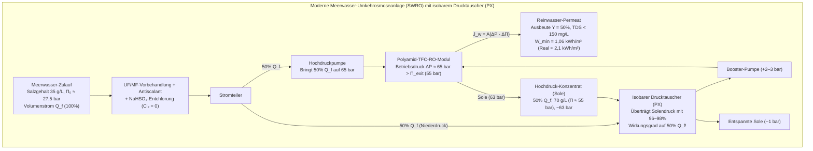

## Einleitung: Von gesalzenen Gurken bis zur globalen Wasserkrise — Die unsichtbare Urkraft der Osmose

Bestreut man dünne Gurkenscheiben mit Kochsalz, tritt innerhalb weniger Minuten Wasser aus dem Pflanzengewebe aus. Gibt man in der Medizin einem Patienten versehentlich reines destilliertes Wasser statt einer <strong>isotonischen Kochsalzlösung ($0{,}9\,\text{wt}\%$ $\text{NaCl}$)</strong> intravenös, strömt Wasser mit solcher Gewalt in die roten Blutkörperchen (Erythrozyten), dass ihre Zellmembranen platzen — eine lebensbedrohliche <strong>Hämolyse</strong>. Umgekehrt führt das Trinken von Meerwasser bei Schiffbrüchigen unweigerlich zum Tod durch Dehydratation, da die Nieren zur Ausscheidung des Salzes den Körperzellen mehr Wasser entziehen, als aufgenommen wurde.

All diese Phänomene werden durch die <strong>Osmose</strong> gesteuert, deren thermodynamische Triebkraft durch den <strong>osmotischen Druck ($\Pi$)</strong> quantifiziert wird. Standard-Meerwasser ($35\,\text{g/L}$ Salzgehalt) besitzt einen osmotischen Druck von <strong>$27\text{ bis }28\,\text{atm}$ ($\approx 2{,}75\,\text{MPa}$ bzw. $27{,}5\,\text{bar}$)</strong> — das entspricht dem hydrostatischen Druck in <strong>$280\,\text{Metern}$ Meerestiefe</strong>! Durch Anlegen eines hydraulischen Drucks von $55\text{ bis }80\,\text{bar}$ kehren moderne <strong>Umkehrosmose-Anlagen (Reverse Osmosis, RO)</strong> diesen Prozess um und gewinnen täglich weltweit über 100 Millionen Kubikmeter Trinkwasser aus dem Meer.

---

## Kapitel 1: Entlarvung des Mythos der „Wasserkonzentrations-Diffusion“ — Chemisches Potenzial ($\mu_w$) und Mischungsentropie

### 1.1 Warum die Erklärung über das „Konzentrationsgefälle des Wassers“ physikalisch-chemisch falsch ist

Einführende Lehrbücher behaupten oft, Wasser diffundiere bei der Osmose einfach entlang seines eigenen volumetrischen Konzentrationsgradienten ($\nabla c_w$) von der Seite höherer Wasserdichte zur Seite niedrigerer Wasserdichte. Diese Erklärung scheitert aus drei fundamentalen Gründen:

1. <strong>Die molare Volumendichte von Wasser ($c_w$ in $\text{mol/L}$) bestimmt nicht die Richtung des osmotischen Flusses</strong>: Abhängig vom partiellen Molvolumen des gelösten Stoffes ($\bar{V}_s$) und der Elektrostriktion kann eine Lösung A eine höhere Anzahl von Wassermolekülen pro Volumeneinheit aufweisen als Lösung B, und dennoch fließt Wasser osmotisch von B nach A! Entscheidend ist allein der <strong>Molenbruch $x_w$ bzw. die thermodynamische Aktivität des Wassers $a_w = \gamma_w x_w$</strong>.
2. <strong>Reine Ficksche Diffusion kann den vollständigen Stopp durch hydrostatischen Druck ($\Delta P = \Pi$) nicht erklären</strong>: Da flüssiges Wasser nahezu inkompressibel ist ($\kappa_T \approx 4{,}5 \times 10^{-5}\,\text{bar}^{-1}$), erhöht ein Druck von $27{,}5\,\text{bar}$ die Wasserdichte nur um $0{,}12\%$ — viel zu wenig, um die Konzentrationsdifferenz auszugleichen. Dennoch stoppt $\Delta P = \Pi$ den Nettofluss exakt.
3. Osmose durch poröse Membranen ist ein kollektiver hydraulischer Strom, und $\Pi$ ist eine <strong>kolligative Eigenschaft</strong>, die unabhängig von Porengröße oder Membranmaterial ist.

### 1.2 Das Gibbssche chemische Potenzial ($\mu_w$) und die statistische Mechanik der Mischungsentropie ($\Delta S_{\text{mix}}$)

Nach J. Willard Gibbs ist die wahre Triebkraft jedes Stofftransports bei konstanter Temperatur $T$ und konstantem Druck $P$ das <strong>chemische Potenzial $\mu_i$</strong> (die partielle molare freie Enthalpie):

$$\mu_i \equiv \left( \frac{\partial G}{\partial n_i} \right)_{T, P, n_{j \neq i}}$$

Für Wasser in einer Lösung gilt relativ zum Standardpotenzial reinen Wassers $\mu_w^*(T, P_0)$:

$$\mu_w(T, P, x_w) = \mu_w^*(T, P_0) + \int_{P_0}^{P} \bar{V}_w \, dP' + R T \ln(\gamma_w x_w)$$

wobei $\bar{V}_w \approx 18{,}07\,\text{cm}^3/\text{mol}$ das partielle Molvolumen des Wassers und $x_w = \frac{n_w}{n_w + \sum \nu_k n_k} = 1 - x_s$ der Molenbruch des Wassers ist. Da in jeder Lösung $x_w < 1$ gilt, ist bei gleichem Druck $P_0$ das chemische Potenzial des Wassers in der Lösung stets kleiner als im reinen Wasser ($\Delta \mu_w = RT \ln(\gamma_w x_w) < 0$).

In einer idealen Lösung ($\Delta H_{\text{mix}} = 0, \gamma_w = 1$) resultiert diese Absenkung ausschließlich aus der <strong>Mischungsentropie ($\Delta S_{\text{mix}}$)</strong> gemäß der Boltzmann-Formel $S = k_B \ln W$:

$$\Delta S_{\text{mix}} = -R \left( n_w \ln x_w + \sum_k n_k \ln x_k \right) > 0 \implies \Delta \bar{S}_w = \left( \frac{\partial \Delta S_{\text{mix}}}{\partial n_w} \right)_{T,P,n_s} = -R \ln x_w > 0$$

Da die gelösten Ionen die semipermeable Membran nicht passieren können, strömt das Wasser auf die Lösungsseite, um die Ionen zu verdünnen, die Gesamtentropie zu maximieren und die freie Gibbs-Energie $G = H - TS$ zu minimieren.

### 1.3 Der mechanisch-kinetische Debye-Kramer-Mechanismus

Auf mikroskopischer Ebene zeigten <strong>Peter Debye (1923)</strong>, Gerald Manning und Eric Kramer: Wenn thermisch bewegte Gelöstteilchen von der abstoßenden Potenzialbarriere $U_s(z)$ der Membran reflektiert werden, übertragen sie ihren Impuls durch viskose Reibung auf das umgebende Wasser. Das Kräftegleichgewicht in der Grenzschicht vor der Membran lautet:

$$\frac{dP_{\text{solvent}}(z)}{dz} + c_s(z) \frac{dU_s(z)}{dz} = 0 \implies P_{\text{solvent}}(0^+) = P_0 - c_s^{\text{bulk}} R T = P_0 - \Pi$$

```mermaid
flowchart TD
    subgraph S1["1. Vorwärtsosmose (Forward Osmosis): ΔP = 0 < Π"]
        L1["Reines Wasser (L)<br/>Druck P₀, Molenbruch x_w = 1<br/>Chemisches Potenzial μ_w(L) = μ_w*"]
        M1["Semipermeable Membran<br/>Solut-Reflexion an der Barriere:<br/>Lokaler Wasserdruck sinkt auf P₀ - Π"]
        R1["Salzlösung (R)<br/>Druck P₀, Molenbruch x_w < 1<br/>μ_w(R) = μ_w* + RT ln(γ_w x_w) < μ_w*"]
        L1 -->|"Spontaner Wasserfluss (Δμ_w > 0)<br/>Mischungsentropie & Porensog"| M1 --> R1
    end

    subgraph S2["2. Osmotisches Gleichgewicht: ΔP = Π"]
        L2["Reines Wasser (L)<br/>Druck P₀, μ_w(L) = μ_w*"]
        M2["Semipermeable Membran<br/>Porendrücke ausgeglichen (P₀ = P₀)<br/>Netto-Wasserfluss J_w = 0"]
        R2["Salzlösung (R)<br/>Außendruck P₀ + Π angelegt<br/>μ_w(R) = μ_w* + V_w Π + RT ln(γ_w x_w) = μ_w*"]
        L2 <-->|"Thermodynamisches Gleichgewicht (Δμ_w = 0)<br/>Π = -(RT / V_w) ln(γ_w x_w) ≈ iMRT"| M2 <--> R2
    end

    subgraph S3["3. Umkehrosmose (RO-Entsalzung): ΔP > Π (55–80 bar)"]
        L3["Reinwasser-Permeat (L)<br/>Druck P₀, μ_w(L) = μ_w*"]
        M3["Polyamid-TFC-RO-Membran<br/>Lösungs-Diffusions-Transport:<br/>Wasserfluss J_w = A(ΔP - ΔΠ)"]
        R3["Hochdruck-Meerwassersole (R)<br/>Pumpendruck P₀ + ΔP (ΔP > Π)<br/>μ_w(R) = μ_w* + V_w(ΔP - Π) > μ_w*"]
        R3 -->|"Umkehrung von Δμ_w: μ_w(R) > μ_w(L)<br/>Reinwasser wird aus der Sole gepresst!"| M3 --> L3
    end
```

Die Reflexion der Gelöstteilchen erzeugt unmittelbar an den Porenöffnungen der Lösungsseite einen <strong>lokalen mechanischen Druckabfall (Unterdruck/Sog) im Lösungsmittel Wasser auf $P_0 - \Pi$</strong>, der das reine Wasser (Druck $P_0$) mechanisch durch die Poren saugt!

---

## Kapitel 2: Schrittweise Herleitung des van-'t-Hoff-Gesetzes (1887) und Berechnung für Meerwasser

### 2.1 Strenge Herleitung aus dem Gleichgewicht des chemischen Potenzials

<strong>Jacobus Henricus van 't Hoff</strong> (erster Nobelpreis für Chemie 1901) erkannte anhand der Messungen von Wilhelm Pfeffer an Kupferferrocyanid-Membranen ($\text{Cu}_2[\text{Fe(CN)}_6]$) die Analogie zwischen osmotischem Druck und idealem Gasgesetz.

1. <strong>Gleichgewichtsbedingung</strong> zwischen reinem Wasser ($L$, Druck $P_0, x_w=1$) und Lösung ($R$, Druck $P_0 + \Pi, x_w$):

$$\mu_w^{(L)}(T, P_0, x_w=1) = \mu_w^*(T, P_0) = \mu_w^{(R)}(T, P_0 + \Pi, x_w) = \mu_w^*(T, P_0) + \bar{V}_w \Pi + R T \ln(\gamma_w x_w)$$

2. <strong>Exakte thermodynamische Gleichung</strong> (für inkompressibles Wasser $\bar{V}_w = \text{const.}$):

$$\Pi = -\frac{R T}{\bar{V}_w} \ln(\gamma_w x_w)$$

3. <strong>Taylorentwicklung für verdünnte Lösungen</strong> ($\gamma_w \to 1$, Molenbruch der gelösten Teilchen $x_s = 1 - x_w = \frac{i n_s}{n_w + i n_s} \ll 1$ mit dem <strong>van-'t-Hoff-Faktor $i$</strong>):

$$\ln x_w = \ln(1 - x_s) \approx -x_s \approx -\frac{i n_s}{n_w}$$

4. <strong>Übergang zur Molarität $M = n_s / V$</strong> (mit $V \approx n_w \bar{V}_w$):

$$\Pi \approx \frac{R T}{\bar{V}_w} \frac{i n_s}{n_w} \approx i \left(\frac{n_s}{V}\right) R T = i M R T$$

### 2.2 Exakte Berechnung für Standard-Meerwasser ($35\,\text{g/L}$ $\text{NaCl}$)

Für Standard-Meerwasser bei $T = 298{,}15\,\text{K}$ ($25\,^\circ\text{C}$):
- Molarität: $M = \frac{35\,\text{g/L}}{58{,}44\,\text{g/mol}} \approx 0{,}60\,\text{mol/L}$.
- van-'t-Hoff-Faktor: Wegen der interionischen Debye-Hückel-Wechselwirkung ($\phi \approx 0{,}925$) gilt für $\text{NaCl}$ ($\nu = 2$) ein effektiver Faktor von $i = \phi \nu \approx 1{,}85$ (Osmolarität $\approx 1{,}11\,\text{Osm/L}$).
- Osmotischer Druck ($R = 0{,}082057\,\text{L}\cdot\text{atm}/(\text{K}\cdot\text{mol})$):

$$\Pi = 1{,}85 \times 0{,}60\,\text{mol/L} \times 0{,}082057\,\text{L}\cdot\text{atm}/(\text{K}\cdot\text{mol}) \times 298{,}15\,\text{K} \approx 27{,}16\,\text{atm} \approx 2{,}75\,\text{MPa}\,(27{,}5\,\text{bar})$$

Dies entspricht einer <strong>Wassersäule von $h = \frac{\Pi}{\rho g} \approx 280{,}6\,\text{Metern}$</strong>!

---

## Kapitel 3: Biologische Osmose — Aquaporine (AQP1), Erythrozyten-Tonizität, Starling-Gleichung und Pflanzenturgor

- <strong>Aquaporin-Wasserkanäle (AQP1, Peter Agre, Nobelpreis 2003)</strong>: Eine sanduhrförmige Pore mit einer <strong>$2{,}8\,\text{\AA}$</strong> engen aromatischen/Arginin-Selektivitätsfilterstelle ($\text{ar/R}$) leitet bis zu <strong>$3 \times 10^9$ Wassermoleküle pro Sekunde</strong> im <strong>Einzelreihen-Marsch (Single-file)</strong> durch die Membran. Zwei konservierte <strong>NPA-Motive (Asparagin-Prolin-Alanin)</strong> und Makrodipole erzwingen in der Porenmitte eine <strong>$180^\circ$-Dipolrotation</strong> des Wassermoleküls, wodurch die Grotthuss-Protonenleitung ($\text{H}_3\text{O}^+$) vollständig blockiert wird.
- <strong>Tonizität roter Blutkörperchen</strong>: In <strong>isotonischer</strong> Lösung ($0{,}9\,\text{wt}\%$ $\text{NaCl}$, $\approx 290\,\text{mOsm/L}$) bleibt die bikonkave Form erhalten; in <strong>hypertonischer</strong> Lösung schrumpfen die Zellen (<strong>Stechapfelform / Krenation</strong>); in <strong>hypotonischer</strong> Lösung schwellen sie an und platzen (<strong>Hämolyse</strong>).
- <strong>Starling-Gleichung (1896) in Kapillaren</strong>:
  $$J_v = L_p S \left[ (P_c - P_i) - \sigma (\pi_c - \pi_i) \right]$$
  Das durch Serumalbumin ($66{,}5\,\text{kDa}$) erzeugte <strong>kolloidosmotische (onkotische) Druckgefälle ($\pi_c \approx 25\text{–}28\,\text{mmHg}$)</strong> hält dem hydrostatischen Blutdruck $P_c$ die Waage. Bei Albuminmangel entstehen <strong>Ödeme und Aszites</strong>.
- <strong>Pflanzlicher Turgordruck ($\Psi_w = \Psi_s + \Psi_p + \Psi_g + \Psi_m$)</strong>: Die Zellwand hält einem inneren <strong>Turgordruck von $\Psi_p \approx +0{,}8\text{ bis }+1{,}5\,\text{MPa}$</strong> stand, der krautigen Pflanzen mechanische Stabilität verleiht; bei Trockenheit oder Versalzung tritt <strong>Plasmolyse</strong> auf.

| Membran- / Filtersystem | Porengröße / Freies Volumen | Selektivitätsmechanismus | Wasserpermeanz / Transportrate | Zurückgehaltene Spezies | Typischer Druckbereich |
| :--- | :--- | :--- | :--- | :--- | :--- |
| <strong>Biologisches Aquaporin (AQP1)</strong> | $0{,}28\,\text{nm}$ ($2{,}8\,\text{\AA}$) Kanal | Sterischer $\text{ar/R}$-Filter + NPA-Dipol-Flip | $\sim 3 \times 10^9$ $\text{H}_2\text{O}$/s pro Kanal | Alle hydratisierten Ionen, Protonen ($\text{H}_3\text{O}^+$), Harnstoff | Einige $\text{mmHg}$ bis $\sim 30\,\text{bar}$ |
| <strong>Kapillarendothel (Glykokalyx)</strong> | $4\text{–}5\,\text{nm}$ Interzellularspalten | Größenausschluss + Donnan-Ladungsabstoßung | Starling-Gleichung ($L_p$) | Albumin ($66{,}5\,\text{kDa}$), Globuline, Blutzellen | $P_c \approx 15\text{–}35\,\text{mmHg}$ vs. $\pi_c \approx 28\,\text{mmHg}$ |
| <strong>Mikro- (MF) / Ultrafiltration (UF)</strong> | MF: $100\text{–}1.000\,\text{nm}$ UF: $2\text{–}100\,\text{nm}$ | Mechanisches Sieben (Pore-flow) | $50\text{–}500\,\text{L}/(\text{m}^2\cdot\text{h}\cdot\text{bar})$ | Bakterien, Viren (UF), Kolloide, Makromoleküle | $0{,}2\text{–}5\,\text{bar}$ |
| <strong>Umkehrosmose (Polyamid-TFC-RO)</strong> | Porenfrei ($0{,}2\text{–}0{,}5\,\text{nm}$ freies Volumen) | <strong>Lösungs-Diffusions-Modell</strong> + Dehydratisierungsbarriere | $1\text{–}2\,\text{L}/(\text{m}^2\cdot\text{h}\cdot\text{bar})$ (SWRO) | Einwertige Ionen ($\text{Na}^+, \text{Cl}^-$ Rückhalt $>99{,}8\%$) | <strong>$55\text{–}80\,\text{bar}$</strong> (Meerwasser) |

---

## Kapitel 4: Umkehrosmose (RO) — Polyamid-Dünnschicht-Kompositmembranen (TFC) und Lösungs-Diffusions-Modell

Nach der asymmetrischen Celluloseacetat-Membran von Loeb und Sourirajan (1960) entwickelte John Cadotte Ende der 1970er Jahre die <strong>Polyamid-TFC-Membran durch Grenzflächenpolymerisation (Interfacial Polymerization)</strong> aus $m$-Phenylendiamin (MPD) und Trimesoylchlorid (TMC) mit einer nur <strong>$100\text{ bis }200\,\text{nm}$</strong> dünnen vernetzten Polyamid-Trennschicht.

Nach dem <strong>Lösungs-Diffusions-Modell (Wijmans & Baker, 1995)</strong> besitzt die RO-Membran keine festen Poren:
- <strong>Wasserfluss</strong>: $J_w = A(\Delta P - \Delta \Pi)$ mit $A = \frac{D_w K_w c_w \bar{V}_w}{\delta R T}$.
- <strong>Salzfluss</strong>: $J_s = B(C_m - C_p)$ mit $B = \frac{D_s K_s}{\delta}$ (unabhängig von $\Delta P$!). Der Salzrückhalt $R_s = \frac{A(\Delta P - \Delta \Pi)}{A(\Delta P - \Delta \Pi) + B}$ steigt daher mit wachsendem Druck $\Delta P$ gegen $100\%$.
- <strong>Hydrathülle und Bor-Problem</strong>: Während $\text{Na}^+$ einen großen Hydratradius von <strong>$r_{\text{hyd}} \approx 3{,}58\,\text{\AA}$</strong> (vs. $\text{H}_2\text{O}$ mit $1{,}38\,\text{\AA}$) besitzt und durch eine enorme Dehydratisierungs- und Born-Dielektrizitätsbarriere zurückgehalten wird, liegt Bor bei $\text{pH} \approx 8{,}0$ als ungeladenes, kleines <strong>Borsäure-Molekül $\text{B(OH)}_3$</strong> ($\text{p}K_a \approx 9{,}2$) vor, das Wasserstoffbrücken mit dem Polyamid bildet und die Membran leicht durchdringt (Abhilfe: $\text{pH}$-Anhebung auf $>10$ im zweiten RO-Pass zur Bildung von $\text{B(OH)}_4^-$).

---

## Kapitel 5: Thermodynamisches Energieminimum ($1{,}06\,\text{kWh/m}^3$), Drucktauscher (PX), Konzentrationspolarisation und Biofouling

Die minimale spezifische Trennarbeit $w_{\min}(Y)$ bei einer Ausbeute (Recovery) von $Y = V_p / V_f$ ergibt sich durch Integration von $\Pi(y) = \frac{\Pi_0}{1 - y}$:

$$w_{\min}(Y) = \frac{1}{Y} \int_0^Y \Pi(y)\,dy = \Pi_0 \frac{\ln\left(\frac{1}{1 - Y}\right)}{Y}$$

Bei <strong>$Y = 50\%$</strong> und $\Pi_0 = 2{,}75\,\text{MPa}$ folgt <strong>$w_{\min}(0{,}50) = 2{,}75\,\text{MPa} \times 2\ln 2 = 3{,}812\,\text{MJ/m}^3 \approx 1{,}06\,\text{kWh/m}^3$</strong> — verglichen mit <strong>$\sim 650\,\text{kWh/m}^3$</strong> Verdampfungsenthalpie des Wassers! Dank <strong>isobarer Drucktauscher (PX)</strong> mit $96\text{–}98\%$ Rückgewinnungseffizienz benötigen moderne SWRO-Anlagen im RO-Kernprozess nur noch <strong>$2{,}0\text{–}2{,}5\,\text{kWh/m}^3$</strong>.

| Entsalzungsverfahren | Physikalisches Prinzip | Theoretisches Minimum ($Y=50\%$) | Praktischer Energiebedarf | Betriebsbedingungen | Hauptmerkmale & Engpässe |
| :--- | :--- | :--- | :--- | :--- | :--- |
| <strong>Einstufige Verdampfung</strong> | Phasenwechsel flüssig-gasförmig | $\sim 650\,\text{kWh/m}^3$ (Verdampfungswärme) | $>650\,\text{kWh/m}^3$ | $100\,^\circ\text{C}$, $1\,\text{bar}$ | Energetisch völlig unwirtschaftlich |
| <strong>MSF / MED (Thermisch)</strong> | Mehrstufige Entspannungsverdampfung | $1{,}06\,\text{kWh/m}^3$ | <strong>$7\text{–}18\,\text{kWh/m}^3$</strong> | $60\text{–}110\,^\circ\text{C}$ | Robust bei hohem Salzgehalt, hoher Energiebedarf |
| <strong>Umkehrosmose (SWRO + PX)</strong> | <strong>Polyamid-TFC Lösungs-Diffusion + Druckumkehr</strong> | <strong>$1{,}06\,\text{kWh/m}^3$</strong> ($0{,}76\,\text{kWh/m}^3$ für $Y\to 0$) | RO-Kern: <strong>$2{,}0\text{–}2{,}5\,\text{kWh/m}^3$</strong> Gesamt: $3{,}0\text{–}3{,}5\,\text{kWh/m}^3$ | Raumtemperatur, <strong>$55\text{–}80\,\text{bar}$</strong> | <strong>Weltmarktführer ($\sim 70\%$)</strong>; begrenzt durch CP und Biofouling |

Die zwei größten verfahrenstechnischen Engpässe sind die <strong>Konzentrationspolarisation</strong> in der Grenzschicht ($\frac{C_m - C_p}{C_b - C_p} = \exp(J_w / k_m)$) sowie das <strong>Membran-Fouling (Scaling und Biofouling)</strong>: Da die Amidbindungen des Polyamids durch freies Chlor ($\text{HOCl}/\text{OCl}^-$) über N-Chlorierung und Orton-Umlagerung zerstört werden, muss das Zulaufwasser mit $\text{NaHSO}_3$ vollständig entchlort werden, was die Bildung bakterieller EPS-Biofilme begünstigt.
