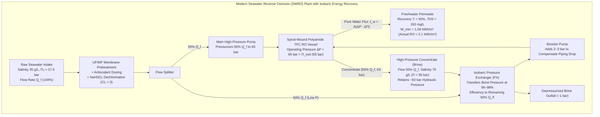

## Introduction: From Salted Cucumbers to Global Water Security — The Invisible Giant of Osmosis

Sprinkle table salt over thinly sliced cucumbers, and within minutes beads of water sweat out of the plant tissue, leaving the slices crisp yet pliable. Pour salt onto a terrestrial slug, and water is violently drawn out of its body until it desiccates. In clinical medicine, if a nurse were to accidentally administer pure distilled water intravenously instead of <strong>normal saline ($0.9\,\text{wt}\%$ $\text{NaCl}$)</strong>, water would rush into the patient's red blood cells with such relentless force that their cell membranes would stretch beyond their elastic limit and burst—a fatal condition known as <strong>hemolysis</strong>. Conversely, a shipwrecked sailor who drinks seawater to quench their thirst suffers paradoxical dehydration: the osmotic pull of ocean salt extracts more water from their intracellular compartments via the kidneys than the volume of seawater consumed.

All of these everyday culinary, physiological, and life-or-death phenomena are governed by <strong>osmosis</strong>, and the thermodynamic magnitude of its driving force is quantified by <strong>osmotic pressure ($\Pi$)</strong>. Because osmosis occurs silently without flames, pistons, or electrical sparks, it is easy to underestimate its mechanical violence. Yet standard ocean water (with a salinity of roughly $35\,\text{g/L}$) exerts an osmotic pressure of <strong>$27\text{ to }28\,\text{atm}$ ($\approx 2.75\,\text{MPa}$ or $27.5\,\text{bar}$)</strong>. That invisible thermodynamic pull is mechanically equivalent to the hydrostatic pressure at an ocean depth of <strong>$280\,\text{meters}$</strong>—a column of water taller than a 70-story skyscraper pressing down on every square centimeter of membrane.

Today, humanity has learned not only to understand this force, but to reverse it. By applying hydraulic pressures of $55\text{ to }80\,\text{bar}$ ($5.5\text{ to }8.0\,\text{MPa}$) against ultrathin polymeric membranes, modern <strong>Seawater Reverse Osmosis (SWRO)</strong> desalination plants overcome the chemical potential of ocean brine and squeeze pure drinking water out of the sea, supplying over 100 million cubic meters of freshwater every day to hundreds of millions of people across the Middle East, Singapore, Australia, California, and the Mediterranean.

In this comprehensive study, we dismantle the naive introductory textbook myth that osmosis is merely "water diffusing from a high water concentration to a low water concentration." We replace it with the rigorous statistical-mechanical and thermodynamic framework of <strong>Gibbs chemical potential ($\mu_w$)</strong>, the <strong>entropy of mixing ($\Delta S_{\text{mix}}$)</strong>, and the <strong>Debye–Kramer–Manning kinetic mechanism</strong> of solute-membrane momentum transfer. We then perform a step-by-step mathematical derivation of <strong>van 't Hoff's law (1887)</strong>, examine the atomic-scale electrostatics of <strong>Aquaporin (AQP1)</strong> water channels and <strong>Starling's equation</strong> in human capillaries, and conclude with a deep engineering analysis of <strong>polyamide thin-film composite (TFC) membranes</strong>, the <strong>solution-diffusion model</strong>, the <strong>thermodynamic minimum specific energy of desalination ($W_{\min} \approx 1.06\,\text{kWh/m}^3$)</strong>, isobaric pressure exchangers, concentration polarization, and membrane biofouling.

---

## Chapter 1: Debunking the "Water Concentration Gradient" Myth — Chemical Potential ($\mu_w$) and Entropy of Mixing

### 1.1 Why the Textbook Explanation of "Water Diffusion Down Its Own Concentration Gradient" Fails

Open almost any high-school biology or introductory chemistry textbook, and you will find osmosis explained along the following lines:
> *"When pure water is separated from a salt solution by a semi-permeable membrane, the pure water side has a higher concentration of water molecules per unit volume than the salt solution side (where dissolved salt ions take up space). Therefore, water simply diffuses down its own concentration gradient from high water concentration to low water concentration."*

While pedagogically convenient, this explanation is <strong>physicochemically false and breaks down under rigorous scrutiny</strong> for three fundamental reasons:

1. <strong>Mass/Molar Density of Water ($c_w$) Does Not Govern the Direction of Osmotic Flow</strong>:
   When a solute dissolves in water, the resulting change in solution volume depends on the partial molar volume of the solute ($\bar{V}_s$) and electrostriction of the surrounding hydration shells. One can easily prepare two different solutions (for example, comparing a solution of small strongly hydrating ions against a solution of macromolecules or heavy-water mixtures) where Solution A has a *higher* number density of water molecules per liter ($c_w$ in $\text{mol/L}$) than Solution B, yet water flows osmotically from Solution B into Solution A! The true thermodynamic variable governing osmosis is not the volumetric molarity of water $c_w$, but the <strong>mole fraction ($x_w$) and thermodynamic activity of water ($a_w = \gamma_w x_w$)</strong>.
2. <strong>Pure Fickian Diffusion Cannot Explain Complete Arrest and Reversal by Hydrostatic Pressure ($\Delta P$)</strong>:
   If osmosis were merely independent random-walk diffusion of water molecules down a spatial density gradient ($J_w = -D_w \nabla c_w$), applying a modest hydrostatic pressure $\Delta P$ of a few atmospheres to the solution side could never stop the flow. Liquid water is nearly incompressible (its isothermal compressibility is $\kappa_T \approx 4.5 \times 10^{-5}\,\text{bar}^{-1}$); compressing water by $27.5\,\text{bar}$ increases its volumetric density $c_w$ by a negligible $0.12\%$, which is nowhere near enough to equalize the volumetric water concentration with pure water. Yet in reality, applying $\Delta P = \Pi$ brings net water transport to an exact halt, and $\Delta P > \Pi$ reverses it.
3. <strong>Osmosis Across Porous Semi-Permeable Membranes Is a Collective Convective/Hydraulic Flow</strong>:
   Experimentally, the rate of osmotic water transport across a porous semi-permeable membrane is identical to the rate of pressure-driven Poiseuille hydraulic flow under an equivalent mechanical pressure difference $\Delta P = \Pi$, which is orders of magnitude faster than self-diffusion of individual water molecules. Furthermore, at equilibrium, the osmotic pressure $\Pi$ is a <strong>colligative property</strong>—so long as the membrane completely rejects the solute, $\Pi$ is entirely independent of the membrane's chemical composition, thickness, or pore size.

### 1.2 Gibbs Chemical Potential ($\mu_w$) and the Statistical Mechanics of Mixing Entropy ($\Delta S_{\text{mix}}$)

To understand why water truly crosses a semi-permeable membrane, we must turn to the master variable of chemical thermodynamics introduced by J. Willard Gibbs in 1876: the <strong>chemical potential ($\mu_i$)</strong>, defined as the partial molar Gibbs free energy of species $i$ at constant temperature $T$, pressure $P$, and mole numbers of all other components $n_{j \neq i}$:

$$\mu_i \equiv \left( \frac{\partial G}{\partial n_i} \right)_{T, P, n_{j \neq i}}$$

By the Second Law of Thermodynamics, at constant temperature and pressure, any mobile chemical species $w$ (water) will spontaneously migrate from a region of higher chemical potential $\mu_w^{(L)}$ to a region of lower chemical potential $\mu_w^{(R)}$ until thermodynamic equilibrium is established:

$$\mu_w^{(L)} = \mu_w^{(R)}$$

For liquid water in a solution at temperature $T$, hydrostatic pressure $P$, and water mole fraction $x_w$, the chemical potential $\mu_w(T, P, x_w)$ is related to the chemical potential of pure liquid water $\mu_w^*(T, P_0)$ at reference pressure $P_0$ by combining the pressure integral of the partial molar volume of water $\bar{V}_w = \left(\frac{\partial V}{\partial n_w}\right)_{T,P,n_s}$ ($\approx 18.07\,\text{cm}^3/\text{mol}$) with the logarithmic activity term:

$$\mu_w(T, P, x_w) = \mu_w^*(T, P_0) + \int_{P_0}^{P} \bar{V}_w \, dP' + R T \ln(\gamma_w x_w)$$

Here $R = 8.3145\,\text{J}/(\text{K}\cdot\text{mol})$ is the universal gas constant, $\gamma_w$ is the activity coefficient of water ($\gamma_w \to 1$ in an ideal or dilute solution), $a_w = \gamma_w x_w$ is the water activity, and $x_w$ is the mole fraction of water:

$$x_w = \frac{n_w}{n_w + \sum_k \nu_k n_k} = 1 - x_s$$

In pure water at pressure $P_0$, $x_w = 1$ and $\gamma_w = 1$, so $\ln(\gamma_w x_w) = 0$ and $\mu_w = \mu_w^*(T, P_0)$. The moment we dissolve any non-volatile solute into water at the same pressure $P_0$, the mole fraction of water drops below unity ($x_w < 1$), making $\ln(\gamma_w x_w) < 0$. Consequently, at equal temperature and hydrostatic pressure, <strong>the chemical potential of water in a solution is always strictly lower than that of pure water</strong>:

$$\Delta \mu_w = \mu_w(\text{solution}, T, P_0) - \mu_w^*(\text{pure water}, T, P_0) = R T \ln(\gamma_w x_w) < 0$$

Why does dissolving a solute lower the free energy per mole of water even in an <strong>ideal solution</strong> where the enthalpy of mixing is identically zero ($\Delta H_{\text{mix}} = 0$, meaning water–solute intermolecular forces are identical in strength to water–water forces)? The answer lies purely in statistical mechanics: the <strong>Entropy of Mixing ($\Delta S_{\text{mix}}$)</strong>.

When $N_w$ water molecules and $N_s$ solute particles are mixed on a quasi-lattice, the number of accessible microscopic configurations (microstates $W$) increases combinatorially as $W = \frac{(N_w + N_s)!}{N_w! N_s!}$. Applying Boltzmann's entropy formula $S = k_B \ln W$ and Stirling's approximation $\ln(N!) \approx N \ln N - N$ yields the molar entropy of mixing:

$$\Delta S_{\text{mix}} = -R \left( n_w \ln x_w + \sum_k n_k \ln x_k \right) > 0$$

Differentiating $\Delta S_{\text{mix}}$ with respect to the number of moles of water $n_w$ gives the partial molar entropy of mixing of water:

$$\Delta \bar{S}_w = \left( \frac{\partial \Delta S_{\text{mix}}}{\partial n_w} \right)_{T, P, n_s} = -R \ln x_w > 0$$

Because $\Delta \bar{H}_w = 0$ in an ideal solution, the change in chemical potential of water upon mixing is purely entropic:

$$\mu_w - \mu_w^* = \Delta \bar{H}_w - T \Delta \bar{S}_w = -T (-R \ln x_w) = R T \ln x_w < 0$$

Here is the profound physical truth: a salt solution has a higher entropy (greater molecular disorder) when the solute ions are diluted across a larger number of water molecules. Normally, if there were no membrane, solute ions would diffuse into the pure water to maximize $\Delta S_{\text{mix}}$. However, the semi-permeable membrane blocks the solute ions from crossing into the pure water compartment. Since the mountain (the solute) cannot go to Muhammad (the pure water), <strong>Muhammad (the pure water) must go to the mountain (the solute)</strong>: water molecules cross the membrane into the saline compartment to dilute the trapped solute, thereby increasing the total configurational entropy of the universe and lowering the total Gibbs free energy $G$.

### 1.3 The Debye–Kramer–Manning Mechanical/Kinetic Mechanism: How Solute Repulsion Creates a Localized Solvent Pressure Drop

While thermodynamics proves *that* water must flow to lower $\mu_w$, a fascinating mechanistic question remains: *How does an individual water molecule sitting inside a membrane pore "know" about the entropy of mixing on the other side? What is the actual mechanical force pushing it through the pore?*

This question was answered through the brilliant kinetic and statistical-mechanical analysis pioneered by <strong>Peter Debye (1923)</strong> and later expanded by <strong>Gerald Manning (1968)</strong> and <strong>Eric Kramer & David Myers (2012)</strong>.

Consider a semi-permeable membrane separating pure water ($z < 0$) from a solution ($z > 0$), where both bulk liquids are open to the atmosphere at hydrostatic pressure $P_0$. The membrane is permeable to water molecules, but exerts a steep short-range repulsive potential $U_s(z)$ on solute particles within a thin interaction boundary layer $0 < z < \lambda$ right at the mouth of the membrane pores, reflecting 100% of approaching solute particles back into the solution ($+z$ direction).

1. <strong>Thermal Bombardment and Momentum Transfer</strong>: Solute particles in the bulk solution execute relentless thermal Brownian motion with average translational kinetic energy $\frac{3}{2}k_B T$. As they approach the membrane face ($z \to 0^+$), the repulsive force $-\frac{dU_s}{dz}$ pushes them backward into the solution.
2. <strong>Force Balance in the Boundary Layer</strong>: At mechanical equilibrium in the fluid boundary layer ($0 < z < \lambda$), the external body force density exerted by the membrane's repulsive barrier on the solute particles, $f_z(z) = -c_s(z) \frac{dU_s(z)}{dz}$ (where $c_s(z) = c_s(\infty) \exp\left(-\frac{U_s(z)}{k_B T}\right)$ is the Boltzmann distribution of solute concentration), is transferred via viscous drag and molecular collisions to the surrounding solvent (water). By the Cauchy/Stokes hydrostatic momentum balance for the fluid mixture, the spatial gradient of the local mechanical pressure carried by the solvent $P_{\text{solvent}}(z)$ must balance this repulsive force:

$$\frac{dP_{\text{solvent}}(z)}{dz} + c_s(z) \frac{dU_s(z)}{dz} = 0$$

3. <strong>Integration Across the Repulsive Layer</strong>: Using the identity $\frac{dc_s(z)}{dz} = -\frac{c_s(z)}{k_B T} \frac{dU_s(z)}{dz}$ (for molar concentration, replace $k_B T$ with $RT$), we can integrate this force balance from the bulk solution ($z = \infty$, where $U_s = 0$, $c_s = c_s^{\text{bulk}}$, and $P_{\text{solvent}} = P_0$) right up to the pore entrance inside the membrane ($z = 0^+$, where $U_s \to \infty$ and solute is completely excluded so $c_s(0^+) = 0$):

$$\int_{P_{\text{solvent}}(\infty)}^{P_{\text{solvent}}(0^+)} dP_{\text{solvent}} = R T \int_{c_s^{\text{bulk}}}^{0} dc_s \implies P_{\text{solvent}}(0^+) - P_0 = -c_s^{\text{bulk}} R T = -\Pi$$

$$P_{\text{solvent}}(0^+) = P_0 - \Pi$$

```mermaid
flowchart TD
    subgraph S1["1. Forward Osmosis: ΔP = 0 < Π"]
        L1["Pure Water Compartment (L)<br/>Pressure P₀, Mole fraction x_w = 1<br/>Chemical Potential μ_w(L) = μ_w*"]
        M1["Semi-Permeable Membrane<br/>Repels solute at interface:<br/>Local solvent pressure drops to P₀ - Π"]
        R1["Saline Solution Compartment (R)<br/>Pressure P₀, Mole fraction x_w < 1<br/>μ_w(R) = μ_w* + RT ln(γ_w x_w) < μ_w*"]
        L1 -->|"Spontaneous Water Flux (Δμ_w > 0)<br/>Driven by Mixing Entropy & Pore Suction"| M1 --> R1
    end

    subgraph S2["2. Osmotic Equilibrium: ΔP = Π"]
        L2["Pure Water Compartment (L)<br/>Pressure P₀<br/>μ_w(L) = μ_w*"]
        M2["Semi-Permeable Membrane<br/>Pore entrance pressures equalized (P₀ = P₀)<br/>Net Water Flux J_w = 0"]
        R2["Saline Solution Compartment (R)<br/>External Pressure P₀ + Π Applied<br/>μ_w(R) = μ_w* + V_w Π + RT ln(γ_w x_w) = μ_w*"]
        L2 <-->|"Thermodynamic Equilibrium (Δμ_w = 0)<br/>Π = -(RT / V_w) ln(γ_w x_w) ≈ iMRT"| M2 <--> R2
    end

    subgraph S3["3. Reverse Osmosis (RO Desalination): ΔP > Π (55–80 bar)"]
        L3["Freshwater Permeate (L)<br/>Pressure P₀, Pure Water<br/>μ_w(L) = μ_w*"]
        M3["Polyamide TFC RO Membrane<br/>Solution-Diffusion Transport:<br/>Water Flux J_w = A(ΔP - ΔΠ)"]
        R3["High-Pressure Seawater Brine (R)<br/>External Pump Pressure P₀ + ΔP (ΔP > Π)<br/>μ_w(R) = μ_w* + V_w(ΔP - Π) > μ_w*"]
        R3 -->|"Inverted Driving Force: μ_w(R) > μ_w(L)<br/>Pure Water Squeezed Out of Brine!"| M3 --> L3
    end
```

This result is stunning in its physical clarity: as solute particles are continually repelled away from the semi-permeable membrane by thermal collisions with the barrier, they drag solvent molecules away from the membrane interface, creating a <strong>localized mechanical pressure drop (suction / tension) in the water right at the solution-side pore mouths equal to $P_0 - \Pi$</strong>! Meanwhile, the pure water at the pore mouths on the left side ($z = 0^-$) is at full pressure $P_0$. Inside the membrane pore, there are no solute particles—only pure water experiencing a pressure of $P_0$ at the left entrance and $P_0 - \Pi$ at the right exit. Water is therefore driven from pure water into the solution by a <strong>direct mechanical pressure gradient $\Delta P_{\text{pore}} = P_0 - (P_0 - \Pi) = \Pi$</strong>! When an external piston applies an additional hydrostatic pressure $\Delta P = \Pi$ to the bulk solution, the solvent pressure at the right pore mouth rises to $(P_0 + \Pi) - \Pi = P_0$, equalizing the mechanical pressure across the pore and halting the flow.

---

## Chapter 2: Step-by-Step Derivation of van 't Hoff's Law (1887) and Exact Calculation of Seawater Osmotic Pressure

### 2.1 Pfeffer's Copper Ferrocyanide Membrane and van 't Hoff's 1901 Nobel Prize

In 1877, the German botanist Wilhelm Pfeffer fabricated the first mechanically robust artificial semi-permeable membrane by precipitating <strong>copper hexacyanoferrate(II), $\text{Cu}_2[\text{Fe(CN)}_6]$</strong>, inside the walls of an unglazed porous porcelain cylinder. Using a mercury manometer attached to this cell, Pfeffer made the first accurate quantitative measurements of osmotic pressure $\Pi$ in sucrose solutions across varying concentrations and temperatures.

In 1887, the Dutch physical chemist <strong>Jacobus Henricus van 't Hoff</strong> analyzed Pfeffer's data and discovered a profound thermodynamic correspondence: in dilute solutions, the osmotic pressure $\Pi$ exerted by $n_s$ moles of dissolved solute in a solution volume $V$ at absolute temperature $T$ obeys the exact same mathematical equation as the ideal gas law $P V = n R T$. For his discovery of the laws of chemical dynamics and osmotic pressure in solutions, van 't Hoff was awarded the <strong>inaugural Nobel Prize in Chemistry in 1901</strong>.

### 2.2 Rigorous Step-by-Step Thermodynamic Derivation of van 't Hoff's Law

Let us derive van 't Hoff's law rigorously from the condition of chemical potential equilibrium across an ideal semi-permeable membrane.

Consider a two-compartment isothermal system at temperature $T$:
- <strong>Left Compartment ($L$)</strong>: Pure liquid water ($x_w^{(L)} = 1, \gamma_w^{(L)} = 1$) at ambient reference pressure $P_0$.
- <strong>Right Compartment ($R$)</strong>: An aqueous solution with water mole fraction $x_w^{(R)} = x_w$ and activity coefficient $\gamma_w$, subjected to an elevated hydrostatic pressure $P = P_0 + \Pi$ just sufficient to establish osmotic equilibrium (zero net water flux).

<strong>Step 1: Equate the Chemical Potential of Water Across the Membrane</strong>
At thermodynamic equilibrium, the chemical potential of the permeable species (water) must be identical on both sides:

$$\mu_w^{(L)}(T, P_0, x_w=1) = \mu_w^{(R)}(T, P_0 + \Pi, x_w)$$

Expanding both sides in terms of the pure water reference state $\mu_w^*(T, P_0)$:

$$\mu_w^*(T, P_0) = \mu_w^*(T, P_0) + \int_{P_0}^{P_0 + \Pi} \bar{V}_w \, dP' + R T \ln(\gamma_w x_w)$$

<strong>Step 2: Apply Incompressibility of Liquid Water to Obtain the Exact Thermodynamic Equation</strong>
Canceling $\mu_w^*(T, P_0)$ from both sides and treating the partial molar volume of liquid water $\bar{V}_w$ as constant over the pressure range $[P_0, P_0 + \Pi]$ yields:

$$\bar{V}_w \Pi + R T \ln(\gamma_w x_w) = 0$$

Solving for $\Pi$ gives the <strong>exact thermodynamic equation for osmotic pressure</strong> valid at arbitrary concentration:

$$\Pi = -\frac{R T}{\bar{V}_w} \ln(\gamma_w x_w) = -\frac{R T}{\bar{V}_w} \ln a_w$$

<strong>Step 3: Dilute Solution Approximation and Taylor Series Expansion</strong>
Now assume the solution is sufficiently dilute that water behaves ideally ($\gamma_w \to 1$). Let the total effective number of moles of dissolved solute particles (accounting for electrolyte dissociation into ions) be $n_s^{\text{eff}} = i n_s$, where $n_s$ is the analytical number of moles of solute formula units and $i$ is the dimensionless <strong>van 't Hoff factor</strong>. Since the mole fractions of water and total solute particles sum to unity ($x_w + x_s = 1$), we substitute $x_w = 1 - x_s$, where:

$$x_s = \frac{i n_s}{n_w + i n_s} \ll 1$$

Expanding $\ln x_w = \ln(1 - x_s)$ in a Maclaurin (Taylor) series around $x_s = 0$:

$$\ln(1 - x_s) = -x_s - \frac{1}{2} x_s^2 - \frac{1}{3} x_s^3 - \cdots \approx -x_s$$

Retaining the leading linear term for a dilute solution ($x_s \ll 1$) and noting that $n_w + i n_s \approx n_w$ in the denominator:

$$\ln x_w \approx -x_s \approx -\frac{i n_s}{n_w}$$

<strong>Step 4: Conversion to Molarity ($M$) and Final Form of van 't Hoff's Law</strong>
Substituting $\ln(\gamma_w x_w) \approx -\frac{i n_s}{n_w}$ into our osmotic pressure equation gives:

$$\Pi \approx -\frac{R T}{\bar{V}_w} \left( -\frac{i n_s}{n_w} \right) = \frac{i n_s R T}{n_w \bar{V}_w}$$

In a dilute solution, the total volume of the solution $V$ is virtually identical to the volume occupied by the $n_w$ moles of water ($V = n_w \bar{V}_w + n_s \bar{V}_s \approx n_w \bar{V}_w$). Defining the molarity (molar concentration) of the solute as $M \equiv \frac{n_s}{V}$ (in $\text{mol/L}$ or $\text{mol/m}^3$), we arrive at <strong>van 't Hoff's Law</strong>:

$$\Pi = i M R T$$

In rigorous electrolyte thermodynamics, interionic Coulombic attractions (Debye–Hückel screening and ion-pair association) reduce the effective osmotic pressure slightly below the ideal stoichiometric dissociation multiplicity $\nu$ (where $\nu = 2$ for $\text{NaCl} \to \text{Na}^+ + \text{Cl}^-$ and $\nu = 3$ for $\text{CaCl}_2 \to \text{Ca}^{2+} + 2\text{Cl}^-$). This non-ideality is captured by the <strong>practical osmotic coefficient ($\phi$)</strong>, such that $i = \phi \nu$ and:

$$\Pi = \phi \nu M R T = \text{Osmolarity} \times R T$$

### 2.3 Quantitative Calculation for Standard Seawater ($35\,\text{g/L}$ $\text{NaCl}$)

Let us apply van 't Hoff's equation to compute the exact osmotic pressure of standard ocean water at $T = 25\,^\circ\text{C}$ ($298.15\,\text{K}$):

1. <strong>Molarity ($M$)</strong>: Standard seawater has a total dissolved solids (TDS) salinity of $35\,\text{g/L}$ ($3.5\,\text{wt}\%$). Modeling this salinity as sodium chloride ($\text{NaCl}$, molar mass $M_{\text{mol}} = 58.44\,\text{g/mol}$):

$$M = \frac{35\,\text{g/L}}{58.44\,\text{g/mol}} = 0.5989\,\text{mol/L} \approx 0.60\,\text{mol/L}$$

2. <strong>van 't Hoff Factor ($i$)</strong>: Although $\text{NaCl}$ dissociates completely into $\nu = 2$ ions ($\text{Na}^+$ and $\text{Cl}^-$), at an ionic strength of $I \approx 0.6\text{–}0.7\,\text{mol/L}$ electrostatic attraction between oppositely charged ions yields an experimental osmotic coefficient of $\phi \approx 0.925$ at $25\,^\circ\text{C}$. Thus, the effective van 't Hoff factor is:

$$i = \phi \nu = 0.925 \times 2 = 1.85$$

   The resulting osmolarity of seawater is $i M = 1.85 \times 0.60\,\text{mol/L} = 1.11\,\text{Osm/L}$ ($1,110\,\text{mOsm/L}$).
3. <strong>Osmotic Pressure ($\Pi$)</strong>: Using $R = 0.082057\,\text{L}\cdot\text{atm}/(\text{K}\cdot\text{mol})$:

$$\Pi = i M R T = 1.85 \times 0.60\,\text{mol/L} \times 0.082057\,\text{L}\cdot\text{atm}/(\text{K}\cdot\text{mol}) \times 298.15\,\text{K} \approx 27.16\,\text{atm}$$

   Converting to SI units ($1\,\text{atm} = 101,325\,\text{Pa} = 1.01325\,\text{bar}$, or computing directly with $M = 600\,\text{mol/m}^3$ and $R = 8.3145\,\text{J}/(\text{K}\cdot\text{mol})$):

$$\Pi = 1.85 \times 600\,\text{mol/m}^3 \times 8.3145\,\text{J}/(\text{K}\cdot\text{mol}) \times 298.15\,\text{K} = 2.752 \times 10^6\,\text{Pa} = 2.75\,\text{MPa} = 27.5\,\text{bar}$$

   *(Note: Multi-ion seawater models incorporating $\text{Mg}^{2+}$, $\text{SO}_4^{2-}$, $\text{Ca}^{2+}$, and $\text{K}^+$ give an identical measured osmotic pressure of <strong>$27\text{ to }28\,\text{atm}$ ($\approx 2.75\,\text{MPa}$)</strong>).*
4. <strong>Equivalent Hydrostatic Water Column ($h$)</strong>: Using $\Pi = \rho g h$ with $\rho = 1,000\,\text{kg/m}^3$ and $g = 9.80665\,\text{m/s}^2$:

$$h = \frac{\Pi}{\rho g} = \frac{2.752 \times 10^6\,\text{Pa}}{1,000\,\text{kg/m}^3 \times 9.80665\,\text{m/s}^2} \approx 280.6\,\text{meters}$$

Thus, standard seawater pulls on pure water with a thermodynamic suction equivalent to a <strong>$280\text{-meter-tall}$ column of water</strong>!

---

## Chapter 3: Biological Osmosis — Aquaporin Water Channels, Red Blood Cell Tonicity, Starling's Equation, and Plant Turgor

### 3.1 Peter Agre's Aquaporin (AQP1): $3 \times 10^9$ Water Molecules per Second with Zero Proton Leakage

Every living cell is bounded by a phospholipid bilayer membrane. Because the interior of a lipid bilayer consists of hydrophobic hydrocarbon tails, the activation energy required for a polar water molecule to partition into the lipid core and diffuse across it is substantial ($E_a \approx 40\text{–}60\,\text{kJ/mol}$). For decades, biophysicists were puzzled as to how red blood cells, renal collecting ducts in the kidney, secretory glands, and plant roots could transport water orders of magnitude faster than artificial lipid bilayers while remaining completely impermeable to ions—and above all, impermeable to protons ($\text{H}^+ / \text{H}_3\text{O}^+$).

In 1992, American physician-scientist <strong>Peter Agre</strong> (awarded the <strong>2003 Nobel Prize in Chemistry</strong>) solved this mystery by isolating a $28\,\text{kDa}$ integral membrane protein from human erythrocytes, now known as <strong>Aquaporin-1 (AQP1)</strong>. High-resolution X-ray crystallography and molecular dynamics simulations revealed how AQP1 achieves near-frictionless water transport alongside absolute solute and proton rejection:

1. <strong>The $2.8\,\text{\AA}$ Hourglass Pore and $\text{ar/R}$ Steric Filter</strong>:
   AQP1 assembles as a homotetramer in the cell membrane, with each monomer forming an independent amphipathic pore shaped like an hourglass. At the narrowest constriction—the <strong>aromatic/arginine ($\text{ar/R}$) selectivity filter</strong> formed by Histidine-180, Arginine-195, and Phenylalanine-56—the pore diameter narrows to exactly <strong>$2.8\,\text{\AA}$ ($0.28\,\text{nm}$)</strong>, matching the van der Waals diameter of a single $\text{H}_2\text{O}$ molecule ($\approx 2.75\,\text{\AA}$). Hydrated ions ($\text{Na}^+$, $\text{K}^+$, $\text{Cl}^-$) are far too large to enter, and the pore lacks the high-field coordination sites needed to compensate for stripping their hydration shells. Inside the central channel, water molecules are forced to march in <strong>strict single file</strong>, stabilized by hydrogen bonds with backbone carbonyl oxygens lining the pore wall. This lowers the transport activation barrier to $E_a \approx 15\,\text{kJ/mol}$ (equivalent to bulk water self-diffusion), enabling a single AQP1 monomer to conduct <strong>$3 \times 10^9$ water molecules per second</strong>!
2. <strong>Blocking the Grotthuss Proton Wire via the NPA Motif Dipole Flip</strong>:
   A single-file chain of hydrogen-bonded water molecules normally acts as a ultrafast "proton wire" via the <strong>Grotthuss mechanism</strong>: a proton ($\text{H}^+$) hops concertedly from one water molecule to the next along the hydrogen-bond chain without requiring actual translation of water molecules. If AQP1 allowed proton hopping, it would instantly short-circuit the transmembrane proton-motive force ($\Delta \text{pH}$ and membrane potential $\Delta \psi$) that cells rely on for ATP synthesis and secondary active transport.
   AQP1 prevents proton leakage through a brilliant dual electrostatic mechanism at the center of the hourglass:
   - Two short half-membrane-spanning $\alpha$-helices (HB and HE) point their positively charged N-termini directly toward the midpoint of the pore, generating a powerful positive electrostatic macro-dipole barrier that repels positively charged $\text{H}_3\text{O}^+$ ions.
   - At the exact center of the channel sit two conserved <strong>NPA motifs (Asparagine–Proline–Alanine)</strong>. As each water molecule passes the central constriction, the amide $-\text{NH}_2$ side chains of the two asparagine residues (Asn-76 and Asn-192) form hydrogen bonds with the lone-pair orbitals on the water molecule's oxygen atom. This forces the water molecule's electric dipole moment to <strong>rotate by $180^\circ$ (the bipolar dipole flip)</strong> as it crosses the center of the channel—pointing its hydrogen atoms upward in the upper half of the pore and downward in the lower half. Because the hydrogen-bond chain is severed and inverted at the NPA center, Grotthuss proton hopping is completely blocked!

### 3.2 Red Blood Cell Tonicity vs. Osmolarity

In cell physiology, a critical distinction exists between <strong>osmolarity</strong> (a purely thermodynamic property of a solution) and <strong>tonicity</strong> (a functional property of a solution relative to a specific biological membrane):

$$\Pi_{\text{effective}} = R T \sum_k \sigma_k i_k M_k$$

Here $\sigma_k \in [0, 1]$ is <strong>Staverman's reflection coefficient</strong>: $\sigma_k = 1$ for an impermeant solute that is completely reflected by the cell membrane, whereas $\sigma_k = 0$ for a permeant solute that crosses the membrane as freely as water.
- <strong>Isotonic Solution</strong> ($\Pi_{\text{eff}} = \Pi_{\text{intracellular}} \approx 290\,\text{mOsm/L}$, such as $0.9\,\text{wt}\%$ $\text{NaCl}$ or $5\,\text{wt}\%$ dextrose): Because the $\text{Na}^+/\text{K}^+$-ATPase pump actively extrudes $\text{Na}^+$, sodium chloride is effectively impermeant ($\sigma_{\text{NaCl}} \approx 1$). Chemical potentials of intracellular and extracellular water are matched ($\Delta \mu_w = 0$), and erythrocytes maintain their healthy biconcave disc shape.
- <strong>Hypertonic Solution</strong> ($\Pi_{\text{eff}} > 290\,\text{mOsm/L}$, such as seawater or $3\%$ $\text{NaCl}$): Extracellular water has a lower chemical potential ($\mu_w^{\text{ext}} < \mu_w^{\text{int}}$). Water exits rapidly through AQP1 channels, causing the red blood cell to shrivel and form spiked projections—a process termed <strong>crenation</strong>.
- <strong>Hypotonic Solution</strong> ($\Pi_{\text{eff}} < 290\,\text{mOsm/L}$, such as pure water or $0.2\%$ $\text{NaCl}$, or an *iso-osmotic $290\,\text{mOsm/L}$ urea solution* where $\sigma_{\text{urea}} \approx 0$): Because $\mu_w^{\text{ext}} > \mu_w^{\text{int}}$, water rushes into the cell, swelling it into a sphere until the plasma membrane ruptures (<strong>hemolysis</strong>), spilling hemoglobin into the plasma.

### 3.3 Starling's Equation (1896) and Capillary Oncotic Pressure

In the human microcirculation, capillary walls are freely permeable to water and small crystalloid solutes ($\text{Na}^+, \text{Cl}^-$, glucose, urea; $\sigma \approx 0$), meaning the massive $290\,\text{mOsm/L}$ ($\approx 5,800\,\text{mmHg}$) crystalloid osmotic pressure is equal inside and outside the blood vessel and exerts zero net fluid force. However, large plasma proteins—predominantly <strong>serum albumin ($66.5\,\text{kDa}$)</strong>, globulins, and fibrinogen—are retained within the lumen by the endothelial <strong>glycocalyx layer</strong> ($\sigma \approx 0.9\text{–}0.95$).

The osmotic pressure generated by these trapped plasma proteins (amplified by roughly $50\%$ due to the <strong>Gibbs–Donnan equilibrium</strong> of counterions attracted by negatively charged albumin) is called the <strong>colloid osmotic pressure or oncotic pressure ($\pi_c \approx 25\text{–}28\,\text{mmHg}$)</strong>. In 1896, British physiologist <strong>Ernest Starling</strong> formulated the fundamental equation governing transcapillary fluid flux $J_v$ (later cast into non-equilibrium thermodynamic form by Kedem and Katchalsky):

$$J_v = L_p S \left[ (P_c - P_i) - \sigma (\pi_c - \pi_i) \right]$$

where $L_p$ is the hydraulic conductivity of the capillary wall, $S$ is the capillary surface area, $P_c$ and $P_i$ are the capillary and interstitial hydrostatic pressures, and $\pi_c$ and $\pi_i$ are the capillary and interstitial oncotic pressures.
- At the <strong>arteriolar end</strong> of a capillary, blood hydrostatic pressure is high ($P_c \approx 35\,\text{mmHg}$), exceeding the opposing oncotic pressure ($\sigma \Delta \pi \approx 22\,\text{mmHg}$), so net fluid filtration ($J_v > 0$) occurs into the tissue interstitium.
- At the <strong>venular end</strong>, viscous pressure drop reduces capillary hydrostatic pressure to $P_c \approx 15\,\text{mmHg}$, which is lower than the oncotic pull $\sigma \Delta \pi \approx 22\,\text{mmHg}$, driving osmotic fluid reabsorption ($J_v < 0$) back into the circulation.
- In clinical states of hypoalbuminemia—such as severe protein malnutrition (kwashiorkor), liver cirrhosis (impaired albumin synthesis), or nephrotic syndrome (urinary protein loss)—$\pi_c$ plummets, Starling's balance tips overwhelmingly toward outward filtration, and fluid accumulates in the tissues as <strong>edema</strong> or <strong>ascites</strong>.

### 3.4 Plant Cell Turgor Pressure and Water Potential ($\Psi_w$)

Unlike animal cells, plant cells are encased within a rigid cellulosic <strong>cell wall</strong>. Plant physiologists express the chemical potential of water in pressure units ($\text{MPa}$) as <strong>Water Potential ($\Psi_w$)</strong>:

$$\Psi_w \equiv \frac{\mu_w - \mu_w^*}{\bar{V}_w} = \Psi_s + \Psi_p + \Psi_g + \Psi_m$$

where $\Psi_s = -\Pi \approx -iMRT < 0$ is the <strong>solute (osmotic) potential</strong>, $\Psi_p = P - P_0$ is the <strong>hydrostatic pressure (turgor) potential</strong>, $\Psi_g = \rho_w g h$ is the gravitational potential, and $\Psi_m$ is the matric potential. A healthy plant cell accumulates $\text{K}^+$, malate, and sucrose in its central vacuole to achieve $\Psi_s \approx -0.8\text{ to }-1.5\,\text{MPa}$. When bathed in soil water ($\Psi_w \approx -0.05\,\text{MPa}$), water enters the cell via plasma-membrane (PIP) and tonoplast (TIP) aquaporins until the rigid cell wall pushes back with an internal <strong>turgor pressure $\Psi_p \approx +0.8\text{ to }+1.5\,\text{MPa}$ ($8\text{ to }15\,\text{atm}$)</strong>—nearly five times the pressure inside an automobile tire! At $\Psi_p = -\Psi_s$, $\Psi_w = 0$ and osmotic equilibrium is reached. This hydraulic turgor pressure is the mechanical skeleton that keeps non-woody plants upright, drives cell expansion during growth, and opens stomatal guard cells for photosynthesis. When exposed to hypertonic soil (drought or salinization), turgor drops to zero (wilting) and the plasma membrane pulls away from the cell wall in <strong>plasmolysis</strong>.

| Membrane / Filtration System | Characteristic Pore or Free-Volume Size | Primary Transport & Selectivity Mechanism | Water Permeance ($A$) / Transport Rate | Target Species Rejected | Typical Operating / Osmotic Pressure |
| :--- | :--- | :--- | :--- | :--- | :--- |
| <strong>Biological Aquaporin (AQP1)</strong> | $0.28\,\text{nm}$ ($2.8\,\text{\AA}$) fixed hourglass channel | Steric $\text{ar/R}$ filter + NPA dipole flip + macro-dipole electrostatics | $\sim 3 \times 10^9$ $\text{H}_2\text{O}$/s per channel (ballistic single-file) | All hydrated ions, protons ($\text{H}_3\text{O}^+$), urea, glycerol | Physiological $\Delta \Pi$: a few $\text{mmHg}$ to $\sim 30\,\text{bar}$ |
| <strong>Capillary Endothelium (Glycocalyx)</strong> | $4\text{–}5\,\text{nm}$ intercellular clefts / fenestrae | Steric size exclusion + negative Donnan charge repulsion | Governed by Starling's equation ($L_p$) | Serum albumin ($66.5\,\text{kDa}$), globulins, erythrocytes | $P_c \approx 15\text{–}35\,\text{mmHg}$ vs. $\pi_c \approx 28\,\text{mmHg}$ |
| <strong>Microfiltration (MF) & Ultrafiltration (UF)</strong> | MF: $100\text{–}1,000\,\text{nm}$ UF: $2\text{–}100\,\text{nm}$ | Convective Darcy/Poiseuille pore flow & mechanical size sieving | $50\text{–}500\,\text{L}/(\text{m}^2\cdot\text{h}\cdot\text{bar})$ | Bacteria, protozoa, viruses (UF), colloids, proteins | $0.2\text{–}5\,\text{bar}$ |
| <strong>Nanofiltration (NF)</strong> | $0.5\text{–}2.0\,\text{nm}$ | Hindered pore diffusion + strong Donnan multivalent ion exclusion | $5\text{–}20\,\text{L}/(\text{m}^2\cdot\text{h}\cdot\text{bar})$ | Divalent ions ($\text{Mg}^{2+}, \text{Ca}^{2+}, \text{SO}_4^{2-}$), small organics | $5\text{–}20\,\text{bar}$ |
| <strong>Reverse Osmosis (Polyamide TFC RO)</strong> | Non-porous ($0.2\text{–}0.5\,\text{nm}$ transient thermal free volume) | <strong>Solution-Diffusion</strong> + ion dehydration & Born dielectric barrier | $1\text{–}2\,\text{L}/(\text{m}^2\cdot\text{h}\cdot\text{bar})$ (SWRO) | Monovalent ions ($\text{Na}^+, \text{Cl}^-$ rejection $>99.8\%$), all salts | <strong>$55\text{–}80\,\text{bar}$</strong> (seawater desalination) |

---

## Chapter 4: Reverse Osmosis (RO) Desalination — Polyamide TFC Membranes and the Solution-Diffusion Model

### 4.1 Inverting $\Delta \mu_w$ with Hydraulic Pressure ($\Delta P > \Pi$)

As established in Chapters 1 and 2, when seawater ($\Pi \approx 27.5\,\text{bar}$) and pure water are separated by a semi-permeable membrane at atmospheric pressure, the chemical potential of water in the seawater is lower by $\bar{V}_w \Pi$. If we now pressurize the seawater compartment with a high-pressure pump to a hydraulic pressure $P_f = P_0 + \Delta P$ while keeping the freshwater permeate side at $P_0$, the chemical potential difference of water between the pressurized brine and the permeate becomes:

$$\Delta \mu_w = \mu_w^{(\text{brine})}(T, P_0 + \Delta P, x_w) - \mu_w^{(\text{permeate})}(T, P_0, 1) = \bar{V}_w (\Delta P - \Pi)$$

Whenever the applied hydraulic pressure exceeds the osmotic pressure ($\Delta P > \Pi$), <strong>$\Delta \mu_w$ becomes positive</strong>, and thermodynamics forces water molecules to migrate *out* of the concentrated salt solution and *into* the pure water compartment! In practical Seawater Reverse Osmosis (SWRO) plants operating at a water recovery ratio of $Y = 50\%$, the brine becomes twice as concentrated by the time it exits the pressure vessel, doubling its osmotic pressure from $27.5\,\text{bar}$ at the inlet to <strong>$55\,\text{bar}$ at the concentrate exit</strong>. To maintain a positive net driving pressure $(\Delta P - \Delta \Pi)$ along the entire module and overcome hydraulic friction and concentration polarization, SWRO plants operate at feed pressures of <strong>$55\text{ to }80\,\text{bar}$ ($5.5\text{ to }8.0\,\text{MPa}$)</strong>.

### 4.2 From Loeb–Sourirajan Asymmetric Membranes to Cadotte's Interfacial Polymerization TFC Membrane

Because diffusive flux across a dense polymer film scales inversely with thickness ($J_w \propto 1/\delta$), early homogeneous polymeric membranes had hopelessly low water permeability, yet making a freestanding film thinner than a few micrometers caused it to rupture instantly under $60\,\text{bar}$ of pressure. Two landmark inventions solved this materials engineering paradox:

1. <strong>The Loeb–Sourirajan Asymmetric Cellulose Acetate Membrane (1960)</strong>:
   Working at UCLA, Sidney Loeb and Srinivasa Sourirajan invented the immersion phase-inversion casting process to fabricate an <strong>asymmetric membrane</strong> from cellulose acetate (CA). Their membrane consisted of a single polymer sheet graded into an ultrathin, dense <strong>top skin layer ($\delta \approx 0.1\text{–}0.2\,\mu\text{m}$)</strong> that performed the salt rejection, integrally supported by a thick, spongy, macroporous sublayer ($\sim 100\,\mu\text{m}$) that provided mechanical strength with negligible hydraulic resistance. Water flux jumped by more than an order of magnitude, launching the commercial RO industry.
2. <strong>John Cadotte's Polyamide Thin-Film Composite (TFC) Membrane via Interfacial Polymerization (late 1970s)</strong>:
   Cellulose acetate suffered from narrow $\text{pH}$ tolerance ($4\text{–}6$), susceptibility to biological and hydrolytic degradation, and modest salt rejection ($\sim 98\%$). In the late 1970s, John Cadotte at FilmTec (now DuPont) revolutionized desalination by inventing the three-layer <strong>Thin-Film Composite (TFC) membrane</strong> formed via <strong>in-situ interfacial polymerization</strong>:
   - A $120\,\mu\text{m}$ non-woven polyester fabric provides bulk mechanical handling strength.
   - An ultrafiltration-grade microporous <strong>polysulfone (PSf)</strong> interlayer ($\sim 40\,\mu\text{m}$) is cast onto the polyester backing.
   - The porous polysulfone support is soaked in an aqueous solution of <strong>$m$-phenylenediamine (MPD)</strong> and then contacted with an immiscible organic (alkane) solution containing <strong>trimesoyl chloride (TMC, 1,3,5-benzenetricarbonyl trichloride)</strong>. Because MPD partitions slightly into the organic phase while acid chlorides react instantaneously with amines, a rapid, self-limiting polycondensation reaction occurs strictly at the water–organic interface, forming a <strong>highly cross-linked aromatic polyamide active barrier layer only $100\text{ to }200\,\text{nm}$ thick</strong> (with an effective dense core of just $10\text{–}20\,\text{nm}$) exhibiting a characteristic "ridge-and-valley" morphology. Modern polyamide TFC membranes achieve <strong>$\text{NaCl}$ rejections of $99.75\%$ to $99.85\%$</strong>.

### 4.3 Why RO Membranes Are NOT Mechanical Sieves: The Solution-Diffusion Model

A widespread misconception is that an RO membrane acts like a microscopic kitchen colander (sieve) punctured by permanent pores larger than $\text{H}_2\text{O}$ but smaller than $\text{Na}^+$. This mechanical sieve picture is completely wrong:
- First, the bare crystallographic (Pauling) ionic radius of $\text{Na}^+$ is <strong>$0.95\,\text{\AA}$</strong>, which is *smaller* than the radius of a water molecule (<strong>$1.38\,\text{\AA}$</strong>)!
- Second, positron annihilation lifetime spectroscopy (PALS) and molecular dynamics confirm that the cross-linked polyamide active layer contains <strong>no permanent through-pores</strong>; instead, it is a non-porous, dense amorphous polymer network containing only transient sub-nanometer <strong>free-volume elements ($2.0\text{ to }5.0\,\text{\AA}$ in diameter)</strong> that flicker open and closed on picosecond timescales due to thermal segmental motion of the polymer chains.

As formalized by Lonsdale (1965) and <strong>Wijmans & Baker (1995)</strong>, transport across an RO membrane obeys the <strong>Solution-Diffusion Model</strong>, comprising three sequential steps: (1) thermodynamic partitioning (dissolution) of permeants from the feed solution into the upstream face of the dense polymer, (2) activated molecular diffusion down each species' chemical potential gradient $\nabla \mu_i$ across the polymer matrix via thermal free-volume hopping, and (3) desorption into the low-pressure permeate.

In the Wijmans–Baker framework, hydrostatic pressure within the dense polymer membrane is uniform and equal to the high upstream feed pressure $P_f$, dropping abruptly to $P_p$ at the downstream interface. Consequently, the pressure gradient inside the membrane is zero, and transport is driven purely by activity (concentration) gradients within the polymer created by the boundary conditions at the two interfaces:

1. <strong>Water Flux Equation ($J_w$)</strong>:
   Equating the chemical potential of water in the external solutions to that inside the polymer at both interfaces and applying Fick's law across the active layer thickness $\delta$ yields:

$$J_w = A (\Delta P - \Delta \Pi), \qquad A \equiv \frac{D_w K_w c_w \bar{V}_w}{\delta R T}$$

   where $A$ is the <strong>water permeability coefficient (permeance)</strong>, $D_w$ is the diffusivity of water in the polyamide matrix, $K_w$ is the water sorption partition coefficient, and $\Delta \Pi = \Pi_m - \Pi_p$ is the osmotic pressure difference across the active layer.
2. <strong>Salt Flux Equation ($J_s$)</strong>:
   For dissolved salt ions, the pressure-volume term $\bar{V}_s \Delta P$ is negligible compared to the massive concentration ratio between the feed brine ($C_m$) and permeate ($C_p$). Therefore, salt partitioning at both interfaces depends strictly on external salt concentrations, and <strong>diffusive salt flux $J_s$ is completely independent of applied hydraulic pressure $\Delta P$</strong>:

$$J_s = B (C_m - C_p), \qquad B \equiv \frac{D_s K_s}{\delta}$$

   where $B$ is the <strong>salt permeability coefficient</strong>, $D_s$ is the salt diffusivity in the membrane, and $K_s$ is the salt partition coefficient between water and polyamide.
3. <strong>Pressure Dependence of Salt Rejection ($R_s$)</strong>:
   Since permeate salt concentration is determined by the ratio of salt flux to water flux ($C_p = J_s / J_w$), substituting $J_w$ and $J_s$ gives the intrinsic salt rejection $R_s$:

$$R_s \equiv 1 - \frac{C_p}{C_m} = \frac{A (\Delta P - \Delta \Pi)}{A (\Delta P - \Delta \Pi) + B}$$

   This equation highlights the remarkable contrast between solution-diffusion and pore-flow sieving: as operating pressure $\Delta P$ increases, salt flux $J_s$ remains constant while water flux $J_w$ increases linearly, diluting the permeate and driving salt rejection $R_s$ asymptotically toward $100\%$!

### 4.4 The Ion Dehydration Energy Barrier, Born Dielectric Exclusion, and the Boron Anomaly

Why is the salt partition-diffusion product $D_s K_s$ in polyamide four orders of magnitude smaller than that of water?

1. <strong>Hydration Shells and the Dehydration Energy Barrier</strong>:
   In aqueous solution, bare $\text{Na}^+$ ($r_{\text{bare}} = 0.95\,\text{\AA}$) and $\text{Cl}^-$ ($r_{\text{bare}} = 1.81\,\text{\AA}$) ions are surrounded by tightly bound electrostatic <strong>hydration shells</strong> of oriented water dipoles (hydration free energies $\Delta G_{\text{hyd}} \approx -365\,\text{kJ/mol}$ for $\text{Na}^+$, $-340\,\text{kJ/mol}$ for $\text{Cl}^-$, and $-1,830\,\text{kJ/mol}$ for divalent $\text{Mg}^{2+}$). Consequently, their effective <strong>hydrated radii ($r_{\text{hyd}}$)</strong> are far larger than a single water molecule ($r_{\text{H}_2\text{O}} \approx 1.38\,\text{\AA}$):
   - $\text{H}_2\text{O}$ molecule: $r \approx 1.38\,\text{\AA}$
   - $\text{Cl}^-$ ion: $r_{\text{hyd}} \approx 3.32\,\text{\AA}$
   - $\text{Na}^+$ ion: $r_{\text{hyd}} \approx 3.58\,\text{\AA}$
   - $\text{Mg}^{2+}$ ion: $r_{\text{hyd}} \approx 4.28\,\text{\AA}$
   To squeeze into a $2.5\text{–}4.0\,\text{\AA}$ transient free-volume element in polyamide, an ion must undergo <strong>partial dehydration</strong>—shedding several water molecules from its primary hydration shell without compensation, which imposes an enormous free-energy penalty $\Delta G_{\text{dehyd}} \gg k_B T$.
2. <strong>Born Dielectric Exclusion and Donnan Charge Repulsion</strong>:
   Bulk water has a high relative permittivity ($\varepsilon_w \approx 78.5$), whereas the hydrophobic aromatic polyamide matrix has a low local dielectric constant ($\varepsilon_m \approx 3\text{–}15$). By the <strong>Born solvation equation</strong>, transferring an ion of charge $z e$ and radius $r_i$ from a high-dielectric medium to a low-dielectric medium requires an electrostatic self-energy penalty:

$$\Delta G_{\text{Born}} = \frac{N_A (z e)^2}{8 \pi \varepsilon_0 r_i} \left( \frac{1}{\varepsilon_m} - \frac{1}{\varepsilon_w} \right) \gg 0$$

   Because $K_s \propto \exp(-\Delta G_{\text{Born}} / RT)$, ions are thermodynamically excluded from dissolving into the membrane (with divalent ions $z = \pm 2$ penalized fourfold more strongly in the exponent than monovalent ions). Furthermore, unreacted acyl chloride groups from TMC hydrolyze into negatively charged carboxylate groups ($-\text{COO}^-$) at neutral $\text{pH}$, providing <strong>Donnan electrostatic co-ion exclusion</strong> against $\text{Cl}^-$ (and by electroneutrality, $\text{Na}^+$).
3. <strong>Why Neutral Boric Acid $\text{B(OH)}_3$ Slips Through RO Membranes</strong>:
   Seawater contains $\sim 4.5\,\text{mg/L}$ of boron, which must be reduced below $0.5\text{–}1.0\,\text{mg/L}$ to prevent agricultural crop toxicity (especially in citrus orchards) and meet WHO drinking water guidelines. However, boric acid is a very weak Lewis acid with $\text{p}K_a \approx 9.2$:

$$\text{B(OH)}_3 + \text{H}_2\text{O} \rightleftharpoons \text{B(OH)}_4^- + \text{H}^+ \qquad (\text{p}K_a \approx 9.2)$$

   At natural seawater $\text{pH} \approx 8.0$, over $93\%$ of boron exists as the <strong>uncharged, planar trigonal boric acid molecule $\text{B(OH)}_3$</strong>. Because $\text{B(OH)}_3$ carries <strong>zero net charge ($z = 0$)</strong>, it experiences zero Donnan repulsion, zero Born dielectric exclusion, and lacks a strongly bound ionic hydration shell ($r \approx 2.5\,\text{\AA}$). Even worse, its three hydroxyl ($-\text{OH}$) groups readily form hydrogen bonds with the amide linkages of the polyamide membrane just like water molecules, giving $\text{B(OH)}_3$ a high partition coefficient $K_s$ and allowing it to diffuse rapidly across the membrane (single-pass boron rejection is only $40\text{–}70\%$). To remove boron, SWRO plants add $\text{NaOH}$ to the first-pass permeate to raise the $\text{pH}$ above $10.0$, converting neutral $\text{B(OH)}_3$ into the negatively charged, bulky, well-hydrated <strong>tetrahydroxyborate anion $\text{B(OH)}_4^-$</strong>, which is then rejected at $>99\%$ efficiency in a second-pass RO stage!

---

## Chapter 5: Thermodynamic Minimum Energy of Desalination ($1.06\,\text{kWh/m}^3$), Isobaric Pressure Exchangers, Concentration Polarization, and Biofouling

### 5.1 Exact Integral Derivation of the Thermodynamic Minimum Specific Energy ($W_{\min}$)

What is the absolute minimum energy required by the laws of physics to separate $1\,\text{m}^3$ of pure freshwater from seawater? By the Second Law of Thermodynamics, the minimum work of separation $W_{\min}$ is achieved in an ideal, reversible, isothermal process and depends solely on the Gibbs free energy of mixing $\Delta G_{\text{mix}}$, regardless of the separation technology used.

Let $V_f$ be the initial volume of seawater feed at osmotic pressure $\Pi_0 \approx 27.5\,\text{bar} = 2.75\,\text{MPa}$, and let $V_p$ be the volume of pure water extracted, defining the fractional <strong>water recovery ratio $Y \equiv \frac{V_p}{V_f} \in (0, 1)$</strong>.

1. <strong>Zero-Recovery Limit ($Y \to 0$)</strong>:
   If an infinitesimal volume $dV_p$ of pure water is extracted reversibly at the threshold pressure $P = \Pi_0$, the work per unit volume of freshwater is simply the osmotic pressure itself (since $1\,\text{Pa} = 1\,\text{N/m}^2 = 1\,\text{J/m}^3$):

$$w_{\min}(Y \to 0) = \Pi_0 = 2.75 \times 10^6\,\text{J/m}^3 = \frac{2.75 \times 10^6\,\text{J/m}^3}{3.6 \times 10^6\,\text{J/kWh}} \approx 0.764\,\text{kWh/m}^3$$

2. <strong>Finite Recovery Ratio ($Y = 50\%$)</strong>:
   As a fraction $y \in [0, Y]$ of pure water is removed from the feed, the remaining brine volume shrinks to $(1 - y)V_f$, concentrating the dissolved salts and raising the instantaneous osmotic pressure according to conservation of solute mass:

$$\Pi(y) \approx \frac{\Pi_0}{1 - y}$$

   Integrating this reversible pressure work from $y = 0$ to $y = Y$ and dividing by $Y$ yields the exact analytical formula for the <strong>thermodynamic minimum specific energy of desalination</strong>:

$$w_{\min}(Y) = \frac{1}{Y} \int_{0}^{Y} \Pi(y) \, dy = \frac{\Pi_0}{Y} \int_{0}^{Y} \frac{dy}{1 - y} = \Pi_0 \frac{\ln\left(\frac{1}{1 - Y}\right)}{Y}$$

   Evaluating this expression at the industry-standard seawater recovery ratio of <strong>$Y = 0.50$ ($50\%$ recovery, where exit brine salinity reaches $70\,\text{g/L}$ and $\Pi_{\text{exit}} = 55.0\,\text{bar}$)</strong>:

$$w_{\min}(Y = 0.50) = 2.75\,\text{MPa} \times \frac{\ln(2)}{0.50} = 2.75\,\text{MPa} \times 1.3863 = 3.812\,\text{MPa} = 3.812 \times 10^6\,\text{J/m}^3$$

   Dividing by $3.6 \times 10^6\,\text{J/kWh}$ gives the famous thermodynamic benchmark:

$$w_{\min}(Y = 0.50) = \frac{3.812 \times 10^6\,\text{J/m}^3}{3.6 \times 10^6\,\text{J/kWh}} \approx 1.059\,\text{kWh/m}^3 \approx 1.06\,\text{kWh/m}^3$$

3. <strong>Why Membrane RO Beats Thermal Distillation by an Order of Magnitude</strong>:
   Compare $w_{\min} = 1.06\,\text{kWh/m}^3$ against the latent heat of vaporization of water: $\Delta H_{\text{vap}} \approx 2,260\,\text{kJ/kg} = 2.26 \times 10^9\,\text{J/m}^3 \approx 628\,\text{kWh/m}^3$ (or <strong>$\sim 650\,\text{kWh/m}^3$</strong> including sensible heating from $25\,^\circ\text{C}$ to $100\,^\circ\text{C}$). Boiling water breaks every single intermolecular hydrogen bond to convert liquid water into vapor, expending <strong>$600\text{ times}$</strong> more energy than the thermodynamic free energy of unmixing salt from water! Even when thermal desalination plants (Multi-Stage Flash MSF or Multiple-Effect Distillation MED) recycle latent heat across 20 to 40 stages, their total equivalent electrical energy consumption remains stuck at $7\text{ to }18\,\text{kWh/m}^3$.

### 5.2 Isobaric Pressure Exchangers (PX): Recovering $96\text{–}98\%$ of Brine Energy

In an SWRO plant operating at $Y = 50\%$ recovery and $65\,\text{bar}$ feed pressure, $2\,\text{m}^3$ of seawater must be pressurized to produce $1\,\text{m}^3$ of freshwater, leaving $1\,\text{m}^3$ of rejected brine still pressurized at $\sim 63\,\text{bar}$. Throttling that high-pressure brine across a valve would waste half of the high-pressure pump's electrical input.

The invention of the <strong>Isobaric Pressure Exchanger (PX)</strong> (such as rotary ceramic-duct devices developed by Energy Recovery Inc.) transformed the economics of desalination. Inside a cylindrical ceramic rotor spinning on a hydrodynamic water bearing, axial ducts alternately expose the $63\,\text{bar}$ reject brine directly to incoming low-pressure seawater ($2\,\text{bar}$). Without converting hydraulic pressure into mechanical shaft work and back, the rotary isobaric chamber transfers pressure directly across a brief fluid interface with <strong>$96\%$ to $98\%$ efficiency</strong>! Consequently, the main high-pressure pump only needs to process the $50\%$ of feed flow that actually becomes permeate, slashing the specific energy consumption of the RO stage to <strong>$2.0\text{–}2.3\,\text{kWh/m}^3$</strong> (and total plant-wide energy including intake, UF pretreatment, and product pumping to <strong>$3.0\text{–}3.5\,\text{kWh/m}^3$</strong>).

| Desalination Technology | Separation Principle | Theoretical Minimum Energy ($Y=50\%$) | Practical Plant Specific Energy (Electrical Equivalent) | Operating Conditions | Key Advantages & Engineering Limitations |
| :--- | :--- | :--- | :--- | :--- | :--- |
| <strong>Single-Stage Evaporation</strong> | Liquid-to-vapor phase change (breaking all H-bonds) | $\sim 650\,\text{kWh/m}^3$ (latent + sensible heat) | $>650\,\text{kWh/m}^3$ (uneconomical) | $100\,^\circ\text{C}$, $1\,\text{bar}$ | Prohibitive energy cost; never used without heat recovery |
| <strong>Multi-Stage Flash (MSF)</strong> | Sequential flash evaporation & latent heat condensation ($20\text{–}40$ stages) | $1.06\,\text{kWh/m}^3$ | <strong>$12\text{–}18\,\text{kWh/m}^3$</strong> (thermal + electrical) | $90\text{–}110\,^\circ\text{C}$, vacuum stages | Handles harsh, high-salinity Gulf waters; high carbon footprint |
| <strong>Multiple-Effect Distillation (MED-TVC)</strong> | Thin-film evaporation & vapor compression heat recycling | $1.06\,\text{kWh/m}^3$ | <strong>$7\text{–}12\,\text{kWh/m}^3$</strong> (thermal + electrical) | $60\text{–}70\,^\circ\text{C}$ | Lower scaling than MSF; high capital cost |
| <strong>Electrodialysis (ED / EDR)</strong> | Ion-exchange membranes + DC electric field migration | $1.06\,\text{kWh/m}^3$ (at seawater salinity) | $0.7\text{–}2.5\,\text{kWh/m}^3$ for brackish water ($2\text{–}5\,\text{g/L}$) | Ambient $T$, $1\text{–}3\,\text{bar}$ | Energy scales linearly with salinity; ideal for brackish water, too costly for seawater |
| <strong>Seawater Reverse Osmosis (SWRO + PX)</strong> | <strong>Polyamide TFC solution-diffusion + hydraulic $\Delta \mu_w$ inversion</strong> | <strong>$1.06\,\text{kWh/m}^3$</strong> ($0.76\,\text{kWh/m}^3$ as $Y\to 0$) | RO Core: <strong>$2.0\text{–}2.5\,\text{kWh/m}^3$</strong> Total Plant: $3.0\text{–}3.5\,\text{kWh/m}^3$ | Ambient $T$, <strong>$55\text{–}80\,\text{bar}$</strong> | <strong>Lowest energy consumption ($\sim 70\%$ global share)</strong>; limited by CP, scaling, and chlorine-sensitive biofouling |

### 5.3 The Twin Engineering Bottlenecks: Concentration Polarization and Membrane Fouling

#### (1) Concentration Polarization (CP) and the Stagnant Film Model
As water permeates the membrane at convective velocity $J_w$, rejected salt ions accumulate within a thin stagnant mass-transfer boundary layer of thickness $\delta_b$ adjacent to the membrane surface. At steady state, convective transport of solute toward the membrane ($J_w C(x)$) is balanced by Fickian back-diffusion into the bulk flow ($-D_s \frac{dC}{dx}$) plus the small salt flux escaping into the permeate ($J_s = J_w C_p$):

$$J_w C(x) - D_s \frac{dC(x)}{dx} = J_w C_p$$

Integrating across the boundary layer from $x = 0$ ($C = C_b$, bulk concentration) to $x = \delta_b$ ($C = C_m$, membrane wall concentration) and defining the convective mass-transfer coefficient $k_m \equiv \frac{D_s}{\delta_b}$ yields the classic <strong>Film Theory Concentration Polarization Equation</strong>:

$$\frac{C_m - C_p}{C_b - C_p} = \exp\left(\frac{J_w}{k_m}\right)$$

For high salt rejection ($C_p \ll C_b$), the concentration polarization modulus $\beta \equiv C_m / C_b = \exp(J_w / k_m)$ grows *exponentially* with water flux $J_w$! If $J_w$ is pushed too high relative to the cross-flow mass transfer coefficient $k_m$, the wall concentration $C_m$ spikes $20\text{–}50\%$ above the bulk salinity $C_b$. This elevates the local osmotic back-pressure $\Pi(C_m)$ (choking off water flux $J_w$), increases salt leakage $J_s = B(C_m - C_p)$, and triggers mineral precipitation. Spiral-wound RO modules therefore incorporate mesh <strong>feed spacers</strong> to promote eddy mixing, thin the boundary layer $\delta_b$, and maximize $k_m$.

#### (2) Membrane Fouling, Scaling, and the Chlorine-Degradation Paradox of Biofouling
Over months of operation, RO membranes suffer flux decline and elevated differential pressure drop ($\Delta P_{\text{channel}}$) due to four classes of <strong>membrane fouling</strong>:
1. <strong>Inorganic Scaling</strong>: Supersaturation of sparingly soluble salts in the concentrated boundary layer ($C_m$) causes crystallization of calcium carbonate ($\text{CaCO}_3$), calcium sulfate/gypsum ($\text{CaSO}_4\cdot 2\text{H}_2\text{O}$), barium/strontium sulfate ($\text{BaSO}_4, \text{SrSO}_4$), and amorphous silica ($\text{SiO}_2$), mitigated via polymeric/phosphonate <strong>antiscalants</strong> and acid $\text{pH}$ adjustment.
2. <strong>Particulate and Colloidal Fouling</strong>: Deposition of clay aluminosilicates, iron oxyhydroxides, and silt forms a porous cake layer that traps salt near the membrane surface (<strong>Cake-Enhanced Concentration Polarization, CECP</strong>), controlled by ultrafiltration (UF) pretreatment to maintain a Silt Density Index $\text{SDI}_{15} < 3$.
3. <strong>Organic Fouling</strong>: Adsorption of hydrophobic humic/fulvic acids (natural organic matter, NOM), polysaccharides, and algal transparent exopolymer particles (TEP) bridged by divalent $\text{Ca}^{2+}$ ions.
4. <strong>Biofouling and the Polyamide Chlorine Sensitivity Dilemma</strong>:
   Microbial attachment and proliferation on the membrane surface leads to secretion of sticky <strong>Extracellular Polymeric Substances (EPS)</strong>—an alginate-like hydrogel biofilm that severely impedes water transport and induces severe CECP. Why can't plant operators simply maintain $1\text{–}2\,\text{mg/L}$ of free chlorine ($\text{HOCl} / \text{OCl}^-$) inside the RO vessels to sterilize bacteria?
   Because the aromatic amide linkages ($-\text{CO}-\text{NH}-$) of cross-linked polyamide TFC membranes undergo rapid <strong>electrophilic N-chlorination ($-\text{CO}-\text{NCl}-$) followed by irreversible Orton ring-chlorination rearrangement</strong>! This cleaves intermolecular hydrogen bonds and degrades polymer cross-linking, destroying salt rejection after a cumulative exposure of merely <strong>$1,000\text{ to }2,000\,\text{ppm}\cdot\text{h}$</strong> of free chlorine. Consequently, operators must inject <strong>sodium bisulfite ($\text{NaHSO}_3$)</strong> upstream of the RO train to completely dechlorinate the feedwater ($\text{Cl}_2 = 0.00\,\text{ppm}$), leaving the polyamide membrane defenseless against surviving marine bacteria and necessitating periodic chemical Clean-In-Place (CIP) cycles.

---

## Conclusion: Biomimetic Membranes and Carbon Nanomaterials on the Horizon

From the shrinking of salted vegetables to the operation of mega-scale desalination plants, water transport across semi-permeable membranes is governed by a single unifying principle: the drive of water molecules down their <strong>chemical potential gradient ($\Delta \mu_w$)</strong>, powered either by the statistical-mechanical <strong>entropy of mixing ($\Delta S_{\text{mix}}$)</strong> in forward osmosis or by external hydraulic compression ($\Delta P > \Pi$) in reverse osmosis.

Today, the convergence of biophysics and materials science is poised to overcome the longstanding permeability–selectivity trade-off and chlorine sensitivity of conventional polyamide TFC membranes. Researchers are engineering <strong>biomimetic aquaporin-incorporated membranes</strong> (embedding AQPZ vesicles into triblock copolymer matrices), aligned <strong>single-walled carbon nanotubes (CNTs)</strong> that replicate single-file ballistic water transport, sub-nanometer <strong>graphene oxide (GO) laminates</strong>, and <strong>zwitterionic polymer brush coatings</strong> that resist both chlorine attack and bacterial biofilm adhesion—ensuring that the physical chemistry discovered by Gibbs, van 't Hoff, and Agre will continue to quench the thirst of a warming planet.
