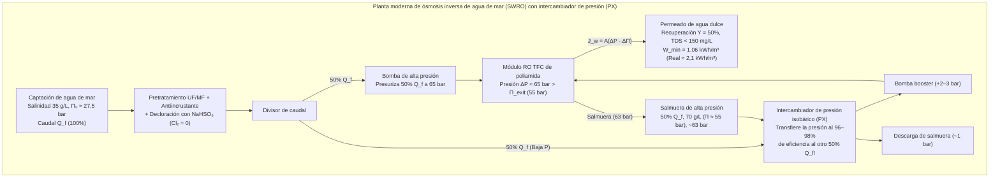

## Introducción: De los pepinos en salmuera a la crisis mundial del agua — La fuerza gigante invisible de la ósmosis

Si espolvoreamos sal sobre rodajas finas de pepino, en poucos minutos brotan gotas de agua del tejido vegetal. En medicina clínica, si se inyectara por error agua destilada pura por vía intravenosa en lugar de <strong>suero fisiológico ($0{,}9\,\text{wt}\%$ $\text{NaCl}$)</strong>, el agua entraría violentamente en los glóbulos rojos (eritrocitos) hasta hacer estallar su membrana celular, provocando una <strong>hemólisis</strong> letal. Por el contrario, un náufrago que bebe agua de mar sufre una deshidratación paradójica mortal, pues sus riñones necesitan extraer más agua de sus propias células para excretar el exceso de sal marina.

Este fenómeno universal es la <strong>ósmosis</strong>, y su fuerza impulsora termodinámica se cuantifica mediante la <strong>presión osmótica ($\Pi$)</strong>. El agua de mar estándar ($35\,\text{g/L}$) posee una presión osmótica de <strong>$27\text{ a }28\,\text{atm}$ ($\approx 2{,}75\,\text{MPa}$ o $27{,}5\,\text{bar}$)</strong>, equivalente a la presión hidrostática a <strong>$280\,\text{metros}$ de profundidad en el océano</strong>! Aplicando presiones hidráulicas de $55\text{ a }80\,\text{bar}$ sobre membranas poliméricas nanocompuestas, las plantas de desalinización por <strong>ósmosis inversa (Reverse Osmosis, RO)</strong> invierten este proceso natural para producir más de 100 millones de metros cúbicos de agua potable cada día.

---

## Capítulo 1: Desmontando el mito del «gradiente de concentración de agua» — Potencial químico ($\mu_w$) y entropía de mezcla

### 1.1 ¿Por qué es falsa la explicación de la «difusión del agua según su propia concentración volumétrica»?

Los textos introductorios suelen afirmar que el agua simplemente se difunde desde donde hay mayor concentración volumétrica de agua ($c_w$ en $\text{mol/L}$) hacia donde hay menor concentración. Esta explicación es <strong>fisicoquímicamente incorrecta</strong>:
1. <strong>La densidad molar volumétrica del agua ($c_w$) no gobierna la dirección del flujo osmótico</strong>: Dependiendo del volumen molar parcial del soluto ($\bar{V}_s$) y la electrostricción, el agua fluye estrictamente según su <strong>fracción molar $x_w$ y su actividad termodinámica $a_w = \gamma_w x_w$</strong>.
2. <strong>La simple difusión de Fick no puede explicar la detención total y la inversión mediante presión hidrostática ($\Delta P = \Pi$)</strong>: Dado que el agua líquida es casi incompresible ($\kappa_T \approx 4{,}5 \times 10^{-5}\,\text{bar}^{-1}$), aplicar $27{,}5\,\text{bar}$ solo aumenta su densidad en un $0{,}12\%$. Sin embargo, $\Delta P = \Pi$ detiene exactamente el flujo neto y $\Delta P > \Pi$ lo invierte.
3. La ósmosis en membranas porosas es un flujo convectivo colectivo, y $\Pi$ es una <strong>propiedad coligativa</strong> independiente del tamaño de poro o material de la membrana.

### 1.2 El potencial químico de Gibbs ($\mu_w$) y la mecánica estadística de la entropía de mezcla ($\Delta S_{\text{mix}}$)

Según la termodinámica de J. Willard Gibbs, a temperatura $T$ y presión $P$ constantes, toda especie química móvil migra espontáneamente de mayor a menor <strong>potencial químico $\mu_i$</strong>:

$$\mu_i \equiv \left( \frac{\partial G}{\partial n_i} \right)_{T, P, n_{j \neq i}}$$

Para el agua en solución respecto al agua pura $\mu_w^*(T, P_0)$:

$$\mu_w(T, P, x_w) = \mu_w^*(T, P_0) + \int_{P_0}^{P} \bar{V}_w \, dP' + R T \ln(\gamma_w x_w)$$

donde $\bar{V}_w \approx 18{,}07\,\text{cm}^3/\text{mol}$ es el volumen molar parcial del agua y $x_w = \frac{n_w}{n_w + \sum \nu_k n_k} = 1 - x_s < 1$ es su fracción molar. En una solución ideal ($\Delta H_{\text{mix}} = 0, \gamma_w = 1$), la reducción $\Delta \mu_w = RT \ln x_w < 0$ proviene exclusivamente del aumento de la <strong>entropía de mezcla ($\Delta S_{\text{mix}}$)</strong>:

$$\Delta S_{\text{mix}} = -R \left( n_w \ln x_w + \sum_k n_k \ln x_k \right) > 0 \implies \Delta \bar{S}_w = \left( \frac{\partial \Delta S_{\text{mix}}}{\partial n_w} \right)_{T,P,n_s} = -R \ln x_w > 0$$

Como la membrana semipermeable impide que los iones de soluto pasen al agua pura, las moléculas de agua cruzan la membrana para diluir el soluto, maximizando la entropía configuracional del universo ($S = k_B \ln W$) y minimizando la energía libre de Gibbs $G = H - TS$.

### 1.3 El mecanismo cinético de Debye–Kramer: Caída local de presión del disolvente en la interfaz

Como demostraron <strong>Peter Debye (1923)</strong>, Gerald Manning y Eric Kramer, cuando las partículas de soluto en movimiento térmico chocan contra la barrera repulsiva $U_s(z)$ de la membrana y son reflejadas, arrastran viscosamente las moléculas de agua hacia el interior de la solución:

$$\frac{dP_{\text{solvent}}(z)}{dz} + c_s(z) \frac{dU_s(z)}{dz} = 0 \implies P_{\text{solvent}}(0^+) = P_0 - c_s^{\text{bulk}} R T = P_0 - \Pi$$

```mermaid
flowchart TD
    subgraph S1["1. Ósmosis directa (Forward Osmosis): ΔP = 0 < Π"]
        L1["Agua pura (L)<br/>Presión P₀, fracción molar x_w = 1<br/>Potencial químico μ_w(L) = μ_w*"]
        M1["Membrana semipermeable<br/>Reflexión del soluto en la barrera:<br/>Presión local del agua cae a P₀ - Π"]
        R1["Solución salina (R)<br/>Presión P₀, fracción molar x_w < 1<br/>μ_w(R) = μ_w* + RT ln(γ_w x_w) < μ_w*"]
        L1 -->|"Flujo espontáneo de agua (Δμ_w > 0)<br/>Entropía de mezcla y succión en poros"| M1 --> R1
    end

    subgraph S2["2. Equilibrio osmótico: ΔP = Π"]
        L2["Agua pura (L)<br/>Presión P₀, μ_w(L) = μ_w*"]
        M2["Membrana semipermeable<br/>Presiones en poros igualadas (P₀ = P₀)<br/>Flujo neto J_w = 0"]
        R2["Solución salina (R)<br/>Presión externa P₀ + Π aplicada<br/>μ_w(R) = μ_w* + V_w Π + RT ln(γ_w x_w) = μ_w*"]
        L2 <-->|"Equilibrio termodinámico (Δμ_w = 0)<br/>Π = -(RT / V_w) ln(γ_w x_w) ≈ iMRT"| M2 <--> R2
    end

    subgraph S3["3. Ósmosis inversa (Desalinización RO): ΔP > Π (55–80 bar)"]
        L3["Permeado de agua dulce (L)<br/>Presión P₀, μ_w(L) = μ_w*"]
        M3["Membrana RO TFC de poliamida<br/>Transporte solución-difusión:<br/>Flujo J_w = A(ΔP - ΔΠ)"]
        R3["Salmuera a alta presión (R)<br/>Presión de bomba P₀ + ΔP (ΔP > Π)<br/>μ_w(R) = μ_w* + V_w(ΔP - Π) > μ_w*"]
        R3 -->|"Inversión de Δμ_w: μ_w(R) > μ_w(L)<br/>¡Agua pura exprimida de la salmuera!"| M3 --> L3
    end
```

Esto genera una <strong>caída mecánica local de presión en el agua ($P_0 - \Pi$)</strong> justo en la boca de los poros del lado de la solución, succionando mecánicamente el agua pura (a presión $P_0$) a través de la membrana.

---

## Capítulo 2: Derivación paso a paso de la ley de van 't Hoff (1887) y cálculo para el agua de mar

### 2.1 Derivación termodinámica rigurosa

<strong>Jacobus Henricus van 't Hoff</strong> (primer Premio Nobel de Química en 1901), basándose en las mediciones de Wilhelm Pfeffer con membranas de ferrocianuro de cobre ($\text{Cu}_2[\text{Fe(CN)}_6]$), formuló la ley de la presión osmótica:

1. <strong>Igualdad de potenciales químicos en el equilibrio</strong> entre el agua pura ($L$, presión $P_0, x_w=1$) y la solución ($R$, presión $P_0 + \Pi, x_w$):

$$\mu_w^{(L)}(T, P_0, x_w=1) = \mu_w^*(T, P_0) = \mu_w^{(R)}(T, P_0 + \Pi, x_w) = \mu_w^*(T, P_0) + \bar{V}_w \Pi + R T \ln(\gamma_w x_w)$$

2. <strong>Ecuación termodinámica exacta</strong> (agua incompresible):

$$\Pi = -\frac{R T}{\bar{V}_w} \ln(\gamma_w x_w)$$

3. <strong>Serie de Taylor para solución diluida</strong> ($\gamma_w \to 1$, $x_s = 1 - x_w = \frac{i n_s}{n_w + i n_s} \ll 1$ con el <strong>factor de van 't Hoff $i$</strong>):

$$\ln x_w = \ln(1 - x_s) \approx -x_s \approx -\frac{i n_s}{n_w}$$

4. <strong>Conversión a molaridad $M = n_s / V$</strong> (con $V \approx n_w \bar{V}_w$):

$$\Pi \approx \frac{R T}{\bar{V}_w} \frac{i n_s}{n_w} \approx i \left(\frac{n_s}{V}\right) R T = i M R T$$

### 2.2 Cálculo exacto para el agua de mar estándar ($35\,\text{g/L}$ $\text{NaCl}$)

A $T = 298{,}15\,\text{K}$ ($25\,^\circ\text{C}$):
- Molaridad: $M = \frac{35\,\text{g/L}}{58{,}44\,\text{g/mol}} \approx 0{,}60\,\text{mol/L}$.
- Factor de van 't Hoff: Para $\text{NaCl}$ ($\nu = 2$), el coeficiente osmótico $\phi \approx 0{,}925$ da $i = \phi \nu \approx 1{,}85$ (osmolaridad $\approx 1{,}11\,\text{Osm/L}$).
- Presión osmótica ($R = 0{,}082057\,\text{L}\cdot\text{atm}/(\text{K}\cdot\text{mol})$):

$$\Pi = 1{,}85 \times 0{,}60\,\text{mol/L} \times 0{,}082057\,\text{L}\cdot\text{atm}/(\text{K}\cdot\text{mol}) \times 298{,}15\,\text{K} \approx 27{,}16\,\text{atm} \approx 2{,}75\,\text{MPa}\,(27{,}5\,\text{bar})$$

¡Esto equivale a una <strong>columna de agua de $h = \frac{\Pi}{\rho g} \approx 280{,}6\,\text{metros}$ de altura</strong>!

---

## Capítulo 3: Ósmosis biológica — Acuaporinas (AQP1), tonicidad eritrocitaria, ecuación de Starling y turgencia

- <strong>Canales de agua Acuaporina (AQP1, Peter Agre, Premio Nobel 2003)</strong>: Un poro en forma de reloj de arena con un filtro estérico $\text{ar/R}$ de <strong>$2{,}8\,\text{\AA}$</strong> conduce <strong>$3 \times 10^9$ moléculas de agua por segundo</strong> en fila india (single-file). Dos <strong>motivos NPA (Asparagina-Prolina-Alanina)</strong> centrales fuerzan un <strong>giro de $180^\circ$ del dipolo eléctrico</strong> del agua, interrumpiendo la cadena de enlaces de hidrógeno y bloqueando por completo la conducción de protones ($\text{H}_3\text{O}^+$) por el mecanismo de Grotthuss.
- <strong>Tonicidad en glóbulos rojos</strong>: Forma bicóncava normal en medio <strong>isotónico</strong> ($0{,}9\,\text{wt}\%$ $\text{NaCl}$, $\approx 290\,\text{mOsm/L}$), encogimiento espinoso (<strong>crenación</strong>) en medio <strong>hipertónico</strong>, y ruptura celular (<strong>hemólisis</strong>) en medio <strong>hipotónico</strong>.
- <strong>Ecuación de Starling (1896) en capilares</strong>:
  $$J_v = L_p S \left[ (P_c - P_i) - \sigma (\pi_c - \pi_i) \right]$$
  La <strong>presión oncótica ($\pi_c \approx 25\text{–}28\,\text{mmHg}$)</strong> generada por la albúmina sérica ($66{,}5\,\text{kDa}$) permite la reabsorción venosa; su déficit provoca <strong>edema y ascitis</strong>.
- <strong>Presión de turgencia vegetal ($\Psi_w = \Psi_s + \Psi_p + \Psi_g + \Psi_m$)</strong>: La pared celular soporta una turgencia $\Psi_p \approx +0{,}8\text{ a }+1{,}5\,\text{MPa}$, manteniendo erguidas las plantas herbáceas e impidiendo la <strong>plasmólisis</strong>.

| Sistema de membrana | Tamaño de poro / Volumen libre | Mecanismo de selectividad | Permeancia / Tasa de transporte | Especies rechazadas | Presión típica |
| :--- | :--- | :--- | :--- | :--- | :--- |
| <strong>Acuaporina biológica (AQP1)</strong> | Canal fijo de $0{,}28\,\text{nm}$ ($2{,}8\,\text{\AA}$) | Filtro estérico $\text{ar/R}$ + giro dipolar NPA | $\sim 3 \times 10^9$ $\text{H}_2\text{O}$/s por canal | Todos los iones hidratados, protones ($\text{H}_3\text{O}^+$), urea | Pocos $\text{mmHg}$ a $\sim 30\,\text{bar}$ |
| <strong>Endotelio capilar (Glicocálix)</strong> | Hendiduras de $4\text{–}5\,\text{nm}$ | Exclusión por tamaño + repulsión de Donnan | Ecuación de Starling ($L_p$) | Albúmina ($66{,}5\,\text{kDa}$), globulinas, eritrocitos | $P_c \approx 15\text{–}35\,\text{mmHg}$ vs $\pi_c \approx 28\,\text{mmHg}$ |
| <strong>Micro- (MF) / Ultrafiltración (UF)</strong> | MF: $100\text{–}1\,000\,\text{nm}$ UF: $2\text{–}100\,\text{nm}$ | Tamizado mecánico por poros (Pore-flow) | $50\text{–}500\,\text{L}/(\text{m}^2\cdot\text{h}\cdot\text{bar})$ | Bacterias, virus (UF), coloides, proteínas | $0{,}2\text{–}5\,\text{bar}$ |
| <strong>Ósmosis inversa (RO TFC Poliamida)</strong> | No porosa ($0{,}2\text{–}0{,}5\,\text{nm}$ volumen libre) | <strong>Solución-Difusión</strong> + barrera de deshidratación | $1\text{–}2\,\text{L}/(\text{m}^2\cdot\text{h}\cdot\text{bar})$ (SWRO) | Iones monovalentes ($\text{Na}^+, \text{Cl}^-$ rechazo $>99{,}8\%$) | <strong>$55\text{–}80\,\text{bar}$</strong> (agua de mar) |

---

## Capítulo 4: Desalinización por ósmosis inversa (RO) — Membranas TFC de poliamida y modelo de solución-difusión

Tras las membranas asimétricas de Loeb y Sourirajan (1960), John Cadotte inventó a finales de los años 1970 la <strong>membrana compuesta de película delgada (TFC) de poliamida mediante polimerización interfacial</strong> entre $m$-fenilendiamina (MPD) y cloruro de trimesoilo (TMC), creando una capa activa reticulada de <strong>$100\text{ a }200\,\text{nm}$</strong>.

Según el <strong>modelo de solución-difusión (Wijmans & Baker, 1995)</strong>:
- <strong>Flujo de agua</strong>: $J_w = A(\Delta P - \Delta \Pi)$ con $A = \frac{D_w K_w c_w \bar{V}_w}{\delta R T}$.
- <strong>Flujo de sal</strong>: $J_s = B(C_m - C_p)$ con $B = \frac{D_s K_s}{\delta}$ (¡independiente de $\Delta P$!). Por ello, el rechazo de sal $R_s = \frac{A(\Delta P - \Delta \Pi)}{A(\Delta P - \Delta \Pi) + B}$ se aproxima al $100\%$ al aumentar $\Delta P$.
- <strong>Barrera de deshidratación y anomalía del boro</strong>: El $\text{Na}^+$ hidratado ($r_{\text{hyd}} \approx 3{,}58\,\text{\AA}$ frente a $1{,}38\,\text{\AA}$ del $\text{H}_2\text{O}$) es rechazado por la barrera energética de deshidratación y de exclusión dieléctrica de Born. En cambio, el <strong>ácido bórico neutro $\text{B(OH)}_3$</strong> ($\text{p}K_a \approx 9{,}2$) a $\text{pH} \approx 8{,}0$ carece de carga eléctrica y atraviesa la membrana formando puentes de hidrógeno (requiriendo elevar el $\text{pH} > 10$ con $\text{NaOH}$ en un segundo paso de RO para convertirlo en el anión $\text{B(OH)}_4^-$).

---

## Capítulo 5: Energía mínima termodinámica ($1{,}06\,\text{kWh/m}^3$), intercambiadores isobáricos (PX), polarización de concentración y biofouling

El trabajo mínimo reversible de separación $w_{\min}(Y)$ para una tasa de recuperación $Y = V_p / V_f$ se obtiene integrando $\Pi(y) = \frac{\Pi_0}{1 - y}$:

$$w_{\min}(Y) = \frac{1}{Y} \int_0^Y \Pi(y)\,dy = \Pi_0 \frac{\ln\left(\frac{1}{1 - Y}\right)}{Y}$$

Para <strong>$Y = 50\%$</strong> ($\Pi_0 = 2{,}75\,\text{MPa}$), resulta <strong>$w_{\min}(0{,}50) = 3{,}812\,\text{MJ/m}^3 \approx 1{,}06\,\text{kWh/m}^3$</strong>, frente a <strong>$\sim 650\,\text{kWh/m}^3$</strong> de calor latente de vaporización. Gracias a los <strong>intercambiadores de presión isobáricos (PX)</strong> que recuperan entre el $96\%$ y el $98\%$ de la energía de la salmuera, el consumo del núcleo de RO se sitúa hoy en <strong>$2{,}0\text{–}2{,}5\,\text{kWh/m}^3$</strong>.

| Tecnología de desalinización | Principio fisicoquímico | Energía mínima teórica ($Y=50\%$) | Consumo real en planta (equivalente eléctrico) | Condiciones operativas | Ventajas y limitaciones |
| :--- | :--- | :--- | :--- | :--- | :--- |
| <strong>Evaporación simple</strong> | Cambio de fase líquido-vapor | $\sim 650\,\text{kWh/m}^3$ (calor latente) | $>650\,\text{kWh/m}^3$ | $100\,^\circ\text{C}$, $1\,\text{bar}$ | Coste energético prohibitivo |
| <strong>Destilación térmica (MSF / MED)</strong> | Evaporación flash multietapa | $1{,}06\,\text{kWh/m}^3$ | <strong>$7\text{–}18\,\text{kWh/m}^3$</strong> | $60\text{–}110\,^\circ\text{C}$ | Robusta pero de alto consumo energético |
| <strong>Ósmosis inversa (SWRO + PX)</strong> | <strong>Solución-difusión TFC + inversión a alta presión</strong> | <strong>$1{,}06\,\text{kWh/m}^3$</strong> ($0{,}76\,\text{kWh/m}^3$ si $Y\to 0$) | Núcleo RO: <strong>$2{,}0\text{–}2{,}5\,\text{kWh/m}^3$</strong> Total planta: $3{,}0\text{–}3{,}5\,\text{kWh/m}^3$ | Temp. ambiente, <strong>$55\text{–}80\,\text{bar}$</strong> | <strong>70% de cuota mundial</strong>; limitada por polarización y biofouling |

Los dos grandes cuellos de botella de ingeniería son la <strong>polarización por concentración</strong> ($\frac{C_m - C_p}{C_b - C_p} = \exp(J_w / k_m)$) y el <strong>ensuciamiento biológico (biofouling)</strong> agravado por la sensibilidad de los enlaces amida de la poliamida al cloro libre (N-cloración y transposición de Orton), lo que obliga a declorar el agua con $\text{NaHSO}_3$ antes de las membranas.
