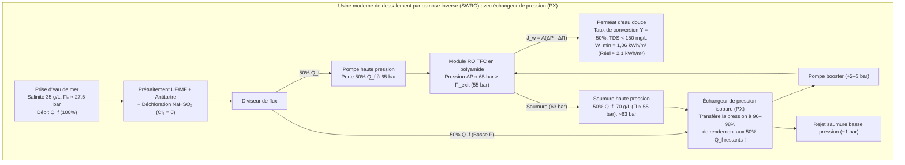

## Introduction : Des concombres salés à la crise mondiale de l'eau — La force géante invisible de l'osmose

Saupoudrez de sel des rondelles de concombre : en quelques minutes, l'eau perle hors des cellules végétales. En médecine clinique, si l'on injectait par erreur de l'eau pure distillée par voie intraveineuse au lieu d'un <strong>sérum physiologique ($0{,}9\,\text{wt}\%$ $\text{NaCl}$)</strong>, l'eau s'engouffrerait dans les globules rouges (érythrocytes) jusqu'à faire éclater leur membrane plasmique — une <strong>hémolyse</strong> mortelle. À l'inverse, un naufragé qui boit de l'eau de mer meurt de déshydratation accélérée, car ses reins doivent puiser davantage d'eau dans ses propres cellules pour excréter l'excès de sel marin.

Ce phénomène universel est l'<strong>osmose</strong>, et l'intensité de sa force motrice thermodynamique est mesurée par la <strong>pression osmotique ($\Pi$)</strong>. L'eau de mer standard ($35\,\text{g/L}$) exerce une pression osmotique de <strong>$27\text{ à }28\,\text{atm}$ ($\approx 2{,}75\,\text{MPa}$ ou $27{,}5\,\text{bar}$)</strong>, soit l'équivalent de la pression hydrostatique régnant à <strong>$280\,\text{mètres}$ de profondeur sous l'océan</strong> ! Aujourd'hui, en appliquant une pression hydraulique de $55\text{ à }80\,\text{bar}$ sur des membranes polymères nanocomposites, les usines de dessalement par <strong>osmose inverse (Reverse Osmosis, RO)</strong> inversent ce flux naturel pour produire plus de 100 millions de mètres cubes d'eau douce par jour.

---

## Chapitre 1 : Déconstruire le mythe de la « concentration en eau » — Potentiel chimique ($\mu_w$) et entropie de mélange

### 1.1 Pourquoi l'explication par « diffusion selon le gradient de concentration volumique de l'eau » est-elle erronée ?

Les manuels élémentaires affirment souvent que l'eau diffuse simplement de la région où sa concentration volumique ($c_w$ en $\text{mol/L}$) est plus élevée vers celle où elle est plus faible. Or, cette vision est <strong>physico-chimiquement fausse</strong> :
1. <strong>La densité molaire volumique de l'eau ($c_w$) ne dicte pas le sens de l'osmose</strong> : Selon le volume molaire partiel du soluté ($\bar{V}_s$) et l'électrostriction, l'eau s'écoule toujours selon le gradient de sa <strong>fraction molaire $x_w$ et de son activité thermodynamique $a_w = \gamma_w x_w$</strong>, même si la concentration massique par litre d'eau est identique ou inversée.
2. <strong>Une simple diffusion de Fick ne pourrait jamais être stoppée net par une pression hydrostatique $\Delta P = \Pi$</strong> : L'eau liquide étant quasi incompressible ($\kappa_T \approx 4{,}5 \times 10^{-5}\,\text{bar}^{-1}$), une pression de $27{,}5\,\text{bar}$ n'augmente sa densité que de $0{,}12\%$. Pourtant, $\Delta P = \Pi$ annule exactement le flux osmotique et $\Delta P > \Pi$ l'inverse.
3. L'osmose à travers une membrane poreuse est un écoulement convectif collectif, et $\Pi$ est une <strong>propriété colligative</strong> indépendante de la nature de la membrane.

### 1.2 Le potentiel chimique de Gibbs ($\mu_w$) et l'entropie statistique de mélange ($\Delta S_{\text{mix}}$)

Selon la thermodynamique de J. Willard Gibbs, à température $T$ et pression $P$ constantes, toute espèce mobile migre spontanément vers les régions de plus faible <strong>potentiel chimique $\mu_i$</strong> :

$$\mu_i \equiv \left( \frac{\partial G}{\partial n_i} \right)_{T, P, n_{j \neq i}}$$

Pour l'eau (solvant $w$) dans une solution, le potentiel chimique s'écrit en fonction de celui de l'eau pure $\mu_w^*(T, P_0)$ :

$$\mu_w(T, P, x_w) = \mu_w^*(T, P_0) + \int_{P_0}^{P} \bar{V}_w \, dP' + R T \ln(\gamma_w x_w)$$

où $\bar{V}_w \approx 18{,}07\,\text{cm}^3/\text{mol}$ est le volume molaire partiel de l'eau et $x_w = \frac{n_w}{n_w + \sum \nu_k n_k} = 1 - x_s < 1$ est sa fraction molaire. Dans une solution idéale ($\Delta H_{\text{mix}} = 0, \gamma_w = 1$), la diminution $\Delta \mu_w = RT \ln x_w < 0$ provient exclusivement de l'augmentation de l'<strong>entropie de mélange ($\Delta S_{\text{mix}}$)</strong> :

$$\Delta S_{\text{mix}} = -R \left( n_w \ln x_w + \sum_k n_k \ln x_k \right) > 0 \implies \Delta \bar{S}_w = \left( \frac{\partial \Delta S_{\text{mix}}}{\partial n_w} \right)_{T,P,n_s} = -R \ln x_w > 0$$

Puisque la membrane semi-perméable empêche les ions de soluté de se disperser dans l'eau pure, ce sont les molécules d'eau qui traversent la membrane pour diluer le soluté, maximisant ainsi l'entropie de configuration de l'univers ($S = k_B \ln W$) et minimisant l'énergie libre de Gibbs $G = H - TS$.

### 1.3 Le mécanisme cinétique de Debye–Kramer : Chute locale de pression du solvant à l'interface

Comme l'ont démontré <strong>Peter Debye (1923)</strong>, Gerald Manning et Eric Kramer, lorsque les particules de soluté en agitation thermique sont réfléchies par la barrière répulsive $U_s(z)$ de la membrane, elles entraînent par viscosité les molécules d'eau vers l'intérieur de la solution :

$$\frac{dP_{\text{solvent}}(z)}{dz} + c_s(z) \frac{dU_s(z)}{dz} = 0 \implies P_{\text{solvent}}(0^+) = P_0 - c_s^{\text{bulk}} R T = P_0 - \Pi$$

```mermaid
flowchart TD
    subgraph S1["1. Osmose directe (Forward Osmosis): ΔP = 0 < Π"]
        L1["Eau pure (L)<br/>Pression P₀, fraction molaire x_w = 1<br/>Potentiel chimique μ_w(L) = μ_w*"]
        M1["Membrane semi-perméable<br/>Réflexion du soluté à l'interface :<br/>Pression locale de l'eau chute à P₀ - Π"]
        R1["Solution saline (R)<br/>Pression P₀, fraction molaire x_w < 1<br/>μ_w(R) = μ_w* + RT ln(γ_w x_w) < μ_w*"]
        L1 -->|"Flux d'eau spontané (Δμ_w > 0)<br/>Entropie de mélange & succion aux pores"| M1 --> R1
    end

    subgraph S2["2. Équilibre osmotique: ΔP = Π"]
        L2["Eau pure (L)<br/>Pression P₀, μ_w(L) = μ_w*"]
        M2["Membrane semi-perméable<br/>Pressions aux pores équilibrées (P₀ = P₀)<br/>Flux net J_w = 0"]
        R2["Solution saline (R)<br/>Pression externe P₀ + Π appliquée<br/>μ_w(R) = μ_w* + V_w Π + RT ln(γ_w x_w) = μ_w*"]
        L2 <-->|"Équilibre thermodynamique (Δμ_w = 0)<br/>Π = -(RT / V_w) ln(γ_w x_w) ≈ iMRT"| M2 <--> R2
    end

    subgraph S3["3. Osmose inverse (Dessalement RO): ΔP > Π (55–80 bar)"]
        L3["Perméat d'eau douce (L)<br/>Pression P₀, μ_w(L) = μ_w*"]
        M3["Membrane RO TFC en polyamide<br/>Modèle solubilisation-diffusion :<br/>Flux J_w = A(ΔP - ΔΠ)"]
        R3["Saumure haute pression (R)<br/>Pression pompe P₀ + ΔP (ΔP > Π)<br/>μ_w(R) = μ_w* + V_w(ΔP - Π) > μ_w*"]
        R3 -->|"Inversion de Δμ_w : μ_w(R) > μ_w(L)<br/>L'eau pure est extraite de la saumure !"| M3 --> L3
    end
```

Cette répulsion du soluté crée une <strong>dépression mécanique locale dans le solvant ($P_0 - \Pi$)</strong> juste à l'entrée des pores côté solution, aspirant mécaniquement l'eau pure (à pression $P_0$) à travers la membrane !

---

## Chapitre 2 : Dérivation pas à pas de la loi de van 't Hoff (1887) et calcul pour l'eau de mer

### 2.1 Dérivation thermodynamique rigoureuse

<strong>Jacobus Henricus van 't Hoff</strong> (premier prix Nobel de chimie en 1901), s'appuyant sur les mesures de Wilhelm Pfeffer avec des membranes de ferrocyanure de cuivre ($\text{Cu}_2[\text{Fe(CN)}_6]$), a établi la loi fondamentale de la pression osmotique :

1. <strong>Égalité des potentiels chimiques à l'équilibre</strong> entre l'eau pure ($L$, pression $P_0, x_w=1$) et la solution ($R$, pression $P_0 + \Pi, x_w$) :

$$\mu_w^{(L)}(T, P_0, x_w=1) = \mu_w^*(T, P_0) = \mu_w^{(R)}(T, P_0 + \Pi, x_w) = \mu_w^*(T, P_0) + \bar{V}_w \Pi + R T \ln(\gamma_w x_w)$$

2. <strong>Équation thermodynamique exacte</strong> (eau incompressible) :

$$\Pi = -\frac{R T}{\bar{V}_w} \ln(\gamma_w x_w)$$

3. <strong>Développement de Taylor pour une solution diluée</strong> ($\gamma_w \to 1$, $x_s = 1 - x_w = \frac{i n_s}{n_w + i n_s} \ll 1$ avec le <strong>facteur de van 't Hoff $i$</strong>) :

$$\ln x_w = \ln(1 - x_s) \approx -x_s \approx -\frac{i n_s}{n_w}$$

4. <strong>Expression en fonction de la molarité $M = n_s / V$</strong> (avec $V \approx n_w \bar{V}_w$) :

$$\Pi \approx \frac{R T}{\bar{V}_w} \frac{i n_s}{n_w} \approx i \left(\frac{n_s}{V}\right) R T = i M R T$$

### 2.2 Calcul exact pour l'eau de mer standard ($35\,\text{g/L}$ $\text{NaCl}$)

À $T = 298{,}15\,\text{K}$ ($25\,^\circ\text{C}$) :
- Molarité : $M = \frac{35\,\text{g/L}}{58{,}44\,\text{g/mol}} \approx 0{,}60\,\text{mol/L}$.
- Facteur de van 't Hoff : Pour $\text{NaCl}$ ($\nu = 2$), le coefficient osmotique $\phi \approx 0{,}925$ donne $i = \phi \nu \approx 1{,}85$ (osmolarité $\approx 1{,}11\,\text{Osm/L}$).
- Pression osmotique ($R = 0{,}082057\,\text{L}\cdot\text{atm}/(\text{K}\cdot\text{mol})$) :

$$\Pi = 1{,}85 \times 0{,}60\,\text{mol/L} \times 0{,}082057\,\text{L}\cdot\text{atm}/(\text{K}\cdot\text{mol}) \times 298{,}15\,\text{K} \approx 27{,}16\,\text{atm} \approx 2{,}75\,\text{MPa}\,(27{,}5\,\text{bar})$$

Cela équivaut à une <strong>colonne d'eau de $h = \frac{\Pi}{\rho g} \approx 280{,}6\,\text{mètres}$</strong> !

---

## Chapitre 3 : Osmose biologique — Aquaporines (AQP1), tonicité érythrocytaire, équation de Starling et turgescence

- <strong>Canaux hydriques Aquaporine (AQP1, Peter Agre, Prix Nobel 2003)</strong> : Un canal en sablier doté d'un filtre stérique $\text{ar/R}$ de <strong>$2{,}8\,\text{\AA}$</strong> fait passer <strong>$3 \times 10^9$ molécules d'eau par seconde</strong> en file indienne (single-file). Deux <strong>motifs NPA (Asparagine-Proline-Alanine)</strong> centraux forcent un <strong>retournement à $180^\circ$ du dipôle électrique</strong> de chaque molécule d'eau, brisant la chaîne de liaisons hydrogène et bloquant totalement le transfert de protons ($\text{H}_3\text{O}^+$) par mécanisme de Grotthuss.
- <strong>Tonicité des globules rouges</strong> : Maintien du disque biconcave en milieu <strong>isotonique</strong> ($0{,}9\,\text{wt}\%$ $\text{NaCl}$, $\approx 290\,\text{mOsm/L}$), rétraction épineuse (<strong>crénation</strong>) en milieu <strong>hypertonique</strong>, et éclatement (<strong>hémolyse</strong>) en milieu <strong>hypotonique</strong>.
- <strong>Équation de Starling (1896) dans les capillaires sanguins</strong> :
  $$J_v = L_p S \left[ (P_c - P_i) - \sigma (\pi_c - \pi_i) \right]$$
  La <strong>pression oncotique ($\pi_c \approx 25\text{–}28\,\text{mmHg}$)</strong> exercée par l'albumine sérique ($66{,}5\,\text{kDa}$) permet la réabsorption veineuse ; sa chute provoque des <strong>œdèmes et de l'ascite</strong>.
- <strong>Pression de turgescence végétale ($\Psi_w = \Psi_s + \Psi_p + \Psi_g + \Psi_m$)</strong> : La paroi cellulosique soutient une turgescence $\Psi_p \approx +0{,}8\text{ à }+1{,}5\,\text{MPa}$, évitant le flétrissement et la <strong>plasmolyse</strong>.

| Système membranaire | Taille des pores / Volume libre | Mécanisme de sélectivité | Perméance / Débit | Espèces rejetées | Pression typique |
| :--- | :--- | :--- | :--- | :--- | :--- |
| <strong>Aquaporine biologique (AQP1)</strong> | Canal fixe de $0{,}28\,\text{nm}$ ($2{,}8\,\text{\AA}$) | Filtre stérique $\text{ar/R}$ + bascule dipolaire NPA | $\sim 3 \times 10^9$ $\text{H}_2\text{O}$/s par canal | Tous les ions hydratés, protons ($\text{H}_3\text{O}^+$), urée | Quelques $\text{mmHg}$ à $\sim 30\,\text{bar}$ |
| <strong>Endothélium capillaire (Glycocalyx)</strong> | Fentes de $4\text{–}5\,\text{nm}$ | Tamisage stérique + répulsion de Donnan | Équation de Starling ($L_p$) | Albumine ($66{,}5\,\text{kDa}$), globulines, hématies | $P_c \approx 15\text{–}35\,\text{mmHg}$ vs $\pi_c \approx 28\,\text{mmHg}$ |
| <strong>Micro- (MF) / Ultrafiltration (UF)</strong> | MF : $100\text{–}1\,000\,\text{nm}$ UF : $2\text{–}100\,\text{nm}$ | Tamisage mécanique (écoulement en pores) | $50\text{–}500\,\text{L}/(\text{m}^2\cdot\text{h}\cdot\text{bar})$ | Bactéries, virus (UF), colloïdes, protéines | $0{,}2\text{–}5\,\text{bar}$ |
| <strong>Osmose inverse (RO TFC Polyamide)</strong> | Non poreux ($0{,}2\text{–}0{,}5\,\text{nm}$ volume libre) | <strong>Solubilisation-Diffusion</strong> + barrière de déshydratation | $1\text{–}2\,\text{L}/(\text{m}^2\cdot\text{h}\cdot\text{bar})$ (SWRO) | Ions monovalents ($\text{Na}^+, \text{Cl}^-$ rejet $>99{,}8\%$) | <strong>$55\text{–}80\,\text{bar}$</strong> (eau de mer) |

---

## Chapitre 4 : Dessalement par osmose inverse (RO) — Membranes composites TFC et modèle de solubilisation-diffusion

Après les membranes asymétriques de Loeb et Sourirajan (1960), John Cadotte a inventé à la fin des années 1970 la <strong>membrane composite à film mince (TFC) en polyamide par polymérisation interfaciale</strong> entre la $m$-phénylènediamine (MPD) et le chlorure de trimésoyle (TMC), formant une couche active réticulée de <strong>$100\text{ à }200\,\text{nm}$</strong>.

Selon le <strong>modèle de solubilisation-diffusion (Wijmans & Baker, 1995)</strong> :
- <strong>Flux d'eau</strong> : $J_w = A(\Delta P - \Delta \Pi)$ avec $A = \frac{D_w K_w c_w \bar{V}_w}{\delta R T}$.
- <strong>Flux de sel</strong> : $J_s = B(C_m - C_p)$ avec $B = \frac{D_s K_s}{\delta}$ (indépendant de $\Delta P$ !). Le taux de rejet $R_s = \frac{A(\Delta P - \Delta \Pi)}{A(\Delta P - \Delta \Pi) + B}$ tend donc vers $100\%$ à haute pression.
- <strong>Barrière de déshydratation et anomalie du bore</strong> : L'ion $\text{Na}^+$ hydraté ($r_{\text{hyd}} \approx 3{,}58\,\text{\AA}$ contre $1{,}38\,\text{\AA}$ pour $\text{H}_2\text{O}$) est bloqué par la pénalité énergétique de déshydratation et d'exclusion diélectrique de Born. En revanche, l'<strong>acide borique neutre $\text{B(OH)}_3$</strong> ($\text{p}K_a \approx 9{,}2$) à $\text{pH} \approx 8{,}0$ ne porte aucune charge et traverse facilement la membrane par liaisons hydrogène (nécessitant une alcalinisation à $\text{pH} > 10$ en 2e passe pour former l'anion $\text{B(OH)}_4^-$).

---

## Chapitre 5 : Énergie minimale thermodynamique ($1{,}06\,\text{kWh/m}^3$), échangeurs isobares (PX), polarisation de concentration et biofouling

Le travail minimal réversible de séparation $w_{\min}(Y)$ pour un taux de conversion $Y = V_p / V_f$ s'obtient en intégrant $\Pi(y) = \frac{\Pi_0}{1 - y}$ :

$$w_{\min}(Y) = \frac{1}{Y} \int_0^Y \Pi(y)\,dy = \Pi_0 \frac{\ln\left(\frac{1}{1 - Y}\right)}{Y}$$

Pour <strong>$Y = 50\%$</strong> ($\Pi_0 = 2{,}75\,\text{MPa}$), on obtient <strong>$w_{\min}(0{,}50) = 3{,}812\,\text{MJ/m}^3 \approx 1{,}06\,\text{kWh/m}^3$</strong>, contre <strong>$\sim 650\,\text{kWh/m}^3$</strong> de chaleur latente de vaporisation ! Grâce aux <strong>échangeurs de pression isobares (PX)</strong> récupérant $96\text{ à }98\%$ de l'énergie de la saumure, la consommation du cœur RO atteint aujourd'hui <strong>$2{,}0\text{ à }2{,}5\,\text{kWh/m}^3$</strong>.

| Technologie de dessalement | Principe physico-chimique | Énergie minimale théorique ($Y=50\%$) | Consommation réelle (équivalent électrique) | Conditions opératoires | Avantages & Limites |
| :--- | :--- | :--- | :--- | :--- | :--- |
| <strong>Évaporation simple</strong> | Changement de phase liquide-vapeur | $\sim 650\,\text{kWh/m}^3$ (chaleur latente) | $>650\,\text{kWh/m}^3$ | $100\,^\circ\text{C}$, $1\,\text{bar}$ | Coût énergétique prohibitif |
| <strong>Distillation thermique (MSF / MED)</strong> | Ébullition flash multi-étagée | $1{,}06\,\text{kWh/m}^3$ | <strong>$7\text{–}18\,\text{kWh/m}^3$</strong> | $60\text{–}110\,^\circ\text{C}$ | Robuste mais très énergivore |
| <strong>Osmose inverse (SWRO + PX)</strong> | <strong>Solubilisation-diffusion TFC + inversion haute pression</strong> | <strong>$1{,}06\,\text{kWh/m}^3$</strong> ($0{,}76\,\text{kWh/m}^3$ si $Y\to 0$) | Cœur RO : <strong>$2{,}0\text{–}2{,}5\,\text{kWh/m}^3$</strong> Total usine : $3{,}0\text{–}3{,}5\,\text{kWh/m}^3$ | Temp. ambiante, <strong>$55\text{–}80\,\text{bar}$</strong> | <strong>70% du marché mondial</strong> ; limité par la polarisation et le biofouling |

Les deux verrous d'ingénierie majeurs restent la <strong>polarisation de concentration</strong> ($\frac{C_m - C_p}{C_b - C_p} = \exp(J_w / k_m)$) et le <strong>colmatage biologique (biofouling)</strong> dû à la vulnérabilité des liaisons amide du polyamide face au chlore libre (N-chloration et réarrangement d'Orton), qui oblige à déchlorer l'eau par $\text{NaHSO}_3$ avant les membranes.
