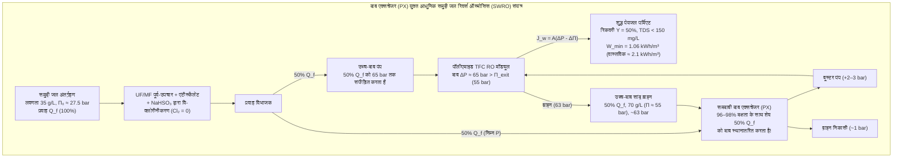

## परिचय: नमकीन खीरे से लेकर वैश्विक जल सुरक्षा तक — परासरण (Osmosis) की अदृश्य महाशक्ति

पतले कटे हुए खीरे पर नमक छिड़कें, तो कुछ ही मिनटों में पौधे के ऊतकों से पानी की बूंदें बाहर निकल आती हैं। क्लिनिकल मेडिसिन में, यदि किसी रोगी को <strong>सामान्य सलाइन ($0.9\,\text{wt}\%$ $\text{NaCl}$)</strong> के बजाय गलती से शुद्ध आसुत जल (distilled water) नसों में चढ़ा दिया जाए, तो पानी इतनी तीव्रता से लाल रक्त कोशिकाओं (एरिथ्रोसाइट्स) में घुसेगा कि उनकी कोशिका झिल्ली फट जाएगी—इस घातक स्थिति को <strong>हीमोलिसिस (Hemolysis)</strong> कहते हैं। इसके विपरीत, जहाज दुर्घटना में फंसा नाविक यदि प्यास बुझाने के लिए समुद्री जल पीता है, तो वह विरोधाभासी निर्जलीकरण का शिकार हो जाता है, क्योंकि अतिरिक्त समुद्री नमक को बाहर निकालने के लिए गुर्दों को कोशिकाओं से अधिक पानी खींचना पड़ता है।

ये सभी परिघटनाएं <strong>परासरण (Osmosis)</strong> द्वारा संचालित होती हैं, और इसके ऊष्मागतिकीय प्रेरक बल को <strong>परासरण दाब ($\Pi$)</strong> द्वारा मापा जाता है। मानक समुद्री जल ($35\,\text{g/L}$) का परासरण दाब <strong>$27\text{ से }28\,\text{atm}$ ($\approx 2.75\,\text{MPa}$ या $27.5\,\text{bar}$)</strong> होता है, जो यांत्रिक रूप से महासागर में <strong>$280\,\text{मीटर}$ की गहराई</strong> पर स्थित द्रवस्थैतिक दाब के बराबर है! अति-पतली बहुलक झिल्लियों पर $55\text{ से }80\,\text{bar}$ का हाइड्रोलिक दाब लगाकर आधुनिक <strong>समुद्री जल रिवर्स ऑस्मोसिस (SWRO)</strong> संयंत्र इस प्राकृतिक प्रक्रिया को उलट देते हैं और प्रतिदिन 10 करोड़ घन मीटर से अधिक शुद्ध पेयजल प्रदान करते हैं।

---

## अध्याय 1: "जल सांद्रता प्रवणता" के मिथक का खंडन — रासायनिक विभव ($\mu_w$) और मिश्रण की एन्ट्रॉपी

### 1.1 "जल की अपनी आयतनी सांद्रता के अनुसार विसरण" की व्याख्या क्यों गलत है?

प्रारंभिक पाठ्यपुस्तकें अक्सर कहती हैं कि पानी उच्च आयतनी जल सांद्रता ($c_w$, $\text{mol/L}$ में) से निम्न सांद्रता की ओर विसरित होता है। यह व्याख्या <strong>भौतिक-रासायनिक रूप से गलत है</strong>:
1. <strong>जल का आयतनी मोलर घनत्व ($c_w$) परासरण प्रवाह की दिशा तय नहीं करता</strong>: विलेय के आंशिक मोलर आयतन ($\bar{V}_s$) और इलेक्ट्रोस्ट्रिक्शन के आधार पर, जल строго अपने <strong>मोल अंश $x_w$ और ऊष्मागतिकीय सक्रियता $a_w = \gamma_w x_w$</strong> के अनुसार बहता है।
2. <strong>शुद्ध फिक का विसरण द्रवस्थैतिक दाब ($\Delta P = \Pi$) द्वारा प्रवाह के पूर्णतः रुकने और पलटने की व्याख्या नहीं कर सकता</strong>: चूंकि द्रव जल लगभग असंपीड्य है ($\kappa_T \approx 4.5 \times 10^{-5}\,\text{bar}^{-1}$), $27.5\,\text{bar}$ दाब लगाने पर इसका घनत्व केवल $0.12\%$ बढ़ता है। फिर भी $\Delta P = \Pi$ शुद्ध जल प्रवाह को पूरी तरह रोक देता है और $\Delta P > \Pi$ इसे उलट देता है।
3. छिद्रयुक्त अर्ध-पारगम्य झिल्लियों के पार परासरण एक सामूहिक संवहनी प्रवाह है, और $\Pi$ एक <strong>अणुसंख्य गुणधर्म (Colligative property)</strong> है जो झिल्ली के छिद्र आकार या पदार्थ पर निर्भर नहीं करता।

### 1.2 गिब्स का रासायनिक विभव ($\mu_w$) और मिश्रण की एन्ट्रॉपी ($\Delta S_{\text{mix}}$) का सांख्यिकीय यांत्रिकी

जे. विलार्ड गिब्स के ऊष्मागतिकी के अनुसार, स्थिर तापमान $T$ और दाब $P$ पर कोई भी गतिशील रासायनिक घटक स्वतः उच्च <strong>रासायनिक विभव $\mu_i$</strong> से निम्न रासायनिक विभव की ओर प्रवाहित होता है:

$$\mu_i \equiv \left( \frac{\partial G}{\partial n_i} \right)_{T, P, n_{j \neq i}}$$

शुद्ध जल $\mu_w^*(T, P_0)$ के सापेक्ष विलयन में जल का रासायनिक विभव है:

$$\mu_w(T, P, x_w) = \mu_w^*(T, P_0) + \int_{P_0}^{P} \bar{V}_w \, dP' + R T \ln(\gamma_w x_w)$$

जहाँ $\bar{V}_w \approx 18.07\,\text{cm}^3/\text{mol}$ जल का आंशिक मोलर आयतन है और $x_w = \frac{n_w}{n_w + \sum \nu_k n_k} = 1 - x_s < 1$ जल का मोल अंश है। एक आदर्श विलयन ($\Delta H_{\text{mix}} = 0, \gamma_w = 1$) में $\Delta \mu_w = RT \ln x_w < 0$ की कमी पूरी तरह से <strong>मिश्रण की एन्ट्रॉपी ($\Delta S_{\text{mix}}$)</strong> में वृद्धि के कारण होती है:

$$\Delta S_{\text{mix}} = -R \left( n_w \ln x_w + \sum_k n_k \ln x_k \right) > 0 \implies \Delta \bar{S}_w = \left( \frac{\partial \Delta S_{\text{mix}}}{\partial n_w} \right)_{T,P,n_s} = -R \ln x_w > 0$$

चूंकि अर्ध-पारगम्य झिल्ली विलेय आयनों को शुद्ध जल में जाने से रोकती है, इसलिए विलेय को तनु करने के लिए जल के अणु झिल्ली को पार करते हैं, जिससे ब्रह्मांड की विन्यास एन्ट्रॉपी ($S = k_B \ln W$) अधिकतम होती है और गिब्स मुक्त ऊर्जा $G = H - TS$ न्यूनतम होती है।

### 1.3 डिबाई–क्रेमर बलगतिकीय तंत्र: छिद्र के मुहाने पर विलायक के दाब में स्थानीय गिरावट

जैसा कि <strong>पीटर डिबाई (1923)</strong>, गेराल्ड मैनिंग और एरिक क्रेमर ने सिद्ध किया, जब तापीय गति करते हुए विलेय कण झिल्ली के प्रतिकर्षी अवरोध $U_s(z)$ से टकराकर वापस लौटते हैं, तो वे जल के अणुओं को विलयन की ओर खींचते हैं:

$$\frac{dP_{\text{solvent}}(z)}{dz} + c_s(z) \frac{dU_s(z)}{dz} = 0 \implies P_{\text{solvent}}(0^+) = P_0 - c_s^{\text{bulk}} R T = P_0 - \Pi$$

```mermaid
flowchart TD
    subgraph S1["1. अग्र परासरण (Forward Osmosis): ΔP = 0 < Π"]
        L1["शुद्ध जल (L)<br/>दाब P₀, मोल अंश x_w = 1<br/>रासायनिक विभव μ_w(L) = μ_w*"]
        M1["अर्ध-पारगम्य झिल्ली<br/>अवरोध से विलेय का परावर्तन:<br/>स्थानीय जल दाब गिरकर P₀ - Π हुआ"]
        R1["लवण विलयन (R)<br/>दाब P₀, मोल अंश x_w < 1<br/>μ_w(R) = μ_w* + RT ln(γ_w x_w) < μ_w*"]
        L1 -->|"स्वतः जल प्रवाह (Δμ_w > 0)<br/>मिश्रण एन्ट्रॉपी और छिद्र चूषण"| M1 --> R1
    end

    subgraph S2["2. परासरण संतुलन: ΔP = Π"]
        L2["शुद्ध जल (L)<br/>दाब P₀, μ_w(L) = μ_w*"]
        M2["अर्ध-पारगम्य झिल्ली<br/>छिद्र मुहाने पर दाब बराबर (P₀ = P₀)<br/>शुद्ध प्रवाह J_w = 0"]
        R2["लवण विलयन (R)<br/>बाहरी दाब P₀ + Π आरोपित<br/>μ_w(R) = μ_w* + V_w Π + RT ln(γ_w x_w) = μ_w*"]
        L2 <-->|"ऊष्मागतिकीय संतुलन (Δμ_w = 0)<br/>Π = -(RT / V_w) ln(γ_w x_w) ≈ iMRT"| M2 <--> R2
    end

    subgraph S3["3. रिवर्स ऑस्मोसिस (RO विलवणीकरण): ΔP > Π (55–80 bar)"]
        L3["मीठा जल पर्मिएट (L)<br/>दाब P₀, μ_w(L) = μ_w*"]
        M3["पॉलीएमाइड TFC RO झिल्ली<br/>विलयन-विसरण परिवहन:<br/>प्रवाह J_w = A(ΔP - ΔΠ)"]
        R3["उच्च दाब ब्राइन (R)<br/>पंप दाब P₀ + ΔP (ΔP > Π)<br/>μ_w(R) = μ_w* + V_w(ΔP - Π) > μ_w*"]
        R3 -->|"Δμ_w का व्युत्क्रमण: μ_w(R) > μ_w(L)<br/>खारे पानी से शुद्ध जल निचोड़ा गया!"| M3 --> L3
    end
```

इससे विलयन की ओर छिद्रों के मुहाने पर <strong>जल में स्थानीय यांत्रिक दाब पतन ($P_0 - \Pi$, चूषण)</strong> उत्पन्न होता है, जो शुद्ध जल ($P_0$ दाब पर) को झिल्ली के पार खींच लेता है।

---

## अध्याय 2: वान्ट हॉफ के नियम (1887) की चरणबद्ध व्युत्पत्ति और समुद्री जल के लिए गणना

### 2.1 सटीक ऊष्मागतिकीय व्युत्पत्ति

<strong>जैकोबस हेनरिकस वान्ट हॉफ</strong> (1901 में रसायन विज्ञान के प्रथम नोबेल पुरस्कार विजेता) ने विल्हेम फेफर के कॉपर फेरोसायनाइड ($\text{Cu}_2[\text{Fe(CN)}_6]$) झिल्ली मापों के आधार पर परासरण दाब का नियम प्रतिपादित किया:

1. शुद्ध जल ($L$, दाब $P_0, x_w=1$) और विलयन ($R$, दाब $P_0 + \Pi, x_w$) के बीच <strong>संतुलन पर रासायनिक विभव की समानता</strong>:

$$\mu_w^{(L)}(T, P_0, x_w=1) = \mu_w^*(T, P_0) = \mu_w^{(R)}(T, P_0 + \Pi, x_w) = \mu_w^*(T, P_0) + \bar{V}_w \Pi + R T \ln(\gamma_w x_w)$$

2. <strong>सटीक ऊष्मागतिकीय समीकरण</strong> (असंपीड्य जल के लिए):

$$\Pi = -\frac{R T}{\bar{V}_w} \ln(\gamma_w x_w)$$

3. <strong>तनु विलयन के लिए टेलर श्रेणी प्रसार</strong> ($\gamma_w \to 1$, <strong>वान्ट हॉफ गुणांक $i$</strong> के साथ $x_s = 1 - x_w = \frac{i n_s}{n_w + i n_s} \ll 1$):

$$\ln x_w = \ln(1 - x_s) \approx -x_s \approx -\frac{i n_s}{n_w}$$

4. <strong>मोलरता $M = n_s / V$ में रूपांतरण</strong> ($V \approx n_w \bar{V}_w$):

$$\Pi \approx \frac{R T}{\bar{V}_w} \frac{i n_s}{n_w} \approx i \left(\frac{n_s}{V}\right) R T = i M R T$$

### 2.2 मानक समुद्री जल ($35\,\text{g/L}$ $\text{NaCl}$) के लिए सटीक गणना

$T = 298.15\,\text{K}$ ($25\,^\circ\text{C}$) पर:
- मोलरता: $M = \frac{35\,\text{g/L}}{58.44\,\text{g/mol}} \approx 0.60\,\text{mol/L}$.
- वान्ट हॉफ गुणांक: $\text{NaCl}$ ($\nu = 2$) के लिए परासरण गुणांक $\phi \approx 0.925$ से $i = \phi \nu \approx 1.85$ (ऑस्मोलैरिटी $\approx 1.11\,\text{Osm/L}$).
- परासरण दाब ($R = 0.082057\,\text{L}\cdot\text{atm}/(\text{K}\cdot\text{mol})$):

$$\Pi = 1.85 \times 0.60\,\text{mol/L} \times 0.082057\,\text{L}\cdot\text{atm}/(\text{K}\cdot\text{mol}) \times 298.15\,\text{K} \approx 27.16\,\text{atm} \approx 2.75\,\text{MPa}\,(27.5\,\text{bar})$$

यह <strong>$h = \frac{\Pi}{\rho g} \approx 280.6\,\text{मीटर}$ ऊँचे जल स्तंभ</strong> के बराबर है!

---

## अध्याय 3: जैविक परासरण — एक्वापोरिन (AQP1), लाल रक्त कोशिका टोनिसिटी, स्टार्लिंग समीकरण और स्फीति दाब

- <strong>एक्वापोरिन जल चैनल (AQP1, पीटर एग्रे, नोबेल पुरस्कार 2003)</strong>: <strong>$2.8\,\text{\AA}$</strong> के $\text{ar/R}$ त्रिविम फिल्टर वाला रेतघड़ी के आकार का यह छिद्र एकल कतार में <strong>$3 \times 10^9$ जल अणु प्रति सेकंड</strong> प्रवाहित करता है। केंद्र में स्थित दो <strong>NPA मोटिफ (एस्पेराजीन-प्रोलीन-एलानीन)</strong> जल के विद्युत द्विध्रुव को <strong>$180^\circ$ घुमाने</strong> के लिए बाध्य करते हैं, जिससे हाइड्रोजन-बंध श्रृंखला टूट जाती है और ग्रोथस तंत्र द्वारा प्रोटॉन ($\text{H}_3\text{O}^+$) का रिसाव पूरी तरह रुक जाता है।
- <strong>लाल रक्त कोशिका टोनिसिटी</strong>: <strong>आइसोटोनिक</strong> विलयन ($0.9\,\text{wt}\%$ $\text{NaCl}$, $\approx 290\,\text{mOsm/L}$) में सामान्य उभयावतल आकार, <strong>हाइपरटोनिक</strong> विलयन में सिकुड़न (<strong>क्रेनेशन</strong>), और <strong>हाइपोटोनिक</strong> विलयन में कोशिका का फटना (<strong>हीमोलिसिस</strong>)।
- <strong>केशिकाओं में स्टार्लिंग का समीकरण (1896)</strong>:
  $$J_v = L_p S \left[ (P_c - P_i) - \sigma (\pi_c - \pi_i) \right]$$
  सीरम एल्ब्यूमिन ($66.5\,\text{kDa}$) द्वारा उत्पन्न <strong>ऑन्कोटिक दाब ($\pi_c \approx 25\text{–}28\,\text{mmHg}$)</strong> शिरापरक सिरे पर द्रव का पुनरावशोषण कराता है; इसकी कमी से <strong>एडिमा (सूजन) और जलोदर (Ascites)</strong> होता है।
- <strong>पादप स्फीति दाब (Turgor Pressure, $\Psi_w = \Psi_s + \Psi_p + \Psi_g + \Psi_m$)</strong>: कोशिका भित्ति $\Psi_p \approx +0.8\text{ से }+1.5\,\text{MPa}$ का आंतरिक स्फीति दाब सहन करती है, जो पौधों को सीधा रखता है और <strong>प्लास्मोलिसिस</strong> को रोकता है।

| झिल्ली प्रणाली | छिद्र / मुक्त-आयतन आकार | चयनात्मकता तंत्र | पारगम्यता / परिवहन दर | अस्वीकृत प्रजातियां | विशिष्ट दाब |
| :--- | :--- | :--- | :--- | :--- | :--- |
| <strong>जैविक एक्वापोरिन (AQP1)</strong> | $0.28\,\text{nm}$ ($2.8\,\text{\AA}$) स्थिर चैनल | त्रिविम $\text{ar/R}$ फिल्टर + NPA द्विध्रुव पलटाव | $\sim 3 \times 10^9$ $\text{H}_2\text{O}$/s प्रति चैनल | सभी जलयोजित आयन, प्रोटॉन ($\text{H}_3\text{O}^+$), यूरिया | कुछ $\text{mmHg}$ से $\sim 30\,\text{bar}$ |
| <strong>केशिका एंडोथेलियम (ग्लाइकोकैलिक्स)</strong> | $4\text{–}5\,\text{nm}$ दरारें | आकार बहिष्करण + डॉनन आवेश प्रतिकर्षण | स्टार्लिंग समीकरण ($L_p$) | एल्ब्यूमिन ($66.5\,\text{kDa}$), ग्लोब्युलिन, एरिथ्रोसाइट्स | $P_c \approx 15\text{–}35\,\text{mmHg}$ बनाम $\pi_c \approx 28\,\text{mmHg}$ |
| <strong>माइक्रो- (MF) / अल्ट्राफिल्ट्रेशन (UF)</strong> | MF: $100\text{–}1\,000\,\text{nm}$ UF: $2\text{–}100\,\text{nm}$ | छिद्र-प्रवाह यांत्रिक छनाई | $50\text{–}500\,\text{L}/(\text{m}^2\cdot\text{h}\cdot\text{bar})$ | बैक्टीरिया, वायरस (UF), कोलाइड, प्रोटीन | $0.2\text{–}5\,\text{bar}$ |
| <strong>रिवर्स ऑस्मोसिस (RO TFC पॉलीएमाइड)</strong> | अछिद्री ($0.2\text{–}0.5\,\text{nm}$ मुक्त आयतन) | <strong>विलयन-विसरण</strong> + निर्जलीकरण अवरोध | $1\text{–}2\,\text{L}/(\text{m}^2\cdot\text{h}\cdot\text{bar})$ (SWRO) | एकसंयोजी आयन ($\text{Na}^+, \text{Cl}^-$ अस्वीकृति $>99.8\%$) | <strong>$55\text{–}80\,\text{bar}$</strong> (समुद्री जल) |

---

## अध्याय 4: रिवर्स ऑस्मोसिस (RO) विलवणीकरण — पॉलीएमाइड TFC झिल्ली और विलयन-विसरण मॉडल

लोएब और सौरीराजन (1960) की असममित झिल्ली के बाद, जॉन कैडॉट ने 1970 के दशक के अंत में $m$-फेनिलीनडायमीन (MPD) और ट्राइमेसॉयल क्लोराइड (TMC) के बीच <strong>अंतरापृष्ठीय बहुलकीकरण (Interfacial Polymerization) द्वारा पॉलीएमाइड थिन-फिल्म कंपोजिट (TFC) झिल्ली</strong> का आविष्कार किया, जिसकी सक्रिय परत केवल <strong>$100\text{ से }200\,\text{nm}$</strong> मोटी होती है।

<strong>विलयन-विसरण मॉडल (Wijmans & Baker, 1995)</strong> के अनुसार:
- <strong>जल प्रवाह</strong>: $J_w = A(\Delta P - \Delta \Pi)$ जहाँ $A = \frac{D_w K_w c_w \bar{V}_w}{\delta R T}$ है।
- <strong>लवण प्रवाह</strong>: $J_s = B(C_m - C_p)$ जहाँ $B = \frac{D_s K_s}{\delta}$ है (यह आरोपित दाब $\Delta P$ से पूर्णतः स्वतंत्र है!)। इसलिए $\Delta P$ बढ़ाने पर लवण अस्वीकृति $R_s = \frac{A(\Delta P - \Delta \Pi)}{A(\Delta P - \Delta \Pi) + B}$ लगभग $100\%$ तक पहुँच जाती है।
- <strong>निर्जलीकरण अवरोध और बोरॉन विसंगति</strong>: जलयोजित $\text{Na}^+$ ($r_{\text{hyd}} \approx 3.58\,\text{\AA}$ बनाम $\text{H}_2\text{O}$ का $1.38\,\text{\AA}$) उच्च निर्जलीकरण ऊर्जा और बोर्न परावैद्युत अवरोध के कारण रोक दिया जाता है। किंतु $\text{pH} \approx 8.0$ पर <strong>उदासीन बोरिक अम्ल $\text{B(OH)}_3$</strong> ($\text{p}K_a \approx 9.2$) आवेशहीन होने के कारण हाइड्रोजन बंध बनाकर झिल्ली पार कर जाता है (जिसे रोकने के लिए दूसरे RO चरण में $\text{NaOH}$ मिलाकर $\text{pH} > 10$ किया जाता है ताकि वह $\text{B(OH)}_4^-$ ऋणायन में बदल जाए)।

---

## अध्याय 5: ऊष्मागतिकीय न्यूनतम ऊर्जा ($1.06\,\text{kWh/m}^3$), आइसोबारिक प्रेशर एक्सचेंजर (PX), सांद्रता ध्रुवण और बायोफाउलिंग

रिकवरी अनुपात $Y = V_p / V_f$ के लिए न्यूनतम उत्क्रमणीय पृथक्करण कार्य $w_{\min}(Y)$, $\Pi(y) = \frac{\Pi_0}{1 - y}$ के समाकलन से प्राप्त होता है:

$$w_{\min}(Y) = \frac{1}{Y} \int_0^Y \Pi(y)\,dy = \Pi_0 \frac{\ln\left(\frac{1}{1 - Y}\right)}{Y}$$

<strong>$Y = 50\%$</strong> ($\Pi_0 = 2.75\,\text{MPa}$) के लिए <strong>$w_{\min}(0.50) = 3.812\,\text{MJ/m}^3 \approx 1.06\,\text{kWh/m}^3$</strong> प्राप्त होता है, जबकि जल के वाष्पीकरण की गुप्त ऊष्मा <strong>$\sim 650\,\text{kWh/m}^3$</strong> है। ब्राइन की $96\text{–}98\%$ दाब ऊर्जा को पुनः प्राप्त करने वाले <strong>आइसोबारिक प्रेशर एक्सचेंजर (PX)</strong> की बदौलत आज RO कोर की ऊर्जा खपत घटकर मात्र <strong>$2.0\text{–}2.5\,\text{kWh/m}^3$</strong> रह गई है।

| विलवणीकरण तकनीक | भौतिक-रासायनिक सिद्धांत | सैद्धांतिक न्यूनतम ऊर्जा ($Y=50\%$) | वास्तविक संयंत्र खपत (विद्युत समतुल्य) | परिचालन स्थितियां | लाभ और सीमाएं |
| :--- | :--- | :--- | :--- | :--- | :--- |
| <strong>साधारण वाष्पीकरण</strong> | द्रव-वाष्प प्रावस्था परिवर्तन | $\sim 650\,\text{kWh/m}^3$ (गुप्त ऊष्मा) | $>650\,\text{kWh/m}^3$ | $100\,^\circ\text{C}$, $1\,\text{bar}$ | अत्यधिक ऊर्जा लागत |
| <strong>तापीय आसवन (MSF / MED)</strong> | बहु-चरणीय फ्लैश वाष्पीकरण | $1.06\,\text{kWh/m}^3$ | <strong>$7\text{–}18\,\text{kWh/m}^3$</strong> | $60\text{–}110\,^\circ\text{C}$ | मजबूत किंतु उच्च ऊर्जा खपत |
| <strong>रिवर्स ऑस्मोसिस (SWRO + PX)</strong> | <strong>TFC विलयन-विसरण + उच्च दाब व्युत्क्रमण</strong> | <strong>$1.06\,\text{kWh/m}^3$</strong> ($Y\to 0$ पर $0.76\,\text{kWh/m}^3$) | RO कोर: <strong>$2.0\text{–}2.5\,\text{kWh/m}^3$</strong> कुल संयंत्र: $3.0\text{–}3.5\,\text{kWh/m}^3$ | कमरे का तापमान, <strong>$55\text{–}80\,\text{bar}$</strong> | <strong>70% वैश्विक हिस्सा</strong>; सांद्रता ध्रुवण व बायोफाउलिंग चुनौती |

दो प्रमुख इंजीनियरिंग चुनौतियां <strong>सांद्रता ध्रुवण (Concentration Polarization)</strong> ($\frac{C_m - C_p}{C_b - C_p} = \exp(J_w / k_m)$) और <strong>जैविक जमाव (Biofouling)</strong> हैं। चूंकि मुक्त क्लोरीन पॉलीएमाइड के एमाइड बंधों को नष्ट कर देती है (N-क्लोरीनीकरण और ऑर्टन पुनर्विन्यास), इसलिए झिल्ली से पहले सोडियम बाइसल्फाइट ($\text{NaHSO}_3$) द्वारा जल का वि-क्लोरीनीकरण करना अनिवार्य होता है।
