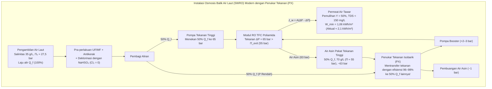

## Pendahuluan: Dari Mentimun Asin hingga Ketahanan Air Global — Raksasa Tak Kasatmata Bernama Osmosis

Taburkan garam dapur di atas irisan tipis mentimun, maka dalam beberapa menit butiran air akan keluar dari jaringan tanaman. Dalam kedokteran klinis, jika air suling murni secara tidak sengaja disuntikkan ke pembuluh darah vena alih-alih <strong>larutan salin normal ($0{,}9\,\text{wt}\%$ $\text{NaCl}$)</strong>, air akan menyerbu masuk ke dalam sel darah merah (eritrosit) hingga memecahkan membran selnya—kondisi mematikan yang disebut <strong>hemolisis</strong>. Sebaliknya, pelaut yang terdampar dan meminum air laut mengalami dehidrasi paradoks yang fatal karena ginjalnya harus menarik lebih banyak air dari dalam sel tubuh untuk membuang kelebihan garam laut.

Semua fenomena ini dikendalikan oleh <strong>osmosis</strong>, dan besarnya gaya dorong termodinamikanya diukur melalui <strong>tekanan osmotik ($\Pi$)</strong>. Air laut standar ($35\,\text{g/L}$) memiliki tekanan osmotik sebesar <strong>$27\text{ hingga }28\,\text{atm}$ ($\approx 2{,}75\,\text{MPa}$ atau $27{,}5\,\text{bar}$)</strong>, yang secara mekanis setara dengan tekanan hidrostatik pada <strong>kedalaman $280\,\text{meter}$ di bawah laut</strong>! Dengan memberikan tekanan hidrolik $55\text{ hingga }80\,\text{bar}$ pada membran polimer ultratipis, instalasi desalinasi <strong>osmosis balik air laut (Seawater Reverse Osmosis, SWRO)</strong> membalikkan proses alami ini untuk menghasilkan lebih dari 100 juta meter kubik air minum bersih setiap hari.

---

## Bab 1: Membongkar Mitos "Gradien Konsentrasi Air" — Potensial Kimia ($\mu_w$) dan Entropi Pencampuran

### 1.1 Mengapa Penjelasan "Difusi Air Menurut Konsentrasi Volumetriknya" Salah?

Buku teks pengantar sering menyatakan bahwa air hanya berdifusi dari tempat dengan konsentrasi volumetrik air tinggi ($c_w$ dalam $\text{mol/L}$) ke konsentrasi rendah. Penjelasan ini <strong>salah secara fisikokimia</strong>:
1. <strong>Kerapatan Molar Volumetrik Air ($c_w$) Tidak Menentukan Arah Aliran Osmotik</strong>: Bergantung pada volume molar parsial zat terlarut ($\bar{V}_s$) dan elektrostriksi, air mengalir secara ketat berdasarkan <strong>fraksi mol $x_w$ dan aktivitas termodinamikanya $a_w = \gamma_w x_w$</strong>.
2. <strong>Difusi Fick Murni Tidak Dapat Menjelaskan Penghentian Total dan Pembalikan oleh Tekanan Hidrostatik ($\Delta P = \Pi$)</strong>: Karena air cair hampir tak termampatkan ($\kappa_T \approx 4{,}5 \times 10^{-5}\,\text{bar}^{-1}$), pemberian tekanan $27{,}5\,\text{bar}$ hanya meningkatkan kerapatannya sebesar $0{,}12\%$. Namun, $\Delta P = \Pi$ menghentikan aliran bersih secara tepat dan $\Delta P > \Pi$ membalikkannya.
3. Osmosis melintasi membran semipermeabel berpori adalah aliran konvektif kolektif, dan $\Pi$ adalah <strong>sifat koligatif</strong> yang tidak bergantung pada ukuran pori maupun bahan membran.

### 1.2 Potensial Kimia Gibbs ($\mu_w$) dan Mekanika Statistik Entropi Pencampuran ($\Delta S_{\text{mix}}$)

Menurut termodinamika J. Willard Gibbs, pada suhu $T$ dan tekanan $P$ konstan, setiap spesi kimia bergerak secara spontan dari <strong>potensial kimia $\mu_i$</strong> tinggi ke rendah:

$$\mu_i \equiv \left( \frac{\partial G}{\partial n_i} \right)_{T, P, n_{j \neq i}}$$

Untuk air dalam larutan relatif terhadap air murni $\mu_w^*(T, P_0)$:

$$\mu_w(T, P, x_w) = \mu_w^*(T, P_0) + \int_{P_0}^{P} \bar{V}_w \, dP' + R T \ln(\gamma_w x_w)$$

di mana $\bar{V}_w \approx 18{,}07\,\text{cm}^3/\text{mol}$ adalah volume molar parsial air dan $x_w = \frac{n_w}{n_w + \sum \nu_k n_k} = 1 - x_s < 1$ adalah fraksi mol air. Dalam larutan ideal ($\Delta H_{\text{mix}} = 0, \gamma_w = 1$), penurunan $\Delta \mu_w = RT \ln x_w < 0$ murni berasal dari kenaikan <strong>entropi pencampuran ($\Delta S_{\text{mix}}$)</strong>:

$$\Delta S_{\text{mix}} = -R \left( n_w \ln x_w + \sum_k n_k \ln x_k \right) > 0 \implies \Delta \bar{S}_w = \left( \frac{\partial \Delta S_{\text{mix}}}{\partial n_w} \right)_{T,P,n_s} = -R \ln x_w > 0$$

Karena membran semipermeabel menghalangi ion zat terlarut menyeberang ke air murni, molekul airlah yang menyeberangi membran untuk mengencerkan zat terlarut demi memaksimalkan entropi konfigurasi alam semesta ($S = k_B \ln W$) dan meminimalkan energi bebas Gibbs $G = H - TS$.

### 1.3 Mekanisme Kinetik Debye–Kramer: Penurunan Tekanan Pelarut Lokal di Mulut Pori

Sebagaimana dibuktikan oleh <strong>Peter Debye (1923)</strong>, Gerald Manning, dan Eric Kramer, ketika partikel zat terlarut yang bergerak termal menumbuk penghalang repulsif membran $U_s(z)$ dan dipantulkan kembali, mereka menyeret molekul air menjauhi membran:

$$\frac{dP_{\text{solvent}}(z)}{dz} + c_s(z) \frac{dU_s(z)}{dz} = 0 \implies P_{\text{solvent}}(0^+) = P_0 - c_s^{\text{bulk}} R T = P_0 - \Pi$$

```mermaid
flowchart TD
    subgraph S1["1. Osmosis Maju (Forward Osmosis): ΔP = 0 < Π"]
        L1["Air Murni (L)<br/>Tekanan P₀, fraksi mol x_w = 1<br/>Potensial kimia μ_w(L) = μ_w*"]
        M1["Membran Semipermeabel<br/>Pantulan zat terlarut di penghalang:<br/>Tekanan air lokal turun ke P₀ - Π"]
        R1["Larutan Garam (R)<br/>Tekanan P₀, fraksi mol x_w < 1<br/>μ_w(R) = μ_w* + RT ln(γ_w x_w) < μ_w*"]
        L1 -->|"Aliran Air Spontan (Δμ_w > 0)<br/>Entropi Pencampuran & Hisapan Pori"| M1 --> R1
    end

    subgraph S2["2. Kesetimbangan Osmotik: ΔP = Π"]
        L2["Air Murni (L)<br/>Tekanan P₀, μ_w(L) = μ_w*"]
        M2["Membran Semipermeabel<br/>Tekanan mulut pori seimbang (P₀ = P₀)<br/>Fluks bersih J_w = 0"]
        R2["Larutan Garam (R)<br/>Tekanan eksternal P₀ + Π diberikan<br/>μ_w(R) = μ_w* + V_w Π + RT ln(γ_w x_w) = μ_w*"]
        L2 <-->|"Kesetimbangan Termodinamika (Δμ_w = 0)<br/>Π = -(RT / V_w) ln(γ_w x_w) ≈ iMRT"| M2 <--> R2
    end

    subgraph S3["3. Osmosis Balik (Desalinasi RO): ΔP > Π (55–80 bar)"]
        L3["Permeat Air Tawar (L)<br/>Tekanan P₀, μ_w(L) = μ_w*"]
        M3["Membran RO TFC Poliamida<br/>Transpor Larutan-Difusi:<br/>Fluks J_w = A(ΔP - ΔΠ)"]
        R3["Air Asin Tekanan Tinggi (R)<br/>Tekanan pompa P₀ + ΔP (ΔP > Π)<br/>μ_w(R) = μ_w* + V_w(ΔP - Π) > μ_w*"]
        R3 -->|"Pembalikan Δμ_w: μ_w(R) > μ_w(L)<br/>Air murni diperas keluar dari air asin!"| M3 --> L3
    end
```

Hal ini menciptakan <strong>penurunan tekanan mekanis lokal pada air ($P_0 - \Pi$)</strong> tepat di mulut pori sisi larutan, sehingga menyedot air murni (pada tekanan $P_0$) menembus membran.

---

## Bab 2: Penurunan Langkah demi Langkah Hukum van 't Hoff (1887) dan Perhitungan Air Laut

### 2.1 Penurunan Termodinamika Ketat

<strong>Jacobus Henricus van 't Hoff</strong> (peraih Hadiah Nobel Kimia pertama tahun 1901), berdasarkan pengukuran Wilhelm Pfeffer dengan membran tembaga ferosianida ($\text{Cu}_2[\text{Fe(CN)}_6]$), merumuskan hukum tekanan osmotik:

1. <strong>Kesamaan potensial kimia saat kesetimbangan</strong> antara air murni ($L$, tekanan $P_0, x_w=1$) dan larutan ($R$, tekanan $P_0 + \Pi, x_w$):

$$\mu_w^{(L)}(T, P_0, x_w=1) = \mu_w^*(T, P_0) = \mu_w^{(R)}(T, P_0 + \Pi, x_w) = \mu_w^*(T, P_0) + \bar{V}_w \Pi + R T \ln(\gamma_w x_w)$$

2. <strong>Persamaan termodinamika eksak</strong> (air tak termampatkan):

$$\Pi = -\frac{R T}{\bar{V}_w} \ln(\gamma_w x_w)$$

3. <strong>Deret Taylor untuk larutan encer</strong> ($\gamma_w \to 1$, $x_s = 1 - x_w = \frac{i n_s}{n_w + i n_s} \ll 1$ dengan <strong>faktor van 't Hoff $i$</strong>):

$$\ln x_w = \ln(1 - x_s) \approx -x_s \approx -\frac{i n_s}{n_w}$$

4. <strong>Konversi ke molaritas $M = n_s / V$</strong> (dengan $V \approx n_w \bar{V}_w$):

$$\Pi \approx \frac{R T}{\bar{V}_w} \frac{i n_s}{n_w} \approx i \left(\frac{n_s}{V}\right) R T = i M R T$$

### 2.2 Perhitungan Eksak untuk Air Laut Standar ($35\,\text{g/L}$ $\text{NaCl}$)

Pada $T = 298{,}15\,\text{K}$ ($25\,^\circ\text{C}$):
- Molaritas: $M = \frac{35\,\text{g/L}}{58{,}44\,\text{g/mol}} \approx 0{,}60\,\text{mol/L}$.
- Faktor van 't Hoff: Untuk $\text{NaCl}$ ($\nu = 2$), koefisien osmotik $\phi \approx 0{,}925$ menghasilkan $i = \phi \nu \approx 1{,}85$ (osmolaritas $\approx 1{,}11\,\text{Osm/L}$).
- Tekanan osmotik ($R = 0{,}082057\,\text{L}\cdot\text{atm}/(\text{K}\cdot\text{mol})$):

$$\Pi = 1{,}85 \times 0{,}60\,\text{mol/L} \times 0{,}082057\,\text{L}\cdot\text{atm}/(\text{K}\cdot\text{mol}) \times 298{,}15\,\text{K} \approx 27{,}16\,\text{atm} \approx 2{,}75\,\text{MPa}\,(27{,}5\,\text{bar})$$

Nilai ini setara dengan <strong>kolom air setinggi $h = \frac{\Pi}{\rho g} \approx 280{,}6\,\text{meter}$</strong>!

---

## Bab 3: Osmosis Biologis — Akuaporin (AQP1), Tonisitas Sel Darah Merah, Persamaan Starling, dan Turgor

- <strong>Saluran Air Akuaporin (AQP1, Peter Agre, Nobel Kimia 2003)</strong>: Pori berbentuk jam pasir dengan filter sterik $\text{ar/R}$ selebar <strong>$2{,}8\,\text{\AA}$</strong> mengalirkan <strong>$3 \times 10^9$ molekul air per detik</strong> dalam barisan tunggal (single-file). Dua <strong>motif NPA (Asparagina-Prolina-Alanina)</strong> di tengah memaksa <strong>pembalikan dipol listrik air sebesar $180^\circ$</strong>, memutus rantai ikatan hidrogen dan memblokir sepenuhnya kebocoran proton ($\text{H}_3\text{O}^+$) melalui mekanisme Grotthuss.
- <strong>Tonisitas Sel Darah Merah</strong>: Bentuk cakram bikonkaf normal dalam larutan <strong>isotonik</strong> ($0{,}9\,\text{wt}\%$ $\text{NaCl}$, $\approx 290\,\text{mOsm/L}$), mengkerut berduri (<strong>krenasi</strong>) dalam larutan <strong>hipertonik</strong>, dan pecah (<strong>hemolisis</strong>) dalam larutan <strong>hipotonik</strong>.
- <strong>Persamaan Starling (1896) pada Kapiler Darah</strong>:
  $$J_v = L_p S \left[ (P_c - P_i) - \sigma (\pi_c - \pi_i) \right]$$
  <strong>Tekanan onkotik ($\pi_c \approx 25\text{–}28\,\text{mmHg}$)</strong> yang dihasilkan oleh albumin serum ($66{,}5\,\text{kDa}$) menarik kembali cairan di ujung vena; kekurangan albumin menyebabkan <strong>edema dan asites</strong>.
- <strong>Tekanan Turgor Tanaman ($\Psi_w = \Psi_s + \Psi_p + \Psi_g + \Psi_m$)</strong>: Dinding sel menahan tekanan turgor internal $\Psi_p \approx +0{,}8\text{ hingga }+1{,}5\,\text{MPa}$, menjaga tanaman tidak berkayu tetap tegak dan mencegah <strong>plasmolisis</strong>.

| Sistem Membran | Ukuran Pori / Volume Bebas | Mekanisme Selektivitas | Permeansi / Laju Transpor | Spesi yang Ditolak | Tekanan Operasi |
| :--- | :--- | :--- | :--- | :--- | :--- |
| <strong>Akuaporin Biologis (AQP1)</strong> | Saluran tetap $0{,}28\,\text{nm}$ ($2{,}8\,\text{\AA}$) | Filter sterik $\text{ar/R}$ + pembalikan dipol NPA | $\sim 3 \times 10^9$ $\text{H}_2\text{O}$/s per saluran | Semua ion terhidrasi, proton ($\text{H}_3\text{O}^+$), urea | Beberapa $\text{mmHg}$ hingga $\sim 30\,\text{bar}$ |
| <strong>Endotelium Kapiler (Glikokaliks)</strong> | Celah $4\text{–}5\,\text{nm}$ | Eksklusi ukuran + tolakan muatan Donnan | Persamaan Starling ($L_p$) | Albumin ($66{,}5\,\text{kDa}$), globulin, eritrosit | $P_c \approx 15\text{–}35\,\text{mmHg}$ vs $\pi_c \approx 28\,\text{mmHg}$ |
| <strong>Mikro- (MF) / Ultrafiltrasi (UF)</strong> | MF: $100\text{–}1\,000\,\text{nm}$ UF: $2\text{–}100\,\text{nm}$ | Penyaringan mekanis aliran pori | $50\text{–}500\,\text{L}/(\text{m}^2\cdot\text{h}\cdot\text{bar})$ | Bakteri, virus (UF), koloid, protein | $0{,}2\text{–}5\,\text{bar}$ |
| <strong>Osmosis Balik (RO TFC Poliamida)</strong> | Tak berpori ($0{,}2\text{–}0{,}5\,\text{nm}$ volume bebas) | <strong>Larutan-Difusi</strong> + penghalang dehidrasi | $1\text{–}2\,\text{L}/(\text{m}^2\cdot\text{h}\cdot\text{bar})$ (SWRO) | Ion monovalen ($\text{Na}^+, \text{Cl}^-$ penolakan $>99{,}8\%$) | <strong>$55\text{–}80\,\text{bar}$</strong> (air laut) |

---

## Bab 4: Desalinasi Osmosis Balik (RO) — Membran TFC Poliamida dan Model Larutan-Difusi

Setelah membran asimetris Loeb–Sourirajan (1960), John Cadotte pada akhir 1970-an menemukan <strong>membran komposit film tipis (TFC) poliamida melalui polimerisasi antarmuka</strong> antara $m$-fenilendiamina (MPD) dan trimesoil klorida (TMC), menghasilkan lapisan aktif berikatan silang setebal <strong>$100\text{ hingga }200\,\text{nm}$</strong>.

Menurut <strong>model larutan-difusi (Wijmans & Baker, 1995)</strong>:
- <strong>Fluks Air</strong>: $J_w = A(\Delta P - \Delta \Pi)$ dengan $A = \frac{D_w K_w c_w \bar{V}_w}{\delta R T}$.
- <strong>Fluks Garam</strong>: $J_s = B(C_m - C_p)$ dengan $B = \frac{D_s K_s}{\delta}$ (tidak bergantung pada $\Delta P$!). Oleh karena itu, penolakan garam $R_s = \frac{A(\Delta P - \Delta \Pi)}{A(\Delta P - \Delta \Pi) + B}$ mendekati $100\%$ saat $\Delta P$ dinaikkan.
- <strong>Penghalang Dehidrasi dan Anomali Boron</strong>: Ion $\text{Na}^+$ terhidrasi ($r_{\text{hyd}} \approx 3{,}58\,\text{\AA}$ vs $1{,}38\,\text{\AA}$ untuk $\text{H}_2\text{O}$) ditolak oleh penghalang energi dehidrasi dan eksklusi dielektrik Born. Sebaliknya, <strong>asam borat netral $\text{B(OH)}_3$</strong> ($\text{p}K_a \approx 9{,}2$) pada $\text{pH} \approx 8{,}0$ tidak bermuatan dan dapat menembus membran melalui ikatan hidrogen (sehingga memerlukan kenaikan $\text{pH} > 10$ dengan $\text{NaOH}$ pada tahap RO kedua untuk mengubahnya menjadi anion $\text{B(OH)}_4^-$).

---

## Bab 5: Energi Minimum Termodinamika ($1{,}06\,\text{kWh/m}^3$), Penukar Tekanan Isobarik (PX), Polarisasi Konsentrasi, dan Biofouling

Kerja pemisahan reversibel minimum $w_{\min}(Y)$ untuk rasio pemulihan $Y = V_p / V_f$ diperoleh dengan mengintegrasikan $\Pi(y) = \frac{\Pi_0}{1 - y}$:

$$w_{\min}(Y) = \frac{1}{Y} \int_0^Y \Pi(y)\,dy = \Pi_0 \frac{\ln\left(\frac{1}{1 - Y}\right)}{Y}$$

Untuk <strong>$Y = 50\%$</strong> ($\Pi_0 = 2{,}75\,\text{MPa}$), diperoleh <strong>$w_{\min}(0{,}50) = 3{,}812\,\text{MJ/m}^3 \approx 1{,}06\,\text{kWh/m}^3$</strong>, jauh lebih kecil dibandingkan <strong>$\sim 650\,\text{kWh/m}^3$</strong> kalor laten penguapan air. Berkat <strong>penukar tekanan isobarik (PX)</strong> yang memulihkan $96\text{–}98\%$ energi tekanan air asin, konsumsi energi inti RO saat ini hanya <strong>$2{,}0\text{–}2{,}5\,\text{kWh/m}^3$</strong>.

| Teknologi Desalinasi | Prinsip Fisikokimia | Energi Minimum Teoretis ($Y=50\%$) | Konsumsi Aktual Pabrik (Setara Listrik) | Kondisi Operasi | Keunggulan & Keterbatasan |
| :--- | :--- | :--- | :--- | :--- | :--- |
| <strong>Penguapan Sederhana</strong> | Perubahan fase cair-uap | $\sim 650\,\text{kWh/m}^3$ (kalor laten) | $>650\,\text{kWh/m}^3$ | $100\,^\circ\text{C}$, $1\,\text{bar}$ | Biaya energi sangat mahal |
| <strong>Distilasi Termal (MSF / MED)</strong> | Penguapan kilat multitahap | $1{,}06\,\text{kWh/m}^3$ | <strong>$7\text{–}18\,\text{kWh/m}^3$</strong> | $60\text{–}110\,^\circ\text{C}$ | Tangguh namun boros energi |
| <strong>Osmosis Balik (SWRO + PX)</strong> | <strong>Larutan-difusi TFC + pembalikan tekanan tinggi</strong> | <strong>$1{,}06\,\text{kWh/m}^3$</strong> ($0{,}76\,\text{kWh/m}^3$ saat $Y\to 0$) | Inti RO: <strong>$2{,}0\text{–}2{,}5\,\text{kWh/m}^3$</strong> Total pabrik: $3{,}0\text{–}3{,}5\,\text{kWh/m}^3$ | Suhu ruang, <strong>$55\text{–}80\,\text{bar}$</strong> | <strong>70% pangsa dunia</strong>; dibatasi polarisasi & biofouling |

Dua tantangan rekayasa utama adalah <strong>polarisasi konsentrasi</strong> ($\frac{C_m - C_p}{C_b - C_p} = \exp(J_w / k_m)$) dan <strong>pengotoran biologis (biofouling)</strong> yang diperparah oleh kerentanan ikatan amida poliamida terhadap klorin bebas (N-klorinasi dan penataan ulang Orton), sehingga air umpan wajib dideklorinasi dengan $\text{NaHSO}_3$ sebelum masuk ke membran.
