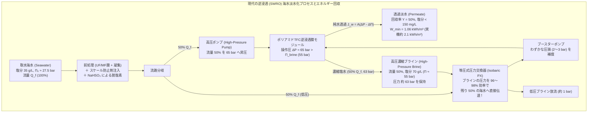

## はじめに：ナメクジに塩をかける残酷な実験から地球規模の水危機まで — 「浸透」という見えざる巨力

キュウリの薄切りに塩を振ると、数分のうちに内部から水分がしみ出してしんなりとする。ナメクジに塩をかけると、体内の水分が急速に奪われて縮んでしまう。病院で患者に点滴を打つ際、もし誤って純水（蒸留水）を血管内に大量注入すれば、赤血球が周囲の水を猛烈な勢いで吸い込んで膨張し、やがて破裂する<strong>溶血（Hemolysis）</strong>を起こして命に関わるため、必ず血液と浸透圧を一致させた<strong>生理食塩水（約 $0.9\,\text{wt}\%$ の塩化ナトリウム水溶液）</strong>が用いられる。逆に、海難事故で漂流した遭難者が渇きのあまり海水を飲むと、海水の高い塩分を排出するために飲んだ量以上の水分が体内の細胞から奪われ、かえって脱水症状が加速して死に至る。

これら日常の料理や生命維持の根幹を支配している物理現象が<strong>浸透（Osmosis）</strong>であり、その駆動力の大きさを表す尺度が<strong>浸透圧（Osmotic Pressure）</strong>である。一見すると、浸透とは「薄い溶液から濃い溶液へと水分子が穏やかにしみ出していく現象」のように思えるかもしれない。しかし、その背後に潜む熱力学的な力は想像を絶するほど巨大である。たとえば、地球の海を満たす標準海水（塩分濃度約 $3.5\%$）が持つ浸透圧は約 $27\sim 28\,\text{atm}$（約 $2.75\,\text{MPa}$）に達する。これは<strong>水深約 $280\,\text{m}$ の深海における水圧</strong>、すなわち東京タワーのメインデッキ（高さ $150\,\text{m}$）をはるかに超え、トップデッキ（高さ $250\,\text{m}$）のさらに上から降りかかる巨大な水柱の重みに匹敵する。

そして現代の人類は、この自然界の浸透現象に真っ向から逆らう技術を手にしている。海水に $55\sim 80\,\text{bar}$（$5.5\sim 8.0\,\text{MPa}$）という超高圧を印加し、分子レベルの緻密な高分子膜を通して塩水から純水だけを力ずくで絞り出す<strong>逆浸透（Reverse Osmosis: RO）</strong>技術である。今日、中東や地中海沿岸、シンガポール、アメリカ西海岸などを中心に、世界中で毎日1億立方メートル以上の淡水が逆浸透膜によって生産され、数億人の生命と産業を支えている。

本稿では、「水はなぜ半透膜を越えて移動するのか？」という根源的な問いを出発点とし、入門書で語られがちな「水の体積濃度差による単純拡散」という素朴な説明の限界を暴く。その上で、ギブズの<strong>化学ポテンシャル（Chemical Potential）</strong>と<strong>混合エントロピー（Entropy of Mixing）</strong>、および分子運動論に基づく厳密な物理化学的メカニズムを解き明かす。さらに、1901年に第1回ノーベル化学賞に輝いた<strong>ファント・ホッフの法則（van 't Hoff's Law）</strong>の数学的導出、2003年ノーベル化学賞の対象となった生体水チャネル<strong>アクアポリン（Aquaporin）</strong>の驚異的な量子・分子選別機構、毛細血管における<strong>スターリングの式（Starling's Equation）</strong>、そして現代水工学の結晶である<strong>ポリアミド薄膜複合膜（TFC膜）の溶解・拡散モデル</strong>と海水淡水化の熱力学最小エネルギー限界に至るまで、ミクロな統計力学からマクロな地球環境工学までを一気通貫で探究する。

---

## 第1章：「水濃度の差による拡散」という素朴な誤解と、化学ポテンシャル $\mu_w$ による真の熱力学的本質

### 1.1 なぜ「水の体積濃度が高い方から低い方へ拡散する」という説明は不正確なのか？

多くの中学・高校の理科教科書や一般向け解説書では、浸透のメカニズムを次のように説明している。
> 「半透膜の片側に純水、もう片側に塩水を入れると、純水側の方が単位体積あたりの水分子の数（水の濃度）が多く、塩水側の方が溶質に場所を取られて水の濃度が低い。だから水分子は、水自身の濃度が高い方から低い方へとフィックの拡散法則（Fick's law of diffusion）に従って移動するのだ」

一見もっともらしいこの説明は、物理化学および統計力学の観点からは<strong>根本的に不正確であり、場合によっては完全に破綻する</strong>。その理由は大きく3つある。

1. <strong>単位体積あたりの水分子密度（モル濃度 $c_w$）と浸透流の向きは必ずしも一致しない</strong>：
   溶質を水に溶かしたとき、溶液の体積がどう変化するかは溶質分子と水分子の相互作用（部分モル体積 $\bar{V}_s$）に依存する。たとえば、水分子との間に強い水素結合や静電収縮（Electrostriction）を引き起こす溶質や、逆に巨大な高分子（デキストランやポリエチレングリコールなど）を異なる組成で比較した場合、あるいは重水や混合溶媒系を考えた場合、「単位体積あたりの水分子の質量または個数密度」がほぼ同じであっても激しい浸透流が生じたり、さらには体積あたりの水密度の大小関係と浸透圧の大小関係が乖離したりするケースが存在する。浸透を決定づける熱力学変数は単位体積あたりの水濃度 $c_w$（$\text{mol/L}$）ではなく、モル分率 $x_w$ と活量係数 $\gamma_w$ の積である<strong>水の活量（Activity）$a_w = \gamma_w x_w$</strong> である。
2. <strong>単なる濃度拡散では「静水圧 $\Delta P$ による完全な停止と逆転」を説明できない</strong>：
   もし浸透が単なる水分子のランダムウォーク（濃度勾配 $\nabla c_w$ によるフィック拡散 $J_w = -D_w \nabla c_w$）に過ぎないのなら、溶液側にわずか数気圧の静水圧 $\Delta P$ をかけたぐらいで水分子の密度はほとんど変わらない（水はほぼ非圧縮性であり、$28\,\text{atm}$ 加圧しても水の体積密度はわずか $0.13\%$ しか増加しない）ため、拡散流を止めることはできないはずである。実際には、溶液側に浸透圧 $\Pi$ に等しい静水圧 $\Delta P = \Pi$ をかけると、水の正味の移動はピタリと止まり、$\Delta P > \Pi$ で逆転する。
3. <strong>輸送様式が単なる拡散ではなく「協同的な粘性流（Hydraulic flow）」を含む</strong>：
   連通管の真ん中に多孔質の半透膜を置き、片側に溶質を加えると、水は単なる1分子ずつのブラウン拡散よりもはるかに速い速度（ポアズイユ流的な集団運動）で膜を通過する。しかも、平衡に達したときの浸透圧 $\Pi$ の大きさは、半透膜が溶質を完全に遮断する限り、<strong>膜の材質や細孔径、膜厚に一切依存しない普遍的な熱力学量（束一的性質：Colligative property）</strong>となる。

では、水分子を半透膜の向こう側へと突き動かしている真の物理的駆動力とは何か？その答えこそが、19世紀後半にウィラード・ギブズ（J. Willard Gibbs）が確立した<strong>化学ポテンシャル（Chemical Potential）$\mu_w$</strong> と、その背後にある<strong>混合エントロピー（Entropy of Mixing）</strong>、そして界面における<strong>分子運動論的な局所圧力降下</strong>である。

### 1.2 ギブズの化学ポテンシャルと混合エントロピー：宇宙の乱雑さを最大化する力

温度 $T$ と圧力 $P$ が規定された系において、物質が自発的に移動・変化する向きを決定づけるのは<strong>ギブズ自由エネルギー（Gibbs Free Energy）$G = H - TS$</strong> である。多成分系において、成分 $i$ のモル数 $n_i$ を微小量変化させたときのギブズ自由エネルギーの偏微分係数を、成分 $i$ の<strong>化学ポテンシャル $\mu_i$</strong> と定義する。

$$\mu_i \equiv \left( \frac{\partial G}{\partial n_i} \right)_{T, P, n_{j \neq i}}$$

熱力学第二法則により、定温・定圧下で成分 $i$（ここでは水 $w$）が移動できる2つの相（左側 $L$ と右側 $R$）が接しているとき、水は必ず<strong>化学ポテンシャルが高い方から低い方へ</strong>と自発的に移動し、両相の化学ポテンシャルが等しくなった状態（$\mu_w^{(L)} = \mu_w^{(R)}$）でマクロな平衡に達する。

溶液中の水（溶媒 $w$）の化学ポテンシャル $\mu_w(T, P, x_w)$ は、基準圧力 $P_0$ における純水の化学ポテンシャル $\mu_w^*(T, P_0)$ を基準として、圧力依存項と組成（活量）依存項の和として厳密に次のように表される。

$$\mu_w(T, P, x_w) = \mu_w^*(T, P_0) + \int_{P_0}^{P} \bar{V}_w \, dP' + R T \ln a_w$$

ここで各記号の意味は以下の通りである。
- $\bar{V}_w \equiv \left(\frac{\partial V}{\partial n_w}\right)_{T, P, n_s}$：溶液中の水の<strong>偏モル体積（Partial molar volume）</strong>。常温常圧の希薄水溶液では純水のモル体積 $V_w^* \approx 18.07\,\text{cm}^3/\text{mol} = 1.807 \times 10^{-5}\,\text{m}^3/\text{mol}$ に極めて近い。
- $R = 8.3145\,\text{J}/(\text{K}\cdot\text{mol})$：気体定数（ボルツマン定数 $k_B$ とアボガドロ定数 $N_A$ の積 $R = N_A k_B$）。
- $a_w = \gamma_w x_w$：水の<strong>活量（Activity）</strong>。$\gamma_w$ は活量係数（理想溶液では $\gamma_w = 1$）、$x_w$ は溶液中の水の<strong>モル分率（Mole fraction）</strong>であり、水分子のモル数 $n_w$ と溶質粒子の総実効モル数 $n_s^{\text{eff}} = \sum_k \nu_k n_k$ を用いて次式で定義される。

$$x_w = \frac{n_w}{n_w + n_s^{\text{eff}}} = 1 - x_s$$

純水では $x_w = 1, \gamma_w = 1$ であるため $\ln a_w = 0$ となる。しかし、水にわずかでも不揮発性の溶質（塩や糖など）を溶かすと、水のモル分率は必ず $x_w < 1$ となり、対数項は負の値（$RT \ln(\gamma_w x_w) < 0$）をとる。したがって、同じ温度 $T$・同じ圧力 $P_0$ で比較すると、<strong>溶液中の水の化学ポテンシャルは、純水の化学ポテンシャルよりも必ず低くなる</strong>。

$$\mu_w(\text{溶液}, T, P_0) - \mu_w^*(\text{純水}, T, P_0) = R T \ln(\gamma_w x_w) < 0$$

では、なぜ溶質を混ぜるだけで水の化学ポテンシャル（1モルあたりの自由エネルギー）が下がるのか？理想溶液（$\gamma_w = 1$、すなわち水分子と溶質分子の間の分子間相互作用エネルギーが水同士・溶質同士と変わらず、混合エンタルピー $\Delta H_{\text{mix}} = 0$ である場合）を考えてみよう。エンタルピー（熱エネルギー）の変化がゼロであるにもかかわらず自由エネルギー $\Delta G_{\text{mix}} = \Delta H_{\text{mix}} - T \Delta S_{\text{mix}}$ が減少するのは、純粋に<strong>混合エントロピー $\Delta S_{\text{mix}}$ が増大するから</strong>である。

統計力学において、$N_w$ 個の水分子と $N_s$ 個の溶質粒子を格子上に配置する場合のミクロ状態の数（組み合わせの数）$W$ は、スターリングの近似 $\ln(N!) \approx N \ln N - N$ を用いるとボルツマンの公式 $S = k_B \ln W$ から次式を与える。

$$\Delta S_{\text{mix}} = k_B \ln \left( \frac{(N_w + N_s)!}{N_w! \, N_s!} \right) = -R \left( n_w \ln x_w + n_s \ln x_s \right) > 0$$

この混合エントロピーを水のモル数 $n_w$ で偏微分すると、溶液中に水1モルを追加したときの偏モル混合エントロピーが求まる。

$$\Delta \bar{S}_w = \left( \frac{\partial \Delta S_{\text{mix}}}{\partial n_w} \right)_{T, P, n_s} = -R \ln x_w > 0$$

したがって、$\Delta \mu_w = \Delta \bar{H}_w - T \Delta \bar{S}_w = 0 - T(-R \ln x_w) = RT \ln x_w < 0$ となる。つまり、純水側の水分子が半透膜を越えて塩水側へと流入するのは、「塩水側の溶質をより広い水分子の海へと希釈・分散させることで、系全体の配置の乱雑さ（混合エントロピー $S$）を増大させ、ギブズ自由エネルギー $G$ を引き下げようとする熱力学的要請」そのものなのである。溶質粒子自身は半透膜を通過して純水側へ広がることができないため、<strong>代わりに水分子の方が半透膜を越えて溶質側へと押し寄せ、溶質を希釈することで混合エントロピーを獲得する</strong>——これが浸透の熱力学的本質である。

### 1.3 デバイとクラマーによる分子運動論的（機械論的）解釈：半透膜界面での局所圧力降下

熱力学は「どちら向きに変化が進み、どこで平衡に達するか」を寸分の狂いもなく予言するが、「水分子1個1個は溶液全体のエントロピーなど知らないのに、なぜ半透膜の細孔の中で純水側から溶液側へと一斉に押し流されるのか？」というミクロな力学機構（Kinetic / Mechanical mechanism）については沈黙している。この問いに明快な解答を与えたのが、ピーター・デバイ（Peter Debye, 1923年）に端を発し、エリック・クラマー（Eric Kramer）やジェラルド・マニング（Gerald Manning）らが精緻化した<strong>統計力学的・分子運動論モデル</strong>である。

半透膜を「水分子には何の力も及ぼさないが、溶質粒子に対しては膜の手前で強い斥力ポテンシャル $U_s(z)$ を及ぼして跳ね返す障壁」としてモデル化しよう（膜面に垂直な座標を $z$ とし、$z < 0$ を純水側、$z > 0$ を溶液側とする）。

1. 溶液内部の溶質粒子は、熱運動エネルギー（平均して1自由度あたり $\frac{1}{2}k_B T$）を持って絶えずランダムに飛び回っている（ブラウン運動）。
2. 膜のごく近傍（斥力遷移層 $0 < z < \lambda$）に近づいた溶質粒子は、半透膜のポテンシャル障壁 $U_s(z)$ によって溶液の奥側（$+z$ 方向）へと弾き返される。単位面積・単位時間あたりに膜が溶質粒子群に及ぼす力（運動量変化率）は、理想希薄溶液において気体分子運動論と全く同じ計算により、溶質の浸透圧 $\Pi = n_s^{\text{eff}} k_B T / V = c_s R T$ に正確に一致する。

```mermaid
flowchart TD
    subgraph S1["1. 通常の浸透 (Forward Osmosis): ΔP = 0 < Π"]
        L1["純水側 (Pure Water)<br/>圧力 P₀, 水モル分率 x_w = 1<br/>化学ポテンシャル μ_w(L) = μ_w*"]
        M1["半透膜 (Semi-permeable Membrane)<br/>水分子のみ透過・溶質を反射<br/>膜界面の局所溶媒圧が P₀ - Π に低下"]
        R1["塩水側 (Saline Solution)<br/>圧力 P₀, 水モル分率 x_w < 1<br/>μ_w(R) = μ_w* + RT ln(γ_w x_w) < μ_w*"]
        L1 -->|"駆動力 Δμ_w > 0<br/>純水から塩水へ水が自発流入"| M1 --> R1
    end

    subgraph S2["2. 浸透平衡 (Osmotic Equilibrium): ΔP = Π"]
        L2["純水側 (Pure Water)<br/>圧力 P₀<br/>μ_w(L) = μ_w*"]
        M2["半透膜 (Semi-permeable Membrane)<br/>純水流束と逆流束が完全均衡<br/>正味の水フラックス J_w = 0"]
        R2["塩水側 (Saline Solution)<br/>外圧 P₀ + Π を印加<br/>μ_w(R) = μ_w* + V_w Π + RT ln(γ_w x_w) = μ_w*"]
        L2 <-->|"Δμ_w = 0 (熱力学平衡)<br/>Π = -(RT / V_w) ln(γ_w x_w) ≈ iMRT"| M2 <--> R2
    end

    subgraph S3["3. 逆浸透 (Reverse Osmosis / RO): ΔP > Π (海水では 55〜80 bar)"]
        L3["透過淡水側 (Permeate)<br/>圧力 P₀, 純水<br/>μ_w(L) = μ_w*"]
        M3["ポリアミドTFC逆浸透膜<br/>溶解・拡散機構により<br/>J_w = A(ΔP - ΔΠ) で純水を絞る"]
        R3["高圧海水側 (High-Pressure Brine)<br/>外圧 P₀ + ΔP (ΔP > Π)<br/>μ_w(R) = μ_w* + V_w(ΔP - Π) > μ_w*"]
        R3 -->|"駆動力逆転: μ_w(R) > μ_w(L)<br/>塩水から純水側へ水が逆流！"| M3 --> L3
    end
```

3. このとき、膜で跳ね返された溶質粒子は真空中を飛んでいるのではなく、粘性を持つ水分子の海の中を運動している。溶質粒子が膜から $+z$ 方向への反発力を受けて移動するとき、周囲の水分子との粘性摩擦・流体力学的相互作用を通じて、境界層内の流体全体には力をバランスさせるための<strong>溶媒（水）自身の静水圧の急激な低下（Pressure drop）</strong>が生じる。
4. すなわち、溶液バルク（膜から十分離れた場所）の全体圧力が大気圧 $P_0$ であるとき、その内訳は溶質の熱運動が担う分圧（浸透圧 $\Pi$）と溶媒自身が担う圧力 $P_{\text{solvent}}$ の和になっており、溶質が排除される半透膜の細孔入口（$z \approx 0^+$）においては、<strong>溶液側の水自身の局所的な機械的圧力が $P_0 - \Pi$ へと落ち込んでいる（負圧化している）</strong>のである！
5. 一方、半透膜の反対側（$z < 0$）にある純水の圧力は $P_0$ のままである。結果として、半透膜の細孔の両端には $P_0$（純水側）と $P_0 - \Pi$（溶液側細孔口）という<strong>純粋な機械的・流体力学的な圧力差 $\Delta P_{\text{pore}} = P_0 - (P_0 - \Pi) = \Pi$</strong> が発生し、純水が溶液側へと勢いよく吸い込まれる（対流・粘性流として流入する）。そして、溶液バルクに外部からピストンで $\Delta P = \Pi$ の静水圧を上乗せすると、溶液側の細孔口の水の圧力が $(P_0 + \Pi) - \Pi = P_0$ となって純水側の圧力 $P_0$ と完全に釣り合い、水の流れがピタリと止まる。

この分子運動論的描像とギブズの化学ポテンシャル描像は対立するものではなく、統計力学のボルツマン分布 $c_s(z) = c_s(\infty) \exp(-U_s(z)/k_B T)$ とナビエ・ストークス／ストークス方程式の静水圧平衡条件 $-\nabla P_{\text{solvent}} - c_s \nabla U_s = 0$ を積分することで、<strong>数学的に100%同値</strong>であることが証明される。

---

## 第2章：ファント・ホッフの法則（1887年）の厳密導出と海水浸透圧の定量計算

### 2.1 ペッファーの実験とファント・ホッフの洞察（第1回ノーベル化学賞）

1877年、ドイツの植物生理学者ヴィルヘルム・ペッファー（Wilhelm Pfeffer）は、素焼きの陶器（多孔質円筒）の細孔内部で硫酸銅水溶液とフェロシアン化カリウム水溶液を反応させ、<strong>フェロシアン化銅 $\text{Cu}_2[\text{Fe(CN)}_6]$ の緻密な沈殿膜</strong>を形成させることで、高い圧力に耐える人工半透膜を作製することに成功した。ペッファーはこの装置を用いてスクロース（ショ糖）水溶液などの浸透圧 $\Pi$ を濃度および温度の関数として精密に測定した。

この実験データに注目したオランダの物理化学者ヤコブス・ヘンリクス・ファント・ホッフ（Jacobus Henricus van 't Hoff）は1887年、希薄溶液の浸透圧 $\Pi$ が示す挙動が、理想気体の状態方程式 $PV = nRT$ と驚くほど完全に一致することを発見した。すなわち、溶液の体積 $V$ の中に溶質 $n_s$ モルが存在するとき、その溶質があたかも同じ体積 $V$・同じ温度 $T$ の空間を飛び回る理想気体であるかのように振る舞い、$\Pi V = n_s R T$ の圧力を生み出すという法則である。この功績（化学動力学の法則および溶液の浸透圧の発見）により、ファント・ホッフは<strong>1901年、人類史上最初のノーベル化学賞</strong>を受賞した。

### 2.2 化学ポテンシャル平衡からのファント・ホッフの法則のステップ・バイ・ステップ導出

それでは、第1章で導入した化学ポテンシャルの厳密式から、ファント・ホッフの法則を一歩ずつ数学的に導出しよう。

半透膜で仕切られた2つの部屋を考える。
- <strong>左側（L：純水相）</strong>：温度 $T$、圧力 $P_0$、純水（$x_w^{(L)} = 1, \gamma_w^{(L)} = 1$）。
- <strong>右側（R：溶液相）</strong>：温度 $T$、圧力 $P_0 + \Pi$（ピストン等で静水圧 $\Pi$ を付加）、水のモル分率 $x_w^{(R)} = x_w$、活量係数 $\gamma_w^{(R)} = \gamma_w$。

<strong>【ステップ1：半透膜を介した熱力学平衡条件】</strong>
浸透が停止して熱力学平衡に達したとき、両相における水の化学ポテンシャルは等しくなければならない。

$$\mu_w^{(L)}(T, P_0, x_w=1) = \mu_w^{(R)}(T, P_0 + \Pi, x_w)$$

それぞれの化学ポテンシャルを書き下すと：

$$\mu_w^*(T, P_0) = \mu_w^*(T, P_0) + \int_{P_0}^{P_0 + \Pi} \bar{V}_w \, dP + R T \ln(\gamma_w x_w)$$

<strong>【ステップ2：非圧縮性近似による厳密熱力学式の導出】</strong>
液体の水は圧縮率が極めて小さいため（等温圧縮率 $\kappa_T \approx 4.5 \times 10^{-5}\,\text{bar}^{-1}$）、通常の浸透圧の範囲（数十〜数百気圧）では水の偏モル体積 $\bar{V}_w$ を圧力によらない定数とみなして積分を実行できる。両辺から $\mu_w^*(T, P_0)$ を消去すると、次式を得る。

$$\bar{V}_w \Pi + R T \ln(\gamma_w x_w) = 0$$

$$\Pi = -\frac{R T}{\bar{V}_w} \ln(\gamma_w x_w) = -\frac{R T}{\bar{V}_w} \ln a_w$$

この式は希薄近似を一切含まない、<strong>あらゆる濃度の実在溶液に対して成り立つ浸透圧の厳密な熱力学基本式</strong>である。実際、高濃度の塩水や高分子溶液、食品科学における水分活性（Water activity $a_w$）の評価ではこの対数式が直接用いられる。

<strong>【ステップ3：理想希薄溶液近似とテイラー展開】</strong>
次に、溶質が十分に希薄な理想溶液（$\gamma_w \to 1$）を考える。溶液中に電解質または非電解質の溶質が存在し、電離等を考慮した実効的な溶質粒子の総モル数を $n_s^{\text{eff}} = i n_s$（ここで $i$ は<strong>ファント・ホッフ係数</strong>、$n_s$ は溶質の化学式単位のモル数）とする。水のモル分率 $x_w$ と全溶質粒子のモル分率 $x_s$ の間には $x_w + x_s = 1$ の関係がある。

$$x_s = \frac{i n_s}{n_w + i n_s} \ll 1$$

自然対数 $\ln x_w = \ln(1 - x_s)$ を $x_s = 0$ の周りでマクローリン展開（テイラー展開）すると：

$$\ln(1 - x_s) = -x_s - \frac{1}{2}x_s^2 - \frac{1}{3}x_s^3 - \cdots$$

これを厳密式に代入すると、浸透圧のビリアル展開（Virial expansion）が得られる。

$$\Pi = \frac{R T}{\bar{V}_w} \left( x_s + \frac{1}{2}x_s^2 + \frac{1}{3}x_s^3 + \cdots \right)$$

希薄極限（$x_s \ll 1$）において2次以上の高次項を無視し、さらに分母において $n_w + i n_s \approx n_w$ と近似すると：

$$x_s = \frac{i n_s}{n_w + i n_s} \approx \frac{i n_s}{n_w}$$

<strong>【ステップ4：モル濃度 $M$ への変換とファント・ホッフの法則の完成】</strong>
この近似を浸透圧の式に代入すると：

$$\Pi \approx \frac{R T}{\bar{V}_w} \frac{i n_s}{n_w} = \frac{i n_s R T}{n_w \bar{V}_w}$$

希薄溶液では、溶液全体の体積 $V$ は水 $n_w$ モルが占める体積 $n_w \bar{V}_w$ にほぼ等しい（$V = n_w \bar{V}_w + n_s \bar{V}_s \approx n_w \bar{V}_w$）。したがって、溶質のモル濃度（Molarity）を $M \equiv \frac{n_s}{V}$（単位：$\text{mol/L}$ または $\text{mol/m}^3$）と定義すれば、ついに<strong>ファント・ホッフの法則</strong>が導かれる。

$$\Pi = i M R T$$

ここで $i M$ は溶液1リットルあたりの全溶質粒子（イオンおよび非解離分子）の総モル濃度を表し、生理学や臨床医学では<strong>モル浸透圧濃度（Osmolarity、単位：$\text{Osm/L}$ または $\text{mOsm/L}$）</strong>と呼ばれる。また、高濃度領域での非理想性を補正するために、より厳密な電気化学・溶液熱力学では<strong>浸透係数（Osmotic coefficient）$\phi$</strong> を導入し、1分子から生じる理論イオン数を $\nu$ として $i = \phi \nu$、すなわち $\Pi = \phi \nu M R T$ と記述する。

### 2.3 標準海水（塩分 $35\,\text{g/L}$）の浸透圧の実演計算：なぜ海水を飲むと脱水死するのか？

導出したファント・ホッフの法則を用いて、地球の海洋を満たす標準海水の浸透圧を実際に計算してみよう。

- <strong>海水の組成モデル</strong>：標準海水の塩分濃度（Salinity）は約 $35\,\text{g/L}$（$3.5\,\text{wt}\%$）である。主成分である塩化ナトリウム（$\text{NaCl}$、モル質量 $M_{\text{NaCl}} = 58.44\,\text{g/mol}$）で代表させると、モル濃度 $M$ は次のようになる。

$$M = \frac{35\,\text{g/L}}{58.44\,\text{g/mol}} \approx 0.5989\,\text{mol/L} \approx 0.60\,\text{mol/L}$$

- <strong>ファント・ホッフ係数 $i$ の評価</strong>：$\text{NaCl}$ は強電解質であり、水中で $\text{Na}^+$ と $\text{Cl}^-$ の2個のイオンに完全電離する（$\nu = 2$）。もしイオン間相互作用が全くなければ $i = 2$ となるはずだが、$0.60\,\text{mol/L}$ という比較的高いイオン強度環境下では、正電荷の $\text{Na}^+$ の周囲に負電荷の $\text{Cl}^-$ がイオン雰囲気（デバイ・ヒュッケル遮蔽雲）を形成して互いの熱運動の独立性をわずかに束縛するため、$25\,^\circ\text{C}$ における $\text{NaCl}$ 水溶液の浸透係数は $\phi \approx 0.925$ となる。したがって実効的なファント・ホッフ係数は：

$$i = \phi \nu \approx 0.925 \times 2 = 1.85$$

このとき、海水のモル浸透圧濃度は $i M = 1.85 \times 0.60\,\text{mol/L} \approx 1.11\,\text{Osm/L} = 1,110\,\text{mOsm/L}$ である。
- <strong>温度 $T = 298.15\,\text{K}$（$25\,^\circ\text{C}$）における浸透圧 $\Pi$ の算出</strong>：
  気体定数 $R = 0.082057\,\text{L}\cdot\text{atm}/(\text{K}\cdot\text{mol})$（SI単位系では $R = 8.3145\,\text{J}/(\text{K}\cdot\text{mol})$、$M = 600\,\text{mol/m}^3$）を代入すると：

$$\Pi = i M R T = 1.85 \times 0.60\,\text{mol/L} \times 0.082057\,\text{L}\cdot\text{atm}/(\text{K}\cdot\text{mol}) \times 298.15\,\text{K} \approx 27.16\,\text{atm}$$

SI単位（パスカルおよびバール）で計算すれば：

$$\Pi = 1.85 \times 600\,\text{mol/m}^3 \times 8.3145\,\text{J}/(\text{K}\cdot\text{mol}) \times 298.15\,\text{K} \approx 2.752 \times 10^6\,\text{Pa} = 2.75\,\text{MPa} = 27.5\,\text{bar}$$

（実際の海水には $\text{Mg}^{2+}, \text{SO}_4^{2-}, \text{Ca}^{2+}, \text{K}^+$ などが含まれるが、総オスモル濃度は約 $1,000\sim 1,150\,\text{mOsm/L}$ であり、実測される標準海水の浸透圧も <strong>$27\sim 28\,\text{atm}$（約 $2.75\,\text{MPa}$）</strong> となって上の計算と高い精度で一致する）。

水の密度 $\rho \approx 1,000\,\text{kg/m}^3$、重力加速度 $g \approx 9.80665\,\text{m/s}^2$ を用いると、この浸透圧 $\Pi = 2.75\,\text{MPa}$ が支えることのできる水柱の高さ $h = \frac{\Pi}{\rho g}$ は：

$$h = \frac{2.752 \times 10^6\,\text{Pa}}{1,000\,\text{kg/m}^3 \times 9.80665\,\text{m/s}^2} \approx 280.6\,\text{m}$$

実に<strong>高さ約 $280\,\text{m}$ の巨大な水柱</strong>に相当する！

ここから、海難遭難者が海水を飲んではいけない理由も定量的に明らかになる。ヒトの血液および細胞内液の浸透圧は約 $290\,\text{mOsm/L}$（$\Pi \approx 7.6\,\text{atm}$）に厳密に保たれている。一方、ヒトの腎臓（ヘンレループの対向流増幅系）が生成できる尿の最大濃縮限界は約 $1,200\,\text{mOsm/L}$ であるが、そのうち約 $500\sim 600\,\text{mOsm/L}$ は代謝老廃物である尿素等の排出に割り当てねばならないため、腎臓が排出できる塩分（$\text{NaCl}$）の最大濃度はせいぜい $600\sim 700\,\text{mOsm/L}$ に過ぎない。したがって、約 $1,110\,\text{mOsm/L}$ の海水を $1.0\,\text{L}$ 飲むと、まず腸管内で高張な海水が血液から水分を奪うだけでなく、吸収された $1,110\,\text{mOsm}$ の塩分を腎臓から体外へ捨てるために約 $1.6\sim 1.8\,\text{L}$ もの尿を排泄せざるを得なくなる。差し引き $0.6\sim 0.8\,\text{L}$ の純水が細胞内から強制的に引き抜かれ、脳細胞の収縮と循環不全によって死に至るのである。

---

## 第3章：生命システムを支える生体浸透圧とアクアポリン（AQP）の分子工学

### 3.1 ピーター・アグレのアクアポリン（AQP1）発見と驚異の単一分子選択機構

生命は水の中で誕生し、すべての細胞は脂質二重層（Lipid bilayer）からなる細胞膜によって外界と隔てられている。しかし、リン脂質の疎水性炭化水素鎖が並ぶ細胞膜の内部は油の層のようなものであり、極性分子である水（$\text{H}_2\text{O}$）が単純拡散で通り抜けるには高い活性化エネルギー（$E_a \approx 40\sim 60\,\text{kJ/mol}$）を要する。そのため、人工のリン脂質二重層膜（リポソーム）の水透過性は低く、これだけでは赤血球や腎臓の尿細管、唾液腺、植物の根などが示す桁違いに高速な浸透圧応答を到底説明できなかった。

この長年の謎を解いたのが、1992年にアメリカの医学者ピーター・アグレ（Peter Agre、<strong>2003年ノーベル化学賞受賞</strong>）が赤血球膜から偶然発見した水専用チャネルタンパク質<strong>アクアポリン1（Aquaporin-1: AQP1）</strong>である。アフリカツメガエルの卵母細胞にAQP1のmRNAを注入して発現させ、低張液に移した瞬間、卵母細胞は猛烈な勢いで水を吸い込んでわずか数分で風船のように破裂した。

X線結晶構造解析と分子動力学（MD）シミュレーションによって解明されたアクアポリンの構造と機能は、まさに自然界が進化させたナノテクノロジーの極致である。

1. <strong>砂時計型（Hourglass）構造と $2.8\,\text{\AA}$ の立体選択フィルタ</strong>：
   AQP1は細胞膜内で4量体（テトラマー）を形成し、各サブユニットが独立した水チャネルとして機能する。チャネルの中央には<strong>$\text{ar/R}$（aromatic/arginine：芳香族アミノ酸／アルギニン）選択性フィルタ</strong>と呼ばれる最狭部が存在し、その口径はわずか <strong>$2.8\,\text{\AA}$（$0.28\,\text{nm}$）</strong> しかない。これは水分子1個のファンデルワールス直径（約 $2.75\,\text{\AA}$）とほぼ同じ大きさである。そのため、水和殻をまとった $\text{Na}^+$ や $\text{K}^+$ などのイオンはもちろん、水よりわずかに大きい尿素やグリセロールさえも物理的に通り抜けることができず、水分子は<strong>一列縦隊（Single-file）</strong>になって1個ずつ順番に通過する。それにもかかわらず、細孔内壁に配置された親水性カルボニル酸素が水分子の脱水和ペナルティを補償するため、活性化エネルギーは $E_a \approx 15\,\text{kJ/mol}$（バルク水中の自己拡散とほぼ同等）まで劇的に低下し、1つのチャネルあたり<strong>毎秒約 $3 \times 10^9$ 個（30億個／秒！）</strong>という驚異的な速度で水分子を輸送する。
2. <strong>グロータス機構（プロトンワイヤ）の完全遮断とNPAモチーフの双極子反転</strong>：
   ここで、生物物理学上の極めて深刻なパラドックスが生じる。水分子が一列に並んで互いに水素結合でつながった「水ワイヤー（Water wire）」が形成されると、プロトン（水素イオン $\text{H}^+$ / $\text{H}_3\text{O}^+$）は水分子自身が移動しなくても、隣の水分子へ共有結合と水素結合を次々と組み替える<strong>グロータス機構（Grotthuss mechanism：バケツリレー式プロトンホッピング）</strong>によって超高速で伝導してしまう。もしアクアポリンがプロトンを通してしまえば、細胞膜やミトコンドリア、腎臓がATPを使って必死に維持している膜電位とプロトン濃度勾配（$\Delta \text{pH}$）が一瞬で短絡・崩壊し、細胞は即死してしまう！
   なぜアクアポリンは毎秒30億個の水分子を通しながら、水分子と大きさの変わらないヒドロニウムイオン $\text{H}_3\text{O}^+$ やプロトンリレーを1個たりとも通さないのか？
   その秘密は、チャネルの中央部に高度に保存された2つの<strong>NPAモチーフ（Asparagine-Proline-Alanine：アスパラギン-プロリン-アラニン配列）</strong>と、2本の短いヘリックス（ヘリックスM3およびM7）が作る静電場にある。2本の半膜貫通ヘリックスの正電荷端がチャネル中央で向かい合うことで強い正の静電ポテンシャル障壁を作り、正電荷を持つ $\text{H}_3\text{O}^+$ を静電的に反発する。さらに決定的なことに、チャネル中央を通過する水分子の酸素原子に対して、2つのNPAモチーフのアスパラギン側鎖（$-\text{NH}_2$ 基）が水素結合を供与する。この結果、水分子はチャネルの上半分では酸素を下に、下半分では酸素を上に向けさせられ、<strong>チャネルの中央を通過する瞬間に水分子の電気双極子モーメントの向きが強制的に180度反転（Dipole flip）</strong>させられるのである。この双極子反転によって水分子間の水素結合連鎖が中央で完全に断ち切られ、グロータス機構によるプロトンのバケツリレーが物理的に不可能になる。

### 3.2 赤血球の張度（Tonicity）とモル浸透圧濃度（Osmolarity）の決定的違い

生体膜を介した浸透を考える際、物理化学的な<strong>モル浸透圧濃度（Osmolarity）</strong>と、生理学的な<strong>張度（Tonicity：有効浸透圧）</strong>を厳密に区別しなければならない。

- <strong>モル浸透圧濃度（Osmolarity）</strong>：溶質が膜を透過できるか否かに関わらず、溶液1リットル中に含まれる全溶質粒子の濃度 $\sum i_k M_k$（$\text{Osm/L}$）。
- <strong>張度（Tonicity）</strong>：実際の生体細胞膜を透過できない溶質（非透過性溶質：Effective osmoles）だけが生み出す実効的な浸透圧差であり、細胞の体積変化（収縮・不変・膨張）を決定づける指標。スタヴェルマンの反射係数 $\sigma_k$（後述）を用いれば、実効浸透圧は $\Pi_{\text{eff}} = RT \sum \sigma_k i_k M_k$ で与えられる。

たとえば、ヒトの赤血球の内部液は約 $290\,\text{mOsm/L}$ である。
- <strong>等張液（Isotonic solution）</strong>：$0.9\,\text{wt}\%$ の $\text{NaCl}$ 水溶液（生理食塩水、約 $308\,\text{mOsm/L}$、活動度補正後の実効浸透圧が血漿と一致）や $5\,\text{wt}\%$ グルコース水溶液。細胞膜の $\text{Na}^+/\text{K}^+$-ATPase ポンプにより $\text{Na}^+$ は実質的に膜不透過（$\sigma_{\text{NaCl}} \approx 1$）として振る舞うため、水の正味の出入りはなく（$\Delta \mu_w = 0$）、赤血球は正常な中央が窪んだ円盤状（Biconcave disc）を保つ。
- <strong>高張液（Hypertonic solution）</strong>：海水や $3\%$ 食塩水など、非透過性溶質濃度が $290\,\text{mOsm/L}$ より高い溶液。赤血球内部よりも外液の水の化学ポテンシャル $\mu_w$ が低いため、アクアポリンを通って細胞内の水が急速に流出し、赤血球は金平糖のようにトゲトゲに収縮する（<strong>鋸歯状赤血球化：Crenation / Plasmoptysisの逆</strong>）。
- <strong>低張液（Hypotonic solution）</strong>：純水や $0.2\%$ 食塩水など。外液の $\mu_w$ が細胞内より高いため、水が赤血球内へ猛烈に流入し、細胞膜が限界を超えて引き伸ばされて破裂する（<strong>溶血：Hemolysis</strong>）。
- <strong>尿素（Urea）の罠（等浸透圧だが低張！）</strong>：もし $290\,\text{mOsm/L}$ の尿素水溶液に赤血球を入れたらどうなるか？計算上のモル浸透圧濃度は血液と全く同じ（Iso-osmotic）である。しかし、赤血球膜には尿素トランスポーターが存在するため、尿素分子は細胞膜を容易に通過してしまう（反射係数 $\sigma_{\text{urea}} \approx 0$）。結果として尿素は浸透圧差を維持できず、細胞内の非透過性溶質が外液の純水を吸い込み続けて、<strong>赤血球は純水に入れたときと同様に膨張・溶血してしまう</strong>。これが「等浸透圧（Iso-osmotic）であっても等張（Isotonic）とは限らない」理由である。

### 3.3 毛細血管におけるスターリングの式（Starling's Equation）と膠質浸透圧

私たちの体内では、心臓から送り出された血液が毛細血管を通過する際、血管壁を介して絶えず水分と栄養素の濾過・再吸収が行われている。毛細血管の内皮細胞間隙は $\text{Na}^+$ や $\text{Cl}^-$、グルコースなどの小分子を自由に通過させる（$\sigma \approx 0$）ため、これら電解質が作る約 $7.6\,\text{atm}$（$5,800\,\text{mmHg}$）もの巨大な結晶浸透圧（Crystalloid osmotic pressure）は血管の内外で完全に相殺され、水を動かす力にはならない。

しかし、血液中に約 $70\,\text{g/L}$ 含まれる<strong>アルブミン（Albumin、分子量約 $66,500\,\text{Da}$）</strong>やグロブリンなどの血漿タンパク質は、分子サイズが大きすぎて毛細血管壁（特に内皮表面の糖衣層：Glycocalyx）を通り抜けることができない（$\sigma \approx 0.9\sim 1.0$）。この血管内に閉じ込められた血漿タンパク質が生み出すわずかな浸透圧を<strong>膠質浸透圧（Oncotic pressure または Colloid osmotic pressure）$\pi_c$</strong> と呼ぶ。その大きさは約 <strong>$25\sim 28\,\text{mmHg}$（約 $3.3\sim 3.7\,\text{kPa}$）</strong> であり、全血漿浸透圧のわずか $0.5\%$ 程度に過ぎないが、毛細血管の血圧（静水圧）とちょうど同じオーダーであるため、体液バランスを支配する決定的な役割を果たす（なお、アルブミンは生理的 $\text{pH}\,7.4$ で負に帯電しているため、対イオンである $\text{Na}^+$ を血管内に引き留める<strong>ギブズ・ドナン効果（Gibbs-Donnan effect）</strong>が働き、アルブミン単独のファント・ホッフ計算値である約 $19\,\text{mmHg}$ よりも約 $50\%$ 高い $28\,\text{mmHg}$ の膠質浸透圧を発生させる）。

1896年、イギリスの生理学者アーネスト・スターリング（Ernest Starling）は、後にケデム・カチャルスキー（Kedem-Katchalsky）の非平衡熱力学によって厳密化された<strong>スターリングの式（Starling's Equation）</strong>を提唱した。

$$J_v = L_p S \left[ (P_c - P_i) - \sigma (\pi_c - \pi_i) \right]$$

ここで各変数の意味は以下の通りである。
- $J_v$：毛細血管壁を横切る体液の体積流束（正なら血管外の間質への濾過 Filtration、負なら血管内への再吸収 Reabsorption）。
- $L_p$：毛細血管壁の水透過係数（Hydraulic conductivity）、$S$：血管表面積。
- $P_c, P_i$：毛細血管内の静水圧（血圧）および間質液（Interstitial fluid）の静水圧。
- $\pi_c, \pi_i$：毛細血管内の血漿膠質浸透圧（約 $28\,\text{mmHg}$）および間質液の膠質浸透圧（約 $3\sim 8\,\text{mmHg}$）。
- $\sigma$：スタヴェルマンの<strong>反射係数（Reflection coefficient）</strong>（完全半透膜で $\sigma = 1$、溶質が水と同じ速度で素通りする膜で $\sigma = 0$）。

毛細血管の<strong>動脈端</strong>では血圧が高く（$P_c \approx 35\,\text{mmHg}$）、静水圧差 $\Delta P$ が膠質浸透圧差 $\sigma \Delta \pi$ を上回る（$J_v > 0$）ため、水分と栄養素が血管外の間質へと染み出す（一種のミクロな逆浸透＝限外濾過）。一方、毛細血管の<strong>静脈端</strong>に至ると血管抵抗によって血圧が低下し（$P_c \approx 15\,\text{mmHg}$）、今度は血管内のアルブミンが持つ膠質浸透圧 $\pi_c \approx 28\,\text{mmHg}$ が静水圧に打ち勝つ（$J_v < 0$）ため、間質から水分と老廃物が血管内へと浸透によって回収される（残りの約 $10\%$ はリンパ管が回収する）。

もし極度の栄養失調（クワシオルコル：タンパク質欠乏症）や肝硬変（肝臓でのアルブミン合成不全）、ネフローゼ症候群（腎臓からのアルブミン漏出）によって血中アルブミン濃度が低下すると、血管内の膠質浸透圧 $\pi_c$ が下がり、静脈端で水を血管内へ引き戻すことができなくなる。その結果、間質や腹腔に大量の水分が貯留し、<strong>浮腫（むくみ：Edema）や腹水（Ascites）</strong>が生じるのである。

### 3.4 植物細胞の膨圧（Turgor Pressure）と水ポテンシャル $\Psi_w$

動物細胞と異なり、植物細胞は強靭なセルロース繊維からなる<strong>細胞壁（Cell wall）</strong>に囲まれている。植物生理学では、水の化学ポテンシャル $\mu_w$ を水の偏モル体積 $\bar{V}_w$ で割って圧力（$\text{MPa}$）の次元に換算した<strong>水ポテンシャル（Water Potential）$\Psi_w$</strong> を用いる。

$$\Psi_w \equiv \frac{\mu_w - \mu_w^*}{\bar{V}_w} = \Psi_s + \Psi_p + \Psi_g + \Psi_m$$

- $\Psi_s = -\Pi = -\frac{RT}{\bar{V}_w}\ln a_w \approx -iMRT < 0$：<strong>浸透ポテンシャル（溶質ポテンシャル：Solute potential）</strong>。溶質が存在すると常に負の値をとる。
- $\Psi_p = P - P_0$：<strong>圧力ポテンシャル（Pressure potential）</strong>。植物細胞内の液胞（Vacuole）が水を吸い込んで膨張し、内側から細胞壁を押し広げる正の静水圧を<strong>膨圧（Turgor pressure）</strong>と呼ぶ（道管内で水が引き上げられる際は負圧 $\Psi_p < 0$ となる）。
- $\Psi_g = \rho_w g h$：重力ポテンシャル（高さ $h=10\,\text{m}$ ごとに約 $0.1\,\text{MPa}$）。
- $\Psi_m$：土壌粒子や細胞壁の毛細管現象・表面吸着によるマトリックポテンシャル。

植物の細胞内（特に中央液胞）にはカリウムイオン $\text{K}^+$ や有機酸、糖類が高濃度に蓄積されており、その浸透ポテンシャルは $\Psi_s \approx -0.8\sim -2.0\,\text{MPa}$ に達する。周囲の土壌水（$\Psi_w \approx -0.01\sim -0.1\,\text{MPa}$）から細胞内へと水が流入すると、細胞体積がわずかに増えただけで硬い細胞壁が強く押し返され、細胞内の膨圧 $\Psi_p$ が急上昇する。やがて $\Psi_p = -\Psi_s$（すなわち $\Psi_w = \Psi_s + \Psi_p = 0$）に達した時点で浸透平衡となり、水の流入が止まる。このときの膨圧 $\Psi_p \approx 0.8\sim 1.5\,\text{MPa}$（約 $8\sim 15\,\text{atm}$）は<strong>乗用車のタイヤの空気圧（約 $2.2\sim 2.5\,\text{atm}$）の4〜6倍</strong>にも達する！木材を持たない草花（草本植物）が重力に逆らってピンと直立できるのも、気孔の孔辺細胞が開閉できるのも、すべてこの浸透圧が生み出す膨圧のおかげである。水やりを忘れて土壌が乾燥すると $\Psi_p \to 0$ となって植物はしおれ、さらに高濃度の塩水を与えると細胞壁から細胞膜が剥がれて収縮する<strong>原形質分離（Plasmolysis）</strong>が起きる。

| 膜・分離システムの種類 | 代表的な細孔径 / 自由体積径 | 主な分離・選択メカニズム | 水透過流束 / 輸送速度 | 阻止される主な対象物質 | 典型的な操作圧力 / 浸透圧差 |
| :--- | :--- | :--- | :--- | :--- | :--- |
| <strong>生体膜アクアポリン (AQP1)</strong> | 約 $0.28\,\text{nm}$ ($2.8\,\text{\AA}$) 固定チャネル | 立体障害 ($\text{ar/R}$) ＋ NPAモチーフ双極子反転 ＋ 静電反発 | 約 $3 \times 10^9$ 水分子/秒/チャネル (究極の選択透過) | すべての水和イオン、$\text{H}_3\text{O}^+$ (プロトン)、尿素、糖 | 生体浸透圧差数 $\text{mmHg} \sim$ 数十 $\text{atm}$ |
| <strong>毛細血管内皮 (グリコカリックス)</strong> | 約 $4 \sim 5\,\text{nm}$ (細胞間隙・小孔) | 分子サイズ篩い分け ＋ 負電荷反発 (ドナン効果) | スターリング則に従う限外濾過・再吸収 | アルブミン ($66.5\,\text{kDa}$)、グロブリン等の血漿蛋白質 | 血圧 $15\sim 35\,\text{mmHg}$ vs 膠質浸透圧 $28\,\text{mmHg}$ |
| <strong>精密濾過膜 (MF) / 限外濾過膜 (UF)</strong> | MF: $100 \sim 1,000\,\text{nm}$ UF: $2 \sim 100\,\text{nm}$ | 物理的細孔による機械的ふるい分け (Pore-flow / Sieving) | $50 \sim 500\,\text{L}/(\text{m}^2\cdot\text{h}\cdot\text{bar})$ | 細菌、ウイルス (UF)、コロイド粒子、高分子タンパク質 | $0.2 \sim 5\,\text{bar}$ |
| <strong>ナノ濾過膜 (NF: ルーズRO)</strong> | 約 $0.5 \sim 2\,\text{nm}$ | 細孔篩い分け ＋ 強いドナン静電排除 ＋ 溶解・拡散 | $5 \sim 20\,\text{L}/(\text{m}^2\cdot\text{h}\cdot\text{bar})$ | 2価イオン ($\text{Mg}^{2+}, \text{Ca}^{2+}, \text{SO}_4^{2-}$)、低分子有機物 | $5 \sim 20\,\text{bar}$ |
| <strong>逆浸透膜 (RO: ポリアミドTFC)</strong> | 貫通孔なし（高分子鎖の熱揺らぎ自由体積 $0.2 \sim 0.5\,\text{nm}$） | <strong>溶解・拡散機構 (Solution-Diffusion)</strong> ＋ 脱水エネルギー障壁 | $1 \sim 2\,\text{L}/(\text{m}^2\cdot\text{h}\cdot\text{bar})$ (海水用SWRO) | 1価イオン ($\text{Na}^+, \text{Cl}^-$ 阻止率 $99.8\%$)、全溶存塩類 | <strong>$55 \sim 80\,\text{bar}$</strong> (海水淡水化) |

---

## 第4章：逆浸透（Reverse Osmosis: RO）の科学とポリアミド薄膜複合膜（TFC）の「溶解・拡散モデル」

### 4.1 化学ポテンシャル差の逆転：塩水から純水を絞り出す熱力学

第1章・第2章で見た通り、半透膜を隔てて純水と海水（浸透圧 $\Pi \approx 27.5\,\text{bar}$）が接しているとき、大気圧下では海水側の水の化学ポテンシャル $\mu_w^{(R)}$ の方が純水側の $\mu_w^{(L)} = \mu_w^*$ よりも $\bar{V}_w \Pi$ だけ低いため、水は純水から海水へと流れる。

しかし、もし海水側にピストンや高圧ポンプで<strong>浸透圧 $\Pi$ を上回る巨大な静水圧 $\Delta P > \Pi$</strong> を印加したらどうなるか？海水側の水の化学ポテンシャルは、圧力項 $\bar{V}_w \Delta P$ の寄与によって次のように引き上げられる。

$$\mu_w^{(R)}(T, P_0 + \Delta P, x_w) = \mu_w^*(T, P_0) + \bar{V}_w \Delta P + R T \ln(\gamma_w x_w) = \mu_w^*(T, P_0) + \bar{V}_w (\Delta P - \Pi)$$

したがって、$\Delta P > \Pi$ の条件を満たした瞬間、化学ポテンシャルの大小関係が逆転する！

$$\Delta \mu_w = \mu_w^{(R)} - \mu_w^{(L)} = \bar{V}_w (\Delta P - \Pi) > 0$$

この正の化学ポテンシャル差 $\Delta \mu_w > 0$ に駆動されて、水分子は本来の浸透とは逆向きに、<strong>濃い塩水側から純水（透過水：Permeate）側へと半透膜を通って絞り出される</strong>。これが<strong>逆浸透（Reverse Osmosis: RO）</strong>の熱力学的原理である。実際の海水淡水化プラントでは、海水の初期浸透圧が約 $27.5\,\text{bar}$ であり、淡水が抜けるにつれて残りの海水（濃縮ブライン）の塩分濃度が約2倍（浸透圧約 $55\,\text{bar}$）まで上昇するため、さらに膜の流体抵抗と濃度分極に打ち勝つために <strong>$55\sim 80\,\text{bar}$（$5.5\sim 8.0\,\text{MPa}$）</strong> という超高圧が印加される。

### 4.2 膜工学の2大ブレークスルー：ロブ・スリラジャン非対称膜からカドット界面重合TFC膜へ

逆浸透の熱力学原理自体は19世紀から明らかであったが、それを実用的な工業プロセスへと昇華させるには「$99\%$ 以上の塩分を阻止する緻密さ」と「大量の水を低い抵抗で通す高い透過流束（Flux）」、そして「$80\,\text{bar}$ の高圧に耐える機械的強度」という相反する要求を同時に満たす膜が必要だった。透過流束は膜厚 $\delta$ に反比例するため、分厚い均質フィルムでは水がほとんど染み出さないし、逆に膜を極限まで薄くすれば高圧で一瞬にして破れてしまう。このジレンマを打ち破ったのが2つの歴史的発明である。

1. <strong>ロブ・スリラジャン非対称酢酸セルロース膜（Loeb-Sourirajan Asymmetric Membrane, 1960年）</strong>：
   カリフォルニア大学ロサンゼルス校（UCLA）のシドニー・ロブ（Sidney Loeb）とスリニヴァサ・スリラジャン（Srinivasa Sourirajan）は、相転換法（Phase inversion）を用いて1枚の酢酸セルロース（Cellulose Acetate: CA）ポリマーから<strong>非対称膜（Asymmetric membrane）</strong>を作製することに成功した。この膜は、最表面に形成された厚さわずか <strong>$0.1\sim 0.2\,\mu\text{m}$ の極めて緻密なスキン層（Skin layer）</strong>が脱塩機能を担い、その下にある厚さ約 $100\,\mu\text{m}$ のスポンジ状の多孔質支持層が水の流れを妨げずに機械的強度を支える構造を持っていた。これにより水透過流束は従来膜の100倍以上に跳ね上がり、RO海水淡水化が初めて現実のものとなった。
2. <strong>ジョン・カドットの界面重合ポリアミド薄膜複合膜（Thin-Film Composite: TFC Membrane, 1970年代後半）</strong>：
   酢酸セルロース膜は加水分解や細菌による生物分解を受けやすく、塩阻止率も $97\sim 98.5\%$ が限界だった。1970年代後半、ジョン・カドット（John Cadotte）は異なる素材を積層する<strong>薄膜複合膜（TFC膜）</strong>と<strong>界面重合（Interfacial Polymerization）</strong>法を完成させた。
   まず不織布の上に厚さ約 $40\,\mu\text{m}$ の微多孔質ポリスルホン（Polysulfone: PSf）支持膜を作り、これに水溶性のアミンモノマーである<strong>$m$-フェニレンジアミン（MPD: m-phenylenediamine）</strong>水溶液を含浸させる。そこへ水と混ざらない有機溶媒（ヘキサン等）に溶かした酸クロリドモノマーである<strong>トリメソイルクロリド（TMC: trimesoyl chloride）</strong>を接触させると、水と油の界面のごく薄い領域だけで瞬間的に重縮合反応が進行し、反応が自己停止することで、厚さわずか <strong>$100\sim 200\,\text{nm}$（実効的な最緻密バリア層は $10\sim 20\,\text{nm}$！）の完全架橋芳香族ポリアミド（Cross-linked aromatic polyamide）活性層</strong>がヒダ状（Ridge-and-valley構造）に形成される。このポリアミドTFC膜は $\text{NaCl}$ 阻止率 <strong>$99.7\sim 99.85\%$</strong> を達成し、現代のほぼすべてのRO淡水化プラントの心臓部として使われている。

### 4.3 なぜRO膜は「細かい穴の開いた網（ふるい）」ではないのか？——溶解・拡散モデル（Solution-Diffusion Model）

RO膜について最もよくある誤解は、「水分子（直径約 $0.28\,\text{nm}$）より大きく、ナトリウムイオンより小さいミクロな貫通孔（Pore）が無数に開いていて、ふるい（Sieve）のように塩を引っ掛けて濾している」というイメージである。しかし、これは物理的に誤りである。

そもそも結晶中のイオン半径（裸のイオン半径：Pauling radius）を比較すると、<strong>$\text{Na}^+$ のイオン半径は $0.95\,\text{\AA}$（$0.095\,\text{nm}$）であり、水分子の半径（約 $1.38\,\text{\AA}$）よりも小さい</strong>！もしRO膜が単純な幾何学的サイズの「ふるい」だったなら、水分子よりも小さい $\text{Na}^+$ の方が簡単にすり抜けてしまうはずである。さらに、ポリアミド活性層の内部には固定された貫通チャネルは存在せず、網目状に架橋された高分子鎖が熱運動（ミクロブラウン運動）によって揺らぐ際に瞬間的に生じる $0.2\sim 0.5\,\text{nm}$ の<strong>過渡的な自由体積要素（Free-volume elements）</strong>しか存在しない。

ロンスデール（Lonsdale, 1965）やウィジャマンスとベイカー（Wijmans & Baker, 1995）が確立した<strong>溶解・拡散モデル（Solution-Diffusion Model）</strong>によれば、RO膜における物質透過は以下の3つの熱力学・速度論的ステップで進行する。
1. <strong>分配・溶解（Sorption / Partitioning）</strong>：供給液（高圧海水）中の水分子や溶質が、水相とポリアミド高分子相との間の熱力学的分配平衡（分配係数 $K_i$）に従って膜ポリマー内部へ溶け込む。
2. <strong>拡散（Diffusion）</strong>：膜内に溶け込んだ分子が、高分子鎖の熱揺らぎによって開閉する自由体積の間をホッピングしながら、膜内部の化学ポテンシャル勾配 $\nabla \mu_i$ に従って拡散する（拡散係数 $D_i$）。
3. <strong>脱着（Desorption）</strong>：低圧の透過水側界面に達した分子が膜から水相へと脱離する。

ここで、溶解・拡散モデルの基本輸送方程式を導出しよう。膜内部では圧力が供給側の高圧 $P_f$ で一様であり、透過側界面で一気に $P_p$ へと落ちるとするウィジャマンス・ベイカーの厳密定式化（あるいは膜内の化学ポテンシャル勾配 $\frac{d\mu_i}{dx}$ の積分）を用いると：

- <strong>水フラックス（Water Flux）$J_w$ の式</strong>：
  水の化学ポテンシャル差 $\Delta \mu_w = \bar{V}_w (\Delta P - \Delta \Pi)$ が膜内での水の濃度勾配（活量差）を生み出し、フィックの拡散則と組み合わせることで次式が得られる。

$$J_w = A (\Delta P - \Delta \Pi), \qquad A \equiv \frac{D_w K_w c_w \bar{V}_w}{\delta R T}$$

ここで $A$ は膜の<strong>水透過係数（Water permeability coefficient）</strong>、$D_w$ は膜内の水の拡散係数、$K_w$ は水の分配係数、$\delta$ はポリアミド活性層の厚さ、$\Delta P = P_f - P_p$ は操作圧力差、$\Delta \Pi = \Pi_m - \Pi_p$ は膜両面の浸透圧差である。つまり、<strong>水の透過速度 $J_w$ は有効圧力差 $(\Delta P - \Delta \Pi)$ に比例して増大する</strong>。

- <strong>塩（溶質）フラックス（Salt Flux）$J_s$ の式</strong>：
  一方、溶質イオンの偏モル体積 $\bar{V}_s$ にかかる圧力項 $\bar{V}_s \Delta P$ は、膜両面での巨大な塩濃度差（海水側 $C_m \approx 35,000\,\text{mg/L}$ vs 透過水側 $C_p \approx 150\,\text{mg/L}$）が作る化学ポテンシャル差 $RT \ln(C_m / C_p)$ に比べて無視できるほど小さい。したがって、塩が膜を通り抜けるフラックス $J_s$ は<strong>圧力差 $\Delta P$ には一切依存せず、膜両面の塩濃度差 $(C_m - C_p)$ のみに比例する</strong>！

$$J_s = B (C_m - C_p), \qquad B \equiv \frac{D_s K_s}{\delta}$$

ここで $B$ は<strong>塩透過係数（Salt permeability coefficient）</strong>、$D_s$ は膜内の塩の拡散係数、$K_s$ は塩の分配係数である。

この2つの式 $J_w = A(\Delta P - \Delta \Pi)$ と $J_s = B(C_m - C_p)$ から、極めて重要な工学的結論が導かれる。透過水の塩濃度 $C_p$ は、単位面積・単位時間あたりに透過した塩の量を水の体積で割ったもの（$C_p = J_s / J_w$）であるから、膜の<strong>真の塩阻止率（Intrinsic salt rejection）$R_s$</strong> は次式で表される。

$$R_s \equiv 1 - \frac{C_p}{C_m} = \frac{A(\Delta P - \Delta \Pi)}{A(\Delta P - \Delta \Pi) + B}$$

これこそが溶解・拡散モデルの真骨頂である。もしRO膜が単なる穴あきふるいなら、圧力を上げても水と一緒に塩も同じ割合で押し出されるはずである。しかし実際には、<strong>操作圧力 $\Delta P$ を高くすればするほど、塩の透過量 $J_s$ は一定のまま、純水の透過量 $J_w$ だけが直線的に増えるため、透過水中の塩が純水で希釈されて塩阻止率 $R_s$ が $100\%$ に近づき、得られる淡水がどんどん純粋になっていく</strong>のである！

### 4.4 水和殻の脱水エネルギー障壁と「ホウ素（Boron）すり抜け問題」の物理化学

では、なぜポリアミドTFC膜において水の透過性 $A$ は高く、$\text{Na}^+$ や $\text{Cl}^-$ の塩透過係数 $B = D_s K_s / \delta$ はそれより4桁以上も小さいのか？その理由は、イオンの<strong>水和殻（Hydration shell）の脱水エネルギー障壁</strong>と<strong>ボーンの誘電排除（Born dielectric exclusion）</strong>にある。

1. <strong>水和殻と脱水エネルギー障壁</strong>：
   水溶液中の $\text{Na}^+$（裸の半径 $0.95\,\text{\AA}$）や $\text{Cl}^-$（裸の半径 $1.81\,\text{\AA}$）、$\text{Mg}^{2+}$（裸の半径 $0.65\,\text{\AA}$）は裸のまま存在するのではなく、強いクーロン電場によって周囲の極性水分子（双極子）を強固に引きつけ、何重もの<strong>水和殻（Hydration shell）</strong>をまとっている。その結果、水分子を伴った実効的な<strong>水和半径（Hydrated radius $r_{\text{hyd}}$）</strong>は、水分子単独（$r \approx 1.38\,\text{\AA}$）よりもはるかに大きくなる。
   - 水分子 $\text{H}_2\text{O}$：半径 $\approx 1.38\,\text{\AA}$
   - $\text{Cl}^-$：水和半径 $r_{\text{hyd}} \approx 3.32\,\text{\AA}$（水和自由エネルギー $\Delta G_{\text{hyd}} \approx -340\,\text{kJ/mol}$）
   - $\text{Na}^+$：水和半径 $r_{\text{hyd}} \approx 3.58\,\text{\AA}$（水和自由エネルギー $\Delta G_{\text{hyd}} \approx -365\,\text{kJ/mol}$）
   - $\text{Mg}^{2+}$：水和半径 $r_{\text{hyd}} \approx 4.28\,\text{\AA}$（水和自由エネルギー $\Delta G_{\text{hyd}} \approx -1,830\,\text{kJ/mol}$）
   ポリアミド膜のサブナノメートル自由体積（直径 $2\sim 5\,\text{\AA}$）にこれらのイオンが侵入しようとすると、嵩高い水和殻の水分子を無理やり剥ぎ取る（<strong>部分的脱水和：Partial dehydration</strong>）必要があり、数十〜数百 $\text{kJ/mol}$ という莫大な自由エネルギー障壁 $\Delta G_{\text{dehyd}} > 0$ を乗り越えなければならない。
2. <strong>ボーンの誘電排除とドナン静電反発</strong>：
   さらに、バルク水の比誘電率は $\varepsilon_w \approx 78.5$ と極めて高いのに対し、緻密なポリアミド高分子マトリックス内部の局所比誘電率は $\varepsilon_m \approx 3\sim 15$ と低い。ボーンの溶媒和モデル（Born solvation model）によれば、電荷 $z e$・半径 $r_i$ のイオンが比誘電率 $\varepsilon_w$ の水相から $\varepsilon_m$ の膜相へ移動する際に要する静電自己エネルギー変化 $\Delta G_{\text{Born}}$ は：

$$\Delta G_{\text{Born}} = \frac{N_A (z e)^2}{8 \pi \varepsilon_0 r_i} \left( \frac{1}{\varepsilon_m} - \frac{1}{\varepsilon_w} \right) \gg 0$$

となり、分配係数 $K_s \propto \exp(-\Delta G / RT)$ を指数関数的に極小化させる（特に $z=2$ の2価イオンである $\text{Mg}^{2+}$ や $\text{SO}_4^{2-}$ は $z^2 = 4$ で効くため、阻止率は $99.9\%$ を超える）。加えて、ポリアミド表面に残存する未反応のカルボキシル基（$-\text{COOH} \to -\text{COO}^-$）が負の固定電荷を持つため、<strong>ドナン排除（Donnan exclusion）</strong>によって陰イオン（$\text{Cl}^-$）を強く弾き、電気的中性条件から陽イオン（$\text{Na}^+$）の侵入も同時に阻止する。

3. <strong>なぜ「ホウ素（Boron）」だけはRO膜をすり抜けてしまうのか？</strong>
   この溶解・拡散と水和・静電排除のメカニズムを鮮やかに実証する実例が、海水淡水化プラントにおける最大の頭痛の種の一つである<strong>ホウ素（Boron）除去問題</strong>である。海水には約 $4.5\,\text{mg/L}$ のホウ素が含まれているが、灌漑用水（柑橘類などの農作物に毒性を示す）や飲料水基準ではこれを $0.5\sim 1.0\,\text{mg/L}$ 以下に抑える必要がある。
   ところが、通常の海水（$\text{pH} \approx 8.0$）において、ホウ素は電離したイオンではなく、非解離の中性分子である<strong>ホウ酸 $\text{B(OH)}_3$</strong>（酸解離定数 $\text{p}K_a \approx 9.2$）として $90\%$ 以上が存在している。
   $$\text{B(OH)}_3 + \text{H}_2\text{O} \rightleftharpoons \text{B(OH)}_4^- + \text{H}^+ \qquad (\text{p}K_a \approx 9.2)$$
   中性の $\text{B(OH)}_3$ 分子は<strong>電荷を持たない（$z = 0$）</strong>ため、ドナン静電反発もボーンの誘電排除も一切受けず、イオンのような強固な水和殻も持たない（分子半径約 $2.5\,\text{\AA}$）。しかも、$\text{B(OH)}_3$ が持つ3つのヒドロキシ基（$-\text{OH}$）は水分子と全く同じようにポリアミド膜のアミド基と水素結合を形成して膜内に容易に分配・溶解（高い $K_s$）し、水分子に紛れて膜内を拡散してしまう！その結果、$\text{NaCl}$ を $99.8\%$ 阻止できる最高性能のRO膜であっても、中性 $\text{pH}$ 下でのホウ素阻止率はわずか <strong>$40\sim 70\%$</strong> に落ち込んでしまうのである。
   この問題を解決するため、実際の海水淡水化プラントでは、1段目のRO透過水に水酸化ナトリウム（$\text{NaOH}$）を注入して <strong>$\text{pH}$ を $10.0\sim 10.5$ に引き上げ</strong>、中性の $\text{B(OH)}_3$ を強制的に負電荷の<strong>テトラヒドロキシホウ酸イオン $\text{B(OH)}_4^-$</strong> へと変換した上で2段目のRO膜（2nd-pass BWRO）に通す。イオン化して電荷と水和殻を獲得した $\text{B(OH)}_4^-$ は、たちまち $99\%$ 以上の高効率でRO膜に阻止されるのである。

---

## 第5章：海水淡水化の熱力学最小エネルギー、エネルギー回収装置（PX）、そして濃度分極とファウリングとの闘い

### 5.1 淡水化の熱力学最小比エネルギー $W_{\min} \approx 1.06\,\text{kWh/m}^3$ の厳密導出

「海水から真水を作るには、最低でもどれだけのエネルギーが必要なのか？」
熱力学第二法則によれば、この最小エネルギー（可逆等温分離仕事 $W_{\min}$）は、採用する淡水化技術が蒸発法であれ逆浸透法であれ電気透析であれ、<strong>分離プロセスの一切の詳細によらず、純粋に海水の混合ギブズ自由エネルギー $\Delta G_{\text{mix}}$ だけから一意に決定される</strong>。

初期浸透圧 $\Pi_0 \approx 27.5\,\text{bar} = 2.75\,\text{MPa}$ の供給海水（体積 $V_f$）から、最終的に体積 $V_p$ の純水を取り出すプロセスを考えよう。供給海水に対する生産淡水の体積割合を<strong>回収率（Recovery ratio）$Y \equiv \frac{V_p}{V_f} \in (0, 1)$</strong> と定義する。

1. <strong>無限小回収極限（$Y \to 0$）での最小比エネルギー</strong>：
   無限に広い海から、海水の塩分濃度を変化させずに $1\,\text{m}^3$ の純水だけを浸透圧 $\Pi_0$ にちょうど釣り合う圧力 $P = \Pi_0$ でゆっくりと可逆的に絞り出すとき、単位体積（$1\,\text{m}^3$）あたりに必要な最小仕事 $w_{\min}(Y \to 0)$ は浸透圧 $\Pi_0$ そのものに等しい（なぜなら $[ \text{Pa} ] = [ \text{N/m}^2 ] = [ \text{J/m}^3 ]$ であり、<strong>圧力とは単位体積あたりのエネルギーに他ならない</strong>からである！）。
   $$w_{\min}(Y \to 0) = \Pi_0 = 2.75 \times 10^6\,\text{Pa} = 2.75 \times 10^6\,\text{J/m}^3$$
   これを電力単位であるキロワット時（$1\,\text{kWh} = 3,600\,\text{kJ} = 3.6 \times 10^6\,\text{J}$）に換算すると：
   $$w_{\min}(Y \to 0) = \frac{2.75 \times 10^6\,\text{J/m}^3}{3.6 \times 10^6\,\text{J/kWh}} \approx 0.764\,\text{kWh/m}^3$$
2. <strong>有限回収率 $Y$（実機標準 $Y = 50\%$）における厳密積分導出</strong>：
   実際のプラントでは、取水・前処理コストを抑えるため、くみ上げた海水の約半分（$Y = 0.50$）を淡水として回収する。淡水が絞られるにつれて、残された海水の体積は $(1 - y) V_f$ へと減少し、塩が濃縮されるため、途中の回収率 $y \in [0, Y]$ における濃縮海水の浸透圧 $\Pi(y)$ は質量保存則より次のように上昇する。
   $$\Pi(y) \approx \frac{\Pi_0}{1 - y}$$
   したがって、回収率 $0$ から $Y$ まで可逆的に純水を絞り出すときの単位透過水量あたりの<strong>熱力学最小比エネルギー（Thermodynamic Minimum Specific Energy of Separation）$w_{\min}(Y)$</strong> は、$\Pi(y)$ を $y=0$ から $Y$ まで積分して $Y$ で割ることで厳密に求まる。

$$w_{\min}(Y) = \frac{1}{Y} \int_0^Y \Pi(y)\,dy = \frac{\Pi_0}{Y} \int_0^Y \frac{dy}{1 - y} = \Pi_0 \frac{\ln\left(\frac{1}{1 - Y}\right)}{Y}$$

   この美しい公式に、標準的な海水淡水化の回収率 <strong>$Y = 0.50$（$50\%$ 回収）</strong> と $\Pi_0 = 2.75\,\text{MPa}$ を代入してみよう。このとき排出される濃縮ブラインの塩分濃度は2倍の $70\,\text{g/L}$、最終浸透圧は $2\Pi_0 = 55.0\,\text{bar}$ に達する。

$$w_{\min}(Y = 0.50) = 2.75\,\text{MPa} \times \frac{\ln\left(\frac{1}{1 - 0.50}\right)}{0.50} = 2.75\,\text{MPa} \times 2 \ln 2 \approx 2.75 \times 1.3863\,\text{MPa} = 3.812\,\text{MPa} = 3.812\,\text{MJ/m}^3$$

   これを $\text{kWh/m}^3$ に換算すると：

$$w_{\min}(Y = 0.50) = \frac{3.812 \times 10^6\,\text{J/m}^3}{3.6 \times 10^6\,\text{J/kWh}} \approx 1.059\,\text{kWh/m}^3 \approx 1.06\,\text{kWh/m}^3$$

3. <strong>蒸発法（潜熱約 $650\,\text{kWh/m}^3$）との圧倒的なエネルギー格差</strong>：
   この $1.06\,\text{kWh/m}^3$ という数値を、水を沸騰させて水蒸気にする熱的淡水化（蒸留法）と比較すると、逆浸透法の凄まじさが浮き彫りになる。水 $1\,\text{kg}$ の蒸発潜熱は $\Delta H_{\text{vap}} \approx 2,260\,\text{kJ/kg}$ であり、水 $1\,\text{m}^3$（$1,000\,\text{kg}$）を単純に蒸発させるには $2,260\,\text{MJ/m}^3 \approx 628\,\text{kWh/m}^3$（常温から沸点までの顕熱を加えると<strong>約 $650\,\text{kWh/m}^3$</strong>）もの莫大な熱エネルギーが必要となる！水素結合をすべて断ち切って液体を気体に相変化させる蒸発法は、本来断ち切る必要のない水分子同士の結合エネルギーと戦っているため、混合エントロピーだけに逆らう逆浸透法の理論限界（$1.06\,\text{kWh/m}^3$）と比べて実に<strong>600倍以上ものエネルギー</strong>を要求するのである（多段フラッシュ法 MSF や多重効用蒸発法 MED では凝縮潜熱を何十段も再利用して熱効率を高めるが、それでもエクセルギー換算の総エネルギー消費は $10\sim 15\,\text{kWh/m}^3$ を下回ることはできない）。

### 5.2 等圧式圧力交換器（Isobaric Pressure Exchanger: PX）による省エネ革命

とはいえ、実際のROプロセスを単純に運転すると大きなエネルギー損失が発生する。回収率 $Y = 50\%$ で最終浸透圧 $55\,\text{bar}$ に打ち勝つには、供給海水 $100\%$（たとえば純水 $1\,\text{m}^3$ を得るために海水 $2\,\text{m}^3$）のすべてを最初から $65\sim 70\,\text{bar}$ に加圧しなければならない。すると、膜を透過しなかった残り $50\%$（$1\,\text{m}^3$）の濃縮ブラインは、<strong>約 $63\sim 68\,\text{bar}$ という超高圧エネルギーを持ったままROモジュールから排出される</strong>。もしこれをバルブで減圧してそのまま海へ捨ててしまえば、高圧ポンプが投入したエネルギーの半分近くが熱として無駄に散逸してしまう。

この問題を劇的に解決したのが、ペルトン水車やターボチャージャーを経て2000年代に普及した<strong>等圧式圧力交換器（Isobaric Pressure Exchanger: PX / Energy Recovery Device: ERD）</strong>である。PXの内部には高速回転するセラミック製ローターに多数の円筒ダクトが設けられており、ROモジュールから出てきた高圧ブライン（$63\,\text{bar}$）と、新しく取り込まれた低圧の供給海水（約 $2\,\text{bar}$）がダクト内で（機械的なピストンを介さずに流体同士の短い界面で）直接接触する。これにより、機械エネルギーへの変換ロスを伴うことなく、<strong>実に $96\sim 98\%$ という驚異的なエネルギー変換効率で高圧ブラインの圧力を新供給海水へと直接受け渡す</strong>ことができる！

その結果、メインの高圧ポンプは実際に淡水となる $50\%$ 分の海水だけを昇圧すればよくなり、現代の最新鋭SWROプラントにおけるRO工程単体の消費電力は <strong>$2.0\sim 2.3\,\text{kWh/m}^3$</strong>（取水・前処理・送水を含めたプラント全体でも $3.0\sim 3.5\,\text{kWh/m}^3$）にまで到達し、熱力学限界（$1.06\,\text{kWh/m}^3$）の約2倍という極限的な高効率を実現している。

| 淡水化技術・方式 | 分離の物理化学的原理 | 理論最小エネルギー ($Y=50\%$) | 実機プラントの総消費エネルギー (電気換算) | 運転温度・圧力条件 | 主な長所と短所・課題 |
| :--- | :--- | :--- | :--- | :--- | :--- |
| <strong>単純単段蒸発 (相変化基準)</strong> | 水の気液相変化 (水素結合の完全切断) | 約 $650\,\text{kWh/m}^3$ (蒸発潜熱＋顕熱) | $650\,\text{kWh/m}^3$ 以上 (工業利用不可) | $100\,^\circ\text{C}$, $1\,\text{bar}$ | エネルギー消費が天文学的に大きく実用不可 |
| <strong>多段フラッシュ蒸発法 (MSF)</strong> | 減圧沸騰と凝縮潜熱の多段回収 ($20\sim 40$ 段) | $1.06\,\text{kWh/m}^3$ (熱力学限界は共通) | 熱＋電力で総計 <strong>$12 \sim 18\,\text{kWh/m}^3$</strong> | $90\sim 110\,^\circ\text{C}$ | 高塩分・高濁度原水に強く中東の火力発電併設で実績多数だがエネルギー効率が低い |
| <strong>多重効用蒸発法 (MED-TVC)</strong> | 薄膜蒸発と蒸気圧縮による潜熱再利用 | $1.06\,\text{kWh/m}^3$ | 熱＋電力で総計 <strong>$7 \sim 12\,\text{kWh/m}^3$</strong> | $60\sim 70\,^\circ\text{C}$ (低温蒸発) | MSFより省エネでスケール抑制に優れるが設備コスト大 |
| <strong>電気透析法 (ED / EDR)</strong> | イオン交換膜と直流電場によるイオン泳動分離 | $1.06\,\text{kWh/m}^3$ (海水換算) | 汽水 ($2\sim 5\,\text{g/L}$) で $0.7\sim 2.5\,\text{kWh/m}^3$ | 常温, 低圧 ($1\sim 3\,\text{bar}$) | 塩分濃度に比例して電力が増えるため低塩分の汽水淡水化や塩田濃縮に最適 |
| <strong>逆浸透法 (SWRO + 等圧PX)</strong> | <strong>ポリアミドTFC膜の溶解・拡散 ＋ 高圧化学ポテンシャル逆転</strong> | <strong>$1.06\,\text{kWh/m}^3$</strong> ($Y=0\%$ で $0.76\,\text{kWh/m}^3$) | RO単体: <strong>$2.0 \sim 2.5\,\text{kWh/m}^3$</strong> 全体: $3.0 \sim 3.5\,\text{kWh/m}^3$ | 常温, <strong>$55 \sim 80\,\text{bar}$</strong> | <strong>圧倒的に省エネルギーで世界シェア約70%</strong>。濃度分極・バイオファウリング・塩素劣化が課題 |

### 5.3 工学上の二大ボトルネック：濃度分極（Concentration Polarization）と膜ファウリング（目詰まり）

熱力学限界に迫るRO技術において、残された最大の工学的障壁が膜表面における<strong>濃度分極（Concentration Polarization: CP）</strong>と<strong>ファウリング（Membrane Fouling：目詰まり）</strong>である。

#### (1) 濃度分極（Concentration Polarization）の境界層微分方程式とフィルムモデル
RO膜に向かって水透過流束 $J_w$ で海水が流れると、水分子は膜を通り抜けるが、$99.8\%$ の塩イオンは膜表面で阻止されて取り残される。その結果、膜表面から厚さ $\delta_b$ の流体力学的な静止境界層（Mass-transfer boundary layer）の内部で塩が濃縮され、膜表面の塩濃度 $C_m$ がバルク流路の塩濃度 $C_b$ よりも高くなる現象が<strong>濃度分極</strong>である。

境界層内（膜面に向かう座標を $x \in [0, \delta_b]$、$x=0$ をバルク境界 $C(0)=C_b$、$x=\delta_b$ を膜表面 $C(\delta_b)=C_m$ とする）における定常状態の溶質質量保存則は、膜へ向かう対流フラックス $J_w C(x)$ と、バルク側へ戻るフィックの逆拡散フラックス $-D_s \frac{dC}{dx}$ の和が、膜を透過する正味の塩フラックス $J_s = J_w C_p$ に等しいことから、次の1階常微分方程式で表される。

$$J_w C(x) - D_s \frac{dC(x)}{dx} = J_w C_p$$

変数分離して $x=0$（$C = C_b$）から $x=\delta_b$（$C = C_m$）まで積分すると、膜工学の基本式である<strong>フィルムモデル（Film Theory）の濃度分極式</strong>が導かれる。

$$\int_{C_b}^{C_m} \frac{dC}{C - C_p} = \int_0^{\delta_b} \frac{J_w}{D_s}\,dx \implies \ln\left(\frac{C_m - C_p}{C_b - C_p}\right) = \frac{J_w \delta_b}{D_s}$$

物質移動係数（Mass transfer coefficient）を $k_m \equiv \frac{D_s}{\delta_b}$ と定義すれば：

$$\frac{C_m - C_p}{C_b - C_p} = \exp\left(\frac{J_w}{k_m}\right)$$

もし塩阻止率がほぼ $100\%$（$C_p \approx 0$）であれば、濃度分極係数（CP modulus）は単純に $\beta \equiv \frac{C_m}{C_b} = \exp\left(\frac{J_w}{k_m}\right)$ となる。この指数関数が意味するところは極めて重大である。欲張って水透過流束 $J_w$ を上げすぎたり、流路の流速が落ちて物質移動係数 $k_m$ が小さくなったりすると、<strong>膜表面の塩濃度 $C_m$ がバルク濃度の $1.2\sim 1.5$ 倍へと指数関数的に跳ね上がる</strong>！その結果：
1. 膜表面の実効浸透圧 $\Pi(C_m)$ が急増し、有効駆動圧力 $(\Delta P - \Delta \Pi_m)$ が食いつぶされて水フラックス $J_w$ が低下する（または同じ水量を得るために余分なポンプ電力が必要になる）。
2. 塩透過フラックス $J_s = B(C_m - C_p)$ が増大し、透過水の水質が悪化する。
3. 膜表面で難溶性塩の濃度が溶解度積 $K_{sp}$ を突破し、次に述べるスケーリングを引き起こす。
これを防ぐため、RO膜エレメント（スパイラル型モジュール）の流路には網目状の<strong>フィードスペーサー（Feed spacer）</strong>が挿入され、クロスフロー（膜面に平行な掃流）に渦・乱流を発生させて境界層厚さ $\delta_b$ を極限まで薄くする（$k_m$ を大きくする）設計が採られている。

#### (2) 膜ファウリングの4分類と「ポリアミド膜の塩素脆弱性パラドックス」
長期運転においてRO膜の性能を劣化させる<strong>ファウリング（目詰まり）</strong>は、その原因物質によって以下の4つに分類される。

1. <strong>無機スケーリング（Inorganic Scaling）</strong>：
   回収率 $Y$ の上昇と濃度分極により、炭酸カルシウム（$\text{CaCO}_3$）、硫酸カルシウム（石膏 $\text{CaSO}_4\cdot 2\text{H}_2\text{O}$）、硫酸バリウム（$\text{BaSO}_4$）、硫酸ストロンチウム（$\text{SrSO}_4$）、および非晶質シリカ（$\text{SiO}_2$）のイオン積が飽和溶解度を超え、膜表面に硬い結晶スケールとして析出する現象。対策として、結晶核の成長を阻害するホスホン酸系やポリカルボン酸系の<strong>スケール防止剤（Antiscalant）</strong>の微量添加や、酸注入によるランゲリア飽和指数（LSI）の制御が行われる。
2. <strong>粒子・コロイド状ファウリング（Particulate & Colloidal Fouling）</strong>：
   海水中に浮遊する粘土鉱物（アルミノケイ酸塩）、コロイド状シリカ、水酸化鉄などが膜面に堆積してケーキ層（Cake layer）を形成し、流れを阻害する（しかもケーキ層内部で乱流攪拌が失われるため、「ケーキ増強型濃度分極 Cake-Enhanced Concentration Polarization: CECP」を引き起こす）。近年では前処理として<strong>限外濾過（UF）膜や精密濾過（MF）膜</strong>を導入し、SDI（Silt Density Index）を $2\sim 3$ 以下に徹底管理することで大幅に抑制されている。
3. <strong>有機物ファウリング（Organic Fouling）</strong>：
   フミン酸やフルボ酸などの腐植質（自然有機物 NOM）、藻類が放出する透明細胞外重合体粒子（TEP: Transparent Exopolymer Particles）、油分などが、ポリアミド膜表面との疎水性相互作用やカルシウムイオン（$\text{Ca}^{2+}$）を介した架橋によって吸着し、ゲル層を形成する。
4. <strong>バイオファウリング（Biofouling：微生物付着）——RO膜の「アキレス腱」</strong>：
   上記3つは前処理と薬品添加で制御可能になったが、現代のRO海水淡水化において最も克服困難な最大の宿敵が<strong>バイオファウリング</strong>である。海水中の細菌が膜表面に付着して増殖し、多糖類やタンパク質からなる粘着質の<strong>細胞外高分子物質（EPS: Extracellular Polymeric Substances）</strong>を分泌して強固な<strong>バイオフィルム（Biofilm）</strong>を形成する。
   ここで誰もが抱く素朴な疑問がある。「水道水やプールと同じように、海水に塩素（次亜塩素酸ナトリウム $\text{NaOCl}$）を常時注入して殺菌し続ければ、細菌など簡単に全滅させられるのではないか？」
   実はここに、高分子化学上の深刻なジレンマ——<strong>「ポリアミドTFC膜の塩素脆弱性（Chlorine sensitivity）」</strong>が存在する。ポリアミド膜の骨格である芳香族アミド結合（$-\text{CO}-\text{NH}-$）の窒素原子は、遊離塩素（$\text{HOCl} / \text{OCl}^-$）によって攻撃されると直ちに<strong>N-塩素化（$-\text{CO}-\text{NCl}-$）</strong>を起こし、さらに<strong>オルトン転位（Orton rearrangement）</strong>によってベンゼン環が直接塩素化される。この反応が進むと、ポリアミド鎖を支えていた分子間水素結合ネットワークと架橋構造が不可逆的に切断・崩壊し、わずか <strong>$1,000\sim 2,000\,\text{ppm}\cdot\text{h}$</strong>（たとえば残留塩素 $1\,\text{ppm}$ ならたった1〜2ヶ月！）の曝露で膜に穴が開いたように塩阻止率が激減してしまうのである。
   そのため、現在のすべてのROプラントでは、取水工程で一度塩素殺菌を行ったとしても、<strong>RO膜に入る直前で必ず亜硫酸水素ナトリウム（$\text{NaHSO}_3$：重亜硫酸ソーダ）を注入して残留塩素を $0.00\,\text{ppm}$ に完全中和（脱塩素：Dechlorination）しなければならない</strong>。結果として、RO膜の内部は「殺菌剤が一切存在せず、しかも新鮮な栄養分が絶えず濃縮され続ける」という細菌にとっての楽園となってしまい、定期的な薬品洗浄（CIP: Clean-In-Place）を余儀なくされている。

---

## おわりに：生体模倣（バイオミメティクス）とナノ材料が拓く次世代膜の未来

本稿で辿ってきたように、水分子が半透膜を越えて移動する「浸透」という現象は、単なる水濃度の拡散ではなく、<strong>溶質と溶媒が織りなす混合エントロピーの増大（水の化学ポテンシャル $\mu_w$ の低下）</strong>と、<strong>半透膜界面における溶質反射がもたらすミクロな流体圧力降下</strong>という、統計力学と熱力学の最も美しい融合によって支配されている。

自然界は38億年の進化の中で、この物理法則を極限まで巧妙に利用してきた。細胞はファント・ホッフの法則に従う浸透圧を制御して形態を維持し、毛細血管はわずか $28\,\text{mmHg}$ のアルブミン膠質浸透圧とスターリングの式によって全身の水分循環を調律し、植物は $1\,\text{MPa}$ を超える膨圧によって大地に立ち上がる。そしてアクアポリンは、直径 $2.8\,\text{\AA}$ の砂時計型チャネルとNPAモチーフの双極子反転という神業によって、プロトンを完全に遮断しながら毎秒30億個の水分子を摩擦ゼロに近い速度で透過させている。

一方、人類がわずか半世紀前に手にしたポリアミドTFC逆浸透膜と等圧式圧力交換器（PX）は、溶解・拡散モデルと水和殻の脱水エネルギー障壁を巧みに利用することで、海水淡水化の消費エネルギーを熱力学の絶対理論限界である $1.06\,\text{kWh/m}^3$（$Y=50\%$）のわずか2倍（約 $2.1\,\text{kWh/m}^3$）にまで肉薄させた。

そして今、第3章で見た生命の叡智と、第4・第5章で見た人工膜工学が再び一つに交差しようとしている。ポリアミド膜の宿命であった「水透過性 $A$ と塩選択性 $A/B$ のトレードオフ（Upper bound trade-off）」や「塩素劣化とバイオファウリングのジレンマ」を打破するため、世界中の研究者が<strong>アクアポリンタンパク質を人工脂質二分子膜やブロック共重合体ベシクルに組み込んだ生体模倣（バイオミメティック）RO膜</strong>、単層<strong>カーボンナノチューブ（CNT）</strong>の超滑面内壁によるバリスティック水輸送、層間隔をオングストローム精度で制御した<strong>酸化グラフェン（Graphene Oxide: GO）ナノシート積層膜</strong>、さらには遊離塩素に耐えつつ細菌の付着を防ぐ<strong>双性イオンポリマー（Zwitterionic polymer）表面修飾膜</strong>の開発にしのぎを削っている。キュウリに塩を振ったときにしみ出す一滴の水から始まった物理化学の探究は、21世紀の地球規模の水危機を救う最先端科学へと直結しているのである。
