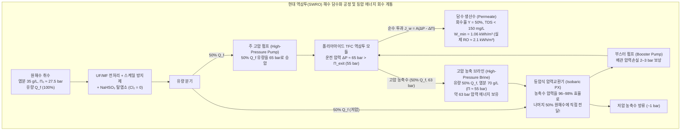

## 서론: 소금에 절인 오이에서 글로벌 물 위기까지 — '삼투'라는 보이지 않는 거대한 힘

오이 조각에 소금을 뿌리면 몇 분 안에 세포 내부에서 수분이 빠져나와 숨이 죽고, 민달팽이에게 소금을 뿌리면 체내 수분이 급격히 빠져나가 오그라든다. 병원에서 환자에게 정맥 주사를 놓을 때 <strong>생리식염수($0.9\,\text{wt}\%$ $\text{NaCl}$ 수용액)</strong> 대신 실수로 순수한 증류수를 대량 주입하면, 적혈구가 맹렬히 물을 흡수해 팽창하다가 결국 세포막이 터지는 치명적인 <strong>용혈(Hemolysis)</strong>이 발생한다. 반대로 바다에 표류한 조난자가 갈증을 참지 못하고 바닷물을 마시면, 해수의 높은 염분을 배출하기 위해 마신 양보다 더 많은 수분을 체내 세포로부터 빼앗겨 탈수로 사망하게 된다.

이러한 일상과 생명 현상을 지배하는 물리 과정이 바로 <strong>삼투(Osmosis)</strong>이며, 그 구동력의 크기를 나타내는 척도가 <strong>삼투압(Osmotic Pressure, $\Pi$)</strong>이다. 표준 해수(염분 농도 약 $35\,\text{g/L}$)의 삼투압은 약 <strong>$27\sim 28\,\text{atm}$($2.75\,\text{MPa}$ 또는 $27.5\,\text{bar}$)</strong>에 달하며, 이는 <strong>수심 약 $280\,\text{m}$ 심해의 수압</strong>과 맞먹는다! 현대 인류는 해수에 $55\sim 80\,\text{bar}$의 초고압을 가해 자연의 삼투 현상을 역전시키는 <strong>역삼투(Reverse Osmosis, RO)</strong> 기술로 매일 1억 입방미터 이상의 담수를 생산하고 있다. 본고에서는 통계역학과 물리화학을 바탕으로 반투막을 가로지르는 물 이동의 진정한 원리를 규명한다.

---

## 제1장: "물 농도 차이에 의한 확산"이라는 통념의 타파 — 화학 퍼텐셜($\mu_w$)과 혼합 엔트로피

### 1.1 왜 "물의 부피 농도가 높은 곳에서 낮은 곳으로 확산한다"는 설명은 틀렸는가?

많은 입문서에서는 "순수한 물 쪽이 소금물 쪽보다 단위 부피당 물 분자 수(물의 농도 $c_w$)가 많기 때문에 물이 자체 농도 구배를 따라 픽의 확산(Fickian diffusion)을 한다"고 설명한다. 그러나 이는 물리화학적으로 <strong>근본적인 오류</strong>다.

1. <strong>단위 부피당 물의 몰농도($c_w$)는 삼투 방향을 결정하지 않는다</strong>: 용질의 부분 몰부피($\bar{V}_s$)와 정전기적 수축(Electrostriction)에 따라 단위 부피당 물 밀도가 같거나 역전된 용액 쌍에서도 물은 오직 <strong>물의 몰분율($x_w$)과 활동도($a_w = \gamma_w x_w$)</strong> 구배에 따라서만 이동한다.
2. <strong>단순 농도 확산으로는 정수압($\Delta P$)에 의한 흐름의 완전 정지와 역전을 설명할 수 없다</strong>: 액체 상태의 물은 거의 비압축성($\kappa_T \approx 4.5 \times 10^{-5}\,\text{bar}^{-1}$)이므로 $27.5\,\text{bar}$를 가해도 물의 밀도는 고작 $0.12\%$밖에 증가하지 않는다. 그러나 실제로는 $\Delta P = \Pi$의 압력만으로 순수 이동이 완전히 멈추고 $\Delta P > \Pi$에서 역전된다.
3. 다공성 반투막에서의 삼투는 집단적인 점성 유동(Hydraulic flow)을 포함하며, 평형 삼투압 $\Pi$는 막의 기공 크기나 재질과 무관한 <strong>총괄성(Colligative property)</strong>이다.

### 1.2 깁스 화학 퍼텐셜($\mu_w$)과 혼합 엔트로피($\Delta S_{\text{mix}}$)

깁스(J. Willard Gibbs) 열역학에 따르면 일정한 온도 $T$와 압력 $P$에서 성분 $i$의 자발적 이동 방향을 결정하는 변수는 <strong>화학 퍼텐셜(Chemical Potential, 부분 몰 깁스 자유 에너지)</strong>이다.

$$\mu_i \equiv \left( \frac{\partial G}{\partial n_i} \right)_{T, P, n_{j \neq i}}$$

용액 속 물(용매 $w$)의 화학 퍼텐셜 $\mu_w(T, P, x_w)$는 기준 압력 $P_0$에서의 순수한 물의 화학 퍼텐셜 $\mu_w^*(T, P_0)$를 기준으로 압력 항과 활동도 로그 항의 합으로 표현된다.

$$\mu_w(T, P, x_w) = \mu_w^*(T, P_0) + \int_{P_0}^{P} \bar{V}_w \, dP' + R T \ln(\gamma_w x_w)$$

여기서 $\bar{V}_w \approx 18.07\,\text{cm}^3/\text{mol}$은 물의 부분 몰부피, $a_w = \gamma_w x_w$는 물의 활동도, $x_w = \frac{n_w}{n_w + \sum \nu_k n_k} = 1 - x_s$는 물의 몰분율이다. 동일한 대기압 $P_0$ 하에서 비휘발성 용질이 녹아 있으면 항상 $x_w < 1$이므로 $\ln(\gamma_w x_w) < 0$이 되어, <strong>용액 속 물의 화학 퍼텐셜은 순수한 물보다 반드시 낮다</strong>.

$$\Delta \mu_w = \mu_w(\text{용액}, T, P_0) - \mu_w^*(\text{순수}, T, P_0) = R T \ln(\gamma_w x_w) < 0$$

이상 용액($\Delta H_{\text{mix}} = 0, \gamma_w = 1$)에서 물의 화학 퍼텐셜이 낮아지는 이유는 순전히 통계역학적 <strong>혼합 엔트로피(Entropy of Mixing)</strong> 때문이다.

$$\Delta S_{\text{mix}} = -R \left( n_w \ln x_w + \sum_k n_k \ln x_k \right) > 0 \implies \Delta \bar{S}_w = \left( \frac{\partial \Delta S_{\text{mix}}}{\partial n_w} \right)_{T,P,n_s} = -R \ln x_w > 0$$

반투막에 가로막힌 용질 이온이 순수한 물 쪽으로 퍼질 수 없으므로, 우주 전체의 미시 상태 수 $W$($S = k_B \ln W$)를 극대화하기 위해 물 분자가 반투막을 넘어 용질 쪽으로 들어가 용질을 희석함으로써 깁스 자유 에너지 $G = H - TS$를 낮추는 것이다.

### 1.3 디바이-크레이머(Debye–Kramer) 분자운동론적 메커니즘: 막 계면의 국소 용매 압력 강하

피터 디바이(Peter Debye, 1923), 매닝(Gerald Manning), 크레이머(Eric Kramer)의 통계역학 모델에 따르면, 반투막은 열운동하는 용질 입자에 척력 퍼텐셜 장벽 $U_s(z)$를 가해 반사시킨다. 반사되는 용질 입자들이 점성 마찰을 통해 주변 물 분자를 용액 내부로 끌고 가면서, 막 기공 입구 경계층에서 다음과 같은 정역학적 힘의 평형이 성립한다.

$$\frac{dP_{\text{solvent}}(z)}{dz} + c_s(z) \frac{dU_s(z)}{dz} = 0 \implies P_{\text{solvent}}(0^+) = P_0 - c_s^{\text{bulk}} R T = P_0 - \Pi$$

```mermaid
flowchart TD
    subgraph S1["1. 정삼투 (Forward Osmosis): ΔP = 0 < Π"]
        L1["순수한 물 (Pure Water)<br/>압력 P₀, 몰분율 x_w = 1<br/>화학 퍼텐셜 μ_w(L) = μ_w*"]
        M1["반투막 (Semi-permeable Membrane)<br/>용질 입자 반사로 운동량 전달<br/>기공 입구 용매 압력이 P₀ - Π로 강하"]
        R1["소금물 (Saline Solution)<br/>압력 P₀, 몰분율 x_w < 1<br/>μ_w(R) = μ_w* + RT ln(γ_w x_w) < μ_w*"]
        L1 -->|"자발적 물 이동 (Δμ_w > 0)<br/>혼합 엔트로피 및 기공 흡입력 구동"| M1 --> R1
    end

    subgraph S2["2. 삼투 평형 (Osmotic Equilibrium): ΔP = Π"]
        L2["순수한 물 (Pure Water)<br/>압력 P₀, μ_w(L) = μ_w*"]
        M2["반투막 (Semi-permeable Membrane)<br/>양측 기공 입구 수압 평형 (P₀ = P₀)<br/>순 물 플럭스 J_w = 0"]
        R2["소금물 (Saline Solution)<br/>외부 압력 P₀ + Π 인가<br/>μ_w(R) = μ_w* + V_w Π + RT ln(γ_w x_w) = μ_w*"]
        L2 <-->|"열역학적 평형 (Δμ_w = 0)<br/>Π = -(RT / V_w) ln(γ_w x_w) ≈ iMRT"| M2 <--> R2
    end

    subgraph S3["3. 역삼투 담수화 (Reverse Osmosis): ΔP > Π (해수 55–80 bar)"]
        L3["담수 투과수 (Permeate)<br/>압력 P₀, 순수 μ_w(L) = μ_w*"]
        M3["폴리아마이드 TFC 역삼투막<br/>용해-확산 모델 수송:<br/>물 플럭스 J_w = A(ΔP - ΔΠ)"]
        R3["고압 해수 농축수 (High-Pressure Brine)<br/>고압 펌프로 P₀ + ΔP 인가 (ΔP > Π)<br/>μ_w(R) = μ_w* + V_w(ΔP - Π) > μ_w*"]
        R3 -->|"화학 퍼텐셜 역전: μ_w(R) > μ_w(L)<br/>염수에서 순수한 물을 짜냄!"| M3 --> L3
    end
```

즉, 용질 입자가 반투막에서 튕겨 나가는 반작용으로 <strong>용액 쪽 기공 입구에서 물(용매) 자체의 국소 기계적 압력이 $P_0 - \Pi$로 급격히 떨어진다(음압/흡입력 발생)</strong>! 이 국소 압력차 $\Delta P_{\text{pore}} = P_0 - (P_0 - \Pi) = \Pi$가 순수한 물을 용액 쪽으로 빨아들이는 미시적 실체다.

---

## 제2장: 반트호프 법칙(1887)의 단계별 유도와 해수 삼투압 정량 계산

### 2.1 화학 퍼텐셜 평형으로부터 반트호프 법칙의 유도

1887년 네덜란드의 물리화학자 야코뷔스 헨리퀴스 반트호프(Jacobus Henricus van 't Hoff, <strong>1901년 제1회 노벨 화학상 수상</strong>)는 페퍼(Wilhelm Pfeffer)의 페로시안화구리($\text{Cu}_2[\text{Fe(CN)}_6]$) 반투막 실험을 바탕으로 묽은 용액의 삼투압 법칙을 확립했다.

<strong>1단계: 반투막 양측의 화학 퍼텐셜 평형 조건</strong>
순수한 물($L$, 압력 $P_0$, $x_w = 1$)과 정수압 $P_0 + \Pi$가 가해진 용액($R$, 몰분율 $x_w$)이 평형을 이룰 때:

$$\mu_w^{(L)}(T, P_0, x_w=1) = \mu_w^*(T, P_0) = \mu_w^{(R)}(T, P_0 + \Pi, x_w) = \mu_w^*(T, P_0) + \bar{V}_w \Pi + R T \ln(\gamma_w x_w)$$

<strong>2단계: 비압축성 근사를 통한 엄밀한 열역학 방정식</strong>

$$\Pi = -\frac{R T}{\bar{V}_w} \ln(\gamma_w x_w) = -\frac{R T}{\bar{V}_w} \ln a_w$$

<strong>3단계: 묽은 용액 근사($\gamma_w \to 1, x_s \ll 1$)와 테일러 급수 전개</strong>
유효 용질 몰수를 $n_s^{\text{eff}} = i n_s$($i$는 <strong>반트호프 인자</strong>)라 하면, $x_w = 1 - x_s$에서 $\ln(1 - x_s)$를 테일러 전개하여 1차항까지 취한다.

$$\ln x_w = \ln(1 - x_s) = -x_s - \frac{1}{2}x_s^2 - \cdots \approx -x_s = -\frac{i n_s}{n_w + i n_s} \approx -\frac{i n_s}{n_w}$$

<strong>4단계: 몰농도($M$)로의 변환</strong>
묽은 용액의 전체 부피 $V \approx n_w \bar{V}_w$와 몰농도 $M \equiv \frac{n_s}{V}$를 대입하면 <strong>반트호프 법칙(van 't Hoff's Law)</strong>이 도출된다.

$$\Pi \approx \frac{R T}{\bar{V}_w} \frac{i n_s}{n_w} = \frac{i n_s R T}{n_w \bar{V}_w} \approx i \left(\frac{n_s}{V}\right) R T = i M R T$$

### 2.2 표준 해수($35\,\text{g/L}$ $\text{NaCl}$)의 삼투압 계산

표준 해수(염분 $35\,\text{g/L}$, 온도 $T = 298.15\,\text{K} = 25\,^\circ\text{C}$)에 대입하면:
- 몰농도: $M = \frac{35\,\text{g/L}}{58.44\,\text{g/mol}} \approx 0.60\,\text{mol/L}$.
- 반트호프 인자: $\text{NaCl}$은 2개 이온($\nu = 2$)으로 해리되나, 이온 간 정전기적 인력(삼투 계수 $\phi \approx 0.925$)으로 인해 $i = \phi \nu \approx 1.85$가 된다(총 오스몰 농도 $\approx 1.11\,\text{Osm/L}$).
- 삼투압($R = 0.082057\,\text{L}\cdot\text{atm}/(\text{K}\cdot\text{mol})$):

$$\Pi = i M R T = 1.85 \times 0.60\,\text{mol/L} \times 0.082057\,\text{L}\cdot\text{atm}/(\text{K}\cdot\text{mol}) \times 298.15\,\text{K} \approx 27.16\,\text{atm} \approx 2.75\,\text{MPa}\,(27.5\,\text{bar})$$

이는 <strong>높이 약 $280.6\,\text{m}$의 물기둥</strong>이 누르는 압력과 같다!

---

## 제3장: 생체 삼투압 — 아쿠아포린(AQP1), 적혈구 등장성, 스탈링 방정식 및 식물 팽압

### 3.1 피터 아그레의 아쿠아포린(AQP1) 발견과 단일열 물 수송 및 양성자 차단

피터 아그레(Peter Agre, <strong>2003년 노벨 화학상 수상</strong>)가 규명한 수분 통로 단백질 <strong>아쿠아포린(AQP1)</strong>은 모래시계 형태의 채널 중앙에 직경 <strong>$2.8\,\text{\AA}$($0.28\,\text{nm}$)</strong>의 <strong>$\text{ar/R}$ 입체 선택성 필터</strong>를 가지고 있어, 물 분자($2.75\,\text{\AA}$)를 한 줄(Single-file)로 세워 채널당 초당 <strong>$3 \times 10^9$개</strong>의 경이적인 속도로 통과시킨다. 이때 물 분자들이 수소결합으로 연결되어 그로투스 메커니즘(Grotthuss mechanism, 양성자 와이어)을 통해 $\text{H}_3\text{O}^+$가 누출되는 것을 막기 위해, 채널 중앙의 두 <strong>NPA 모티프(아스파라긴-프롤린-알라닌)</strong>와 거대 쌍극자 전기장이 통과하는 물 분자의 전기 쌍극자 모멘트를 <strong>$180^\circ$ 강제 회전(Dipole flip)</strong>시켜 양성자 이동을 완벽히 차단한다.

### 3.2 적혈구 긴장성(Tonicity), 모세혈관 스탈링 방정식과 식물 팽압

1. <strong>적혈구 긴장성(Tonicity)</strong>: 혈장($\approx 290\,\text{mOsm/L}$)과 같은 <strong>등장액</strong>($0.9\,\text{wt}\%$ $\text{NaCl}$)에서는 적혈구 형태가 유지되지만, <strong>고장액</strong>에서는 수분이 빠져나가 톱니 모양으로 수축(<strong>적혈구 주름 형성 Crenation</strong>)하고, <strong>저장액</strong>(순수한 물 또는 반사 계수 $\sigma \approx 0$인 요소 수용액)에서는 물이 유입되어 팽창·파열(<strong>용혈 Hemolysis</strong>)된다.
2. <strong>스탈링 방정식(Starling's Equation, 1896)과 교질 삼투압</strong>:
   모세혈관 벽을 가로지르는 체액 이동 플럭스 $J_v$는 모세혈관 혈압 $P_c$와 혈장 알부민($66.5\,\text{kDa}$)이 만드는 <strong>교질 삼투압(Oncotic pressure, $\pi_c \approx 25\sim 28\,\text{mmHg}$)</strong>의 균형으로 결정된다.
   $$J_v = L_p S \left[ (P_c - P_i) - \sigma (\pi_c - \pi_i) \right]$$
   동맥단($P_c \approx 35\,\text{mmHg}$)에서는 여과($J_v > 0$)가, 정맥단($P_c \approx 15\,\text{mmHg}$)에서는 재흡수($J_v < 0$)가 일어나며, 알부민 결핍 시 간질액이 축적되어 <strong>부종(Edema)과 복수(Ascites)</strong>가 발생한다.
3. <strong>식물 수분 퍼텐셜($\Psi_w = \Psi_s + \Psi_p + \Psi_g + \Psi_m$)과 팽압(Turgor Pressure)</strong>: 세포벽이 버텨주는 <strong>$+0.8\sim +1.5\,\text{MPa}$의 팽압($\Psi_p$)</strong> 덕분에 초본 식물이 직립하며, 고장액에서는 <strong>원형질 분리(Plasmolysis)</strong>가 일어난다.

| 분리막 및 시스템 유형 | 특징적 기공 / 자유부피 크기 | 주요 수송 및 선택성 메커니즘 | 수투과도 / 수송 속도 | 배제 대상 물질 | 대표적 운전 압력 / 삼투압차 |
| :--- | :--- | :--- | :--- | :--- | :--- |
| <strong>생체막 아쿠아포린 (AQP1)</strong> | $0.28\,\text{nm}$ ($2.8\,\text{\AA}$) 고정 채널 | $\text{ar/R}$ 입체 배제 + NPA 쌍극자 반전 + 정전기 반발 | $\sim 3 \times 10^9$ 물분자/초/채널 | 모든 수화 이온, 양성자 ($\text{H}_3\text{O}^+$), 요소 | 생체 삼투압차 (수 $\text{mmHg}\sim$수십 $\text{bar}$) |
| <strong>모세혈관 내피 (글리코칼릭스)</strong> | $4\sim 5\,\text{nm}$ 세포 간극 | 크기 체거름 + 음전하 도난(Donnan) 배제 | 스탈링 방정식 ($L_p$) | 알부민 ($66.5\,\text{kDa}$), 글로불린, 혈구 | 혈압 $15\sim 35\,\text{mmHg}$ vs 교질삼투압 $28\,\text{mmHg}$ |
| <strong>정밀여과 (MF) / 한외여과 (UF)</strong> | MF: $100\sim 1,000\,\text{nm}$ UF: $2\sim 100\,\text{nm}$ | 물리적 기공에 의한 체거름 (Pore-flow) | $50\sim 500\,\text{L}/(\text{m}^2\cdot\text{h}\cdot\text{bar})$ | 박테리아, 바이러스 (UF), 콜로이드, 단백질 | $0.2\sim 5\,\text{bar}$ |
| <strong>나노여과막 (NF)</strong> | $0.5\sim 2.0\,\text{nm}$ | 나노기공 확산 + 강한 도난 다가 이온 정전기 배제 | $5\sim 20\,\text{L}/(\text{m}^2\cdot\text{h}\cdot\text{bar})$ | 2가 이온 ($\text{Mg}^{2+}, \text{Ca}^{2+}, \text{SO}_4^{2-}$), 저분자 유기물 | $5\sim 20\,\text{bar}$ |
| <strong>역삼투막 (폴리아마이드 TFC RO)</strong> | 고정 기공 없음 ($0.2\sim 0.5\,\text{nm}$ 열요동 자유부피) | <strong>용해-확산 모델</strong> + 이온 탈수화 에너지 장벽 | $1\sim 2\,\text{L}/(\text{m}^2\cdot\text{h}\cdot\text{bar})$ (해수 SWRO) | 1가 이온 ($\text{Na}^+, \text{Cl}^-$ 배제율 $>99.8\%$) | <strong>$55\sim 80\,\text{bar}$</strong> (해수 담수화) |

---

## 제4장: 역삼투(RO) 해수 담수화 — 폴리아마이드 박막 복합막(TFC)과 용해-확산 모델

### 4.1 압력에 의한 화학 퍼텐셜 역전($\Delta P > \Pi$)과 계면중합 TFC 막

해수 쪽에 삼투압보다 큰 외압 $\Delta P > \Pi$(회수율 $50\%$ 기준 농축 해수 삼투압 $55\,\text{bar}$를 극복하기 위해 <strong>$55\sim 80\,\text{bar}$</strong> 인가)를 가하면 $\Delta \mu_w = \bar{V}_w(\Delta P - \Pi) > 0$이 되어 순수한 물이 해수로부터 빠져나온다. 로브-수리라잔(Loeb–Sourirajan, 1960)의 비대칭막에 이어 존 캐도트(John Cadotte)가 개발한 <strong>계면중합(Interfacial Polymerization) 폴리아마이드 박막 복합막(TFC)</strong>은 다공성 폴리설폰 지지체 위에서 수용액의 $m$-페닐렌다이아민(MPD)과 유기상의 트라이메소일 클로라이드(TMC)를 계면 축합시켜 두께 <strong>$100\sim 200\,\text{nm}$</strong>의 가교 방향족 폴리아마이드 활성층을 형성한다.

### 4.2 용해-확산 모델(Solution-Diffusion Model), 수화 반경 및 붕소(Boron) 투과 문제

RO 막은 구멍 뚫린 체(Sieve)가 아니다(맨 $\text{Na}^+$ 결정 반경은 $0.95\,\text{\AA}$로 물 분자 반경 $1.38\,\text{\AA}$보다 작다!). <strong>용해-확산 모델(Wijmans & Baker, 1995)</strong>에 따르면:
- <strong>물 투과 플럭스</strong>: $J_w = A(\Delta P - \Delta \Pi)$, 여기서 $A = \frac{D_w K_w c_w \bar{V}_w}{\delta R T}$.
- <strong>염 투과 플럭스</strong>: $J_s = B(C_m - C_p)$, 여기서 $B = \frac{D_s K_s}{\delta}$. 염 플럭스는 압력 $\Delta P$와 무관하고 농도차에만 비례하므로, 운전 압력 $\Delta P$를 높일수록 염 배제율 $R_s = \frac{A(\Delta P - \Delta \Pi)}{A(\Delta P - \Delta \Pi) + B}$는 $100\%$에 수렴한다!
- <strong>이온 탈수화 장벽과 중성 붕산($\text{B(OH)}_3$)</strong>: 물속의 $\text{Na}^+$와 $\text{Cl}^-$는 강한 수화껍질(Hydration shell)을 둘러싸고 있어 유효 <strong>수화 반경($r_{\text{hyd}}$)이 각각 $3.58\,\text{\AA}$ 및 $3.32\,\text{\AA}$</strong>에 달하며, 저유전율 폴리아마이드 내부로 들어가려면 막대한 탈수화 에너지 장벽과 본(Born) 유전 배제를 넘어야 한다. 반면 해수($\text{pH} \approx 8.0$) 속의 붕소는 전하가 없는 중성 <strong>붕산 분자 $\text{B(OH)}_3$</strong>($\text{p}K_a \approx 9.2$) 상태로 존재하여 정전기 반발과 수화 장벽 없이 막과 수소결합을 형성하며 쉽게 통과한다(1단 배제율 $40\sim 70\%$). 따라서 2단 RO 전에 $\text{NaOH}$를 주입해 $\text{pH} > 10$으로 높여 음이온인 $\text{B(OH)}_4^-$로 전환시켜 제거한다.

---

## 제5장: 해수 담수화의 열역학적 최소 에너지($1.06\,\text{kWh/m}^3$), 압력교환기(PX), 농도 분극과 파울링

### 5.1 열역학적 최소 분리 에너지 유도 및 증발법과의 비교

초기 삼투압 $\Pi_0 \approx 2.75\,\text{MPa}$인 해수로부터 회수율 $Y = V_p / V_f$만큼 담수를 추출할 때, 가역 등온 최소 비에너지 $w_{\min}(Y)$는 다음과 같이 적분된다.

$$w_{\min}(Y) = \frac{1}{Y} \int_0^Y \Pi(y)\,dy = \frac{\Pi_0}{Y} \int_0^Y \frac{dy}{1 - y} = \Pi_0 \frac{\ln\left(\frac{1}{1 - Y}\right)}{Y}$$

- $Y \to 0$ 극한: $w_{\min}(0) = \Pi_0 = 2.75\,\text{MJ/m}^3 \approx 0.764\,\text{kWh/m}^3$.
- <strong>$Y = 50\%$($Y = 0.50$) 회수율</strong>: $w_{\min}(0.50) = 2.75\,\text{MPa} \times 2\ln 2 = 3.812\,\text{MJ/m}^3 \approx \mathbf{1.06\,\text{kWh/m}^3}$.
이는 물의 기화 잠열(<strong>$\sim 650\,\text{kWh/m}^3$</strong>)의 $1/600$에 불과하며, <strong>등압식 압력교환기(Isobaric Pressure Exchanger, PX)</strong>로 고압 브라인 에너지의 <strong>$96\sim 98\%$</strong>를 회수함으로써 현대 SWRO 플랜트의 RO 공정 전력 소모는 <strong>$2.0\sim 2.5\,\text{kWh/m}^3$</strong>까지 낮아졌다.

| 담수화 기술 방식 | 분리 물리화학적 원리 | 이론적 최소 에너지 ($Y=50\%$) | 실제 플랜트 총 에너지 소비 (전력 환산) | 운전 조건 | 핵심 장단점 및 한계 |
| :--- | :--- | :--- | :--- | :--- | :--- |
| <strong>단단 증발 (상변화 기준)</strong> | 기액 상변화 (모든 수소결합 파괴) | $\sim 650\,\text{kWh/m}^3$ (기화 잠열) | $>650\,\text{kWh/m}^3$ | $100\,^\circ\text{C}$, $1\,\text{bar}$ | 에너지 소비가 천문학적이어서 비실용적 |
| <strong>다단 플래시 (MSF) / 다중효용 (MED)</strong> | 감압 비등 및 응축 잠열 다단 회수 | $1.06\,\text{kWh/m}^3$ | <strong>$7\sim 18\,\text{kWh/m}^3$</strong> | $60\sim 110\,^\circ\text{C}$ | 고염분 원수에 강하나 열·전력 소모가 큼 |
| <strong>역삼투법 (SWRO + 등압 PX)</strong> | <strong>폴리아마이드 TFC 용해-확산 + 고압 화학퍼텐셜 역전</strong> | <strong>$1.06\,\text{kWh/m}^3$</strong> ($Y\to 0$ 시 $0.76\,\text{kWh/m}^3$) | RO 코어: <strong>$2.0\sim 2.5\,\text{kWh/m}^3$</strong> 플랜트 전체: $3.0\sim 3.5\,\text{kWh/m}^3$ | 상온, <strong>$55\sim 80\,\text{bar}$</strong> | <strong>세계 시장 70% 점유, 최고 에너지 효율</strong>. 농도 분극과 바이오파울링이 과제 |

### 5.2 농도 분극(Concentration Polarization)과 바이오파울링 및 염소 열화 딜레마

1. <strong>농도 분극(CP)</strong>: 경계층($\delta_b$) 내 대류-확산 평형식 $J_w C(x) - D_s \frac{dC}{dx} = J_w C_p$를 적분하면 <strong>필름 모델 방정식</strong>이 도출된다.
   $$\frac{C_m - C_p}{C_b - C_p} = \exp\left(\frac{J_w}{k_m}\right), \qquad k_m = \frac{D_s}{\delta_b}$$
   막 표면 염 농도 $C_m$이 지수함수적으로 증가하면 유효 삼투압 $\Pi(C_m)$이 상승하여 투과 유량이 감소하고 스케일링($\text{CaCO}_3, \text{CaSO}_4, \text{SiO}_2$)이 촉진된다.
2. <strong>바이오파울링과 폴리아마이드 염소 취약성</strong>: 폴리아마이드의 아마이드 결합($-\text{CONH}-$)은 유리 염소($\text{HOCl}/\text{OCl}^-$)에 의한 <strong>N-염소화 및 오턴 자리옮김(Orton rearrangement)</strong> 반응으로 쉽게 파괴되므로, RO 유입 전 중아황산나트륨($\text{NaHSO}_3$)으로 잔류 염소를 완전히 제거해야 한다. 이로 인해 생존 세균이 막 표면에서 세포외 고분자 물질(EPS) 바이오필름을 형성하는 <strong>바이오파울링(Biofouling)</strong>이 발생하며, 이를 극복하기 위해 생체모방 아쿠아포린 막, 탄소나노튜브(CNT), 산화그래핀(GO) 및 양쪽성이온 코팅 막 연구가 활발히 진행되고 있다.
