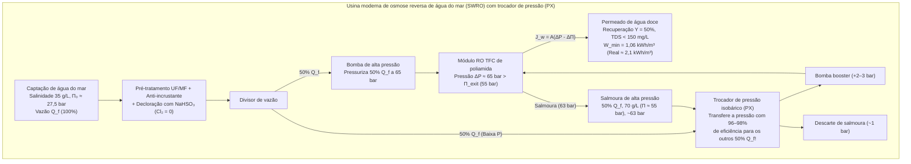

## Introdução: Dos pepinos salgados à crise hídrica global — O gigante invisível da osmose

Ao polvilhar sal de cozinha sobre fatias finas de pepino, em poucos minutos gotículas de água brotam do tecido vegetal. Na medicina clínica, se água destilada pura fosse acidentalmente injetada por via intravenosa em vez de <strong>soro fisiológico ($0{,}9\,\text{wt}\%$ $\text{NaCl}$)</strong>, a água entraria violentamente nos glóbulos vermelhos (eritrócitos) até romper sua membrana celular, provocando uma <strong>hemólise</strong> fatal. Inversamente, um náufrago que bebe água do mar sofre desidratação paradoxal letal, pois seus rins precisam extrair mais água das próprias células para excretar o excesso de sal marinho.

Esse fenômeno universal é a <strong>osmose</strong>, e sua força motriz termodinâmica é quantificada pela <strong>pressão osmótica ($\Pi$)</strong>. A água do mar padrão ($35\,\text{g/L}$) exerce uma pressão osmótica de <strong>$27\text{ a }28\,\text{atm}$ ($\approx 2{,}75\,\text{MPa}$ ou $27{,}5\,\text{bar}$)</strong>, mecanicamente equivalente à pressão hidrostática a <strong>$280\,\text{metros}$ de profundidade no oceano</strong>! Aplicando pressões hidráulicas de $55\text{ a }80\,\text{bar}$ sobre membranas poliméricas ultrafinas, as modernas usinas de dessalinização por <strong>osmose reversa (Reverse Osmosis, SWRO)</strong> invertem esse processo natural para fornecer mais de 100 milhões de metros cúbicos de água potável todos os dias.

---

## Capítulo 1: Desmistificando o mito do «gradiente de concentração da água» — Potencial químico ($\mu_w$) e entropia de mistura

### 1.1 Por que a explicação da «difusão da água segundo sua própria concentração volumétrica» é falsa?

Livros introdutórios costumam afirmar que a água simplesmente se difunde de onde há maior concentração volumétrica de água ($c_w$ em $\text{mol/L}$) para onde há menor concentração. Essa explicação é <strong>físico-quimicamente incorreta</strong>:
1. <strong>A densidade molar volumétrica da água ($c_w$) não governa a direção do fluxo osmótico</strong>: Dependendo do volume molar parcial do soluto ($\bar{V}_s$) e da eletrostrição, a água flui estritamente segundo sua <strong>fração molar $x_w$ e sua atividade termodinâmica $a_w = \gamma_w x_w$</strong>.
2. <strong>A simples difusão de Fick não explica a parada total e a inversão por pressão hidrostática ($\Delta P = \Pi$)</strong>: Como a água líquida é quase incompressível ($\kappa_T \approx 4{,}5 \times 10^{-5}\,\text{bar}^{-1}$), aplicar $27{,}5\,\text{bar}$ aumenta sua densidade em apenas $0{,}12\%$. Contudo, $\Delta P = \Pi$ interrompe exatamente o fluxo líquido e $\Delta P > \Pi$ o inverte.
3. A osmose em membranas porosas é um fluxo convectivo coletivo, e $\Pi$ é uma <strong>propriedade coligativa</strong> independente do tamanho dos poros ou do material da membrana.

### 1.2 O potencial químico de Gibbs ($\mu_w$) e a mecânica estatística da entropia de mistura ($\Delta S_{\text{mix}}$)

Pela termodinâmica de J. Willard Gibbs, a temperatura $T$ e pressão $P$ constantes, toda espécie química móvel migra espontaneamente do maior para o menor <strong>potencial químico $\mu_i$</strong>:

$$\mu_i \equiv \left( \frac{\partial G}{\partial n_i} \right)_{T, P, n_{j \neq i}}$$

Para a água em solução em relação à água pura $\mu_w^*(T, P_0)$:

$$\mu_w(T, P, x_w) = \mu_w^*(T, P_0) + \int_{P_0}^{P} \bar{V}_w \, dP' + R T \ln(\gamma_w x_w)$$

onde $\bar{V}_w \approx 18{,}07\,\text{cm}^3/\text{mol}$ é o volume molar parcial da água e $x_w = \frac{n_w}{n_w + \sum \nu_k n_k} = 1 - x_s < 1$ é sua fração molar. Em uma solução ideal ($\Delta H_{\text{mix}} = 0, \gamma_w = 1$), a redução $\Delta \mu_w = RT \ln x_w < 0$ provém exclusivamente do aumento da <strong>entropia de mistura ($\Delta S_{\text{mix}}$)</strong>:

$$\Delta S_{\text{mix}} = -R \left( n_w \ln x_w + \sum_k n_k \ln x_k \right) > 0 \implies \Delta \bar{S}_w = \left( \frac{\partial \Delta S_{\text{mix}}}{\partial n_w} \right)_{T,P,n_s} = -R \ln x_w > 0$$

Como a membrana semipermeável impede os íons de soluto de passarem para a água pura, as moléculas de água atravessam a membrana para diluir o soluto, maximizando a entropia configuracional do universo ($S = k_B \ln W$) e minimizando a energia livre de Gibbs $G = H - TS$.

### 1.3 O mecanismo cinético de Debye–Kramer: Queda local de pressão do solvente na interface

Como demonstraram <strong>Peter Debye (1923)</strong>, Gerald Manning e Eric Kramer, quando as partículas de soluto em agitação térmica colidem contra a barreira repulsiva $U_s(z)$ da membrana e são refletidas, elas arrastam viscosamente as moléculas de água para o interior da solução:

$$\frac{dP_{\text{solvent}}(z)}{dz} + c_s(z) \frac{dU_s(z)}{dz} = 0 \implies P_{\text{solvent}}(0^+) = P_0 - c_s^{\text{bulk}} R T = P_0 - \Pi$$

```mermaid
flowchart TD
    subgraph S1["1. Osmose direta (Forward Osmosis): ΔP = 0 < Π"]
        L1["Água pura (L)<br/>Pressão P₀, fração molar x_w = 1<br/>Potencial químico μ_w(L) = μ_w*"]
        M1["Membrana semipermeável<br/>Reflexão do soluto na barreira:<br/>Pressão local da água cai para P₀ - Π"]
        R1["Solução salina (R)<br/>Pressão P₀, fração molar x_w < 1<br/>μ_w(R) = μ_w* + RT ln(γ_w x_w) < μ_w*"]
        L1 -->|"Fluxo espontâneo de água (Δμ_w > 0)<br/>Entropia de mistura e sucção nos poros"| M1 --> R1
    end

    subgraph S2["2. Equilíbrio osmótico: ΔP = Π"]
        L2["Água pura (L)<br/>Pressão P₀, μ_w(L) = μ_w*"]
        M2["Membrana semipermeável<br/>Pressões nos poros igualadas (P₀ = P₀)<br/>Fluxo líquido J_w = 0"]
        R2["Solução salina (R)<br/>Pressão externa P₀ + Π aplicada<br/>μ_w(R) = μ_w* + V_w Π + RT ln(γ_w x_w) = μ_w*"]
        L2 <-->|"Equilíbrio termodinâmico (Δμ_w = 0)<br/>Π = -(RT / V_w) ln(γ_w x_w) ≈ iMRT"| M2 <--> R2
    end

    subgraph S3["3. Osmose reversa (Dessalinização RO): ΔP > Π (55–80 bar)"]
        L3["Permeado de água doce (L)<br/>Pressão P₀, μ_w(L) = μ_w*"]
        M3["Membrana RO TFC de poliamida<br/>Transporte solução-difusão:<br/>Fluxo J_w = A(ΔP - ΔΠ)"]
        R3["Salmoura em alta pressão (R)<br/>Pressão da bomba P₀ + ΔP (ΔP > Π)<br/>μ_w(R) = μ_w* + V_w(ΔP - Π) > μ_w*"]
        R3 -->|"Inversão de Δμ_w: μ_w(R) > μ_w(L)<br/>Água pura espremida da salmoura!"| M3 --> L3
    end
```

Isso cria uma <strong>queda mecânica local de pressão na água ($P_0 - \Pi$)</strong> exatamente na entrada dos poros do lado da solução, succionando mecanicamente a água pura (à pressão $P_0$) através da membrana.

---

## Capítulo 2: Derivação passo a passo da lei de van 't Hoff (1887) e cálculo para a água do mar

### 2.1 Derivação termodinâmica rigorosa

<strong>Jacobus Henricus van 't Hoff</strong> (primeiro Prêmio Nobel de Química em 1901), baseando-se nas medições de Wilhelm Pfeffer com membranas de ferrocianeto de cobre ($\text{Cu}_2[\text{Fe(CN)}_6]$), formulou a lei da pressão osmótica:

1. <strong>Igualdade de potenciais químicos no equilíbrio</strong> entre a água pura ($L$, pressão $P_0, x_w=1$) e a solução ($R$, pressão $P_0 + \Pi, x_w$):

$$\mu_w^{(L)}(T, P_0, x_w=1) = \mu_w^*(T, P_0) = \mu_w^{(R)}(T, P_0 + \Pi, x_w) = \mu_w^*(T, P_0) + \bar{V}_w \Pi + R T \ln(\gamma_w x_w)$$

2. <strong>Equação termodinâmica exata</strong> (água incompressível):

$$\Pi = -\frac{R T}{\bar{V}_w} \ln(\gamma_w x_w)$$

3. <strong>Expansão em série de Taylor para solução diluída</strong> ($\gamma_w \to 1$, $x_s = 1 - x_w = \frac{i n_s}{n_w + i n_s} \ll 1$ com o <strong>fator de van 't Hoff $i$</strong>):

$$\ln x_w = \ln(1 - x_s) \approx -x_s \approx -\frac{i n_s}{n_w}$$

4. <strong>Conversão para molaridade $M = n_s / V$</strong> (com $V \approx n_w \bar{V}_w$):

$$\Pi \approx \frac{R T}{\bar{V}_w} \frac{i n_s}{n_w} \approx i \left(\frac{n_s}{V}\right) R T = i M R T$$

### 2.2 Cálculo exato para a água do mar padrão ($35\,\text{g/L}$ $\text{NaCl}$)

A $T = 298{,}15\,\text{K}$ ($25\,^\circ\text{C}$):
- Molaridade: $M = \frac{35\,\text{g/L}}{58{,}44\,\text{g/mol}} \approx 0{,}60\,\text{mol/L}$.
- Fator de van 't Hoff: Para $\text{NaCl}$ ($\nu = 2$), o coeficiente osmótico $\phi \approx 0{,}925$ resulta em $i = \phi \nu \approx 1{,}85$ (osmolaridade $\approx 1{,}11\,\text{Osm/L}$).
- Pressão osmótica ($R = 0{,}082057\,\text{L}\cdot\text{atm}/(\text{K}\cdot\text{mol})$):

$$\Pi = 1{,}85 \times 0{,}60\,\text{mol/L} \times 0{,}082057\,\text{L}\cdot\text{atm}/(\text{K}\cdot\text{mol}) \times 298{,}15\,\text{K} \approx 27{,}16\,\text{atm} \approx 2{,}75\,\text{MPa}\,(27{,}5\,\text{bar})$$

Isso equivale a uma <strong>coluna de água de $h = \frac{\Pi}{\rho g} \approx 280{,}6\,\text{metros}$ de altura</strong>!

---

## Capítulo 3: Osmose biológica — Aquaporinas (AQP1), tonicidade eritrocitária, equação de Starling e turgescência

- <strong>Canais de água Aquaporina (AQP1, Peter Agre, Prêmio Nobel 2003)</strong>: Um poro em forma de ampulheta com filtro estérico $\text{ar/R}$ de <strong>$2{,}8\,\text{\AA}$</strong> conduz <strong>$3 \times 10^9$ moléculas de água por segundo</strong> em fila única. Dois <strong>motivos NPA (Asparagina-Prolina-Alanina)</strong> centrais forçam uma <strong>inversão de $180^\circ$ do dipolo elétrico</strong> da água, interrompendo a cadeia de ligações de hidrogênio e bloqueando completamente o salto de prótons ($\text{H}_3\text{O}^+$) pelo mecanismo de Grotthuss.
- <strong>Tonicidade em glóbulos vermelhos</strong>: Formato bicôncavo normal em meio <strong>isotônico</strong> ($0{,}9\,\text{wt}\%$ $\text{NaCl}$, $\approx 290\,\text{mOsm/L}$), encolhimento espinhoso (<strong>crenação</strong>) em meio <strong>hipertônico</strong>, e ruptura celular (<strong>hemólise</strong>) em meio <strong>hipotônico</strong>.
- <strong>Equação de Starling (1896) nos capilares</strong>:
  $$J_v = L_p S \left[ (P_c - P_i) - \sigma (\pi_c - \pi_i) \right]$$
  A <strong>pressão oncótica ($\pi_c \approx 25\text{–}28\,\text{mmHg}$)</strong> gerada pela albumina sérica ($66{,}5\,\text{kDa}$) garante a reabsorção venosa; sua queda provoca <strong>edema e ascite</strong>.
- <strong>Pressão de turgescência vegetal ($\Psi_w = \Psi_s + \Psi_p + \Psi_g + \Psi_m$)</strong>: A parede celular suporta uma pressão interna $\Psi_p \approx +0{,}8\text{ a }+1{,}5\,\text{MPa}$, mantendo plantas herbáceas eretas e evitando a <strong>plasmólise</strong>.

| Sistema de membrana | Tamanho de poro / Volume livre | Mecanismo de seletividade | Permeância / Taxa de transporte | Espécies rejeitadas | Pressão típica |
| :--- | :--- | :--- | :--- | :--- | :--- |
| <strong>Aquaporina biológica (AQP1)</strong> | Canal fixo de $0{,}28\,\text{nm}$ ($2{,}8\,\text{\AA}$) | Filtro estérico $\text{ar/R}$ + giro dipolar NPA | $\sim 3 \times 10^9$ $\text{H}_2\text{O}$/s por canal | Todos os íons hidratados, prótons ($\text{H}_3\text{O}^+$), ureia | Poucos $\text{mmHg}$ a $\sim 30\,\text{bar}$ |
| <strong>Endotélio capilar (Glicocálix)</strong> | Fendas de $4\text{–}5\,\text{nm}$ | Exclusão por tamanho + repulsão de Donnan | Equação de Starling ($L_p$) | Albumina ($66{,}5\,\text{kDa}$), globulinas, eritrócitos | $P_c \approx 15\text{–}35\,\text{mmHg}$ vs $\pi_c \approx 28\,\text{mmHg}$ |
| <strong>Micro- (MF) / Ultrafiltração (UF)</strong> | MF: $100\text{–}1\,000\,\text{nm}$ UF: $2\text{–}100\,\text{nm}$ | Peneiramento mecânico por poros | $50\text{–}500\,\text{L}/(\text{m}^2\cdot\text{h}\cdot\text{bar})$ | Bactérias, vírus (UF), coloides, proteínas | $0{,}2\text{–}5\,\text{bar}$ |
| <strong>Osmose reversa (RO TFC Poliamida)</strong> | Não porosa ($0{,}2\text{–}0{,}5\,\text{nm}$ volume livre) | <strong>Solução-Difusão</strong> + barreira de desidratação | $1\text{–}2\,\text{L}/(\text{m}^2\cdot\text{h}\cdot\text{bar})$ (SWRO) | Íons monovalentes ($\text{Na}^+, \text{Cl}^-$ rejeição $>99{,}8\%$) | <strong>$55\text{–}80\,\text{bar}$</strong> (água do mar) |

---

## Capítulo 4: Dessalinização por osmose reversa (RO) — Membranas TFC de poliamida e modelo de solução-difusão

Após as membranas assimétricas de Loeb e Sourirajan (1960), John Cadotte inventou no final dos anos 1970 a <strong>membrana composta de filme fino (TFC) de poliamida via polimerização interfacial</strong> entre $m$-fenilenodiamina (MPD) e cloreto de trimesoíla (TMC), formando uma camada ativa reticulada de <strong>$100\text{ a }200\,\text{nm}$</strong>.

Segundo o <strong>modelo de solução-difusão (Wijmans & Baker, 1995)</strong>:
- <strong>Fluxo de água</strong>: $J_w = A(\Delta P - \Delta \Pi)$ com $A = \frac{D_w K_w c_w \bar{V}_w}{\delta R T}$.
- <strong>Fluxo de sal</strong>: $J_s = B(C_m - C_p)$ com $B = \frac{D_s K_s}{\delta}$ (independente de $\Delta P$!). Por isso, a rejeição de sal $R_s = \frac{A(\Delta P - \Delta \Pi)}{A(\Delta P - \Delta \Pi) + B}$ aproxima-se de $100\%$ ao elevar $\Delta P$.
- <strong>Barreira de desidratação e anomalia do boro</strong>: O $\text{Na}^+$ hidratado ($r_{\text{hyd}} \approx 3{,}58\,\text{\AA}$ contra $1{,}38\,\text{\AA}$ da $\text{H}_2\text{O}$) é rejeitado pela barreira de desidratação e exclusão dielétrica de Born. Já o <strong>ácido bórico neutro $\text{B(OH)}_3$</strong> ($\text{p}K_a \approx 9{,}2$) a $\text{pH} \approx 8{,}0$ não possui carga e atravessa a membrana por ligações de hidrogênio (exigindo elevar o $\text{pH} > 10$ com $\text{NaOH}$ em um segundo passo de RO para convertê-lo no ânion $\text{B(OH)}_4^-$).

---

## Capítulo 5: Energia mínima termodinâmica ($1{,}06\,\text{kWh/m}^3$), trocadores isobáricos (PX), polarização por concentração e biofouling

O trabalho mínimo reversível de separação $w_{\min}(Y)$ para uma taxa de recuperação $Y = V_p / V_f$ obtém-se integrando $\Pi(y) = \frac{\Pi_0}{1 - y}$:

$$w_{\min}(Y) = \frac{1}{Y} \int_0^Y \Pi(y)\,dy = \Pi_0 \frac{\ln\left(\frac{1}{1 - Y}\right)}{Y}$$

Para <strong>$Y = 50\%$</strong> ($\Pi_0 = 2{,}75\,\text{MPa}$), resulta <strong>$w_{\min}(0{,}50) = 3{,}812\,\text{MJ/m}^3 \approx 1{,}06\,\text{kWh/m}^3$</strong>, contra <strong>$\sim 650\,\text{kWh/m}^3$</strong> do calor latente de vaporização. Graças aos <strong>trocadores de pressão isobáricos (PX)</strong> que recuperam de $96\%$ a $98\%$ da energia hidráulica da salmoura, o consumo do núcleo de RO situa-se hoje em <strong>$2{,}0\text{–}2{,}5\,\text{kWh/m}^3$</strong>.

| Tecnologia de dessalinização | Princípio físico-químico | Energia mínima teórica ($Y=50\%$) | Consumo real na usina (equivalente elétrico) | Condições operacionais | Vantagens e limitações |
| :--- | :--- | :--- | :--- | :--- | :--- |
| <strong>Evaporação simples</strong> | Mudança de fase líquido-vapor | $\sim 650\,\text{kWh/m}^3$ (calor latente) | $>650\,\text{kWh/m}^3$ | $100\,^\circ\text{C}$, $1\,\text{bar}$ | Custo energético proibitivo |
| <strong>Destilação térmica (MSF / MED)</strong> | Evaporação flash multiestágio | $1{,}06\,\text{kWh/m}^3$ | <strong>$7\text{–}18\,\text{kWh/m}^3$</strong> | $60\text{–}110\,^\circ\text{C}$ | Robusta, mas de alto consumo energético |
| <strong>Osmose reversa (SWRO + PX)</strong> | <strong>Solução-difusão TFC + inversão a alta pressão</strong> | <strong>$1{,}06\,\text{kWh/m}^3$</strong> ($0{,}76\,\text{kWh/m}^3$ se $Y\to 0$) | Núcleo RO: <strong>$2{,}0\text{–}2{,}5\,\text{kWh/m}^3$</strong> Total usina: $3{,}0\text{–}3{,}5\,\text{kWh/m}^3$ | Temp. ambiente, <strong>$55\text{–}80\,\text{bar}$</strong> | <strong>70% da capacidade mundial</strong>; limitada por polarização e biofouling |

Os dois grandes gargalos de engenharia são a <strong>polarização por concentração</strong> ($\frac{C_m - C_p}{C_b - C_p} = \exp(J_w / k_m)$) e a <strong>incrustação biológica (biofouling)</strong> agravada pela sensibilidade das ligações amida da poliamida ao cloro livre (N-cloração e rearranjo de Orton), o que exige declorar a água com $\text{NaHSO}_3$ antes das membranas.
