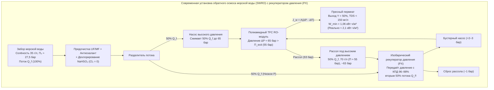

## Введение: От солёных огурцов до глобальной водной безопасности — невидимый гигант осмоса

Посыпьте солью тонко нарезанные огурцы, и уже через несколько минут на поверхности овощей выступят капли воды. В клинической медицине, если пациенту по ошибке ввести внутривенно чистую дистиллированную воду вместо <strong>физиологического раствора ($0{,}9\,\text{мас.}\%$ $\text{NaCl}$)</strong>, вода стремительно хлынет внутрь эритроцитов и разорвёт их клеточные мембраны, вызвав смертельный <strong>гемолиз</strong>. Напротив, потерпевший кораблекрушение моряк, пьющий морскую воду, погибает от парадоксального обезвоживания, поскольку почкам требуется извлечь из тканей больше внутриклеточной воды для выведения избытка соли, чем было выпито.

Все эти явления управляются <strong>осмосом</strong>, а термодинамическая величина его движущей силы измеряется <strong>осмотическим давлением ($\Pi$)</strong>. Стандартная океанская вода (солёность $35\,\text{г/л}$) обладает осмотическим давлением <strong>$27\text{–}28\,\text{атм}$ ($\approx 2{,}75\,\text{МПа}$ или $27{,}5\,\text{бар}$)</strong>, что механически эквивалентно гидростатическому давлению на <strong>глубине $280\,\text{метров}$ в океане</strong>! Прикладывая гидравлическое давление $55\text{–}80\,\text{бар}$ к ультратонким полимерным мембранам, современные установки <strong>обратного осмоса морской воды (SWRO)</strong> обращают этот природный процесс вспять, производя более 100 миллионов кубометров пресной питьевой воды ежедневно.

---

## Глава 1: Развенчание мифа о «градиенте концентрации воды» — химический потенциал ($\mu_w$) и энтропия смешения

### 1.1 Почему школьное объяснение о «диффузии воды по градиенту её объёмной концентрации» ошибочно?

Вводные учебники часто утверждают, что вода просто диффундирует из области с большей объёмной концентрацией воды ($c_w$ в $\text{моль/л}$) в область с меньшей концентрацией. Это объяснение <strong>физико-химически неверно</strong>:
1. <strong>Объёмная молярная плотность воды ($c_w$) не определяет направление осмотического потока</strong>: В зависимости от парциального молярного объёма растворённого вещества ($\bar{V}_s$) и электрострикции гидратных оболочек вода движется строго в соответствии с её <strong>мольной долей $x_w$ и термодинамической активностью $a_w = \gamma_w x_w$</strong>.
2. <strong>Чистая фиковская диффузия не может объяснить полную остановку и обращение потока гидростатическим давлением ($\Delta P = \Pi$)</strong>: Жидкая вода практически несжимаема ($\kappa_T \approx 4{,}5 \times 10^{-5}\,\text{бар}^{-1}$); сжатие на $27{,}5\,\text{бар}$ увеличивает её плотность лишь на $0{,}12\%$. Тем не менее приложение $\Delta P = \Pi$ полностью останавливает поток воды, а $\Delta P > \Pi$ обращает его вспять.
3. Осмос через пористые полупроницаемые мембраны представляет собой коллективный конвективный поток, а $\Pi$ является <strong>коллигативным свойством</strong>, не зависящим от размера пор или материала мембраны.

### 1.2 Химический потенциал Гиббса ($\mu_w$) и статистическая механика энтропии смешения ($\Delta S_{\text{mix}}$)

Согласно термодинамике Дж. Уилларда Гиббса, при постоянных температуре $T$ и давлении $P$ любой подвижный компонент $i$ самопроизвольно переходит из области с более высоким в область с более низким <strong>химическим потенциалом $\mu_i$</strong>:

$$\mu_i \equiv \left( \frac{\partial G}{\partial n_i} \right)_{T, P, n_{j \neq i}}$$

Для жидкой воды в растворе относительно чистой воды $\mu_w^*(T, P_0)$:

$$\mu_w(T, P, x_w) = \mu_w^*(T, P_0) + \int_{P_0}^{P} \bar{V}_w \, dP' + R T \ln(\gamma_w x_w)$$

где $\bar{V}_w \approx 18{,}07\,\text{см}^3/\text{моль}$ — парциальный молярный объём воды, а $x_w = \frac{n_w}{n_w + \sum \nu_k n_k} = 1 - x_s < 1$ — мольная доля воды. В идеальном растворе ($\Delta H_{\text{mix}} = 0, \gamma_w = 1$) понижение потенциала $\Delta \mu_w = RT \ln x_w < 0$ обусловлено исключительно ростом <strong>энтропии смешения ($\Delta S_{\text{mix}}$)</strong>:

$$\Delta S_{\text{mix}} = -R \left( n_w \ln x_w + \sum_k n_k \ln x_k \right) > 0 \implies \Delta \bar{S}_w = \left( \frac{\partial \Delta S_{\text{mix}}}{\partial n_w} \right)_{T,P,n_s} = -R \ln x_w > 0$$

Поскольку полупроницаемая мембрана не пропускает ионы соли в отсек с чистой водой, молекулы воды сами переходят через мембрану для разбавления соли, максимизируя конфигурационную энтропию Вселенной ($S = k_B \ln W$) и минимизируя энергию Гиббса $G = H - TS$.

### 1.3 Кинетический механизм Дебая — Крамера: локальное падение давления растворителя у пор

Как показали <strong>Петер Дебай (1923)</strong>, Джеральдэннинг и Эрик Крамер, когда частицы растворённого вещества при тепловом броуновском движении отталкиваются барьером мембраны $U_s(z)$, они передают импульс молекулам воды:

$$\frac{dP_{\text{solvent}}(z)}{dz} + c_s(z) \frac{dU_s(z)}{dz} = 0 \implies P_{\text{solvent}}(0^+) = P_0 - c_s^{\text{bulk}} R T = P_0 - \Pi$$

```mermaid
flowchart TD
    subgraph S1["1. Прямой осмос (Forward Osmosis): ΔP = 0 < Π"]
        L1["Чистая вода (L)<br/>Давление P₀, мольная доля x_w = 1<br/>Хим. потенциал μ_w(L) = μ_w*"]
        M1["Полупроницаемая мембрана<br/>Отражение соли от барьера:<br/>Локальное давление воды падает до P₀ - Π"]
        R1["Солевой раствор (R)<br/>Давление P₀, мольная доля x_w < 1<br/>μ_w(R) = μ_w* + RT ln(γ_w x_w) < μ_w*"]
        L1 -->|"Самопроизвольный поток воды (Δμ_w > 0)<br/>Энтропия смешения и разрежение у пор"| M1 --> R1
    end

    subgraph S2["2. Осмотическое равновесие: ΔP = Π"]
        L2["Чистая вода (L)<br/>Давление P₀, μ_w(L) = μ_w*"]
        M2["Полупроницаемая мембрана<br/>Давления у входов в поры равны (P₀ = P₀)<br/>Чистый поток J_w = 0"]
        R2["Солевой раствор (R)<br/>Приложено внешнее давление P₀ + Π<br/>μ_w(R) = μ_w* + V_w Π + RT ln(γ_w x_w) = μ_w*"]
        L2 <-->|"Термодинамическое равновесие (Δμ_w = 0)<br/>Π = -(RT / V_w) ln(γ_w x_w) ≈ iMRT"| M2 <--> R2
    end

    subgraph S3["3. Обратный осмос (Опреснение RO): ΔP > Π (55–80 бар)"]
        L3["Пресный пермеат (L)<br/>Давление P₀, μ_w(L) = μ_w*"]
        M3["Полиамидная TFC RO-мембрана<br/>Растворение-диффузия:<br/>Поток J_w = A(ΔP - ΔΠ)"]
        R3["Рассол под высоким давлением (R)<br/>Давление насоса P₀ + ΔP (ΔP > Π)<br/>μ_w(R) = μ_w* + V_w(ΔP - Π) > μ_w*"]
        R3 -->|"Инверсия Δμ_w: μ_w(R) > μ_w(L)<br/>Чистая вода отжимается из рассола!"| M3 --> L3
    end
```

Это создаёт <strong>локальное механическое разрежение (падение давления воды до $P_0 - \Pi$)</strong> непосредственно у устьев пор со стороны раствора, засасывая чистую воду (находящуюся под давлением $P_0$) сквозь мембрану.

---

## Глава 2: Пошаговый вывод закона Вант-Гоффа (1887) и расчёт для морской воды

### 2.1 Строгий термодинамический вывод

<strong>Якоб Хендрик Вант-Гофф</strong> (первый лауреат Нобелевской премии по химии 1901 г.), опираясь на измерения Вильгельма Пфеффера с мембранами из гексацианоферрата(II) меди ($\text{Cu}_2[\text{Fe(CN)}_6]$), вывел закон осмотического давления:

1. <strong>Равенство химических потенциалов в равновесии</strong> между чистой водой ($L$, давление $P_0, x_w=1$) и раствором ($R$, давление $P_0 + \Pi, x_w$):

$$\mu_w^{(L)}(T, P_0, x_w=1) = \mu_w^*(T, P_0) = \mu_w^{(R)}(T, P_0 + \Pi, x_w) = \mu_w^*(T, P_0) + \bar{V}_w \Pi + R T \ln(\gamma_w x_w)$$

2. <strong>Точное термодинамическое уравнение</strong> (при несжимаемости воды):

$$\Pi = -\frac{R T}{\bar{V}_w} \ln(\gamma_w x_w)$$

3. <strong>Разложение в ряд Тейлора для разбавленного раствора</strong> ($\gamma_w \to 1$, $x_s = 1 - x_w = \frac{i n_s}{n_w + i n_s} \ll 1$ с <strong>изотоническим коэффициентом Вант-Гоффа $i$</strong>):

$$\ln x_w = \ln(1 - x_s) \approx -x_s \approx -\frac{i n_s}{n_w}$$

4. <strong>Переход к молярности $M = n_s / V$</strong> (где $V \approx n_w \bar{V}_w$):

$$\Pi \approx \frac{R T}{\bar{V}_w} \frac{i n_s}{n_w} \approx i \left(\frac{n_s}{V}\right) R T = i M R T$$

### 2.2 Точный расчёт для стандартной морской воды ($35\,\text{г/л}$ $\text{NaCl}$)

При $T = 298{,}15\,\text{K}$ ($25\,^\circ\text{C}$):
- Молярность: $M = \frac{35\,\text{г/л}}{58{,}44\,\text{г/моль}} \approx 0{,}60\,\text{моль/л}$.
- Фактор Вант-Гоффа: Для $\text{NaCl}$ ($\nu = 2$) осмотический коэффициент $\phi \approx 0{,}925$ даёт $i = \phi \nu \approx 1{,}85$ (осмолярность $\approx 1{,}11\,\text{Осм/л}$).
- Осмотическое давление ($R = 0{,}082057\,\text{л}\cdot\text{атм}/(\text{K}\cdot\text{моль})$):

$$\Pi = 1{,}85 \times 0{,}60\,\text{моль/л} \times 0{,}082057\,\text{л}\cdot\text{атм}/(\text{K}\cdot\text{моль}) \times 298{,}15\,\text{K} \approx 27{,}16\,\text{атм} \approx 2{,}75\,\text{МПа}\,(27{,}5\,\text{бар})$$

Это соответствует <strong>водяному столбу высотой $h = \frac{\Pi}{\rho g} \approx 280{,}6\,\text{метров}$</strong>!

---

## Глава 3: Биологический осмос — аквапорины (AQP1), тоничность эритроцитов, уравнение Старлинга и тургор

- <strong>Водные каналы аквапорины (AQP1, Питер Эгр, Нобелевская премия 2003 г.)</strong>: Канал в форме песочных часов со стерическим фильтром $\text{ar/R}$ диаметром <strong>$2{,}8\,\text{\AA}$</strong> пропускает <strong>$3 \times 10^9$ молекул воды в секунду</strong> строго в один ряд. Два центральных <strong>мотива NPA (аспарагин-пролин-аланин)</strong> заставляют диполь молекулы воды <strong>перевернуться на $180^\circ$</strong>, разрывая водородную цепь и полностью блокируя перескок протонов ($\text{H}_3\text{O}^+$) по механизму Гротгуса.
- <strong>Тоничность эритроцитов</strong>: Нормальная двояковогнутая форма в <strong>изотоническом</strong> растворе ($0{,}9\,\text{мас.}\%$ $\text{NaCl}$, $\approx 290\,\text{мОсм/л}$), сморщивание (<strong>кренация</strong>) в <strong>гипертоническом</strong> и разрыв мембраны (<strong>гемолиз</strong>) в <strong>гипотоническом</strong> растворе.
- <strong>Уравнение Старлинга (1896) в капиллярах</strong>:
  $$J_v = L_p S \left[ (P_c - P_i) - \sigma (\pi_c - \pi_i) \right]$$
  <strong>Онкотическое давление ($\pi_c \approx 25\text{–}28\,\text{мм рт. ст.}$)</strong>, создаваемое сывороточным альбумином ($66{,}5\,\text{кДа}$), обеспечивает реабсорбцию жидкости на венозном конце; при гипоальбуминемии развиваются <strong>отёки и асцит</strong>.
- <strong>Тургорное давление растений ($\Psi_w = \Psi_s + \Psi_p + \Psi_g + \Psi_m$)</strong>: Клеточная стенка выдерживает тургор $\Psi_p \approx +0{,}8\text{…}+1{,}5\,\text{МПа}$, поддерживая травянистые растения вертикально и предотвращая <strong>плазмолиз</strong>.

| Мембранная система | Размер пор / свободного объёма | Механизм селективности | Проницаемость / скорость | Задерживаемые частицы | Рабочее давление |
| :--- | :--- | :--- | :--- | :--- | :--- |
| <strong>Биологический аквапорин (AQP1)</strong> | Канал $0{,}28\,\text{нм}$ ($2{,}8\,\text{\AA}$) | Стерический фильтр $\text{ar/R}$ + переворот диполя NPA | $\sim 3 \times 10^9$ $\text{H}_2\text{O}$/с на канал | Все гидратированные ионы, протоны ($\text{H}_3\text{O}^+$), мочевина | От нескольких $\text{мм рт. ст.}$ до $\sim 30\,\text{бар}$ |
| <strong>Эндотелий капилляров (гликокаликс)</strong> | Щели $4\text{–}5\,\text{нм}$ | Размерное сито + доннановское отталкивание | Уравнение Старлинга ($L_p$) | Альбумин ($66{,}5\,\text{кДа}$), глобулины, эритроциты | $P_c \approx 15\text{–}35\,\text{мм рт. ст.}$ против $\pi_c \approx 28\,\text{мм рт. ст.}$ |
| <strong>Микро- (MF) / Ультрафильтрация (UF)</strong> | MF: $100\text{–}1\,000\,\text{нм}$ UF: $2\text{–}100\,\text{нм}$ | Конвективное ситование через поры | $50\text{–}500\,\text{л}/(\text{м}^2\cdot\text{ч}\cdot\text{бар})$ | Бактерии, вирусы (UF), коллоиды, белки | $0{,}2\text{–}5\,\text{бар}$ |
| <strong>Обратный осмос (RO TFC полиамид)</strong> | Непористая ($0{,}2\text{–}0{,}5\,\text{нм}$ своб. объём) | <strong>Растворение-диффузия</strong> + барьер дегидратации | $1\text{–}2\,\text{л}/(\text{м}^2\cdot\text{ч}\cdot\text{бар})$ (SWRO) | Одновалентные ионы ($\text{Na}^+, \text{Cl}^-$ селективность $>99{,}8\%$) | <strong>$55\text{–}80\,\text{бар}$</strong> (морская вода) |

---

## Глава 4: Опреснение методом обратного осмоса (RO) — полиамидные TFC-мембраны и модель растворения-диффузии

После создания асимметричных мембран Лёба — Сурираджана (1960) Джон Кадотт в конце 1970-х годов изобрёл <strong>тонкоплёночную композитную (TFC) полиамидную мембрану методом межфазной поликонденсации</strong> между $m$-фенилендиамином (MPD) и тримезоилхлоридом (TMC) с толщиной сшитого селективного слоя <strong>$100\text{–}200\,\text{нм}$</strong>.

Согласно <strong>модели растворения-диффузии (Wijmans & Baker, 1995)</strong>:
- <strong>Поток воды</strong>: $J_w = A(\Delta P - \Delta \Pi)$, где $A = \frac{D_w K_w c_w \bar{V}_w}{\delta R T}$.
- <strong>Поток соли</strong>: $J_s = B(C_m - C_p)$, где $B = \frac{D_s K_s}{\delta}$ (не зависит от $\Delta P$!). Поэтому селективность по соли $R_s = \frac{A(\Delta P - \Delta \Pi)}{A(\Delta P - \Delta \Pi) + B}$ стремится к $100\%$ с ростом давления $\Delta P$.
- <strong>Барьер дегидратации и аномалия бора</strong>: Гидратированный ион $\text{Na}^+$ ($r_{\text{hyd}} \approx 3{,}58\,\text{\AA}$ против $1{,}38\,\text{\AA}$ у $\text{H}_2\text{O}$) отвергается из-за высокого энергетического барьера дегидратации и диэлектрического исключения Борна. Напротив, <strong>нейтральная борная кислота $\text{B(OH)}_3$</strong> ($\text{p}K_a \approx 9{,}2$) при $\text{pH} \approx 8{,}0$ не имеет заряда и легко диффундирует сквозь полиамид (требуя повышения $\text{pH} > 10$ щёлочью $\text{NaOH}$ на второй ступени RO для перевода в анион $\text{B(OH)}_4^-$).

---

## Глава 5: Термодинамический минимум энергии ($1{,}06\,\text{кВт}\cdot\text{ч/м}^3$), рекуператоры давления (PX), концентрационная поляризация и биообрастание

Минимальная обратимая работа разделения $w_{\min}(Y)$ при степени извлечения $Y = V_p / V_f$ находится интегрированием $\Pi(y) = \frac{\Pi_0}{1 - y}$:

$$w_{\min}(Y) = \frac{1}{Y} \int_0^Y \Pi(y)\,dy = \Pi_0 \frac{\ln\left(\frac{1}{1 - Y}\right)}{Y}$$

При <strong>$Y = 50\%$</strong> ($\Pi_0 = 2{,}75\,\text{МПа}$) получаем <strong>$w_{\min}(0{,}50) = 3{,}812\,\text{МДж/м}^3 \approx 1{,}06\,\text{кВт}\cdot\text{ч/м}^3$</strong> против <strong>$\sim 650\,\text{кВт}\cdot\text{ч/м}^3$</strong> скрытой теплоты парообразования. Благодаря <strong>изобарическим рекуператорам давления (PX)</strong> с КПД $96\text{–}98\%$ реальный расход энергии в RO-блоке снижен до <strong>$2{,}0\text{–}2{,}5\,\text{кВт}\cdot\text{ч/м}^3$</strong>.

| Технология опреснения | Физико-химический принцип | Теоретический минимум ($Y=50\%$) | Реальный расход энергии на станции | Рабочие параметры | Преимущества и ограничения |
| :--- | :--- | :--- | :--- | :--- | :--- |
| <strong>Простое выпаривание</strong> | Фазовый переход жидкость — пар | $\sim 650\,\text{кВт}\cdot\text{ч/м}^3$ (скрытая теплота) | $>650\,\text{кВт}\cdot\text{ч/м}^3$ | $100\,^\circ\text{C}$, $1\,\text{бар}$ | Запредельная энергоёмкость |
| <strong>Термическая дистилляция (MSF / MED)</strong> | Многоступенчатое испарение | $1{,}06\,\text{кВт}\cdot\text{ч/м}^3$ | <strong>$7\text{–}18\,\text{кВт}\cdot\text{ч/м}^3$</strong> | $60\text{–}110\,^\circ\text{C}$ | Надёжна, но энергозатратна |
| <strong>Обратный осмос (SWRO + PX)</strong> | <strong>Растворение-диффузия TFC под давлением</strong> | <strong>$1{,}06\,\text{кВт}\cdot\text{ч/м}^3$</strong> ($0{,}76\,\text{кВт}\cdot\text{ч/м}^3$ при $Y\to 0$) | Ядро RO: <strong>$2{,}0\text{–}2{,}5\,\text{кВт}\cdot\text{ч/м}^3$</strong> Вся станция: $3{,}0\text{–}3{,}5\,\text{кВт}\cdot\text{ч/м}^3$ | Комнатная $T$, <strong>$55\text{–}80\,\text{бар}$</strong> | <strong>70% мирового рынка</strong>; лимитируется поляризацией и биообрастанием |

Двумя главными инженерными проблемами остаются <strong>концентрационная поляризация</strong> ($\frac{C_m - C_p}{C_b - C_p} = \exp(J_w / k_m)$) и <strong>биологическое обрастание (biofouling)</strong>, усугубляемое разрушением амидных связей полиамида свободным хлором (N-хлорирование и перегруппировка Ортона), из-за чего воду перед мембранами обязательно дехлорируют бисульфитом натрия ($\text{NaHSO}_3$).
