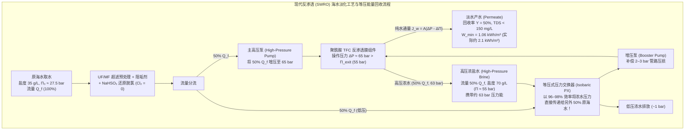

## 引言：从盐腌黄瓜到全球水危机——“渗透”背后的无形巨力

在切薄的黄瓜片上撒一把盐，几分钟内植物细胞中的水分就会渗出；向鼻涕虫（蛞蝓）撒盐，其体内水分会迅速流失而萎缩。在临床医学中，如果医护人员误将纯水（蒸馏水）而非<strong>生理盐水（$0.9\,\text{wt}\%$ $\text{NaCl}$ 溶液）</strong>大量输入患者静脉，红细胞会因疯狂吸水而膨胀破裂，引发致命的<strong>溶血（Hemolysis）</strong>。相反，海难幸存者若饮用海水止渴，为了排出高浓度的海盐，肾脏被迫从体内细胞抽取比所饮海水更多的水分，反而加速脱水死亡。

支配这些日常现象与生命底线的物理过程正是<strong>渗透（Osmosis）</strong>，衡量其热力学驱动力大小的物理量则是<strong>渗透压（Osmotic Pressure, $\Pi$）</strong>。标准海水（含盐量约 $35\,\text{g/L}$）的渗透压高达 <strong>$27\sim 28\,\text{atm}$（约 $2.75\,\text{MPa}$ 或 $27.5\,\text{bar}$）</strong>，相当于<strong>水深 $280\,\text{m}$ 处的深海静水压力</strong>！现代人类通过向海水施加 $55\sim 80\,\text{bar}$ 的超高液压，利用<strong>反渗透（Reverse Osmosis, RO）</strong>技术逆转自然渗透方向，每天在世界各地生产超过1亿立方米的淡水。本文将从统计力学与物理化学出发，彻底揭示跨膜水输运的科学本质。

---

## 第一章：打破“水浓度梯度扩散”的素朴迷思——化学势 $\mu_w$ 与混合熵的统计力学

### 1.1 为什么“水从高浓度向低浓度简单扩散”的解释是错误的？

许多中学和入门教材将渗透解释为：“纯水一侧单位体积内的水分子数（水的体积浓度 $c_w$）高于盐水一侧，因此水分子顺着自身的体积浓度梯度发生菲克扩散（Fickian diffusion）。”这一说法在物理化学上是<strong>根本不准确的</strong>：

1. <strong>单位体积水分子密度 $c_w$ 并不能决定渗透方向</strong>：溶质溶解时的偏摩尔体积 $\bar{V}_s$ 与电致伸缩效应各不相同。在许多高分子溶液或混合溶剂体系中，即便两侧单位体积内的水质量浓度相等甚至倒置，水依然会严格按照<strong>水的摩尔分数 $x_w$ 与活度 $a_w = \gamma_w x_w$</strong> 的梯度流动。
2. <strong>单纯的浓度扩散无法解释静水压 $\Delta P$ 对流动的完全阻断与逆转</strong>：液态水几乎不可压缩（等温压缩率 $\kappa_T \approx 4.5 \times 10^{-5}\,\text{bar}^{-1}$），施加 $27.5\,\text{bar}$ 的静水压仅使水密度增加 $0.12\%$，根本不足以抹平体积浓度差。然而在实验中，施加 $\Delta P = \Pi$ 即可使跨膜净水通量精确归零，$\Delta P > \Pi$ 则直接逆转水流。
3. <strong>多孔半透膜中的渗透具有协同粘性流（Hydraulic flow）特征</strong>，且平衡渗透压 $\Pi$ 是与膜材质、厚度和孔径无关的<strong>依数性（Colligative property）</strong>。

### 1.2 吉布斯化学势 $\mu_w$ 与混合熵 $\Delta S_{\text{mix}}$

根据吉布斯（J. Willard Gibbs）建立的化学热力学，在恒温 $T$、恒压 $P$ 下，决定组分 $i$ 自发迁移方向的唯一判据是其<strong>化学势（Chemical Potential，即偏摩尔吉布斯自由能）</strong>：

$$\mu_i \equiv \left( \frac{\partial G}{\partial n_i} \right)_{T, P, n_{j \neq i}}$$

溶液中水（溶剂 $w$）的化学势 $\mu_w(T, P, x_w)$ 可表示为基准压力 $P_0$ 下纯水化学势 $\mu_w^*(T, P_0)$、压力做功项与活度对数项之和：

$$\mu_w(T, P, x_w) = \mu_w^*(T, P_0) + \int_{P_0}^{P} \bar{V}_w \, dP' + R T \ln(\gamma_w x_w)$$

其中 $\bar{V}_w \approx 18.07\,\text{cm}^3/\text{mol}$ 为水的偏摩尔体积，$R = 8.3145\,\text{J}/(\text{K}\cdot\text{mol})$ 为摩尔气体常数，$a_w = \gamma_w x_w$ 为水的活度，$x_w = \frac{n_w}{n_w + \sum \nu_k n_k} = 1 - x_s$ 为水的摩尔分数。当同处于大气压 $P_0$ 时，纯水一侧 $x_w = 1, \ln a_w = 0$；而在含有非挥发性溶质的溶液一侧，由于 $x_w < 1$，必有 $RT \ln(\gamma_w x_w) < 0$。因此，<strong>常压下溶液中水的化学势必然低于纯水</strong>：

$$\Delta \mu_w = \mu_w(\text{溶液}, T, P_0) - \mu_w^*(\text{纯水}, T, P_0) = R T \ln(\gamma_w x_w) < 0$$

在理想溶液（混合焓 $\Delta H_{\text{mix}} = 0, \gamma_w = 1$）中，水化学势的降低完全源于统计力学中的<strong>混合熵（Entropy of Mixing）</strong>：

$$\Delta S_{\text{mix}} = -R \left( n_w \ln x_w + \sum_k n_k \ln x_k \right) > 0 \implies \Delta \bar{S}_w = \left( \frac{\partial \Delta S_{\text{mix}}}{\partial n_w} \right)_{T,P,n_s} = -R \ln x_w > 0$$

由于半透膜阻挡了溶质离子向纯水侧扩散，为了使整个宇宙的配置微观状态数 $W$（混合熵 $S = k_B \ln W$）最大化，纯水侧的水分子只能主动穿过半透膜涌入盐水侧去稀释溶质，从而降低系统的总吉布斯自由能 $G = H - TS$。

### 1.3 德拜-克莱默（Debye–Kramer）分子运动论机制：膜界面的局域溶剂压降

从微观力学来看，彼得·德拜（Peter Debye, 1923）、曼宁（Gerald Manning）和克莱默（Eric Kramer）证明：半透膜对溶质粒子施加了一个排斥势垒 $U_s(z)$。当处于热布朗运动中的溶质粒子靠近膜表面并被势垒反射回溶液内部时，溶质通过粘性流体力学耦合拖拽周围的水分子，在紧贴膜孔入口的排斥边界层内产生了力平衡：

$$\frac{dP_{\text{solvent}}(z)}{dz} + c_s(z) \frac{dU_s(z)}{dz} = 0 \implies P_{\text{solvent}}(0^+) = P_0 - c_s^{\text{bulk}} R T = P_0 - \Pi$$

```mermaid
flowchart TD
    subgraph S1["1. 正向渗透 (Forward Osmosis): ΔP = 0 < Π"]
        L1["纯水侧 (Pure Water)<br/>压力 P₀, 摩尔分数 x_w = 1<br/>化学势 μ_w(L) = μ_w*"]
        M1["半透膜 (Semi-permeable Membrane)<br/>反射溶质粒子产生动量转移<br/>膜界面局域水压降至 P₀ - Π"]
        R1["盐水侧 (Saline Solution)<br/>压力 P₀, 摩尔分数 x_w < 1<br/>μ_w(R) = μ_w* + RT ln(γ_w x_w) < μ_w*"]
        L1 -->|"自发水通量 (Δμ_w > 0)<br/>由混合熵与孔口吸力驱动"| M1 --> R1
    end

    subgraph S2["2. 渗透平衡 (Osmotic Equilibrium): ΔP = Π"]
        L2["纯水侧 (Pure Water)<br/>压力 P₀, μ_w(L) = μ_w*"]
        M2["半透膜 (Semi-permeable Membrane)<br/>两侧孔口水压相等 (P₀ = P₀)<br/>净水通量 J_w = 0"]
        R2["盐水侧 (Saline Solution)<br/>施加外压 P₀ + Π<br/>μ_w(R) = μ_w* + V_w Π + RT ln(γ_w x_w) = μ_w*"]
        L2 <-->|"热力学平衡 (Δμ_w = 0)<br/>Π = -(RT / V_w) ln(γ_w x_w) ≈ iMRT"| M2 <--> R2
    end

    subgraph S3["3. 反渗透淡化 (Reverse Osmosis): ΔP > Π (海水 55–80 bar)"]
        L3["淡水产水侧 (Permeate)<br/>压力 P₀, 纯水 μ_w(L) = μ_w*"]
        M3["聚酰胺 TFC 反渗透膜<br/>溶解-扩散模型输运:<br/>水通量 J_w = A(ΔP - ΔΠ)"]
        R3["高压海水浓水侧 (High-Pressure Brine)<br/>高压泵施加 P₀ + ΔP (ΔP > Π)<br/>μ_w(R) = μ_w* + V_w(ΔP - Π) > μ_w*"]
        R3 -->|"化学势逆转: μ_w(R) > μ_w(L)<br/>从浓盐水中挤出纯水！"| M3 --> L3
    end
```

换言之，溶质粒子在半透膜表面的热碰撞反射，导致<strong>溶液侧膜孔入口处纯溶剂（水）的局域机械静水压骤降至 $P_0 - \Pi$（产生局域负压/吸力）</strong>！膜孔左侧纯水压力为 $P_0$，右侧孔口水压为 $P_0 - \Pi$，这一机械压差 $\Delta P_{\text{pore}} = \Pi$ 直接把纯水抽吸进溶液侧。

---

## 第二章：范特霍夫定律（1887）的严格推导与海水渗透压定量计算

### 2.1 从化学势平衡逐步推导范特霍夫方程

1887年，荷兰物理化学家雅各布斯·亨里克斯·范特霍夫（Jacobus Henricus van 't Hoff，<strong>1901年首届诺贝尔化学奖得主</strong>）基于普费弗（Wilhelm Pfeffer）的亚铁氰化铜（$\text{Cu}_2[\text{Fe(CN)}_6]$）半透膜实验数据，发现了稀溶液渗透压与理想气体状态方程的深刻统一。下面我们从化学势平衡严格推导该定律：

<strong>第一步：建立跨膜热力学平衡方程</strong>
设半透膜左侧（$L$）为压力 $P_0$ 下的纯水（$x_w = 1, \gamma_w = 1$），右侧（$R$）为施加了附加静水压 $\Pi$（总压力 $P_0 + \Pi$）的溶液。平衡时两侧水的化学势相等：

$$\mu_w^{(L)}(T, P_0, x_w=1) = \mu_w^*(T, P_0) = \mu_w^{(R)}(T, P_0 + \Pi, x_w) = \mu_w^*(T, P_0) + \bar{V}_w \Pi + R T \ln(\gamma_w x_w)$$

<strong>第二步：导出精确热力学渗透压公式</strong>
消去 $\mu_w^*(T, P_0)$，得到适用于任意浓度的精确热力学渗透压方程：

$$\Pi = -\frac{R T}{\bar{V}_w} \ln(\gamma_w x_w) = -\frac{R T}{\bar{V}_w} \ln a_w$$

<strong>第三步：稀溶液近似与泰勒展开</strong>
在稀溶液中，$\gamma_w \to 1$，设考虑电离后的溶质有效总摩尔数为 $n_s^{\text{eff}} = i n_s$（$i$ 为<strong>范特霍夫因子</strong>），溶质摩尔分数 $x_s = 1 - x_w = \frac{i n_s}{n_w + i n_s} \ll 1$。对 $\ln x_w = \ln(1 - x_s)$ 进行泰勒展开并取一阶项：

$$\ln x_w = \ln(1 - x_s) = -x_s - \frac{1}{2}x_s^2 - \cdots \approx -x_s \approx -\frac{i n_s}{n_w}$$

<strong>第四步：代入溶液体积 $V \approx n_w \bar{V}_w$ 导出范特霍夫定律</strong>
将 $\ln(\gamma_w x_w) \approx -\frac{i n_s}{n_w}$ 代入 $\Pi$ 表达式，并利用稀溶液总体积 $V \approx n_w \bar{V}_w$ 及溶质摩尔浓度（Molarity）$M \equiv \frac{n_s}{V}$：

$$\Pi \approx \frac{R T}{\bar{V}_w} \frac{i n_s}{n_w} = \frac{i n_s R T}{n_w \bar{V}_w} \approx i \left(\frac{n_s}{V}\right) R T = i M R T$$

### 2.2 标准海水（$35\,\text{g/L}$ $\text{NaCl}$）渗透压的精确计算

以标准海水（含盐量 $35\,\text{g/L}$，温度 $T = 298.15\,\text{K} = 25\,^\circ\text{C}$）为例：
- 摩尔浓度：$M = \frac{35\,\text{g/L}}{58.44\,\text{g/mol}} \approx 0.60\,\text{mol/L}$。
- 范特霍夫因子：$\text{NaCl}$ 电离为 $\nu = 2$ 个离子（$\text{Na}^+$ 和 $\text{Cl}^-$），在 $0.60\,\text{mol/L}$ 离子强度下，离子间德拜-休克尔（Debye–Hückel）静电屏蔽效应使渗透系数 $\phi \approx 0.925$，故有效范特霍夫因子 $i = \phi \nu \approx 2 \times 0.925 = 1.85$（总渗透摩尔浓度 $\text{Osmolarity} = i M \approx 1.11\,\text{Osm/L}$）。
- 渗透压计算（取 $R = 0.082057\,\text{L}\cdot\text{atm}/(\text{K}\cdot\text{mol})$）：

$$\Pi = i M R T = 1.85 \times 0.60\,\text{mol/L} \times 0.082057\,\text{L}\cdot\text{atm}/(\text{K}\cdot\text{mol}) \times 298.15\,\text{K} \approx 27.16\,\text{atm} \approx 2.75\,\text{MPa}\,(27.5\,\text{bar})$$

- 等效水柱高度：$h = \frac{\Pi}{\rho g} = \frac{2.752 \times 10^6\,\text{Pa}}{1,000\,\text{kg/m}^3 \times 9.80665\,\text{m/s}^2} \approx 280.6\,\text{m}$。即标准海水的渗透压相当于<strong>$280\,\text{m}$ 高的巨型水柱</strong>！由于人类肾脏浓缩尿液的极限约为 $1,200\,\text{mOsm/L}$（扣除尿素后仅能排出约 $600\,\text{mOsm/L}$ 的盐分），饮用 $1\,\text{L}$ 海水（$1,110\,\text{mOsm}$）需要排泄约 $1.8\,\text{L}$ 尿液，导致净流失 $0.8\,\text{L}$ 细胞内水而致命。

---

## 第三章：生物物理学中的渗透——水通道蛋白（AQP1）、红细胞张力、斯塔林方程与植物膨压

### 3.1 彼得·阿格雷与水通道蛋白（Aquaporin, AQP1）的分子选别奇迹

磷脂双分子层的疏水核心对水分子的简单扩散具有较高的活化能垒（$E_a \approx 40\sim 60\,\text{kJ/mol}$）。1992年，彼得·阿格雷（Peter Agre，<strong>2003年诺贝尔化学奖得主</strong>）发现了红细胞与肾小管膜上的<strong>水通道蛋白 AQP1</strong>。
- <strong>$2.8\,\text{\AA}$ 沙漏状孔道与 $\text{ar/R}$ 空间位阻筛</strong>：AQP1 通道最窄处（芳香族/精氨酸 $\text{ar/R}$ 滤器）直径仅为 <strong>$2.8\,\text{\AA}$（$0.28\,\text{nm}$）</strong>，与单个水分子的范德华直径（$2.75\,\text{\AA}$）几乎相同。水分子以<strong>单列纵队（Single-file）</strong>方式穿过，活化能降至 $15\,\text{kJ/mol}$，每个通道每秒可高速输运 <strong>$3 \times 10^9$ 个水分子</strong>，同时彻底阻挡水合离子。
- <strong>NPA 基序偶极翻转与格罗特斯（Grotthuss）质子线阻断</strong>：单列氢键水链本会通过格罗特斯质子跳跃机制形成超高速“质子导线”，导致细胞膜电位与 $\Delta \text{pH}$ 崩溃。AQP1 在孔道中央布置了两个保守的<strong>NPA 基序（天冬酰胺-脯氨酸-丙氨酸）</strong>以及半跨膜螺旋正电偶极场。天冬酰胺的 $-\text{NH}_2$ 基团与水分子的氧原子形成氢键，迫使水分子在经过通道中心时发生<strong>$180^\circ$ 电偶极矩翻转（Dipole flip）</strong>，彻底打断氢键网络链路，从而在每秒放行30亿个水分子的同时，不让一个 $\text{H}_3\text{O}^+$（质子）漏过！

### 3.2 红细胞张力（Tonicity）、斯塔林方程（Starling's Equation）与植物膨压

1. <strong>红细胞张力（Tonicity）</strong>：人血浆渗透浓度约为 $290\,\text{mOsm/L}$（$\Pi \approx 7.6\,\text{atm}$）。在<strong>等渗等张液</strong>（$0.9\,\text{wt}\%$ $\text{NaCl}$）中，$\Delta \mu_w = 0$，红细胞保持双凹圆盘状；在<strong>高张液</strong>（海水或浓盐水）中，红细胞失水皱缩（<strong>棘形红细胞化 Crenation</strong>）；在<strong>低张液</strong>（纯水，或可自由穿透细胞膜、反射系数 $\sigma \approx 0$ 的等渗尿素溶液）中，水涌入细胞导致膨胀破裂（<strong>溶血 Hemolysis</strong>）。
2. <strong>毛细血管中的斯塔林方程（1896）与胶体渗透压</strong>：
   毛细血管内皮允许小分子无机盐自由透过（$\sigma \approx 0$），但截留分子量 $66.5\,\text{kDa}$ 的<strong>血浆白蛋白（Albumin）</strong>。白蛋白产生的<strong>胶体渗透压（Oncotic pressure, $\pi_c \approx 25\sim 28\,\text{mmHg}$，含吉布斯-唐南效应加成）</strong>与静水压共同决定跨血管液流 $J_v$：
   $$J_v = L_p S \left[ (P_c - P_i) - \sigma (\pi_c - \pi_i) \right]$$
   动脉端血压高（$P_c \approx 35\,\text{mmHg} > \sigma \Delta \pi$），发生超滤出血管（$J_v > 0$）；静脉端血压低（$P_c \approx 15\,\text{mmHg} < \sigma \Delta \pi$），胶体渗透压将组织液重吸收回血管（$J_v < 0$）。肝硬化、肾病综合征或重度营养不良导致低白蛋白血症（$\pi_c$ 下降）时，水分滞留组织间隙引发<strong>水肿（Edema）与腹水（Ascites）</strong>。
3. <strong>植物水势 $\Psi_w$ 与膨压（Turgor Pressure）</strong>：
   植物细胞的水势定义为 $\Psi_w = \frac{\mu_w - \mu_w^*}{\bar{V}_w} = \Psi_s + \Psi_p + \Psi_g + \Psi_m$。液泡积累溶质产生负的溶质势 $\Psi_s = -\Pi \approx -1.0\sim -1.5\,\text{MPa}$，吸水后刚性纤维素细胞壁产生高达 <strong>$+0.8\sim +1.5\,\text{MPa}$（汽车轮胎气压的4～6倍）的膨压 $\Psi_p$</strong>，支撑草本植物直立生长与气孔开闭；在高盐干旱土壤中则发生<strong>质壁分离（Plasmolysis）</strong>。

| 膜与分离系统类型 | 特征孔径 / 自由体积尺寸 | 核心传输与选择性机制 | 水透过系数 / 传输速率 | 截留的目标物质 | 典型操作压力 / 渗透压差 |
| :--- | :--- | :--- | :--- | :--- | :--- |
| <strong>生物水通道蛋白 (AQP1)</strong> | $0.28\,\text{nm}$ ($2.8\,\text{\AA}$) 沙漏通道 | $\text{ar/R}$ 位阻筛 + NPA 偶极翻转 + 静电排斥 | $\sim 3 \times 10^9$ 水分子/秒/通道 | 所有水合离子、质子 ($\text{H}_3\text{O}^+$)、尿素 | 生理渗透压差 (数 $\text{mmHg}$ 至数十 $\text{bar}$) |
| <strong>毛细血管内皮 (糖萼层)</strong> | $4\sim 5\,\text{nm}$ 细胞间隙 | 分子尺寸筛分 + 负电荷唐南排斥 | 遵循斯塔林方程 ($L_p$) | 白蛋白 ($66.5\,\text{kDa}$)、球蛋白、血细胞 | 血压 $15\sim 35\,\text{mmHg}$ vs 胶体渗透压 $28\,\text{mmHg}$ |
| <strong>微滤 (MF) / 超滤 (UF)</strong> | MF: $100\sim 1,000\,\text{nm}$ UF: $2\sim 100\,\text{nm}$ | 物理微孔筛分与泊肃叶对流 (Pore-flow) | $50\sim 500\,\text{L}/(\text{m}^2\cdot\text{h}\cdot\text{bar})$ | 细菌、病毒 (UF)、胶体、大分子蛋白质 | $0.2\sim 5\,\text{bar}$ |
| <strong>纳滤膜 (NF)</strong> | $0.5\sim 2.0\,\text{nm}$ | 纳米孔受阻扩散 + 强唐南多价离子静电排斥 | $5\sim 20\,\text{L}/(\text{m}^2\cdot\text{h}\cdot\text{bar})$ | 二价离子 ($\text{Mg}^{2+}, \text{Ca}^{2+}, \text{SO}_4^{2-}$)、小分子有机物 | $5\sim 20\,\text{bar}$ |
| <strong>反渗透膜 (聚酰胺 TFC RO)</strong> | 无固定孔 ($0.2\sim 0.5\,\text{nm}$ 瞬态热自由体积) | <strong>溶解-扩散模型</strong> + 水合壳脱水能垒与介电排斥 | $1\sim 2\,\text{L}/(\text{m}^2\cdot\text{h}\cdot\text{bar})$ (海水SWRO) | 一价盐离子 ($\text{Na}^+, \text{Cl}^-$ 截留率 $>99.8\%$) | <strong>$55\sim 80\,\text{bar}$</strong> (海水淡化) |

---

## 第四章：反渗透（RO）海水淡化——聚酰胺复合膜（TFC）与“溶解-扩散模型”

### 4.1 液压逆转化学势（$\Delta P > \Pi$）与界面聚合 TFC 膜

当在海水侧施加大于渗透压的静水压 $\Delta P > \Pi$（海水淡化中为克服 $50\%$ 回收率下的浓缩渗透压 $55\,\text{bar}$，需施加 <strong>$55\sim 80\,\text{bar}$</strong> 高压）时，盐水侧水的化学势被抬升至纯水之上（$\Delta \mu_w = \bar{V}_w(\Delta P - \Pi) > 0$），纯水被反向挤压出浓盐水。

继1960年洛布与苏里拉金（Loeb & Sourirajan）发明非对称醋酸纤维素膜后，约翰·卡多特（John Cadotte）在1970年代末发明了<strong>界面聚合（Interfacial Polymerization）制备的聚酰胺薄层复合膜（TFC）</strong>：在多孔聚砜（PSf）支撑层上，使水相中的<strong>间苯二胺（MPD）</strong>与有机相中的<strong>均苯三甲酰氯（TMC）</strong>在界面处瞬间缩聚，形成仅 <strong>$100\sim 200\,\text{nm}$</strong> 厚的交联芳香族聚酰胺致密活性层。

### 4.2 溶解-扩散模型（Solution-Diffusion Model）、水合半径与硼（Boron）穿透之谜

RO 膜绝非带有固定筛孔的机械筛网（裸 $\text{Na}^+$ 晶体半径仅 $0.95\,\text{\AA}$，比水分子半径 $1.38\,\text{\AA}$ 更小！）。根据威杰曼斯与贝克（Wijmans & Baker, 1995）建立的<strong>溶解-扩散模型</strong>，水与盐均需先溶解（分配）进入无孔聚酰胺高分子相，再借高分子链热涨落产生的瞬态自由体积扩散过膜：
- <strong>水通量方程</strong>：$J_w = A (\Delta P - \Delta \Pi)$，其中 $A = \frac{D_w K_w c_w \bar{V}_w}{\delta R T}$ 为水渗透系数，水通量与有效净驱动压 $(\Delta P - \Delta \Pi)$ 成正比。
- <strong>盐通量方程</strong>：$J_s = B (C_m - C_p)$，其中 $B = \frac{D_s K_s}{\delta}$ 为盐渗透系数。盐通量仅取决于膜两侧浓度差，与操作压力 $\Delta P$ 无关！因此表观截盐率 $R_s = 1 - \frac{C_p}{C_m} = \frac{A(\Delta P - \Delta \Pi)}{A(\Delta P - \Delta \Pi) + B}$ 随压力升高而趋近 $100\%$。
- <strong>脱水能垒与硼酸问题</strong>：水中的 $\text{Na}^+$ 和 $\text{Cl}^-$ 被强静电场束缚的<strong>水合壳（Hydration shell）</strong>包裹，其水合半径分别高达 <strong>$r_{\text{hyd}}(\text{Na}^+) \approx 3.58\,\text{\AA}$</strong>（水合自由能 $-365\,\text{kJ/mol}$）和 <strong>$r_{\text{hyd}}(\text{Cl}^-) \approx 3.32\,\text{\AA}$</strong>，远大于水分子（$1.38\,\text{\AA}$）。进入低介电常数的聚酰胺膜需克服巨大的<strong>脱水能垒（Dehydration energy barrier）</strong>与玻恩介电排斥（Born dielectric exclusion）。然而，海水中的硼在天然 $\text{pH} \approx 8.0$ 下以不带电的中性<strong>硼酸分子 $\text{B(OH)}_3$</strong>（$\text{p}K_a \approx 9.2$）形式存在，既无电荷排斥也无强水合壳，且能与聚酰胺形成氢键而轻易溶解穿透（一级RO截留率仅 $40\sim 70\%$），工程上必须在二级RO前投加 $\text{NaOH}$ 将 $\text{pH}$ 调至 $>10$，使其转化为带负电的水合<strong>四羟基硼酸根离子 $\text{B(OH)}_4^-$</strong> 才能高效截留。

---

## 第五章：海水淡化的热力学最小比能耗、压力交换器（PX）、浓差极化与膜污染

### 5.1 热力学最小分离功 $W_{\min} \approx 1.06\,\text{kWh/m}^3$ 的严格积分推导

设初始海水渗透压为 $\Pi_0 \approx 2.75\,\text{MPa}$，当淡水回收率为 $Y = V_p / V_f$ 时，任意中间回收阶段 $y \in [0, Y]$ 的浓海水渗透压为 $\Pi(y) = \frac{\Pi_0}{1 - y}$。生产单位体积（$1\,\text{m}^3$）淡水的可逆等温最小比能耗 $w_{\min}(Y)$ 为：

$$w_{\min}(Y) = \frac{1}{Y} \int_0^Y \Pi(y)\,dy = \frac{\Pi_0}{Y} \int_0^Y \frac{dy}{1 - y} = \Pi_0 \frac{\ln\left(\frac{1}{1 - Y}\right)}{Y}$$

- 在无限小回收极限 $Y \to 0$ 时：$w_{\min}(0) = \Pi_0 = 2.75\,\text{MJ/m}^3 \approx 0.764\,\text{kWh/m}^3$。
- 在工业标准回收率 <strong>$Y = 50\%$（$Y = 0.50$）</strong> 时：

$$w_{\min}(Y = 0.50) = 2.75\,\text{MPa} \times \frac{\ln 2}{0.50} = 3.812\,\text{MJ/m}^3 = \frac{3.812 \times 10^6\,\text{J/m}^3}{3.6 \times 10^6\,\text{J/kWh}} \approx 1.06\,\text{kWh/m}^3$$

相比之下，将水蒸发为蒸汽的汽化潜热高达 <strong>$\sim 650\,\text{kWh/m}^3$</strong>（是RO理论极限的600倍以上！）。依靠<strong>等压式压力交换器（Isobaric Pressure Exchanger, PX）</strong>以 <strong>$96\sim 98\%$</strong> 的效率直接回收 $50\%$ 排放浓盐水所携带的 $63\,\text{bar}$ 压力能，现代 SWRO 工厂的反渗透核心能耗已降至 <strong>$2.0\sim 2.5\,\text{kWh/m}^3$</strong>。

| 淡化技术路线 | 分离物理化学原理 | 理论最小能耗 ($Y=50\%$) | 实际工厂折合电耗 | 运行工况 | 核心优势与工程瓶颈 |
| :--- | :--- | :--- | :--- | :--- | :--- |
| <strong>单效蒸发 (相变基准)</strong> | 气液相变 (打断全部水分子间氢键) | $\sim 650\,\text{kWh/m}^3$ (汽化潜热) | $>650\,\text{kWh/m}^3$ | $100\,^\circ\text{C}$, $1\,\text{bar}$ | 能耗极高，无实用价值 |
| <strong>多级闪蒸 (MSF) / 多效蒸馏 (MED)</strong> | 多级减压沸腾与潜热循环回收 | $1.06\,\text{kWh/m}^3$ | <strong>$7\sim 18\,\text{kWh/m}^3$</strong> | $60\sim 110\,^\circ\text{C}$ | 耐高盐高浊原水，但热折合能耗远高于膜法 |
| <strong>反渗透法 (SWRO + 等压 PX)</strong> | <strong>聚酰胺 TFC 溶解-扩散 + 高压化学势逆转</strong> | <strong>$1.06\,\text{kWh/m}^3$</strong> ($Y\to 0$ 为 $0.76\,\text{kWh/m}^3$) | RO核心: <strong>$2.0\sim 2.5\,\text{kWh/m}^3$</strong> 全厂: $3.0\sim 3.5\,\text{kWh/m}^3$ | 常温, <strong>$55\sim 80\,\text{bar}$</strong> | <strong>能耗最低（占全球产能约70%）</strong>，受制于浓差极化与生物污染 |

### 5.2 浓差极化（Concentration Polarization）与膜生物污染（Biofouling）悖论

1. <strong>浓差极化（CP）</strong>：被膜截留的盐离子在膜表面厚度为 $\delta_b$ 的停滞边界层内富集。由对流输运与反向菲克扩散平衡 $J_w C(x) - D_s \frac{dC}{dx} = J_w C_p$ 积分可得薄膜理论公式：
   $$\frac{C_m - C_p}{C_b - C_p} = \exp\left(\frac{J_w}{k_m}\right), \qquad k_m = \frac{D_s}{\delta_b}$$
   膜表面盐浓度 $C_m$ 随水通量 $J_w$ 呈指数级升高，既增大局域渗透压 $\Pi(C_m)$ 削弱净驱动力，又加剧盐穿透并诱发无机结垢（$\text{CaCO}_3, \text{CaSO}_4, \text{SiO}_2$）。
2. <strong>膜污染与聚酰胺不耐氯悖论</strong>：聚酰胺 TFC 膜中的芳香酰胺键（$-\text{CONH}-$）极易遭受游离氯（$\text{HOCl}/\text{OCl}^-$）的<strong>亲电 N-氯化与奥顿重排（Orton rearrangement）</strong>氧化降解，暴露于 $1,000\sim 2,000\,\text{ppm}\cdot\text{h}$ 余氯即彻底丧失脱盐能力。因此海水进入 RO 膜前必须投加亚硫酸氢钠（$\text{NaHSO}_3$）彻底脱氯，导致残存细菌在无氯膜面上分泌胞外聚合物（EPS）形成顽固的<strong>生物膜污染（Biofouling）</strong>。当前，仿生水通道蛋白膜、碳纳米管（CNT）、氧化石墨烯（GO）与耐氯两性离子聚合物改性膜正引领下一代海水淡化技术革命。
