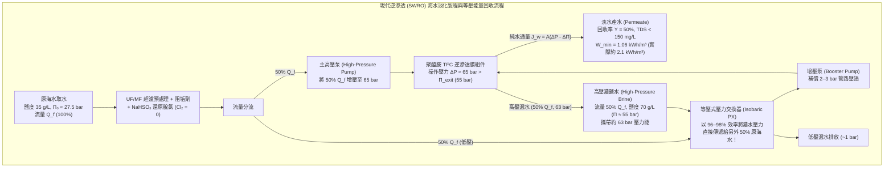

## 引言：從鹽醃小黃瓜到全球水危機——「滲透」背後的無形巨力

在切薄的小黃瓜片上撒一把鹽，幾分鐘內植物組織中的水分就會滲出；向蛞蝓撒鹽，其體內水分會迅速流失而萎縮。在臨床醫學中，若醫護人員誤將純水（蒸餾水）而非<strong>生理食鹽水（$0.9\,\text{wt}\%$ $\text{NaCl}$ 溶液）</strong>大量注入患者靜脈，紅血球會因猛烈吸水而膨脹破裂，引發致命的<strong>溶血（Hemolysis）</strong>。相反地，海難受困者若飲用海水止渴，為了排出高濃度的海鹽，腎臟被迫從體內細胞抽取比所飲海水更多的水分，反而加速脫水死亡。

支配這些日常現象與生命底線的物理過程正是<strong>滲透（Osmosis）</strong>，衡量其熱力學驅動力大小的物理量則是<strong>滲透壓（Osmotic Pressure, $\Pi$）</strong>。標準海水（含鹽量約 $35\,\text{g/L}$）的滲透壓高達 <strong>$27\sim 28\,\text{atm}$（約 $2.75\,\text{MPa}$ 或 $27.5\,\text{bar}$）</strong>，相當於<strong>水深 $280\,\text{m}$ 處的深海靜水壓力</strong>！現代人類透過向海水施加 $55\sim 80\,\text{bar}$ 的超高液壓，利用<strong>逆滲透（Reverse Osmosis, RO）</strong>技術逆轉自然滲透方向，每天在世界各地生產超過1億立方公尺的淡水。本文將從統計力學與物理化學出發，徹底揭示跨膜水輸運的科學本質。

---

## 第一章：打破「水濃度梯度擴散」的素樸迷思——化學勢 $\mu_w$ 與混合熵的統計力學

### 1.1 為什麼「水從高濃度向低濃度簡單擴散」的解釋是錯誤的？

許多中學與入門教材將滲透解釋為：「純水一側單位體積內的水分子數（水的體積濃度 $c_w$）高於鹽水一側，因此水分子順著自身的體積濃度梯度發生菲克擴散（Fickian diffusion）。」這一說法在物理化學上是<strong>根本不準確的</strong>：

1. <strong>單位體積水分子密度 $c_w$ 並不能決定滲透方向</strong>：溶質溶解時的偏莫耳體積 $\bar{V}_s$ 與電致伸縮效應各不相同。在許多高分子溶液或混合溶劑體系中，即便兩側單位體積內的水質量濃度相等甚至倒置，水依然會嚴格按照<strong>水的莫耳分率 $x_w$ 與活度 $a_w = \gamma_w x_w$</strong> 的梯度流動。
2. <strong>單純的濃度擴散無法解釋靜水壓 $\Delta P$ 對流動的完全阻斷與逆轉</strong>：液態水幾乎不可壓縮（等溫壓縮率 $\kappa_T \approx 4.5 \times 10^{-5}\,\text{bar}^{-1}$），施加 $27.5\,\text{bar}$ 的靜水壓僅使水密度增加 $0.12\%$，根本不足以抹平體積濃度差。然而在實驗中，施加 $\Delta P = \Pi$ 即可使跨膜淨水通量精確歸零，$\Delta P > \Pi$ 則直接逆轉水流。
3. <strong>多孔半透膜中的滲透具有協同黏性流（Hydraulic flow）特徵</strong>，且平衡滲透壓 $\Pi$ 是與膜材質、厚度和孔徑無關的<strong>依數性（Colligative property）</strong>。

### 1.2 吉布斯化學勢 $\mu_w$ 與混合熵 $\Delta S_{\text{mix}}$

根據吉布斯（J. Willard Gibbs）建立的化學熱力學，在恆溫 $T$、恆壓 $P$ 下，決定成分 $i$ 自發遷移方向的唯一判據是其<strong>化學勢（Chemical Potential，即偏莫耳吉布斯自由能）</strong>：

$$\mu_i \equiv \left( \frac{\partial G}{\partial n_i} \right)_{T, P, n_{j \neq i}}$$

溶液中水（溶劑 $w$）的化學勢 $\mu_w(T, P, x_w)$ 可表示為基準壓力 $P_0$ 下純水化學勢 $\mu_w^*(T, P_0)$、壓力做功項與活度對數項之和：

$$\mu_w(T, P, x_w) = \mu_w^*(T, P_0) + \int_{P_0}^{P} \bar{V}_w \, dP' + R T \ln(\gamma_w x_w)$$

其中 $\bar{V}_w \approx 18.07\,\text{cm}^3/\text{mol}$ 為水的偏莫耳體積，$R = 8.3145\,\text{J}/(\text{K}\cdot\text{mol})$ 為莫耳氣體常數，$a_w = \gamma_w x_w$ 為水的活度，$x_w = \frac{n_w}{n_w + \sum \nu_k n_k} = 1 - x_s$ 為水的莫耳分率。當同處於大氣壓 $P_0$ 時，純水一側 $x_w = 1, \ln a_w = 0$；而在含有非揮發性溶質的溶液一側，由於 $x_w < 1$，必有 $RT \ln(\gamma_w x_w) < 0$。因此，<strong>常壓下溶液中水的化學勢必然低於純水</strong>：

$$\Delta \mu_w = \mu_w(\text{溶液}, T, P_0) - \mu_w^*(\text{純水}, T, P_0) = R T \ln(\gamma_w x_w) < 0$$

在理想溶液（混合焓 $\Delta H_{\text{mix}} = 0, \gamma_w = 1$）中，水化學勢的降低完全源於統計力學中的<strong>混合熵（Entropy of Mixing）</strong>：

$$\Delta S_{\text{mix}} = -R \left( n_w \ln x_w + \sum_k n_k \ln x_k \right) > 0 \implies \Delta \bar{S}_w = \left( \frac{\partial \Delta S_{\text{mix}}}{\partial n_w} \right)_{T,P,n_s} = -R \ln x_w > 0$$

由於半透膜阻擋了溶質離子向純水側擴散，為了使整個宇宙的配置微觀狀態數 $W$（混合熵 $S = k_B \ln W$）最大化，純水側的水分子只能主動穿過半透膜湧入鹽水側去稀釋溶質，進而降低系統的總吉布斯自由能 $G = H - TS$。

### 1.3 德拜-克萊默（Debye–Kramer）分子運動論機制：膜界面的局域溶劑壓降

從微觀力學來看，彼得·德拜（Peter Debye, 1923）、曼寧（Gerald Manning）與克萊默（Eric Kramer）證明：半透膜對溶質粒子施加了一個排斥勢壘 $U_s(z)$。當處於熱布朗運動中的溶質粒子靠近膜表面並被勢壘反射回溶液內部時，溶質透過黏性流體力學耦合拖拽周圍的水分子，在緊貼膜孔入口的排斥邊界層內產生了力平衡：

$$\frac{dP_{\text{solvent}}(z)}{dz} + c_s(z) \frac{dU_s(z)}{dz} = 0 \implies P_{\text{solvent}}(0^+) = P_0 - c_s^{\text{bulk}} R T = P_0 - \Pi$$

```mermaid
flowchart TD
    subgraph S1["1. 正向滲透 (Forward Osmosis): ΔP = 0 < Π"]
        L1["純水側 (Pure Water)<br/>壓力 P₀, 莫耳分率 x_w = 1<br/>化學勢 μ_w(L) = μ_w*"]
        M1["半透膜 (Semi-permeable Membrane)<br/>反射溶質粒子產生動量轉移<br/>膜界面局域水壓降至 P₀ - Π"]
        R1["鹽水側 (Saline Solution)<br/>壓力 P₀, 莫耳分率 x_w < 1<br/>μ_w(R) = μ_w* + RT ln(γ_w x_w) < μ_w*"]
        L1 -->|"自發水通量 (Δμ_w > 0)<br/>由混合熵與孔口吸力驅動"| M1 --> R1
    end

    subgraph S2["2. 滲透平衡 (Osmotic Equilibrium): ΔP = Π"]
        L2["純水側 (Pure Water)<br/>壓力 P₀, μ_w(L) = μ_w*"]
        M2["半透膜 (Semi-permeable Membrane)<br/>兩側孔口水壓相等 (P₀ = P₀)<br/>淨水通量 J_w = 0"]
        R2["鹽水側 (Saline Solution)<br/>施加外壓 P₀ + Π<br/>μ_w(R) = μ_w* + V_w Π + RT ln(γ_w x_w) = μ_w*"]
        L2 <-->|"熱力學平衡 (Δμ_w = 0)<br/>Π = -(RT / V_w) ln(γ_w x_w) ≈ iMRT"| M2 <--> R2
    end

    subgraph S3["3. 逆滲透淡化 (Reverse Osmosis): ΔP > Π (海水 55–80 bar)"]
        L3["淡水產水側 (Permeate)<br/>壓力 P₀, 純水 μ_w(L) = μ_w*"]
        M3["聚醯胺 TFC 逆滲透膜<br/>溶解-擴散模型輸運:<br/>水通量 J_w = A(ΔP - ΔΠ)"]
        R3["高壓海水濃水側 (High-Pressure Brine)<br/>高壓泵施加 P₀ + ΔP (ΔP > Π)<br/>μ_w(R) = μ_w* + V_w(ΔP - Π) > μ_w*"]
        R3 -->|"化學勢逆轉: μ_w(R) > μ_w(L)<br/>從濃鹽水中擠出純水！"| M3 --> L3
    end
```

換言之，溶質粒子在半透膜表面的熱碰撞反射，導致<strong>溶液側膜孔入口處純溶劑（水）的局域機械靜水壓驟降至 $P_0 - \Pi$（產生局域負壓/吸力）</strong>！膜孔左側純水壓力為 $P_0$，右側孔口水壓為 $P_0 - \Pi$，這一機械壓差 $\Delta P_{\text{pore}} = \Pi$ 直接把純水抽吸進溶液側。

---

## 第二章：范特霍夫定律（1887）的嚴格推導與海水滲透壓定量計算

### 2.1 從化學勢平衡逐步推導范特霍夫方程式

1887年，荷蘭物理化學家雅各布斯·亨里克斯·范特霍夫（Jacobus Henricus van 't Hoff，<strong>1901年首屆諾貝爾化學獎得主</strong>）基於普費弗（Wilhelm Pfeffer）的亞鐵氰化銅（$\text{Cu}_2[\text{Fe(CN)}_6]$）半透膜實驗數據，發現了稀溶液滲透壓與理想氣體狀態方程式的深刻統一。下面我們從化學勢平衡嚴格推導該定律：

<strong>第一步：建立跨膜熱力學平衡方程式</strong>
設半透膜左側（$L$）為壓力 $P_0$ 下的純水（$x_w = 1, \gamma_w = 1$），右側（$R$）為施加了附加靜水壓 $\Pi$（總壓力 $P_0 + \Pi$）的溶液。平衡時兩側水的化學勢相等：

$$\mu_w^{(L)}(T, P_0, x_w=1) = \mu_w^*(T, P_0) = \mu_w^{(R)}(T, P_0 + \Pi, x_w) = \mu_w^*(T, P_0) + \bar{V}_w \Pi + R T \ln(\gamma_w x_w)$$

<strong>第二步：導出精確熱力學滲透壓公式</strong>
消去 $\mu_w^*(T, P_0)$，得到適用於任意濃度的精確熱力學滲透壓方程式：

$$\Pi = -\frac{R T}{\bar{V}_w} \ln(\gamma_w x_w) = -\frac{R T}{\bar{V}_w} \ln a_w$$

<strong>第三步：稀溶液近似與泰勒展開</strong>
在稀溶液中，$\gamma_w \to 1$，設考慮解離後的溶質有效總莫耳數為 $n_s^{\text{eff}} = i n_s$（$i$ 為<strong>范特霍夫因子</strong>），溶質莫耳分率 $x_s = 1 - x_w = \frac{i n_s}{n_w + i n_s} \ll 1$。對 $\ln x_w = \ln(1 - x_s)$ 進行泰勒展開並取一階項：

$$\ln x_w = \ln(1 - x_s) = -x_s - \frac{1}{2}x_s^2 - \cdots \approx -x_s \approx -\frac{i n_s}{n_w}$$

<strong>第四步：代入溶液體積 $V \approx n_w \bar{V}_w$ 導出范特霍夫定律</strong>
將 $\ln(\gamma_w x_w) \approx -\frac{i n_s}{n_w}$ 代入 $\Pi$ 表達式，並利用稀溶液總體積 $V \approx n_w \bar{V}_w$ 及溶質體積莫耳濃度（Molarity）$M \equiv \frac{n_s}{V}$：

$$\Pi \approx \frac{R T}{\bar{V}_w} \frac{i n_s}{n_w} = \frac{i n_s R T}{n_w \bar{V}_w} \approx i \left(\frac{n_s}{V}\right) R T = i M R T$$

### 2.2 標準海水（$35\,\text{g/L}$ $\text{NaCl}$）滲透壓的精確計算

以標準海水（含鹽量 $35\,\text{g/L}$，溫度 $T = 298.15\,\text{K} = 25\,^\circ\text{C}$）為例：
- 體積莫耳濃度：$M = \frac{35\,\text{g/L}}{58.44\,\text{g/mol}} \approx 0.60\,\text{mol/L}$。
- 范特霍夫因子：$\text{NaCl}$ 解離為 $\nu = 2$ 個離子（$\text{Na}^+$ 和 $\text{Cl}^-$），在 $0.60\,\text{mol/L}$ 離子強度下，離子間德拜-休克爾（Debye–Hückel）靜電屏蔽效應使滲透係數 $\phi \approx 0.925$，故有效范特霍夫因子 $i = \phi \nu \approx 2 \times 0.925 = 1.85$（總滲透莫耳濃度 $\text{Osmolarity} = i M \approx 1.11\,\text{Osm/L}$）。
- 滲透壓計算（取 $R = 0.082057\,\text{L}\cdot\text{atm}/(\text{K}\cdot\text{mol})$）：

$$\Pi = i M R T = 1.85 \times 0.60\,\text{mol/L} \times 0.082057\,\text{L}\cdot\text{atm}/(\text{K}\cdot\text{mol}) \times 298.15\,\text{K} \approx 27.16\,\text{atm} \approx 2.75\,\text{MPa}\,(27.5\,\text{bar})$$

- 等效水柱高度：$h = \frac{\Pi}{\rho g} = \frac{2.752 \times 10^6\,\text{Pa}}{1,000\,\text{kg/m}^3 \times 9.80665\,\text{m/s}^2} \approx 280.6\,\text{m}$。即標準海水的滲透壓相當於<strong>$280\,\text{m}$ 高的巨型水柱</strong>！由於人類腎臟濃縮尿液的極限約為 $1,200\,\text{mOsm/L}$（扣除尿素後僅能排出約 $600\,\text{mOsm/L}$ 的鹽分），飲用 $1\,\text{L}$ 海水（$1,110\,\text{mOsm}$）需要排泄約 $1.8\,\text{L}$ 尿液，導致淨流失 $0.8\,\text{L}$ 細胞內水而致命。

---

## 第三章：生物物理學中的滲透——水通道蛋白（AQP1）、紅血球張力、史達林方程式與植物膨壓

### 3.1 彼得·阿格雷與水通道蛋白（Aquaporin, AQP1）的分子選別奇蹟

磷脂雙分子層的疏水核心對水分子的簡單擴散具有較高的活化能壘（$E_a \approx 40\sim 60\,\text{kJ/mol}$）。1992年，彼得·阿格雷（Peter Agre，<strong>2003年諾貝爾化學獎得主</strong>）發現了紅血球與腎小管膜上的<strong>水通道蛋白 AQP1</strong>。
- <strong>$2.8\,\text{\AA}$ 沙漏狀孔道與 $\text{ar/R}$ 空間位阻篩</strong>：AQP1 通道最窄處（芳香族/精胺酸 $\text{ar/R}$ 濾器）直徑僅為 <strong>$2.8\,\text{\AA}$（$0.28\,\text{nm}$）</strong>，與單個水分子的范德華直徑（$2.75\,\text{\AA}$）幾乎相同。水分子以<strong>單列縱隊（Single-file）</strong>方式穿過，活化能降至 $15\,\text{kJ/mol}$，每個通道每秒可高速輸運 <strong>$3 \times 10^9$ 個水分子</strong>，同時徹底阻擋水合離子。
- <strong>NPA 基序偶極翻轉與格羅特斯（Grotthuss）質子線阻斷</strong>：單列氫鍵水鏈本會透過格羅特斯質子跳躍機制形成超高速「質子導線」，導致細胞膜電位與 $\Delta \text{pH}$ 崩潰。AQP1 在孔道中央佈置了兩個保守的<strong>NPA 基序（天冬醯胺-脯胺酸-丙胺酸）</strong>以及半跨膜螺旋正電偶極場。天冬醯胺的 $-\text{NH}_2$ 基團與水分子的氧原子形成氫鍵，迫使水分子在經過通道中心時發生<strong>$180^\circ$ 電偶極矩翻轉（Dipole flip）</strong>，徹底打斷氫鍵網路鏈路，從而在每秒放行30億個水分子的同時，不讓一個 $\text{H}_3\text{O}^+$（質子）漏過！

### 3.2 紅血球張力（Tonicity）、史達林方程式（Starling's Equation）與植物膨壓

1. <strong>紅血球張力（Tonicity）</strong>：人血漿滲透濃度約為 $290\,\text{mOsm/L}$（$\Pi \approx 7.6\,\text{atm}$）。在<strong>等滲等張液</strong>（$0.9\,\text{wt}\%$ $\text{NaCl}$）中，$\Delta \mu_w = 0$，紅血球保持雙凹圓盤狀；在<strong>高張液</strong>（海水或濃鹽水）中，紅血球失水皺縮（<strong>棘形紅血球化 Crenation</strong>）；在<strong>低張液</strong>（純水，或可自由穿透細胞膜、反射係數 $\sigma \approx 0$ 的等滲尿素溶液）中，水湧入細胞導致膨脹破裂（<strong>溶血 Hemolysis</strong>）。
2. <strong>微血管中的史達林方程式（1896）與膠體滲透壓</strong>：
   微血管內皮允許小分子無機鹽自由透過（$\sigma \approx 0$），但截留分子量 $66.5\,\text{kDa}$ 的<strong>血漿白蛋白（Albumin）</strong>。白蛋白產生的<strong>膠體滲透壓（Oncotic pressure, $\pi_c \approx 25\sim 28\,\text{mmHg}$，含吉布斯-唐南效應加成）</strong>與靜水壓共同決定跨血管液流 $J_v$：
   $$J_v = L_p S \left[ (P_c - P_i) - \sigma (\pi_c - \pi_i) \right]$$
   動脈端血壓高（$P_c \approx 35\,\text{mmHg} > \sigma \Delta \pi$），發生超濾出血管（$J_v > 0$）；靜脈端血壓低（$P_c \approx 15\,\text{mmHg} < \sigma \Delta \pi$），膠體滲透壓將組織液重吸收回血管（$J_v < 0$）。肝硬化、腎病症候群或重度營養不良導致低白蛋白血症（$\pi_c$ 下降）時，水分滯留組織間隙引發<strong>水腫（Edema）與腹水（Ascites）</strong>。
3. <strong>植物水勢 $\Psi_w$ 與膨壓（Turgor Pressure）</strong>：
   植物細胞的水勢定義為 $\Psi_w = \frac{\mu_w - \mu_w^*}{\bar{V}_w} = \Psi_s + \Psi_p + \Psi_g + \Psi_m$。液胞積累溶質產生負的溶質勢 $\Psi_s = -\Pi \approx -1.0\sim -1.5\,\text{MPa}$，吸水後剛性纖維素細胞壁產生高達 <strong>$+0.8\sim +1.5\,\text{MPa}$（汽車輪胎氣壓的4～6倍）的膨壓 $\Psi_p$</strong>，支撐草本植物直立生長與氣孔開閉；在高鹽乾旱土壤中則發生<strong>質壁分離（Plasmolysis）</strong>。

| 膜與分離系統類型 | 特徵孔徑 / 自由體積尺寸 | 核心傳輸與選擇性機制 | 水透過係數 / 傳輸速率 | 截留的目標物質 | 典型操作壓力 / 滲透壓差 |
| :--- | :--- | :--- | :--- | :--- | :--- |
| <strong>生物水通道蛋白 (AQP1)</strong> | $0.28\,\text{nm}$ ($2.8\,\text{\AA}$) 沙漏通道 | $\text{ar/R}$ 位阻篩 + NPA 偶極翻轉 + 靜電排斥 | $\sim 3 \times 10^9$ 水分子/秒/通道 | 所有水合離子、質子 ($\text{H}_3\text{O}^+$)、尿素 | 生理滲透壓差 (數 $\text{mmHg}$ 至數十 $\text{bar}$) |
| <strong>微血管內皮 (糖萼層)</strong> | $4\sim 5\,\text{nm}$ 細胞間隙 | 分子尺寸篩分 + 負電荷唐南排斥 | 遵循史達林方程式 ($L_p$) | 白蛋白 ($66.5\,\text{kDa}$)、球蛋白、血球 | 血壓 $15\sim 35\,\text{mmHg}$ vs 膠體滲透壓 $28\,\text{mmHg}$ |
| <strong>微濾 (MF) / 超濾 (UF)</strong> | MF: $100\sim 1,000\,\text{nm}$ UF: $2\sim 100\,\text{nm}$ | 物理微孔篩分與泊肅葉對流 (Pore-flow) | $50\sim 500\,\text{L}/(\text{m}^2\cdot\text{h}\cdot\text{bar})$ | 細菌、病毒 (UF)、膠體、大分子蛋白質 | $0.2\sim 5\,\text{bar}$ |
| <strong>納濾膜 (NF)</strong> | $0.5\sim 2.0\,\text{nm}$ | 奈米孔受阻擴散 + 強唐南多價離子靜電排斥 | $5\sim 20\,\text{L}/(\text{m}^2\cdot\text{h}\cdot\text{bar})$ | 二價離子 ($\text{Mg}^{2+}, \text{Ca}^{2+}, \text{SO}_4^{2-}$)、小分子有機物 | $5\sim 20\,\text{bar}$ |
| <strong>逆滲透膜 (聚醯胺 TFC RO)</strong> | 無固定孔 ($0.2\sim 0.5\,\text{nm}$ 瞬態熱自由體積) | <strong>溶解-擴散模型</strong> + 水合殼脫水能壘與介電排斥 | $1\sim 2\,\text{L}/(\text{m}^2\cdot\text{h}\cdot\text{bar})$ (海水SWRO) | 一價鹽離子 ($\text{Na}^+, \text{Cl}^-$ 截留率 $>99.8\%$) | <strong>$55\sim 80\,\text{bar}$</strong> (海水淡化) |

---

## 第四章：逆滲透（RO）海水淡化——聚醯胺複合膜（TFC）與「溶解-擴散模型」

### 4.1 液壓逆轉化學勢（$\Delta P > \Pi$）與界面聚合 TFC 膜

當在海水側施加大於滲透壓的靜水壓 $\Delta P > \Pi$（海水淡化中為克服 $50\%$ 回收率下的濃縮滲透壓 $55\,\text{bar}$，需施加 <strong>$55\sim 80\,\text{bar}$</strong> 高壓）時，鹽水側水的化學勢被抬升至純水之上（$\Delta \mu_w = \bar{V}_w(\Delta P - \Pi) > 0$），純水被反向擠壓出濃鹽水。

繼1960年洛布與蘇里拉金（Loeb & Sourirajan）發明非對稱醋酸纖維素膜後，約翰·卡多特（John Cadotte）在1970年代末發明了<strong>界面聚合（Interfacial Polymerization）製備的聚醯胺薄層複合膜（TFC）</strong>：在多孔聚碸（PSf）支撐層上，使水相中的<strong>間苯二胺（MPD）</strong>與有機相中的<strong>均苯三甲醯氯（TMC）</strong>在界面處瞬間縮聚，形成僅 <strong>$100\sim 200\,\text{nm}$</strong> 厚的交聯芳香族聚醯胺致密活性層。

### 4.2 溶解-擴散模型（Solution-Diffusion Model）、水合半徑與硼（Boron）穿透之謎

RO 膜絕非帶有固定篩孔的機械篩網（裸 $\text{Na}^+$ 晶體半徑僅 $0.95\,\text{\AA}$，比水分子半徑 $1.38\,\text{\AA}$ 更小！）。根據威傑曼斯與貝克（Wijmans & Baker, 1995）建立的<strong>溶解-擴散模型</strong>，水與鹽均需先溶解（分配）進入無孔聚醯胺高分子相，再藉高分子鏈熱漲落產生的瞬態自由體積擴散過膜：
- <strong>水通量方程式</strong>：$J_w = A (\Delta P - \Delta \Pi)$，其中 $A = \frac{D_w K_w c_w \bar{V}_w}{\delta R T}$ 為水滲透係數，水通量與有效淨驅動壓 $(\Delta P - \Delta \Pi)$ 成正比。
- <strong>鹽通量方程式</strong>：$J_s = B (C_m - C_p)$，其中 $B = \frac{D_s K_s}{\delta}$ 為鹽滲透係數。鹽通量僅取決於膜兩側濃度差，與操作壓力 $\Delta P$ 無關！因此表觀截鹽率 $R_s = 1 - \frac{C_p}{C_m} = \frac{A(\Delta P - \Delta \Pi)}{A(\Delta P - \Delta \Pi) + B}$ 隨壓力升高而趨近 $100\%$。
- <strong>脫水能壘與硼酸問題</strong>：水中的 $\text{Na}^+$ 和 $\text{Cl}^-$ 被強靜電場束縛的<strong>水合殼（Hydration shell）</strong>包裹，其水合半徑分別高達 <strong>$r_{\text{hyd}}(\text{Na}^+) \approx 3.58\,\text{\AA}$</strong>（水合自由能 $-365\,\text{kJ/mol}$）和 <strong>$r_{\text{hyd}}(\text{Cl}^-) \approx 3.32\,\text{\AA}$</strong>，遠大於水分子（$1.38\,\text{\AA}$）。進入低介電常數的聚醯胺膜需克服巨大的<strong>脫水能壘（Dehydration energy barrier）</strong>與玻恩介電排斥（Born dielectric exclusion）。然而，海水中的硼在天然 $\text{pH} \approx 8.0$ 下以不帶電的中性<strong>硼酸分子 $\text{B(OH)}_3$</strong>（$\text{p}K_a \approx 9.2$）形式存在，既無電荷排斥也無強水合殼，且能與聚醯胺形成氫鍵而輕易溶解穿透（一級RO截留率僅 $40\sim 70\%$），工程上必須在二級RO前投加 $\text{NaOH}$ 將 $\text{pH}$ 調至 $>10$，使其轉化為帶負電的水合<strong>四羥基硼酸根離子 $\text{B(OH)}_4^-$</strong> 才能高效截留。

---

## 第五章：海水淡化的熱力學最小比能耗、壓力交換器（PX）、濃差極化與膜結垢

### 5.1 熱力學最小分離功 $W_{\min} \approx 1.06\,\text{kWh/m}^3$ 的嚴格積分推導

設初始海水滲透壓為 $\Pi_0 \approx 2.75\,\text{MPa}$，當淡水回收率為 $Y = V_p / V_f$ 時，任意中間回收階段 $y \in [0, Y]$ 的濃海水滲透壓為 $\Pi(y) = \frac{\Pi_0}{1 - y}$。生產單位體積（$1\,\text{m}^3$）淡水的可逆等溫最小比能耗 $w_{\min}(Y)$ 為：

$$w_{\min}(Y) = \frac{1}{Y} \int_0^Y \Pi(y)\,dy = \frac{\Pi_0}{Y} \int_0^Y \frac{dy}{1 - y} = \Pi_0 \frac{\ln\left(\frac{1}{1 - Y}\right)}{Y}$$

- 在無限小回收極限 $Y \to 0$ 時：$w_{\min}(0) = \Pi_0 = 2.75\,\text{MJ/m}^3 \approx 0.764\,\text{kWh/m}^3$。
- 在工業標準回收率 <strong>$Y = 50\%$（$Y = 0.50$）</strong> 時：

$$w_{\min}(Y = 0.50) = 2.75\,\text{MPa} \times \frac{\ln 2}{0.50} = 3.812\,\text{MJ/m}^3 = \frac{3.812 \times 10^6\,\text{J/m}^3}{3.6 \times 10^6\,\text{J/kWh}} \approx 1.06\,\text{kWh/m}^3$$

相比之下，將水蒸發為蒸汽的汽化潛熱高達 <strong>$\sim 650\,\text{kWh/m}^3$</strong>（是RO理論極限的600倍以上！）。依靠<strong>等壓式壓力交換器（Isobaric Pressure Exchanger, PX）</strong>以 <strong>$96\sim 98\%$</strong> 的效率直接回收 $50\%$ 排放濃鹽水所攜帶的 $63\,\text{bar}$ 壓力能，現代 SWRO 工廠的逆滲透核心能耗已降至 <strong>$2.0\sim 2.5\,\text{kWh/m}^3$</strong>。

| 淡化技術路線 | 分離物理化學原理 | 理論最小能耗 ($Y=50\%$) | 實際工廠折合電耗 | 運行工況 | 核心優勢與工程瓶頸 |
| :--- | :--- | :--- | :--- | :--- | :--- |
| <strong>單效蒸發 (相變基準)</strong> | 氣液相變 (打斷全部水分子間氫鍵) | $\sim 650\,\text{kWh/m}^3$ (汽化潛熱) | $>650\,\text{kWh/m}^3$ | $100\,^\circ\text{C}$, $1\,\text{bar}$ | 能耗極高，無實用價值 |
| <strong>多級閃蒸 (MSF) / 多效蒸餾 (MED)</strong> | 多級減壓沸騰與潛熱循環回收 | $1.06\,\text{kWh/m}^3$ | <strong>$7\sim 18\,\text{kWh/m}^3$</strong> | $60\sim 110\,^\circ\text{C}$ | 耐高鹽高濁原水，但熱折合能耗遠高於膜法 |
| <strong>逆滲透法 (SWRO + 等壓 PX)</strong> | <strong>聚醯胺 TFC 溶解-擴散 + 高壓化學勢逆轉</strong> | <strong>$1.06\,\text{kWh/m}^3$</strong> ($Y\to 0$ 為 $0.76\,\text{kWh/m}^3$) | RO核心: <strong>$2.0\sim 2.5\,\text{kWh/m}^3$</strong> 全廠: $3.0\sim 3.5\,\text{kWh/m}^3$ | 常溫, <strong>$55\sim 80\,\text{bar}$</strong> | <strong>能耗最低（佔全球產能約70%）</strong>，受制於濃差極化與生物結垢 |

### 5.2 濃差極化（Concentration Polarization）與膜生物結垢（Biofouling）悖論

1. <strong>濃差極化（CP）</strong>：被膜截留的鹽離子在膜表面厚度為 $\delta_b$ 的停滯邊界層內富集。由對流輸運與反向菲克擴散平衡 $J_w C(x) - D_s \frac{dC}{dx} = J_w C_p$ 積分可得薄膜理論公式：
   $$\frac{C_m - C_p}{C_b - C_p} = \exp\left(\frac{J_w}{k_m}\right), \qquad k_m = \frac{D_s}{\delta_b}$$
   膜表面鹽濃度 $C_m$ 隨水通量 $J_w$ 呈指數級升高，既增大局域滲透壓 $\Pi(C_m)$ 削弱淨驅動力，又加劇鹽穿透並誘發無機結垢（$\text{CaCO}_3, \text{CaSO}_4, \text{SiO}_2$）。
2. <strong>膜結垢與聚醯胺不耐氯悖論</strong>：聚醯胺 TFC 膜中的芳香醯胺鍵（$-\text{CONH}-$）極易遭受游離氯（$\text{HOCl}/\text{OCl}^-$）的<strong>親電 N-氯化與奧頓重排（Orton rearrangement）</strong>氧化降解，暴露於 $1,000\sim 2,000\,\text{ppm}\cdot\text{h}$ 餘氯即徹底喪失脫鹽能力。因此海水進入 RO 膜前必須投加亞硫酸氫鈉（$\text{NaHSO}_3$）徹底脫氯，導致殘存細菌在無氯膜面上分泌胞外聚合物（EPS）形成頑固的<strong>生物膜結垢（Biofouling）</strong>。當前，仿生水通道蛋白膜、奈米碳管（CNT）、氧化石墨烯（GO）與耐氯兩性離子聚合物改質膜正引領下一代海水淡化技術革命。
